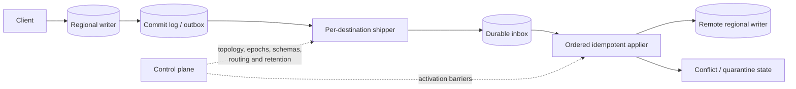

# Multi-Leader Replication

## TL;DR

Multi-leader replication lets more than one site commit writes without first obtaining permission from a single remote leader. That can keep a disconnected client productive and remove an inter-region round trip from the foreground path. It also creates independent histories that must later be combined. The design is therefore not “single-leader replication, twice”: its core product contract is what a local acknowledgement means while other writers are unreachable.

This chapter traces replication streams between writable sites through durable capture, topology, ordering, deduplication, causal sessions, bootstrap, rejoin, and regional operations. [Conflict Resolution](./04-conflict-resolution.md) owns merge algebra and CRDT mechanics. [Partitioning Strategies](./05-partitioning-strategies.md) owns key placement, while [Consensus Algorithms](./08-consensus-algorithms.md) covers systems that choose one ordered history instead of reconciling several.

## Workload and Consistency Contract

Start with operations, not a topology diagram. For each command class, specify:

- where it may be accepted and which local durability boundary precedes success;
- whether a client needs read-your-writes, monotonic reads, causal visibility, or merely eventual convergence after communication resumes;
- whether concurrent updates commute, can be presented as siblings, or must be serialized;
- whether invariants span one key, several keys, tenants, or external systems;
- the maximum tolerable replication lag, conflict age, and recovery point after losing a site.

A typical active-active contract says that a write acknowledged in region A survives an A process restart, is usable immediately in A, and will eventually be delivered at least once to every healthy destination. It does **not** say that a simultaneous read in B sees the write, that wall-clock timestamps identify the real last writer, or that two locally valid transactions preserve a global invariant.

The distinction matters for money and scarce resources. If A and B can each decrement the last inventory unit, no deterministic merge can make both promises true. Route that item to one authority, allocate regional escrow quotas, or coordinate the reservation. Multi-leader replication is appropriate only for the remaining state whose concurrent outcomes have an explicit meaning.

## Durable State and Invariants

Each committed mutation needs an immutable replication identity. A useful envelope contains:

```text
event_id              globally unique retry identity
origin_id, origin_epoch, origin_sequence
transaction_id, transaction_position
key and operation or after-image
causal_context        dependencies observed by the writer, when required
commit_time           diagnostic or tie-break input, not proof of causality
schema_version and resolver_version
tenant_id and data-classification metadata
```

Every destination durably tracks received events, applied events, per-origin contiguous sequence frontiers, gaps, and quarantined failures. The source tracks each destination’s acknowledged receive frontier so that it knows what log can be reclaimed. Tombstones and conflict metadata are data with their own retention rules, not temporary implementation details.

The following invariants make recovery reason-able:

1. An origin acknowledges only after the local mutation and its replication record share an atomic durable boundary.
2. A receiver acknowledges delivery only after the event is durable at that receiver.
3. Re-delivery has one logical effect. Deduplication covers both database changes and emitted side effects.
4. Events from an origin are applied in sequence, or an operation is explicitly proven safe under reordering. Transaction fragments become visible atomically when the contract promises that boundary.
5. Replicas that have received the same event set and use the same resolution version converge.
6. A progress frontier never advances across an unrecorded gap or a quarantined event.
7. Reclaimed history is older than every bootstrap, repair, and offline-replica requirement that can still legally return.

An `event_id` alone is not enough. If the deduplication marker commits and the data mutation does not, the event is lost; if the data commits and the marker does not, replay repeats it. They must be atomic, or the target operation must itself be conditional on a stored version.

## Architecture: Data Plane and Control Plane



The data plane commits, ships, receives, and applies mutations. The control plane owns the region set, origin epochs, replication routes, resolver and schema versions, tenant placement policy, and bootstrap or drain state. Separating them prevents a transient configuration view from rewriting history.

In a small full mesh, every origin sends directly to every other region. Delivery paths are short, but directed streams and credentials grow as `M(M-1)` for `M` regions. A hub or log fan-out reduces connections, yet the hub becomes a lag and availability dependency. Multi-hop topologies require immutable origin identity: a B-origin event forwarded by C must still be recognized as B’s event when it reaches A, or replication loops amplify it forever.

## Commit, Ship, and Apply Protocol

For a local transaction, the writer changes application state and appends one or more ordered replication records in the same database transaction or WAL boundary. It then acknowledges locally. A shipper reads from a durable cursor, batches records without crossing unsupported transaction boundaries, and sends them with the destination’s topology epoch.

The receiver writes the batch to an inbox before acknowledging it. An applier then:

1. verifies tenant, schema, origin epoch, and sequence;
2. rejects duplicates and holds later records behind sequence gaps;
3. evaluates causal predecessors if the data type requires them;
4. applies the mutation and deduplication marker atomically;
5. records any semantic conflict without skipping the frontier silently;
6. advances the contiguous applied frontier and emits only idempotent downstream work.

Transport is normally at-least-once. Exactly-once *effect* comes from stable identity and atomic conditional application, not from a message broker label. A poison event must move into visible quarantine while its origin frontier remains blocked or explicitly records a policy decision; merely incrementing the cursor creates permanent divergence.

### Causal sessions without global serialization

A client response can carry a session token such as `{A: 914, B: 207}`. On a later request, a region either waits until its applied frontiers dominate that token, forwards to a region that does, or returns a defined “causal state unavailable” response. This supplies read-your-writes and monotonic reads across region changes without imposing one total order on unrelated writes.

Hybrid logical clocks can provide stable ordering inputs and bound clock anomalies, but they do not prove that two events are causally related. Version vectors or explicit dependency tokens do. If vector size grows with thousands of devices, scope causal metadata to a document, use dotted versions, or accept a weaker session contract.

Merge policy belongs in [Conflict Resolution](./04-conflict-resolution.md). The replication layer’s responsibility is to retain enough context for that policy and to apply one version of it deterministically. Changing a resolver while old events are in flight requires versioned semantics or an offline convergence rewrite.

## Topology and Schema Evolution

Adding a writable region is a state machine, not a load-balancer edit:

```text
ABSENT -> SNAPSHOTTING(L) -> CATCHING_UP(>L) -> VALIDATING
       -> READ_ONLY -> WRITE_ENABLED
```

Take a consistent snapshot at source frontier `L`, restore it, then apply every event after `L`. Validate row or range digests and wait for a declared lag bound before serving reads. Enable writes only after every existing site understands the new origin epoch and has a return path for its events. Removing a region reverses the process: stop new routing, drain accepted writes to all required destinations, preserve its origin identity through the rejoin window, then retire credentials and history.

Schema changes use expand–migrate–contract. Readers and appliers first learn both encodings; producers then emit the new representation; old events and offline sites are drained or translated; only then may the old field disappear. Replication records keep an immutable schema identifier. The general compatibility rules live in [Data Encoding](../03-storage-engines/07-data-encoding.md), and large data backfills should follow the log-boundary discipline in [Change Data Capture](../13-data-pipelines/04-change-data-capture.md).

## Specialized Failure Traces

### Acknowledgement outruns durable capture

Region A updates a row, replies success, and intends to enqueue replication afterward. The process loses power between those actions. A recovers the row from its database, but no other region can ever learn the mutation. If A is then lost permanently, an acknowledged write disappears. A transactional outbox or shared WAL boundary closes this gap.

### A loop repeats an external side effect

A’s event reaches B, B republishes it as a new B event, and C forwards both versions back to A. Database LWW may hide the duplicates, while a trigger sends three emails. Preserve origin identity, deduplicate before apply, and derive side-effect idempotency keys from the original event, not the receiving site.

### Local uniqueness creates two winners

A and B both accept `username = "river"` for different user IDs. Each local unique index is valid. When streams cross, neither row can be inserted without violating the constraint, and choosing a row does not retract the already-issued account promise. Globally scarce names need one routing authority or a reservation protocol; “repair later” is a business compensation, not database consistency.

### A returning site resurrects deleted data

B was offline longer than tombstone retention. A deletion replicated among the remaining sites and its marker was reclaimed. B returns with the old live value, which now looks like a new missing record and spreads. Rejoin through a fresh snapshot after the allowed offline horizon; never let a stale replica self-declare current.

### Mixed schemas block a frontier

A deploys a required new field and emits version 9. B’s applier understands only version 8, quarantines event 501, but incorrectly advances through event 502. B now advertises progress while permanently missing state. Schema gates must precede producer rollout, and sequence frontiers must expose (not skip) the blocked record.

## Product Knob Map

Multi-leader systems fail on settings that each look like a local preference: which operations a stream carries, what identifies a row at the far end, whether a resume point survives a promotion, and which site is allowed to accept writes today. None of them are visible in an architecture diagram, and every one of them has been the root cause of a cross-region divergence review. Read the values from each writable site rather than from the deployment template, because topology changes are exactly when these drift.

| Product and scope | Knob | Invariant it enforces | Default and how it misleads |
| --- | --- | --- | --- |
| PostgreSQL publisher | publication `publish`, row filters, column lists | every site receives the operation set its resolver can handle | the documented default publishes all DML, and that default has changed across major versions, so assert the effective list per publication instead of remembering it. A row filter or column list has no effect on `TRUNCATE`: a publication that looks scoped to one tenant still emits table-wide truncation to a subscriber that was never designed to merge it. |
| PostgreSQL publisher and subscriber | `REPLICA IDENTITY` | an update or delete resolves to a specific row at the far end | the identity is the primary key by default, and a published table whose identity is `NOTHING`, `DEFAULT` without a primary key, or a dropped `USING INDEX` cannot replicate updates or deletes: those operations error on the publisher while inserts keep flowing, so the site silently diverges on exactly the mutations that matter. A non-`FULL` publisher identity requires an identity of the same or fewer columns on the subscriber; `FULL` avoids the error and makes far-end row lookup scan-heavy. |
| PostgreSQL subscriber | `origin` | a change cannot loop forever through a ring or mesh | default `any` replays changes regardless of where they were written, so an A-to-B-to-A pair forwards each other's rows in perpetuity; `none` accepts only changes with no recorded origin, which breaks the loop but also drops legitimate third-site changes that a mesh expects to arrive. Loop control is a per-subscription decision made once and then invisible. |
| PostgreSQL subscriber | `slot_name`, `create_slot`, `failover`, `synchronized_standby_slots` | the resume point survives a rename, and survives a promotion | `create_slot` defaults true and the slot name defaults to the subscription name; setting `slot_name` to `NONE` leaves no reservation, so recreation restarts from a chosen position or skips changes. `failover` defaults false, so after the publisher is promoted its logical slots do not exist on the new primary and downstream cannot resume: durability across failover needs the slot synced to standbys and the matching physical slot listed for the logical sender to wait on. |
| MySQL 8.4 every site | `gtid_mode`, `SOURCE_AUTO_POSITION=1` | a writer can be re-pointed after failover without anyone guessing file coordinates | auto-position needs GTIDs enabled at the source, and the documented migration steps every server through `OFF_PERMISSIVE` then `ON_PERMISSIVE` before `ON`. Assert `@@global.gtid_mode` per site: a fleet that half-completed that procedure produces transactions with and without identifiers, which is precisely the state in which re-pointing a writer loses or duplicates history. |
| MySQL 8.4 writable sites | `auto_increment_increment`, `auto_increment_offset` | two writable sites never mint the same surrogate key | increment ships at 1, the single-writer assumption. Staggering offsets per site works until a site is added, a backup is promoted, or a restored master resets its counter, and the ceiling is 65535; it also prevents only key collisions, never the logical double-entry that two accepted commands represent. Generating identifiers above the storage layer removes a coupling that has no upside. |
| MySQL 8.4 non-writable site | `super_read_only` | a site that must not accept writes cannot, including for privileged clients | default off. Setting it on also sets `read_only`, blocks clients holding `SUPER` (unlike plain `read_only`), and still exempts replication applier threads, which is the exact asymmetry a multi-leader topology wants: enforcement lives in the server rather than in routing that a scheduled job can bypass. |
| MySQL 8.4 source | `rpl_semi_sync_source_wait_point`, `_timeout` | an acknowledged write is visible at a peer before the client is told | `AFTER_SYNC` is the wait point that removes the window where the source has committed and applied but no peer holds the row; with the plugin enabled, a timeout (default 10000 ms) of too few replying replicas switches the source to asynchronous and keeps serving commits, so cross-region durability degrades while latency recovers. `Rpl_semi_sync_source_no_tx` counts the transactions that lost it. |
| MySQL 8.4 applier | `replica_parallel_workers`, `replica_preserve_commit_order` | cross-site apply is parallel without breaking the order a session token depends on | four workers by default, commit order preserved by default; throughput comes from parallelism while ordering holds, and the two shipped values reflect that. Disabling order preservation to drain a backlog destroys read-your-writes and monotonic reads for every region that trusts this site, and the failure surfaces as another region's bug report rather than an alert here. |
| MySQL 8.4 source | `binlog_format`, `binlog_row_image` | a downstream consumer can reconstruct both the before and after image | row format and full row images are the defaults, and `binlog_format` is deprecated but still session-settable in 8.4, so one tool's session can change what the next year of history contains. `MINIMAL` shrinks cross-region egress by logging a primary-key equivalent before image and only changed columns, which breaks any consumer needing the before image; `NOBLOB` omits blob columns when unchanged. |
| CouchDB replicator | `new_edits` on bulk writes, `_local/{id}` replication log | the target stores the revision decided elsewhere and can resume where it stopped | replication always sends `new_edits=false`, so the target records the supplied `_rev` instead of minting a new one; resume depends on that local document's session id and recorded sequences picking the latest common point. A pruned or restored database without its local log re-replicates from the beginning, which is correct behavior that looks like a stall. |

```bash
# PostgreSQL publisher: what each publication actually carries, and what can identify a row
psql "$PUB_DSN" -X -c "SELECT pubname, puballtables, pubinsert, pubupdate, pubdelete,
                              pubtruncate, pubviaroot FROM pg_publication ORDER BY 1;"
# replica identity per table: d default, p primary key, f full, n nothing
psql "$PUB_DSN" -X -c "SELECT relname, relreplident FROM pg_class
                       WHERE relkind = 'r' AND relreplident <> 'p' ORDER BY 1;"
psql "$PUB_DSN" -X -c "SELECT slot_name, slot_type, active, restart_lsn FROM pg_replication_slots;"
# subscriber: definition plus live state (columns move between versions, so select star)
psql "$SUB_DSN" -X -c '\drn+'
psql "$SUB_DSN" -X -c 'SELECT * FROM pg_stat_subscription;'

# MySQL 8.4, run on every writable site: identity, authority, ordering, and image shape
mysql -NBe "SELECT @@global.gtid_mode, @@global.auto_increment_increment,
                   @@global.auto_increment_offset, @@global.read_only,
                   @@global.super_read_only, @@global.binlog_format,
                   @@global.binlog_row_image, @@global.replica_parallel_workers,
                   @@global.replica_preserve_commit_order,
                   @@global.rpl_semi_sync_source_wait_point,
                   @@global.rpl_semi_sync_source_timeout\G"
mysql -NBe "SHOW GLOBAL STATUS LIKE 'Rpl_semi_sync%';"
mysql -e "SHOW REPLICA STATUS\G" | grep -Ei "Auto_Position|Source_Host|Running|Received|Executed|Last_Error"

# CouchDB: what is replicating now, and where it believes it stopped
curl -s "$COUCH/_scheduler/jobs" | jq '.jobs[] | {id, database, source, target, doc_failures}'
curl -s "$COUCH/$DB/_local/$REPLICATION_ID" | jq '{session_id, history: (.history | map(keys) )}'
```

## Capacity and Cost Model

Let global accepted mutation rate be `W` events/s, mean encoded event size `B`, writable regions `M`, retained-log time `T`, and mean apply CPU `c_apply` seconds/event. In a direct fan-out design:

```text
cross-region egress rate       ~= W * B * (M - 1)
replication-log bytes retained ~= W * B * T
balanced ingress per region    ~= W * B * (M - 1) / M
apply cores per region         >= W * (M - 1) / M * c_apply / target_utilization
```

Compression and batching reduce wire overhead but increase batch-loss retry size and head-of-line delay. Size for peak accepted rate plus replay, not just steady state. If incoming apply demand is `λ` and capacity is `μ`, a partition lasting `D` seconds creates roughly `λD` queued events; after healing, catch-up time is at least `λD / (μ-λ)`. When `μ <= λ`, the region never catches up.

Conflict exposure grows with both hot-key rate and visibility delay. For a key receiving writes as a Poisson process at rate `λ_k`, the chance another write arrives during replication window `Δ` is approximately `1 - e^(-λ_kΔ)`. This is an illustrative workload model, not a correctness bound; measure the actual per-key distribution because a few hot keys dominate.

Cost includes duplicated regional storage, egress, conflict retention, repair scans, and operator time. A design that saves 80 ms of write latency but doubles every byte across four destinations should make that exchange explicit.

## Security, Isolation, and Observability

Replication identities are privileged database writers. Use mutually authenticated, encrypted channels; short-lived credentials per direction; destination-side allow-lists for origins, tenants, schemas, and operations; and immutable audit records for topology or resolver changes. An applier must re-establish tenant and row-security context rather than bypass authorization because traffic is “internal.” Encrypt sensitive conflict payloads and bound who may inspect them.

Tenant placement and deletion policy travel with the event. A residency-restricted tenant must not enter a disallowed regional log, retry queue, backup, or quarantine store. Per-tenant rate and backlog quotas prevent one migration or hot tenant from consuming every apply worker; dedicated lanes are warranted when noisy-neighbor risk exceeds the efficiency of a shared stream.

The primary dashboard is a matrix of `origin -> destination`, showing durable-receive and applied frontiers, oldest unapplied age, bytes queued, gaps, retries, quarantine count, and event throughput. Add conflict counts by entity and resolver version, dedup hits, schema rejects, clock-offset diagnostics, and periodic key-range digests. End-to-end canary mutations reveal a stream that is connected but not applying.

Test histories, not just APIs: crash at every local-commit/outbox/inbox/apply boundary; duplicate, drop, delay, and reorder batches; partition one direction only; roll clocks; reuse a restored origin counter; hold a site offline past retention; mix schema and resolver versions; and inject a hot tenant. Property tests should assert convergence after delivering the same event set, replay idempotence, monotonic frontiers, and preservation of each declared business invariant.

## Incident Playbook

Multi-leader incidents rarely announce themselves as replication failures: they arrive as a customer whose accepted edit vanished, a reconciliation report that will not close, or a region whose dashboards are green because every metric it publishes is about itself. The route below assumes the topology is healthy and asks what each site can currently prove. Record the frontier coordinates before any remediation, because most fixes move state in one direction and destroy the only evidence of what was missing.

### An acknowledged write exists in only one region

Compare the origin's durable commit coordinate with that origin's durable-receive frontier at every destination: a gap that never drains for one site means the capture step, not the transport, is losing events, typically because acknowledgement and enqueue are two separate actions and the process died between them. Confirm before acting by taking a row or range digest of the affected window on the origin and matching it against each destination rather than trusting queue depth. Remediation is a targeted re-ship from the origin's own log or a bounded re-snapshot of the affected key range, applied under the normal resolver so provenance stays intact. Do not hand-copy rows from a query result, do not replay from application logs that lack version metadata, and do not silence it by widening the destination's conflict window. Verify by re-running the digest on the repaired window and by killing a canary write at each boundary until one path proves that acknowledgement cannot outrun durable capture.

### Conflicts jumped after a resolver or schema change

The count rises before any user complains, and the shape of the new conflicts is the diagnosis: same entities as before means the change did not take effect, while previously-stable entities appearing for the first time means in-flight events written under old semantics are being merged by new rules. Freeze the resolver version per merge decision rather than per process, drain or translate queued events, and only then retire the old encoding path. Compare convergence on a captured event set replayed at rest before touching production history. Do not rewrite stored versions to match the new policy in place, because a rewritten history cannot be re-merged correctly by any future resolver, and do not treat a rising conflict count as noise simply because the merge succeeds: a successful merge of two intent-bearing commands is still double-entry. Verify by replaying the frozen set under both resolver versions and confirming the diff is the intended semantic change and nothing else.

### One region's applied frontier is frozen while its stream looks connected

A connected-but-not-applying matrix cell has three causes with different owners: one direction of the partition is down so the return path is starved, a single unreadable event is blocking an ordered applier, or schema rejects parked the batch in quarantine. Test each direction independently, then read oldest-unapplied age next to quarantine count: age climbing with a flat quarantine points at ordering and head-of-line blocking, while age climbing in step with quarantine points at a contract the destination can no longer decode. Unblock by moving the offending event into a durable quarantine with its identity and failure reason, letting healthy events proceed behind it. Do not disable commit-order preservation to drain a backlog, which quietly voids every cross-region read-your-writes promise, and do not skip an event without recording it, since a skipped event is divergence that no later repair can distinguish from an unreplicated one. Verify by watching oldest-unapplied age fall with quarantine count held constant, and by reconciling one sampled entity end to end rather than counting applied events.

### A site rejoined after a long outage and its history no longer lines up

The replication log's resume point is older than the retained history at the peer, so there is nothing to replay from; this is the contract expiring rather than a failure of it. Re-onboard through the topology state machine: consistent snapshot at a fresh frontier, catch up past it, validate range digests, serve read-only, then re-enable writes once every existing site recognizes the origin epoch and has a return path. Keep the retired origin identity visible through the rejoin window so late events from the old incarnation are rejected with an explicit reason instead of merged. Do not resume from a stale or restored replication log, do not reuse the old origin identity for the rebuilt site, and do not accept writes on the "read-only" step because a local operator needs a fix now: that write has no path anywhere. Verify by comparing key-range digests at the frontier before enabling writes and confirming the drained queue is empty at the moment routing changes.

### Both sites accepted the same business command

Two regions each returned success for one reservation, transfer, or withdrawal, so the defect predates the page: either a single-writer lease per aggregate never existed, or the dedup horizon at each site is shorter than the worst-case replication delay and an idempotency key expired before its twin arrived. Decide ownership explicitly, then reconcile against the business invariant rather than choosing a survivor by timestamp; the losing region must record an explicit reversal event so both histories contain the same story. Where isolation is expected to be routine, move the decision to one authority per aggregate and make other sites forward rather than accept. Do not fix this with a wider auto-increment stagger or a bigger UUID space, which prevents key collisions while leaving two accepted intents intact, and do not let last-writer-wins arbitrate a quantity that must never be overwritten. Verify by reconciling counts against the invariant for the incident window in both regions and confirming each duplicate resolves to exactly one recorded reversal.

## Decision Framework

Use multi-leader replication when local or offline write acceptance is a product requirement, cross-site latency is material, and every concurrently writable command has a defensible reconciliation or ownership rule. Prefer [single-leader replication](./01-single-leader-replication.md) when writes can tolerate one authority and operational simplicity matters. Prefer consensus per partition when a single current value or cross-writer invariant must be decided synchronously. Prefer asynchronous replicas or CDC-fed views when only read locality is needed.

The decisive review question is: **what user-visible promise can two isolated sites both make, and how is that promise still true when their histories meet?** If the answer is “the timestamp winner,” the design is unfinished.

## References

- Terry, D. B., et al. [Managing Update Conflicts in Bayou, a Weakly Connected Replicated Storage System](https://doi.org/10.1145/224056.224070). SOSP, 1995.
- Petersen, K., et al. [Flexible Update Propagation for Weakly Consistent Replication](https://doi.org/10.1145/268998.266711). SOSP, 1997.
- Saito, Y., and Shapiro, M. [Optimistic Replication](https://doi.org/10.1145/1057977.1057980). ACM Computing Surveys, 2005.
- Apache CouchDB. [Replication Protocol](https://docs.couchdb.org/en/stable/replication/protocol.html).
- MySQL. [Group Replication](https://dev.mysql.com/doc/refman/8.4/en/group-replication.html).
- PostgreSQL. [Publication](https://www.postgresql.org/docs/current/logical-replication-publication.html).
- PostgreSQL. [CREATE SUBSCRIPTION](https://www.postgresql.org/docs/current/sql-createsubscription.html).
- MySQL. [Server System Variables](https://dev.mysql.com/doc/refman/8.4/en/server-system-variables.html), 8.4 Reference Manual.
- Amazon DynamoDB. [Global tables: multi-active, multi-Region replication](https://docs.aws.amazon.com/amazondynamodb/latest/developerguide/GlobalTables.html).

---

## Related Chapters

- [Conflict Resolution](04-conflict-resolution.md): the cost of the second leader arrives here, as a merge function you have to own
- [Change Data Capture](../13-data-pipelines/04-change-data-capture.md): most multi-leader systems are a change data capture pipeline with a write path attached
- [Multi-Region Architecture](../06-scaling/09-multi-region-architecture.md): the topology where this pattern is usually justified, and the latency budget that comes with it
- [Single-Leader Replication](01-single-leader-replication.md): the simpler contract to compare against once conflicts stop being rare
