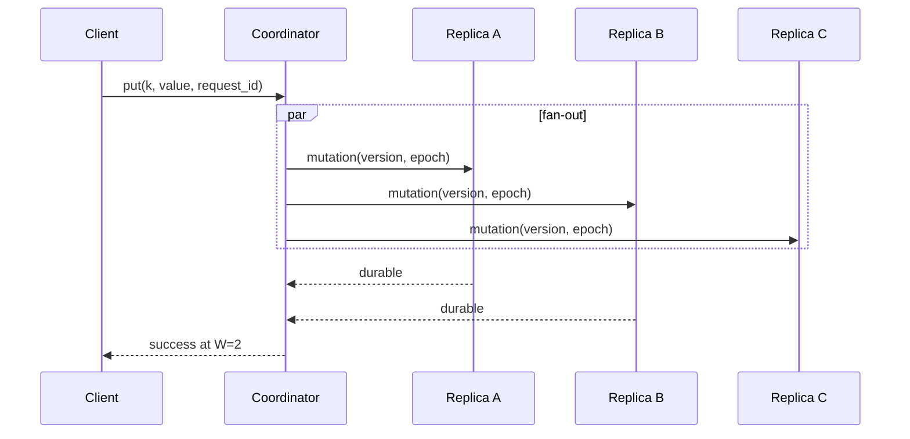

# Leaderless Replication

## TL;DR

Leaderless replication assigns each key to a replica set but lets any reachable node coordinate its reads and writes. There is no elected per-key primary in the foreground path. Availability comes from completing against a subset of replicas; the cost is that versions, repair debt, and topology changes become part of normal request processing.

A leaderless-replication design must specify quorum coordination, replica selection, hinted handoff, anti-entropy, and membership interaction. [Conflict Resolution](./04-conflict-resolution.md) owns the semantics of siblings, last-writer-wins registers, and CRDTs. [Partitioning Strategies](./05-partitioning-strategies.md) owns how logical partitions map to nodes, and [SSTables and Compaction](../03-storage-engines/03-sstables-compaction.md) owns on-disk tombstone collection. A system may use leaderless replication above any of those storage choices.

## Contract and Failure Model

For each operation, define a replication factor `N`, acknowledgement requirement `W`, read response requirement `R`, whether the coordinator may substitute non-home replicas, and the version relation used to reconcile responses. Also define the failure model: crash-stop or crash-recovery nodes, lossy and reordered messages, network partitions, bounded or unbounded clock skew, and whether disks can lose acknowledged writes.

An acknowledgement normally means that at least `W` selected replicas durably recorded a version. It does not mean every replica has it, that a later low-consistency read will find it, or that a timed-out attempt did not commit. Likewise, “eventual consistency” needs a liveness condition: after writes stop, communication recovers, topology stabilizes, and repair continues, every live home replica converges.

Classify invariants before choosing consistency levels. Immutable blobs and add-wins sets can tolerate reconciliation. Unique usernames, non-negative balances, and compare-and-set require a conditional authority or a linearizable protocol; `QUORUM` as a product label does not manufacture those semantics.

## Replica State and Invariants

A stored version needs more than `(key, value)`. Depending on the resolution model, it includes a logical tag or causal context, mutation identity, tombstone flag, schema version, origin, and expiry. Each node also keeps its topology epoch, natural replica ranges, durable hints, repair metadata, and bootstrap or decommission state.

The protocol should preserve these invariants:

1. A successful write is durable on at least the promised replica set under the request’s stated topology epoch.
2. Replaying a mutation has one logical effect; a retry identity is not confused with a version identity.
3. A read never compares versions using a relation that can disagree across coordinators.
4. Repair cannot replace a causally newer version with an older one.
5. A tombstone is removed only after no legal replica, hint, snapshot, or repair source can reintroduce the shadowed value.
6. Topology transitions do not let coordinators form incompatible replica sets without an explicit joint phase.
7. Per-tenant limits apply to foreground requests, hints, streaming, and repair, not just API traffic.

Wall-clock timestamps are convenient tags, but they depend on clocks for correctness when used as last-writer-wins authority. A stable tie-breaker makes the order total; it does not make it reflect real-time causality. See [Conflict Resolution](./04-conflict-resolution.md) for the distinction.

## Data Path: Write and Read Quorums

For key `k`, a coordinator reads the current topology epoch and computes an ordered preference list. The first `N` eligible nodes are the natural replicas. In a strict quorum write it sends the same immutable mutation to those nodes, waits for `W` durable acknowledgements, and returns the mutation identity and observed version context. Late acknowledgements are still recorded; a client timeout is an unknown outcome, not proof of failure.



A read queries enough natural replicas to obtain `R` acceptable responses. The coordinator compares their version metadata, returns the value or siblings required by the contract, and may repair stale replicas. Waiting only for the fastest `R` reduces latency but biases reads toward healthy, nearby replicas; that is useful only if the consistency promise accounts for it. Digest-first reads save response bytes but add another round trip when digests disagree.

### What `W + R > N` actually proves

If every successful write stores on `W` members and every read samples `R` members of the **same fixed set of `N` natural replicas**, then `W + R > N` guarantees that a read quorum intersects the replica set of every completed write. That set argument is valuable, but it is not by itself a proof of linearizability.

The reader must still identify the newest intersecting version correctly. Concurrent writes may be incomparable. Sloppy quorums may use different nodes. A write in progress may have reached fewer than `W` replicas: one read can observe it, while a later read misses it and returns an older version. The Attiya–Bar-Noy–Dolev atomic-register protocol closes this “new/old inversion” by assigning ordered tags and writing the selected value back to a quorum during reads. Most Dynamo-style eventually consistent stores choose lower read cost instead.

Two other quorum conditions serve different purposes. `W > N/2` forces successful write quorums to intersect, useful for detecting competing versions under an appropriate tag protocol. `R > N/2` makes read quorums intersect each other, but without read write-back it still does not fully order concurrent operations.

### Sloppy quorums and hints

During failure, a sloppy quorum may store a mutation on healthy nodes outside the natural set. The substitute keeps a durable hint saying which home replica should eventually receive it. This increases write availability, but the equation above no longer applies to natural replicas:

```text
home set for k:       {A, B, C}
partitioned write:    {C, D}       W=2, D holds a hint for A
partitioned read:     {A, B}       R=2
intersection:         empty, despite W + R > N
```

Hints are a short-outage optimization, not repair and not a second source of truth. They need byte and age limits, topology-aware delivery, checksums, and an explicit policy when the target is removed. Expiring a hint before another home replica receives its version reduces acknowledged durability.

## Repair and Convergence

Read repair compares only keys that clients happen to read. It improves hot-key convergence but leaves cold data untouched and can add writes to latency-sensitive reads. Apply repairs with the original version identity; issuing a new “repair timestamp” can make stale data defeat a legitimate concurrent write.

Active anti-entropy compares all owned ranges. Replicas take compatible snapshots or stable version views, exchange range summaries such as Merkle-tree hashes, descend only into mismatching subranges, and stream the missing versions. A Merkle tree reduces comparison traffic when replicas are mostly equal; building trees and streaming differences still consume disk, network, cache, and compaction capacity.

Deletion makes convergence proof-sensitive. A tombstone can disappear only after every relevant replica has either observed it or can no longer legally contribute an older value. A time-based grace period is a conservative proxy for that proof, so the maximum repair interval and maximum node outage must remain shorter than the grace period. A node returning after the supported horizon should bootstrap from a current replica rather than join with old data.

The repair controller owns range scheduling, concurrency, checkpoints, and fairness. It must distinguish “range compared successfully” from “job launched,” retain enough state to resume after crashes, and avoid synchronizing every replica pair at once. Repair traffic needs an I/O budget below the point where it causes the foreground timeouts that create yet more hints.

## Membership and Topology Changes

Coordinators cannot safely switch replica maps independently. A new node first joins as a non-serving learner, receives a snapshot at a declared frontier, streams later mutations, validates range digests, and only then enters a joint routing epoch. During the joint phase, writes reach enough members of old and new sets to preserve the stated durability contract. After old coordinators have stopped using the prior epoch, ownership can finalize.

Removing or replacing a node likewise drains hints, streams its ranges, and fences the old identity. Reusing a node ID with an empty disk is dangerous: peers may interpret it as the old replica that has already seen tombstones. Use a fresh incarnation epoch and require explicit bootstrap. Logical partition movement itself is covered in [Partitioning Strategies](./05-partitioning-strategies.md).

## Specialized Failure Traces

### Timeout followed by a non-idempotent retry

Two replicas durably store `increment(+1)`, but their acknowledgements arrive after the client deadline. The client retries with a new identity and two replicas apply another increment. Both attempts were valid; the counter is now two. Reuse an idempotency key, or replicate a convergent counter operation whose identity is deduplicated.

### Read observes an incomplete write, then time goes backward

Write `v2` reaches only A before its coordinator pauses. Read X queries A and B and returns `v2`. Read Y starts after X finishes but queries B and C, returning completed `v1`. `W=2, R=2, N=3` did not help because `v2` had not completed on W replicas. Atomic-register read-back, a leader, or consensus is required if this inversion violates the API.

### Repair resurrects a delete

A and B store tombstone `t9`; C is offline with value `v7`. The grace period expires, compaction drops `t9`, and C returns before being rebuilt. Anti-entropy sees a value on C and absence elsewhere, so `v7` becomes live again. The root cause is an unsupported outage beyond the repair-and-retention contract, not “eventual consistency being slow.”

### Topology split creates two quorums

Half the coordinators use epoch 41 with replicas `{A,B,C}`; the rest use epoch 42 with `{C,D,E}`. Each accepts `W=2` on disjoint pairs. Later reads cannot infer a unique latest value from quorum intersection. Membership must be versioned, and activation must bridge old and new replica sets.

### Clock skew silently loses a write

A’s clock is five minutes fast. Its earlier value receives timestamp 500; B’s causally later correction receives 220 and loses under LWW everywhere. NTP monitoring limits frequency but cannot prove order. Use causal versions, a logical sequencer, or a merge that does not interpret physical time as truth.

## Product Knob Map

Leaderless clusters fail on numbers that live in a configuration file rather than in the design document: how many ranges a node owns, how long a substitute may hold a write, how long a tombstone outlives the value it buries, and how much I/O recovery is allowed to take from foreground traffic. Two of those are per-table, several ship commented out so that a configuration diff shows nothing, and one is a bucket property that most deployments never open. Read them from every node in the ring, because one host restored from an old image carries a different answer from its neighbours and therefore a different definition of durability.

| Product and scope | Knob | Invariant it enforces | Default and how it misleads |
| --- | --- | --- | --- |
| Apache Cassandra, node | `num_tokens` | one failed node costs a bounded slice of the ring, so repair and bootstrap fit inside the outage window | 16 ships in the current reference configuration, but a node configured without the key falls back to legacy single-token behaviour and owns a contiguous span of the ring: capacity looks identical on a dashboard while one failure now streams a token range instead of a vnode, which is how a routine repair becomes an hours-long recovery. |
| Apache Cassandra, node | `hinted_handoff_enabled`, `max_hint_window` | an acknowledged write survives a short outage without waiting for scheduled repair | enabled, with a 3h window in the current shipped configuration; 4.x spells the same setting `max_hint_window_in_ms: 10800000`, so a configuration template carried across a major version can set nothing at all. Hints are not repair and not a second source of truth: once the window closes, no new hints are written for that host until it is seen alive and goes down again, so a node quietly unreachable for a week accumulates no hint debt and still returns missing data. |
| Apache Cassandra, table | `gc_grace_seconds` | a tombstone outlives every replica, hint, snapshot, or repair source that could still reintroduce the value it shadows | 864000 (ten days), set per table and almost never compared with the measured maximum repair interval and longest observed outage. Below that horizon it resurrects deleted rows; far above it, reads carry delete history for weeks and storage grows with no writes to explain it. |
| Apache Cassandra, node | `tombstone_warn_threshold`, `tombstone_failure_threshold` | a read that must scan excessive delete history fails loudly instead of occupying the thread pool | 1000 and 100000. The warn half only writes a log line nobody reads; the failure half aborts the query with an error that surfaces as a timeout or an overloaded cluster, so teams add hardware for what is a tombstone retention decision made years earlier. |
| Apache Cassandra, node | `concurrent_reads`, `concurrent_writes` | foreground capacity and recovery capacity stay separable on shared disks | 32 and 32, with the shipped comment recommending roughly eight times the core count as the rule of thumb. Those values were chosen for modest machines; on a large host they oversubscribe the same device that repair needs, and raising them during an incident converts latency into thrash without adding throughput. |
| Apache Cassandra, node | `compaction_throughput` | compaction keeps pace with writes without starving foreground I/O | 64MiB/s. The misleading part is that a healthy-looking rate says nothing about backlog: the signal is pending compaction tasks and their age, and a cap held too low leaves tombstones uncollected and read paths walking more tables, which then surfaces as read timeouts on an otherwise idle cluster. |
| Apache Cassandra, node | `phi_convict_threshold`, `dynamic_snitch_badness_threshold` | gossip suspicion tracks real failure, and routing switches only for a measured reason | the failure threshold ships commented out at 8, so a review that greps active keys finds no policy at all; the snitch badness threshold ships at 1.0, whose shipped comment explains that the example value 0.2 means a pinned host may be twenty percent worse before routing moves, so at 1.0 a remote replica is effectively pinned until it is twice as slow. |
| Apache Cassandra, request | consistency level `ANY`, `EACH_QUORUM` | the write path only admits acknowledgements the deployment can reason about | the level enum offers both. `ANY` can be satisfied by a hint alone, meaning a client was told success with no durable home replica holding the version; `EACH_QUORUM` demands a quorum per datastore location, so an unrelated distant region turns into failed writes. Neither appears in a capacity model, and both are one refactor away from being used. |
| Basho Riak, bucket | `allow_mult` | concurrent writes stay visible to the merge function that is supposed to reconcile them | `buckets.default.allow_mult` ships false, so an untyped bucket silently collapses siblings and returns one value as though a winner had been chosen. The cluster reports no conflicts, the application never sees a sibling, and reconciliation logic written for vector clocks never runs on exactly the workload that needs it. |
| Apache CouchDB, replicator | `new_edits=false`, `_local/{id}` log | the target stores the exact revision the source supplied, and a resume point survives a restart | the replicator always writes with `new_edits=false` so the replica accepts the supplied `_rev` rather than minting its own; progress lives in a `_local` document holding a session id and sequence history. A restored or pruned `_local` log resumes from the wrong sequence, and nothing in the scheduler reports that the two databases now disagree about where replication started. |

```bash
# Ring shape and agreement: token policy, schema version, silent restarts
nodetool status
nodetool describecluster
nodetool gossipinfo                # generation numbers expose hosts that restarted

# Backpressure and recovery debt on the node itself
nodetool tpstats             # Pending and Blocked on ReadCommand, MutationStage, HintedHandoff
nodetool compactionstats     # pending tasks matter more than throughput
nodetool netstats            # streaming and handoff in flight right now
nodetool failuredetector     # live phi per peer: read this before touching any threshold
nodetool tablestats app.orders     # read latency, pending compaction tasks, space per table
grep -i tombstone /var/log/cassandra/system.log | tail -20   # the coordinator names the key it scanned

# What each node believes, commented lines included (they are inherited defaults)
grep -nE "^[#[:space:]]*(num_tokens|hinted_handoff_enabled|max_hint_window(_in_ms)?|tombstone_(warn|failure)_threshold|concurrent_reads|concurrent_writes|compaction_throughput|phi_convict_threshold|dynamic_snitch_badness_threshold)" /etc/cassandra/cassandra.yaml

# Per-table delete policy, which is where gc_grace_seconds actually lives
cqlsh -e "DESCRIBE TABLE app.orders;"

# Riak: does this bucket retain siblings at all
curl -s "http://node:8098/buckets/orders/props" | grep -E "allow_mult|last_write_wins|n_val"

# CouchDB: where a continuous replication resumed, and what it is replaying from
curl -s "http://node:5984/_scheduler/jobs" | jq '.jobs[] | {id, database, doc_id}'
curl -s "http://node:5984/orders_replica/_local/orders-sync" | jq '{session_id, history}'
```

## Capacity, Overload, and Cost

Let logical writes and reads be `Qw` and `Qr` operations/s, value plus metadata size be `B`, replication factor be `N`, and a replica sustain `Cw` durable writes/s at the chosen compaction budget. Approximate foreground work is:

```text
replica write requests/s       ~= Qw * N          if fan-out targets all N
minimum write acknowledgements = Qw * W
read responses/s               >= Qr * R          plus speculative requests
stored live bytes              ~= logical_bytes * N * space_amplification
write network bytes/s          ~= Qw * N * B
```

Sending only until `W` acknowledgements reduces immediate work only if the remaining replicas are deliberately repaired later; it does not erase the replication obligation. Quorum latency is an order statistic of replica latencies, not simply their mean. Increasing `R` or `W` can improve confidence while moving the request deeper into the straggler tail.

For data size `D` per replica and maximum full-repair interval `Trepair`, baseline sequential repair scan must exceed `D / Trepair`, before mismatch streaming. A failed node absent for `Tout` at incoming mutation rate `λ` creates roughly `λTout` versions of catch-up debt. Reserve measured headroom for hints, bootstrap, and repair simultaneously; a cluster whose foreground load consumes all sustainable I/O has no recovery capacity.

Backpressure begins per destination and per tenant. Bound coordinator in-flight requests, hint bytes, repair streams, and mutation queues. Reject or degrade weak-consistency traffic before memory exhaustion. Do not lower `W` automatically during an incident unless the API explicitly allows a durability-mode change and records which writes received it.

## Security, Isolation, and Observability

Replica RPC is an authorization boundary. Use mutual authentication, encryption, topology-epoch validation, and per-node identities; a compromised coordinator must not write arbitrary tenant ranges. Repair and bootstrap paths need the same row-level policy and auditability as foreground writes because they bypass normal application authorization.

Include `tenant_id` in the authenticated key namespace, encrypt sensitive values and hints, and isolate keys where equality or size leaks matter. Fair schedulers should cap per-tenant request, hint, and repair debt. Deletion obligations include every replica, hint store, snapshot, and quarantine stream; tombstone retention cannot be shortened merely to meet a storage target.

Observe coordinator latency separately from replica latency. Core signals are successful acknowledgements by consistency level, timeout-with-late-success count, unavailable versus timed-out requests, stale-version and sibling rates, per-node version age, hint bytes and oldest age, repair coverage frontier, streamed mismatch bytes, tombstone age, topology-epoch rejects, speculative requests, disk saturation, and per-tenant queueing. Periodic digest comparisons and end-to-end canary keys detect silent divergence that request success rates miss.

Verification should model arbitrary message loss, duplication, reordering, coordinator crashes, and membership changes. Jepsen-style history checking can test the advertised register or set semantics. Deterministic simulations should pause a write after every acknowledgement subset, overlap reads, advance tombstone GC, restore old disks, exhaust hint storage, and restart repair. Assert not only convergence but also acknowledgement durability, no new/old inversion when linearizability is claimed, monotonic topology epochs, idempotent retries, and tenant isolation.

## Incident Playbook

These five entries start from what an operator sees, because leaderless failures announce themselves as latency, missing rows, or resurrected rows long before they look like replication. Each entry assumes the invariants in this chapter: a successful write is durable on the promised replica set under a stated topology epoch, a tombstone outlives every source that could reintroduce its value, and repair never replaces a causally newer version with an older one. Record the consistency level, the topology epoch, and the affected range for every step; without those three, the same symptoms recur in six weeks with no evidence trail.

### Reads time out on one table while writes are healthy

Check whether the failing reads are scanning delete history before you conclude the cluster is undersized: grep the coordinator logs for tombstone threshold messages, read `nodetool tablestats` for the affected table, and compare pending compaction tasks against the last time that table was compacted. A table with heavy deletes or TTL expiry and a stalled compaction path fails reads on an idle cluster, and the failure is a retention decision rather than a capacity one. Decide from the tombstone counts whether to reclaim deleted data on the affected tables or raise the compaction budget; if you change the read-failure threshold at all, treat it as a temporary valve with an owner and an expiry. Do not raise the failure threshold and close the incident, which hides unbounded scans until they take down a second table, do not major-compact every node at once on a cluster already shedding load, and do not shorten tombstone retention to reclaim space, because that is how deleted rows return. Verify by confirming p99 read latency falls for the sampled range while per-read tombstone counts drop, and by confirming pending compaction tasks return to their pre-incident baseline rather than merely draining once.

### A node came back from an outage longer than the hint window

Symptom is a replica that rejoins as `UN` yet answers reads with missing keys, or repair reports mismatches on every range it touches. Confirm the arithmetic first: downtime against the hint window, and hint backlog against the byte limit, remembering that a zero pending-hint metric means nothing was queued, not that the home replicas hold the data. The host is outside the supported recovery horizon, so decide to treat it as a rebuild rather than a repair: stream the authoritative ranges from a healthy replica under a fresh incarnation epoch, drain and discard its stale hints, keep it out of the serving set until its range digests match, and only then let coordinators route to it. Do not re-add the old identity with an empty or stale disk, since peers read that as a replica that already saw the tombstones, do not rely on read repair to converge cold ranges, and do not declare recovery complete because gossip reports `UN`: convergence is a digest comparison, not a membership flag. Verify by comparing range digests against a healthy replica for every owned range and by reading a set of canary keys written before the outage at a consistency level that forces the quorum, then confirming both agree with the source of truth.

### Deleted rows reappeared

A resurrection means a tombstone was collected while some replica, hint, snapshot, or backup could still contribute the shadowed value. Establish which: compare the tombstone age against the table's grace period, then list every source that has been replayed into the cluster in the last grace window (a restored node, a repair run from an old snapshot, a delayed hint delivery, a backup restore). Decide the corrected retention horizon from measured reality rather than convention: the grace period must exceed the longest interval in which any legal source can still deliver an older version, which includes the repair cadence and the worst observed outage. Re-delete the resurrected keys so fresh tombstones cover them, raise the per-table grace period above the new horizon, and schedule the repair runs that keep the horizon honest. Do not shorten a grace period to reclaim space or speed up reads, do not delete the data directory of the node that produced the resurrection as a substitute for fencing its identity, and do not assume a `DELETE` removed anything until every source has been accounted for. Verify by scanning the affected ranges for keys that should be absent and confirming they stay absent across a full repair cycle, with the resurrection event logged once per key rather than recurring.

### Quorum reads disagree after a topology change

Two coordinators return different answers for the same key minutes apart, usually while nodes are joining, leaving, or being replaced. Read the epoch each coordinator used and the preference list it computed: if the sets differ, `W + R > N` was never evaluating one fixed set of replicas, and a write acknowledged against the old map can be invisible to a read scheduled against the new one. Confirm whether sloppy-quorum substitutes still hold versions that the new home set lacks. Decide whether the transition is still inside its joint phase; if it is, keep both maps authoritative for writes rather than finalizing early, drain hints into the new owners, and repair the moved ranges before ownership is finalized. Do not lower `W` to make the transition succeed, which silently changes the durability contract for every write that used it, do not finalize or resume a decommission while mismatch counters are still moving, and do not paper over the divergence with monotonic-read settings that only order what a single coordinator happens to see. Verify by reading the affected keys from several coordinators at the intended consistency level until all agree, and by confirming the topology epoch is stable cluster-wide before routing resumes.

### A repair or bootstrap run degrades foreground latency

Foreground p99 rises while a range comparison, streaming operation, or bootstrap is running, and the temptation is to cancel recovery and buy back latency. Separate the two resource fights before choosing: check thread-pool blocked counts for the foreground stages, then compaction and streaming throughput, then per-tenant queueing, because repair degrades latency either by occupying I/O or by occupying the same request threads. Decide that recovery capacity is reserved capacity: lower the stream throughput, reduce concurrent repair ranges, and let the run proceed range by range so it can be paused at a range boundary with recorded progress instead of restarted from the beginning. Do not kill a running cluster-wide operation and immediately launch another, which doubles the debt you were trying to drain, do not disable the background job that is causing pain without scheduling it somewhere else, and do not run full repairs across every node simultaneously in an attempt to finish before peak traffic. Verify by comparing coordinator-side and replica-side latency histograms before, during, and after the run, confirming blocked counts return to zero, and confirming the repair coverage frontier advanced rather than reset.

## Decision Framework

Leaderless replication fits high-availability key-value workloads where any node may coordinate, per-request consistency is useful, and repair capacity is a first-class subsystem. It is strongest when mutations are naturally idempotent or mergeable and the working set partitions evenly.

Choose [single-leader replication](./01-single-leader-replication.md) or a consensus-backed register when real-time order, conditional updates, or non-mergeable invariants dominate. Choose [multi-leader replication](./02-multi-leader-replication.md) when writable sites have explicit regional identity and asynchronous cross-site streams are the central concern. Whatever the choice, state the consistency contract in histories a client can observe, not in `ONE`, `QUORUM`, or `ALL` labels alone.

## References

- DeCandia, G., et al. [Dynamo: Amazon’s Highly Available Key-value Store](https://www.allthingsdistributed.com/files/amazon-dynamo-sosp2007.pdf). SOSP, 2007.
- Attiya, H., Bar-Noy, A., and Dolev, D. [Sharing Memory Robustly in Message-Passing Systems](https://doi.org/10.1145/200836.200869). Journal of the ACM, 1995.
- Lakshman, A., and Malik, P. [Cassandra: A Decentralized Structured Storage System](https://www.cs.cornell.edu/projects/ladis2009/papers/lakshman-ladis2009.pdf). LADIS, 2009.
- Apache Cassandra. [Dynamo](https://cassandra.apache.org/doc/latest/cassandra/architecture/dynamo.html) and [Repair](https://cassandra.apache.org/doc/latest/cassandra/managing/operating/repair.html) architecture documentation.
- Basho Technologies. [Riak KV Concepts: Vector Clocks](https://riak.com/posts/technical/vector-clocks-revisited/index.html).
- Apache Cassandra. [cassandra.yaml reference configuration](https://github.com/apache/cassandra/blob/trunk/conf/cassandra.yaml).

---

## Related Chapters

- [Dynamo](../09-whitepapers/02-dynamo.md): the design that removed the leader and inherited the conflict problem with it
- [Conflict Resolution](04-conflict-resolution.md): what a quorum read actually returns once two replicas disagree about a value
- [CAP Theorem](../01-foundations/03-cap-theorem.md): sloppy quorums and read repair are a consistency choice made one operation at a time
- [Partitioning Strategies](05-partitioning-strategies.md): consistent hashing, which is where the replica set for a key comes from in the first place
