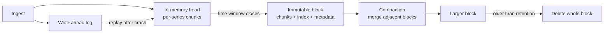

# Time-Series Storage Engines

## TL;DR

A time-series engine stores samples as `(series identity, timestamp, value)` and wins by exploiting three regularities a general-purpose engine cannot assume: samples for one series arrive in time order, adjacent samples are nearly identical, and almost every query reads a recent time range for a small set of series. Those regularities allow an append-only write path, compression measured in bits per sample instead of bytes, and deletion by dropping whole time-partitioned blocks.

The cost is that the engine is only cheap while those regularities hold. **Series cardinality**, not sample rate, is the resource that runs out first: every distinct label combination is a separate series with its own in-memory head, index entries, and compression state. Late and out-of-order samples, long-range queries over raw data, and per-entity labels each break one of the assumptions, and each has to be either bounded or priced. [Metrics Systems and Monitoring](../11-observability/02-metrics-monitoring.md) owns instrument semantics and aggregation rules; [Monarch](../09-whitepapers/12-monarch.md) analyzes one planet-scale design. What follows is the storage engine underneath.

## Primary Evidence and Scope

| Source | What it establishes | Boundary |
|---|---|---|
| Pelkonen et al., Gorilla (VLDB 2015) | Delta-of-delta timestamps and XOR-compressed floats reach about 1.37 bytes per sample on Facebook's monitoring data; recent data is served from memory | Compression ratio is a property of that workload's regular intervals and slowly changing values |
| Prometheus TSDB format documentation | Head block with write-ahead log, immutable time-partitioned blocks, per-block inverted index, tombstones, compaction | One open-source engine; defaults are that project's choices |
| InfluxDB storage engine documentation | Write-ahead log, in-memory cache, and columnar TSM files with a separate series index | One engine's layout, cited for contrast |
| Adams et al., Monarch (VLDB 2020) | A regionalized in-memory design with query pushdown and hierarchical evaluation | A system built for a specific availability requirement |

Numbers in the capacity section are illustrative inputs, labeled as such.

## Workload and Contract

A time-series workload differs from general OLTP in ways the engine is allowed to depend on:

- **Writes dominate and are appends.** Most series receive a sample at a fixed interval; updates to old samples are rare or forbidden.
- **Reads are range scans by time**, usually over the most recent hours, filtered by label predicates and reduced by an aggregation.
- **Value is time-decayed.** Second-level resolution matters for an hour, minute-level for a month, and trends for a year.
- **Deletion is by age**, almost never by key.

State the contract before choosing an engine:

| Field | Question |
|---|---|
| Sample model | Float gauge or counter, histogram, event with payload? |
| Timestamp authority | Assigned by the source, the collector, or the store? |
| Ordering | Are late or out-of-order samples accepted, and within what window? |
| Durability | Is a sample acknowledged before or after it is durable? How much may a crash lose? |
| Cardinality bound | Maximum active series per tenant and per metric name? |
| Query bound | Maximum series and samples one query may touch? |
| Retention | Raw and downsampled lifetimes, and whether deletion must be provable |

An engine that leaves the cardinality and query bounds implicit will have them set by whichever user first attaches a request identifier as a label.

## Series Identity and Cardinality

A series is identified by a metric name plus a set of label pairs. The engine maps that identity to a compact series reference and stores samples against the reference. Two consequences follow.

First, cardinality multiplies. A metric with labels `method` (10 values), `status` (8), `instance` (500), and `route` (200) can produce up to 8 million series, and the engine pays per series for an in-memory buffer, a compression state, and entries in every label's posting list, whether or not the series is ever queried.

Second, **churn** is as expensive as cardinality. When instances are replaced on every deploy, each replacement creates a new series for every metric the instance exposes. The count of series active right now may be stable while the count of series that existed during the retention period grows without bound, and the index must cover the second number.

Bound both. Enforce per-tenant and per-metric active-series limits at ingestion, reject or relabel unbounded dimensions (user, request, session, raw URL path), and track series created per hour as a first-class signal. Per-entity analysis belongs in an event store, a trace system, or an [analytical query engine](../13-data-pipelines/03-analytical-query-engines.md), where high-cardinality columns are scanned rather than indexed as identities.

## Write Path: Head, Log, and Blocks

The common design is a specialization of the log-structured approach in [LSM Trees](./02-lsm-trees.md), partitioned by time instead of by key range.



**Documented, Prometheus TSDB:** incoming samples are appended to a write-ahead log and to an in-memory head, where each series accumulates compressed chunks. Periodically the head's older data is written out as an immutable block covering a fixed time range. A block is a directory holding chunk files, an index, tombstones, and metadata. Compaction later merges adjacent blocks into larger ones.

The design choices that matter:

- **Acknowledgement point.** Acknowledging after the log append but before a sync trades a bounded window of loss for throughput. Monitoring data usually accepts this; billing or audit series usually cannot. See [Write-Ahead Logging](./04-write-ahead-logging.md) for the sync semantics.
- **Head memory.** The head holds every active series, so memory scales with active series, not with sample rate. This is the mechanical reason cardinality is the binding resource.
- **Block immutability.** Persisted blocks are never modified in place. Deletes are recorded as tombstones and applied at compaction. Immutable blocks are trivially cacheable, safe to upload to [object storage](./08-object-storage.md), and deletable in one operation.
- **Restart cost.** After a crash the log is replayed to rebuild the head. Replay time grows with the log length, so checkpointing or snapshotting the head bounds recovery time.

## Compression: Timestamps and Values

**Documented, Gorilla:** the paper compresses the two columns of a series separately.

Timestamps use **delta-of-delta** encoding. If samples arrive every 60 seconds, the deltas are 60, 60, 60 and the second-order deltas are 0, 0, 0. A zero is written as a single bit; small deviations use short variable-length codes. On the paper's data about 96% of timestamps compressed to one bit.

Values use **XOR** against the previous value. Identical consecutive values XOR to zero and cost one bit. When values differ, the XOR typically has long runs of leading and trailing zeros, and only the meaningful middle bits are stored along with their position. About half of the values in the paper's data were identical to their predecessor.

The paper reports an average of 1.37 bytes per sample against 16 bytes uncompressed. Treat that as a workload measurement, not a constant:

- Irregular intervals (event-driven samples, jittered collection) defeat delta-of-delta.
- High-entropy floats (measurements with noise in the low bits) defeat XOR. Rounding to a meaningful precision before storage restores most of the ratio.
- Counters that increase by varying amounts compress worse than gauges that sit still.
- Integer and string series need different codecs (delta, run-length, dictionary), which is why columnar engines choose an encoding per column type. See [Column-Oriented Storage](./06-column-storage.md).

Compression is stateful per series: decoding a sample requires decoding the chunk from its start. Chunks are therefore kept small enough that a point lookup does not decompress hours of data, which sets a floor on per-chunk overhead.

## Index: From Label Predicates to Series

A query such as `http_requests{service="checkout", status=~"5.."}` must first become a set of series references. The standard structure is an inverted index: for every label name and value, a sorted **posting list** of the series that carry it. Equality matchers intersect posting lists; regular-expression matchers enumerate the matching values of a label and union their lists first. This is the same structure as a text index, described in [Search Index Architecture and Internals](../14-search-systems/01-inverted-indexes.md), with labels as terms and series as documents.

Two properties keep it cheap:

1. **The index is per block.** A query for the last hour consults only the blocks overlapping that hour, so index cost follows the queried time range rather than total retention.
2. **Posting lists are sorted by series reference**, so intersections are linear merges.

The index is also where cardinality and churn are paid. A regular expression over a label with a million values enumerates a million entries before reading one sample, and a label whose values are unique per series makes its posting lists as large as the series table itself.

## Query Execution

A range query proceeds in four steps: select blocks by time, resolve matchers to series through each block's index, decode the relevant chunks, and evaluate the aggregation. The cost drivers are the number of series selected and the number of samples decoded, so engines expose both as limits.

Three techniques control cost at scale:

- **Pushdown.** Evaluate filters and partial aggregation where the data lives and ship only reduced results. Monarch pushes query evaluation down to the zones holding the data for this reason.
- **Step alignment and caching.** Dashboards issue the same query repeatedly with a sliding window. Aligning the evaluation step to fixed boundaries lets results for completed time ranges be cached and only the newest slice recomputed.
- **Precomputation.** A query evaluated on every dashboard load over thousands of series is cheaper as a recording rule that writes one aggregated series at ingestion time.

## Out-of-Order and Late Samples

The append-only head assumes each series' samples arrive in increasing timestamp order. Real pipelines violate this: agents buffer through network partitions, clocks disagree, and backfills arrive days late. An engine has three choices, and should state which one it makes:

1. **Reject** samples older than the newest sample of the series. Simple and cheap, but a buffered agent loses its backlog on reconnect.
2. **Accept within a bounded window** by keeping a second, unsorted in-memory structure that is merged at compaction. The window bounds the extra memory and the query-time merge.
3. **Accept anything** through a separate backfill path that writes complete blocks offline and adds them to the store.

The same question applies to duplicates. If two collectors scrape the same target for availability, the store either deduplicates by an explicit replica label or stores both and lets queries choose. Decide this at design time; discovering it during an outage produces doubled rates.

## Retention, Downsampling, and Tiering

Time partitioning makes retention an O(1) operation: delete the blocks older than the horizon. No per-key tombstones and no compaction debt are created, which is the largest operational advantage over storing time series in a general key-value engine.

Downsampling replaces raw samples with coarser aggregates to keep long ranges queryable. It is lossy in specific ways:

- Keep `min`, `max`, `sum`, and `count` per window, not only the average. An average of averages is wrong unless weighted by count, and a one-second spike vanishes from a five-minute mean.
- **Quantiles cannot be downsampled.** The average of per-minute p99 values is not the hourly p99. Store mergeable histograms or [probabilistic sketches](./10-probabilistic-sketches.md) and compute quantiles after merging.
- Counter resets must be handled before aggregation, or a restart looks like a large negative rate.

Tiering moves older blocks to object storage and keeps only indexes or caches local. Queries over the cold tier pay object-store latency per chunk range, so the planner should refuse or downsample unbounded raw queries over months.

## Capacity Model

All inputs below are illustrative.

Assume 2 million active series scraped every 15 seconds, 30 days of raw retention, 1.5 bytes per sample after compression, and 20% series churn per day.

```text
samples/s        = 2,000,000 / 15                 = 133,333
samples/day      = 133,333 x 86,400               = 11.52 billion
raw bytes/day    = 11.52e9 x 16 bytes             = 184 GB   (uncompressed)
stored bytes/day = 11.52e9 x 1.5 bytes            = 17.3 GB
30-day chunks    = 17.3 GB x 30                   = 518 GB   (before index and replication)
series in 30 d   = 2,000,000 x (1 + 0.20 x 30)    = 14 million distinct series
```

Three observations follow. Chunk storage is modest and almost linear in sample rate. Head memory is linear in active series: if the engine needs a few kilobytes per active series, two million series require several gigabytes before any query runs, so measure the per-series figure for the deployed version instead of assuming one. And the index covers 14 million series, seven times the active count, purely because of churn. Halving churn saves more index than halving the scrape rate saves in chunks.

## Failure Traces

### Cardinality explosion from one deploy

1. A service adds `customer_id` as a label on a request counter.
2. Each instance now exposes one series per customer per route per status.
3. Active series rise from 2 million to 40 million within one scrape interval.
4. Head memory grows until the process is killed; on restart, log replay rebuilds the same head and it is killed again.

The recovery requires dropping the offending series from the log or blocking them at ingestion before replay. Per-metric series limits enforced at the door turn this from an outage into a rejected write with a named culprit.

### A long-range query starves ingestion

A dashboard requests 90 days of raw data across 50,000 series. The engine decodes billions of samples, the page cache is evicted, and ingestion latency rises until samples are dropped. Enforce per-query sample limits, route long ranges to downsampled data, and isolate query and ingestion resources.

### Backlog rejected after a partition

An agent buffers 40 minutes of samples during a network partition and replays them on reconnect. The store accepts only in-order samples, so every buffered sample older than what a second collector already wrote is rejected. The graph shows a gap that the agent's own logs say it delivered. Either configure a bounded out-of-order window or make the rejection visible as a counted, alertable event.

### Downsampled quantiles drift

A latency SLO is computed from five-minute averages of per-instance p99 values. Each layer of averaging pulls the result toward the median, the SLO reports success, and users report slowness. Recompute from merged histograms; treat any stored quantile as display-only.

## Operations and Verification

Watch active series and series created per hour by tenant and metric, head memory per series, log replay duration, samples rejected by reason (out-of-order, limit, duplicate), compaction backlog, block count, and query samples and series touched at the tail.

Verify with tests that match the failure traces: a churn test that replaces every source and checks index growth; a crash during block write followed by replay; a backfill that overlaps existing blocks; a query at the configured limits; and a retention run that proves expired blocks are gone from every replica and tier.

## Decision Framework

| Situation | Choice | Reason |
|---|---|---|
| Bounded label sets, regular intervals, recent-range queries | Purpose-built time-series engine | Bit-level compression and block-drop retention apply directly |
| Per-entity or per-request dimensions | Columnar analytical store or event store | Cardinality is unbounded by design; scan instead of indexing identities |
| Time-ordered rows with relational joins and updates | Time-partitioned tables in a relational engine | Keeps transactions and SQL; gives up most of the compression |
| Late data is normal (mobile, IoT, intermittent links) | Engine with an explicit out-of-order window or batch backfill path | In-order-only ingestion silently drops the backlog |
| Multi-year retention with trend queries | Downsampling plus object-storage tiering | Raw retention cost is linear in time; trend queries do not need raw samples |
| Latency or size distributions | Histograms or sketches as the stored type | Quantiles are not mergeable; distributions are |

Before committing, answer four questions: what bounds active series and churn, what one query is allowed to touch, what happens to a sample that arrives late, and which aggregates survive downsampling.

## References

- [Pelkonen et al., *Gorilla: A Fast, Scalable, In-Memory Time Series Database* (VLDB 2015)](https://www.vldb.org/pvldb/vol8/p1816-teller.pdf)
- [Prometheus, *TSDB format* documentation](https://github.com/prometheus/prometheus/blob/main/tsdb/docs/format/README.md)
- [InfluxData, *In-memory indexing and the Time-Structured Merge Tree (TSM)*](https://docs.influxdata.com/influxdb/v1/concepts/storage_engine/)
- [Adams et al., *Monarch: Google's Planet-Scale In-Memory Time Series Database* (VLDB 2020)](https://www.vldb.org/pvldb/vol13/p3181-adams.pdf)
- [Jensen, Pedersen, and Thomsen, *Time Series Management Systems: A Survey* (2017)](https://arxiv.org/abs/1710.01077)

---

## Related Chapters

- [Monarch](../09-whitepapers/12-monarch.md): one complete design built on these mechanisms, with its availability argument
- [Metrics Systems and Monitoring](../11-observability/02-metrics-monitoring.md): the instrument and aggregation semantics this engine stores
- [LSM Trees](./02-lsm-trees.md): the log-structured parent design that time partitioning specializes
- [Column-Oriented Storage](./06-column-storage.md): per-column encodings for the cases float XOR compression does not fit
- [Probabilistic Sketches](./10-probabilistic-sketches.md): the mergeable summaries that survive downsampling when quantiles do not
- [Analytical Query Engines](../13-data-pipelines/03-analytical-query-engines.md): where high-cardinality per-entity analysis belongs instead
