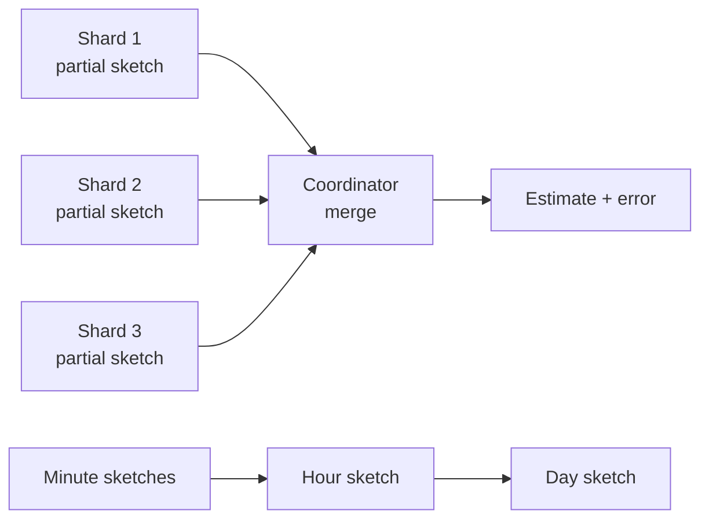

# Probabilistic Sketches

## TL;DR

A sketch is a fixed-size summary of a stream that answers one question (how many distinct items, how often did this item appear, what is the 99th percentile) with a stated error instead of an exact answer. It exists because the exact answer needs memory proportional to the data, and the data arrives on many machines at once. HyperLogLog counts a billion distinct values in about 12 kilobytes; a Count-Min sketch bounds frequency error with a few thousand counters; a quantile sketch reports tail latency from a few hundred buckets.

The property that makes sketches a system design tool, and not only an algorithmic one, is **mergeability**: two sketches built independently combine into the sketch of the union, in any order. That is what lets a query fan out across shards, roll up minutes into days, and survive a retried partial aggregate without double counting. Choosing a sketch is therefore choosing three things at once: the question, the error definition (absolute, relative, or rank), and the merge behavior. Getting the error definition wrong is the common failure, because a sketch with 1% rank error is accurate at the median and useless at p99.9. [Bloom Filters](./05-bloom-filters.md) covers set membership; the families below cover counting, frequency, and distribution.

## Primary Evidence and Scope

| Source | What it establishes | Boundary |
|---|---|---|
| Flajolet, Fusy, Gandouet, and Meunier (2007) | HyperLogLog estimates cardinality with standard error about 1.04/sqrt(m) using m small registers | Assumes a hash that behaves uniformly; raw estimator is biased at small cardinalities |
| Heule, Nunkesser, and Hall (EDBT 2013) | HyperLogLog++: 64-bit hashing, sparse representation, and empirical bias correction as deployed at Google | Engineering refinements, same asymptotic error |
| Cormode and Muthukrishnan (2005) | Count-Min: overestimate bounded by epsilon times stream length with probability 1 - delta | Error is absolute in the total count, so rare items are poorly estimated |
| Metwally, Agrawal, and El Abbadi (2005) | Space-Saving finds frequent items with k counters and error at most N/k | Guarantees are about items above a frequency threshold |
| Karnin, Lang, and Liberty (2016) | KLL: space-optimal quantile sketch with a rank-error guarantee | Rank error, not value error |
| Masson, Rim, and Lee (VLDB 2019) | DDSketch: quantiles with a relative value-error guarantee and exact mergeability | Bucket count grows with the ratio between largest and smallest value |
| Dunning (2019) | t-digest: adaptive clusters, small near the tails | Accuracy is empirical; no worst-case bound of the same kind |

## When Approximation Is the Right Contract

Exact answers have exact costs. Counting distinct 64-bit identifiers exactly means holding every identifier seen: 100 million of them occupy 800 megabytes before any hash-table overhead, and two shards cannot combine their counts without exchanging the identifiers, because the same user may appear on both. An exact percentile needs every observation, sorted.

Approximation is appropriate when all of the following hold:

1. The consumer acts the same way for any answer inside the error band (a dashboard, a capacity trend, a top-k list, a query planner's row estimate).
2. The error is stated to the consumer, not hidden.
3. The quantity is not money, entitlement, or an audit count. Billing a customer on an estimated count converts sketch error into a dispute.

Query planners are the oldest production users: distinct-value estimates drive join ordering in an [analytical query engine](../13-data-pipelines/03-analytical-query-engines.md), where a 2% error is irrelevant and an exact count would cost more than the query.

## Mergeability Is the System Property

A sketch type is mergeable when `merge(sketch(A), sketch(B)) = sketch(A + B)` with the same error guarantee, and the merge is associative and commutative. This single property decides where the sketch can live:



- **Scatter-gather queries** compute a sketch per shard and merge at the coordinator, moving kilobytes instead of raw values.
- **Rollups** store one sketch per time window and merge windows at query time, so a 30-day unique count is a merge of 30 daily sketches rather than a rescan.
- **Idempotent recovery** follows for sketches whose merge is a per-register maximum: merging the same partial twice changes nothing. Counter-based sketches do not have this property, and a retried partial is counted twice unless the pipeline deduplicates it. See [Delivery Guarantees and Effect Boundaries](../05-messaging/04-delivery-guarantees.md).

The corollary is what cannot be merged. Stored quantile values (a column of p99 numbers) are not mergeable, and neither are stored distinct counts. Persist the sketch as the column type and compute the scalar at read time.

## Cardinality: HyperLogLog

HyperLogLog hashes each item, uses the first `p` bits of the hash to choose one of `m = 2^p` registers, and stores in that register the largest number of leading zeros seen in the remaining bits. A long run of leading zeros is rare, so the register values indicate how many distinct hashes have been observed; a harmonic mean across registers gives the estimate.

**Documented:** the standard error is approximately `1.04 / sqrt(m)`.

| Precision p | Registers m | Approximate size | Standard error |
|---|---|---|---|
| 11 | 2,048 | 1.5 KB | 2.3% |
| 12 | 4,096 | 3 KB | 1.6% |
| 14 | 16,384 | 12 KB | 0.81% |
| 16 | 65,536 | 48 KB | 0.41% |

Sizes assume six bits per register. Redis documents its implementation at 12 kilobytes per key with a 0.81% standard error, which is the `p = 14` row.

Properties that shape a design:

- **Duplicates are free.** Adding the same item again cannot raise any register, so at-least-once ingestion does not inflate the count.
- **Merge is a register-wise maximum**, provided both sketches use the same precision and hash function.
- **No deletion.** A register remembers a maximum; removing an item cannot be expressed. Sliding windows are built by keeping one sketch per sub-window and merging the live ones.
- **Small cardinalities need correction.** The raw estimator is biased when few registers are set. HyperLogLog++ uses a sparse exact-like representation and an empirical bias correction in that range.
- **Standard error is not a bound.** About one estimate in three falls outside one standard error and one in twenty outside two. Quote the interval that matches the decision.

## Frequency: Count-Min and Heavy Hitters

A Count-Min sketch is a `d` by `w` array of counters with one hash function per row. To add an item, increment one counter in each row; to estimate its frequency, take the minimum of its `d` counters. Collisions can only add, so the estimate never undercounts.

**Documented:** with `w = ceil(e / epsilon)` and `d = ceil(ln(1 / delta))`, the estimate exceeds the true count by at most `epsilon x N` with probability at least `1 - delta`, where `N` is the total of all counts added.

For `epsilon = 0.001` and `delta = 0.01`, that is `w = 2,719` and `d = 5`: 13,595 counters regardless of how many distinct items exist.

The error term is the important part. It is proportional to the whole stream, not to the item. In a stream of one billion events, the bound above is one million, which is excellent for an item seen 200 million times and meaningless for an item seen 50 times. Count-Min is a tool for frequent items in skewed data.

For the direct question "which items are frequent", counter-based algorithms are usually better. **Space-Saving** keeps `k` counters; when a new item arrives and all counters are taken, it replaces the smallest and inherits its count. Any item with true frequency above `N / k` is guaranteed to be present, and each reported count overestimates by at most `N / k`. This is the mechanism behind hot-key detection in caches and partitioned stores, where the output feeds the mitigation described in [Cache Stampede, Cold Start, and Warming](../04-caching/04-cache-stampede.md).

## Quantiles: Rank Error Versus Relative Error

Quantile sketches differ in what they promise, and the difference decides whether tail percentiles mean anything.

A **rank-error** sketch such as KLL guarantees that the value returned for quantile `q` has true rank within `q +/- epsilon`. With `epsilon = 1%`, a request for p50 returns something between p49 and p51, which is tight. A request for p99.9 returns something between p98.9 and p100, and in a long-tailed latency distribution those may differ by an order of magnitude.

A **relative-error** sketch such as DDSketch guarantees that the returned value is within a factor `1 +/- alpha` of the true quantile value. It achieves this with buckets whose boundaries grow geometrically by `gamma = (1 + alpha) / (1 - alpha)`, so every value in a bucket is within `alpha` of the bucket's representative.

**Reference design, illustrative sizing:** for `alpha = 1%`, `gamma` is about 1.0202. Covering one millisecond to one hour is a ratio of 3.6 million, which needs `ln(3,600,000) / ln(1.0202)`, about 755 buckets. Merging two such sketches is adding counts bucket by bucket, which is exact.

The same geometric-bucket idea underlies exponential histograms in metrics systems. Fixed-boundary histograms are also mergeable, but their accuracy depends on someone having chosen boundaries near the values that later mattered. t-digest takes a third route: clusters of adaptive size that are kept small near the extremes, which gives good tail accuracy in practice without a worst-case bound of the same form.

Three rules follow:

1. Choose relative error for latency, size, and any quantity whose tail you alert on.
2. Never average stored quantiles across hosts or time windows. Merge the sketches, then read the quantile. The storage consequence is covered in [Time-Series Storage Engines](./09-time-series-storage.md).
3. Record the sketch type and parameters with the data. Two sketches with different `alpha` or different bucket schemes are not safely mergeable.

## Set Operations and Their Error

Unions are native to cardinality sketches. Intersections are not. Estimating `|A and B|` by inclusion-exclusion, `|A| + |B| - |A or B|`, subtracts large estimated numbers: if each set holds 10 million items with 1% error and the true overlap is 50,000, the absolute error on the result is on the order of 100,000 or more, larger than the answer. Use a sketch family that supports intersection directly (theta sketches and similar sampling-based designs), accept that small intersections of large sets are inherently expensive, or compute them exactly from a sample.

## Where Sketches Live in a System

- **At ingestion**, as partial aggregates per partition and time window, replacing raw values that would otherwise be stored.
- **In storage**, as a column type. Analytical stores expose sketch columns that are merged by the aggregation operator, which keeps rollup tables small and still answers distinct-count and quantile queries.
- **At the edge of a process**, as in-memory hot-key and heavy-hitter detectors feeding admission or routing decisions.
- **In the planner**, as table statistics.

In every position the same operational facts apply: the sketch must be versioned (algorithm, parameters, hash function and seed), serialized in a stable format, and bounded in size, since some designs grow with the range of the input.

## Sizing a Rollup

All inputs are illustrative.

A product wants unique visitors per page per minute, queryable over any range within a day, for 10,000 pages.

```text
sketches per day       = 10,000 pages x 1,440 minutes   = 14.4 million
at p = 14 (12 KB)      = 14.4e6 x 12 KB                 = 172.8 GB per day
at p = 11 (1.5 KB)     = 14.4e6 x 1.5 KB                = 21.6 GB per day
```

The precision that looked free for one counter is the dominant storage cost for 14 million of them. The options are a lower precision (2.3% standard error per minute cell, improving when cells are merged only if the merged cardinality grows), a sparse representation for the many low-traffic cells that hold a handful of visitors, or coarser windows for pages below a traffic threshold. The exact alternative, storing visitor identifiers per cell, costs eight bytes per distinct visitor per cell and cannot be merged without rereading them.

## Failure Traces

### Mismatched parameters merge silently

Two services emit HyperLogLog sketches for the same metric, one at `p = 12` and one at `p = 14`, or with different hash seeds. A merge that does not check produces a well-formed sketch with a meaningless estimate. Carry algorithm, precision, and hash identity in the serialized form and reject mismatches.

### Tail percentile from a rank-error sketch

A latency SLO at p99.9 is computed from a sketch with 0.5% rank error. The reported value moves between the true p99.4 and the maximum from one evaluation to the next, and alerts flap with no change in the service. Switch to a relative-error sketch, or raise accuracy until the rank error is a small fraction of `1 - q`.

### Counter sketch double-counts after a retry

A stream job emits partial Count-Min sketches per window. A task fails after emitting, restarts, and emits again. The downstream merge adds both. Frequencies are inflated by exactly the retried window. Give each partial an identity (partition, window, attempt) and merge idempotently, or commit partials transactionally with the input offsets.

### Estimated count used for billing

Usage is billed from a distinct-count sketch with 0.8% standard error. Across thousands of customers, some are overcharged by 2% in any given month by chance alone. Approximate counts are for decisions that tolerate the error band; invoices need exact, reconcilable counts.

## Verification

Test sketches as measuring instruments. Feed streams with known ground truth across the range of cardinalities and distributions the system will see, including tiny inputs, heavy skew, and adversarially repeated values, and compare observed error against the claimed bound. Test that `merge(a, b)`, `merge(b, a)`, and incremental insertion agree within the guarantee. Round-trip serialization across library versions, and keep a fixture of serialized sketches from the oldest version still in storage.

## Decision Framework

| Question | Sketch | Error to quote | Mergeable |
|---|---|---|---|
| How many distinct items? | HyperLogLog or HyperLogLog++ | Relative standard error, about 1.04/sqrt(m) | Yes, register-wise maximum |
| How often did this item occur, in skewed data? | Count-Min | Absolute overestimate, epsilon x N | Yes, counter-wise sum (not idempotent) |
| Which items are most frequent? | Space-Saving or Misra-Gries | At most N/k per count | Yes, with care |
| What is the p99 or p99.9 value? | DDSketch or exponential histogram | Relative value error alpha | Yes, exact |
| What is the median of a bounded distribution? | KLL | Rank error epsilon | Yes |
| Is this item in the set? | Bloom filter | False-positive rate | Yes, bitwise OR at equal size |
| How large is the intersection of two sets? | Theta sketch, or exact on a sample | Depends on overlap ratio | Yes, with set operators |

Then check three conditions before shipping: the consumer has been told the error, the sketch parameters are stored with the data, and nothing downstream treats the estimate as an exact, auditable number.

## References

- [Flajolet, Fusy, Gandouet, and Meunier, *HyperLogLog: The Analysis of a Near-optimal Cardinality Estimation Algorithm* (2007)](https://algo.inria.fr/flajolet/Publications/FlFuGaMe07.pdf)
- [Heule, Nunkesser, and Hall, *HyperLogLog in Practice: Algorithmic Engineering of a State of the Art Cardinality Estimation Algorithm* (EDBT 2013)](https://research.google/pubs/hyperloglog-in-practice-algorithmic-engineering-of-a-state-of-the-art-cardinality-estimation-algorithm/)
- [Cormode and Muthukrishnan, *An Improved Data Stream Summary: The Count-Min Sketch and Its Applications* (Journal of Algorithms, 2005)](https://doi.org/10.1016/j.jalgor.2003.12.001)
- [Metwally, Agrawal, and El Abbadi, *Efficient Computation of Frequent and Top-k Elements in Data Streams* (ICDT 2005)](https://doi.org/10.1007/978-3-540-30570-5_27)
- [Karnin, Lang, and Liberty, *Optimal Quantile Approximation in Streams* (2016)](https://arxiv.org/abs/1603.05346)
- [Masson, Rim, and Lee, *DDSketch: A Fast and Fully-Mergeable Quantile Sketch with Relative-Error Guarantees* (VLDB 2019)](https://arxiv.org/abs/1908.10693)
- [Dunning, *The t-digest: Efficient Estimates of Distributions* (2019)](https://arxiv.org/abs/1902.04023)
- [Apache DataSketches documentation](https://datasketches.apache.org/)
- [Redis documentation, *HyperLogLog*](https://redis.io/docs/latest/develop/data-types/probabilistic/hyperloglogs/)

---

## Related Chapters

- [Bloom Filters](./05-bloom-filters.md): the membership sketch, with the same trade of memory for a stated error rate
- [Time-Series Storage Engines](./09-time-series-storage.md): why stored quantiles break under downsampling and sketches do not
- [Analytical Query Engines](../13-data-pipelines/03-analytical-query-engines.md): sketches as partial aggregates and as planner statistics
- [Stream Execution](../13-data-pipelines/02-stream-processing.md): windowed partial aggregation, where merge and retry semantics are decided
- [Metrics Systems and Monitoring](../11-observability/02-metrics-monitoring.md): histograms as the mergeable type behind latency percentiles
