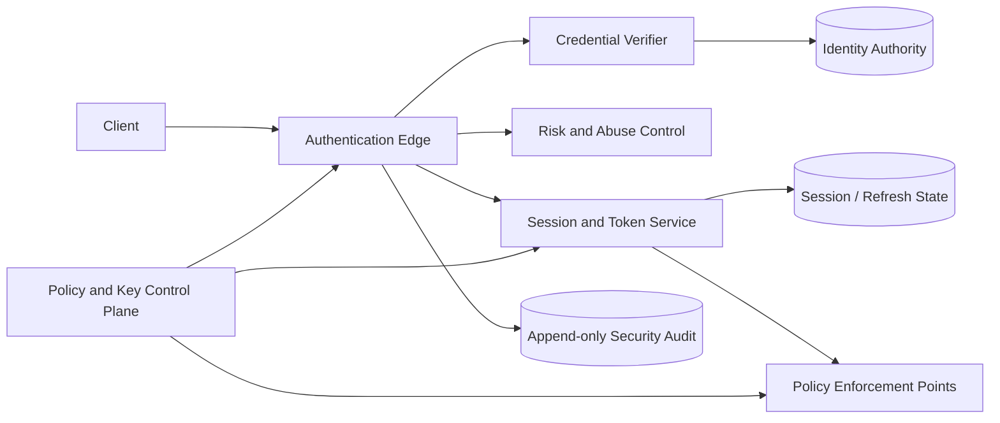

# Authentication Systems

## TL;DR

Authentication is a distributed state machine. The password check that most people picture is one transition in it. A production design must bind an identity to one or more authenticators, issue a revocable session, propagate authentication results without spreading long-lived credentials, survive regional and dependency failures, and make recovery at least as strong as normal sign-in. The central trade-off is between **online authority** (immediate revocation, one more dependency on every request) and **locally verifiable assertions** (lower latency and wider availability, bounded staleness until expiry). We make that staleness bound explicit. A design that describes signed tokens as "stateless" and then quietly adds deny-lists, refresh-token rows, key registries, and account-status lookups has not avoided state. It has only stopped accounting for it.

---

## The Security Contract

Authentication establishes that a claimant currently controls an authenticator bound to an account. It does **not** decide what that account may do; that belongs to [authorization](./07-authorization-patterns.md). It also does not prove a real-world identity unless an identity-proofing process established that binding. Keeping these three questions apart is the first design decision, because systems that blur them end up with authorization rules buried in login code and identity assumptions that nobody verified.

We begin with invariants and come to protocols afterward. Protocols change every few years, and the invariants have been stable for decades:

1. **Credential isolation.** Raw passwords, private keys, recovery codes, and refresh tokens reach only the component that must verify them. Downstream services receive a bounded assertion, never the original credential.
2. **Unambiguous binding.** A successful ceremony binds one account, one authenticator, one client context, and one challenge. Challenges are unpredictable, single-use, short-lived, and scoped to the intended operation.
3. **Replay resistance.** Reusing a captured proof must either fail or have a deliberately bounded value. A password is replayable; a WebAuthn assertion is challenge- and origin-bound; a bearer access token remains replayable until it expires or is revoked.
4. **Revocation has a deadline.** "The user is disabled now" must translate into a measurable maximum time before every enforcement point rejects the account.
5. **Recovery cannot bypass assurance.** An account protected by a passkey but recoverable through an unchecked email or support call has the assurance of that recovery path.
6. **Security transitions are atomic.** Password changes, authenticator removal, global logout, and recovery completion advance a security version so concurrently issued sessions cannot survive on stale state.
7. **Failures do not silently weaken policy.** A risk engine outage, stale replica, or unavailable audit sink has a named fail-open, fail-closed, or degraded behavior for each operation class.

Passwords, passkeys, sessions, OAuth, and federation are mechanisms for satisfying these seven. When evaluating a mechanism, the useful question is which invariants it satisfies and under what failure, and whether a given mechanism is fashionable has no bearing on that.

---

## State and Ownership

Most authentication incidents are, at bottom, disagreements about state: two components each believing something different about whether an account is active, a session is live, or a credential is current. The remedy is for one authority to own a small, explicit state model. A representative account record contains:

```text
Account
  account_id             immutable internal identifier
  status                 pending | active | recovery_pending | locked | disabled
  security_version       monotonic epoch for global invalidation
  authenticators[]       id, type, public metadata, state, enrolled_at
  recovery_methods[]     method, verified_at, risk class
  failed_attempt_state   counters or a pointer to abuse-control state
  policy                 required assurance, allowed recovery paths
  changed_at             authoritative state-change time
```

The storage rule for each credential type follows from one question: what does an attacker gain by reading this row? A password is stored as a verifier record containing the algorithm, parameters, salt, and derived value, so that reading it yields only an expensive guessing problem. A passkey is stored as a credential identifier and public key, and reading it yields nothing, since the private key never left the authenticator. A refresh token is a bearer credential, so it is stored as a one-way digest together with a token-family identifier, generation, expiry, client binding, and status. A refresh token kept in recoverable plaintext turns a read-only database leak into every user's session.

The `security_version` field deserves attention, because it solves a problem that is otherwise surprisingly hard. Suppose a user changes their password because they suspect compromise. We must invalidate every session that existed before the change. Enumerating them is unreliable: a login may be in flight at this moment, on another region, and will commit a new session a few milliseconds after our enumeration finishes. The version number avoids enumeration altogether. Each session and assertion records the version it observed at issuance. A global logout, credential compromise, account disable, or sensitive recovery increments the version, and anything carrying an older number is invalid by comparison, including sessions we did not know existed. This is a fencing token, the same device that protects a storage system from a lock holder that has not noticed its lease expired.

How quickly the comparison takes effect depends on who is doing the comparing. An enforcement point that performs an online check rejects older versions immediately. An offline verifier rejects them only once its assertion expires, unless it receives a revocation update. That difference is the central trade-off of this chapter, and it reappears in every section that follows.

### The planes



We separate the system into planes according to what each one is trusted to touch.

The **credential plane** enrolls and verifies authenticators. It handles the most sensitive inputs in the system and should therefore have the narrowest interface: a proof goes in, a yes or no comes out. The **session plane** exchanges a successful ceremony for an opaque session or bounded assertion, rotates refresh credentials, and enforces revocation. The **policy plane** distributes accepted issuers, key sets, assurance rules, client metadata, and security epochs. The **recovery plane** changes authenticator bindings under stricter workflow and audit rules. The **audit plane** records security decisions without becoming a store for credentials or full bearer tokens.

The reason for the separation is blast radius. In many systems all five functions live in one general application service, which then holds raw passwords in memory, signs tokens, edits recovery settings, and reads policy, and any vulnerability in that service's considerable surface area exposes all of them together.

---

## Authentication as a Transaction

It is natural to think of a login as a function that returns true or false. In fact it is a transaction with several externally visible effects, and each step has a failure that matters:

1. Resolve the account without revealing whether the submitted identifier exists.
2. Load the authoritative account status and credential metadata.
3. Verify the proof using a bounded worker pool; password hashing is intentionally expensive and therefore an admission-controlled resource.
4. Evaluate abuse signals and the assurance required for this operation. A valid password may still require a passkey or another factor.
5. Atomically record the successful ceremony, reset or advance relevant attempt state, and create a session or refresh-token family.
6. Return the client credential only after its authoritative record exists.
7. Append a redacted audit event and publish derived security signals asynchronously.

The first step is harder than it reads. Returning the same error message for "no such user" and "wrong password" is the well-known part. The less obvious part is time. If the account does not exist, the server skips the password hash and answers in a millisecond. If it exists, the hash takes fifty. An attacker can distinguish the two with a stopwatch and enumerate accounts regardless of what the error message says. The response for an unknown account must do the same work as for a known one, typically by hashing against a dummy verifier.

The ordering of steps 5 and 6 addresses a different failure. If the credential were returned before its record committed, a crash between the two would leave the client holding a session the server has never heard of. In the committed-first order, the corresponding failure is a commit whose response is lost, after which the client retries. That retry must not create an unbounded number of live refresh-token families. We either use a short-lived ceremony identifier as an idempotency key, or allow multiple sessions deliberately and expose them for the user to review.

Failure counters need equally careful semantics, and they show how a security control can turn into a vulnerability in two opposite directions. A read-then-increment sequence against an eventually consistent replica is bypassable under concurrency: an attacker sends a thousand guesses in parallel, each reads a counter of zero, and all thousand are evaluated. Updates must therefore be atomic at the chosen enforcement scope. In the other direction, a strict per-account lockout hands the attacker a different weapon, since five wrong guesses now lock the real owner out, and the attacker can do that to any account whose identifier they know. Production abuse control accordingly combines per-account, per-network, per-device, and fleet-wide signals with progressive delay or step-up authentication, and does not rely on a single threshold.

---

## Authenticator Lifecycle

The moment of verification gets most of the attention, and it is where the least goes wrong. Authentication security is mostly lifecycle management: enrollment, use, replacement, compromise, recovery, and deletion.

### Password verifiers

The purpose of a password hash is to make an attacker who has stolen the verifier table pay heavily for each guess. A fast general-purpose hash fails at this, and understanding why explains the modern functions. An attacker does not use the defender's hardware. They use graphics processors or custom chips that evaluate a simple hash billions of times per second, thousands in parallel. Raising the iteration count slows both sides equally and does not change the attacker's hardware advantage. Memory-hard functions attack that advantage directly. They require each evaluation to occupy a substantial block of memory, and memory, unlike arithmetic, does not get dramatically cheaper on specialized hardware. A chip that could run ten thousand simple hashes in parallel can run only as many memory-hard evaluations as it has memory for.

We use a maintained library to apply a purpose-built password-hashing function, normally Argon2id, scrypt, or bcrypt, and we store the algorithm and parameters with every verifier so that they can be raised over time. Cost is calibrated against the slowest supported production tier and the capacity reserved for authentication. A universal work factor or millisecond target copied from a guide ages badly as hardware and traffic change.

The same expense that burdens the attacker makes password verification a scarce resource for us. If peak login traffic is $Q$ attempts/s and one verification consumes $t$ CPU-seconds, the unconstrained CPU demand is approximately:

$$
\text{cores} \approx Q \times t
$$

That is before retries, bot traffic, or failover. The consequence is that the login endpoint is the cheapest place in the system to mount a denial-of-service attack: each request costs the sender almost nothing and costs the server tens of milliseconds of CPU and tens of megabytes of memory. Verification therefore sits behind concurrency admission, capacity is reserved for legitimate recovery and administrator access, and abusive traffic is shed before the hash cost is paid. When a user signs in successfully and their stored parameters have fallen behind current policy, we rehash at that moment, which is the only time the plaintext is available to do so.

A server-side pepper, a secret mixed into every hash and kept outside the database, can reduce the usefulness of a database-only compromise. It also creates a key-management dependency. It should be versioned, kept in a managed secret or key system, and given a rotation design, and the team should write down whether losing it makes every password unverifiable, because in most designs it does.

### Passkeys and WebAuthn

WebAuthn replaces a replayable shared secret with a public-key credential scoped to a relying-party identifier. The server creates a fresh challenge; the authenticator signs the challenge and ceremony data; the server verifies the signature, challenge, origin, relying-party binding, and required user-verification flags. Nothing reusable crosses the network, and nothing useful is stored on the server.

The system still has design choices:

- **Synced or device-bound credentials.** Synced passkeys improve recovery and multi-device use; device-bound authenticators offer different provenance and administrative control.
- **Discoverable credentials.** They enable username-less sign-in but require clear account-selection and privacy behavior.
- **Attestation.** It is useful only when policy truly depends on authenticator provenance; collecting it without a requirement adds complexity and privacy cost.
- **Enrollment authorization.** Adding a new authenticator is a privileged security transition. Require a recent high-assurance ceremony and notify existing channels.

The last of these is where strong deployments are most often undone. A passkey login that is unphishable does little good if removing the authenticator, or recovering the account, is protected by a weaker single factor. The attacker simply takes that route.

### Additional factors and step-up

TOTP is a shared-secret proof and remains phishable: a user who can be induced to type a password into the wrong site can be induced to type a six-digit code there as well. SMS is additionally exposed to takeover of the delivery channel. Both can be useful compatibility factors, but phishing-resistant authenticators should protect high-impact operations where practical.

TOTP seeds are stored encrypted, since the server must be able to recover them to compute the expected code. Verification is rate-limited, the accepted clock window is only as wide as measured drift requires, and a time step that has already been accepted is rejected if presented again. Backup codes are stored as one-way verifiers and consumed atomically.

A boolean "MFA enabled" is not a sufficient model. It cannot express that a user signed in with a password an hour ago and is now attempting something that warrants more. We record which factors were used, when the ceremony occurred, and the resulting assurance, so that an operation can demand a recent step-up.

---

## Session Architecture

After authentication, the system needs a credential suitable for repeated requests, since nobody wants to present a passkey on every click. Three common designs occupy different points on the trade-off between revocation and availability.

| Design | Request path | Revocation | Main failure boundary |
|---|---|---|---|
| Opaque server session | Random identifier; online session lookup | Immediate when the authority is reachable | Session store latency and availability |
| Short-lived signed access token | Local signature and claim validation | Bounded by token lifetime unless an online epoch/deny check is added | Key/config staleness and bearer replay |
| Opaque or signed token with introspection | Online authority check, often cached | Near-immediate within cache TTL | Introspection service and cache coherence |

The table is one decision viewed three ways. Every request must somehow learn whether the session is still good. Either it asks, and inherits the latency and availability of whatever it asks, or it trusts something it already holds, and inherits that thing's age. The third row is a point between the two, where the cache lifetime sets the mixture.

### Opaque sessions

The session identifier is a random value with at least 128 bits of unpredictable entropy. We store only its digest where practical, and send it in a `Secure`, `HttpOnly` cookie with an explicit `SameSite`, domain, path, idle timeout, and absolute lifetime. It is regenerated whenever authentication state changes, so that an identifier an attacker planted before login is not the one that becomes authenticated. Broad parent-domain cookies are avoided unless every subdomain is inside the same trust boundary, because any subdomain can read them.

The authoritative session record includes account ID, security version, creation and expiry times, last meaningful use, client metadata needed for security decisions, and revocation state.

Sliding expiry hides a cost. "Expire after 30 minutes of inactivity" sounds like a policy, but implemented naively it is a write on every request, which turns a read-heavy session store into a write-heavy one and may overwhelm it. Common alternatives are to touch the record only when a coarse interval has passed since the last touch, or to keep a short cache in front of a durable record of absolute expiry.

### Access and refresh credentials

A signed access token is often described as stateless, and the description does not survive inspection. Correct operation still depends on issuer metadata, verification keys, audience policy, clock bounds, account state, and usually refresh-token state. What the signed token removes is a lookup on each request, and the state behind it remains. We keep access tokens narrowly scoped and short enough that their worst-case revocation delay is acceptable.

The short access token is made tolerable by a longer-lived refresh token, and refresh-token rotation is a compare-and-swap state transition:

```text
family F, generation 7, ACTIVE
  client presents generation 7
  transaction: mark 7 USED; create generation 8 ACTIVE
  retry with generation 7 after commit => REUSE DETECTED
  response: revoke family F and require authentication
```

The logic is that a refresh token should be used exactly once. If generation 7 appears a second time, two parties hold it, and one of them should not. The server cannot tell which is the thief, so it ends the whole family.

The difficulty is that there is an innocent explanation for a second appearance. The client sent generation 7, the server committed generation 8, and the response was lost on a poor mobile connection. The client, having never received 8, retries with 7. A design that treats this as theft signs out legitimate users whenever the network drops a packet. An idempotency record tied to the refresh request can return the already-created generation through a protected response channel. Where that is not available, conservative family revocation is the safer of the two errors.

Sender-constrained credentials, which bind a token to a key held by the client, reduce bearer replay but introduce client-key lifecycle and recovery. Audience restriction and least privilege remain necessary even when a token is sender-constrained.

### Logout semantics

"Logout" names at least four operations, and incidents result when a product means one and the implementation performs another:

- **Local logout:** remove the credential from this client and revoke this session.
- **Account-wide logout:** increment the account security version and revoke every refresh-token family.
- **Federated logout:** also coordinate with the identity provider and relying parties; partial completion is expected and must be visible.
- **Compromise response:** revoke sessions, rotate affected credentials or signing keys, preserve evidence, and force recovery at an appropriate assurance level.

---

## Capacity and Multi-Region Design

Session capacity is driven by active sessions, record size, replication, and headroom. The number of registered users is irrelevant to it. For an illustrative workload with two million active sessions, 1.2 KiB per stored record, replication factor two, and a 70% target occupancy:

$$
\text{memory} \approx \frac{2{,}000{,}000 \times 1.2\ \text{KiB} \times 2}{0.70}
\approx 6.7\ \text{GiB}
$$

Allocator overhead, indexes, expiration metadata, replicas during failover, and refresh-token records require additional measured headroom. Request load matters independently: 150,000 authenticated requests/s with online validation on 70% of requests creates 105,000 session reads/s before retries or regional failover. Memory for this store is cheap. The read rate is what makes it a tier-zero dependency, because it sits in front of almost every request the product serves.

For multi-region systems the question to settle explicitly is where authority lives:

- **Home-region sessions** keep one writer per account or session family. Remote requests pay a lookup or use a bounded cache, but rotation and revocation have one serialization point.
- **Region-local sessions** reduce latency but make global logout and compromise response a replicated invalidation problem. Define maximum propagation delay and behavior during partition.
- **Locally verified access tokens** keep the request path available during authority outages, but disabled accounts remain accepted until expiry unless enforcement points receive a trustworthy revocation stream.

The first option exists because of the refresh rotation above. Compare-and-swap on a token family is only correct if there is one place where the comparison happens. Two regions that each accept generation 7 during a partition will each mint a generation 8, and the family now has two live descendants, which is the very condition reuse detection exists to prevent.

Signing-key distribution is a control plane with a timing rule that is easy to get wrong in both directions. Verifiers cache a versioned key set. A new key must be published and given time to reach every verifier before the issuer signs anything with it, or tokens will be rejected by verifiers that have not yet heard of the key. An old key must stay published until the last token it signed has expired, with margin for clock skew and distribution delay, or valid tokens will be rejected. An emergency rotation after a key compromise cannot wait for either period and needs a separately tested fast path. Finally, a verifier that cannot refresh its key set should continue only within an explicit stale-key window. A verifier that caches forever will go on honoring a compromised key that everyone else has withdrawn.

---

## Recovery Is a Privileged Workflow

Recovery changes the binding between a person and an account. That makes it the most powerful operation in the system, since its successful completion is equivalent to a login plus a credential change, and it is typically attempted by someone who, by definition, cannot authenticate normally. We model it as a durable, observable workflow, and not as a special login endpoint:

1. Create a recovery case with an opaque identifier and risk classification.
2. Gather proofs appropriate to the account's assurance and value.
3. Apply delay and out-of-band notification when immediate recovery would create unacceptable takeover risk.
4. Require independent approval for administrator-assisted recovery of sensitive accounts.
5. Atomically bind the new authenticator, invalidate recovery artifacts, increment `security_version`, and revoke existing sessions according to policy.
6. Retain a privacy-conscious audit trail and make the change visible to the account owner.

Email links and SMS codes are bearer credentials and are handled like any other: stored as digests, single-use, bound to the intended action, and quickly expired. The human path needs the same discipline as the technical one. Support staff with database access can bypass every control above with one unlogged edit, and social engineering of a help desk is a well-practiced attack.

---

## Failure Modes

For each dependency, there is a tempting response to its failure that keeps users happy and quietly abandons an invariant. The design work is to decide the response in advance.

| Failure | Unsafe response | Designed response |
|---|---|---|
| Session store unavailable | Accept an unknown opaque session | Fail closed for privileged operations; optionally use a deliberately bounded read cache for lower-risk traffic |
| Identity replica lags after disable | Issue a new session from stale account state | Issue only from the authoritative write region or require a fresh security epoch |
| Risk service times out | Silently skip required step-up | Use operation-specific policy: fail closed for high-impact actions, conservative degraded rules for ordinary login |
| Password-hash pool saturates | Queue without bound and exhaust the service | Admission control, per-source shaping, bounded queues, and reserved recovery capacity |
| Signing-key distribution stalls | Trust unknown keys or cache forever | Reject unknown key IDs; apply a finite stale-key policy for already trusted keys and alert |
| Refresh response is lost | Create a new descendant on every retry | Idempotent rotation or family-reuse detection with a forced ceremony |
| Regional partition | Both regions mutate one token family | Single-writer ownership or fenced generations; make reduced functionality explicit |
| Audit sink is unavailable | Block every login indefinitely or drop all evidence | Durable local buffering with backpressure thresholds and a defined fail policy for sensitive operations |
| Recovery notification fails | Complete silently | Keep the security change valid if policy allows, but raise a high-priority delivery incident and provide another owner-visible channel |

The unsafe column is worth reading as a list of things that are easy to ship. Most of them are what the code does by default when a timeout is caught and ignored. An attacker who can degrade a dependency, for instance by overloading the risk service, can then choose to authenticate under the weakened policy.

We test these with fault injection at transaction boundaries: after credential verification but before session commit, after commit but before response, during refresh rotation, during security-version propagation, and while keys rotate. A happy-path login test proves almost none of the distributed properties.

---

## Observability Without Credential Leakage

Authentication telemetry has an unusual hazard: the events worth recording sit next to secrets that must never be recorded, and the logging pipeline is usually readable by far more people than the credential store. We record ceremony ID, account pseudonym, authenticator class, achieved assurance, decision, reason category, policy version, security version, region, dependency latency, and session-family event. We never log passwords, TOTP seeds, full assertions, cookies, authorization codes, or bearer tokens. Hashing a low-entropy token before logging it is not sufficient redaction, since a value that can be guessed can be matched against its hash.

Operational signals should separate:

- user-visible success and latency by ceremony type;
- invalid proofs from dependency and policy failures;
- password-hash queue saturation;
- refresh reuse and global-revocation propagation delay;
- recovery creation, abandonment, approval, and reversal;
- key-set age and verifier refresh failures;
- notification delivery for high-risk security changes.

The second item matters most during an incident. A rising login failure rate caused by wrong passwords is an attack, and one caused by a dependency timing out is an outage. The two call for different responders, and a single failure counter cannot tell them apart.

Attack telemetry should be aggregated without turning it into an account-enumeration or cross-tenant privacy leak. Access to authentication traces is itself privileged.

---

## Decision Framework

We choose an opaque online session when immediate revocation, simple browser semantics, and centralized policy outweigh the cost of the extra lookup. We choose short-lived signed access tokens when many independent services or intermittent authority connectivity make local verification valuable and the bounded revocation delay is acceptable. Introspection or security-epoch checks are added when the risk requires fresher status, in the knowledge that each such check moves the design back toward online authority.

We prefer passkeys for new interactive authentication when the client ecosystem supports them, and retain passwords and compatible factors only with an explicit migration and recovery design. We use federation when another identity authority should own the ceremony, and still validate issuer, audience, redirect, nonce, and client binding. Federation relocates the trust boundary and does not remove it.

The final architecture should be explainable in four sentences: who owns authenticator state, who can issue a session, how every verifier decides, and how quickly compromise or disable reaches every verifier. If any answer is "eventually" without a bound, the authentication contract is incomplete.

---

## Key Takeaways

- Authentication is an identity, authenticator, session, and recovery lifecycle with explicit authority and epochs.
- Local token verification trades online dependency for bounded stale authorization; it does not eliminate state.
- Refresh rotation, global logout, and authenticator changes are concurrency-sensitive transactions.
- Password verification and abuse defense need capacity planning and admission control.
- Recovery and support operations must preserve, or deliberately re-establish, the account's assurance.
- Key distribution, revocation propagation, and audit buffering are control-plane problems that require failure tests.

---

## References

- [NIST SP 800-63-4: Digital Identity Guidelines](https://pages.nist.gov/800-63-4/)
- [NIST SP 800-63B-4: Authentication and Authenticator Management](https://pages.nist.gov/800-63-4/sp800-63b.html)
- [OWASP Authentication Cheat Sheet](https://cheatsheetseries.owasp.org/cheatsheets/Authentication_Cheat_Sheet.html)
- [W3C Web Authentication Level 3](https://www.w3.org/TR/webauthn-3/)
- [RFC 9106: Argon2 Memory-Hard Function](https://www.rfc-editor.org/rfc/rfc9106)
- [RFC 9700: Best Current Practice for OAuth 2.0 Security](https://www.rfc-editor.org/rfc/rfc9700)
- [RFC 7009: OAuth 2.0 Token Revocation](https://www.rfc-editor.org/rfc/rfc7009)
- [RFC 7662: OAuth 2.0 Token Introspection](https://www.rfc-editor.org/rfc/rfc7662)

---

## Related Chapters

- [OAuth 2.0 and OpenID Connect](02-oauth2-openid-connect.md): the delegation protocol that turns a successful login into an issued assertion
- [JOSE and JSON Web Token Verification](03-jwt-tokens.md): the access and refresh split, and why signature validity is not revocation
- [Authorization at Scale](07-authorization-patterns.md): authentication answers who; authorization decides what they may do
- [Cache Invalidation and Coherence](../04-caching/02-cache-invalidation.md): session propagation is cache invalidation with a security deadline attached
- [Multi-Region Architecture](../06-scaling/09-multi-region-architecture.md): online authority versus availability when the session store is regional
- [Passkeys and Phishing-Resistant Authentication](10-passkeys-and-phishing-resistant-authentication.md): the public-key credential path in depth, including fallbacks and session binding
