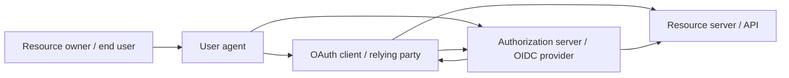
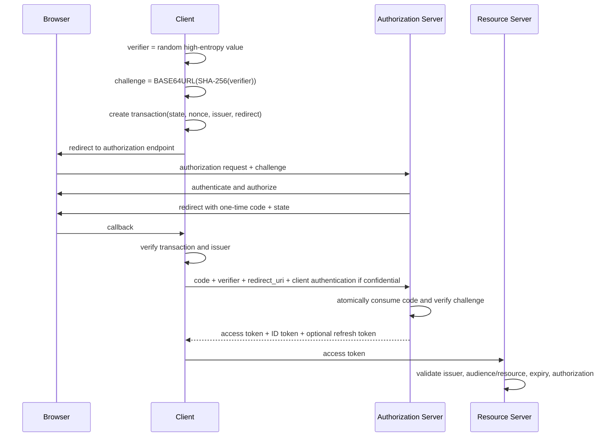
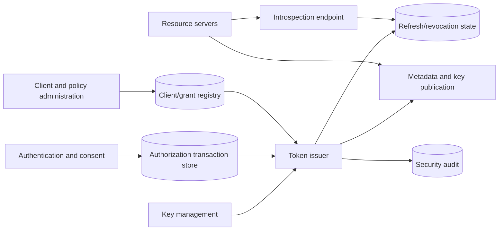

# OAuth 2.0 and OpenID Connect

## TL;DR

OAuth is a framework for delegated API access. OpenID Connect (OIDC) adds an identity layer for login. They share endpoints and tokens, and they are confused with each other constantly, but their security contracts differ:

- an **access token** is presented to a resource server and authorizes a bounded API action;
- an **ID token** is consumed by the client that requested authentication and describes that authentication event;
- a **refresh token** is a long-lived delegation handle used only at the authorization server.

For browser and native-app user flows, we use authorization code with PKCE, exact redirect-URI matching, issuer validation, `state` or equivalent request correlation, and OIDC `nonce` where required. Tokens are bound to the intended resource, access tokens are short-lived, refresh tokens are rotated for public clients, and an ID token is never sent to an API as an access token.

The protocol messages are the smaller part of the work. The system to be designed consists of authorization transaction state, client registration, redirect and consent policy, the lifecycle of tokens and keys, replay protection across regions, revocation, sender constraint, and explicit behavior when the authorization service is unavailable.

---

## Protocol Roles and Trust Boundaries

OAuth exists because of a practice that was once normal and now seems reckless. In the mid-2000s, an application that wanted to read a user's contacts from another service asked the user for their password to that service, stored it, and logged in as them. The application received everything the user could do, indefinitely, and the only way to withdraw the access was to change the password, which withdrew it from every other application too. OAuth replaces the shared password with a token that represents a specific, limited, revocable grant from the user to one application. Everything in the protocol follows from wanting that token to reach the intended application and nobody else.



The vocabulary takes some care, because the everyday meanings of the words mislead. The **authorization server** (AS) authenticates the user as needed, obtains their authorization, and issues tokens. The **client** is the application requesting delegated access. It is software, and the word never refers to the end user. The **resource server** (RS) is the API, which validates an access token and enforces what it permits. The **resource owner** is the party who can grant access to a resource, usually the user. An **OpenID Provider** is an authorization server that also implements OIDC, and a **Relying Party** is an OIDC client that consumes an ID token.

The client and the resource server may be operated by different organizations. Two parties that trust the same issuer do not thereby trust each other, and much of what follows guards against treating them as if they did.

### Core invariants

Each rule in OAuth security prevents an artifact from being used somewhere other than where it was meant to go. The invariants are easier to remember as a list of bindings:

1. **Redirect binding:** an authorization response returns only to an exactly registered redirect URI.
2. **Transaction correlation:** a response is accepted only for the browser/session transaction that initiated it.
3. **Code binding:** an intercepted authorization code cannot be redeemed without the PKCE verifier and correct client/redirect context.
4. **Issuer binding:** a client never accepts a response or token from an unintended issuer.
5. **Audience/resource binding:** a resource server accepts only tokens intended for it.
6. **Client binding:** confidential-client credentials and refresh tokens are usable only by the intended client.
7. **No token substitution:** ID tokens, access tokens, authorization codes, and refresh tokens are not interchangeable.
8. **Bounded delegation:** scopes and resource indicators do not exceed the authorized grant.
9. **Replay containment:** one-time codes and rotated refresh tokens have durable replay state.
10. **Auditable consent/administration:** the authorization basis and revision are reconstructable.

---

## Authorization Code With PKCE

The authorization code flow can look needlessly indirect on first reading. The authorization server could hand the client a token directly. It sends a code instead, which the client must then exchange. The indirection has a purpose. The response to the user's approval travels through the browser, in a URL, where it can be logged, cached, and read by other software. A code is useless without a second step performed over a direct, authenticated connection, so the value that crosses the exposed path is one that an eavesdropper cannot spend.



### Authorization transaction state

Between sending the user away and receiving them back, the client must remember what it asked for. That memory is a short-lived, single-use transaction record:

```text
transaction_id
client_id
issuer
redirect_uri
state_digest
pkce_challenge
pkce_method
oidc_nonce_digest
requested_scopes
requested_resources
browser_session_binding
created_at
expires_at
consumed_at
```

When the callback arrives, the client consumes the record atomically. A duplicate callback, whether from a user pressing the back button or from an attacker replaying a URL, returns the recorded outcome or fails. It does not start a second token exchange. Most attacks on OAuth clients amount to delivering a callback the client did not expect, and this record is how the client distinguishes a response to its own question from one that merely looks like it.

### PKCE

The client creates a random verifier and sends only its SHA-256 hash, the challenge, in the authorization request. The verifier itself goes to the token endpoint with the code. An attacker who observes the code in transit has seen only the hash and cannot produce the value that hashes to it.

We use the `S256` method. The older `plain` method sends the verifier as the challenge, which protects against nothing an observer of the request could do. The verifier is transaction secret state, and it should stay out of logs, analytics, referrers, and any broadly readable browser store.

PKCE addresses one threat, the interception of the code, and it is sometimes mistaken for a general remedy. It does not replace redirect-URI validation, client authentication for confidential clients, transaction correlation through `state`, issuer validation, the OIDC `nonce`, or audience validation of the access token. Each of those closes a different path.

### State, nonce, and issuer

Three values correlate the response with the request, and each binds a different pair of things.

`state` binds the authorization response to the browser session that started the flow. Without it, an attacker can begin a login with their own account, capture the callback URL, and trick a victim's browser into loading it. The victim's client completes the attacker's login, and the victim is now signed in as the attacker, where anything they upload or any payment card they add lands in an account the attacker controls. This is cross-site request forgery applied to login. The value must be unpredictable and tied to the initiating session. It is also a poor place to carry an application return URL, unless that URL is signed or looked up server-side, since an attacker who controls it controls where the user lands after login.

The OIDC `nonce` binds the ID token to the authentication request. The client stores a digest in the transaction, the provider copies the nonce into the token, and the client compares. An ID token lifted from one login cannot then be injected into another.

Where a client talks to several authorization servers, it must also verify which one answered and bind the transaction to that issuer. Otherwise an attacker who operates or influences one issuer can cross responses between them, an attack traced later in this chapter.

---

## Redirect URI and Front-Channel Security

The redirect URI is where the authorization server sends the code, which makes it an authorization boundary. Whoever controls a URI the server will redirect to receives codes. We therefore require exact string matching against registered values, with the single exception of the loopback behavior that the native-app profile defines.

The things to reject share a theme, which is any flexibility an attacker could use to make a URI that passes the check and leads somewhere else:

- wildcards in scheme, host, path, or port for web clients;
- open redirectors;
- userinfo tricks such as `trusted.example@attacker.example`;
- unregistered query changes;
- fragment-based secrets;
- ambiguous Unicode/punycode host handling;
- untrusted custom URI schemes that another native app can claim.

The userinfo case shows why pattern matching fails here. A check that asks whether the URI "starts with `https://trusted.example`" is satisfied by `https://trusted.example@attacker.example/`, in which `trusted.example` is a username and the host is the attacker's. A string comparison against a registered value has no such edge.

Native apps should use claimed HTTPS redirects, the application or universal links that the operating system ties to a verified domain, wherever possible. A custom scheme such as `myapp://` can be registered by any other app on the device. Loopback redirects bind a random local port and still require PKCE.

Even with a correct redirect, anything placed in a URL has a way of spreading. Codes and tokens leak through browser history, `Referer` headers, analytics scripts, reverse-proxy access logs, crash reports, and URLs that users copy and paste to each other. We keep tokens out of authorization response URLs, strip sensitive query data as soon as the callback has been processed, set a restrictive referrer policy, and keep third-party scripts off callback pages altogether.

---

## Client Types and Deployment Patterns

The right flow depends on one property of the client: whether it can keep a secret. The answer is fixed by where the code runs, and good intentions do not change it.

### Confidential web client

A backend can hold client credentials and refresh tokens where the browser never sees them. The browser holds only a secure application session cookie.

```text
browser
  -> application backend / BFF
     -> authorization server
     -> resource APIs
```

This arrangement, the backend-for-frontend (BFF), removes tokens from the reach of any script running in the page, which is the main way browser tokens are stolen. It does not remove risk so much as relocate it. The BFF is now a high-value session boundary, with the ordinary obligations of one: protected cookies, session rotation after login, and same-origin and CSRF controls. It must also not degenerate into a proxy that will attach the user's token to any request the browser asks it to forward.

### Browser-only public client

An application that runs entirely in the browser cannot keep a static client secret. It uses code with PKCE and keeps token lifetime and exposure to a minimum. For high-value data, the question to ask is whether a BFF is warranted.

A secret bundled into JavaScript does not authenticate the client. Anyone can open the developer tools and read it.

### Native public client

A native app uses the system browser, code with PKCE, and a redirect mechanism the app controls. The system browser matters because an embedded webview runs inside the app's own process, where the app can read every keystroke the user types into the login page. Requiring the system browser means the user's credentials for the authorization server are never visible to the client.

Refresh tokens belong in platform-protected storage, with the assumption that device compromise remains possible. Refresh rotation and sender constraint limit what a stolen token is worth.

### Machine client

The client-credentials grant represents the client or workload itself, with no user involved. Tokens are resource-specific and short-lived and are issued on the basis of workload identity. A machine token should not carry an invented end-user subject, since downstream services will take it for a statement that a user was present.

Where possible the client authenticates with an asymmetric proof, such as a private-key JWT or mutual TLS, in preference to a shared secret that is copied across a fleet and can be used by whoever obtains one copy.

### Input-constrained devices

A television or a command-line tool on a remote server cannot conveniently show a login page. The device authorization grant lets the device display a short user code while the user authorizes on a phone or laptop. Meanwhile the device polls the token endpoint at the interval it was told to use, handling `authorization_pending`, `slow_down`, expiry, and denial.

The flow has a characteristic weakness. Because approval happens on a different device from the one being authorized, nothing technical ties the two together, and an attacker can start a flow on their own device and persuade a victim to enter the code. The defenses are procedural: show the user which device and application they are authorizing, use adequate code entropy, expire codes quickly, rate-limit verification, and require explicit confirmation.

---

## OIDC Authentication Contract

OAuth by itself says nothing about who the user is. An access token means "the bearer may call this API," and early attempts to use it as proof of login failed in an instructive way: an application that accepted any valid access token as evidence of identity could be given a token that some other application had legitimately obtained for the same user. OIDC adds the ID token to answer the identity question directly. It is a signed statement from the issuer, addressed to one specific client, that a particular user authenticated at a particular time.

Because it is addressed, most of its validation is about confirming the address. The client validates:

- signature with an allowed algorithm and current issuer key;
- exact issuer;
- audience containing the client ID;
- authorized party where multiple audiences require it;
- expiry and not-before/time policy;
- `nonce` when sent;
- authentication time/assurance when the application requested it;
- hash claims required by the chosen flow/profile.

The subject identifier is unique only within its issuer, and may be pairwise, meaning a different value for each client, so that two applications cannot correlate their users. Local accounts are therefore keyed by the pair `(issuer, subject)`. Email is not a key. It can change, it can be reassigned to another person, and some providers will assert addresses they have never verified.

### UserInfo

The UserInfo endpoint returns claims authorized by an access token. Its subject must match the subject of the ID token from the same login transaction, and a response that does not match is not merged into the session.

### Session creation

After validating the tokens, the client still has decisions of its own to make:

1. map issuer/subject to a local identity;
2. evaluate tenant membership and account state;
3. create or rotate the application session;
4. store authentication time, assurance, issuer, and upstream session references;
5. discard front-channel artifacts;
6. apply step-up policy for high-risk actions.

An OIDC login proves that an authentication event took place. What the user may do locally is a separate decision, and a successful login does not grant any local role.

### Logout

"Logout" can mean any of the following, and they are distinct protocols with different latencies:

- destroy local application session;
- revoke refresh token/grant;
- end the identity-provider session;
- notify other relying parties;
- invalidate access tokens.

The product should state which of these it promises. A user who clicks "sign out" and sees the login page reasonably believes that access has ended. A short-lived access token issued a minute earlier may nonetheless remain valid at the API until it expires, unless the resource server checks current state.

---

## Access Token Design

An access token should say what the resource server needs in order to decide, and nothing more:

```text
issuer
subject or client identity
audience/resource
scope or authorization reference
issued_at / expiry
token identity
confirmation key when sender-constrained
tenant context if contractually stable
```

There are two forms. An opaque token is a random string, and the resource server learns its meaning by asking the authorization server. A structured token such as a JWT carries its meaning with it and can be validated locally. The first keeps state central and current. The second is fast and independent, and the freshness of its claims and of its revocation status is bounded by the token's lifetime. The JOSE mechanics and key-confusion hazards belong to [JSON Web Tokens](./03-jwt-tokens.md).

### Resource indicators and audience

A client that calls several APIs should hold a separate token for each, requested for an explicit resource, and each resource server should confirm that it is the intended audience.

The alternative is a single audience such as `api` that every service accepts. It is convenient, and it means that every service can impersonate the user to every other service. The token received by a low-value analytics endpoint is, byte for byte, a valid credential for billing.

### Scopes are delegated verbs, not the whole authorization model

A scope such as `invoices.read` describes a category of action that the user has allowed the client to perform. It says nothing about which invoices. The resource server must still decide:

- which tenant;
- which specific invoice;
- ownership/relationship;
- current account state;
- transaction constraints.

A scope sets a ceiling on what the client may attempt, and the object-level decision is made by the API from its own data. Attempts to make scopes carry that decision, by encoding object identifiers or relationships into them, produce tokens that are enormous and stale the moment a relationship changes.

### Token exchange and delegation chains

When service A must call service B on behalf of a user, there are four options, and the choice determines what B can know and what a compromised A can do:

- **propagate original token** only if B is an intended audience and least privilege is preserved;
- **exchange token** for a B-specific token to reduce audience/scope;
- **use workload token** when the call is purely service authority;
- carry auditable actor/delegation context where B must know both service and user.

One shortcut should be ruled out explicitly. A service that places a user ID in an unsigned header and calls the result delegation has given every service on the network the ability to act as any user.

---

## Refresh Token Lifecycle

Access tokens are short-lived so that theft is bounded. Something must then let a legitimate client continue without sending the user back through login every few minutes, and that is the refresh token. It concentrates the risk that short access tokens removed: it is long-lived, and it can mint access tokens at will. The authorization server stores only a hash or protected representation of it:

```text
refresh_family:
  family_id
  subject
  client_id
  tenant
  authorized_resources/scopes
  current_generation
  state
  created_at
  absolute_expires_at
  last_used_at
  revoked_at

refresh_token:
  token_digest
  family_id
  generation
  issued_at
  consumed_at
  replacement_digest
```

### Rotation transaction

For clients that cannot authenticate, each use of a refresh token replaces it:

```text
BEGIN
  lookup token digest FOR UPDATE
  verify family active, client binding, expiry, and generation
  mark token consumed
  create next generation
  persist access-token authorization event
COMMIT
```

The row lock is essential. Two concurrent requests presenting the same token must be serialized, so that exactly one of them finds the token unconsumed. Without the lock, both read it as valid and both mint a successor.

Rotation turns theft into something detectable. If a thief and the legitimate client both hold generation 5, whichever uses it second presents a consumed token, and the server learns that two parties hold the family. It cannot tell which of them is legitimate, so it revokes the family and both must authenticate again, which only the real user can do.

The complication is that an honest client can also present a consumed token, when the response carrying its replacement was lost and it retries. Treating every reuse as theft signs users out whenever a mobile network drops a response. Treating reuse leniently gives a thief a window. The `replacement_digest` column exists for this case: the server can recognize a retry of the request it has just answered and return the same successor, within a narrow interval and only when the request can be identified as the same one. The width of that interval is a direct trade between false alarms and missed thefts, and it should be chosen deliberately.

### Absolute and inactivity expiry

Several clocks run at once, each for a different purpose:

- access-token expiry for routine authorization freshness;
- refresh inactivity expiry for abandoned sessions;
- absolute grant lifetime where reauthentication is required;
- immediate family revocation for detected compromise or user/admin action.

The right values come from the risk of the data and the tolerance of the user journey. A banking application and a music player should not share them.

---

## Sender-Constrained Tokens

A bearer token works like cash, in that possession is the whole of the entitlement. Sender constraint binds the token to a cryptographic key, so that presenting it also requires proving possession of the key, and a token copied from a log or a proxy is inert.

### mTLS-bound tokens

The authorization server observes the client's certificate at the token endpoint and records its thumbprint in the token. The resource server then checks that the TLS connection on which the token arrives was established with the same certificate.

The mechanism is simple and its difficulties are operational:

- TLS termination must preserve verified certificate identity;
- certificate and token lifetimes/rotation overlap;
- key scope must match client instance/fleet policy;
- proxies cannot substitute arbitrary certificate headers.

The first and last items are one problem seen from two sides. Applications rarely terminate TLS themselves, so the load balancer must tell the application which certificate it saw, typically in a header. If a client can supply that header directly, it can claim any certificate it likes.

### DPoP

DPoP moves the proof into the application layer. With each request the client sends a small JWT signed by its key, naming the HTTP method and URI and carrying a timestamp and unique identifier. The access token is associated with that key, and the resource server validates both.

This survives TLS termination, which is why it suits browsers and mobile apps. In exchange it brings state for nonces and replay detection, the need to agree exactly on what the request URI was after any proxies have rewritten it, and sensitivity to clock differences. It also does not protect against a compromised client, since an attacker who controls the key can generate valid proofs.

Sender constraint is worth its operational cost where bearer replay is a realistic threat, especially for public clients and high-value APIs.

---

## Authorization Server State and Planes



An authorization server is three systems with very different operational profiles, and separating them clarifies what must stay up and what may be slow.

The **control plane** changes rarely and must be correct. It owns:

- client registration and redirect URIs;
- allowed grants/response types;
- scopes/resources and consent policy;
- signing/encryption keys;
- federation/issuer metadata;
- risk and step-up policy;
- token lifetime and sender-constraint requirements.

The **transaction plane** is the write-heavy part. It handles authorization sessions, codes, device codes, and refresh rotation, all of which need strong consistency because each is a single-use value.

The **publication plane** serves issuer metadata and verification keys. It is read-only, static, and cacheable, and it is the one part that every resource server depends on. It should therefore remain available even while the issuer itself is failing over, which is easy to arrange for static content, provided it is deployed separately from the transactional service.

### Client registration

Registering a client is a security configuration change, because the registration determines where codes are sent and what tokens may be requested. A registration records:

- stable client identity and owner;
- exact redirect/logout URIs;
- client type and authentication method;
- allowed grants, resources, scopes;
- token format and sender constraint;
- software metadata/version;
- environment and tenant policy.

Dynamic registration, where enabled, lets software register itself. It needs initial access control, software statements or equivalent governance, rate limits, and lifecycle cleanup. Without them an attacker can register a client with a name resembling a trusted application and a redirect URI of their own.

---

## Multi-Tenancy and Federation

A provider serving many customer organizations must decide whether they share one issuer or each has their own.

With a **shared issuer**, key and metadata distribution is simple, since there is one of each. The tenant is then a piece of data that must be carried explicitly through every grant, token, session, and resource lookup, and administrative isolation between tenants rests entirely on application logic:

- simpler key and metadata distribution;
- tenant must be explicit in grant, token, session, and resource lookup;
- admin/config isolation becomes critical.

With a **per-tenant issuer**, each tenant has a separate namespace, separate keys, and separate configuration, and a token from one cannot validate under another's keys:

- stronger namespace and configuration separation;
- more metadata/key caches and onboarding complexity;
- resource servers must safely resolve issuer before accepting tokens.

The last point conceals a trap. A resource server serving many issuers must choose which issuer's keys to use for an incoming token, and the obvious way is to read the `iss` claim from the token. That claim has not yet been verified. If the server will fetch keys from whatever issuer the token names, an attacker names their own. The issuer must be selected from trusted routing context, such as the hostname or a configured list, and the token's claim then checked against that selection.

Enterprise federation adds upstream identity providers. The local authorization server should translate an upstream authentication into a local subject and session, preserving the upstream issuer, assurance, and authentication time. Upstream group names should not be trusted directly as local privileged roles, because whoever administers the upstream directory would then administer local privileges.

Account linking, the joining of two upstream identities into one local account, is high-risk, since it merges authority. It requires authenticated proof of both sides or controlled administrative verification. Linking automatically because two identities share an email address allows anyone who can obtain that address at any one provider to take over the account.

---

## Capacity and Availability

Assume:

- 35,000 interactive logins per second at peak;
- 120,000 refreshes per second;
- authorization-code records average 1.2 KiB with indexes/replication factor 3;
- codes retained operationally for 15 minutes including audit/cleanup lag;
- 0.8 percent of 2 million API requests per second use introspection.

Live code-state storage:

```text
35,000/s * 900 s * 1.2 KiB * 3
= about 106 GiB
```

Introspection load:

```text
2,000,000/s * 0.008 = 16,000 requests/s
```

The arithmetic shows something that intuition often misses. Logins are the visible activity, but refresh rotation, at 120,000 transactional writes per second, is more than three times the login rate and dominates the write path. It is driven by the number of active sessions divided by the access token lifetime, so halving the token lifetime to improve security doubles the heaviest write load in the system. The refresh store should be partitioned by a stable digest or family key, with uniqueness maintained across regions as far as the replay guarantee requires, and with limits so that one tenant or client cannot exhaust shared capacity.

The choice between local validation and introspection is likewise a choice about where load and dependency fall. Local JWT validation takes API request load off the authorization server entirely, at the price of bounded freshness. Introspection gives current state and makes the authorization server a serving dependency of the API. The decision is best made per resource, by risk.

### Outage behavior

When the authorization server is unavailable, the consequences differ by component:

- existing locally verifiable access tokens may continue until expiry;
- new login/refresh normally fails if transaction authority is unavailable;
- resource servers using introspection need a fail-safe cache policy;
- public metadata/JWKS should be replicated and cacheable;
- no region should issue conflicting refresh generations without a uniqueness protocol.

The first two items together describe how an authorization-server outage unfolds. It is gradual at first. Users with valid access tokens notice nothing, and then, as tokens expire over the following minutes, sessions fail one after another as each client tries to refresh. The access token lifetime is the length of the grace period.

Under no circumstances should an invalid or unverifiable token be accepted in order to preserve availability.

---

## Key Rotation

Signing keys are rotated routinely, and the procedure is a small exercise in distributed coordination, since issuers and verifiers learn of changes at different times:

1. publish the new verification key;
2. observe verifier fetch/convergence;
3. begin signing new tokens with the new key ID;
4. retain old public key for all unexpired tokens plus clock/cache margin;
5. stop old signing and protect/destroy old private key according to policy;
6. remove old public key only when no valid token can reference it.

The order of the first three steps is the critical part. A verifier that receives a token signed by a key it has not seen cannot validate it. If signing begins before publication has reached every verifier, valid tokens are rejected across the fleet.

Resource servers have corresponding duties:

- restrict algorithms independently of token header;
- select keys only from configured issuer metadata;
- cache keys with refresh-on-unknown-key bounded against request storms;
- retain last-known-good keys through transient metadata outage;
- reject unknown issuer/key rather than fetching an arbitrary URL from token data.

A key compromise changes the calculation, because waiting for tokens to expire is no longer acceptable. Emergency rotation may require revoking tokens before normal expiry, publishing revocation state, and adding current-state checks at resource servers for high-risk actions.

---

## Failure Traces

### Authorization-code injection

1. Attacker starts a login for their own account.
2. Attacker causes victim's browser/client session to receive the attacker's code.
3. Client accepts callback without transaction correlation.
4. Victim acts inside attacker's account.

**Prevention:** bind code response to initiating session using `state`/transaction state, PKCE, issuer, and OIDC nonce semantics.

### Open redirect steals code

1. Client registers a wildcard or open redirect.
2. Authorization server sends code to the client URI.
3. Client redirect forwards to attacker.
4. Attacker redeems if other bindings are weak.

**Prevention:** exact redirect matching and no open redirect on registered endpoints.

### ID token accepted by API

1. Client sends ID token to resource server.
2. API checks signature/expiry but not audience/type.
3. Token intended for the client is accepted as API authorization.

The signature is valid and the token is unexpired, which is why this passes casual testing. The token was simply addressed to someone else.

**Prevention:** APIs accept access tokens under a resource-specific contract; clients consume ID tokens.

### Mix-up between issuers

1. Client supports trusted issuer A and attacker-influenced issuer B.
2. Authorization response from B is sent into A's transaction path.
3. Client sends code or credentials to wrong endpoint or accepts wrong identity.

**Prevention:** bind transaction to issuer, use issuer identification/metadata, and validate exact issuer at every stage.

### Refresh replay revokes the legitimate session

1. Client rotates token but loses response.
2. It retries old token.
3. Server treats any reuse as theft and revokes family.
4. Benign network loss logs user out.

**Mitigation:** atomic rotation, stored replacement relation, narrowly designed retry handling, and telemetry that distinguishes races without granting a broad replay window.

### Shared audience enables lateral use

1. Token for analytics is accepted by billing because both use audience `api`.
2. Compromised analytics client calls billing.

**Prevention:** resource-specific audiences/resource indicators and least scopes.

### Key rotation outage

1. Issuer signs with new key before publishing/convergence.
2. Resource servers see unknown key ID.
3. Every request refreshes JWKS simultaneously.
4. Metadata service overloads and valid traffic fails.

This trace is a cache stampede. Refreshing on an unknown key is a sensible behavior that becomes destructive when every request on every server does it at once. Each server needs to coalesce concurrent refreshes into one and limit how often it will try.

**Prevention:** publish-before-sign, convergence telemetry, jittered/cache-coalesced refresh, and last-known-good keys.

---

## Security Telemetry and Operations

At the authorization server, we watch:

- authorization/token request rate by client/grant/result;
- redirect, PKCE, state, nonce, issuer, and client-auth failures;
- code reuse and refresh-family replay;
- consent/authorization denial;
- token issuance by resource/scope/client;
- suspicious device-code verification;
- signing-key use and verifier convergence;
- admin/client-registration mutations.

At resource servers:

- issuer/audience/scope/binding failures;
- token age and key ID distribution;
- introspection latency/cache age;
- authorization denial by coarse action/resource class;
- replay/nonces where sender-constrained;
- use of deprecated clients/scopes.

Binding failures deserve attention in proportion to their rarity. In a correctly functioning system, a token presented to the wrong audience or a callback with the wrong `state` should almost never occur. A sustained rate of either is a misconfigured client or an attack, and both are worth finding.

Raw codes, access tokens, refresh tokens, client secrets, PKCE verifiers, and full ID-token claims are never logged. Token digests or identifiers are recorded only when needed, under access control.

Incident response needs its actions prepared in advance:

- revoke grant/refresh family;
- disable client or redirect;
- stop key issuance/rotate key;
- block subject/workload;
- narrow scope/resource policy;
- force reauthentication;
- search token/audit identity across resource logs.

---

## Verification

1. **Protocol conformance:** standards/profile test suites for supported flows.
2. **Redirect tests:** exact match, encoding, Unicode, userinfo, fragments, open redirect.
3. **Transaction tests:** state/nonce/issuer swap, duplicate callback, expired code, concurrent redemption.
4. **PKCE tests:** missing/wrong verifier, disallowed method, verifier leakage.
5. **Token substitution:** ID token as access token, wrong issuer/audience/resource/client.
6. **Refresh races:** duplicate use, lost response, concurrent rotation, revoked/expired family.
7. **Key tests:** publish-before-sign, unknown key storm, algorithm confusion, compromised-key emergency.
8. **Sender-binding tests:** wrong certificate/key, replayed proof, URI normalization, proxy termination.
9. **Multi-tenant/federation tests:** issuer confusion, account-linking takeover, cross-tenant grants.
10. **Failure injection:** transaction-store failover, stale region, metadata outage, introspection overload.
11. **Privacy tests:** logs, URLs, analytics, referrers, browser storage, support tooling.
12. **End-to-end authorization:** token authority is no broader than consent/client policy/resource ownership.

The tests should exercise the protocol as a state machine and go beyond the happy path of each endpoint. OAuth failures rarely involve a forged artifact. They occur when individually valid artifacts, a real code, a real token, a real callback, are combined in a transaction they did not come from.

---

## Decision Framework

We use OIDC when an application delegates authentication to an identity provider, and OAuth when a client needs bounded access to a resource API. They often appear together, and neither substitutes for the other.

Before implementing, a team should be able to answer:

1. Is the client confidential, browser-public, native, machine, or input constrained?
2. Which issuer and resource servers participate?
3. What is the exact redirect and transaction binding?
4. Which access-token audience/resource and scopes are required?
5. Does the resource need current introspection or is bounded local validation acceptable?
6. How are refresh tokens stored, rotated, replay-detected, and revoked?
7. Does token theft require sender constraint?
8. Which human/workload identity does a downstream call represent?
9. How do key and policy changes converge across regions?
10. What continues during authorization-server outage?
11. Which logs and URLs could expose artifacts?
12. How are clients, grants, scopes, and old sessions retired?

We strongly prefer a maintained, standards-conformant authorization server and mature protocol libraries. The protocol has accumulated fifteen years of corrections for attacks that were not obvious to its designers, and a new implementation starts without them. Application teams contribute most by integrating correctly and enforcing resource policy, and least by inventing token formats or flows.

---

## References

- [RFC 6749: The OAuth 2.0 Authorization Framework](https://www.rfc-editor.org/rfc/rfc6749)
- [RFC 9700: Best Current Practice for OAuth 2.0 Security](https://www.rfc-editor.org/rfc/rfc9700)
- [OpenID Connect Core 1.0](https://openid.net/specs/openid-connect-core-1_0.html)
- [RFC 7636: Proof Key for Code Exchange](https://www.rfc-editor.org/rfc/rfc7636)
- [RFC 8414: OAuth 2.0 Authorization Server Metadata](https://www.rfc-editor.org/rfc/rfc8414)
- [RFC 8707: Resource Indicators for OAuth 2.0](https://www.rfc-editor.org/rfc/rfc8707)
- [RFC 8705: OAuth 2.0 Mutual-TLS Client Authentication and Certificate-Bound Access Tokens](https://www.rfc-editor.org/rfc/rfc8705)
- [RFC 9126: Pushed Authorization Requests](https://www.rfc-editor.org/rfc/rfc9126)
- [RFC 9207: OAuth 2.0 Authorization Server Issuer Identification](https://www.rfc-editor.org/rfc/rfc9207)
- [RFC 9449: OAuth 2.0 Demonstrating Proof of Possession](https://www.rfc-editor.org/rfc/rfc9449)
- [RFC 8628: OAuth 2.0 Device Authorization Grant](https://www.rfc-editor.org/rfc/rfc8628)

---

## Related Chapters

- [Authentication Systems](01-authentication-fundamentals.md): delegation begins where authentication ends, and the two protocols are easiest to confuse here
- [JOSE and JSON Web Token Verification](03-jwt-tokens.md): the serialization that carries these claims, plus the verification rules clients get wrong
- [Zero-Trust Service and Workload Architecture](05-zero-trust-architecture.md): a token naming a workload rather than a user is the credential shape that architecture needs
- [Authorization at Scale](07-authorization-patterns.md): scopes delegate coarse authority; deciding one object permission is a different system entirely
- [API Design and Evolution](../12-service-mesh/04-api-design-patterns.md): the contract that decides which client may hold which scope without breaking during rotation
- [OAuth 2.1 and High-Assurance Authorization Profiles](11-oauth-security-profiles.md): which extension RFCs to adopt on top of these flows, and in what order
