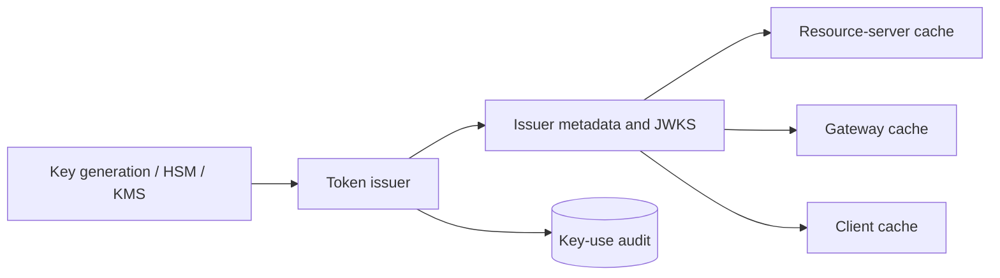

# JOSE and JSON Web Token Verification

## TL;DR

A JSON Web Token (JWT) is a claims container. JOSE defines how that container is signed (JWS) or encrypted (JWE). Neither format decides whether a token is appropriate for a request, and that gap between "the signature is valid" and "this token should be accepted here" is where nearly every JWT vulnerability lives.

Secure use begins with a validation contract written for one type of token:

- expected issuer and audience/resource;
- allowed signature algorithms fixed by configuration;
- trusted key source bound to that issuer;
- required `typ` and claims;
- time, nonce, assurance, or sender-binding rules;
- authorization semantics and maximum lifetime;
- key-rotation and revocation behavior.

We apply size and format limits before parsing, verify cryptography before trusting any claim, and then validate the full semantic contract. Algorithms, issuer metadata, and key URLs are never selected from the content of the token. ID tokens, access tokens, session tokens, email links, and DPoP proofs remain distinct token types even when all of them happen to be JWTs.

---

## Format and Trust Boundary

A compact JWS has three parts separated by dots:

```text
BASE64URL(protected_header)
.
BASE64URL(payload)
.
BASE64URL(signature)
```

The header and payload are encoded and not encrypted. Base64url is a transport encoding that anyone can reverse, so anyone holding the token can read its claims. This surprises people often enough that personal data and internal identifiers turn up regularly in tokens stored in browsers.

The signature is computed over the first two parts exactly as transmitted, the encoded header, a dot, and the encoded payload. That detail matters. The verifier checks the bytes it received and only afterward decodes them, so two JSON documents that mean the same thing but are serialized differently do not share a signature, and no canonicalization step exists for an attacker to exploit.

A compact JWE has five parts:

```text
protected_header
.
encrypted_key
.
initialization_vector
.
ciphertext
.
authentication_tag
```

JWS provides integrity and authenticity when it is verified with the intended key and algorithm. JWE provides confidentiality and integrity under a configured encryption contract. A JWT may be a JWS, a JWE, or one nested inside the other.

The qualification "with the intended key and algorithm" carries most of the weight in that paragraph. A JWT describes itself: its header states which algorithm was used and may suggest which key to use. That is convenient for interoperability, and it means that the attacker, who writes the header, takes part in choosing how their own token will be verified. The invariants below are largely ways of taking that choice back.

### Core invariants

1. **Token-type separation:** one validator accepts one semantic token profile.
2. **Algorithm allowlist:** allowed algorithms come from configuration, never the token alone.
3. **Issuer-key binding:** keys are selected only from metadata configured for the expected issuer.
4. **Audience binding:** the consumer accepts only tokens intended for it.
5. **Required claims:** absence is an error, not a permissive default.
6. **Bounded time:** expiry, not-before, issued-at, and maximum age follow the profile.
7. **Key ambiguity rejection:** zero or multiple matching keys fail safely.
8. **No claim-before-verify authority:** unverified claims do not select tenant, issuer, key URL, or authorization.
9. **Bounded input:** token size, nesting, compression, and JSON complexity are limited.
10. **Auditable result:** decisions record token type, issuer, key ID, validation reason, and policy revision without logging token content.

---

## Build a Validator per Token Type

The most common structural mistake is a single helper, `verifyJwt(token)`, shared by the whole application. It checks the signature and the expiry and returns the claims. Every caller then receives claims from a token that is genuine and unexpired and may have been issued for an entirely different purpose.

An organization's issuer signs many kinds of token with the same keys. An ID token tells a web application who logged in. An access token authorizes an API call. An email-verification token confirms an address. All verify under the same public key. If one generic function validates them all, an attacker who can obtain any one kind, and a password-reset link is easy to obtain, can present it wherever another kind is expected. We define a validator for each profile instead:

```text
OidcIdTokenValidator
OAuthAccessTokenValidator
ApplicationSessionTokenValidator
EmailActionTokenValidator
DPoPProofValidator
WorkloadAssertionValidator
```

Each profile fixes, in configuration, everything the token might otherwise be allowed to say about itself:

```text
expected_typ
expected_issuer
accepted_audiences/resources
allowed_algorithms
trusted_jwks_source
required_claims
maximum_lifetime
clock_skew_policy
replay/nonce policy
subject/client rules
sender-confirmation rules
```

With this arrangement a token that is valid under one protocol cannot be accepted in another, because a validator checks more than signature and expiry and will reject a token of the wrong type before considering its claims.

### Validation pipeline

The order of the steps is part of the design. Each step runs only on input that the earlier steps have made safe to handle:

```text
1. enforce transport/header/token size limits
2. split serialization; reject wrong part count
3. decode protected header under strict JSON rules
4. check token type and configured algorithm
5. select expected issuer configuration from request context
6. select exactly one trusted key by allowed key metadata
7. verify signature/authentication tag
8. decode claims under strict JSON rules
9. validate issuer, audience, times, required claims
10. validate profile-specific nonce/subject/client/binding
11. perform current authorization/resource checks
```

Size limits come first because parsing is itself an attack surface, and a multi-megabyte token should be refused before any JSON parser sees it. The issuer configuration is chosen from the request context in step 5, before the payload has been decoded, so that the token cannot nominate its own trust anchor. Claims are decoded only in step 8, after the signature has established that the issuer wrote them.

Some libraries decode the payload before verification in order to locate a claim such as `iss`. Whatever is read at that point is attacker-controlled input and must be treated accordingly. An unverified `iss` must not be used to fetch metadata, and an unverified tenant must not choose an authorization context.

---

## Algorithm and Key Confusion

The attacks in this section all exploit the same weakness, a verifier that lets the token's header influence how the token is verified. They are worth studying individually because each appeared in widely used libraries and each looks, in code, like reasonable flexibility.

### The `none` algorithm

The specification defines an algorithm called `none` for unsecured tokens, intended for cases where integrity is provided by other means. A verifier that honors it accepts a token with an empty signature. An attacker writes any claims they like, sets `alg` to `none`, and is believed. Ordinary authentication and authorization validators reject it, and a library's default set of algorithms must not include it.

### Symmetric and asymmetric confusion

This attack is subtler and repays a careful walk through. A service verifies tokens signed with RSA. It holds the issuer's public key, which is public by design and published for anyone to fetch. The service calls a generic library function with the token and that key.

The attacker crafts a token whose header says `HS256`, an HMAC algorithm. HMAC is symmetric: the same secret both signs and verifies. The library reads the header, sees HMAC, and uses the key it was handed as the HMAC secret. That key is the RSA public key, whose bytes the attacker also has. So the attacker computes an HMAC over their forged token using the public key's bytes as the secret, and the library, performing the identical computation, finds that it matches.

The cryptography did exactly what it was asked. The flaw is that a single "key" parameter was interpreted according to an algorithm the attacker chose. The fix is to bind the algorithm family and key type to the issuer and token profile in configuration, so that a verifier expecting RSA will not perform an HMAC whatever the header says.

### Header-controlled key locations

JOSE headers can carry `jku` and `x5u`, which are URLs from which to fetch keys, `jwk`, which is the key itself embedded in the token, and certificate chains. A verifier that follows them is asking the bearer of the token which key to trust, and an attacker will answer with a key of their own. A verifier that fetches a URL from the header has, in addition, become a tool for making requests into its own internal network.

The `kid` header is legitimate and necessary, since it tells the verifier which of the issuer's current keys signed the token. It is used only as an index into the trusted, configured key set, and it remains untrusted input:

- cap length;
- compare exact opaque values;
- do not concatenate into file paths or SQL;
- do not use it as a URL;
- reject duplicate keys with the same ID/algorithm/use.

The third item is drawn from experience. Implementations that load keys from disk or a database by `kid` have been attacked through path traversal and SQL injection in that one field. In one known variant the attacker points `kid` at a file with predictable contents and signs with those contents as an HMAC secret.

### Critical headers

The `crit` header lists extensions that the verifier must understand in order to process the token correctly. A token containing a critical parameter the verifier does not support must be rejected. Ignoring it would mean verifying under different semantics from those the issuer intended.

### ECDSA and implementation quality

Signature encoding, curve point validation, randomness, and low-level key checks belong in maintained cryptographic libraries. Elliptic-curve signatures in particular have a history of implementation errors, including verifiers that accepted a signature of all zeros for any message. Application code should restrict itself to stating policy, which algorithms, key sizes, and curves are acceptable, through the library and the issuer configuration.

---

## Claims Validation

Once the signature has been verified, the claims are known to be what the issuer wrote. Whether they authorize the present request is still open, and each registered claim answers part of it.

### Issuer

`iss` is an exact identifier, compared as a string against the configured value. A verifier should not normalize trailing slashes, letter case, or aliases unless the profile defines such rules, because each normalization is an opportunity for two different issuers to be treated as one.

Subjects are keyed by the pair `(issuer, sub)`. A `sub` value is unique only within its issuer, and two issuers can perfectly well assign the same value to different people.

### Audience and authorized party

`aud` names the recipients for whom the token was issued, as a string or an array. The consumer requires its own identifier to be present. This check is the most frequently omitted, and its omission means that any token the issuer has ever signed, for any application, is accepted.

Profiles such as OIDC may additionally require an `azp` check when several audiences are listed. OAuth access-token profiles may distinguish the client ID, the subject, and the resource.

### Time

- `exp`: reject at/after expiry according to profile.
- `nbf`: reject before token becomes valid.
- `iat`: validate presence/plausibility and maximum token age where required.
- `auth_time`: use for recent-authentication/step-up policy, not general expiry.

Verifiers allow a small clock skew because the issuer's clock and the verifier's are never perfectly aligned. The allowance exists to absorb bounded operational drift, typically seconds. It is effectively added to every token's lifetime, so a generous allowance of several minutes on a five-minute token roughly doubles the exposure. It is better to monitor clocks and the distribution of token ages than to widen the allowance.

### Token identity and replay

`jti` gives a token a unique identifier. It does not, of itself, prevent the token from being used twice. Replay protection is a property of the verifier, which must remember which identifiers it has seen, in state scoped by issuer and token type, for as long as the token could be valid.

For one-time action links and DPoP proofs, the verifier consumes the `jti` or nonce atomically. For ordinary bearer access tokens, which are meant to be used many times, a unique `jti` serves mainly for audit and revocation.

### Private claims

Private claims should be namespaced and their schema versioned. Several kinds of content do not belong in them:

- mutable complete permission sets with long lifetime;
- secrets or personal data;
- large tenant/group lists;
- claims consumed by only one service but exposed to every holder.

The first is the most consequential. A signature proves that a claim was true when the issuer wrote it. A role that was signed an hour ago and removed five minutes ago is still, cryptographically, impeccable. Where the answer must be current, authorization consults current domain state.

---

## JWK Sets and Key Distribution



Local verification requires every verifier to hold the issuer's public keys. The issuer publishes them as a JWK set at a well-known URL, and verifiers cache it. This is a small content-distribution system with security consequences, and the set normally contains several keys at once, some active and some being retired. Consumers:

1. bind JWKS URL to configured issuer metadata;
2. cache by HTTP semantics plus local bounds;
3. select keys by `kid`, algorithm, key type, and intended use;
4. refresh on unknown key through a coalesced/rate-limited path;
5. retain last-known-good keys during transient publication outage;
6. reject if no unique compatible key exists.

### Unknown-key storm

The fourth item, refreshing when a token names a key the verifier has not seen, is necessary for rotation to work without waiting for caches to expire. It is also something an attacker can trigger at will. Anyone can send tokens with random `kid` values. If each miss causes a fetch, the verifier fleet becomes an amplifier pointed at the issuer's key endpoint: one cheap forged request in, one outbound fetch out, multiplied by every verifier. The controls are:

- singleflight refresh;
- minimum refresh interval;
- negative cache for unknown key IDs;
- rate limits;
- cached last-known-good set;
- maximum key-set size.

Singleflight means that when many requests miss on the same key at once, one of them fetches and the others wait for its result. The minimum interval means that having just refreshed and still not found the key, the verifier concludes the key does not exist and declines to ask again for a while.

### Rotation protocol

1. create new key in protected key service;
2. publish public key;
3. observe verifier convergence;
4. begin signing new tokens with new `kid`;
5. stop old signing;
6. retain old public key for maximum remaining token lifetime plus cache/clock margin;
7. remove old private/public material according to compromise/retention policy.

Two ordering rules account for the whole procedure. Publish before signing, so that no verifier meets a token whose key it cannot find. Retain after stopping, so that tokens already issued remain verifiable until they expire. Violating the first causes an outage at the start of a rotation, and violating the second causes one at the end.

### Emergency compromise

If a signing key is stolen, the attacker can mint tokens that verify. Waiting for normal expiry does nothing, because the attacker will simply issue more. The options are:

- revoke tokens/key IDs in a current-state service;
- shorten accepted maximum age;
- rotate and block compromised key;
- require introspection for high-risk operations;
- revoke sessions/grants;
- force reauthentication.

Each trades availability or state load for speed of response. Removing the compromised key from the set immediately also invalidates every legitimate token it signed, which signs out the user base. That may well be the right decision. It should be rehearsed beforehand, so that it is not being worked out for the first time during the incident.

---

## Access Tokens, ID Tokens, and Sessions

The four common uses of JWTs differ in who consumes the token and what the consumer must check.

### OAuth access token

An access token is consumed by the resource server, which validates resource or audience, issuer, token type and profile, expiry, client and subject, scopes, and sender binding, and then performs its own resource authorization.

RFC 9068 defines one JWT profile for access tokens. Not every JWT access token follows it, and many predate it, so the issuer and its resource servers need to agree explicitly on which profile is in use.

### OIDC ID token

An ID token is consumed by the OIDC client. The client validates that the audience is itself, along with issuer, nonce, subject, and authentication time or assurance as required. It is a message to the client about a login and should not be presented to an API as authorization.

### Application session

A session token may be opaque or a JWT. Storing the session as a JWT in a cookie is often chosen in order to avoid a session store, and the store tends to come back, because the application turns out to need revocation, a list of the user's devices, rolling expiry, or the ability to disable an account.

For browser sessions, secure cookie delivery, CSRF controls, fixation prevention, and logout behavior matter far more than the format of the token. See [Authentication Systems](./01-authentication-fundamentals.md).

### One-time action tokens

Password reset, email verification, and confirmation of destructive actions are sometimes implemented as signed JWTs. Such tokens need:

- exact action/resource binding;
- short expiry;
- one-time atomic consumption;
- subject/account version binding;
- no sensitive claims in readable payload;
- protection against URL/referrer/log leakage.

A signed JWT with no consumption state can be replayed until it expires. A password-reset link that works a second time, for whoever finds it in a mail archive or browser history, is the usual result. Binding the token to the account's security version gives a simple remedy, since changing the password advances the version and invalidates every outstanding link.

---

## JWE and Nested Tokens

JWE is appropriate when the claims must be hidden from the party holding the token or from intermediaries, and a token is still the right vehicle. It is sometimes adopted in the hope that encryption will make a token design safe in general. Encryption does nothing about:

- replay;
- overbroad authorization;
- long lifetime;
- unsafe storage;
- confused token type;
- recipient compromise.

An encrypted bearer token is still a bearer token. Whoever steals it can present it without ever being able to read it. The key-management and content-encryption algorithms are fixed by the profile, and authenticated encryption from a mature JOSE library is used.

### Sign then encrypt

A common nested pattern signs the claims and then encrypts the resulting JWS for a recipient. The recipient decrypts and then validates the inner signature and profile. Explicit `cty` and type rules are needed so that the layers cannot be confused with one another.

### Compression

JWE permits compressing the plaintext before encryption, and there are two reasons to leave this disabled. The first is a side channel. Compression makes the length of the output depend on the content. If an attacker can place chosen text in the same plaintext as a secret and observe the length of the ciphertext, they can test guesses: a guess that matches part of the secret compresses better and yields a shorter result. This is the mechanism behind a well-known family of attacks on compressed TLS. The second reason is the decompression bomb, a small ciphertext that expands to gigabytes. Unless a reviewed profile requires compression, we disable it and cap compressed size, uncompressed size, and nesting depth.

### Why Not Put Sensitive Data in a Token?

Tokens travel. They pass through clients, proxies, logs, traces, browser storage, support tools, and crash reports, and each of those is a copy the issuer no longer controls. When data is sensitive or likely to change, an opaque reference that the consumer resolves server-side is usually better. Encryption concentrates access in whoever holds the decryption key, which helps, and it leaves just as many copies of the ciphertext in the world.

---

## Revocation and Freshness

Choosing self-contained validation is choosing a bound on how stale an authorization decision can be:

```text
authorization freshness <= token lifetime + accepted clock/cache margin
```

Everything on the right-hand side is under the designer's control, and nothing on it responds to events. If a user is disabled, the inequality is unaffected. The mechanisms for doing better each add something back to the request path:

| Mechanism | Freshness | Serving dependency | State/cost |
|---|---|---|---|
| short access-token lifetime | bounded by expiry | none per request | refresh load |
| token/grant denylist | near current | local/distributed lookup | high-cardinality state |
| introspection | current at AS | network call/cache | central load |
| subject/session version | current per user cache | lookup/cache | compact but coarse |
| key revocation | broad/emergency | key/deny distribution | revokes many tokens |

The rows run roughly from cheapest and stalest to most expensive and most current, and the appropriate row depends on the action. Reading a public profile can tolerate a decision several minutes old. Moving money may require current account and session status and a recent authentication.

Logout and revocation semantics belong to the protocol that uses the JWT. A token that is cryptographically valid has not thereby been shown to carry current authorization.

---

## Capacity and Availability

Assume:

- 1.6 million protected requests per second;
- 70 percent carry a locally verified JWT;
- verification consumes 35 microseconds CPU on measured production hardware;
- target CPU utilization is 60 percent;
- JWKS has 8 keys and serialized size 12 KiB;
- 25,000 verifier processes poll every 10 minutes with jitter.

Verification CPU:

```text
1,600,000 * 0.70 * 35 us
= 39.2 CPU-seconds per wall-second
```

At 60 percent target utilization:

```text
39.2 / 0.60 = 65.4 CPU cores
```

Sixty-five cores for more than a million verifications per second is modest, and that is the reason local verification is attractive. The figure is an illustrative lower bound that excludes parsing, authorization, and tail behavior. The choice of algorithm moves it considerably. RSA verification is very cheap and RSA signing is expensive, while for elliptic-curve algorithms the two costs are closer together, so a fleet that mostly verifies and an issuer that mostly signs may reasonably prefer different algorithms. Exact algorithms, libraries, and key types should be benchmarked.

JWKS average egress:

```text
25,000 * 12 KiB / 600 s
= about 500 KiB/s
```

The average is trivially small. The risk lies in the shape of the load. Twenty-five thousand processes started by the same deployment will have caches that expire at the same instant, and an unknown-`kid` attack produces bursts on demand. Jitter, HTTP caching, regional distribution, and singleflight are what keep this system available.

### Failures

- cached valid keys can keep verification available through metadata outage;
- unknown new key should fail safely until trusted publication is obtained;
- introspection-dependent paths need explicit fail-closed/cache behavior;
- clock failures can reject valid tokens or accept expired ones;
- parser/crypto CPU exhaustion requires input bounds and admission controls.

Signature and audience checks are never disabled during an issuer outage. The cached key set exists so that such an outage does not create the temptation.

---

## Multi-Region and Multi-Tenant Design

Issuer identity and key authority should be globally unambiguous. There are three workable arrangements:

- one issuer with globally replicated key metadata and token state;
- regional issuers with distinct exact issuer IDs;
- tenant-specific issuers under controlled registration.

In each of them, resource servers select the expected issuer from trusted routing or configuration and then validate the token's `iss` against it. They do not fetch configuration for whatever issuer string an unverified token presents.

For multi-tenant tokens, the tenant must be bound consistently at four points:

- tenant in subject/session/grant;
- resource server lookup;
- authorization decision;
- decision/token cache key.

A tenant claim signed by a trusted issuer shows that the subject was a member when the token was issued. If membership can be removed, the design needs a stated freshness for that claim.

Key rotation must converge across all regions before signing switches to the new key. State for refresh and revocation needs an authority consistent with its replay guarantee. Two regions cannot each independently accept the same one-time token and still call it one-time, unless deduplication is global.

---

## Security Logging and Privacy

For each validation decision, we record:

- token profile/type;
- configured issuer;
- audience/resource result;
- `kid` and algorithm after validation;
- token age bucket;
- validation failure reason;
- subject/client/tenant through access-controlled stable references;
- policy/key-set revision;
- sender-binding result.

Raw tokens, signatures in reusable form, complete claims, and decrypted plaintext are never logged. A logged bearer token is a credential available to everyone with log access. URL, query, and header logs are the common leak paths.

Metrics:

- validation success/failure by reason/profile/issuer;
- unknown-key and JWKS refresh;
- algorithm/type mismatch;
- expired/not-yet-valid;
- audience/issuer mismatch;
- token age distribution;
- signature verification latency/CPU;
- key-set staleness;
- revocation/introspection latency and cache age;
- oversized/malformed token rejection.

A breakdown of failures by reason is the most useful diagnostic here. A sudden rise in "unknown key" points to a rotation problem, a rise in "expired" to a clock or refresh problem, and a rise in "algorithm mismatch" to someone probing. Subject, tenant, `jti`, and `kid` values of unbounded cardinality should stay out of metric labels.

---

## Failure Traces

### Signature-only validation

1. API trusts issuer key.
2. It verifies signature and expiry.
3. It ignores audience.
4. ID token for another client is accepted as API access.

**Prevention:** token-profile validator with audience/type contract.

### Algorithm confusion

1. Validator allows RSA and HMAC.
2. Attacker chooses HMAC and signs with public RSA key bytes as secret.
3. generic library verifies.

**Prevention:** fixed algorithm/key-type allowlist per profile.

### SSRF through key URL

1. Token header supplies `jku`.
2. verifier fetches it.
3. attacker targets metadata/internal service and supplies own key.

**Prevention:** issuer-configured JWKS only; no token-directed fetch.

### Unknown-key denial of service

1. attacker sends random `kid` values.
2. each request fetches JWKS.
3. issuer/egress/verifier saturates.

**Prevention:** coalesced/rate-limited refresh and negative cache.

### Key removed too early

1. issuer stops old signing and deletes old public JWK.
2. unexpired tokens still reference it.
3. fleet rejects valid users.

**Prevention:** retain through maximum token lifetime plus margins.

### Stale role remains valid

1. admin role removed.
2. long-lived token embeds role.
3. resource trusts claim until expiry.
4. revoked admin acts.

**Prevention:** short lifetime/current-state authorization for high-risk actions.

### One-time token replay

1. email action JWT is signed and unexpired.
2. action endpoint never stores consumption.
3. copied link executes repeatedly.

**Prevention:** atomic nonce/`jti` consumption and action/resource binding.

### Cross-tenant token cache

1. authorization cache keys by subject/action only.
2. same subject has different rights across tenants.
3. allow leaks between tenants.

**Prevention:** tenant/resource/policy revision in semantic cache key.

Read together, the eight traces have one thing in common. In none of them is a signature forged by breaking cryptography. Each succeeds because a verifier asked a narrower question than the situation required.

---

## Verification

1. **Known-answer vectors:** valid/invalid signatures for every allowed algorithm.
2. **Cross-profile substitution:** ID/access/session/action/DPoP tokens against every wrong validator.
3. **Header adversarial tests:** `none`, wrong alg, `jku`/`x5u`/`jwk`, duplicate `kid`, unsupported `crit`.
4. **Claim tests:** wrong/missing issuer/audience/type/time/subject/nonce.
5. **Parser tests:** duplicate JSON keys, invalid UTF-8, huge numbers, deep nesting, oversized token.
6. **Rotation tests:** publish-before-sign, old-key retention, cache outage, unknown-key storm.
7. **Revocation tests:** logout, role removal, account disable, emergency key compromise.
8. **JWE tests:** wrong recipient/algorithm/tag, nested type, decompression bound.
9. **Multi-region tests:** stale JWKS, regional issuer confusion, one-time replay.
10. **Security tests:** token leakage in logs/URLs/traces/support tools.
11. **Performance tests:** exact library/algorithm/key set under malformed-input load.
12. **Differential tests:** compare independent conformant libraries on a corpus to expose parser differences.

The second test is the most productive. It takes every kind of token the issuer produces and presents each to every validator that should refuse it, in the form of a matrix. Any cell that passes is a substitution vulnerability.

The parser tests guard against a quieter problem. JSON does not say what a document with two `"sub"` keys means. Some parsers take the first and some the last. If a gateway and a backend use different parsers, an attacker can construct a token that each reads differently, and the differential test in the final item exists to find such disagreements.

We use maintained JOSE libraries and wrap them in profile-specific validators whose configuration and tests the application owns.

---

## Decision Framework

A signed JWT is the right choice when several consumers need offline verification of bounded, stable claims and can tolerate freshness limited by the token lifetime. An opaque reference with introspection is the right choice when current revocation, claim confidentiality, or centralized policy outweighs a dependency at request time. A server-side session is right when browser lifecycle, revocation, and device inventory matter. JWE is for reviewed cases in which a token transport needs claim confidentiality.

Before choosing JWT, a team should be able to answer:

1. What exact token type/profile is this?
2. Who issues it, who consumes it, and what audience/resource is bound?
3. Which algorithms and key source are configured?
4. Which claims are required and how fresh must they be?
5. What is the maximum lifetime and revocation path?
6. Can the holder read every claim safely?
7. Is replay acceptable, sender-constrained, or statefully prevented?
8. How do key rotation and issuer outage behave?
9. Can another token type from the same issuer be substituted?
10. How are tenant and resource authorization checked?
11. What happens under malformed/unknown-key load?
12. Why is a self-contained token better than an opaque handle here?

The last question is worth asking sincerely, because the honest answer is sometimes that it is not. A JWT saves a lookup. Identity, authorization, revocation, key management, and state all remain to be designed.

---

## References

- [RFC 7515: JSON Web Signature](https://www.rfc-editor.org/rfc/rfc7515)
- [RFC 7516: JSON Web Encryption](https://www.rfc-editor.org/rfc/rfc7516)
- [RFC 7517: JSON Web Key](https://www.rfc-editor.org/rfc/rfc7517)
- [RFC 7518: JSON Web Algorithms](https://www.rfc-editor.org/rfc/rfc7518)
- [RFC 7519: JSON Web Token](https://www.rfc-editor.org/rfc/rfc7519)
- [RFC 8725: JSON Web Token Best Current Practices](https://www.rfc-editor.org/rfc/rfc8725)
- [RFC 9068: JWT Profile for OAuth 2.0 Access Tokens](https://www.rfc-editor.org/rfc/rfc9068)
- [OpenID Connect Core 1.0](https://openid.net/specs/openid-connect-core-1_0.html)

---

## Related Chapters

- [OAuth 2.0 and OpenID Connect](02-oauth2-openid-connect.md): the framework specifies where tokens are exchanged, not whether these claims are trustworthy here
- [Authentication Systems](01-authentication-fundamentals.md): server-side sessions solve the revocation problem that self-contained tokens delegate to somebody else
- [Authorization at Scale](07-authorization-patterns.md): putting permissions inside a token freezes a decision at the moment you issue it
- [Cryptographic Key and Data-Protection Architecture](06-encryption.md): algorithm choice and key rotation are cryptographic decisions wearing a token header
- [Distributed Time](../01-foundations/05-distributed-time.md): an expired token is a disagreement about now, so the skew allowance is the failure budget granted to every verifier
- [Verifiable Credentials and Selective Disclosure](14-verifiable-credentials-and-selective-disclosure.md): SD-JWT extends these validation rules with per-claim disclosure and holder key binding
