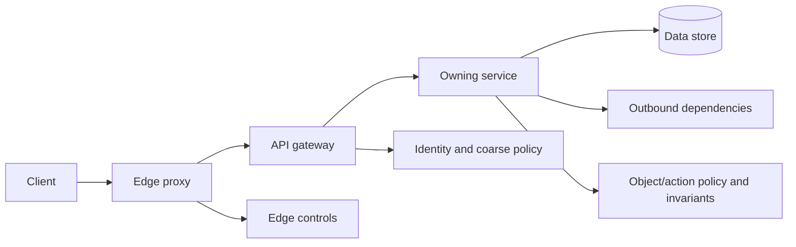

# API Threat Boundaries and Abuse Resistance

## TL;DR

API security is the preservation of request meaning and resource authority across clients, proxies, gateways, services, queues, and data stores. TLS protects a channel and authentication identifies a caller. Neither one prevents object-level authorization bugs, parser disagreement, mass assignment, SSRF, replay, resource exhaustion, or unsafe webhooks, and those are the ways APIs are actually breached.

A production API needs:

- one canonical interpretation of method, authority, path, headers, and body at every hop;
- schema and size limits before expensive work;
- action and object authorization at the resource owner;
- explicit field-level write policy;
- safe outbound-fetch and webhook protocols;
- bounded query/fan-out/resource consumption;
- idempotency/replay identity for effects;
- tenant-complete cache, storage, and authorization keys;
- stable error semantics without sensitive leakage;
- abuse telemetry and deterministic adversarial tests.

This chapter covers the API threat boundary. Identity protocols, authorization models, encryption, and generic rate algorithms are treated in their own chapters.

---

## Request Contract and Invariants

Most API vulnerabilities share a shape. Two components each handle the same request correctly by their own lights, and they disagree about what the request means. The gateway thinks the path is one thing and the service thinks it is another. The proxy thinks the request ends here and the backend thinks it ends there. The authentication layer establishes who is calling, and the handler assumes this also established what they may touch. No single component is wrong, and the vulnerability is in the difference between them.

For that reason we begin by writing down what an accepted request is, as a single object on which every component must agree:

```text
request = (
  authenticated transport/caller,
  canonical authority,
  canonical route and action,
  validated content type/schema,
  bounded body,
  tenant/resource context,
  replay/idempotency identity,
  deadline and resource budget
)
```

### Core invariants

1. **Parser agreement:** every security-relevant hop interprets framing and routing identically.
2. **Authentication before trust:** caller-provided identity/tenant headers are not authoritative.
3. **Object authorization:** permission is checked against the actual loaded resource and tenant.
4. **Field allowlist:** clients can modify only explicitly writable fields.
5. **Canonical identity:** cache, idempotency, signature, and authorization use the same request/resource identity.
6. **Bounded work:** input controls bound CPU, memory, I/O, fan-out, and downstream cost.
7. **No internal reachability oracle:** user-controlled URLs cannot access unintended networks/metadata.
8. **Replay policy:** effectful requests define duplicate behavior and freshness.
9. **Safe failure:** malformed/unauthorized input does not leak secrets or widen access.
10. **Complete enforcement:** alternate routes, versions, admin tools, jobs, and direct service paths cannot bypass policy.

---

## Normalize Once, Validate at Every Trust Boundary



Each layer is suited to a different kind of check, according to what it knows. The edge sees raw bytes, so it normalizes protocol framing and rejects ambiguity. The gateway knows identities and routes, so it authenticates and applies coarse policy. The owning service is the only component that knows what an invoice is and who may read it, so it revalidates the identity context and enforces object and domain authorization. The database, where possible, constrains tenant and data invariants as a final backstop.

The recurring error is to treat an internal hop as trusted because a gateway usually stands in front of it. The word "usually" matters here. Services acquire direct paths over time: a debugging port, a batch job, a second gateway added for a partner, a peer service that calls in sideways. Either those paths are closed, or every path carries the same authenticated, integrity-protected context.

### Propagated identity

When a proxy authenticates the caller and passes the result inward as headers, a specific sequence is required:

1. strip client-supplied versions;
2. authenticate at the proxy;
3. create a signed or channel-protected context;
4. bind audience, issuer, expiry, tenant, action/route, and request identity;
5. verify at the service;
6. retain original workload identity as actor/delegation context.

The first step is the one that gets forgotten, and its omission is among the simplest serious vulnerabilities there is. If the proxy adds `X-User-ID` and does not first remove any `X-User-ID` the client sent, then on any path where the proxy's own header is absent or appended second, the client chooses who they are. An unsigned `X-User-ID` is input, like any other field the client can set, and it becomes identity only when the service can verify who wrote it.

---

## HTTP Framing and Routing Ambiguity

Request smuggling is the clearest example of parser disagreement, and its mechanism explains the defenses.

HTTP/1.1 offers two ways to say how long a request body is: a `Content-Length` header giving a byte count, and `Transfer-Encoding: chunked`, in which the body arrives in pieces terminated by a zero-length chunk. A request should use one. Suppose an attacker sends both, and the front-end proxy honors `Content-Length` while the backend honors `Transfer-Encoding`. The proxy forwards what it takes to be one request. The backend reads up to the terminating chunk, considers the request complete, and finds bytes left over on the connection. It treats them as the beginning of the next request.

Proxies reuse backend connections for many users, so the "next request" is completed by whatever arrives next, which is some other user's request. The attacker's leftover bytes become a prefix on a stranger's request, executed with that stranger's cookies. The proxy's access controls were applied to the outer request it saw and never to the hidden one. The defenses are these:

- use maintained HTTP stacks;
- reject ambiguous/multiple/conflicting framing headers;
- normalize or reject obsolete transfer encodings;
- do not forward malformed requests after "repair";
- align proxy/backend HTTP versions and behavior;
- test connection reuse and upgrade paths;
- patch intermediaries as one protocol chain.

The fourth item reflects a principle that recurs throughout this chapter. A component that receives something ambiguous and helpfully repairs it has chosen one interpretation, and the next component may choose the other. Rejecting the request is the only response that cannot create a disagreement.

### Authority and path

The same problem arises at the level of URLs. Before routing, signing, or authorizing, the request target has to be reduced to one canonical form, and each of the following is a place where two components may reduce it differently:

- scheme and host/authority;
- port/default port;
- percent encoding;
- dot segments;
- repeated slashes if the framework treats them specially;
- Unicode normalization;
- path versus query;
- case sensitivity;
- forwarded host/proto headers from trusted proxies only.

A concrete case: the gateway has a rule denying `/admin` to ordinary users, and it compares the raw path. A request for `/%61dmin` does not match, since `%61` is the percent-encoding of the letter `a`. The gateway passes it. The service decodes the path before routing and serves the admin page. Each component applied a sensible rule and the combination is a bypass.

Unsupported methods and method-override headers are rejected. The action being performed is derived from the route the server matched, and never from something the client asserts about its own request.

### Header policy

Headers are bounded in:

- total header bytes;
- header count;
- individual field size;
- duplicates and combination behavior;
- trusted forwarding chain length.

`X-Forwarded-For`, `Forwarded`, and original-host headers deserve particular suspicion, because applications use them for rate limiting, geolocation, and audit, and a client can send them as easily as a proxy can. They are meaningful only when set by infrastructure we control. The first trusted ingress replaces or sanitizes the chain, and nothing received from an untrusted peer is believed.

---

## Schema, Content Type, and Input Bounds

The declared content type and the parser actually used must agree, and ambiguous content negotiation and unsupported charsets or encodings are rejected. Beyond that, a schema defines what a well-formed request is:

- required and optional fields;
- types and numeric bounds;
- string length/normalization;
- enum evolution;
- unknown-field policy;
- collection length;
- nesting depth;
- duplicate JSON-key behavior;
- timestamp/decimal canonical form;
- cross-field invariants.

The unknown-field policy involves a real tension. Tolerating unknown fields helps compatibility, since an old server can accept requests from a newer client. It also means the server is accepting data it has not examined, and if any later stage binds the raw request to a domain object, those unexamined fields become writes. The resolution is to parse into an explicit request type that contains only the known fields and then map from that type, so that tolerance at the parser never reaches the domain.

### Decompression and parser bombs

Some inputs are small on the wire and enormous once processed. A few kilobytes of compressed data can expand to gigabytes, and a deeply nested document can exhaust a recursive parser's stack. We bound compressed and expanded bytes, compression ratio, nesting, entity expansion, and parser time, and we apply the limits while reading, before the whole body has been buffered.

Streaming parsers reduce memory use and do not remove the need for semantic limits. When a deadline or budget is exceeded, the request is aborted and downstream work is stopped.

### Batch and graph APIs

A request-per-second limit assumes that requests cost roughly the same. Several kinds of API break the assumption, because a single small request can demand a very large amount of work:

- batch of thousands of IDs;
- GraphQL depth/breadth/aliases;
- recursive filters;
- large page size;
- expensive regex;
- N+1 backend fan-out;
- unbounded export.

Graph query languages make the problem acute. A query a few hundred bytes long can ask for a user's friends, each friend's friends, and each of their posts, and aliases let the client request the same expensive field many times in one document. The request count is one. The backend call count may be in the thousands.

The remedy is to estimate cost before executing:

```text
estimated_cost =
  base_route_cost
  + object_count * per_object_cost
  + fanout_edges * edge_cost
  + requested_bytes * serialization_cost
```

A request whose estimate exceeds the budget for its class is rejected, split, deferred, or converted to an asynchronous job. The estimate will be imperfect at first, so actual cost is measured against it and the model refined.

---

## Object-Level and Function-Level Authorization

Broken object-level authorization, also known as BOLA or IDOR, has led the OWASP API risk list for years, and it is almost embarrassingly simple. An authenticated caller requests `/invoices/1001`, receives their invoice, and then requests `/invoices/1002`. The service confirms that the caller is logged in, loads invoice 1002, and returns it. It belongs to someone else.

Unsafe:

```text
load invoice by id
return invoice
```

Required:

```text
load invoice within authorized tenant/scope
authorize(subject, action='invoice.read', invoice)
return filtered representation
```

The bug persists because it is an absence. No line of code is wrong. A check that should exist does not, the endpoint works perfectly in every functional test, and nothing in a normal code review draws attention to a missing statement. It cannot be fixed at the gateway either, because the gateway does not know who owns invoice 1002. Only the service that owns the data can make this decision.

Where possible, the tenant or owner predicate goes into the storage query itself, so that a lookup for another tenant's row finds nothing. This guards against accidental cross-tenant loads. It does not replace the domain authorization that follows, which handles relationships and actions a simple predicate cannot express.

### Never authorize by hidden UI

Removing an admin button from a client hides the button. The endpoint behind it remains reachable by anyone who can construct the request, which is everyone. Every server operation enforces its own action policy.

### Function-level authorization

Each route maps to a stable action name, and the mapping is reviewed for consistency across all the ways the same operation can be reached:

- HTTP methods;
- versioned routes;
- bulk endpoints;
- export/import;
- support/admin endpoints;
- asynchronous equivalents;
- mobile/legacy APIs.

These alternate paths are where function-level bugs concentrate. The main endpoint was written carefully and reviewed. The bulk variant was added later under deadline, and the version-one route was kept for an old mobile client and never updated when the policy changed. Permissions also do not imply one another: read does not imply export, update does not imply delete, and administering a tenant does not imply administering the platform.

### Relationship changes

Authorization is evaluated against current resource state, and it must not be separated from the action it authorizes by a gap in which the state can change. If a user's membership can be revoked between the check and the mutation, a request that started while they were a member completes after they were removed. The predicate or an expected resource version is enforced in the same transaction as the write.

The authorization models and policy distribution belong to [Authorization at Scale](./07-authorization-patterns.md).

---

## Mass Assignment and Response Exposure

Web frameworks make it convenient to copy a request body directly into a domain or database object:

```text
user.update(request.json)
```

The convenience is that adding a field to the model makes it updatable through the API with no further code. That convenience is also the vulnerability. The client decides which fields to send, and so an attacker sends `role=admin`, `tenant_id=other`, a `credit_limit`, or `status=approved`. Fields that were never meant to be client-writable, and that appear in no form or documentation, are written because they exist on the object.

The remedy is an explicit command type listing the fields a caller may set, kept separate from the fields the server owns:

```text
UpdateProfileCommand:
  display_name
  locale

server-owned:
  tenant_id
  role
  account_state
  risk_score
```

Field-level authorization may depend on the current state or on the caller's role. Unknown fields are either rejected or ignored, consistently. Silently accepting them hides client bugs today and becomes a privilege escalation on the day someone adds a model field with the same name.

The same reasoning applies in reverse to responses. Serializing an internal object returns everything on it, which may include:

- password/token hashes;
- internal notes;
- risk/abuse signals;
- encryption metadata;
- tenant IDs;
- deleted fields;
- third-party secrets.

Response schemas are versioned allowlists, and tests assert that sensitive fields are absent.

---

## Injection and Command Boundaries

The standard advice is to use parameterized database queries, structured subprocess APIs, and safe templates. The principle behind all three is worth stating once, because it covers cases the advice does not list. Injection happens when a string that mixes trusted code and untrusted data is handed to an interpreter that cannot tell which characters came from where. Parameterization works because it sends the two through separate channels, so the data is never parsed as code at all.

The boundaries where this arises are numerous:

- SQL/NoSQL queries;
- shell/process invocation;
- LDAP/XPath;
- template engines;
- log formats;
- search query DSL;
- object-storage paths;
- email/header generation;
- spreadsheet/CSV export formulas.

Parameter binding has a limit that catches people out. It can bind values, and it generally cannot bind identifiers. A sort column, table name, or field name supplied by the client cannot be passed as a bound parameter, and concatenating it reintroduces the problem. For identifiers, the input is checked against an allowlist of permitted names.

Escaping is specific to its context. HTML escaping does nothing useful inside a JavaScript string, a URL, or a SQL statement. APIs that preserve structure are preferable to any amount of escaping.

Log injection is easy to dismiss and matters operationally. An attacker who can put a newline into a logged field can forge entire log lines, with whatever severity, tenant, or user they choose, and logs are the evidence an investigation will later rely on. Structured fields are encoded so that attacker input stays inside its field.

---

## SSRF and Outbound Request Security

Server-side request forgery arises whenever a server fetches a URL that a user supplied: to preview a link, import a file, or deliver a webhook. The server sits inside the network. It can reach things the user cannot, and it will reach them on the user's behalf.

The classic target shows why this is serious. Cloud instances can obtain their own credentials from a metadata service at a fixed link-local address, reachable only from the instance itself. That restriction is the service's entire access control. A server that fetches arbitrary URLs is on the instance, so a user who asks it to fetch the metadata address receives the server's cloud credentials in the response. The threats more generally are:

- cloud metadata and node agents;
- internal admin/control planes;
- loopback and link-local services;
- other tenants;
- DNS rebinding;
- redirect to forbidden target;
- alternate IP encodings/IPv6;
- credential leakage to attacker endpoint;
- large/slow response resource exhaustion.

### Safer architecture

The strongest position is not to accept arbitrary URLs at all, and to use instead:

- named integrations/destinations;
- pre-registered webhook endpoints;
- allowlisted schemes/ports/domains;
- dedicated egress proxy/resolver;
- network policy blocking metadata/internal ranges;
- destination-specific credentials;
- response size/time limits.

Where arbitrary destinations must be supported, validation follows a specific sequence:

1. parse URL with one maintained parser;
2. require allowed scheme and explicit/default port;
3. reject userinfo/fragments where irrelevant;
4. resolve through controlled DNS;
5. evaluate every returned IP against destination policy;
6. connect to a validated address while preserving intended TLS hostname;
7. revalidate redirects and DNS changes;
8. limit bytes, time, redirects, and decompression.

Steps 4 through 6 are there to defeat DNS rebinding, a time-of-check to time-of-use attack. A naive implementation resolves the hostname, checks that the address is public, and then hands the hostname to an HTTP client, which resolves it again. The attacker controls the DNS server for their domain and answers the first query with a public address and the second with `127.0.0.1` or the metadata address. The check passed on one address and the connection went to another. The defense is to resolve once, validate the resulting addresses, and connect to exactly the address that was validated.

For the same reason, checks on the URL string, such as prefix or suffix matching, are insufficient. A perfectly ordinary-looking domain name can resolve to a private address, and the attacker decides what it resolves to.

### Egress identity

Outbound calls use an identity and credentials specific to the integration. A broad cloud credential must never be attached automatically to requests bound for arbitrary destinations, and sensitive inbound headers are stripped before anything is forwarded.

---

## Webhooks and Asynchronous Callbacks

A webhook endpoint is a public URL that accepts instructions such as "this payment succeeded." Anyone on the internet can post to it, so the receiver must establish that a message came from the provider, that it is recent, and that it has not been processed before. Verification of an incoming webhook needs:

```text
provider identity/key
timestamp/freshness
event identity
signature over exact transmitted bytes and bound metadata
destination/account binding
replay/idempotency state
schema/version
```

The signature is verified over the exact bytes that were received. This goes wrong in a predictable way: the framework parses the JSON body, the handler re-serializes it to compute the signature, and the re-serialized form differs from the original in whitespace or key order, so verification fails or, worse, is made lenient to compensate. The raw body must be captured before any parsing. MACs are compared in constant time, and algorithms and keys are restricted and rotated with overlap.

The receiver then proceeds as follows:

1. bounds body;
2. verifies key/signature/timestamp;
3. atomically records event ID/digest;
4. acknowledges after durable acceptance;
5. processes asynchronously;
6. quarantines deterministic failures;
7. reconciles provider state for high-value events.

A valid signature shows that the provider sent the message at some time. It does not show that this is the first delivery. Providers retry, and an attacker who captures one signed event can send it again, so the event identifier is recorded atomically and a repeat is a no-op.

The source IP address is weak evidence. Published address ranges change, and a signature identifies the sender far more strongly.

When we are the sender, the obligations are mirrored:

- destination registration/verification;
- SSRF-safe egress;
- per-tenant secrets/keys;
- signed event ID/timestamp/body;
- retry with backoff and bounded horizon;
- delivery attempt log;
- disable/quarantine for failing destinations;
- secret rotation overlap;
- redaction and tenant isolation.

An outgoing webhook is also a server-side fetch of a customer-supplied URL, so everything in the previous section applies to it.

---

## Browser APIs: Cookies, CSRF, and CORS

Browsers add a threat that other clients do not have, because a browser will send requests on behalf of a page the user did not intend to trust. When a page at `evil.example` submits a form to `bank.example`, the browser attaches the user's `bank.example` cookies. The bank sees an authenticated request. This is cross-site request forgery, and it follows directly from the fact that cookies are attached according to the destination of a request, whichever page initiated it. Where the browser sends credentials automatically, state-changing requests need protection:

- SameSite cookie policy;
- unpredictable token bound to session;
- origin/referer validation where appropriate;
- no state change via safe methods;
- content-type/custom-header strategy for APIs.

Bearer tokens in an explicit `Authorization` header are not attached automatically, so they are not exposed to this attack. They have a different exposure: script in the page must be able to read them, and so can injected script.

CORS is widely misunderstood as a server-side access control. It is an instruction to browsers about which other origins may read a response. It does not stop a request from being sent or processed, and clients that are not browsers ignore it entirely. Its most dangerous misconfiguration is to reflect whatever `Origin` header arrives while also allowing credentials, which tells the browser that every site on the internet may read authenticated responses. Trusted origins, methods, and headers are configured exactly, and `Vary: Origin` is set so that caches do not serve one origin's response to another.

Whatever the CORS policy says, the server enforces authorization on every request.

---

## Replay, Idempotency, and Request Signatures

TLS protects a request in transit between two endpoints. It does nothing to stop a valid request from being sent twice, whether by a client that retried, an intermediary that duplicated it, or someone who obtained a copy.

For operations with effects, we use [Idempotency and Operation Identity](../01-foundations/08-idempotency.md), binding the operation key to the tenant, caller, action, resource, and a digest of the request's meaning.

Where a request must be verifiable independently of the channel it arrived on, HTTP message signatures or application-level signatures can bind:

- method;
- authority;
- target URI;
- selected headers;
- content digest;
- creation/expiry;
- nonce/key identity.

The canonicalization problem returns here in its sharpest form. Signer and verifier must produce byte-identical input from their respective views of the request, and any proxy between them that rewrites the host, the path, or a covered header breaks the signature. A valid signature also establishes only who sent the request. Authorization and replay state are still required.

Signed requests are worth their complexity where intermediaries terminate the channel, or where webhooks and client proofs need integrity at the message level. Elsewhere, mutual TLS or OAuth sender constraint is usually simpler.

---

## Resource Exhaustion and Abuse

Rate limiting is one layer of protection against exhaustion, and several others are needed alongside it:

- request/body/header limits;
- concurrency limits;
- bounded queues;
- per-tenant query/fan-out budgets;
- deadlines/cancellation propagation;
- pagination/export caps;
- memory/CPU quotas;
- downstream bulkheads;
- cost-aware admission;
- cache-miss/origin protection.

The generic algorithms belong to [Rate Limiting](../06-scaling/05-rate-limiting.md) and [Backpressure](../06-scaling/07-backpressure.md).

### Capacity example

Suppose an endpoint:

- receives 6,000 requests/s;
- performs up to 40 downstream lookups per request;
- downstream safe capacity is 90,000 lookups/s;
- target utilization is 70 percent.

Unbounded worst-case demand:

```text
6,000 * 40 = 240,000 lookups/s
```

Admissible average downstream budget:

```text
90,000 * 0.70 = 63,000 lookups/s
```

Average budget per request at 6,000 rps:

```text
63,000 / 6,000 = 10.5 lookups/request
```

The endpoint permits 40 lookups per request and the system can afford about 10. In ordinary operation this goes unnoticed, because typical requests use few. The gap is exposed by anyone, hostile or merely unusual, whose requests all sit at the maximum, and at that point the downstream receives nearly four times its safe load while the request rate looks perfectly normal. A request-per-second limit cannot see this, since it counts requests and the downstream is consumed in lookups. The API must reduce the fan-out it permits, batch or cache more efficiently, defer work, or reject.

Retries and cache misses are charged to the budget of the tenant and operation that caused them. If they are free, an attacker can amplify work indirectly by inducing them.

---

## Error and Cache Semantics

Errors should be stable, machine-readable, and minimally revealing:

```text
type
title
status
code
request/trace reference
safe validation details
```

Stack traces, SQL, internal hostnames, key material, and policy internals do not belong in responses, where they serve as reconnaissance. Whether a sensitive resource exists is also information. If a request for another tenant's invoice returns "forbidden" and a request for a nonexistent one returns "not found," the difference lets a caller enumerate valid identifiers. Returning the same external result for both closes that channel, while the internal audit log keeps the distinction.

Clients do need to be able to tell apart the cases that call for different behavior:

- malformed request;
- unauthenticated;
- unauthorized;
- conflict/precondition;
- rate/admission rejection;
- transient unavailable;
- accepted asynchronous work.

Cache controls are security controls. A shared cache stores a response under a key, usually the URL, and serves it to whoever asks next. If the response was personalized and the key was not, the next user receives the first user's data. Either the cache key includes the authorization and tenant context, or the response is marked private or no-store. `Vary` behavior must be consistent across the CDN, the proxy, and the application, for the usual reason: if they disagree about what the key is, one of them will serve something the others would not.

---

## Multi-Tenant and Multi-Region Control Planes

Tenant context is derived from the authenticated grant, the host, or the resource relationship, and it is propagated with integrity. Every database, cache, search, and object key includes the tenant scope unless the resource is deliberately global.

API policy is itself configuration that must be distributed:

- routes and versions;
- schema/size/cost rules;
- identity issuers/audiences;
- authorization action mapping;
- egress destinations;
- webhook keys;
- rate/admission classes;
- CORS/cache policy.

It is published as versioned, signed snapshots that are validated and activated atomically. Atomicity matters because these pieces depend on one another. If a new route becomes live a moment before its authorization mapping does, there is an interval during which the route exists with no policy, and depending on the default that is a bypass.

Regions hold a last-known-good policy with a bound on its staleness. Emergency denies and key revocations need telemetry showing when every region has converged. Concurrent security policy changes should not be reconciled by last-write-wins. If one administrator removes an access right while another adds an unrelated one, a merge that keeps only the later write may silently restore what the first removed.

---

## Failure Traces

### BOLA across tenants

1. authenticated user changes `/tenants/A/invoices/9` to tenant B's ID.
2. service loads by invoice ID alone.
3. authentication succeeds; no object/tenant check occurs.
4. B's invoice leaks.

**Prevention:** tenant-scoped load plus resource/action authorization.

### Proxy/backend parser disagreement

1. edge and backend disagree on request framing.
2. attacker embeds a second request.
3. edge security applies to first interpretation.
4. backend processes hidden request under another user's connection.

**Prevention:** reject ambiguous framing and test the full proxy chain.

### Mass assignment

1. profile update deserializes directly into user record.
2. attacker includes `role=admin`.
3. ORM persists it.

**Prevention:** explicit command fields and server-owned attributes.

### SSRF through redirect

1. initial URL resolves to allowed host.
2. host redirects to metadata IP.
3. client follows without revalidation.
4. credentials leak.

**Prevention:** validate each hop/address and isolate egress.

### Webhook replay

1. valid signed payment event is captured.
2. signature verifies on repeat.
3. receiver lacks event-id consumption.
4. credit applied twice.

**Prevention:** freshness plus transactional event idempotency.

### Query-cost attack

1. attacker submits deeply aliased graph query under normal request-rate quota.
2. one request causes thousands of backend calls.
3. shared dependency saturates.

**Prevention:** structural cost model, depth/breadth/fan-out limits, and concurrency admission.

### CORS credential leak

1. server reflects arbitrary origin and allows credentials.
2. attacker site sends browser request with victim cookie.
3. browser exposes response to attacker.

**Prevention:** exact origin policy and CSRF/session controls.

### Shared cache leaks authorization

1. authenticated response cached by URL only.
2. next tenant requests same URL.
3. cache returns first tenant's data.

**Prevention:** private/no-store or complete tenant/auth-aware cache key.

---

## Observability and Incident Response

We track:

- rejected requests by stage/reason;
- parser/framing anomalies;
- route/action/policy revision;
- authentication and authorization denial;
- cross-tenant/resource mismatch;
- schema/unknown-field/mass-assignment attempts;
- body/header/decompression bounds;
- query estimated versus actual cost;
- downstream fan-out and cancellation;
- SSRF destination-policy rejection;
- webhook signature/replay/delivery state;
- idempotency conflict/replay;
- cache authorization anomalies;
- rate/concurrency/admission outcomes.

Several of these are useful because their normal value is zero. A legitimate client does not send server-owned fields, request another tenant's resource, or ask the server to fetch a link-local address, so any nonzero count is either a client bug or a probe, and both are worth a look. Raw tokens, credentials, request bodies, personal data, and attacker-controlled high-cardinality fields stay out of metrics and logs.

Incident controls should exist before they are needed:

- disable route/client/integration;
- publish emergency deny;
- rotate webhook/API credentials;
- block destination/egress;
- reduce query/body/fan-out limits;
- revoke grants/sessions;
- identify affected resources/tenants from audit evidence;
- replay quarantined work only after repair.

Security logging has to survive the incident it is recording. An attack that generates a rejection log line for every request can exhaust the logging pipeline, so logging is buffered and bounded, and critical audit events travel on a separate path that the flood cannot crowd out.

---

## Verification

1. **Protocol-chain tests:** edge/gateway/backend parse the same corpus.
2. **Route inventory:** every method/version/admin/async path maps to an action policy.
3. **Object authorization matrix:** subject × tenant × resource × action, including existence masking.
4. **Mass-assignment tests:** unexpected/server-owned fields never persist.
5. **Schema fuzzing:** duplicate keys, deep nesting, encodings, huge numbers/collections.
6. **SSRF tests:** private/link-local/loopback, IPv6, alternate encodings, DNS rebinding, redirects.
7. **Injection tests:** every interpreter/identifier boundary.
8. **Webhook tests:** exact bytes, wrong key/algorithm/timestamp, duplicate/out-of-order, rotation.
9. **Browser tests:** CSRF, origin confusion, CORS preflight/cache, cookie policy.
10. **Cost/load tests:** expensive legal requests, fan-out, decompression, cancellation, retries.
11. **Cache tests:** cross-user/tenant, `Vary`, error caching, authorization changes.
12. **Control-plane tests:** partial/stale policy, rollback, emergency deny.
13. **Security regression corpus:** every disclosed incident class becomes a test.
14. **End-to-end adversarial review:** prove no bypass path reaches protected state.

The first test is the direct check on parser agreement. A corpus of unusual requests is fed through the real chain of edge, gateway, and backend, and the test fails wherever two hops interpret one differently.

Tests should assert semantic invariants and go beyond status codes. A `403` on one route says nothing about its bulk or legacy equivalent, which is why the route inventory in the second test has to be complete.

---

## Decision Framework

Before exposing an endpoint, a team should be able to answer:

1. What exact action and resource does it represent?
2. Which hop establishes identity, tenant, authority, path, and body meaning?
3. Can any alternate path bypass enforcement?
4. How is object/relationship authorization performed atomically enough?
5. Which fields are writable and readable?
6. What parser/normalization differences exist across hops?
7. What is the maximum bytes, nesting, fan-out, CPU, memory, I/O, and deadline?
8. Does input control an outbound destination or interpreter?
9. What is the replay/idempotency contract?
10. How do caches separate authorization/tenant contexts?
11. What sensitive data can appear in errors/logs/traces?
12. How do policy, keys, and integrations rotate across regions?
13. Which evidence proves the endpoint resists its highest-risk abuse cases?

A secure API is one in which illegal states and ambiguous interpretations are hard to express. That property comes from a coherent contract for requests and resources, and a collection of security middleware assembled without one does not provide it.

---

## References

- [OWASP API Security Top 10 (2023)](https://owasp.org/API-Security/editions/2023/en/0x11-t10/)
- [RFC 9110: HTTP Semantics](https://www.rfc-editor.org/rfc/rfc9110)
- [RFC 9112: HTTP/1.1](https://www.rfc-editor.org/rfc/rfc9112)
- [RFC 9457: Problem Details for HTTP APIs](https://www.rfc-editor.org/rfc/rfc9457)
- [RFC 9421: HTTP Message Signatures](https://www.rfc-editor.org/rfc/rfc9421)
- [OWASP SSRF Prevention Cheat Sheet](https://cheatsheetseries.owasp.org/cheatsheets/Server_Side_Request_Forgery_Prevention_Cheat_Sheet.html)
- [Fetch Standard: CORS Protocol](https://fetch.spec.whatwg.org/#http-cors-protocol)

---

## Related Chapters

- [OAuth 2.0 and OpenID Connect](02-oauth2-openid-connect.md): the grant type decides what a token claim means, so validation policy starts with that contract
- [Authorization at Scale](07-authorization-patterns.md): object-level checks are where API security actually fails, and that model lives in authorization
- [Zero-Trust Service and Workload Architecture](05-zero-trust-architecture.md): once every call carries authority, the gateway stops being the place trust is decided
- [Idempotency and Operation Identity](../01-foundations/08-idempotency.md): a retried POST is an identity problem, and keys make replay harmless rather than duplicated
- [Rate Limiting](../06-scaling/05-rate-limiting.md): exhaustion defenses are admission policy, and per-principal budgets are where abuse control becomes real
- [Backpressure](../06-scaling/07-backpressure.md): a saturated API should shed load deliberately instead of queueing it onto a failing downstream
- [Edge Gateway and API Mediation](../12-service-mesh/02-api-gateway.md): the layer that terminates credentials is also where spoofed identity headers get invented
- [Threat Modeling and Abuse Case Engineering](08-threat-modeling-and-abuse-cases.md): the design-time method that decides which abuse cases an API boundary has to resist
