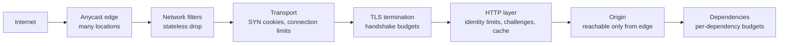

# DDoS Defense Architecture

## TL;DR

A distributed denial-of-service attack does not break a control; it spends a resource faster than the defender can supply it. The resource may be bandwidth on a link, entries in a connection table, CPU for TLS handshakes, or database time behind one expensive endpoint. Defense is therefore a capacity and placement problem before it is a detection problem: **each layer must discard hostile work using less of its own resource than the attacker spent to send it, and must do so before the work reaches a layer where it is more expensive.**

That principle produces the standard architecture. Volumetric floods are absorbed at a distributed, anycast edge with far more bandwidth than any single site. Transport-layer state exhaustion is defeated by refusing to allocate state for an unverified peer. Application-layer floods are met with identity-based limits, cost-aware admission, and challenges, because each request is individually valid. The origin is reachable only through the edge, or the whole arrangement is bypassed. [Rate Limiting](../06-scaling/05-rate-limiting.md) owns limiter algorithms and distributed budgets, and [API Threat Boundaries and Abuse Resistance](./04-api-security.md) owns authenticated abuse. The subject here is surviving traffic whose purpose is exhaustion.

## Primary Evidence and Scope

| Source | What it establishes | Boundary |
|---|---|---|
| RFC 2827 (BCP 38) | Ingress filtering at network edges prevents spoofed source addresses, the precondition for reflection attacks | Works only where operators deploy it |
| RFC 4987 | SYN flooding mechanics and mitigations including SYN caches and SYN cookies | TCP-specific |
| Rossow, Amplification Hell (NDSS 2014) | 14 UDP-based protocols usable for amplification, with bandwidth amplification factors up to 4,670 | Survey of protocols as deployed at the time |
| GitHub incident report (2018) | A memcached reflection attack peaking at 1.35 Tbps and 126.9 million packets per second, mitigated by diverting traffic to a scrubbing provider | One incident |
| Antonakakis et al., Mirai (USENIX Security 2017) | An IoT botnet that peaked near 600,000 infected devices and its attack history | One botnet family |
| Cloudflare and Google reports on HTTP/2 Rapid Reset (2023) | Request floods of 201 million and 398 million requests per second from a protocol feature that cancels streams cheaply | Vendor-reported peaks for one vulnerability |
| RFC 9000 | QUIC limits a server to sending three times the bytes received from an unvalidated address | The protocol's anti-amplification rule |

Sizing examples below are illustrative.

## Attack Classes by Exhausted Resource

Classify an attack by what it consumes, because that determines where it must be stopped.

| Class | Resource exhausted | Typical form | Where it must be stopped |
|---|---|---|---|
| Volumetric | Link and transit bandwidth, packet-forwarding capacity | Reflection and amplification over UDP, direct floods from botnets | Upstream of the site, across many locations |
| Protocol or state | Connection tables, half-open queues, load-balancer and firewall state | SYN floods, fragment floods, connection exhaustion | The first device that would allocate state |
| Application | CPU, memory, worker pools, database and downstream capacity | HTTP request floods, slow requests, expensive queries, protocol abuse such as rapid stream resets | The first layer that can attribute and price a request |

Two properties distinguish the classes. Volumetric attacks are mostly **spoofed and stateless**, so they can be filtered by packet properties without understanding sessions. Application attacks are **unspoofed and well-formed**: every request completes a handshake and passes validation, so discarding them requires deciding which clients to believe.

### Why Amplification Works

Reflection needs two things: a network that lets the attacker send packets with the victim's source address, and a public service that answers a small request with a large response. The attacker's cost is the request; the victim receives the response.

**Documented, Rossow:** the study measured bandwidth amplification factors across 14 protocols, up to 4,670. **Documented, GitHub:** the 2018 attack used exposed memcached servers, whose amplification the report describes as up to 51,000 times. An attacker controlling 100 Mbps of spoofed traffic and an amplifier with a factor of 500 delivers 50 Gbps, more than most single sites buy.

Source-address filtering at network edges removes the precondition, which is why it is a published best current practice. A defender cannot rely on other networks having deployed it.

## The Layered Defense Path



Each stage is cheaper per discarded unit than the one after it. A packet dropped by a stateless filter costs nanoseconds. A connection refused by a SYN cookie costs one hash. A request rejected after TLS has already cost a handshake. A request rejected by the application has cost a worker, a parse, and possibly a database query. The design goal is to make the earliest possible stage do the discarding.

## Absorbing Volume at the Edge

Bandwidth attacks are won by having more capacity than the attacker in more places than the attacker can concentrate on.

**Anycast** announces the same address prefix from many locations, so the routing system delivers each packet to a nearby one. An attack sourced from machines around the world is divided among sites along the same boundaries as legitimate traffic, and no single site receives the total. The architecture is described in [CDN Architecture](../06-scaling/04-cdn-architecture.md) and [Cloudflare System Design](../08-case-studies/12-cloudflare.md).

Three operating models exist:

- **Always-on proxy.** All traffic enters through a provider's edge. No detection delay and no routing change during an attack; the provider is in the path of every request, with the latency and dependency that implies.
- **On-demand diversion.** Under attack, routes are changed so traffic passes through scrubbing centers and clean traffic is returned over a tunnel. The site is exposed during detection and route convergence. **Documented, GitHub:** the 2018 report describes exactly this sequence, with the site unavailable for several minutes before diversion took effect.
- **Remotely triggered black hole.** The upstream network drops all traffic to the attacked address. This completes the attacker's goal for that address in exchange for saving everything else on the network. It is a last resort and a reason to keep unrelated services on separate addresses.

At the edge, stateless filters remove what no legitimate client sends: UDP to an address that serves only TCP, fragments, source ports of known amplifiers, and packets for protocols the service does not speak. Operators distribute such rules to routers at the network border so the drop happens before the traffic is carried inward.

## Refusing to Hold State

A TCP server traditionally allocates a record when it receives a SYN and holds it until the handshake completes or times out. A SYN flood sends handshakes that never complete, filling that table so genuine connections are refused.

**Documented, RFC 4987:** SYN cookies remove the allocation. The server encodes the connection parameters into the initial sequence number of its SYN-ACK and keeps nothing. A genuine client returns that number in its ACK, from which the server reconstructs the state. A spoofed source never replies, and the server spent one hash computation.

The same idea generalizes and should be applied everywhere a peer is unverified:

- **Do not send more than you received.** **Documented, RFC 9000:** before validating a client's address, a QUIC server may send at most three times the bytes it has received, which caps its usefulness as an amplifier.
- **Prove the return path first.** Retry tokens and cookies force the client to demonstrate it can receive packets at its claimed address before the server commits resources.
- **Keep middleboxes stateless where possible.** A stateful firewall or load balancer in front of servers is itself a connection table to exhaust. Designs that hash packets to backends consistently, without per-connection memory on the forwarding path, do not have that failure mode. See [Load Balancing](../06-scaling/01-load-balancing.md).

The transport details, including handshake costs and kernel queues, are in [Network Transport Internals](../06-scaling/14-network-transport-internals.md).

## Application-Layer Floods

When every request is valid, filtering becomes a judgment about clients, and the attacker's advantage is **cost asymmetry**: a request that takes microseconds to send may take the defender a database query, a template render, or a password hash.

**Documented, 2023 Rapid Reset reports:** attackers opened HTTP/2 streams and cancelled them immediately. Cancellation freed the client's concurrency slot while the server had already begun work, so the protocol's concurrent-stream limit did not bound the request rate. Cloudflare reported a peak of 201 million requests per second and Google 398 million, with Cloudflare noting the botnet involved was on the order of 20,000 machines. The lesson generalizes: any operation that is cheap to start and cheap to abandon for the client, but not for the server, is an amplifier.

The defensive toolkit, in rough order of application:

1. **Serve from cache.** A cached response costs the edge almost nothing. Attackers therefore target what cannot be cached: search, login, cart, and query strings that defeat cache keys. Normalize cache keys and refuse unbounded variation.
2. **Limit by identity, at several granularities.** Per address, per network prefix, per authenticated account, per API key, per session, and per TLS or client fingerprint. A botnet of 20,000 machines sending 50 requests per second each produces one million requests per second while every individual address looks moderate, so per-address limits alone do not see it.
3. **Price requests by cost, not count.** Give each endpoint a weight reflecting its backend cost and charge budgets in those units. Ten search queries should not be treated like ten static fetches.
4. **Challenge when uncertain.** A computational or interactive challenge raises the attacker's per-request cost and separates automated clients from browsers. It also harms legitimate automation and accessibility, so apply it selectively and only under suspicion.
5. **Bound connection behavior.** Limit streams opened and reset per connection, header and body read times, and request size. Close connections that misbehave instead of only rejecting requests.
6. **Shed by priority at the origin.** When load still exceeds capacity, serve authenticated and in-progress sessions first and fail the rest quickly. See [Backpressure](../06-scaling/07-backpressure.md).

## Origin and Dependency Protection

An edge that absorbs attacks is worth nothing if the origin can be addressed directly. Attackers find origin addresses in historical DNS records, certificate transparency logs, outbound mail headers, and misconfigured subdomains.

- Accept origin connections only from the edge, enforced by network allowlists and by mutual TLS or a signed header the origin verifies.
- Rotate the origin address after any exposure, and never publish it in a DNS record.
- Keep administrative and deployment access on a separate path, so mitigation can be changed while the public path is saturated.

Dependencies are attack surface too. Authoritative DNS, an identity provider, a payment gateway, or a shared rate-limit store can be the real target, and an attack on them looks like an application outage. The 2016 attack on a managed DNS provider made many unrelated sites unreachable without touching their servers. Use more than one DNS provider where the product justifies it, and see [DNS and Connection Management](../06-scaling/13-dns-and-connection-management.md).

For multi-tenant platforms, the blast radius is the question: one attacked customer must not exhaust the capacity shared with others. Assigning tenants to overlapping subsets of edge capacity limits the damage to the tenants sharing that exact subset, as described in [Cell-Based Architecture and Shuffle Sharding](../06-scaling/11-cell-based-architecture.md).

## Capacity and Cost Model

All inputs are illustrative.

**SYN flood.** Ten million SYN packets per second at 60 bytes each:

```text
bandwidth        = 10,000,000 x 60 x 8      = 4.8 Gbit/s
state if stored  = 10,000,000 x 60 s hold   = 600 million half-open entries
state with cookies                          = 0
```

The bandwidth is survivable for a well-connected site. The state is not, which is why the mitigation is to store none.

**Application flood against a small origin.** An origin sustains 20,000 requests per second at its latency objective. A botnet sends one million.

```text
required discard rate at the edge  = 1 - 20,000 / 1,000,000  = 98%
```

If discrimination is imperfect and 5% of hostile requests pass, the origin receives 50,000 hostile requests per second, more than twice its capacity, before any legitimate traffic. Edge filtering alone is insufficient; the origin still needs admission control and a cheap failure mode.

**Autoscaling as an attack outcome.** If each instance costs 0.20 currency units per hour and serves 1,000 requests per second, absorbing one million requests per second by scaling out costs 200 per hour for as long as the attacker continues. Scaling limits and budget alarms are part of the defense. A capped service that sheds is often the correct design; an uncapped one converts denial of service into denial of wallet.

## Failure Traces

### The origin was never hidden

A site sits behind a proxy service. Its origin address appears in an old DNS record for a staging hostname. The attacker sends a volumetric flood directly to the origin's hosting provider, which black-holes the address. The edge is healthy and serves errors. Lock the origin to edge sources and treat any address disclosure as requiring rotation.

### Retries amplify the attack

The edge sheds 30% of requests with an error. Mobile clients retry immediately, three times each. Legitimate load nearly doubles on top of the attack, and the service that was degraded becomes unavailable. Return an explicit retry delay, make clients honor it with jitter, and budget retries as described in [Retries, Timeouts, and Hedging](../06-scaling/10-retries-timeouts-hedging.md).

### One expensive endpoint

A product search endpoint runs an unindexed query taking 400 milliseconds of database time. Fifty requests per second saturate the database, and the request rate never crosses any per-address or global limit. Find such endpoints before attackers do by ranking endpoints by backend cost per request, and give them their own small budgets.

### The mitigation depended on the attacked path

Operators need to push a new filter rule. The configuration interface is served through the same edge and the same authentication service that is under attack, and the login times out. Keep an out-of-band management path and pre-approved emergency rules that can be enabled without the primary control plane.

### Legitimate users behind one address

A per-address limit of 100 requests per second blocks a university and a mobile carrier whose users share a small set of translated addresses. Support volume becomes the second incident. Prefer authenticated identity where it exists, widen limits for known shared networks, and degrade to challenges before blocking.

## Operations and Verification

Maintain a runbook with named decisions: who may enable challenges site-wide, who may request a black hole, and what the communication path is when primary tools are down. The command structure is in [Incident Command and Learning](../11-observability/07-incident-management.md).

Observe at every layer separately: packets and bits per second by protocol at the edge, SYN and connection-table occupancy, handshake rate, requests per second by endpoint cost class, cache hit ratio, challenge issue and pass rates, origin admission rejections, and dependency saturation. A single request-rate graph hides which layer is failing.

Test deliberately and with authorization from every network involved. Load-test the origin's shedding behavior, verify that the origin refuses direct connections, exercise route diversion on a schedule so that convergence time is known, and replay captured attack patterns against a staging edge. An untested mitigation is a hypothesis.

## Decision Framework

| Situation | Choice | Reason |
|---|---|---|
| Public web property with no tolerance for detection delay | Always-on anycast proxy with origin lockdown | No exposure window; volume is absorbed where capacity exists |
| Non-HTTP service or own address space, attacks are rare | On-demand route diversion to scrubbing | Preserves direct paths in peacetime; accept minutes of exposure |
| TCP service on your own hosts | SYN cookies enabled, stateless forwarding in front | Removes the half-open table as a target |
| UDP service you operate | Address validation before large responses; response no larger than a small multiple of the request | Do not become someone else's amplifier |
| API with authenticated clients | Per-key cost budgets, tight limits for unauthenticated routes | Identity is a better limiter key than address |
| Endpoints with high backend cost | Separate small budgets, caching or precomputation, challenge on anomaly | These are where a small flood succeeds |
| Multi-tenant platform | Per-tenant capacity isolation and shuffle sharding | One tenant's attacker must not become every tenant's outage |
| Cost-sensitive service with autoscaling | Hard scaling caps and shed-on-overload | Bound the bill as well as the latency |

Finally, ask of each layer: what resource does it spend per hostile unit, what does the attacker spend, and which earlier layer could have discarded it?

## References

- [RFC 2827 (BCP 38), *Network Ingress Filtering: Defeating Denial of Service Attacks which employ IP Source Address Spoofing*](https://www.rfc-editor.org/rfc/rfc2827)
- [RFC 4987, *TCP SYN Flooding Attacks and Common Mitigations*](https://www.rfc-editor.org/rfc/rfc4987)
- [RFC 9000, *QUIC: A UDP-Based Multiplexed and Secure Transport*](https://www.rfc-editor.org/rfc/rfc9000)
- [Rossow, *Amplification Hell: Revisiting Network Protocols for DDoS Abuse* (NDSS 2014)](https://www.ndss-symposium.org/ndss2014/programme/amplification-hell-revisiting-network-protocols-ddos-abuse/)
- [GitHub Engineering, *February 28th DDoS Incident Report* (2018)](https://github.blog/news-insights/company-news/ddos-incident-report/)
- [Antonakakis et al., *Understanding the Mirai Botnet* (USENIX Security 2017)](https://www.usenix.org/conference/usenixsecurity17/technical-sessions/presentation/antonakakis)
- [Cloudflare, *HTTP/2 Rapid Reset: Deconstructing the Record-Breaking Attack* (2023)](https://blog.cloudflare.com/technical-breakdown-http2-rapid-reset-ddos-attack/)
- [Google Cloud, *How it works: The novel HTTP/2 Rapid Reset DDoS attack* (2023)](https://cloud.google.com/blog/products/identity-security/how-it-works-the-novel-http2-rapid-reset-ddos-attack)
- [Eisenbud et al., *Maglev: A Fast and Reliable Software Network Load Balancer* (NSDI 2016)](https://research.google/pubs/maglev-a-fast-and-reliable-software-network-load-balancer/)
- [AWS, *AWS Best Practices for DDoS Resiliency*](https://docs.aws.amazon.com/whitepapers/latest/aws-best-practices-ddos-resiliency/aws-best-practices-ddos-resiliency.html)

---

## Related Chapters

- [Rate Limiting](../06-scaling/05-rate-limiting.md): the limiter algorithms and distributed budgets the application layer relies on
- [CDN Architecture](../06-scaling/04-cdn-architecture.md): the anycast edge that absorbs volume and serves cached responses under attack
- [Network Transport Internals](../06-scaling/14-network-transport-internals.md): handshake state, kernel queues, and where connection floods bite
- [API Threat Boundaries and Abuse Resistance](./04-api-security.md): abuse by authenticated clients, the case identity limits do not solve
- [Cell-Based Architecture and Shuffle Sharding](../06-scaling/11-cell-based-architecture.md): keeping one attacked tenant from consuming capacity shared with others
- [Cloudflare System Design](../08-case-studies/12-cloudflare.md): an edge network designed around absorbing attacks at every location
