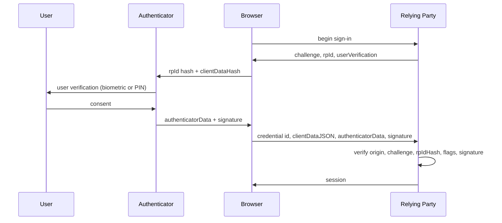
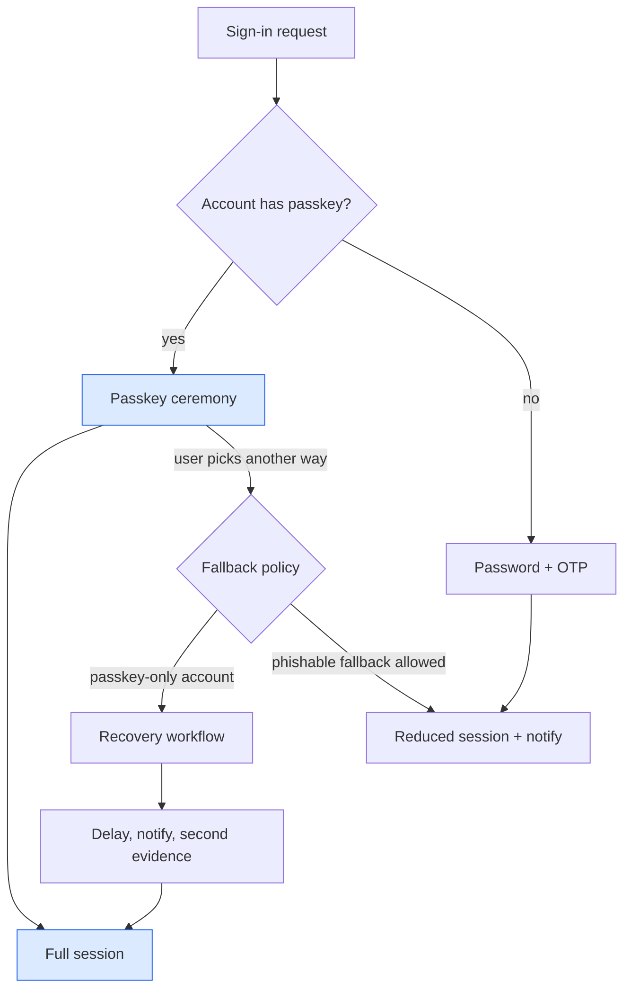

# Passkeys and Phishing-Resistant Authentication

## TL;DR

A passkey is a WebAuthn public-key credential that the user can discover and use without typing an identifier. The server stores a public key; the private key stays inside an authenticator and signs a challenge only for the relying party it was created for. The browser, not the user, decides which site is asking. That is the whole reason passkeys resist phishing: a look-alike domain cannot obtain a signature scoped to the real one, and a relay that sits between the victim and the real site receives an assertion bound to the wrong origin.

**Phishing resistance is a property of the account, not of the authenticator.** An account that accepts a passkey and also accepts a password plus a one-time code is exactly as phishable as the password path, because the attacker chooses the path. The design work is therefore not the WebAuthn ceremony, which libraries implement, but the surrounding system: which fallbacks remain, how recovery is authorized, how synced and device-bound credentials are told apart, and what protects the session after the ceremony ends. Password storage, session stores, and the general authenticator lifecycle belong to [Authentication Systems](01-authentication-fundamentals.md); this chapter covers the public-key path and the session-binding work that follows it.

## The Security Contract

A deployment is phishing resistant only when all of these hold:

1. **Origin binding.** Every accepted assertion was produced for an origin the relying party explicitly allows, and the server verifies it instead of trusting the client.
2. **Challenge freshness.** Each challenge is generated by the server, bound to one pending ceremony, and consumed exactly once.
3. **No weaker equivalent path.** Any path that grants the same session without a phishing-resistant factor is either removed, limited to a lower privilege, or delayed and notified.
4. **Recovery is at least as strong as sign-in.** Adding a new passkey or resetting the account requires evidence comparable to using an existing one.
5. **Credential state is authoritative on the server.** A credential deleted server-side stops working immediately, whatever the authenticator still holds.
6. **Post-authentication theft is bounded.** A stolen session cookie or token expires quickly or is bound to a key the thief does not hold.

**Documented, WebAuthn Level 3:** the specification became a W3C Recommendation on 25 August 2026. It standardizes features browsers had already shipped, including conditional mediation, related origin requests, the signal methods, backup flags, and hybrid transport. **Documented, NIST SP 800-63B-4 (2025):** syncable authenticators are permitted up to AAL2, AAL3 requires a phishing-resistant authenticator with a non-exportable key, and verifiers operating at AAL2 must offer a phishing-resistant option.

## How Origin Binding Works



Two independent parties enforce scope. The browser refuses to run a ceremony for an `rpId` that is not a registrable suffix of the page's origin, and it writes the real origin into `clientDataJSON`. The authenticator looks up credentials by the hash of the `rpId` and includes that hash in the signed `authenticatorData`. The signature covers `authenticatorData` followed by the SHA-256 hash of `clientDataJSON`, so neither value can be swapped afterward.

The server's verification list is short and every item is load-bearing:

| Check | What it defeats |
|---|---|
| `clientDataJSON.type` is `webauthn.get` (or `webauthn.create`) | A registration response replayed as a sign-in |
| `clientDataJSON.challenge` equals the pending challenge, then delete it | Replay of a captured assertion |
| `clientDataJSON.origin` is in the allow list | Assertion produced on a look-alike or embedded origin |
| `rpIdHash` equals SHA-256 of the expected `rpId` | Credential created for another relying party |
| User Present flag set; User Verified flag set when policy requires it | Silent use, or use without the local second factor |
| Signature verifies under the stored public key | Forgery |
| Backup Eligible flag unchanged since registration | A credential record that has been tampered with |

A real-time relay kit defeats passwords, one-time codes, and push approvals because the victim types or approves something the attacker can forward. With WebAuthn the victim's browser signs for the attacker's origin, which the real relying party rejects at the origin and `rpIdHash` checks.

## Synced and Device-Bound Credentials

`authenticatorData` carries two flags that decide what kind of credential the server is holding:

| Flag | Meaning | Design consequence |
|---|---|---|
| Backup Eligible (BE) | The credential may be copied to other devices by its provider | Set once at creation and never changes; BE=0 means device-bound |
| Backup State (BS) | The credential is currently backed up | Can change between ceremonies; BS=1 means losing this device does not lose the credential |

A **synced passkey** lives in a credential manager and follows the user's platform account. It survives device loss, which removes most recovery traffic, but its security is now the security of that sync account and its own recovery process. A **device-bound passkey** on a hardware key or in a platform secure element cannot be exported, which is what high-assurance policy wants, but losing it is an account-recovery event.

Three consequences follow:

- **Signature counters are not a clone detector for synced passkeys.** Providers commonly report zero. Treat a counter that goes backward on a device-bound credential as a signal; ignore it when BE=1.
- **Attestation is mostly absent for synced passkeys.** Consumer providers return no attestation, so the server cannot prove the authenticator model. Enterprise deployments that need hardware provenance request attestation, verify it against FIDO Metadata Service entries, and restrict the allowed AAGUIDs.
- **Policy keys on the flags, not on marketing names.** A reasonable rule is: BE=1 credentials satisfy ordinary sign-in; privileged operations require a BE=0 credential or a fresh step-up, as in the OAuth challenge described in [OAuth 2.1 and High-Assurance Authorization Profiles](11-oauth-security-profiles.md).

## Registration, Sign-In, and Upgrade Paths

**Reference design.** Store one row per credential, keyed by credential ID:

```text
credential_id      bytes   primary key
user_handle        bytes   opaque, never an email address
public_key         COSE    algorithm included
backup_eligible    bool    immutable
backup_state       bool    last observed
sign_count         uint32  last observed
aaguid             uuid    provider or model identifier
transports         set     hints for the next ceremony
created_at, last_used_at, created_by_session
```

The `user_handle` is returned by the authenticator during a discoverable sign-in and is how the server finds the account with no typed identifier. It must be random and stable: an email address there leaks personal data to anyone holding the authenticator and breaks when the address changes.

Level 3 features shape the enrollment funnel:

- **Conditional mediation** offers passkeys inside the username field's autofill, so one form serves users with and without passkeys and no account enumeration is needed.
- **Conditional create** lets the relying party register a passkey right after a successful password sign-in in a credential manager that supports it, with no extra prompt. This is the upgrade path that moves an existing population.
- **Related origin requests** let a relying party publish a list of origins at `/.well-known/webauthn` that may use one `rpId`. This covers country-code domains and brand migrations without one credential per domain. The server must still allow-list each origin it accepts.
- **Signal methods** let the server tell the credential manager that a credential is unknown, which credentials remain valid, and what the current user name is. Without them, deleted credentials stay in the picker and fail at sign-in.
- **Hybrid transport** lets a phone act as the authenticator for a nearby desktop. A QR code carries the bootstrap secret and a Bluetooth proximity check proves the two devices are physically close, which is why a remote attacker cannot simply show the victim a QR code.

## Fallbacks Decide the Real Assurance

An attacker who cannot phish the passkey phishes the fallback. A phishing page simply shows "Passkey unavailable, sign in another way" and collects the password and code.



Options, in increasing strength:

1. **Passkey preferred.** Fallback grants a full session. This improves convenience and conversion but not security.
2. **Fallback degrades.** A session obtained through a phishable path cannot change credentials, move money, or reach administrative functions until a step-up with a passkey.
3. **Passkey required.** Once two passkeys exist (or one synced passkey), phishable factors are removed from the account. Loss is handled only by recovery.

Recovery is then the weakest link by construction. Email-link recovery makes the mailbox the real authenticator. Stronger designs combine a waiting period with notification to every existing channel, identity re-proofing, a recovery credential printed at enrollment, or approval from a second enrolled device. Whatever is chosen, it should be threat-modeled as a sign-in method, because that is what it is.

## Binding the Session After Sign-In

A passkey protects the ceremony. Malware that copies the resulting cookie from the browser's storage bypasses the ceremony entirely, and cookie theft is how most accounts with strong authentication are taken over.

- **Device Bound Session Credentials (DBSC).** The browser creates a key pair, in hardware where available, when the session starts. The server issues a short-lived cookie and will refresh it only when the browser proves possession of the private key at a refresh endpoint. A cookie exfiltrated to another machine expires within minutes and cannot be renewed. **Documented, Google (2026):** DBSC reached public availability in Chrome 146 on Windows in April 2026, backed by the TPM, with macOS announced to follow. Browsers without support keep working with ordinary cookies, so the control is additive.
- **Sender-constrained tokens.** For API clients, DPoP and mutual TLS bind access tokens to a key in the same way.
- **Re-verification for sensitive actions.** Require a fresh user-verified assertion, not just a live session, before credential changes, payouts, or data export.

The honest limit: malware running as the user on the user's device can ask the legitimate browser to act. Binding stops export of the credential, not abuse in place.

## Capacity and Storage Model

The arithmetic is small, which is part of the appeal.

- **Verification cost.** One ES256 signature verification and two SHA-256 hashes per sign-in. This is cheaper than a memory-hard password hash by several orders of magnitude, so a passkey-heavy population lowers the CPU needed at the sign-in tier and removes the password-hash capacity that credential-stuffing floods consume.
- **Challenge store.** One entry per pending ceremony. **Illustrative:** at 2,000 sign-in starts per second with a 5-minute lifetime, the store holds at most 600,000 challenges; at roughly 100 bytes each that is 60 MB before overhead. It needs atomic get-and-delete and a single-region home per ceremony, or a region-tagged challenge, so a response cannot be redeemed twice in two regions.
- **Credential table.** A few hundred bytes per credential; three credentials per user for 50 million users is 150 million rows and well under 100 GB.
- **DBSC refresh.** Each bound session calls the refresh endpoint once per cookie lifetime. **Illustrative:** 5 million concurrently active sessions with a 10-minute cookie produce about 8,300 refreshes per second, each a signature verification and a session lookup. Size this tier explicitly; it did not exist before.

## Failure Modes

| Failure | Mechanism | Detection and control |
|---|---|---|
| Fallback downgrade | Phishing page hides the passkey option and harvests password plus code | Track sign-ins by method per account; alert when a passkey-enrolled account uses a phishable path; apply the reduced-session policy |
| Recovery takeover | Attacker controls the email inbox and resets the account | Delay and notify on recovery; require a second form of evidence; record recovery as a privileged event |
| Origin allow-list drift | A staging or partner origin stays in the allow list or the related-origins file | Review the allow list as security configuration; test that an unlisted origin is rejected |
| Challenge replay across regions | Challenge validated in two regions before deletion replicates | Pin a ceremony to the region that issued it |
| Orphaned credentials | Server deletes a credential; the picker still offers it | Call the signal methods after deletion and at sign-in |
| Sync-account compromise | Attacker restores the victim's credential manager onto a new device | Out of the relying party's control; require BE=0 or step-up for privileged actions |
| Lockout wave | A platform bug or policy change makes a provider's passkeys unusable | Keep a recovery path that does not depend on one provider; monitor failure rate by AAGUID |
| Cookie theft | Infostealer exports session cookies | DBSC or short sessions; re-verify for sensitive actions |

## Verification

1. Replay a captured assertion: it must fail on the consumed challenge.
2. Present an assertion with a correct signature and a foreign origin: it must fail before signature verification matters.
3. Submit a registration response to the sign-in endpoint: it must fail on `type`.
4. Delete a credential server-side and sign in with it: rejected, and the signal call is issued.
5. From a passkey-enrolled account, complete the fallback path: confirm the session is restricted and the user is notified.
6. Copy a DBSC-bound cookie to another browser profile: it works until expiry and then fails to refresh.
7. Run the recovery flow end to end as an attacker who controls only the email inbox, and write down what stops them.

## Decision Framework

1. **Which accounts must be phishing resistant, not merely passkey capable?** Administrators and staff first; then any account whose compromise moves money or data.
2. **Is a synced credential acceptable for this assurance level?** If policy requires a non-exportable key, enforce BE=0 and attestation at registration.
3. **What is the fallback, and what can a session obtained through it do?** If the answer is "everything," the deployment is a convenience feature.
4. **How does a user with no working authenticator get back in, and how would an attacker abuse that?**
5. **Which origins may assert for the `rpId`, and who approves a change to that list?**
6. **What bounds a stolen session?** Cookie lifetime, DBSC, re-verification.
7. **How is success measured?** Share of sign-ins by method, fallback use on enrolled accounts, recovery volume, and takeover reports by entry path.

## Key Takeaways

- The browser and authenticator enforce origin scope; the server's job is to verify what they signed and to remove every path that skips them.
- Backup flags, not product names, tell the server whether a credential is synced or device-bound. Build policy on them.
- Recovery and fallback define the real assurance level. Design them first.
- Authentication strength ends at the ceremony. Session binding and re-verification carry it forward.

## References

- [W3C, *Web Authentication: An API for accessing Public Key Credentials, Level 3*](https://www.w3.org/TR/webauthn-3/)
- [FIDO Alliance, *WebAuthn Level 3 Is Now a W3C Recommendation* (2026)](https://fidoalliance.org/webauthn-level-3-is-now-a-w3c-recommendation/)
- [NIST SP 800-63B-4, *Digital Identity Guidelines: Authentication and Authenticator Management* (2025)](https://csrc.nist.gov/pubs/sp/800/63/b/4/final)
- [W3C Web Application Security Working Group, *Device Bound Session Credentials*](https://w3c.github.io/webappsec-dbsc/)
- [Google, *Protecting Cookies with Device Bound Session Credentials* (2026)](https://blog.google/security/protecting-cookies-with-device-bound-session-credentials/)
- [RFC 9449: OAuth 2.0 Demonstrating Proof of Possession (DPoP)](https://www.rfc-editor.org/rfc/rfc9449)

---

## Related Chapters

- [Authentication Systems](01-authentication-fundamentals.md): the authenticator lifecycle, session store, and recovery workflow that this credential type plugs into
- [OAuth 2.1 and High-Assurance Authorization Profiles](11-oauth-security-profiles.md): step-up challenges and sender-constrained tokens carry this assurance into API calls
- [Identity Lifecycle and Continuous Access Evaluation](13-identity-lifecycle-and-continuous-access.md): a credential-change or compromise event has to reach every session it once created
- [Threat Modeling and Abuse Case Engineering](08-threat-modeling-and-abuse-cases.md): fallback and recovery paths are abuse cases, and this is the method for enumerating them
- [Rate Limiting](../06-scaling/05-rate-limiting.md): sign-in and recovery endpoints still need admission control once password hashing no longer throttles them
