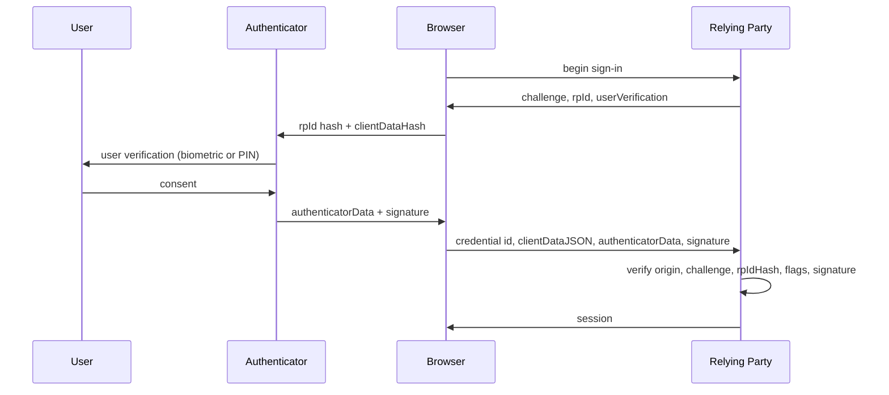
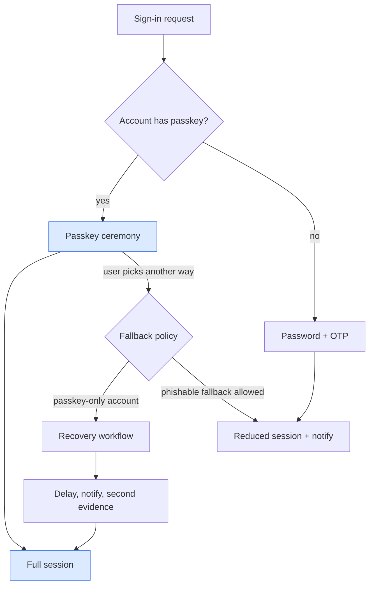

# Passkeys and Phishing-Resistant Authentication

## TL;DR

A passkey is a WebAuthn public-key credential that a user can find and use without typing an identifier. The server keeps a public key. The private key stays inside an authenticator, which signs a server challenge only on behalf of the site the credential was created for. The browser decides which site is asking, and the user is never consulted on that question. This is the entire source of phishing resistance: the one judgment that people reliably get wrong, "is this really my bank?", has been taken away from them and given to software that compares strings.

**Phishing resistance is a property of the account, not of the authenticator.** An account that accepts a passkey and also accepts a password with a one-time code is as phishable as the password path, because the attacker chooses which path to attack. The WebAuthn ceremony itself is a solved problem that libraries implement. The engineering that determines whether an account can be taken over lives around the ceremony: which fallbacks remain, how recovery is authorized, how synced and device-bound credentials are distinguished, and what protects the session after the ceremony ends. Password storage, session stores, and the general authenticator lifecycle belong to [Authentication Systems](01-authentication-fundamentals.md). This chapter follows the public-key path from the bytes that are signed to the cookie that outlives the signature.

## Why Every Shared Secret Can Be Relayed

It is worth being precise about what phishing defeats, because the precision explains the design of everything that follows.

A password is a secret the user knows and transmits. A one-time code from an authenticator app is a secret the user reads and transmits. A push approval is a decision the user makes about a prompt that does not say who is asking. In all three cases a human being carries the proof from one place to another, and the proof contains nothing about where it is being carried. A modern phishing kit exploits exactly this. It is a reverse proxy: the victim loads a look-alike domain, the kit forwards every request to the real site and every response back to the victim, and the victim completes a perfectly genuine sign-in through the attacker's machine. The password, the code, and the approval all pass through. At the end, the real site sets a session cookie, and the kit keeps it.

Notice what did not matter. The length of the password did not matter. The strength of the one-time code algorithm did not matter. The second factor was real and was really checked. Adding a third factor of the same kind would not have helped. The failure is structural: **any proof that a human can carry to the wrong place will eventually be carried there.**

There are only two ways out. We can train people to check the address bar, an approach with decades of evidence against it, or we can arrange for the proof to be worthless anywhere except the place it was meant for. WebAuthn takes the second route. The proof is a signature, the signature covers the name of the site that requested it, and that name is written by the browser from the connection it actually has, not from anything the page or the user claims.

## The Security Contract

Before the mechanism, we state what has to be true. A deployment is phishing resistant only when all of these hold:

1. **Origin binding.** Every accepted assertion was produced for an origin the relying party explicitly allows, and the server verifies it instead of trusting the client.
2. **Challenge freshness.** Each challenge is generated by the server, bound to one pending ceremony, and consumed exactly once.
3. **No weaker equivalent path.** Any path that grants the same session without a phishing-resistant factor is either removed, limited to a lower privilege, or delayed and notified.
4. **Recovery is at least as strong as sign-in.** Adding a new passkey or resetting the account requires evidence comparable to using an existing one.
5. **Credential state is authoritative on the server.** A credential deleted server-side stops working immediately, whatever the authenticator still holds.
6. **Post-authentication theft is bounded.** A stolen session cookie or token expires quickly or is bound to a key the thief does not hold.

The first two clauses are cryptography, and a maintained library will satisfy them. The last four are system design, and no library can. Most of this chapter is about the last four.

**Documented, WebAuthn Level 3:** the specification became a W3C Recommendation on 25 August 2026. It standardizes features browsers had already shipped, including conditional mediation, related origin requests, the signal methods, backup flags, and hybrid transport. **Documented, NIST SP 800-63B-4 (2025):** syncable authenticators are permitted up to AAL2, AAL3 requires a phishing-resistant authenticator with a non-exportable key, and verifiers operating at AAL2 must offer a phishing-resistant option.

## How Origin Binding Works



Three parties take part in a sign-in, and it helps to ask of each one what it knows and what it vouches for.

The **browser** knows the origin of the page, because it made the TLS connection. When a page asks for a credential, it names a relying party identifier, the `rpId`, which is a domain such as `bank.example`. The browser refuses the request unless that `rpId` equals the page's own domain or is a registrable parent of it. A page on `login.bank.example` may ask for `bank.example`. A page on `bank-example.co` may not. The browser then assembles a small JSON document, `clientDataJSON`, containing the ceremony type, the server's challenge, and the page's true origin. The page does not get to edit this document.

The **authenticator** knows nothing about URLs. It receives two hashes: the SHA-256 of the `rpId` and the SHA-256 of `clientDataJSON`. It keeps its credentials indexed by `rpId` hash, so it can only find a credential for the relying party the browser named. After verifying the user locally with a biometric or PIN, it builds `authenticatorData` and signs.

The layout of `authenticatorData` is fixed, and knowing it removes most of the mystery from the server's checks. The first 32 bytes are the `rpId` hash. The next byte holds flags: bit 0 is User Present, bit 2 is User Verified, bit 3 is Backup Eligible, bit 4 is Backup State, and bit 6 marks that new credential data follows. Then come four bytes of signature counter. During registration only, the structure continues with a 16-byte authenticator model identifier (the AAGUID), the credential ID, and the new public key in COSE encoding. The signature is computed over `authenticatorData` concatenated with the hash of `clientDataJSON`. One signature therefore commits to the relying party, the flags, the challenge, and the origin together, and none of them can be exchanged afterward.

Now replay the phishing kit against this. The victim is on `bank-example.co`. If the kit's page asks for a credential with `rpId` set to `bank.example`, the browser rejects the call before any authenticator is involved. If it asks with its own domain, the authenticator searches for credentials under the hash of `bank-example.co` and finds none, so there is nothing to offer the user. Suppose a browser bug let the request through anyway: the signed `clientDataJSON` would carry the origin `https://bank-example.co`, and the real server would reject it. The kit can still forward bytes faithfully in both directions. It just has no bytes worth forwarding.

The **relying party** is the third party, and its job is to distrust the other two until the signature is verified. The verification list is short and every item is load-bearing:

| Check | What it defeats |
|---|---|
| `clientDataJSON.type` is `webauthn.get` (or `webauthn.create`) | A registration response replayed as a sign-in |
| `clientDataJSON.challenge` equals the pending challenge, then delete it | Replay of a captured assertion |
| `clientDataJSON.origin` is in the allow list | Assertion produced on a look-alike or embedded origin |
| `rpIdHash` equals SHA-256 of the expected `rpId` | Credential created for another relying party |
| User Present flag set; User Verified flag set when policy requires it | Silent use, or use without the local second factor |
| Signature verifies under the stored public key | Forgery |
| Backup Eligible flag unchanged since registration | A credential record that has been tampered with |

Teams that write this verification by hand tend to implement the signature check carefully and the origin check loosely, typically as a suffix match or a pattern that also admits a staging host. The signature check only proves that some authenticator signed some bytes. It is the comparisons against server-held expectations that turn a valid signature into an authentication, so we treat the origin allow list as security configuration with an owner and a review process.

### The Challenge Store Is a Small Distributed Systems Problem

The challenge exists to make each assertion single-use. That requires state: the server must remember which challenges are outstanding and must retire each one atomically when it is redeemed. The operation we need is get-and-delete as a single step. Two separate commands leave a window in which two concurrent requests both read the challenge before either deletes it, and a captured assertion is accepted twice.

It is tempting to avoid the store by making the challenge self-describing: sign a timestamp and a nonce, send it to the client, and verify the signature when it returns. This removes the state and with it the guarantee. A stateless challenge can prove it is recent, but it cannot prove it has not been used before, so an assertion captured in transit remains replayable until the timestamp expires. For most deployments the window is narrow and the attacker who can capture an assertion over TLS has better options, but the contract says "exactly once," and only state can deliver that.

The same reasoning applies across regions. If the challenge store replicates asynchronously, a challenge issued in one region may be redeemed in a second region before the deletion from the first arrives. We avoid the problem by not having it: a ceremony is pinned to the region that issued its challenge, either by routing or by encoding the region in the challenge so that a misrouted response is forwarded or refused.

## Synced and Device-Bound Credentials

The original FIDO model put each private key in one piece of hardware and never let it leave. That model has an excellent security argument and a poor operational one: every lost phone becomes an account recovery, and account recovery is where accounts are stolen. Passkeys became viable for consumer populations when platform vendors began synchronizing the private keys across a user's devices. The trade is explicit, and the protocol reports which side of it a credential is on through two flags in `authenticatorData`:

| Flag | Meaning | Design consequence |
|---|---|---|
| Backup Eligible (BE) | The credential may be copied to other devices by its provider | Set once at creation and never changes; BE=0 means device-bound |
| Backup State (BS) | The credential is currently backed up | Can change between ceremonies; BS=1 means losing this device does not lose the credential |

A **synced passkey** lives in a credential manager and follows the user's platform account. The major providers encrypt the key material end to end, so that their own servers hold ciphertext, and they gate the enrollment of a new device on a secret from an existing one, usually a device passcode checked inside hardware security modules that limit the number of guesses. This is strong, but observe what has happened to the trust boundary. The relying party's account is now exactly as secure as the user's platform account and that account's own recovery process, neither of which the relying party can inspect or configure. A **device-bound passkey** on a hardware key or in a platform secure element cannot be exported. It gives the relying party a boundary it can reason about, and the price is that loss of the device is a recovery event.

Three consequences follow, and each one overturns an assumption carried over from the hardware-key era.

**Signature counters cannot detect clones of synced passkeys.** The counter was designed so that a cloned hardware key would eventually present a value lower than one the server had already seen. For that to work across a phone, a tablet, and a laptop holding the same key, the three devices would need to agree on a single increasing number, which means coordinating on every sign-in, including when one of them is offline. No provider attempts this. Synced passkeys report a counter of zero, permanently. We treat a counter that goes backward on a BE=0 credential as a real signal and ignore the counter entirely when BE=1.

**Attestation is mostly absent for synced passkeys.** Attestation is a statement, signed by a key the manufacturer embedded in the device, that a credential was created inside a particular authenticator model. A key that will be copied to devices not yet purchased has no single device to attest to, and consumer providers return no attestation at all. Enterprise deployments that need hardware provenance must therefore ask for attestation at registration, verify it against FIDO Metadata Service entries, and restrict the AAGUIDs they accept, which in practice means issuing hardware.

**Policy should key on the flags and not on product names.** A reasonable rule is that BE=1 credentials satisfy ordinary sign-in, while privileged operations require a BE=0 credential or a fresh step-up, as in the OAuth challenge described in [OAuth 2.1 and High-Assurance Authorization Profiles](11-oauth-security-profiles.md).

## Registration, Sign-In, and Upgrade Paths

**Reference design.** Store one row per credential, keyed by credential ID:

```text
credential_id      bytes   primary key
user_handle        bytes   opaque, never an email address
public_key         COSE    algorithm included
backup_eligible    bool    immutable
backup_state       bool    last observed
sign_count         uint32  last observed
aaguid             uuid    provider or model identifier
transports         set     hints for the next ceremony
created_at, last_used_at, created_by_session
```

The key choice follows from the access pattern. In a discoverable sign-in the user types nothing, so the server has no account to look up. The authenticator returns a credential ID and the `user_handle` it was given at registration, and the server's first read is by credential ID. The `user_handle` then identifies the account. It must be random and stable. An email address in that field is disclosed to anyone who can enumerate the authenticator, and it breaks the credential when the address changes.

The stored `backup_eligible` value is the reason the verification table compares the flag on every sign-in. The flag is immutable by specification, so a credential that registered as device-bound and later claims to be syncable is either a corrupted record or something worse, and both deserve an alert.

A new credential type is only as useful as the fraction of users who have one. WebAuthn Level 3 is largely a catalogue of features for moving an existing population, and each solves a specific obstacle that early deployments ran into.

The first obstacle was the sign-in page itself. A site that does not know whether a visitor has a passkey must either ask, which adds a step, or look up the typed username and reveal whether a passkey exists, which is an enumeration oracle. **Conditional mediation** removes the question. The page starts a ceremony that stays silent, and the browser offers any matching passkeys inside the username field's autofill menu. A user with a passkey selects it and is signed in. A user without one sees an ordinary form.

The second obstacle was enrollment. Few users go looking for a security settings page. **Conditional create** lets the relying party register a passkey immediately after a successful password sign-in, without a prompt, when the credential manager that filled the password supports it. This is the mechanism that converts a population at the pace of its normal sign-ins.

The third was that organizations have more than one domain. Because a credential is scoped to an `rpId`, a company operating `shop.example` and `shop.example.jp` would need a credential for each. **Related origin requests** let the relying party publish, at `/.well-known/webauthn`, a list of origins permitted to use one `rpId`. The browser fetches that file before allowing the ceremony. The server must still allow-list each origin it accepts, and the file now belongs to the security configuration.

The fourth was drift between server and authenticator. When the server deletes a credential, the copy in the user's credential manager is unaffected and keeps appearing in the picker, where it fails. The **signal methods** let the server report that a credential is unknown, list the credentials that remain valid, and update the displayed user name.

The fifth was signing in on a device that does not hold the passkey. **Hybrid transport** lets a phone act as the authenticator for a nearby computer, and its design repays a closer look, because the obvious version of it would have reintroduced phishing. The computer displays a QR code containing a fresh public key and a secret. The phone scans it, and then broadcasts a Bluetooth Low Energy advertisement encrypted under a key derived from that secret. The computer must receive that advertisement by radio. Only then do the two devices connect through an internet relay, complete an encrypted handshake, and exchange the authentication messages. The Bluetooth step carries almost no data. Its purpose is to prove the phone is within radio range of the computer that displayed the code. An attacker who sends the victim a QR code from another continent can get the phone to scan it, but the attacker's computer will never hear the advertisement, and the ceremony stops.

## Fallbacks Decide the Real Assurance

We now arrive at the part of the system where deployments succeed or fail. An attacker who cannot phish the passkey phishes the fallback. The phishing page does not need to defeat WebAuthn. It needs to display "Passkey unavailable, sign in another way," and then collect the password and code exactly as before.



The useful way to think about this is that an account's assurance is the minimum over all the paths that lead to a full session, and the attacker gets to choose the path. Adding a strong path does not raise a minimum. Only removing or weakening the consequences of the weak ones does. There are three positions a deployment can take:

1. **Passkey preferred.** The fallback grants a full session. This improves convenience and conversion, and those are real benefits, but the security of the account is unchanged.
2. **Fallback degrades.** A session obtained through a phishable path cannot change credentials, move money, or reach administrative functions until the user steps up with a passkey. The phished session exists but is worth much less.
3. **Passkey required.** Once the account holds two passkeys, or one synced passkey, phishable factors are removed. Loss is handled only by recovery.

Most organizations should aim to reach the second position quickly and the third for staff and administrators. The second position has a property that makes it attractive operationally: it produces a metric. Every use of a phishable path on a passkey-enrolled account is either a user in difficulty or an attack in progress, and both are worth counting.

Taking the third position moves the weakest point to recovery, by construction. If a reset link sent by email restores full access, then the mailbox is the account's real authenticator and the passkey is decoration. Stronger designs combine several kinds of evidence: a waiting period during which every existing channel is notified, identity re-proofing, a recovery credential printed at enrollment, or approval from a second enrolled device. The waiting period deserves particular mention because it is cheap and is so often omitted. It converts a silent takeover into a race that the legitimate owner, who still holds a working session or a notification channel, has a chance to win. Whatever is chosen, we threat-model recovery as a sign-in method, because that is what it is.

## Binding the Session After Sign-In

A passkey protects a ceremony that lasts a few seconds. The session cookie it produces lasts for days or weeks, and it is a bearer credential: whoever presents it is the user. Malware that reads the cookie from the browser's storage never encounters the ceremony at all. As strong authentication has spread, this has become the dominant route into well-protected accounts, since for the attacker it is simply the remaining open door.

The earlier attempt to close it, Token Binding, tied cookies to a key at the TLS layer. It was withdrawn from browsers, largely because TLS is so often terminated by a load balancer or content delivery network that has no good way to pass the binding to the application. **Device Bound Session Credentials (DBSC)** makes a different trade, and the difference is instructive.

When a session starts, the server's response asks the browser to register a session key. The browser generates a key pair, in a TPM or equivalent where one exists, and sends the public key to a registration endpoint. From then on the server issues a session cookie with a lifetime of minutes. When it expires, the browser pauses outgoing requests, calls a refresh endpoint, signs a server challenge with the session key, and receives a new cookie. Ordinary requests carry an ordinary cookie, and every layer between browser and application continues to work unmodified.

Why sign only at refresh, and not on every request? Because hardware keys are slow. A TPM signature takes tens to hundreds of milliseconds, which is tolerable once every several minutes and intolerable on every image fetch. The short cookie is the mechanism that amortizes one expensive proof over many cheap requests. It also defines the residual exposure precisely: a cookie exfiltrated to another machine works until it expires and then cannot be renewed, because the key that renews it never left the original hardware.

**Documented, Google (2026):** DBSC reached public availability in Chrome 146 on Windows in April 2026, backed by the TPM, with macOS announced to follow. Browsers without support keep working with ordinary cookies, so the control is additive.

Two companions complete the picture. For API clients, DPoP and mutual TLS bind access tokens to a key in the same way. And for sensitive actions such as credential changes, payouts, or data export, we require a fresh user-verified assertion in addition to a live session.

We should be honest about the limit. Malware running as the user, on the user's device, can drive the legitimate browser and use the bound session where it sits. Binding prevents the credential from being exported and used elsewhere at the attacker's convenience. It does not prevent abuse in place. That still matters a great deal: it forces the attacker to remain on the compromised machine, where endpoint defenses can see them, and it ends the trade in stolen cookies.

## Capacity and Storage Model

The arithmetic here is small, and the interesting part is where load moves.

Password verification is deliberately expensive. A memory-hard hash is tuned to cost tens of milliseconds and tens of megabytes per attempt, which means a sign-in tier's capacity is set by hashing, and a credential-stuffing flood exhausts it. A passkey sign-in costs one ES256 signature verification and two SHA-256 hashes. **Illustrative:** at roughly 100 microseconds per verification, one core handles about 10,000 sign-ins per second, against perhaps 20 for a hash tuned to 50 milliseconds. As the population moves to passkeys the sign-in tier needs far less CPU. The less welcome effect is that the hash no longer throttles anyone, so explicit admission control on sign-in and recovery endpoints becomes necessary where it was previously incidental.

The challenge store holds one entry per pending ceremony. **Illustrative:** at 2,000 sign-in starts per second with a 5-minute lifetime, the store holds at most 600,000 challenges; at roughly 100 bytes each that is 60 MB before overhead. Its size is never the difficulty. Its requirements are the atomic get-and-delete and the single-region home discussed earlier.

The credential table needs a few hundred bytes per credential. Three credentials per user for 50 million users is 150 million rows and well under 100 GB, read by primary key.

DBSC is the one component that introduces load that did not exist before. Each bound session calls the refresh endpoint once per cookie lifetime, whether or not the user is doing anything interesting. **Illustrative:** 5 million concurrently active sessions with a 10-minute cookie produce about 8,300 refreshes per second, each a signature verification and a session lookup. The cookie lifetime is therefore a dial with security on one side and request volume on the other: halving the exposure window doubles the refresh traffic. This tier also sits in the path of every request that follows an expiry, so an outage there signs users out in waves, one cookie lifetime wide. It deserves its own capacity plan and its own availability objective.

## Failure Modes

The failures below are ordered roughly by how often they decide real incidents. The first two account for most of them.

**Fallback downgrade.** A staff member with an enrolled passkey receives a link, lands on a proxy page, and is told the passkey is unavailable. They enter a password and a code, and the attacker obtains a full session. Nothing in the WebAuthn implementation malfunctioned. The control is the reduced-session policy, and the detection is a count of sign-ins by method per account, with an alert when a passkey-enrolled account uses a phishable path.

**Recovery takeover.** The attacker already controls the victim's mailbox, requests an account reset, and enrolls a passkey of their own. The account is now protected by phishing-resistant authentication that belongs to the attacker. Delay and notification, a second form of evidence, and recording every recovery as a privileged event are the controls.

**Origin allow-list drift.** A staging or partner origin remains in the allow list or the related-origins file after its purpose has passed, and whoever comes to control that origin can obtain valid assertions. We review these lists as security configuration and keep a test that an unlisted origin is rejected.

**Challenge replay across regions.** A challenge is validated in two regions before its deletion replicates. Pinning the ceremony to the issuing region removes the window.

**Orphaned credentials.** The server deletes a credential and the picker continues to offer it. Users experience this as passkeys being unreliable, and they fall back to passwords, which undoes the migration. Calling the signal methods after deletion and at sign-in keeps the two sides aligned.

**Sync-account compromise.** An attacker restores the victim's credential manager onto a new device. This is outside the relying party's control, which is the argument for requiring BE=0 or a step-up before privileged actions.

**Lockout wave.** A platform bug or policy change makes one provider's passkeys unusable, and a large fraction of users cannot sign in at once. Recovery must not depend on a single provider, and sign-in failure rate should be monitored by AAGUID so that the pattern is visible within minutes.

**Cookie theft.** An infostealer exports session cookies. DBSC or short sessions bound the damage, and re-verification protects the actions that matter most.

## Verification

We do not consider a control deployed until we have watched it refuse something. Each of these tests is an attack that should fail, run against production configuration:

1. Replay a captured assertion: it must fail on the consumed challenge.
2. Present an assertion with a correct signature and a foreign origin: it must fail before signature verification matters.
3. Submit a registration response to the sign-in endpoint: it must fail on `type`.
4. Delete a credential server-side and sign in with it: rejected, and the signal call is issued.
5. From a passkey-enrolled account, complete the fallback path: confirm the session is restricted and the user is notified.
6. Copy a DBSC-bound cookie to another browser profile: it works until expiry and then fails to refresh.
7. Run the recovery flow end to end as an attacker who controls only the email inbox, and write down what stops them.

The seventh test is the one most likely to produce an uncomfortable answer, and for that reason it is the one to run first.

## Decision Framework

1. **Which accounts must be phishing resistant, not merely passkey capable?** Administrators and staff first; then any account whose compromise moves money or data.
2. **Is a synced credential acceptable for this assurance level?** If policy requires a non-exportable key, enforce BE=0 and attestation at registration.
3. **What is the fallback, and what can a session obtained through it do?** If the answer is "everything," the deployment is a convenience feature.
4. **How does a user with no working authenticator get back in, and how would an attacker abuse that?**
5. **Which origins may assert for the `rpId`, and who approves a change to that list?**
6. **What bounds a stolen session?** Cookie lifetime, DBSC, re-verification.
7. **How is success measured?** Share of sign-ins by method, fallback use on enrolled accounts, recovery volume, and takeover reports by entry path.

## Key Takeaways

- Shared secrets fail against relays because a human carries them. A signature that names its requester cannot be carried anywhere useful.
- The browser and authenticator enforce origin scope. The server's job is to verify what they signed and to remove every path that skips them.
- Backup flags, not product names, tell the server whether a credential is synced or device-bound. Build policy on them.
- An account's assurance is the minimum over its sign-in and recovery paths. Design those first.
- Authentication strength ends at the ceremony. Session binding and re-verification carry it forward.

## References

- [W3C, *Web Authentication: An API for accessing Public Key Credentials, Level 3*](https://www.w3.org/TR/webauthn-3/)
- [FIDO Alliance, *WebAuthn Level 3 Is Now a W3C Recommendation* (2026)](https://fidoalliance.org/webauthn-level-3-is-now-a-w3c-recommendation/)
- [NIST SP 800-63B-4, *Digital Identity Guidelines: Authentication and Authenticator Management* (2025)](https://csrc.nist.gov/pubs/sp/800/63/b/4/final)
- [W3C Web Application Security Working Group, *Device Bound Session Credentials*](https://w3c.github.io/webappsec-dbsc/)
- [Google, *Protecting Cookies with Device Bound Session Credentials* (2026)](https://blog.google/security/protecting-cookies-with-device-bound-session-credentials/)
- [RFC 9449: OAuth 2.0 Demonstrating Proof of Possession (DPoP)](https://www.rfc-editor.org/rfc/rfc9449)

---

## Related Chapters

- [Authentication Systems](01-authentication-fundamentals.md): the authenticator lifecycle, session store, and recovery workflow that this credential type plugs into
- [OAuth 2.1 and High-Assurance Authorization Profiles](11-oauth-security-profiles.md): step-up challenges and sender-constrained tokens carry this assurance into API calls
- [Identity Lifecycle and Continuous Access Evaluation](13-identity-lifecycle-and-continuous-access.md): a credential-change or compromise event has to reach every session it once created
- [Threat Modeling and Abuse Case Engineering](08-threat-modeling-and-abuse-cases.md): fallback and recovery paths are abuse cases, and this is the method for enumerating them
- [Rate Limiting](../06-scaling/05-rate-limiting.md): sign-in and recovery endpoints still need admission control once password hashing no longer throttles them
