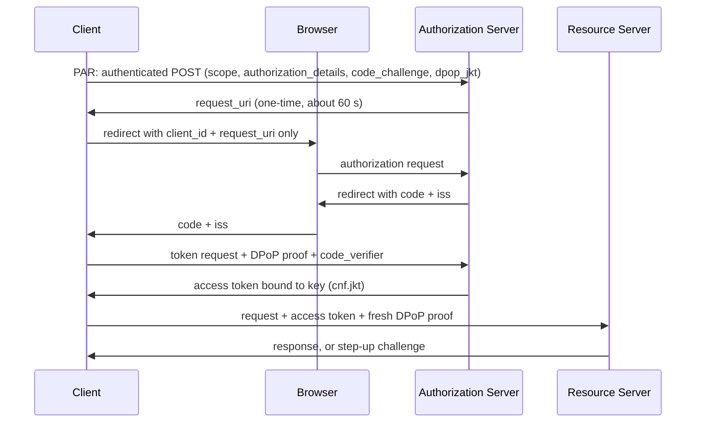

# OAuth 2.1 and High-Assurance Authorization Profiles

## TL;DR

OAuth 2.0 (RFC 6749) is a framework with many optional parts, and most real breaches came from the options: tokens in URLs, loosely matched redirects, bearer tokens that work for whoever holds them, and clients that cannot tell which authorization server answered. A decade of extension RFCs closed those gaps one at a time. The current state of the art is not a new protocol but a **profile**: a fixed selection of those extensions in which the dangerous options are simply absent.

Three layers are worth telling apart. **RFC 9700** (2025) is the published Best Current Practice and is what an implementation should already satisfy. **OAuth 2.1** consolidates that practice into one document; as of November 2026 it is still an IETF Internet-Draft, so cite it as a direction, not as a standard. **FAPI 2.0** is a final OpenID Foundation profile that goes further, with pushed requests, sender-constrained tokens, and a published attacker model. The grant mechanics, token types, and refresh lifecycle are in [OAuth 2.0 and OpenID Connect](02-oauth2-openid-connect.md); this chapter covers which extensions to adopt, in what order, and what each costs to operate.

## What the Baseline Removes

**Documented, RFC 9700 and the OAuth 2.1 draft:** the consolidated baseline is defined mostly by deletions.

| Removed or forbidden | Replacement | Reason |
|---|---|---|
| Implicit grant (`response_type=token`) | Authorization code with PKCE | Tokens in the fragment leak through history, referrers, and injected scripts |
| Resource owner password credentials grant | Authorization code; device grant for constrained input | The client sees the password and multi-factor cannot be applied |
| Authorization code without PKCE | PKCE with `S256` for every client, confidential ones included | Code injection and interception |
| Redirect URI pattern or prefix matching | Exact string comparison | Open redirects and subdomain takeover turn into code theft |
| Bearer tokens in the URI query | `Authorization` header or form body | URLs are logged everywhere |
| Long-lived bearer refresh tokens for public clients | Sender-constrained or rotated with reuse detection | A stolen refresh token is a standing grant |

A system that meets this table has an ordinary, defensible OAuth deployment. The profiles below are for systems where an attacker who can read or alter the browser's traffic, or steal a token at rest, must still fail.

## The Hardened Request Path



Each extension answers one specific weakness of the plain front-channel flow.

### Pushed Authorization Requests

With plain OAuth the authorization request travels through the browser as query parameters, where the user, extensions, and intermediaries can read and alter it. **Documented, RFC 9126:** the client instead POSTs the parameters directly to the authorization server's pushed-request endpoint, authenticating as it would at the token endpoint, and receives a `request_uri`. The browser carries only `client_id` and that reference.

The effects are concrete. Request parameters gain integrity and confidentiality without signing. The authorization server authenticates the client and can reject a bad request before any user interaction. Large requests no longer hit URL length limits. The cost is one extra back-channel round trip per authorization and a short-lived store of pending requests. A signed request object (**RFC 9101**, JAR) is the alternative when the request must be attributable to the client's key afterward, at the price of key management on every client.

### Rich Authorization Requests

A scope string such as `payments` says nothing about amount or payee. **Documented, RFC 9396:** `authorization_details` is a JSON array of typed objects describing exactly what is being authorized:

```json
[{
  "type": "payment_initiation",
  "actions": ["initiate"],
  "locations": ["https://api.bank.example/payments"],
  "instructedAmount": {"currency": "EUR", "amount": "123.50"},
  "creditorAccount": {"iban": "DE02100100109307118603"}
}]
```

The user consents to that object, the granted details are returned with the token, and the resource server enforces them. Two rules keep this safe: each `type` has a schema the authorization server validates, and the resource server treats the details as an upper bound that it still checks against its own object-level policy from [Authorization at Scale](07-authorization-patterns.md). Because the payload is sensitive and can be large, RFC 9396 is normally paired with pushed requests.

### Sender-Constrained Tokens

A bearer token is a password for an API. Sender constraint makes a stolen token useless without a private key.

| Mechanism | Binding | Fits | Operational cost |
|---|---|---|---|
| Mutual TLS (RFC 8705) | Certificate thumbprint in `cnf.x5t#S256` | Server-to-server clients with managed certificates | TLS termination must pass a verified certificate identity to the application |
| DPoP (RFC 9449) | JWK thumbprint in `cnf.jkt`; per-request proof JWT | Browsers, mobile apps, clients behind varied network paths | Replay cache or server nonces; exact URI reconstruction behind proxies |

A DPoP proof is a JWT with `typ` set to `dpop+jwt`, the public key in the header, and claims `htm` (method), `htu` (target URI without query), `iat`, a unique `jti`, and `ath` (hash of the access token) when calling a resource. The resource server checks the signature against the embedded key, compares that key's thumbprint to the token's `cnf.jkt`, and enforces freshness. A server-issued `DPoP-Nonce` narrows the acceptance window so that a proof created in advance cannot be used later. Passing `dpop_jkt` in the pushed request binds the authorization code to the same key, closing the gap between code issuance and token issuance.

What sender constraint does not do: an attacker who can run code inside the client can ask it to sign. In browsers, generate the key as non-extractable so script can use it but not export it, and prefer a backend-for-frontend that keeps tokens out of the page altogether.

### Issuer and Resource Binding

- **Issuer identification.** A client that talks to more than one authorization server can be tricked into sending a code issued by one to another, a mix-up attack. **Documented, RFC 9207:** the authorization response carries an `iss` parameter, and the client compares it with the issuer it started the flow with.
- **Resource indicators.** **Documented, RFC 8707:** the client names the target API with the `resource` parameter, and the authorization server issues a token whose audience is that API alone. One token per resource server prevents a compromised or malicious API from replaying a token to a neighbor.
- **Protected resource metadata.** **Documented, RFC 9728:** a resource server publishes a document at `/.well-known/oauth-protected-resource` listing its authorization servers, supported scopes, and token-binding methods, and points to it from the `WWW-Authenticate` header of a 401 response. A client that has never seen the API can discover where to obtain a token without out-of-band configuration. This is the discovery mechanism the Model Context Protocol adopted, described in [Workload and Agent Identity Delegation](12-workload-and-agent-identity.md).
- **Typed access tokens.** **Documented, RFC 9068:** JWT access tokens carry `typ` of `at+jwt`, so an ID token can never validate as an access token.

### Step-Up Authentication

Some operations need stronger or more recent authentication than the session has. **Documented, RFC 9470:** the resource server answers with a 401 whose `WWW-Authenticate` header carries `error="insufficient_user_authentication"` and the required `acr_values` or `max_age`. The client starts a new authorization request with those parameters, and the new token carries `acr` and `auth_time` claims the resource server can check.

This gives the API, which knows what the operation is worth, a standard way to demand a passkey ceremony or a fresh sign-in without the client hard-coding which endpoints are sensitive. Guard against loops: a client that cannot satisfy the requested level must fail with an error instead of redirecting forever.

## FAPI 2.0 as a Reference Profile

**Documented, FAPI 2.0 Security Profile (final, 2025):** the profile targets an attacker who controls the network and the user's browser traffic, and was accompanied by a formal security analysis. Its requirements read as a checklist of this chapter:

- authorization code flow only, with PKCE `S256` and pushed authorization requests;
- confidential clients authenticated with `private_key_jwt` or mutual TLS, never a shared secret;
- access tokens sender-constrained with DPoP or mutual TLS;
- the `iss` response parameter, exact redirect URIs, and short-lived authorization codes;
- restricted signing algorithms and TLS versions.

A companion Message Signing profile adds signed requests, signed responses, and HTTP message signatures (RFC 9421) where non-repudiation is a legal requirement. Open-banking and health ecosystems mandate FAPI, but its value outside regulation is as a pre-argued configuration: adopting it replaces dozens of local design decisions with one conformance test suite.

## Client Identity Without Pre-Registration

Classic OAuth assumes each client was registered by hand. Open ecosystems, where any client may meet any server, break that assumption.

| Approach | How the client is identified | Status and risk |
|---|---|---|
| Dynamic Client Registration (RFC 7591) | Client POSTs metadata and receives a `client_id` | Standard; creates unbounded client records and needs abuse controls |
| Client ID Metadata Document | The `client_id` is an HTTPS URL; the server fetches metadata from it | IETF Internet-Draft in 2026; the fetch is a server-side request and needs SSRF defenses, size limits, and caching |
| Attestation-based client authentication | A platform or backend attests the app instance's key | IETF Internet-Draft; fits mobile apps and wallets that cannot keep a shared secret |

For browser-based applications, the IETF guidance in *OAuth 2.0 for Browser-Based Applications* ranks architectures by exposure: a backend-for-frontend that holds tokens server-side and gives the browser only a cookie is strongest, a token-mediating backend is next, and tokens handled entirely in script come last.

**GNAP (RFC 9635)** deserves one sentence: it is a 2024 redesign with key-bound clients and negotiated interaction built in from the start. It is technically cleaner, and the installed base of OAuth libraries, servers, and auditors means most systems will reach the same properties through the extensions above.

## Capacity and State Model

Hardening converts stateless checks into small amounts of shared state. Plan for it.

- **Pushed-request store.** One entry per started authorization, deleted on first use. **Illustrative:** 500 authorizations per second with a 60-second lifetime is at most 30,000 live entries.
- **DPoP replay cache.** A resource server must remember each `jti` for the acceptance window. **Illustrative:** 5,000 requests per second with a 60-second window is 300,000 entries per resource server cluster; at about 64 bytes each that is roughly 20 MB. Server nonces let the window shrink, and a per-node cache is acceptable only if the residual replay to another node is tolerable for that API.
- **Verification CPU.** Each request now carries two signatures to verify: the access token and the proof. Proof keys are per client, so they cannot be cached like issuer keys; budget one ES256 verification per request.
- **Token minting.** One audience per token means more tokens per client. Cache tokens client-side per resource until near expiry instead of requesting one per call.
- **Authorization-server availability.** Pushed requests and step-up add calls to the authorization server on user-facing paths, while local token validation keeps resource servers running through an outage for as long as existing tokens last.

## Failure Traces

### Mix-Up Between Two Issuers

1. A client supports sign-in with issuers A and B and uses one redirect URI for both.
2. The user starts a flow with B, which is malicious. B redirects the browser to A with the client's `client_id`.
3. A issues a code and redirects to the client.
4. The client, believing it is in a B flow, sends the code and its PKCE verifier to B's token endpoint.

**Prevention:** check the `iss` response parameter against the issuer stored with the pending transaction; use a distinct redirect URI per issuer.

### DPoP Proof Rejected Behind a Proxy

1. The client signs `htu` as the public URL.
2. A gateway rewrites the path and forwards over plain HTTP on an internal host name.
3. The resource server reconstructs a different URL and rejects every proof, or an engineer disables the check.

**Prevention:** reconstruct the external URL from trusted forwarding configuration, not from request headers a client can set; test through the real edge.

### Token Reused at a Second API

1. An authorization server issues tokens with a shared audience for all internal APIs.
2. A low-value API is compromised and logs incoming tokens.
3. The attacker presents a logged token to a high-value API, which accepts the audience.

**Prevention:** resource indicators with one audience per API; sender constraint so the logged token lacks a usable key.

### Step-Up Loop

1. An API demands an authentication context the user's identity provider cannot produce.
2. The client retries the authorization request each time it receives the challenge.
3. The user sees an endless redirect and the authorization server sees a request storm.

**Prevention:** cap step-up attempts per operation; when the returned token's `acr` does not meet the challenge, surface an error.

## Verification

1. Send an authorization request with a redirect URI that differs by one character or a trailing slash: rejected.
2. Reuse a `request_uri`: rejected on the second use.
3. Present a DPoP-bound token with no proof, with a proof for another method or URI, and with a replayed `jti`: all rejected.
4. Present a token issued for API A to API B: rejected on audience.
5. Present an ID token as an access token: rejected on `typ`.
6. Return an authorization response with a wrong or missing `iss` to the client: the client aborts.
7. Run the public conformance suite for the chosen profile in continuous integration, not once at launch.

## Decision Framework

Adopt in this order; each step is useful without the next.

1. **Meet the baseline.** PKCE everywhere, exact redirects, no implicit or password grants, rotated or bound refresh tokens. This is RFC 9700 and is not optional.
2. **Bind audiences.** Resource indicators and typed access tokens stop cross-API replay at almost no cost.
3. **Add issuer identification** as soon as a client can talk to more than one authorization server.
4. **Sender-constrain tokens** when theft of a token at rest or in transit is in the threat model: mutual TLS for managed server clients, DPoP elsewhere.
5. **Push requests** when request parameters are sensitive or must not be tampered with, and always with rich authorization details.
6. **Add step-up challenges** when APIs differ in sensitivity and the client should not own that knowledge.
7. **Adopt FAPI 2.0 wholesale** when a regulator, partner ecosystem, or security review needs a named, testable target.

Choose a maintained authorization server that already implements the profile. The engineering effort belongs in resource-server enforcement and client key handling, which no product can do for you.

## References

- [RFC 9700: Best Current Practice for OAuth 2.0 Security](https://www.rfc-editor.org/rfc/rfc9700)
- [IETF Internet-Draft, *The OAuth 2.1 Authorization Framework*](https://datatracker.ietf.org/doc/draft-ietf-oauth-v2-1/)
- [RFC 9126: OAuth 2.0 Pushed Authorization Requests](https://www.rfc-editor.org/rfc/rfc9126)
- [RFC 9101: JWT-Secured Authorization Request (JAR)](https://www.rfc-editor.org/rfc/rfc9101)
- [RFC 9396: OAuth 2.0 Rich Authorization Requests](https://www.rfc-editor.org/rfc/rfc9396)
- [RFC 9449: OAuth 2.0 Demonstrating Proof of Possession (DPoP)](https://www.rfc-editor.org/rfc/rfc9449)
- [RFC 8705: OAuth 2.0 Mutual-TLS Client Authentication and Certificate-Bound Access Tokens](https://www.rfc-editor.org/rfc/rfc8705)
- [RFC 9207: OAuth 2.0 Authorization Server Issuer Identification](https://www.rfc-editor.org/rfc/rfc9207)
- [RFC 8707: Resource Indicators for OAuth 2.0](https://www.rfc-editor.org/rfc/rfc8707)
- [RFC 9728: OAuth 2.0 Protected Resource Metadata](https://www.rfc-editor.org/rfc/rfc9728)
- [RFC 9470: OAuth 2.0 Step Up Authentication Challenge Protocol](https://www.rfc-editor.org/rfc/rfc9470)
- [RFC 9068: JSON Web Token (JWT) Profile for OAuth 2.0 Access Tokens](https://www.rfc-editor.org/rfc/rfc9068)
- [OpenID Foundation, *FAPI 2.0 Security Profile* (final)](https://openid.net/specs/fapi-security-profile-2_0-final.html)
- [IETF Internet-Draft, *OAuth Client ID Metadata Document*](https://datatracker.ietf.org/doc/draft-ietf-oauth-client-id-metadata-document/)
- [IETF, *OAuth 2.0 for Browser-Based Applications*](https://datatracker.ietf.org/doc/draft-ietf-oauth-browser-based-apps/)
- [RFC 9635: Grant Negotiation and Authorization Protocol (GNAP)](https://www.rfc-editor.org/rfc/rfc9635)

---

## Related Chapters

- [OAuth 2.0 and OpenID Connect](02-oauth2-openid-connect.md): the grants, token types, and refresh lifecycle that these profiles constrain
- [JOSE and JSON Web Token Verification](03-jwt-tokens.md): proofs, request objects, and typed access tokens all depend on strict JWT validation
- [Passkeys and Phishing-Resistant Authentication](10-passkeys-and-phishing-resistant-authentication.md): a step-up challenge is only as strong as the ceremony it triggers
- [Workload and Agent Identity Delegation](12-workload-and-agent-identity.md): the same binding rules applied when the client is a service or an AI agent, not a person
- [Edge Gateway and API Mediation](../12-service-mesh/02-api-gateway.md): where proof validation and URL reconstruction happen when a gateway terminates the connection
- [Verifiable Credentials and Selective Disclosure](14-verifiable-credentials-and-selective-disclosure.md): credential issuance and presentation reuse these flows with the wallet as client or server
