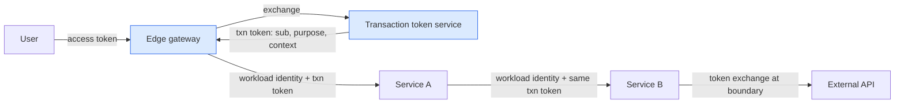

# Workload and Agent Identity Delegation

## TL;DR

A user's request rarely ends at the service that received it. It crosses a gateway, several internal services, and often another organization's API, and increasingly part of that path is an AI agent choosing its own next call. Every hop has to answer two questions: **which software is calling**, and **on whose behalf and for what purpose**. Systems that answer only the first give every service the union of all users' authority. Systems that answer only the second, by forwarding the user's token inward, let any compromised hop replay it anywhere the token is valid.

The current answer has three parts. Workloads get short-lived, attested identities instead of stored secrets (SPIFFE, and the IETF WIMSE work that is standardizing the same shape). Authority is passed by **exchanging** tokens at each trust boundary so the result is narrower, audience-bound, and records the chain of actors (RFC 8693). Inside one trust domain, a transaction token carries the user and request context immutably through the call graph. AI agents are not a new category: an agent is a workload acting for a user, with the difference that its control flow can be steered by untrusted input, so its authority must be bounded by the task and not by the user's whole account. Mutual authentication and policy enforcement between services are covered in [Zero-Trust Service and Workload Architecture](05-zero-trust-architecture.md); this chapter covers how identity and delegated authority move along a call chain.

## The Delegation Contract

1. **Every call names its caller.** No request is authorized by network position or a shared static key.
2. **Subject and actor are distinct.** The party whose authority is used and the party using it are separate claims, and both are logged.
3. **Authority narrows at each hop.** A downstream token never has more scope, a wider audience, or a longer lifetime than the token it was derived from.
4. **Tokens are audience-bound.** A token received by a service cannot be presented to another service.
5. **Context is immutable.** The user identity and purpose fixed at the edge cannot be rewritten by an intermediate service.
6. **Credentials are short-lived and issued, not stored.** A leaked credential expires before it can be sold.
7. **Revocation reaches the chain.** When the user's session ends, derived authority ends with it within a stated bound.

## Workload Identity Without Secrets

A static API key answers "which software is calling" with "whoever has the string." Workload identity replaces it with a credential issued to a running workload after the platform has attested what it is.

**Documented, SPIFFE:** a workload is named by a URI such as `spiffe://prod.example.com/payments/api`, where the authority part is a trust domain. It obtains an SVID, either an X.509 certificate or a JWT, from a local workload API with no authentication secret of its own; the issuer attests the workload through the node and orchestrator, for example by its Kubernetes service account. SVIDs live for minutes to hours and rotate automatically.

**Documented, IETF WIMSE drafts (2026):** the WIMSE working group is specifying the same model for the IETF, with an architecture document, a workload identity token (WIT) that names the workload and carries its public key, and two ways to prove possession per request: a workload proof token (WPT) or HTTP message signatures (RFC 9421). The WIT is explicitly not a bearer token. These are Internet-Drafts; the shape is stable enough to design toward, and the details are not yet final.

The same idea crosses organizational boundaries as **workload identity federation**. A CI job, a Kubernetes pod, or a cloud function already holds a platform-signed token describing it. A cloud provider or SaaS API is configured to trust that issuer and exchanges the token for its own short-lived credential, using the JWT bearer assertion (RFC 7523) or token exchange. No long-lived key is ever created, so there is nothing to rotate or leak. The security work moves into the trust policy: it must pin the issuer, the audience, and the specific subject claims (repository, branch, namespace, service account), because "any token from this issuer" means every tenant of that platform.

## Impersonation, Delegation, and Token Exchange

**Documented, RFC 8693:** a client presents a `subject_token` to the authorization server's token endpoint, optionally with an `actor_token` identifying itself, and names the `audience` or `resource` and `scope` it needs. The server applies policy and returns a new token.

Two semantics are possible, and the difference shows in the result:

| | Impersonation | Delegation |
|---|---|---|
| Resulting token says | The subject is the user | The subject is the user, acting through a named actor |
| Claim | `sub` only | `sub` plus `act` (nested for each prior actor) |
| Downstream sees | A request indistinguishable from the user's own | Who is acting, and the chain behind them |
| Use | Rarely defensible | Default |

A delegated token after two hops looks like this:

```json
{
  "iss": "https://sts.example.com",
  "aud": "https://ledger.internal.example.com",
  "sub": "user:8c1f",
  "scope": "ledger:read",
  "exp": 1794686400,
  "act": {
    "sub": "spiffe://prod.example.com/orders/api",
    "act": { "sub": "spiffe://prod.example.com/edge/gateway" }
  }
}
```

The policy at the exchange point is where the security lives: which actor may exchange which subject tokens, for which audiences, with what maximum scope. A `may_act` claim in the subject token lets the original issuer state in advance who is allowed to act for the subject. An exchange endpoint with no such policy is a token-laundering service.

## Transaction Tokens Inside a Trust Domain

Performing a token exchange at every internal hop is correct and often too expensive, and forwarding the external access token is cheap and wrong. Transaction tokens are the middle path.



**Documented, OAuth Transaction Tokens (IETF Internet-Draft, 2026):** a transaction token is a short-lived signed JWT, issued by one logical transaction token service per trust domain, that asserts the identity of the user or workload that started the transaction together with an authorization context. The external token stops at the edge. The transaction token is passed unchanged in a request header through the call graph, and each service authenticates the immediate caller separately with its workload identity.

This separates two things that a forwarded access token conflates. Workload credentials answer "who is calling me right now," hop by hop. The transaction token answers "what user request is this part of, and what was it authorized to do," end to end, and because it is signed no intermediate service can widen it. Lifetimes are seconds to a few minutes, sized to the longest synchronous call chain; asynchronous work that outlives the token needs its own stored authorization, not a longer token.

**Reference design.** At the edge: validate the external token, call the transaction token service with the token and the request details, and attach the result. In every service: verify the caller's workload identity, verify the transaction token's signature, audience (the trust domain), and expiry, then authorize the operation against both. On leaving the trust domain: exchange, never forward.

## Crossing Trust Domains

When service A in one organization must call an API in another on a user's behalf, there is no shared token service. Two drafts describe the pattern, both combining existing RFCs:

- **Identity and authorization chaining.** The caller exchanges its token at its own authorization server for a JWT assertion addressed to the other domain's authorization server, then presents that assertion there as a JWT bearer grant (RFC 7523) and receives a local access token. Each domain keeps control: the first decides what may leave, the second decides what an incoming assertion is worth.
- **Identity assertion authorization grant (ID-JAG).** In enterprise single sign-on, the identity provider already knows the user and both applications. The requesting application exchanges the user's identity assertion at the identity provider for a grant addressed to the target application's authorization server, and redeems it there. The user sees no consent screen, and the enterprise administrator, not each user, decides which applications may reach which. This is the mechanism behind what vendors call cross-app access.

Both are Internet-Drafts as of late 2026. They are worth tracking because the alternative deployed today is users individually approving long-lived grants between SaaS products, which no administrator can see or revoke centrally.

## AI Agents as Delegated Workloads

An agent that calls tools for a user fits the model above with three properties that change the risk:

1. **Untrusted input steers control flow.** Text the agent reads, such as a web page, an email, or a tool result, can contain instructions. An agent holding broad authority is therefore a confused deputy by default.
2. **The call sequence is not known in advance.** Scopes cannot be reviewed against a fixed code path.
3. **It runs long and unattended.** Authority tends to outlive the user's attention.

The controls follow directly:

- **The agent is the actor, never the subject.** Every tool call carries the user as subject and the agent as actor, so the resource can apply `user permissions ∩ agent permissions` and the audit log shows which decisions a machine made.
- **Authority is scoped to the task.** Request tokens per tool and per task with the narrowest scope, a single audience, and minutes of lifetime. Rich authorization details from [OAuth 2.1 and High-Assurance Authorization Profiles](11-oauth-security-profiles.md) can name the specific object.
- **Authorization is enforced at the resource.** The model's judgment is not a control. The tool server checks every call as if the request were hostile.
- **High-impact actions need the user.** Sending money, deleting data, or sharing externally triggers an out-of-band approval, for example an OpenID CIBA request to the user's device, that the agent cannot answer for itself.
- **Credentials stay out of the context window.** Tokens are held by the harness or a credential broker and attached to calls; anything in the prompt can be exfiltrated by injected instructions.

**Documented, Model Context Protocol authorization:** an MCP server is an OAuth resource server. It advertises its authorization server through protected resource metadata (RFC 9728); clients must send the `resource` parameter (RFC 8707) so tokens are bound to that server; the server must validate that a token was issued for it and must not pass a token it received through to an upstream API. For client identity the specification moved from dynamic registration toward Client ID Metadata Documents in its 2025-11-25 revision, and the 2026-07-28 revision continues in that direction and adds an enterprise-managed authorization extension built on the identity assertion grant. The token-passthrough prohibition is the important rule: an MCP server that calls another API obtains its own token for that API by exchange.

## Capacity and Availability

- **Exchange cost.** An exchange is a network call plus a signature. **Illustrative:** a request that crosses four boundaries with an exchange at each adds four round trips; at 2 ms each that is 8 ms of serial latency. Cache exchanged tokens by (subject token hash, actor, audience, scope) until shortly before expiry, and the steady-state cost falls to the first request per user per route.
- **Transaction token minting.** One per external request. **Illustrative:** 20,000 requests per second at the edge is 20,000 signatures per second. At a conservative 20,000 ES256 signatures per core-second that is one core of signing, so the constraint is the network hop and availability, not CPU. Verification everywhere else is local with cached keys.
- **The token service is tier zero.** If it stops, nothing new is authorized. Run it in every region, keep it free of dependencies on the services it protects, and decide in advance whether the edge may fail closed (correct for most APIs) or serve a degraded read-only mode on the external token's own claims.
- **Workload credential rotation.** With one-hour certificates rotated at half-life, 50,000 workloads produce about 28 issuance requests per second in steady state and 50,000 at once after a fleet-wide restart. Jitter renewals and make sure the issuer can absorb a cold start.

## Failure Traces

### Token Passthrough Creates a Confused Deputy

1. A tool server receives a user's access token whose audience is the tool server.
2. To call an upstream API it forwards the same token, and the upstream accepts it because both share an issuer and a broad audience.
3. A second, malicious tool server that the user also connected receives a similar token and replays it to the upstream API directly.

**Prevention:** one audience per resource; resource servers reject tokens not issued for them; downstream calls use exchanged tokens.

### Injected Instruction Uses Standing Authority

1. An agent holds a token with read and send scopes for the user's mailbox, issued for a summarization task.
2. A received email contains text instructing the agent to forward recent messages to an outside address.
3. The agent complies, and the mail API sees a valid token with the send scope.

**Prevention:** the summarization task's token has read scope only; sending requires a separate grant and user approval; the mail API logs the agent as actor so the event is attributable.

### Federation Policy Trusts the Whole Issuer

1. A cloud role trusts tokens from a shared CI provider's issuer and checks only the audience.
2. Any customer of that CI provider can mint a token with that audience from their own pipeline.
3. The attacker's pipeline assumes the role.

**Prevention:** condition on the subject claims that identify the organization, repository, and branch; test the policy with a token from an unrelated tenant.

### Derived Tokens Outlive the Session

1. A user signs out, or is deprovisioned.
2. An agent's cached exchanged tokens remain valid for their full lifetime, and its refresh grant still works.

**Prevention:** keep derived lifetimes in minutes; tie grants to the originating session so revocation cascades; propagate revocation events as described in [Identity Lifecycle and Continuous Access Evaluation](13-identity-lifecycle-and-continuous-access.md).

## Verification

1. Present a token issued for service A to service B: rejected on audience.
2. Call an internal service with a valid transaction token and no workload credential, then with a valid workload credential and no transaction token: both rejected.
3. Modify a claim in a transaction token: signature verification fails.
4. Request an exchange for a wider scope or an unlisted audience: denied by policy, and the denial is logged with the actor.
5. Present a federation token from a different tenant of the same issuer: rejected.
6. Feed an agent a document containing instructions to perform an out-of-scope action: the resource refuses, whatever the model attempts.
7. End the user's session and measure how long derived tokens keep working; compare with the stated bound.

## Decision Framework

1. **Remove stored secrets first.** Issued, attested workload identity is the foundation; nothing else in this chapter works on shared keys.
2. **Decide the internal propagation model.** A few services: exchange at each hop. A deep call graph with latency budgets: transaction tokens. Never forwarding.
3. **Write the exchange policy as code.** Which actor, which subject, which audience, which maximum scope; review it like firewall rules.
4. **Bind every token to one audience** and reject on mismatch at every resource.
5. **Treat agents as actors with task-scoped authority**, enforce at the tool, and require the user for irreversible actions.
6. **State a revocation bound** for derived authority and test it.
7. **Track the drafts, depend on the RFCs.** Token exchange, JWT bearer assertions, resource indicators, and protected resource metadata are stable. Transaction tokens, WIMSE credentials, chaining, and the identity assertion grant are still moving; isolate them behind an internal interface.

## References

- [RFC 8693: OAuth 2.0 Token Exchange](https://www.rfc-editor.org/rfc/rfc8693)
- [RFC 7523: JSON Web Token (JWT) Profile for OAuth 2.0 Client Authentication and Authorization Grants](https://www.rfc-editor.org/rfc/rfc7523)
- [RFC 9728: OAuth 2.0 Protected Resource Metadata](https://www.rfc-editor.org/rfc/rfc9728)
- [RFC 8707: Resource Indicators for OAuth 2.0](https://www.rfc-editor.org/rfc/rfc8707)
- [RFC 9421: HTTP Message Signatures](https://www.rfc-editor.org/rfc/rfc9421)
- [SPIFFE, *SPIFFE Overview*](https://spiffe.io/docs/latest/spiffe-about/overview/)
- [IETF Internet-Draft, *Workload Identity in a Multi System Environment (WIMSE) Architecture*](https://datatracker.ietf.org/doc/draft-ietf-wimse-arch/)
- [IETF Internet-Draft, *Transaction Tokens*](https://datatracker.ietf.org/doc/draft-ietf-oauth-transaction-tokens/)
- [IETF Internet-Draft, *OAuth Identity and Authorization Chaining Across Domains*](https://datatracker.ietf.org/doc/draft-ietf-oauth-identity-chaining/)
- [IETF Internet-Draft, *Identity Assertion JWT Authorization Grant*](https://datatracker.ietf.org/doc/draft-ietf-oauth-identity-assertion-authz-grant/)
- [Model Context Protocol, *Authorization* (2025-11-25 revision)](https://modelcontextprotocol.io/specification/2025-11-25/basic/authorization)
- [OpenID Foundation, *Client-Initiated Backchannel Authentication Flow, Core 1.0*](https://openid.net/specs/openid-client-initiated-backchannel-authentication-core-1_0.html)

---

## Related Chapters

- [Zero-Trust Service and Workload Architecture](05-zero-trust-architecture.md): the mutual authentication and enforcement points that consume these workload identities
- [OAuth 2.1 and High-Assurance Authorization Profiles](11-oauth-security-profiles.md): audience binding, sender constraint, and discovery are defined there and reused at every hop
- [Authorization at Scale](07-authorization-patterns.md): a delegated token is only an upper bound, and the object-level decision still happens here
- [Identity Lifecycle and Continuous Access Evaluation](13-identity-lifecycle-and-continuous-access.md): revoking a user must also revoke the authority that agents and services derived from them
- [LLM Agent Fundamentals](../17-llm-systems/01-agent-fundamentals.md): the tool-calling loop whose every call needs the actor, subject, and scope defined in this chapter
