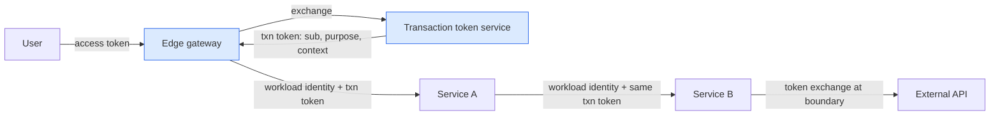

# Workload and Agent Identity Delegation

## TL;DR

A user's request rarely ends at the service that received it. It crosses a gateway, several internal services, and often another organization's API, and increasingly part of that path is an AI agent choosing its own next call. Every hop has to answer two questions: **which software is calling**, and **on whose behalf and for what purpose**. Systems that answer only the first give every service the union of all users' authority. Systems that answer only the second, by forwarding the user's token inward, let any compromised hop replay it anywhere the token is valid.

The current answer has three parts. Workloads get short-lived, attested identities in place of stored secrets (SPIFFE, and the IETF WIMSE work that is standardizing the same shape). Authority is passed by **exchanging** tokens at each trust boundary so the result is narrower, audience-bound, and records the chain of actors (RFC 8693). Inside one trust domain, a transaction token carries the user and request context immutably through the call graph. AI agents are not a new category. An agent is a workload acting for a user, with the difference that its control flow can be steered by untrusted input, so its authority must be bounded by the task and not by the user's whole account. Mutual authentication and policy enforcement between services are covered in [Zero-Trust Service and Workload Architecture](05-zero-trust-architecture.md). This chapter covers how identity and delegated authority move along a call chain.

## Two Questions, and the Deputy Who Confuses Them

The oldest description of the problem in this chapter dates from 1988 and involves a compiler. The compiler ran with permission to write to a billing file, because it recorded usage there. It also accepted, from the user, the name of a file to write debugging output to. A user supplied the name of the billing file, and the compiler overwrote it. The compiler was not buggy in any ordinary sense. It held authority for one purpose and was induced to exercise it for another, because at the moment of the write nothing distinguished "authority I hold for myself" from "authority I am using for the person who asked." Norm Hardy called it the confused deputy.

Every service that acts on behalf of users is a deputy, and distributed systems offer two standard ways to confuse one.

In the first, services authenticate only as themselves. The orders service calls the ledger service with a service credential, and the ledger trusts it to have checked the user. The ledger's real access policy is then "anything the orders service asks for," which is the sum of every user's authority. A single injection flaw or logic error in the orders service exposes every account, and the ledger's logs record only that the orders service made a request.

In the second, the system tries to fix this by passing the user's own access token down the chain. Now the ledger can see the user, but so can everything else on the path. Each service that receives the token can present it to any other service that accepts it, for any operation the token permits, for as long as it lasts. The token was issued to authorize one request at the edge and has become a general-purpose credential held by a dozen processes of varying trustworthiness.

Both failures come from collapsing two identities into one. A request in the middle of a call chain has a **subject**, the party whose authority is being used, and an **actor**, the party using it. The designs in this chapter keep them apart at every hop.

## The Delegation Contract

1. **Every call names its caller.** No request is authorized by network position or a shared static key.
2. **Subject and actor are distinct.** The party whose authority is used and the party using it are separate claims, and both are logged.
3. **Authority narrows at each hop.** A downstream token never has more scope, a wider audience, or a longer lifetime than the token it was derived from.
4. **Tokens are audience-bound.** A token received by a service cannot be presented to another service.
5. **Context is immutable.** The user identity and purpose fixed at the edge cannot be rewritten by an intermediate service.
6. **Credentials are short-lived and issued, not stored.** A leaked credential expires before it can be sold.
7. **Revocation reaches the chain.** When the user's session ends, derived authority ends with it within a stated bound.

## Workload Identity Without Secrets

We begin with the actor. A static API key answers "which software is calling" with "whoever has the string." The usual improvement is to put the string in a secrets manager, which raises an awkward question: how does the workload authenticate to the secrets manager? With another secret. Wherever that one is kept, the same question applies to it. This regress is sometimes called the secret-zero problem, and it cannot be solved by adding another vault. It ends only when some credential is established by something other than a secret.

That something is **attestation**: a component that already has a trusted vantage point observes the workload and vouches for what it is.

**Documented, SPIFFE:** a workload is named by a URI such as `spiffe://prod.example.com/payments/api`, where the authority part is a trust domain. It obtains an SVID, either an X.509 certificate or a JWT, from a local workload API with no authentication secret of its own; the issuer attests the workload through the node and orchestrator, for example by its Kubernetes service account. SVIDs live for minutes to hours and rotate automatically.

How a process can be identified with no secret is worth following through, using the reference implementation's approach. Attestation happens in two stages. First the node proves itself to the central server, using evidence that only the infrastructure could have supplied, such as a cloud provider's signed instance identity document or a key held in the machine's TPM. An agent on that node then exposes the workload API on a Unix domain socket. When a process connects, the agent asks the kernel which process is on the other end of the socket. The kernel answers with a process ID that the caller cannot falsify. From the process ID the agent finds the container, asks the local orchestrator which pod and service account that container belongs to, and matches the result against registration entries that say, in effect, "a process in namespace `payments` under service account `api` on an attested node is `spiffe://prod.example.com/payments/api`." The workload presented nothing. Its identity is a fact about where it is running, established by the kernel and the orchestrator.

The chain of trust has not disappeared. It now rests on the platform, which is where it was always going to rest, since whoever controls the node or the orchestrator controls the workload regardless. What has disappeared is the long-lived string that could be copied out of a repository.

**Documented, IETF WIMSE drafts (2026):** the WIMSE working group is specifying the same model for the IETF, with an architecture document, a workload identity token (WIT) that names the workload and carries its public key, and two ways to prove possession per request: a workload proof token (WPT) or HTTP message signatures (RFC 9421). The WIT is explicitly not a bearer token. These are Internet-Drafts; the shape is stable enough to design toward, and the details are not yet final.

The same idea crosses organizational boundaries as **workload identity federation**. A CI job, a Kubernetes pod, or a cloud function already holds a platform-signed token describing it. A cloud provider or SaaS API is configured to trust that issuer and exchanges the token for its own short-lived credential, using the JWT bearer assertion (RFC 7523) or token exchange. No long-lived key is ever created, so there is nothing to rotate or leak.

The security work has not gone away either. It has moved into the trust policy, and this is where federation deployments are most often wrong. A hosted CI provider operates one issuer for all of its customers. A policy that says "accept tokens from this issuer with our audience" therefore accepts tokens from every customer of that provider, including an attacker who signed up this morning. The policy must also pin the subject claims that identify the specific organization, repository, and branch, or namespace and service account. The issuer says which platform is speaking, and only the subject says whose workload it is.

## Impersonation, Delegation, and Token Exchange

Now the subject. A service holding a user's token needs to call another service for that user. We have ruled out forwarding the token. What it does instead is ask an authorization server for a new one.

**Documented, RFC 8693:** a client presents a `subject_token` to the authorization server's token endpoint, optionally with an `actor_token` identifying itself, and names the `audience` or `resource` and `scope` it needs. The server applies policy and returns a new token.

Two semantics are possible, and the difference shows in the result:

| | Impersonation | Delegation |
|---|---|---|
| Resulting token says | The subject is the user | The subject is the user, acting through a named actor |
| Claim | `sub` only | `sub` plus `act` (nested for each prior actor) |
| Downstream sees | A request indistinguishable from the user's own | Who is acting, and the chain behind them |
| Use | Rarely defensible | Default |

A delegated token after two hops looks like this:

```json
{
  "iss": "https://sts.example.com",
  "aud": "https://ledger.internal.example.com",
  "sub": "user:8c1f",
  "scope": "ledger:read",
  "exp": 1794686400,
  "act": {
    "sub": "spiffe://prod.example.com/orders/api",
    "act": { "sub": "spiffe://prod.example.com/edge/gateway" }
  }
}
```

Read it from the outside in. The user `8c1f` is the subject. The orders service is the current actor. The gateway acted before it. The audience is the ledger and nothing else, and the scope has been reduced to a read. If this token leaks from the ledger's logs, it can be used to read that user's ledger entries until it expires, and for nothing more. Compare that with the leak of a forwarded edge token, and the benefit of the extra round trip is apparent.

The nested `act` claim is a record and is not, by itself, an access rule. The specification is explicit that only the outermost actor is the current one and that prior actors are informational. Their value is in the audit log, where an investigator can see by which path a request arrived and can distinguish what a user did from what was done in their name.

All of the security in this arrangement lives in the policy at the exchange point: which actor may exchange which subject tokens, for which audiences, and with what maximum scope. A `may_act` claim in the subject token lets the original issuer state in advance who is permitted to act for the subject. An exchange endpoint that will convert any valid token into a token for any audience has no such policy, and it functions as a token-laundering service, turning a narrow stolen token into a broad one with the issuer's own signature on it.

## Transaction Tokens Inside a Trust Domain

Token exchange at every hop is correct, and in a deep call graph it is often unaffordable. A request that fans out through thirty services would make thirty calls to the authorization server before doing any work. Forwarding the external token costs nothing and is wrong for the reasons already given. Transaction tokens are a third option that takes its correctness from the first and its cost from the second.



**Documented, OAuth Transaction Tokens (IETF Internet-Draft, 2026):** a transaction token is a short-lived signed JWT, issued by one logical transaction token service per trust domain, that asserts the identity of the user or workload that started the transaction together with an authorization context. The external token stops at the edge. The transaction token is passed unchanged in a request header through the call graph, and each service authenticates the immediate caller separately with its workload identity.

At first sight this looks like forwarding with a different token, so it is fair to ask why it is safe when forwarding the access token was not. There are three differences. The transaction token's audience is the internal trust domain, so it is worthless at the external API surface where the original token was valid. It lives for seconds, sized to one request, whereas an access token lives for minutes or hours. And it is never sufficient alone: a service accepts it only alongside a workload credential proving who the immediate caller is. A stolen transaction token without a workload identity authorizes nothing, and with one it authorizes only what that workload was already positioned to do for that request.

The design separates two things a forwarded access token conflates. Workload credentials answer "who is calling me right now," and are checked hop by hop. The transaction token answers "what user request is this part of, and what was it authorized to do," and holds end to end. Because the token is signed by the token service, an intermediate service cannot widen it. A compromised service in the middle of the chain can misuse the requests that pass through it, but it cannot manufacture a request for a user who is not there.

Lifetime needs one decision. The token should outlast the longest synchronous call chain and not much more. Work that continues after the request returns, such as a queued job, should not be handled by lengthening the token. It needs its own stored authorization, created while the transaction token was still valid, that records what the job is permitted to do.

**Reference design.** At the edge: validate the external token, call the transaction token service with the token and the request details, and attach the result. In every service: verify the caller's workload identity, verify the transaction token's signature, audience (the trust domain), and expiry, then authorize the operation against both. On leaving the trust domain: exchange, never forward.

## Crossing Trust Domains

Everything so far has assumed a token service that both sides trust. When a service in one organization must call an API in another on a user's behalf, there is none. The deployed answer today is that the user personally approves a long-lived grant between the two products through a consent screen. This works for individuals and serves enterprises poorly: no administrator can see which grants exist, set policy over them, or revoke them centrally when an employee leaves.

Two drafts describe a better pattern, and both are assembled from existing RFCs with no new cryptography.

**Identity and authorization chaining.** The caller exchanges its token at its own authorization server for a JWT assertion addressed to the other domain's authorization server, then presents that assertion there as a JWT bearer grant (RFC 7523) and receives a local access token. Each domain keeps control of its side. The first decides what may leave. The second decides what an incoming assertion is worth, and issues its own token under its own policy. Neither accepts the other's tokens directly.

**Identity assertion authorization grant (ID-JAG).** In enterprise single sign-on, the identity provider already knows the user and both applications. The requesting application exchanges the user's identity assertion at the identity provider for a grant addressed to the target application's authorization server, and redeems it there. The user sees no consent screen, and the enterprise administrator decides which applications may reach which. This is the mechanism behind what vendors call cross-app access.

Both are Internet-Drafts as of late 2026.

## AI Agents as Delegated Workloads

An agent that calls tools for a user is a deputy in exactly Hardy's sense, and it fits the model above. Three properties make it a harder case than an ordinary service.

The first is that **untrusted input steers its control flow**. A conventional service has a fixed code path, and data cannot make it do something its authors did not write. An agent decides its next action by reading text, and some of that text comes from web pages, emails, and tool results written by strangers. A sentence in a document can function as an instruction. The original confused deputy had to be tricked through a carefully chosen argument. This one can be addressed in plain language by anyone whose content it reads.

The second is that **the call sequence is not known in advance**, so the practice of reviewing a service's scopes against its code does not apply. The third is that an agent **runs long and unattended**, and authority granted for a task tends to outlive the user's attention to it.

It follows that the model's judgment cannot be counted as a security control. An agent may well decline a malicious instruction most of the time, and a control that holds most of the time is one an attacker simply retries. The controls have to sit outside the model.

**The agent is the actor, never the subject.** Every tool call carries the user as subject and the agent as actor, so the resource can apply `user permissions ∩ agent permissions` and the audit log shows which decisions a machine made.

**Authority is scoped to the task.** The harness requests tokens per tool and per task with the narrowest scope, a single audience, and minutes of lifetime. Rich authorization details from [OAuth 2.1 and High-Assurance Authorization Profiles](11-oauth-security-profiles.md) can name the specific object. The useful test is to assume the injection succeeds and ask what the token in hand would allow. If the task was to summarize a mailbox and the token can only read, a successful injection can produce a bad summary and cannot send mail.

**Authorization is enforced at the resource.** The tool server checks every call as if the request were hostile.

**High-impact actions need the user.** Sending money, deleting data, or sharing externally triggers an out-of-band approval, for example an OpenID CIBA request to the user's device. The property that matters is that the approval travels on a channel the agent cannot write to, so the agent cannot answer for the user.

**Credentials stay out of the context window.** Tokens are held by the harness or a credential broker and attached to calls after the model has chosen them. Anything the model can see, injected instructions can ask it to repeat.

**Documented, Model Context Protocol authorization:** an MCP server is an OAuth resource server. It advertises its authorization server through protected resource metadata (RFC 9728); clients must send the `resource` parameter (RFC 8707) so tokens are bound to that server; the server must validate that a token was issued for it and must not pass a token it received through to an upstream API. For client identity the specification moved from dynamic registration toward Client ID Metadata Documents in its 2025-11-25 revision, and the 2026-07-28 revision continues in that direction and adds an enterprise-managed authorization extension built on the identity assertion grant.

The token-passthrough prohibition is the rule to remember, and it is this chapter's argument applied to one protocol. An MCP server that needs to call another API obtains its own token for that API by exchange.

## Capacity and Availability

The contract costs round trips and signatures. The question for each is whether the cost lands on every request or only on the first.

An exchange is a network call plus a signature. **Illustrative:** a request that crosses four boundaries with an exchange at each adds four round trips; at 2 ms each that is 8 ms of serial latency. Exchanged tokens can be cached by (subject token hash, actor, audience, scope) until shortly before expiry, after which the steady-state cost falls to the first request per user per route. The cache key matters. Omitting the scope or the audience from it hands one caller a token minted for another purpose, which is a privilege escalation created by an optimization.

Transaction tokens are minted once per external request. **Illustrative:** 20,000 requests per second at the edge is 20,000 signatures per second. At a conservative 20,000 ES256 signatures per core-second that is one core of signing. CPU is plainly not the constraint. The constraint is that a network hop to the token service now precedes every request, and so its latency is added to every request and its availability bounds the availability of everything.

That makes the token service tier zero. If it stops, nothing new is authorized. We run it in every region, keep it free of dependencies on the services it protects, since a circular dependency turns a partial outage into one that cannot be recovered from, and decide in advance what the edge does when it is unreachable. Failing closed is correct for most APIs. A degraded read-only mode based on the external token's own claims is sometimes justified, and it should be a decision taken in a design review, not one improvised during an incident.

Workload credential rotation has a steady state and a worst case, and only the worst case is interesting. With one-hour certificates rotated at half-life, 50,000 workloads produce about 28 issuance requests per second. After a fleet-wide restart, all 50,000 ask at once, and because they all received certificates in the same minute they will all renew in the same minute thereafter, indefinitely, unless something breaks the synchrony. Renewal times need random jitter, and the issuer must be sized for a cold start of the whole fleet, because the day that happens is already a bad day.

## Failure Traces

### Token Passthrough Creates a Confused Deputy

1. A tool server receives a user's access token whose audience is the tool server.
2. To call an upstream API it forwards the same token, and the upstream accepts it because both share an issuer and a broad audience.
3. A second, malicious tool server that the user also connected receives a similar token and replays it to the upstream API directly.

**Prevention:** one audience per resource; resource servers reject tokens not issued for them; downstream calls use exchanged tokens.

### Injected Instruction Uses Standing Authority

1. An agent holds a token with read and send scopes for the user's mailbox, issued for a summarization task.
2. A received email contains text instructing the agent to forward recent messages to an outside address.
3. The agent complies, and the mail API sees a valid token with the send scope.

Every component behaved as designed. The mail API enforced the token it was given. The defect was introduced earlier, when a task that needed to read was granted authority to send.

**Prevention:** the summarization task's token has read scope only; sending requires a separate grant and user approval; the mail API logs the agent as actor so the event is attributable.

### Federation Policy Trusts the Whole Issuer

1. A cloud role trusts tokens from a shared CI provider's issuer and checks only the audience.
2. Any customer of that CI provider can mint a token with that audience from their own pipeline.
3. The attacker's pipeline assumes the role.

**Prevention:** condition on the subject claims that identify the organization, repository, and branch; test the policy with a token from an unrelated tenant.

### Derived Tokens Outlive the Session

1. A user signs out, or is deprovisioned.
2. An agent's cached exchanged tokens remain valid for their full lifetime, and its refresh grant still works.

**Prevention:** keep derived lifetimes in minutes; tie grants to the originating session so revocation cascades; propagate revocation events as described in [Identity Lifecycle and Continuous Access Evaluation](13-identity-lifecycle-and-continuous-access.md).

## Verification

1. Present a token issued for service A to service B: rejected on audience.
2. Call an internal service with a valid transaction token and no workload credential, then with a valid workload credential and no transaction token: both rejected.
3. Modify a claim in a transaction token: signature verification fails.
4. Request an exchange for a wider scope or an unlisted audience: denied by policy, and the denial is logged with the actor.
5. Present a federation token from a different tenant of the same issuer: rejected.
6. Feed an agent a document containing instructions to perform an out-of-scope action: the resource refuses, whatever the model attempts.
7. End the user's session and measure how long derived tokens keep working; compare with the stated bound.

The sixth test should be run with the assumption that the model obeys the injected instruction. If the test passes only because the model declined, the control has not been tested.

## Decision Framework

1. **Remove stored secrets first.** Issued, attested workload identity is the foundation; nothing else in this chapter works on shared keys.
2. **Decide the internal propagation model.** A few services: exchange at each hop. A deep call graph with latency budgets: transaction tokens. Never forwarding.
3. **Write the exchange policy as code.** Which actor, which subject, which audience, which maximum scope; review it like firewall rules.
4. **Bind every token to one audience** and reject on mismatch at every resource.
5. **Treat agents as actors with task-scoped authority**, enforce at the tool, and require the user for irreversible actions.
6. **State a revocation bound** for derived authority and test it.
7. **Track the drafts, depend on the RFCs.** Token exchange, JWT bearer assertions, resource indicators, and protected resource metadata are stable. Transaction tokens, WIMSE credentials, chaining, and the identity assertion grant are still moving; isolate them behind an internal interface.

## References

- [RFC 8693: OAuth 2.0 Token Exchange](https://www.rfc-editor.org/rfc/rfc8693)
- [RFC 7523: JSON Web Token (JWT) Profile for OAuth 2.0 Client Authentication and Authorization Grants](https://www.rfc-editor.org/rfc/rfc7523)
- [RFC 9728: OAuth 2.0 Protected Resource Metadata](https://www.rfc-editor.org/rfc/rfc9728)
- [RFC 8707: Resource Indicators for OAuth 2.0](https://www.rfc-editor.org/rfc/rfc8707)
- [RFC 9421: HTTP Message Signatures](https://www.rfc-editor.org/rfc/rfc9421)
- [SPIFFE, *SPIFFE Overview*](https://spiffe.io/docs/latest/spiffe-about/overview/)
- [IETF Internet-Draft, *Workload Identity in a Multi System Environment (WIMSE) Architecture*](https://datatracker.ietf.org/doc/draft-ietf-wimse-arch/)
- [IETF Internet-Draft, *Transaction Tokens*](https://datatracker.ietf.org/doc/draft-ietf-oauth-transaction-tokens/)
- [IETF Internet-Draft, *OAuth Identity and Authorization Chaining Across Domains*](https://datatracker.ietf.org/doc/draft-ietf-oauth-identity-chaining/)
- [IETF Internet-Draft, *Identity Assertion JWT Authorization Grant*](https://datatracker.ietf.org/doc/draft-ietf-oauth-identity-assertion-authz-grant/)
- [Model Context Protocol, *Authorization* (2025-11-25 revision)](https://modelcontextprotocol.io/specification/2025-11-25/basic/authorization)
- [OpenID Foundation, *Client-Initiated Backchannel Authentication Flow, Core 1.0*](https://openid.net/specs/openid-client-initiated-backchannel-authentication-core-1_0.html)

---

## Related Chapters

- [Zero-Trust Service and Workload Architecture](05-zero-trust-architecture.md): the mutual authentication and enforcement points that consume these workload identities
- [OAuth 2.1 and High-Assurance Authorization Profiles](11-oauth-security-profiles.md): audience binding, sender constraint, and discovery are defined there and reused at every hop
- [Authorization at Scale](07-authorization-patterns.md): a delegated token is only an upper bound, and the object-level decision still happens here
- [Identity Lifecycle and Continuous Access Evaluation](13-identity-lifecycle-and-continuous-access.md): revoking a user must also revoke the authority that agents and services derived from them
- [LLM Agent Fundamentals](../17-llm-systems/01-agent-fundamentals.md): the tool-calling loop whose every call needs the actor, subject, and scope defined in this chapter
