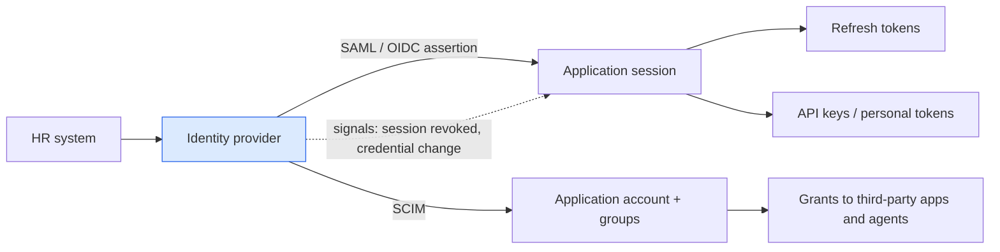

# Identity Lifecycle and Continuous Access Evaluation

## TL;DR

Authentication is an event; access is a duration. Between the moment a user signs in and the moment their token expires, facts change: the employee is terminated, the device falls out of compliance, the password is reset after a breach, a group membership is removed. Every system that validates tokens locally keeps granting access on the old facts until the token runs out. **The exposure window of an identity system is the longest-lived artifact that nothing can recall**, and in federated deployments that is usually not the access token but a session at some downstream application the identity provider has forgotten about.

Two standard families close the gap. **SCIM** (RFC 7643 and RFC 7644) keeps the accounts and groups in each application synchronized with the source of truth, so that joiners, movers, and leavers are reflected without a ticket. The **Shared Signals Framework** with its CAEP and RISC event profiles, final OpenID Foundation specifications since 2025, pushes security events between providers in near real time, so that a session revoked in one place ends everywhere. Federation protocols and token validation are in [OAuth 2.0 and OpenID Connect](02-oauth2-openid-connect.md) and [JOSE and JSON Web Token Verification](03-jwt-tokens.md); this chapter covers how identity state changes after sign-in reach the systems that depend on it.

## The Lifecycle Contract

1. **One source of truth per attribute.** Employment status comes from the HR system, group membership from the directory, device posture from device management. Nothing downstream edits its copy.
2. **Stable identifiers.** Accounts are joined on an immutable subject identifier, never on an email address or user name that can be reassigned.
3. **Bounded deprovisioning.** There is a stated maximum time from "access removed at the source" to "no request succeeds anywhere," and it is measured.
4. **Revocation covers every artifact.** Sessions, refresh tokens, API keys, personal access tokens, and third-party grants created by the identity are all in scope.
5. **Receivers decide.** A security signal is evidence; the receiving application applies its own policy and does not blindly obey.
6. **Loss of a signal is detectable.** A broken stream or failed provisioning job raises an alert instead of silently leaving stale access.

## Where Stale Access Hides

Disabling a user at the identity provider stops new sign-ins. It does nothing, by itself, to any box to the right of the first arrow.

| Artifact | Typical lifetime | What ends it |
|---|---|---|
| Identity provider session | Hours | Provider-side revocation |
| Application session after SAML or OIDC sign-in | Hours to weeks, set by the application | Back-channel logout, a session-revoked signal, or expiry |
| Access token | Minutes | Expiry; introspection if the resource checks |
| Refresh token | Days to months | Revocation at the authorization server (RFC 7009) |
| API key or personal access token | Until deleted | Deprovisioning that explicitly deletes it |
| OAuth grant to a third-party app or agent | Until revoked | Grant revocation; usually not tied to the user's status |
| Local account in the application | Forever | SCIM deactivation |

**Illustrative.** A terminated employee with a 15-minute access token, a 12-hour application session, and a personal access token has an exposure of 15 minutes, 12 hours, and unlimited respectively. Shortening the access token changed nothing that matters.

## Federation Still Runs on Two Protocols

Enterprise single sign-on is OpenID Connect for new integrations and SAML 2.0 for a large installed base. Both deliver a signed statement about a sign-in to the application, and neither says anything afterward. The design points that carry over:

- **SAML specifics.** Validate the signature over the assertion that is actually consumed, to defeat signature-wrapping; check audience, recipient, and validity window; bind the response to a request with `InResponseTo` and refuse unsolicited responses unless the business case is explicit; keep a replay cache of assertion IDs.
- **Attributes in assertions go stale immediately.** Group membership copied into a session at sign-in is a snapshot. Either keep sessions short, or keep groups synchronized by SCIM and read them at decision time.
- **Just-in-time provisioning is half a lifecycle.** Creating the account on first sign-in handles joiners. It never handles leavers, because a user who cannot sign in generates no event.

## Provisioning With SCIM

**Documented, RFC 7643 and RFC 7644:** SCIM defines a JSON schema for users and groups and a REST protocol for managing them: `POST /Users`, `GET /Users?filter=...`, `PATCH /Users/{id}`, `DELETE`, the same for `/Groups`, plus bulk operations and resource versions through ETags. The identity provider is the client; each application exposes the server.

The protocol is simple; the systems problems are in the edges:

- **Correlation.** The provider stores the application's `id` for each user and supplies its own `externalId`. Creation must be idempotent: if a create times out and is retried, a lookup by `externalId` or user name has to find the first attempt instead of producing a duplicate.
- **Deactivate, then delete.** Setting `active` to false is the leaver event and must end sessions, tokens, and keys immediately. Deleting the record is a retention decision that may come much later, and deleting first often orphans owned resources and audit history.
- **Group updates at scale.** A group with 50,000 members cannot be replaced wholesale on each change. Use `PATCH` with add and remove operations, and expect providers to split large changes into many requests.
- **Ordering and convergence.** Requests arrive out of order and some fail. The provider runs a periodic full reconciliation that compares both sides and repairs drift; the application makes every operation safe to repeat.
- **Rate and backpressure.** A reorganization changes thousands of memberships in minutes. Answer with 429 and `Retry-After` instead of timing out, and make sure deactivations are not queued behind bulk group edits.

**Illustrative.** A provider that pushes changes as they occur and reconciles every 40 minutes has a worst-case deprovisioning delay of 40 minutes whenever one push is lost. If the stated bound is 5 minutes, either the push path needs delivery guarantees and alerting, or a signal stream must carry the urgent subset.

## Shared Signals, CAEP, and RISC

**Documented, OpenID Shared Signals Framework 1.0, CAEP 1.0, and RISC 1.0 (final, 2025):** a transmitter and a receiver agree on a stream. Events are Security Event Tokens (SETs, RFC 8417), which are signed JWTs with an `events` claim, delivered by HTTP push (RFC 8935) or by the receiver polling (RFC 8936). The subject of an event is expressed with a standard subject identifier format (RFC 9493), which can name a user, a session, a device, or a tenant.

| Profile | Events | Typical receiver action |
|---|---|---|
| CAEP (session state) | session revoked, credential change, token claims change, assurance level change, device compliance change | End or re-evaluate the session; demand step-up |
| RISC (account state) | account disabled, account enabled, account purged, credentials compromised, identifier changed or recycled | Lock, flag for review, or unlink the federated identity |

Signals flow in both directions. An identity provider tells applications that a session was revoked. An application that detects impossible travel or token theft tells the identity provider, which can then end the session for every other application. A device-management service tells both that a laptop is no longer compliant.

Operating a stream is a messaging problem with security consequences:

- **Verification events.** The receiver periodically asks the transmitter to send a verification event and alerts if it does not arrive. This is the only way to tell a quiet stream from a dead one.
- **Ordering and duplicates.** SETs carry a unique `jti` and an event time. Receivers deduplicate on `jti` and apply events idempotently: "session revoked at T" is safe to process twice and in any order relative to later sign-ins if sessions record their start time.
- **Push versus poll.** Push is faster and needs the receiver reachable; poll works behind a firewall and makes the receiver's lag explicit. Both need acknowledgment and redelivery.
- **Policy at the receiver.** A compromised or misconfigured transmitter must not be able to lock out an organization. Rate-limit destructive actions per transmitter and prefer "require re-authentication" over "delete."

## Enforcing Revocation at the Resource

A signal is useful only if the request path consults its result. The patterns, cheapest first:

1. **Short tokens with gated refresh.** Access tokens live 5 to 15 minutes; revocation is enforced when the client refreshes. Exposure equals the token lifetime.
2. **Per-subject validity watermark.** Store one timestamp per user or session: "tokens issued before T are invalid." A revocation event sets it to now. Resource servers compare the token's `iat` with the watermark from a local cache fed by the event stream. **Illustrative:** 10 million users at 16 bytes each is 160 MB, small enough to hold in memory at every enforcement point, and only users with a recent event need an entry if the watermark is kept for the maximum token lifetime.
3. **Introspection (RFC 7662).** The resource asks the authorization server on each request or with a short cache. This is exact, and it makes the authorization server part of every request's availability and latency.
4. **Back-channel logout.** The identity provider calls each application's logout endpoint with a signed logout token. This is the OpenID Connect predecessor of the session-revoked signal and is widely implemented.

The combination that works at scale is short tokens plus a watermark fed by signals: the watermark handles the urgent cases in seconds, and expiry is the backstop when a signal is lost.

## Non-Human and Third-Party Access

Leaver processes are built around people and miss the credentials people create.

- **Personal tokens and API keys** must be owned by an identity and die with it, or be transferred deliberately.
- **Service accounts** need an owning team, an expiry, and a review, because no HR event will ever fire for them.
- **Third-party OAuth grants**, including grants to AI agents and automation tools, outlive the employee who approved them and often hold broader scopes than the employee's current role. Inventory them at the authorization server, tie them to the granting user's status, and revoke on deactivation. The delegation model in [Workload and Agent Identity Delegation](12-workload-and-agent-identity.md) keeps this tractable by making derived authority short-lived.

## Failure Traces

### Deprovisioned but Still Signed In

1. HR terminates an employee; the identity provider disables the account and SCIM sets `active` to false in the application.
2. The application marks the account inactive but does not invalidate existing sessions.
3. The former employee's open browser tab continues to work until the 30-day session cookie expires.

**Prevention:** deactivation invalidates sessions and tokens in the same transaction; a test asserts that a request made after deactivation fails.

### Recycled Identifier Inherits an Account

1. An employee leaves; their email address is later assigned to a new hire.
2. An application that keys accounts on the email claim signs the new hire into the former employee's account and data.

**Prevention:** join on the immutable subject identifier and issuer; process the identifier-recycled event; never treat email as a key.

### Silent Stream Failure

1. A certificate rotation breaks push delivery from the transmitter.
2. No events arrive. The receiver cannot distinguish this from a quiet day.
3. Revocations stop propagating until someone notices an incident.

**Prevention:** scheduled verification events with alerting; a dashboard of last-event age per stream; token expiry as the backstop.

### Reconciliation Stampede

1. A directory restructure changes most group memberships.
2. The provider emits hundreds of thousands of SCIM requests; the application's write path saturates.
3. Deactivations queued behind them are delayed for hours.

**Prevention:** separate priority for deactivations; rate limiting with `Retry-After`; capacity sized for full reconciliation, not average change rate.

## Verification

1. Deactivate a test user at the source and measure time until an already-open session, a refresh, and a personal access token each fail. Record the three numbers against the stated bound.
2. Reassign a test email address to a new subject identifier and confirm the application creates a new account.
3. Replay a SET: the second delivery is a no-op.
4. Stop the signal stream and confirm an alert fires within the verification interval.
5. Send a burst of group changes and confirm a concurrent deactivation is processed within its bound.
6. List every credential type an identity can create and show which deprovisioning step ends each one.

## Decision Framework

1. **What is the deprovisioning bound, per application tier?** Minutes for systems holding money or production access; an hour may be acceptable elsewhere. Write it down.
2. **What is the longest-lived artifact per application, and what recalls it?** If the answer is "nothing," shorten it or add a signal.
3. **Is provisioning push with reconciliation, or sign-in only?** Sign-in-only provisioning cannot meet any leaver bound.
4. **Which events justify real-time signals?** Session revocation, credential compromise, account disablement, and device non-compliance cover most of the value.
5. **Where is revocation enforced on the request path?** Token expiry alone, a watermark, or introspection, chosen per resource by how exact it must be.
6. **Who owns non-human credentials, and when do they expire?**

## Key Takeaways

- Shortening token lifetimes does not shorten exposure if sessions, keys, and grants live longer.
- SCIM handles state that must converge; shared signals handle changes that must arrive now. Most systems need both.
- Deactivation must end live sessions, and that property needs a test.
- Join identities on immutable identifiers, and treat a quiet event stream as a failure until a verification event proves otherwise.

## References

- [RFC 7643: System for Cross-domain Identity Management: Core Schema](https://www.rfc-editor.org/rfc/rfc7643)
- [RFC 7644: System for Cross-domain Identity Management: Protocol](https://www.rfc-editor.org/rfc/rfc7644)
- [OpenID Foundation, *OpenID Shared Signals Framework Specification 1.0* (final)](https://openid.net/specs/openid-sharedsignals-framework-1_0-final.html)
- [OpenID Foundation, *OpenID Continuous Access Evaluation Profile 1.0* (final)](https://openid.net/specs/openid-caep-1_0-final.html)
- [RFC 8417: Security Event Token (SET)](https://www.rfc-editor.org/rfc/rfc8417)
- [RFC 8935: Push-Based Security Event Token (SET) Delivery Using HTTP](https://www.rfc-editor.org/rfc/rfc8935)
- [RFC 8936: Poll-Based Security Event Token (SET) Delivery Using HTTP](https://www.rfc-editor.org/rfc/rfc8936)
- [RFC 9493: Subject Identifiers for Security Event Tokens](https://www.rfc-editor.org/rfc/rfc9493)
- [RFC 7662: OAuth 2.0 Token Introspection](https://www.rfc-editor.org/rfc/rfc7662)
- [RFC 7009: OAuth 2.0 Token Revocation](https://www.rfc-editor.org/rfc/rfc7009)
- [OpenID Foundation, *OpenID Connect Back-Channel Logout 1.0*](https://openid.net/specs/openid-connect-backchannel-1_0.html)

---

## Related Chapters

- [Authentication Systems](01-authentication-fundamentals.md): the session store and authenticator lifecycle that revocation events have to reach
- [OAuth 2.0 and OpenID Connect](02-oauth2-openid-connect.md): refresh, revocation, and introspection endpoints are the enforcement hooks used here
- [Workload and Agent Identity Delegation](12-workload-and-agent-identity.md): derived tokens and third-party grants are the artifacts leaver processes most often miss
- [Delivery Guarantees and Effect Boundaries](../05-messaging/04-delivery-guarantees.md): a signal stream is at-least-once messaging, with the same deduplication and redelivery rules
- [Data Retention and Compliance Engineering](../20-production-readiness/05-data-retention-and-compliance-engineering.md): deactivating an identity and deleting its data are separate obligations on separate clocks
