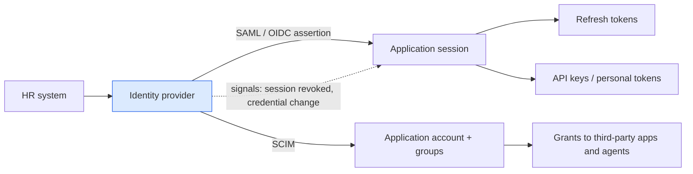

# Identity Lifecycle and Continuous Access Evaluation

## TL;DR

Authentication is an event; access is a duration. Between the moment a user signs in and the moment their token expires, facts change: the employee is terminated, the device falls out of compliance, the password is reset after a breach, a group membership is removed. Every system that validates tokens locally keeps granting access on the old facts until the token runs out. **The exposure window of an identity system is the longest-lived artifact that nothing can recall**, and in federated deployments that is usually not the access token. It is a session at some downstream application the identity provider has forgotten about.

Two standard families close the gap. **SCIM** (RFC 7643 and RFC 7644) keeps the accounts and groups in each application synchronized with the source of truth, so that joiners, movers, and leavers are reflected without a ticket. The **Shared Signals Framework** with its CAEP and RISC event profiles, final OpenID Foundation specifications since 2025, pushes security events between providers in near real time, so that a session revoked in one place ends everywhere. Federation protocols and token validation are in [OAuth 2.0 and OpenID Connect](02-oauth2-openid-connect.md) and [JOSE and JSON Web Token Verification](03-jwt-tokens.md). This chapter covers how changes in identity state after sign-in reach the systems that depend on it.

## The Bargain Behind Every Signed Token

Identity systems scale because of a single trade, and this chapter is about paying for it.

In the simplest possible design, every request to every application would ask the identity provider, "is this user still allowed?" The answer would always be current, and the identity provider would sit in the path of every request in the organization, bounding the latency and availability of everything. Nobody builds this. We sign a statement instead. The identity provider asserts, once, that this user authenticated at this time with these attributes, and the application verifies the signature locally and trusts the statement for some period afterward.

A signed statement is a cache entry. It is a copy of the identity provider's knowledge, taken at one moment and held somewhere the provider cannot reach. Like every cache it buys independence from the origin at the price of staleness, and like every cache it raises the question of invalidation. Federation protocols, for most of their history, did not answer that question. SAML and OpenID Connect both specify in great detail how to deliver the statement, and say almost nothing about what happens when it stops being true.

There are only three ways to invalidate a cache: let entries expire, have the consumer check back with the origin, or have the origin notify the consumer. Everything in this chapter is one of the three. Short token lifetimes are expiry. Introspection is checking back. SCIM and shared signals are notification. Each has the cost profile one would predict from caching in any other domain, and a sound design combines them for the same reasons a sound cache does.

## The Lifecycle Contract

1. **One source of truth per attribute.** Employment status comes from the HR system, group membership from the directory, device posture from device management. Nothing downstream edits its copy.
2. **Stable identifiers.** Accounts are joined on an immutable subject identifier, never on an email address or user name that can be reassigned.
3. **Bounded deprovisioning.** There is a stated maximum time from "access removed at the source" to "no request succeeds anywhere," and it is measured.
4. **Revocation covers every artifact.** Sessions, refresh tokens, API keys, personal access tokens, and third-party grants created by the identity are all in scope.
5. **Receivers decide.** A security signal is evidence; the receiving application applies its own policy and does not blindly obey.
6. **Loss of a signal is detectable.** A broken stream or failed provisioning job raises an alert instead of silently leaving stale access.

The third clause is the one that turns the others into engineering. A bound that is written down can be tested, alerted on, and argued about. Without one, "we deprovision promptly" is an aspiration.

## Where Stale Access Hides

The diagram is a chain of derivation. Each box was created from the one to its left and then became independent of it. The application session was created from an assertion, and once the application set its own cookie, the assertion played no further part. The refresh token was created within the session and survives it. The personal access token was created by a signed-in user and has no link back to any sign-in at all.

Disabling a user at the identity provider stops new sign-ins. It does nothing, by itself, to any box to the right of the first arrow.

| Artifact | Typical lifetime | What ends it |
|---|---|---|
| Identity provider session | Hours | Provider-side revocation |
| Application session after SAML or OIDC sign-in | Hours to weeks, set by the application | Back-channel logout, a session-revoked signal, or expiry |
| Access token | Minutes | Expiry; introspection if the resource checks |
| Refresh token | Days to months | Revocation at the authorization server (RFC 7009) |
| API key or personal access token | Until deleted | Deprovisioning that explicitly deletes it |
| OAuth grant to a third-party app or agent | Until revoked | Grant revocation; usually not tied to the user's status |
| Local account in the application | Forever | SCIM deactivation |

**Illustrative.** A terminated employee with a 15-minute access token, a 12-hour application session, and a personal access token has an exposure of 15 minutes, 12 hours, and unlimited respectively. Teams often invest effort in shortening the first number because it is the one the identity team controls. The exposure of the system is the maximum of the column, and shortening the access token changed nothing that matters.

## Federation Still Runs on Two Protocols

Enterprise single sign-on is OpenID Connect for new integrations and SAML 2.0 for a large installed base. Both deliver a signed statement about a sign-in to the application, and neither says anything afterward. A few design points carry over into the lifecycle problem.

SAML deserves specific care, because its most serious class of vulnerability follows from how its signatures work. An XML signature does not cover "the document." It covers an element that the signature refers to by ID. In a signature-wrapping attack, the attacker takes a legitimately signed response, leaves the signed assertion in place somewhere in the tree where the signature still validates, and inserts a second, forged assertion in the position where the application's business logic will look. The signature check finds the original and passes. The application reads the forgery. The defense is to make sure the element whose signature was verified is the very same element whose contents are consumed, and beyond that to check the audience, recipient, and validity window, bind the response to a request with `InResponseTo`, refuse unsolicited responses unless the business case is explicit, and keep a replay cache of assertion IDs.

The second point is that attributes in assertions go stale immediately. Group membership copied into a session at sign-in is a snapshot, and a user removed from the administrators group an hour later is an administrator until the session ends. Either sessions are kept short, or groups are synchronized by SCIM and read at decision time.

The third is that just-in-time provisioning is half a lifecycle. Creating the account on first sign-in handles joiners neatly, and for that reason it is popular. It can never handle leavers, for a reason that is almost a matter of logic: the mechanism is triggered by sign-in, and a user who has been disabled does not sign in. Their departure generates no event the application can see, and the account, with whatever keys and grants hang from it, stays.

## Provisioning With SCIM

**Documented, RFC 7643 and RFC 7644:** SCIM defines a JSON schema for users and groups and a REST protocol for managing them: `POST /Users`, `GET /Users?filter=...`, `PATCH /Users/{id}`, `DELETE`, the same for `/Groups`, plus bulk operations and resource versions through ETags. The identity provider is the client; each application exposes the server.

The protocol is a plain REST interface and takes an afternoon to read. What makes SCIM implementations difficult is that they are replication. The identity provider holds the primary copy of a dataset, each application holds a replica, and the link between them is an unreliable sequence of HTTP requests with no log, no sequence numbers, and no transactions. The well-known problems of replication all appear, under different names.

**Correlation** is the problem of knowing that two records are the same record. The provider stores the application's `id` for each user and supplies its own `externalId`. The hard case is a create that times out. The provider cannot know whether the application processed it, and will retry. If the application treats the retry as new, there are now two accounts for one person, and later updates will reach only one of them. Creation must therefore be idempotent: a lookup by `externalId` or user name has to find the first attempt.

**Deactivation and deletion are different operations with different clocks.** Setting `active` to false is the leaver event, and it must end sessions, tokens, and keys immediately. Deleting the record is a retention decision that may come much later. Applications that delete first tend to orphan the resources the user owned and the audit history that refers to them.

**Group updates at scale** run into the size of the object. A group with 50,000 members cannot be replaced wholesale each time one member changes. SCIM's `PATCH` carries add and remove operations for this reason, and applications should expect providers to split large changes into many requests.

**Ordering and convergence** follow from the absence of a log. Requests arrive out of order and some fail. No amount of care in the push path makes this reliable, and so the design that works is the one replication systems settled on long ago: an incremental stream for speed, plus a periodic full comparison of both sides that repairs whatever the stream missed. The application's part is to make every operation safe to repeat.

**Rate and backpressure** matter because the load is bursty in a particular way. A reorganization changes thousands of memberships in minutes. An application that times out under this load teaches the provider nothing, whereas one that answers 429 with `Retry-After` gets a well-behaved client. The subtle requirement is priority. A deactivation that waits in the same queue behind 200,000 group edits will miss its bound on exactly the day when access is being restructured.

**Illustrative.** A provider that pushes changes as they occur and reconciles every 40 minutes has a worst-case deprovisioning delay of 40 minutes whenever one push is lost. If the stated bound is 5 minutes, then either the push path needs delivery guarantees and alerting, or a signal stream must carry the urgent subset. The reconciliation interval is the real bound, and the push is an optimization of the common case.

## Shared Signals, CAEP, and RISC

SCIM replicates state, and state converges eventually. Some changes cannot wait for convergence. When a session is known to be stolen, the useful message is not "here is the user's current record" but "this happened, just now, act on it." That is an event, and events need a different transport.

**Documented, OpenID Shared Signals Framework 1.0, CAEP 1.0, and RISC 1.0 (final, 2025):** a transmitter and a receiver agree on a stream. Events are Security Event Tokens (SETs, RFC 8417), which are signed JWTs with an `events` claim, delivered by HTTP push (RFC 8935) or by the receiver polling (RFC 8936). The subject of an event is expressed with a standard subject identifier format (RFC 9493), which can name a user, a session, a device, or a tenant.

| Profile | Events | Typical receiver action |
|---|---|---|
| CAEP (session state) | session revoked, credential change, token claims change, assurance level change, device compliance change | End or re-evaluate the session; demand step-up |
| RISC (account state) | account disabled, account enabled, account purged, credentials compromised, identifier changed or recycled | Lock, flag for review, or unlink the federated identity |

A feature of this design that is easy to miss is that signals flow in both directions. An identity provider tells applications that a session was revoked. An application that detects impossible travel or a stolen token tells the identity provider, which can then end the session for every other application. A device-management service tells both that a laptop is no longer compliant. Before this framework, each of these parties held evidence the others needed and had no standard way to share it, so an attacker detected by one application could carry on unhindered in the next.

Operating a stream is a messaging problem with security consequences, and the familiar rules of messaging apply with unusual force.

The first concerns silence. A revocation stream is quiet most of the time, and a stream that has broken is also quiet. A receiver that sees no events cannot tell a calm afternoon from a transmitter whose certificate expired at noon. The framework's answer is the verification event: the receiver periodically asks the transmitter to send one, and alerts if it does not arrive. This is a heartbeat, and it is the only thing that distinguishes "nothing has happened" from "we would not know if it had."

The second concerns ordering and duplicates. Delivery is at-least-once, so events will repeat, and they may arrive out of order. SETs carry a unique `jti` and an event time. Receivers deduplicate on `jti`, and, more importantly, they phrase the effect of each event so that order does not matter. "Delete the user's sessions" is order-dependent: if it is delayed and arrives after the user has legitimately signed in again, it destroys a valid session. "Sessions for this user that started before time T are invalid" can be applied twice, late, or out of order, and the result is the same.

The third is the choice of push or poll. Push is faster and requires the receiver to be reachable from the transmitter. Poll works from behind a firewall and makes the receiver's lag explicit and measurable. Both need acknowledgment and redelivery.

The fourth is the reason for the contract's fifth clause. A stream is a channel through which another party can cause sessions to end and accounts to lock. A compromised or misconfigured transmitter that emits "account disabled" for every user is a denial-of-service attack delivered through the security system. Receivers should rate-limit destructive actions per transmitter and should prefer the reversible response, requiring re-authentication, over the irreversible one.

## Enforcing Revocation at the Resource

A signal changes nothing until the request path consults its result. There are four established ways to arrange that, and they differ in where they put the cost.

**Short tokens with gated refresh.** Access tokens live 5 to 15 minutes, and revocation is enforced when the client comes back to refresh. The request path is untouched. The exposure equals the token lifetime, and reducing it further means more refresh traffic, in direct proportion.

**Per-subject validity watermark.** The system stores one timestamp per user or session, meaning "tokens issued before T are invalid." A revocation event sets it to the present. Resource servers hold these timestamps in a local cache fed by the event stream and compare each token's `iat` against the entry for its subject. **Illustrative:** 10 million users at 16 bytes each is 160 MB, small enough to hold in memory at every enforcement point. In practice the table is far smaller, because an entry is only needed while tokens issued before it could still be alive. Once the maximum token lifetime has passed since the watermark was set, every older token has expired anyway and the entry can be dropped. The table therefore holds only users with a recent event.

The watermark is worth a second look because it shows why revocation lists for tokens are the wrong shape. A list of revoked token identifiers grows with the number of tokens and requires knowing every token that was issued. A watermark grows with the number of revoked subjects and requires knowing nothing about individual tokens. One comparison invalidates every token the user holds, including ones the issuer never recorded.

**Introspection (RFC 7662).** The resource asks the authorization server about the token on each request, or with a short cache. The answer is exact. The cost is the one we set out to avoid at the start of the chapter: the authorization server is back in the path of every request, bounding latency and availability. It is the right choice for a small number of high-value operations and the wrong default.

**Back-channel logout.** The identity provider calls each application's logout endpoint with a signed logout token. This is the OpenID Connect predecessor of the session-revoked signal and is widely implemented.

The combination that works at scale is short tokens together with a watermark fed by signals. The watermark handles the urgent cases within seconds. Expiry is the backstop that still holds when a signal is lost, a stream is down, or a cache is cold. Neither is sufficient alone: expiry is too slow for a stolen session, and a signal with no backstop fails open and gives no indication that it has.

## Non-Human and Third-Party Access

Leaver processes are built around people, and they miss the credentials that people create.

Personal tokens and API keys must be owned by an identity and die with it, or be transferred deliberately. The typical failure is a key created by an engineer for a script, which continues to run in production for years after the engineer has left, because disabling it would break the script and nobody knows what the script does.

Service accounts need an owning team, an expiry, and a review, because no HR event will ever fire for them. A human account has a natural end. A service account lasts until someone decides to remove it, and without an owner nobody will.

Third-party OAuth grants, including grants to AI agents and automation tools, outlive the employee who approved them and often hold broader scopes than the employee's current role would allow. They should be inventoried at the authorization server, tied to the granting user's status, and revoked on deactivation. The delegation model in [Workload and Agent Identity Delegation](12-workload-and-agent-identity.md) keeps this tractable by making derived authority short-lived, so that most of it expires without anyone having to remember it.

## Failure Traces

### Deprovisioned but Still Signed In

1. HR terminates an employee; the identity provider disables the account and SCIM sets `active` to false in the application.
2. The application marks the account inactive but does not invalidate existing sessions.
3. The former employee's open browser tab continues to work until the 30-day session cookie expires.

Every system reported success. The identity provider shows the user disabled, the SCIM call returned 200, and the application's user list shows the account as inactive. The gap is visible only to a test that makes a request after deactivation, which is why that test belongs in the suite.

**Prevention:** deactivation invalidates sessions and tokens in the same transaction; a test asserts that a request made after deactivation fails.

### Recycled Identifier Inherits an Account

1. An employee leaves; their email address is later assigned to a new hire.
2. An application that keys accounts on the email claim signs the new hire into the former employee's account and data.

**Prevention:** join on the immutable subject identifier and issuer; process the identifier-recycled event; never treat email as a key.

### Silent Stream Failure

1. A certificate rotation breaks push delivery from the transmitter.
2. No events arrive. The receiver cannot distinguish this from a quiet day.
3. Revocations stop propagating until someone notices an incident.

**Prevention:** scheduled verification events with alerting; a dashboard of last-event age per stream; token expiry as the backstop.

### Reconciliation Stampede

1. A directory restructure changes most group memberships.
2. The provider emits hundreds of thousands of SCIM requests; the application's write path saturates.
3. Deactivations queued behind them are delayed for hours.

**Prevention:** separate priority for deactivations; rate limiting with `Retry-After`; capacity sized for full reconciliation, not average change rate.

## Verification

The first test below is the most valuable measurement in this chapter, because it replaces a belief with three numbers.

1. Deactivate a test user at the source and measure time until an already-open session, a refresh, and a personal access token each fail. Record the three numbers against the stated bound.
2. Reassign a test email address to a new subject identifier and confirm the application creates a new account.
3. Replay a SET: the second delivery is a no-op.
4. Stop the signal stream and confirm an alert fires within the verification interval.
5. Send a burst of group changes and confirm a concurrent deactivation is processed within its bound.
6. List every credential type an identity can create and show which deprovisioning step ends each one.

## Decision Framework

1. **What is the deprovisioning bound, per application tier?** Minutes for systems holding money or production access; an hour may be acceptable elsewhere. Write it down.
2. **What is the longest-lived artifact per application, and what recalls it?** If the answer is "nothing," shorten it or add a signal.
3. **Is provisioning push with reconciliation, or sign-in only?** Sign-in-only provisioning cannot meet any leaver bound.
4. **Which events justify real-time signals?** Session revocation, credential compromise, account disablement, and device non-compliance cover most of the value.
5. **Where is revocation enforced on the request path?** Token expiry alone, a watermark, or introspection, chosen per resource by how exact it must be.
6. **Who owns non-human credentials, and when do they expire?**

## Key Takeaways

- A signed token is a cache entry, and revocation is cache invalidation: expire, check back, or notify.
- Shortening token lifetimes does not shorten exposure if sessions, keys, and grants live longer.
- SCIM handles state that must converge; shared signals handle changes that must arrive now. Most systems need both.
- Deactivation must end live sessions, and that property needs a test.
- Join identities on immutable identifiers, and treat a quiet event stream as a failure until a verification event proves otherwise.

## References

- [RFC 7643: System for Cross-domain Identity Management: Core Schema](https://www.rfc-editor.org/rfc/rfc7643)
- [RFC 7644: System for Cross-domain Identity Management: Protocol](https://www.rfc-editor.org/rfc/rfc7644)
- [OpenID Foundation, *OpenID Shared Signals Framework Specification 1.0* (final)](https://openid.net/specs/openid-sharedsignals-framework-1_0-final.html)
- [OpenID Foundation, *OpenID Continuous Access Evaluation Profile 1.0* (final)](https://openid.net/specs/openid-caep-1_0-final.html)
- [RFC 8417: Security Event Token (SET)](https://www.rfc-editor.org/rfc/rfc8417)
- [RFC 8935: Push-Based Security Event Token (SET) Delivery Using HTTP](https://www.rfc-editor.org/rfc/rfc8935)
- [RFC 8936: Poll-Based Security Event Token (SET) Delivery Using HTTP](https://www.rfc-editor.org/rfc/rfc8936)
- [RFC 9493: Subject Identifiers for Security Event Tokens](https://www.rfc-editor.org/rfc/rfc9493)
- [RFC 7662: OAuth 2.0 Token Introspection](https://www.rfc-editor.org/rfc/rfc7662)
- [RFC 7009: OAuth 2.0 Token Revocation](https://www.rfc-editor.org/rfc/rfc7009)
- [OpenID Foundation, *OpenID Connect Back-Channel Logout 1.0*](https://openid.net/specs/openid-connect-backchannel-1_0.html)

---

## Related Chapters

- [Authentication Systems](01-authentication-fundamentals.md): the session store and authenticator lifecycle that revocation events have to reach
- [OAuth 2.0 and OpenID Connect](02-oauth2-openid-connect.md): refresh, revocation, and introspection endpoints are the enforcement hooks used here
- [Workload and Agent Identity Delegation](12-workload-and-agent-identity.md): derived tokens and third-party grants are the artifacts leaver processes most often miss
- [Delivery Guarantees and Effect Boundaries](../05-messaging/04-delivery-guarantees.md): a signal stream is at-least-once messaging, with the same deduplication and redelivery rules
- [Data Retention and Compliance Engineering](../20-production-readiness/05-data-retention-and-compliance-engineering.md): deactivating an identity and deleting its data are separate obligations on separate clocks
