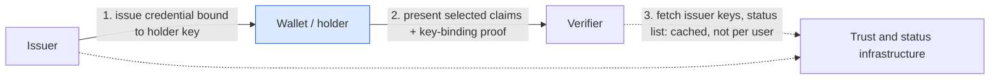

# Verifiable Credentials and Selective Disclosure

## TL;DR

Federated sign-in has two parties talking live: the application asks, the identity provider answers, and the provider therefore learns every place the user goes. A verifiable credential separates those steps. An **issuer** signs a set of claims once and gives the result to the user's **wallet**. Later the wallet presents it to a **verifier**, which checks the issuer's signature offline. The issuer is not contacted and does not learn where the credential was used.

That model only became deployable once three things were standardized: a credential format that lets the holder reveal some claims and withhold others (**SD-JWT**, RFC 9901, published November 2025, and the ISO mdoc format used for mobile driving licences), protocols for issuing and presenting (**OpenID for Verifiable Credential Issuance 1.0** and **OpenID for Verifiable Presentations 1.0**, both final in 2025), and a profile that pins the options (**HAIP 1.0**, final December 2025). Use this for claims issued by one party and consumed by many others that the issuer should not track: proof of age, licences, qualifications, verified identity attributes. Do not use it for ordinary sign-in to your own service, where [Passkeys and Phishing-Resistant Authentication](10-passkeys-and-phishing-resistant-authentication.md) is simpler and stronger.

## The Three-Party Contract



1. **Authenticity.** A verifier accepts only claims signed by an issuer it has decided to trust for that credential type.
2. **Holder binding.** A presentation proves possession of the private key the credential was issued to, so a copied credential is useless.
3. **Presentation binding.** Each presentation is bound to one verifier and one transaction, so it cannot be replayed elsewhere.
4. **Minimal disclosure.** The verifier receives only the claims it requested and the user approved.
5. **Issuer blindness.** Verification does not reveal to the issuer which verifier saw the credential.
6. **Revocability.** A credential can be suspended or revoked without contacting the holder and without breaking issuer blindness.

Properties 5 and 6 pull against each other, and properties 2 and 4 pull against unlinkability. Most of the engineering in this chapter is managing those tensions.

## How Selective Disclosure Works in SD-JWT

**Documented, RFC 9901.** The issuer does not put disclosable claims in the signed JWT. For each one it creates a **disclosure**: the base64url encoding of a JSON array holding a random salt, the claim name, and the value. The signed payload contains only the hash of each disclosure, in an `_sd` array:

```text
Disclosure:   ["2GLC42sKQveCfGfryNRN9w", "birthdate", "1990-04-12"]
In the JWT:   "_sd": ["Xq3...hash-of-that-disclosure...", "9fT...", "kL0..."],
              "_sd_alg": "sha-256",
              "cnf": {"jwk": { ...holder public key... }}
```

The wallet receives the signed JWT plus all disclosures. To present, it sends the JWT, only the disclosures the user agreed to reveal, and a key-binding JWT, joined with tilde characters:

```text
<issuer-signed JWT>~<disclosure 1>~<disclosure 3>~<key-binding JWT>
```

The verifier checks the issuer signature, hashes each received disclosure and confirms the hash appears in `_sd`, then verifies the key-binding JWT against the `cnf` key. That key-binding JWT is signed by the holder and carries the verifier's identifier as `aud`, a verifier-supplied `nonce`, an issue time, and `sd_hash`, a hash over the exact JWT and disclosures being presented. Withheld claims are represented only by salted hashes, which reveal nothing, and issuers may add decoy hashes so that even the number of withheld claims is hidden.

Two related formats matter in practice. **SD-JWT VC** is the profile that turns an SD-JWT into a typed credential with a `vct` claim; it is an IETF draft that deployed profiles already reference. **ISO/IEC 18013-5 mdoc** achieves the same salted-hash disclosure with CBOR encoding and is the format of mobile driving licences. A verifier that serves the general public should expect to accept both.

## Issuance and Presentation Protocols

**Documented, OpenID4VCI 1.0.** Issuance is an OAuth flow in which the wallet is the client and the credential endpoint is the protected resource. The issuer hands the wallet a credential offer, the wallet obtains an access token (by authorization code when the user must authenticate at the issuer, or by a pre-authorized code when they already did so in another channel), and then calls the credential endpoint with a proof of possession of the key the credential should be bound to. A fresh nonce from the issuer prevents replay of that proof. The endpoint can return several credentials at once, each bound to a different key, which matters for unlinkability below.

**Documented, OpenID4VP 1.0.** Presentation is an authorization request in the other direction: the verifier is the client, the wallet is the authorization server. The request carries a query in the Digital Credentials Query Language (DCQL) that names the credential types and the specific claims wanted, plus a nonce. The response is the presentation, typically encrypted to the verifier. On the web the request can be delivered through the browser's Digital Credentials API, in which the browser and operating system mediate wallet selection and bind the request to the calling origin, giving the same phishing resistance that WebAuthn gives passkeys. Redirects and QR codes with custom schemes remain as fallbacks and do not have that property.

**Documented, HAIP 1.0.** The High Assurance Interoperability Profile fixes the choices: specific credential formats, cryptographic suites, sender-constrained tokens, wallet attestation, and the query language. As with FAPI in [OAuth 2.1 and High-Assurance Authorization Profiles](11-oauth-security-profiles.md), its value is turning a framework with many options into something two independent implementations can test against. Regional programs such as the European Digital Identity Wallet build on it.

## Deciding Whom to Trust

Signature verification answers "did this issuer sign it," not "should I care what this issuer says." A verifier needs a rule mapping each credential type to the issuers allowed to assert it, and a way to obtain their keys.

| Mechanism | How it works | Fits |
|---|---|---|
| Static allow list | Verifier configures issuer identifiers and keys | Closed ecosystems with few issuers |
| X.509 chain to a trust anchor | Issuer certificate chains to a root the verifier trusts for that credential type | Government documents; the mdoc model |
| Published trust list | A governing body signs a list of accredited issuers and wallets | National and sector schemes |
| Federation metadata | Entities publish signed statements chained through intermediaries to a trust anchor | Large multi-party ecosystems |

The symmetric question is whether the wallet should trust the verifier. Without verifier authentication and some registration of what each verifier may request, any site can ask for a full identity document. High-assurance schemes therefore authenticate verifiers and show the user who is asking and for what.

## Revocation Without Phoning Home

A per-credential status lookup tells the issuer who verified which credential and when, which destroys issuer blindness. The current approaches avoid it:

- **Status lists.** **Documented, Token Status List (IETF, in publication as of 2026):** the issuer publishes a compressed bit array in which each credential has an index; the credential carries the list's URI and its index. The verifier downloads the whole list, caches it, and reads one position. The issuer sees a fetch of a list covering many thousands of credentials, not which one was checked. **Illustrative:** one bit per credential for 10 million credentials is 1.25 MB before compression, and far less after it when most bits are zero.
- **Short-lived credentials.** Issue credentials valid for days and let the wallet refresh them. Revocation becomes "stop reissuing," and there is no status infrastructure at all, at the cost of wallets needing regular connectivity to the issuer.

Either way the verifier's freshness is bounded by a cache lifetime or a credential lifetime. State that bound; it is the revocation delay.

## Unlinkability and Its Limits

Selective disclosure hides claim values. It does not hide the credential's identity. The issuer signature, the holder public key, and the hashes are the same bytes every time the credential is presented, so two verifiers who compare notes, or one verifier seeing the same user twice, can link the presentations even if only "over 18" was disclosed.

- **Batch issuance.** The wallet obtains many copies of the credential, each with a different holder key and different salts, and uses each once. **Illustrative:** 10 million holders refreshing a batch of 20 credentials monthly is 200 million issuer signatures a month, roughly 77 per second on average and far higher at peaks, plus 20 status-list positions per holder.
- **Zero-knowledge schemes.** Signature schemes that let the holder derive an unlinkable proof from one credential remove the batch cost. They are being standardized and are not yet in the final profiles above.
- **Claims that defeat the purpose.** Disclosing a name, document number, or exact birth date links the user regardless of cryptography. Prefer derived claims such as an age-threshold boolean, and have the issuer include them.

## Capacity and Availability

- **Verification is offline and cheap.** One issuer signature, one holder signature, and a hash per disclosed claim. The verifier's dependencies are cached issuer keys and status lists, so it keeps working through an issuer outage for as long as its caches are acceptable.
- **The issuer is not in the hot path.** Its load is issuance and refresh, driven by batch size and credential lifetime as computed above, not by how often credentials are used.
- **Status list distribution is a CDN problem.** Lists are static, signed, and cacheable. Refresh interval is the freshness bound.
- **Wallet loss is a recovery event.** Holder keys in secure hardware are not exportable, so a lost phone means reissuance. The issuer needs a re-proofing path, and it has the same abuse profile as account recovery.

## Failure Traces

### Presentation Replayed to a Second Verifier

1. A verifier requests a presentation without a nonce, or does not check `aud` in the key-binding JWT.
2. A malicious verifier that received a presentation from the user forwards it.
3. The second verifier accepts a valid issuer signature and a valid holder signature.

**Prevention:** always send a fresh nonce; verify `aud`, `nonce`, and `sd_hash` in the key-binding JWT; prefer the browser-mediated API, which binds the origin.

### Any Issuer Accepted

1. A verifier checks that the signature is valid against the key found in the credential's own metadata.
2. An attacker self-issues a credential of the right type.

**Prevention:** resolve issuer keys only through the trust mechanism, and bind each credential type to its allowed issuers.

### Over-Asking

1. A verifier that needs proof of age requests the full identity credential because it is easier.
2. Users approve the prompt out of habit; the verifier now stores identity documents and the breach consequences that come with them.

**Prevention:** request derived claims; schemes should register what each verifier is entitled to ask; treat the query as a privacy-reviewed artifact.

### Status Check Reveals the User

1. An issuer deploys a per-credential status endpoint for convenience.
2. Every verification produces a request naming the credential, giving the issuer a log of the holder's activity.

**Prevention:** status lists or short-lived credentials only; reject designs with per-credential callbacks.

## Verification

1. Remove a disclosure the verifier requires: the presentation is rejected for missing claims, not accepted with defaults.
2. Alter a disclosure value: its hash no longer matches `_sd` and verification fails.
3. Present with a key-binding JWT signed by a different key, with a wrong `aud`, and with a stale `nonce`: all rejected.
4. Present a self-issued credential of an accepted type: rejected by the trust rule.
5. Revoke a credential and measure how long verifiers continue to accept it; compare with the cache bound.
6. Present the same credential to two test verifiers and confirm whether they can link it; this documents the unlinkability the deployment really provides.
7. Run the OpenID Foundation conformance suite for issuer, wallet, or verifier role as applicable.

## Decision Framework

1. **Is this a many-verifier, issuer-should-not-watch problem?** If the issuer and verifier are the same organization, or the user is just signing in, use federation or passkeys.
2. **Which formats must be accepted?** SD-JWT VC, mdoc, or both, usually decided by the ecosystem being joined.
3. **Who is trusted to issue each credential type, and how are their keys found?**
4. **What is the minimum claim set, and can the issuer provide derived claims?**
5. **What revocation delay is acceptable, and does it come from a status list or from credential lifetime?**
6. **How much unlinkability is required?** None, per-verifier, or per-presentation, with batch issuance sized accordingly.
7. **What happens when the wallet is lost?**
8. **Which profile is the conformance target?** Adopt HAIP or the regional profile instead of choosing options individually.

## References

- [RFC 9901: Selective Disclosure for JSON Web Tokens](https://www.rfc-editor.org/rfc/rfc9901)
- [IETF Internet-Draft, *SD-JWT-based Verifiable Credentials (SD-JWT VC)*](https://datatracker.ietf.org/doc/draft-ietf-oauth-sd-jwt-vc/)
- [OpenID Foundation, *OpenID for Verifiable Credential Issuance 1.0*](https://openid.net/specs/openid-4-verifiable-credential-issuance-1_0.html)
- [OpenID Foundation, *OpenID for Verifiable Presentations 1.0*](https://openid.net/specs/openid-4-verifiable-presentations-1_0.html)
- [OpenID Foundation, *OpenID4VC High Assurance Interoperability Profile 1.0* (final)](https://openid.net/specs/openid4vc-high-assurance-interoperability-profile-1_0-final.html)
- [IETF Internet-Draft, *Token Status List*](https://datatracker.ietf.org/doc/draft-ietf-oauth-status-list/)
- [W3C, *Verifiable Credentials Data Model v2.0*](https://www.w3.org/TR/vc-data-model-2.0/)
- [W3C, *Digital Credentials*](https://www.w3.org/TR/digital-credentials/)

---

## Related Chapters

- [JOSE and JSON Web Token Verification](03-jwt-tokens.md): SD-JWT inherits every JWT validation rule and adds the disclosure and key-binding checks
- [Passkeys and Phishing-Resistant Authentication](10-passkeys-and-phishing-resistant-authentication.md): the right tool for sign-in, and the same origin-binding idea the browser credential API reuses
- [OAuth 2.1 and High-Assurance Authorization Profiles](11-oauth-security-profiles.md): issuance and presentation are OAuth flows and adopt the same hardening profile approach
- [Cryptographic Key and Data-Protection Architecture](06-encryption.md): issuer signing keys are long-lived, high-value keys that need the hierarchy described there
- [Data Retention and Compliance Engineering](../20-production-readiness/05-data-retention-and-compliance-engineering.md): every disclosed claim a verifier stores becomes data it must justify, protect, and delete
