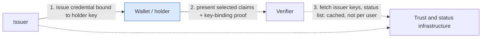

# Verifiable Credentials and Selective Disclosure

## TL;DR

Federated sign-in has two parties talking live: the application asks, the identity provider answers, and the provider therefore learns every place the user goes. A verifiable credential separates those steps. An **issuer** signs a set of claims once and gives the result to the user's **wallet**. Later the wallet presents it to a **verifier**, which checks the issuer's signature offline. The issuer is not contacted and does not learn where the credential was used.

That model only became deployable once three things were standardized: a credential format that lets the holder reveal some claims and withhold others (**SD-JWT**, RFC 9901, published November 2025, and the ISO mdoc format used for mobile driving licences), protocols for issuing and presenting (**OpenID for Verifiable Credential Issuance 1.0** and **OpenID for Verifiable Presentations 1.0**, both final in 2025), and a profile that pins the options (**HAIP 1.0**, final December 2025). We use this for claims issued by one party and consumed by many others that the issuer should not track: proof of age, licences, qualifications, verified identity attributes. We do not use it for ordinary sign-in to our own service, where [Passkeys and Phishing-Resistant Authentication](10-passkeys-and-phishing-resistant-authentication.md) is simpler and stronger.

## What a Plastic Card Does That Federation Cannot

A driving licence in a wallet has properties that are easy to overlook because they are so ordinary. The licensing authority issued it once, years ago. When its holder shows it at a bar, a pharmacy, or a car rental desk, the authority is not consulted and never finds out. The card works when the authority's computers are down. And the person checking it needs no prior relationship with the authority beyond knowing what a genuine card looks like.

Federated identity on the web has none of these properties. Signing in through an identity provider is a live conversation in which the provider is asked, each time, to vouch for the user to a named application. The provider necessarily learns which applications the user visits and when. It must be available at that moment. And the application must have registered with the provider in advance. For workforce sign-on, where the employer runs the provider and is entitled to know, this is fine. For a government attesting that a citizen is over 18, it would mean the state receiving a record of every age-restricted purchase.

The plastic card has its own faults. It shows everything printed on it to everyone who looks, so the bartender who needs one bit, old enough or not, also reads a home address. It can be photographed and, with effort, forged. Verifiable credentials are an attempt to keep the card's architecture, in which the issuer signs once and steps away, while repairing those faults with cryptography. Each property in the contract below corresponds to either something the card already did or something it failed to do.

## The Three-Party Contract



1. **Authenticity.** A verifier accepts only claims signed by an issuer it has decided to trust for that credential type.
2. **Holder binding.** A presentation proves possession of the private key the credential was issued to, so a copied credential is useless.
3. **Presentation binding.** Each presentation is bound to one verifier and one transaction, so it cannot be replayed elsewhere.
4. **Minimal disclosure.** The verifier receives only the claims it requested and the user approved.
5. **Issuer blindness.** Verification does not reveal to the issuer which verifier saw the credential.
6. **Revocability.** A credential can be suspended or revoked without contacting the holder and without breaking issuer blindness.

These six do not sit comfortably together. Revocability wants the verifier to ask the issuer something, and issuer blindness wants it to ask nothing. Holder binding attaches a stable public key to the credential, and a stable key is a tracking identifier, which works against the privacy that minimal disclosure was meant to provide. Most of the engineering in this chapter is the management of those two tensions, and it helps to keep them in view from the start.

## How Selective Disclosure Works in SD-JWT

The requirement sounds paradoxical. The issuer signs a document containing ten claims. The holder wants to show three of them, and the verifier must still be able to check the issuer's signature. A signature, though, covers the whole document, and removing any part of it invalidates the signature.

The way out is to have the issuer sign commitments to the claims in place of the claims themselves.

**Documented, RFC 9901.** The issuer does not put disclosable claims in the signed JWT. For each one it creates a **disclosure**: the base64url encoding of a JSON array holding a random salt, the claim name, and the value. The signed payload contains only the hash of each disclosure, in an `_sd` array:

```text
Disclosure:   ["2GLC42sKQveCfGfryNRN9w", "birthdate", "1990-04-12"]
In the JWT:   "_sd": ["Xq3...hash-of-that-disclosure...", "9fT...", "kL0..."],
              "_sd_alg": "sha-256",
              "cnf": {"jwk": { ...holder public key... }}
```

The signed document is now a list of hashes and never changes. The claims travel beside it, and the holder chooses which to send. A verifier that receives a disclosure hashes it, finds the hash in the signed list, and knows the issuer committed to exactly that name and value. A claim that is withheld is present only as a hash.

The salt is what makes withholding real, and it is instructive to consider the scheme without it. A birth date has perhaps 40,000 plausible values. If the signed list contained a bare hash of `birthdate: 1990-04-12`, a verifier could hash every date in the last century in under a second and find the match. Most personal attributes are like this: drawn from sets small enough to enumerate. The random salt, different for each claim and known only to issuer and holder, makes each hash unguessable regardless of how predictable the value behind it is.

One leak remains. The length of the `_sd` array reveals how many claims the credential holds, and that can be informative in itself. Issuers may therefore add decoy hashes, random values that correspond to no claim, so that the count of withheld claims is hidden as well.

The wallet receives the signed JWT plus all disclosures. To present, it sends the JWT, only the disclosures the user agreed to reveal, and a key-binding JWT, joined with tilde characters:

```text
<issuer-signed JWT>~<disclosure 1>~<disclosure 3>~<key-binding JWT>
```

The final component addresses the fault of the photographed card. Everything before it is static data that anyone who has seen it could copy and present again. The `cnf` claim in the issuer-signed part names a public key whose private half lives in the holder's device, and the key-binding JWT is a fresh signature made with it. It carries the verifier's identifier as `aud`, a verifier-supplied `nonce`, an issue time, and `sd_hash`, a hash over the exact JWT and disclosures being presented. The audience and nonce bind the presentation to one verifier and one moment. The `sd_hash` prevents an interceptor from attaching the same key-binding JWT to a different selection of disclosures.

The verifier therefore performs three checks in order: the issuer's signature over the hash list, the membership of each received disclosure's hash in that list, and the holder's signature over this particular presentation.

Two related formats matter in practice. **SD-JWT VC** is the profile that turns an SD-JWT into a typed credential with a `vct` claim; it is an IETF draft that deployed profiles already reference. **ISO/IEC 18013-5 mdoc** achieves the same salted-hash disclosure with CBOR encoding and is the format of mobile driving licences. The two arrived at the same construction independently, which is some evidence that it is the natural one. A verifier that serves the general public should expect to accept both.

## Issuance and Presentation Protocols

A credential format says what the bytes are. Protocols are still needed to get a credential into a wallet and to get a presentation out of it. The OpenID Foundation's two specifications reuse OAuth for both, which means the hardening work described in earlier chapters applies directly. The roles, however, are arranged differently from an ordinary OAuth deployment, and it is easy to lose track of which party is which.

**Documented, OpenID4VCI 1.0.** Issuance is an OAuth flow in which the wallet is the client and the credential endpoint is the protected resource. The issuer hands the wallet a credential offer, the wallet obtains an access token (by authorization code when the user must authenticate at the issuer, or by a pre-authorized code when they already did so in another channel), and then calls the credential endpoint with a proof of possession of the key the credential should be bound to. A fresh nonce from the issuer prevents replay of that proof. The endpoint can return several credentials at once, each bound to a different key, which matters for unlinkability below.

**Documented, OpenID4VP 1.0.** Presentation is an authorization request in the other direction: the verifier is the client, and the wallet plays the authorization server. The request carries a query in the Digital Credentials Query Language (DCQL) that names the credential types and the specific claims wanted, plus a nonce. The response is the presentation, typically encrypted to the verifier.

How that request reaches the wallet matters more than it might appear. If it arrives by redirect or by a QR code with a custom URL scheme, a phishing site can relay a genuine verifier's request to the victim's wallet and forward the presentation onward, which is the relay attack on passwords in a new setting. On the web the request can instead be delivered through the browser's Digital Credentials API, in which the browser and operating system mediate wallet selection and bind the request to the calling origin. This is the mechanism that gives WebAuthn its phishing resistance, applied to credentials. Redirects and QR codes remain as fallbacks and do not have the property.

**Documented, HAIP 1.0.** The High Assurance Interoperability Profile fixes the choices: specific credential formats, cryptographic suites, sender-constrained tokens, wallet attestation, and the query language. As with FAPI in [OAuth 2.1 and High-Assurance Authorization Profiles](11-oauth-security-profiles.md), its value is in turning a framework with many options into something two independent implementations can test against. Regional programs such as the European Digital Identity Wallet build on it.

## Deciding Whom to Trust

A valid signature establishes that a particular issuer signed the claims. It does not establish that the verifier has any reason to believe that issuer. Anyone can generate a key and sign a credential stating that the bearer is a licensed physician. The cryptography will verify perfectly.

A verifier therefore needs a rule, outside the credential, mapping each credential type to the issuers permitted to assert it, and a way to obtain their keys that does not depend on anything the credential says about itself.

| Mechanism | How it works | Fits |
|---|---|---|
| Static allow list | Verifier configures issuer identifiers and keys | Closed ecosystems with few issuers |
| X.509 chain to a trust anchor | Issuer certificate chains to a root the verifier trusts for that credential type | Government documents; the mdoc model |
| Published trust list | A governing body signs a list of accredited issuers and wallets | National and sector schemes |
| Federation metadata | Entities publish signed statements chained through intermediaries to a trust anchor | Large multi-party ecosystems |

The four are points on one scale, from the verifier deciding everything itself to the verifier delegating the decision to a governing body. The choice is generally made by the ecosystem being joined.

There is a symmetric question that the plastic card never raised, because showing a card is a deliberate physical act. Should the wallet trust the verifier? A digital request costs nothing to make. Without verifier authentication and some registration of what each verifier may ask for, any website can request a full identity document, and a meaningful fraction of users will approve. High-assurance schemes therefore authenticate verifiers, register the claims each is entitled to request, and show the user who is asking and for what.

## Revocation Without Phoning Home

Here the first tension in the contract becomes concrete. The obvious way to check whether a credential is still valid is to ask the issuer about that credential. This is how certificate status checking has traditionally worked, and it tells the issuer exactly which credential was verified, when, and by whom. Issuer blindness, the property that justified this architecture in the first place, is gone.

The approaches in use avoid asking about a single credential.

**Status lists** hide the question in a crowd. **Documented, Token Status List (IETF, in publication as of 2026):** the issuer publishes a compressed bit array in which each credential has an index; the credential carries the list's URI and its index. The verifier downloads the whole list, caches it, and reads one position. The issuer sees a fetch of a list covering many thousands of credentials, and cannot tell which one was checked. **Illustrative:** one bit per credential for 10 million credentials is 1.25 MB before compression, and far less after it when most bits are zero.

The privacy of this scheme depends on details that are easy to get wrong. The crowd must be large, so a list with a few dozen entries hides little. The indexes must be assigned at random, since sequential assignment would let an observer infer issuance order. And the verifier must fetch on a schedule and not on demand, because a fetch triggered by a presentation reveals the timing even if it conceals the index.

**Short-lived credentials** remove the question altogether. The issuer makes credentials valid for days and lets the wallet refresh them. Revocation becomes "stop reissuing," and no status infrastructure is needed. The cost is that wallets need regular connectivity to the issuer, and the issuer's signing load rises accordingly.

In either case the verifier's knowledge is as fresh as a cache lifetime or a credential lifetime, and no fresher. That bound is the revocation delay, and it should be stated as a number and agreed with whoever owns the risk.

## Unlinkability and Its Limits

The second tension is subtler, and it is the one most often misunderstood by teams adopting this technology. Selective disclosure hides claim values. It does not hide the identity of the credential.

Consider what a verifier actually receives when a user proves only that they are over 18. It receives the issuer-signed JWT, which is the same sequence of bytes every time that credential is presented. It receives the issuer's signature, also identical. It receives the holder's public key in `cnf`, also identical. Any of these is a perfectly good unique identifier. Two verifiers who compare records, or one verifier seeing the same user on two occasions, can link the presentations with certainty, having learned nothing but a single boolean each time. The salted hashes protected the birth date and did nothing for the anonymity.

**Batch issuance** is the deployed answer, and it is a direct one. The wallet obtains many copies of the credential, each with a different holder key and different salts and therefore a different signature, and uses each copy once. **Illustrative:** 10 million holders refreshing a batch of 20 credentials monthly is 200 million issuer signatures a month, roughly 77 per second on average and far higher at peaks, plus 20 status-list positions per holder. Unlinkability is thus bought with issuer capacity, and the batch size is a dial between the two.

**Zero-knowledge schemes** would remove that cost. Certain signature schemes allow the holder to derive, from one credential, any number of proofs that the issuer signed the disclosed claims, where no two proofs share any bytes. They are being standardized and are not yet in the final profiles above. A practical obstacle explains much of the delay. Holder binding at high assurance requires the holder's key to live in the phone's secure hardware, and that hardware performs a small fixed set of operations, in practice ECDSA on a standard curve. It cannot execute the newer algebra these schemes need, and so the profiles have been built around what the hardware in a billion existing phones can sign.

Finally, some **claims defeat the purpose** whatever the cryptography. A name, a document number, or an exact birth date identifies the user outright. Verifiers should prefer derived claims, such as an age-threshold boolean, and issuers should include them in the credential so that they can be disclosed in place of the underlying value.

## Capacity and Availability

The architecture moves load in an unusual direction, and it is worth following.

Verification is offline and cheap: one issuer signature, one holder signature, and a hash per disclosed claim. The verifier's only dependencies are cached issuer keys and cached status lists. It therefore continues to work through an issuer outage for as long as its caches remain acceptable, which is the plastic card's resilience recovered.

The issuer is not in the path of any presentation. Its load comes from issuance and refresh, and is determined by batch size and credential lifetime as computed above. How often credentials are used does not affect it at all. This reverses the federated model, where the identity provider's load is proportional to sign-ins, and it means that an issuer's capacity plan is driven by privacy parameters instead of by usage.

Status lists are static, signed, and cacheable, so distributing them is a content-delivery problem with well-known solutions. The refresh interval is the freshness bound.

Wallet loss is a recovery event. Holder keys in secure hardware cannot be exported, which is the point of putting them there, so a lost phone means the credentials are gone and must be reissued. The issuer needs a path for re-proofing the person, and that path has the same abuse profile as account recovery anywhere else: it is where an attacker who cannot steal the key will try to be issued a new one.

## Failure Traces

### Presentation Replayed to a Second Verifier

1. A verifier requests a presentation without a nonce, or does not check `aud` in the key-binding JWT.
2. A malicious verifier that received a presentation from the user forwards it.
3. The second verifier accepts a valid issuer signature and a valid holder signature.

Both signatures are genuine. The holder really did sign, but for someone else. This is the same structural failure as a bearer token replayed to a second API, and it has the same remedy.

**Prevention:** always send a fresh nonce; verify `aud`, `nonce`, and `sd_hash` in the key-binding JWT; prefer the browser-mediated API, which binds the origin.

### Any Issuer Accepted

1. A verifier checks that the signature is valid against the key found in the credential's own metadata.
2. An attacker self-issues a credential of the right type.

**Prevention:** resolve issuer keys only through the trust mechanism, and bind each credential type to its allowed issuers.

### Over-Asking

1. A verifier that needs proof of age requests the full identity credential because it is easier.
2. Users approve the prompt out of habit; the verifier now stores identity documents and the breach consequences that come with them.

Nothing here is a protocol failure. Selective disclosure makes minimal requests possible and does not make them happen, and a verifier that asks for everything has spent the technology's cost for none of its benefit.

**Prevention:** request derived claims; schemes should register what each verifier is entitled to ask; treat the query as a privacy-reviewed artifact.

### Status Check Reveals the User

1. An issuer deploys a per-credential status endpoint for convenience.
2. Every verification produces a request naming the credential, giving the issuer a log of the holder's activity.

**Prevention:** status lists or short-lived credentials only; reject designs with per-credential callbacks.

## Verification

1. Remove a disclosure the verifier requires: the presentation is rejected for missing claims, not accepted with defaults.
2. Alter a disclosure value: its hash no longer matches `_sd` and verification fails.
3. Present with a key-binding JWT signed by a different key, with a wrong `aud`, and with a stale `nonce`: all rejected.
4. Present a self-issued credential of an accepted type: rejected by the trust rule.
5. Revoke a credential and measure how long verifiers continue to accept it; compare with the cache bound.
6. Present the same credential to two test verifiers and confirm whether they can link it; this documents the unlinkability the deployment really provides.
7. Run the OpenID Foundation conformance suite for issuer, wallet, or verifier role as applicable.

The sixth test is unusual in that it has no pass or fail. Its result is a statement of fact about the system's privacy, and the purpose of running it is to make sure the statement in the privacy documentation is the same one.

## Decision Framework

1. **Is this a many-verifier, issuer-should-not-watch problem?** If the issuer and verifier are the same organization, or the user is just signing in, use federation or passkeys.
2. **Which formats must be accepted?** SD-JWT VC, mdoc, or both, usually decided by the ecosystem being joined.
3. **Who is trusted to issue each credential type, and how are their keys found?**
4. **What is the minimum claim set, and can the issuer provide derived claims?**
5. **What revocation delay is acceptable, and does it come from a status list or from credential lifetime?**
6. **How much unlinkability is required?** None, per-verifier, or per-presentation, with batch issuance sized accordingly.
7. **What happens when the wallet is lost?**
8. **Which profile is the conformance target?** Adopt HAIP or the regional profile instead of choosing options individually.

## References

- [RFC 9901: Selective Disclosure for JSON Web Tokens](https://www.rfc-editor.org/rfc/rfc9901)
- [IETF Internet-Draft, *SD-JWT-based Verifiable Credentials (SD-JWT VC)*](https://datatracker.ietf.org/doc/draft-ietf-oauth-sd-jwt-vc/)
- [OpenID Foundation, *OpenID for Verifiable Credential Issuance 1.0*](https://openid.net/specs/openid-4-verifiable-credential-issuance-1_0.html)
- [OpenID Foundation, *OpenID for Verifiable Presentations 1.0*](https://openid.net/specs/openid-4-verifiable-presentations-1_0.html)
- [OpenID Foundation, *OpenID4VC High Assurance Interoperability Profile 1.0* (final)](https://openid.net/specs/openid4vc-high-assurance-interoperability-profile-1_0-final.html)
- [IETF Internet-Draft, *Token Status List*](https://datatracker.ietf.org/doc/draft-ietf-oauth-status-list/)
- [W3C, *Verifiable Credentials Data Model v2.0*](https://www.w3.org/TR/vc-data-model-2.0/)
- [W3C, *Digital Credentials*](https://www.w3.org/TR/digital-credentials/)

---

## Related Chapters

- [JOSE and JSON Web Token Verification](03-jwt-tokens.md): SD-JWT inherits every JWT validation rule and adds the disclosure and key-binding checks
- [Passkeys and Phishing-Resistant Authentication](10-passkeys-and-phishing-resistant-authentication.md): the right tool for sign-in, and the same origin-binding idea the browser credential API reuses
- [OAuth 2.1 and High-Assurance Authorization Profiles](11-oauth-security-profiles.md): issuance and presentation are OAuth flows and adopt the same hardening profile approach
- [Cryptographic Key and Data-Protection Architecture](06-encryption.md): issuer signing keys are long-lived, high-value keys that need the hierarchy described there
- [Data Retention and Compliance Engineering](../20-production-readiness/05-data-retention-and-compliance-engineering.md): every disclosed claim a verifier stores becomes data it must justify, protect, and delete
