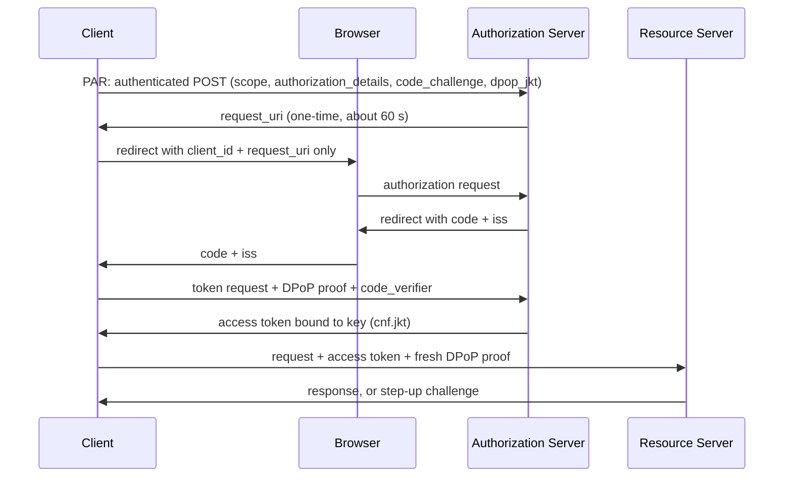

# OAuth 2.1 and High-Assurance Authorization Profiles

> Your OAuth flow is textbook-correct and an attacker with a stolen access token is calling your API from their own laptop. What does a hardened profile add?

## TL;DR

OAuth 2.0 (RFC 6749) is a framework with many optional parts, and most real breaches came from the options: tokens in URLs, loosely matched redirects, bearer tokens that work for whoever holds them, and clients that cannot tell which authorization server answered. A decade of extension RFCs closed those gaps one at a time. The current state of the art is therefore a **profile** and not a new protocol: a fixed selection of those extensions in which the dangerous options are simply absent.

Three layers are worth telling apart. **RFC 9700** (2025) is the published Best Current Practice and is what an implementation should already satisfy. **OAuth 2.1** consolidates that practice into one document; as of November 2026 it is still an IETF Internet-Draft, so we cite it as a direction and not as a standard. **FAPI 2.0** is a final OpenID Foundation profile that goes further, with pushed requests, sender-constrained tokens, and a published attacker model. The grant mechanics, token types, and refresh lifecycle are in [OAuth 2.0 and OpenID Connect](04-oauth2-openid-connect.md). This chapter explains what each extension defends against, how it works on the wire, and what it costs to operate, because an extension adopted without understanding its threat tends to be configured in a way that no longer addresses it.

## Why the Front Channel Is the Problem

Nearly every weakness in this chapter has one root, and seeing it early makes the extensions feel less like a list.

OAuth has to move information between two servers that have no direct relationship in the moment: the client application and the authorization server. It does so by bouncing the user's browser between them with HTTP redirects. Parameters ride out in a URL, and results ride back in a URL. This path through the browser is called the front channel, and it has two unfortunate properties. Nothing on it is authenticated, since anyone can construct a URL and induce a browser to visit it. And nothing on it is private, since URLs are recorded in browser history, proxy logs, analytics beacons, and `Referer` headers, and are visible to every extension the user has installed.

The direct connection between client and authorization server, the back channel, has neither problem. It runs over TLS between two parties that can authenticate each other.

The history of OAuth security is a steady migration of anything valuable off the front channel. First the tokens moved, then the binding between request and response, then the request parameters themselves. What remains in a fully hardened flow is a pair of opaque references that are useless to anyone who intercepts them. With that in mind, the deletions in the modern baseline read as a single argument.

## What the Baseline Removes

**Documented, RFC 9700 and the OAuth 2.1 draft:** the consolidated baseline is defined mostly by deletions.

| Removed or forbidden | Replacement | Reason |
|---|---|---|
| Implicit grant (`response_type=token`) | Authorization code with PKCE | Tokens in the fragment leak through history, referrers, and injected scripts |
| Resource owner password credentials grant | Authorization code; device grant for constrained input | The client sees the password and multi-factor cannot be applied |
| Authorization code without PKCE | PKCE with `S256` for every client, confidential ones included | Code injection and interception |
| Redirect URI pattern or prefix matching | Exact string comparison | Open redirects and subdomain takeover turn into code theft |
| Bearer tokens in the URI query | `Authorization` header or form body | URLs are logged everywhere |
| Long-lived bearer refresh tokens for public clients | Sender-constrained or rotated with reuse detection | A stolen refresh token is a standing grant |

Some of these rows deserve their history, because the history shows they were reasonable once and explains why they linger in old systems.

The **implicit grant** returned the access token directly in the redirect. It existed because, in 2010, a JavaScript application could not make a cross-origin POST to a token endpoint. Browsers did not yet widely support CORS, so the front channel was the only channel a single-page application had. That constraint is long gone, and the grant should have gone with it.

**PKCE** was introduced for mobile apps, where another app on the device could register the same custom URL scheme and receive the authorization code. [OAuth 2.0 and OpenID Connect](04-oauth2-openid-connect.md) describes the verifier and challenge; the question for a baseline is why every client must use it.

Why require it of confidential clients, which already authenticate with a secret when redeeming a code? Because the secret defends against a different attack. Consider an attacker who has stolen a victim's authorization code, perhaps from a log. They begin their own sign-in with the legitimate client, and at the redirect step they substitute the victim's code for their own. The client dutifully redeems it, authenticating with its real secret, and the attacker's browser session is now attached to the victim's account. The client secret was presented by the client and proves nothing about which browser session the code belongs to. PKCE does, because the verifier is held in the session that started the flow, and the victim's code was issued against a different challenge.

**Exact redirect matching** closes a family of attacks that all work the same way: if the authorization server accepts `https://app.example/*`, then any open redirect, any user-controlled page, or any forgotten subdomain under that pattern becomes a place to which the attacker can have codes delivered.

**Refresh token rotation** issues a new refresh token on every use, and a second presentation of an old one revokes the whole family, since the server cannot tell the client from a thief. The rotation transaction and its retry problem, in which a lost response makes an honest client look like the thief, are worked through in [OAuth 2.0 and OpenID Connect](04-oauth2-openid-connect.md). The grace period that softens it is a small, deliberate hole in the detection; binding the refresh token to a key, as described below, avoids the dilemma.

A system that meets this table has an ordinary, defensible OAuth deployment. The profiles that follow are for systems where an attacker who can read or alter the browser's traffic, or steal a token at rest, must still fail.

## The Hardened Request Path



The diagram shows the destination. We will walk through it one extension at a time, in each case starting from the weakness in the plain flow.

### Pushed Authorization Requests

Even with tokens removed from it, the front channel still carries the request: the scopes being asked for, the redirect URI, the PKCE challenge. The user can read these and so can anything in the browser. More seriously, they can be changed. An attacker who can modify the URL before the authorization server sees it can widen a scope or alter the details of a payment, and the server has no way of knowing that the client did not ask for exactly that.

**Documented, RFC 9126:** with pushed authorization requests the client sends the parameters directly to the authorization server over the back channel, authenticating as it would at the token endpoint. The server validates them, stores them, and returns a `request_uri`, an opaque single-use reference that expires in about a minute. The browser redirect carries only the `client_id` and that reference.

Three things improve at once. The request gains integrity and confidentiality without any cryptography beyond TLS. The server knows which client it is dealing with before the user is involved, and can reject a malformed request with a clear error to the party able to fix it, where previously the user would have been shown an error page. And large requests no longer strain URL length limits. The cost is one more round trip per authorization and a short-lived store of pending requests.

The alternative is to keep the request on the front channel and sign it. **RFC 9101** (JAR) packages the parameters as a signed JWT. It is the right tool when the request must later be attributable to the client's key, as in some payment regulations, and its price is key management in every client. Where attribution is not required, pushing the request achieves the security properties with less machinery.

### Rich Authorization Requests

A scope is a string, and a string such as `payments` cannot say how much, to whom, or from which account. Systems worked around this by inventing scope grammars like `payment:123.50:EUR:DE0210...`, each one different and none of them parseable by anyone else's software.

**Documented, RFC 9396:** `authorization_details` is a JSON array of typed objects describing exactly what is being authorized:

```json
[{
  "type": "payment_initiation",
  "actions": ["initiate"],
  "locations": ["https://api.bank.example/payments"],
  "instructedAmount": {"currency": "EUR", "amount": "123.50"},
  "creditorAccount": {"iban": "DE02100100109307118603"}
}]
```

The user consents to that object, the granted details are returned with the token, and the resource server enforces them. Two rules keep this safe. Each `type` has a schema the authorization server validates, so that an unknown field cannot smuggle in authority the consent screen did not display. And the resource server treats the granted details as an upper bound, which it still checks against its own object-level policy from [Authorization at Scale](07-authorization-patterns.md). The token says the client may pay this amount to this account. Whether the user owns the debited account is a question the token cannot answer.

It should now be obvious why this extension is almost always deployed with pushed requests: a payment instruction is exactly the kind of parameter that must not travel through a browser where it can be read or edited.

### Sender-Constrained Tokens

A bearer token is a password for an API. Whoever holds it is authorized, and tokens are held in many places: client memory, server logs, crash dumps, proxy caches, and the compromised API that received one legitimately. Sender constraint changes the question the resource server asks from "is this token valid?" to "is this token valid, and does the caller hold the private key it was issued to?"

| Mechanism | Binding | Fits | Operational cost |
|---|---|---|---|
| Mutual TLS (RFC 8705) | Certificate thumbprint in `cnf.x5t#S256` | Server-to-server clients with managed certificates | TLS termination must pass a verified certificate identity to the application |
| DPoP (RFC 9449) | JWK thumbprint in `cnf.jkt`; per-request proof JWT | Browsers, mobile apps, clients behind varied network paths | Replay cache or server nonces; exact URI reconstruction behind proxies |

Mutual TLS is the simpler idea. The client presents a certificate during the TLS handshake, the authorization server records its thumbprint inside the token, and the resource server compares the thumbprint in the token to the certificate on the connection. The proof of possession is the handshake itself, performed once per connection at no additional per-request cost. Its difficulty is architectural: TLS is rarely terminated by the application. It ends at a load balancer or gateway, which must then convey the verified certificate to the service in a header that the service can trust and a client cannot forge. Every hop that terminates TLS is a place this can be misconfigured.

DPoP moves the proof up to the application layer so that it survives any number of TLS terminations. On each request the client sends a small JWT, the proof, signed with its private key. The proof's header carries `typ` set to `dpop+jwt` and the public key itself. Its claims are `htm` (the HTTP method), `htu` (the target URI without query), `iat`, a unique `jti`, and, when calling a resource, `ath`, a hash of the access token. Each claim exists to defeat a particular reuse. Without `htm` and `htu`, a proof captured from a harmless GET could accompany a destructive POST. Without `ath`, a proof could be paired with a different token bound to the same key. Without `jti` and `iat`, a captured proof could simply be sent again.

That last point is where the operational cost appears. To reject a replayed proof, the resource server must remember every `jti` it has seen within the acceptance window, which makes a previously stateless check stateful. RFC 9449 offers a second mechanism that trades the memory for a round trip. The server issues a `DPoP-Nonce` value that the client must include in subsequent proofs. If the nonce is derived from a keyed hash of the current time bucket, the server can verify it without storing anything, and a proof minted in advance, for instance by an attacker with brief access to the client's signing capability, is refused because it carries no current nonce. Most deployments use both: nonces to keep the window to seconds and a small cache to cover the remainder.

One gap remains between the authorization code and the token. Passing `dpop_jkt`, the thumbprint of the client's key, in the pushed request binds the code to that key, so a stolen code cannot be redeemed with a different key.

We should also be clear about what sender constraint does not do. An attacker who can run code inside the client can ask the client to sign. In browsers, the key should be generated as non-extractable, so that injected script can use it for as long as the page is open but cannot take it away. Better still is a backend-for-frontend that keeps tokens out of the page altogether.

### Issuer and Resource Binding

Four smaller extensions tie a token to where it came from and where it is going. Each is cheap and each closes an attack that is difficult to see without being told about it.

**Issuer identification.** A client that supports more than one authorization server faces a problem that sounds impossible on first hearing: it can receive a response and be mistaken about who sent it. The response arrives at the client's redirect URI through the browser, carrying a code and nothing that names its origin. The mix-up attack exploits this, and a full trace appears later in the chapter. **Documented, RFC 9207:** the authorization response carries an `iss` parameter, and the client compares it with the issuer it recorded when it started the flow.

**Resource indicators.** If one access token is accepted by every API in an organization, then every API is trusted with the authority of every other. The least-defended service, once compromised, can collect the tokens it receives and replay them against the most valuable one. **Documented, RFC 8707:** the client names the target API with the `resource` parameter, and the authorization server issues a token whose audience is that API alone.

**Protected resource metadata.** **Documented, RFC 9728:** a resource server publishes a document at `/.well-known/oauth-protected-resource` listing its authorization servers, supported scopes, and token-binding methods, and points to it from the `WWW-Authenticate` header of a 401 response. A client that has never seen the API can then discover where to obtain a token with no out-of-band configuration. This is the discovery mechanism the Model Context Protocol adopted, described in [Workload and Agent Identity Delegation](12-workload-and-agent-identity.md).

**Typed access tokens.** An ID token and a JWT access token from the same issuer are signed by the same key and look alike to a careless validator. **Documented, RFC 9068:** JWT access tokens carry `typ` of `at+jwt`, so an ID token can never validate as an access token. The check costs one string comparison. Its absence produces token confusion, in which a token a user obtained merely by signing in to one application is accepted somewhere else as authority to call an API.

### Step-Up Authentication

Not every operation behind one API is worth the same. Reading a balance and adding a payee differ in consequence, and the session that was adequate for the first may be too old or too weakly authenticated for the second. The party that knows what an operation is worth is the resource server. The party that can do something about it is the client. They need a way to talk.

**Documented, RFC 9470:** the resource server answers with a 401 whose `WWW-Authenticate` header carries `error="insufficient_user_authentication"` and the required `acr_values` or `max_age`. The client starts a new authorization request with those parameters, and the new token carries `acr` and `auth_time` claims the resource server can check.

The value of standardizing this is that sensitivity stays where it is known. The client does not hard-code a list of dangerous endpoints that drifts out of date. The API can raise its requirements for an operation, or for a particular risky request, and conforming clients follow. One guard is essential: a client that cannot satisfy the requested level must fail with an error and must not redirect again, or the result is the loop traced below.

## FAPI 2.0 as a Reference Profile

Each extension above is optional, and each has options of its own. An organization assembling them independently makes dozens of small decisions, any one of which can reopen a hole, and then must convince a reviewer that the combination is sound. A profile makes those decisions once, in public, and submits the result to analysis.

**Documented, FAPI 2.0 Security Profile (final, 2025):** the profile targets an attacker who controls the network and the user's browser traffic, and was accompanied by a formal security analysis. Its requirements read as a summary of this chapter:

- authorization code flow only, with PKCE `S256` and pushed authorization requests;
- confidential clients authenticated with `private_key_jwt` or mutual TLS, never a shared secret;
- access tokens sender-constrained with DPoP or mutual TLS;
- the `iss` response parameter, exact redirect URIs, and short-lived authorization codes;
- restricted signing algorithms and TLS versions.

A companion Message Signing profile adds signed requests, signed responses, and HTTP message signatures (RFC 9421) where non-repudiation is a legal requirement. Open-banking and health ecosystems mandate FAPI. Outside regulation, we value it as a pre-argued configuration with a conformance test suite: it replaces "we believe our settings are safe" with "we pass the tests for a profile that has been formally analyzed."

## Client Identity Without Pre-Registration

Classic OAuth assumes that someone registered each client by hand and received a `client_id`. That is workable when a company's own apps talk to its own server. It fails in open ecosystems, where any client may meet any server for the first time at run time, as happens with mail clients, federated social software, and AI agents connecting to tool servers.

| Approach | How the client is identified | Status and risk |
|---|---|---|
| Dynamic Client Registration (RFC 7591) | Client POSTs metadata and receives a `client_id` | Standard; creates unbounded client records and needs abuse controls |
| Client ID Metadata Document | The `client_id` is an HTTPS URL; the server fetches metadata from it | IETF Internet-Draft in 2026; the fetch is a server-side request and needs SSRF defenses, size limits, and caching |
| Attestation-based client authentication | A platform or backend attests the app instance's key | IETF Internet-Draft; fits mobile apps and wallets that cannot keep a shared secret |

Dynamic registration has the authorization server create a record for every client that asks, which makes the server a database that strangers can write to. The metadata-document approach inverts the relationship. The client's identifier is a URL that the client controls, the server fetches the metadata when it needs it, and no record has to exist beforehand. The identity is then anchored in control of a domain, the same anchor the web already uses. The server takes on a new duty in exchange: it is now making outbound requests to URLs supplied by strangers, and must defend that fetch like any other server-side request.

For browser-based applications, the IETF guidance in *OAuth 2.0 for Browser-Based Applications* ranks architectures by exposure: a backend-for-frontend that holds tokens server-side and gives the browser only a cookie is strongest, a token-mediating backend is next, and tokens handled entirely in script come last.

**GNAP (RFC 9635)** deserves a sentence. It is a 2024 redesign with key-bound clients and negotiated interaction built in from the start. It is technically cleaner, and the installed base of OAuth libraries, servers, and auditors means most systems will reach the same properties through the extensions above.

## Capacity and State Model

There is a pattern in the cost of everything described so far. Plain OAuth with JWT access tokens is close to stateless at the resource server: verify a signature against a cached issuer key and check some claims. Each hardening step replaces a stateless check with a small amount of shared state, or adds a signature. None of the amounts is large, but each is a new dependency on a request path, and it is better to plan for them than to discover them.

The pushed-request store holds one entry per started authorization, deleted on first use. **Illustrative:** 500 authorizations per second with a 60-second lifetime is at most 30,000 live entries.

The DPoP replay cache holds each `jti` for the acceptance window. **Illustrative:** 5,000 requests per second with a 60-second window is 300,000 entries per resource server cluster; at about 64 bytes each that is roughly 20 MB. The memory is trivial. The design question is whether the cache is shared across nodes. A shared cache adds a network call to every API request. A per-node cache adds none, and allows a proof to be replayed once against each other node within the window. Server nonces shrink the window, and for most APIs a short window with per-node caches is a defensible choice, provided it is made deliberately and written down.

Verification CPU roughly doubles. Each request carries two signatures: the access token and the proof. Issuer keys are few and their verification results can be cached per token. Proof keys are per client and every proof is new, so we budget one ES256 verification per request with no caching.

Token minting increases, because one audience per token means a client calling five APIs holds five tokens. Clients should cache each token until it nears expiry and should not request one per call.

Finally, availability shifts. Pushed requests and step-up put additional authorization-server calls on user-facing paths, so its outage now blocks new sign-ins sooner. In the other direction, local validation of tokens lets resource servers continue to serve existing sessions through such an outage for as long as their tokens last. The access token lifetime is therefore also the length of time the system can coast.

## Failure Traces

### Mix-Up Between Two Issuers

1. A client supports sign-in with issuers A and B and uses one redirect URI for both.
2. The user starts a flow with B, which is malicious. B redirects the browser to A with the client's `client_id`.
3. A issues a code and redirects to the client.
4. The client, believing it is in a B flow, sends the code and its PKCE verifier to B's token endpoint.

The attacker now holds a code for the user's account at the honest issuer, along with the verifier needed to redeem it. No party misbehaved except B, and A was never compromised. The client's error was to infer the sender of a response from its own memory of what it had started, when the response itself said nothing on the matter.

**Prevention:** check the `iss` response parameter against the issuer stored with the pending transaction; use a distinct redirect URI per issuer.

### DPoP Proof Rejected Behind a Proxy

1. The client signs `htu` as the public URL.
2. A gateway rewrites the path and forwards over plain HTTP on an internal host name.
3. The resource server reconstructs a different URL and rejects every proof, or an engineer disables the check.

The second outcome in step 3 is the dangerous one, and it is common. A control that fails closed for every request on its first day in production is under great pressure to be switched off, and a DPoP deployment with the `htu` check disabled looks healthy in every dashboard.

**Prevention:** reconstruct the external URL from trusted forwarding configuration and not from request headers a client can set; test through the real edge.

### Token Reused at a Second API

1. An authorization server issues tokens with a shared audience for all internal APIs.
2. A low-value API is compromised and logs incoming tokens.
3. The attacker presents a logged token to a high-value API, which accepts the audience.

**Prevention:** resource indicators with one audience per API; sender constraint so the logged token lacks a usable key.

### Step-Up Loop

1. An API demands an authentication context the user's identity provider cannot produce.
2. The client retries the authorization request each time it receives the challenge.
3. The user sees an endless redirect and the authorization server sees a request storm.

**Prevention:** cap step-up attempts per operation; when the returned token's `acr` does not meet the challenge, surface an error.

## Verification

Each control in this chapter rejects something, so each can be tested by presenting the thing it should reject:

1. Send an authorization request with a redirect URI that differs by one character or a trailing slash: rejected.
2. Reuse a `request_uri`: rejected on the second use.
3. Present a DPoP-bound token with no proof, with a proof for another method or URI, and with a replayed `jti`: all rejected.
4. Present a token issued for API A to API B: rejected on audience.
5. Present an ID token as an access token: rejected on `typ`.
6. Return an authorization response with a wrong or missing `iss` to the client: the client aborts.
7. Run the public conformance suite for the chosen profile in continuous integration, not once at launch.

## Decision Framework

We recommend adopting in this order. Each step is useful without the next, and the order follows the ratio of risk removed to operational cost added.

1. **Meet the baseline.** PKCE everywhere, exact redirects, no implicit or password grants, rotated or bound refresh tokens. This is RFC 9700 and is not optional.
2. **Bind audiences.** Resource indicators and typed access tokens stop cross-API replay at almost no cost.
3. **Add issuer identification** as soon as a client can talk to more than one authorization server.
4. **Sender-constrain tokens** when theft of a token at rest or in transit is in the threat model: mutual TLS for managed server clients, DPoP elsewhere.
5. **Push requests** when request parameters are sensitive or must not be tampered with, and always with rich authorization details.
6. **Add step-up challenges** when APIs differ in sensitivity and the client should not own that knowledge.
7. **Adopt FAPI 2.0 wholesale** when a regulator, partner ecosystem, or security review needs a named, testable target.

Choose a maintained authorization server that already implements the profile. The engineering effort belongs in resource-server enforcement and client key handling, which no product can do on a team's behalf.

## References

- [RFC 9700: Best Current Practice for OAuth 2.0 Security](https://www.rfc-editor.org/rfc/rfc9700)
- [IETF Internet-Draft, *The OAuth 2.1 Authorization Framework*](https://datatracker.ietf.org/doc/draft-ietf-oauth-v2-1/)
- [RFC 9126: OAuth 2.0 Pushed Authorization Requests](https://www.rfc-editor.org/rfc/rfc9126)
- [RFC 9101: JWT-Secured Authorization Request (JAR)](https://www.rfc-editor.org/rfc/rfc9101)
- [RFC 9396: OAuth 2.0 Rich Authorization Requests](https://www.rfc-editor.org/rfc/rfc9396)
- [RFC 9449: OAuth 2.0 Demonstrating Proof of Possession (DPoP)](https://www.rfc-editor.org/rfc/rfc9449)
- [RFC 8705: OAuth 2.0 Mutual-TLS Client Authentication and Certificate-Bound Access Tokens](https://www.rfc-editor.org/rfc/rfc8705)
- [RFC 9207: OAuth 2.0 Authorization Server Issuer Identification](https://www.rfc-editor.org/rfc/rfc9207)
- [RFC 8707: Resource Indicators for OAuth 2.0](https://www.rfc-editor.org/rfc/rfc8707)
- [RFC 9728: OAuth 2.0 Protected Resource Metadata](https://www.rfc-editor.org/rfc/rfc9728)
- [RFC 9470: OAuth 2.0 Step Up Authentication Challenge Protocol](https://www.rfc-editor.org/rfc/rfc9470)
- [RFC 9068: JSON Web Token (JWT) Profile for OAuth 2.0 Access Tokens](https://www.rfc-editor.org/rfc/rfc9068)
- [OpenID Foundation, *FAPI 2.0 Security Profile* (final)](https://openid.net/specs/fapi-security-profile-2_0-final.html)
- [IETF Internet-Draft, *OAuth Client ID Metadata Document*](https://datatracker.ietf.org/doc/draft-ietf-oauth-client-id-metadata-document/)
- [IETF, *OAuth 2.0 for Browser-Based Applications*](https://datatracker.ietf.org/doc/draft-ietf-oauth-browser-based-apps/)
- [RFC 9635: Grant Negotiation and Authorization Protocol (GNAP)](https://www.rfc-editor.org/rfc/rfc9635)

---

## Related Chapters

- [OAuth 2.0 and OpenID Connect](04-oauth2-openid-connect.md): the grants, token types, and refresh lifecycle that these profiles constrain
- [JOSE and JSON Web Token Verification](05-jwt-tokens.md): proofs, request objects, and typed access tokens all depend on strict JWT validation
- [Passkeys and Phishing-Resistant Authentication](03-passkeys-and-phishing-resistant-authentication.md): a step-up challenge is only as strong as the ceremony it triggers
- [Workload and Agent Identity Delegation](12-workload-and-agent-identity.md): the same binding rules applied when the client is a service or an AI agent, not a person
- [Edge Gateway and API Mediation](../07-service-mesh/03-api-gateway.md): where proof validation and URL reconstruction happen when a gateway terminates the connection
- [Verifiable Credentials and Selective Disclosure](09-verifiable-credentials-and-selective-disclosure.md): credential issuance and presentation reuse these flows with the wallet as client or server
