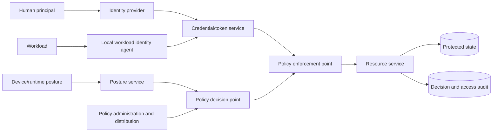

# Zero-Trust Service and Workload Architecture

> The attacker is already inside the network with a valid internal address. What stops them now, if being inside means nothing?

## TL;DR

Zero trust is an authorization architecture. It cannot be bought as a product, and it does not mean "put mTLS everywhere." Network location is treated as a weak signal. Every access decision binds an authenticated principal, workload, device or runtime posture, requested action, resource, tenant, and policy revision, and enforcement occurs at a boundary that the caller cannot bypass.

A zero-trust design requires:

- cryptographic human and workload identity with short-lived credentials;
- explicit trust domains and federation;
- policy decision and enforcement points with versioned, fail-safe state;
- sender-constrained or channel-bound credentials where replay matters;
- resource-level authorization at the service that owns the resource;
- control-plane distribution that tolerates stale state without silently widening access;
- continuous observability, credential rotation, break-glass governance, and recovery.

Zero trust replaces ambient, transitive trust with a verifiable request contract and bounded failure modes.

---

## Threat Model and Access Contract

For most of the history of corporate computing, security architecture rested on a perimeter. A firewall separated the trusted inside from the untrusted outside, and a request that originated inside was treated as legitimate by virtue of where it came from. Internal services often performed no authentication at all, since anything able to reach them was presumed to belong.

The model has one decisive flaw: it gives an attacker nothing more to do after the first success. Once any single machine inside the perimeter is compromised, through a phished employee, a vulnerable service, or a malicious dependency, the attacker is inside, and the inside is trusted. Every internal service is now reachable and most will cooperate. This step, from one foothold to everything else, is called lateral movement, and in a perimeter network it is hardly a step at all. A series of intrusions in the late 2000s followed exactly this course and prompted Google to rebuild its own corporate access on the opposite assumption, in the project published as BeyondCorp: the internal network is to be considered as hostile as the internet.

We therefore assume that an attacker may:

- reach internal network addresses;
- compromise one user account, device, workload, proxy, or CI runner;
- steal a bearer token or static secret;
- exploit a trusted service as a confused deputy;
- replay an old request;
- alter control-plane configuration;
- move laterally through broad service credentials;
- abuse a support or break-glass path;
- target a stale region during policy or key rollout.

If position on the network no longer confers authority, something else has to, and it has to be evaluated on every request. An access decision becomes a function of everything relevant to it:

```text
decision = authorize(
  subject_identity,
  workload_identity,
  device_or_runtime_posture,
  requested_action,
  resource_identity,
  tenant,
  credential_binding,
  request_context,
  policy_revision
)
```

Authentication establishes which principal or workload presented a credential. Authorization determines whether that identity may perform this action on this resource. The user authentication lifecycle is in [Authentication Systems](./02-authentication-fundamentals.md), and policy models are in [Authorization at Scale](./07-authorization-patterns.md).

### Core invariants

1. **No ambient authority:** being on a subnet, cluster, VPN, or host does not by itself grant application access.
2. **Unforgeable identity:** accepted identity is cryptographically verified against an intended trust domain.
3. **Audience and resource binding:** a credential issued for service A is not silently accepted by service B.
4. **Least privilege:** permissions name allowed actions and resources, not a broad network zone.
5. **Tenant binding:** identity, policy, cache keys, and resource lookup agree on tenant scope.
6. **Complete enforcement:** every path to protected state crosses an enforcement point.
7. **Fail-safe degradation:** missing or invalid identity/policy does not widen access.
8. **Monotonic revocation posture:** a stale evaluator cannot reactivate an explicitly revoked principal beyond the declared staleness budget.
9. **Auditable decision:** an operator can identify subject, resource, action, policy revision, and reason without logging secrets.
10. **Bounded credential lifetime:** compromise has an expiration and rotation path.

---

## Planes and Trust Boundaries



The architecture divides into four planes, each answering a different question.

The **identity plane** answers who is asking. It attests principals and workloads and issues them short-lived credentials. The **policy control plane** answers what the rules are: it stores policy, compiles it, validates changes, distributes revisions, and records where each came from. The **enforcement plane**, which is the data plane, sits in the request path. It authenticates the channel or request, obtains or evaluates policy, and gates the operation. The **resource plane** owns the fine-grained facts that no generic component can know: who owns this record, which tenant it currently belongs to, how it is classified, what state its workflow is in.

Vendors tend to draw all of this as a single box labeled "zero-trust proxy," and the simplification does harm. A gateway can enforce coarse ingress policy very well. It cannot decide whether this user may read this invoice, because it has no idea who owns the invoice. That decision belongs to the owning service. And if the service will also accept requests that did not come through the gateway, the gateway's enforcement is advisory.

---

## Identity Sources

### Human identity

Human sessions normally originate at an identity provider and carry:

- stable subject identifier;
- issuer and audience;
- authentication time and assurance;
- session or token identity;
- organization/tenant membership;
- bounded claims needed by the relying party.

It is tempting to go further and encode the user's complete set of permissions in the token, so that no service ever needs to look anything up. This fails in two ways. Permissions change before tokens expire, so the token asserts rights the user no longer has. And the token grows with every consumer's requirements while exposing all of them to each. Tokens work well for facts that are stable over their lifetime, namely identity and assurance. Current policy is queried or cached where the decision requires it.

### Workload identity

Services need identities as much as people do, and the traditional mechanism, a static API key or shared client secret, is poor at it. A key that never changes cannot be rotated without coordination, and a key shared across a fleet cannot say which instance used it. We prefer an identity that the runtime issues to a workload on the basis of attested facts about how it is running:

```text
node attestation
  -> trusted local agent
  -> workload selectors
  -> short-lived workload credential
  -> mTLS or signed request
```

The selectors are facts such as the cluster, namespace, service account, image digest, process identity, or cloud instance identity. What matters is who asserts them. They are observed by trusted infrastructure, the kernel and the orchestrator, and they are never reported by the workload itself. An issuance system that accepted a service name supplied by the caller would let any process claim to be any service.

SPIFFE models a workload identity as a URI within a trust domain and delivers short-lived X.509 or JWT identity documents through a local Workload API. That local endpoint concentrates the risk. A neighboring process that can reach another workload's endpoint, or imitate its selectors, can assume its identity, so the isolation of the endpoint is as important as the cryptography behind it.

### Trust domains

A trust domain is a root of identity authority: the set of identities that one signing root can vouch for. It is an administrative boundary, and it need not correspond to a DNS suffix. Domains should be separate when administrative control, environment, regulatory boundary, or security posture differs.

Federation lets one domain accept identities from another by publishing which roots it recognizes. This establishes that a foreign identity is authentic and nothing more. What the foreign identity may do is still a matter for explicit authorization, mapped to specific resources and actions.

The number of roots is a decision about blast radius. With one global root, a single compromise authenticates an attacker into every environment. With a root per team, rotation and policy become unmanageable. The right question to ask is what an attacker would gain from the compromise of each root.

---

## Credential Forms and Binding

### Mutual TLS

In ordinary TLS the server proves its identity and the client proves nothing. Mutual TLS has the client present a certificate too, so each end knows the other. A workload certificate carries a stable workload identity, has a short validity, and chains to the intended trust domain.

mTLS is the most common building block of zero-trust deployments and the source of their most common misunderstanding. It authenticates a connection, and a connection is not a request. Consider a gateway that holds one mTLS connection to a backend and sends requests from ten thousand users over it. The backend knows, with cryptographic certainty, that the gateway is calling. It knows nothing about which user each request is for. It must distinguish "the gateway workload called me" from "user X requested action Y," and it must verify the user context it is given, since a bare header carries no proof of who wrote it.

### Bearer tokens

A bearer token can be replayed by whoever possesses it. Its exposure is limited by restricting:

- audience;
- scope/resource;
- lifetime;
- issuer;
- accepted algorithms and keys;
- where it may be logged or stored.

Bearer credentials are often unavoidable across proxies and heterogeneous systems. Where they are used, the boundary within which a stolen token could be replayed should be stated explicitly.

### Sender-constrained credentials

A token can be bound to a key that the client must prove it holds. OAuth certificate-bound tokens, for example, carry a confirmation of the client's certificate, and a resource server rejects the token on any connection that was not established with that certificate. The token alone is then insufficient.

The binding couples two lifecycles that were previously independent. Certificate rotation and token refresh must overlap correctly, or a client with a new certificate holds tokens bound to its old one. TLS termination must preserve the proof through to the point of verification. These operational costs should be weighed before the mechanism is chosen.

### Signed request envelopes

Connection-level identity has a further limit, which is that it lasts only as long as the connection. When a request is placed on a queue and processed an hour later, or passes through several hops, the connection that authenticated it is gone by the time the work executes. For these cases the request itself is signed, in an envelope that binds:

```text
issuer workload
original principal
tenant
audience
action
resource reference
request digest
issued_at / expires_at
nonce or operation identity
policy context reference
signature
```

The consumer validates the signature, audience, and expiry, applies its replay or idempotency rules, and then authorizes against the current state of the resource. The end user's bearer token should not be placed on the queue instead. A token meant to live for minutes would then sit in durable storage for as long as the queue retains messages, readable by anything with access to the queue.

---

## Policy Decision and Enforcement

### PEP placement

Policy can be enforced at several points, and each knows some things well and others not at all:

| Enforcement point | Knows well | Cannot safely own alone |
|---|---|---|
| Edge gateway | external identity, route, coarse tenant, abuse signals | record ownership and domain state |
| Service proxy/sidecar | workload identities, method, connection | application object semantics |
| Application middleware | route/action, principal context | every resource fact unless passed |
| Domain service | resource state, relationships, invariants | fleet-wide ingress abuse |
| Database policy | row/tenant ownership | user intent and cross-service workflow |

"Defense in depth" is often taken to mean repeating the same check at every layer. Three copies of a coarse role check are three places for the rule to drift out of agreement, and they add nothing that one copy lacked. Depth is useful when the layers are complementary: coarse ingress policy at the edge, workload admission at the proxy, and resource authorization in the service, each enforcing what it alone is positioned to know.

### Local versus remote policy decisions

A policy decision can be computed inside the enforcing process from a local copy of the policy, or by calling a central decision service. The trade is the familiar one between a cache and its origin.

Local evaluation:

- avoids an RPC on every request;
- survives policy-service outage;
- requires versioned policy distribution and bounded staleness.

Remote evaluation:

- centralizes complex/current facts;
- simplifies immediate revocation;
- adds latency, availability, and fan-out dependencies.

Most systems settle on a hybrid, with stable policy compiled and evaluated locally and a remote lookup reserved for high-risk or rapidly changing facts. Whatever the arrangement, the application decides what happens when the remote call fails. A generic policy client must not quietly convert "decision service unavailable" into "allow," which is a behavior we will meet again in the failure traces.

### Decision cache

If decisions are cached, the cache key must include every input that could change the answer:

```text
subject
workload/caller
tenant
action
resource or policy-relevant resource version
assurance/posture class
policy revision
```

The typical bug is a key that is too small. Caching on `user_id + permission` seems natural and is wrong whenever the same user holds different rights in different tenants or on different objects, because a decision made in one context is then served in another. The TTL is bounded by how quickly revocation must take effect and how volatile the resource state is, and allow and deny decisions may deserve different lifetimes.

---

## Policy Control Plane

A policy change alters what the production system permits, and it can cause an outage or a breach as readily as a code change can. It deserves the same lifecycle:

```text
DRAFT
  -> VALIDATED
  -> REVIEWED
  -> COMPILED
  -> PUBLISHED
  -> OBSERVED
  -> SUPERSEDED
```

Each revision is immutable and carries its own provenance:

```text
policy_revision
schema_version
source_digest
compiled_digest
target_services
required_evaluator_version
created_by
approved_by
created_at
change_reason
previous_revision
signature
```

### Publication

1. parse and type-check policy;
2. validate referenced actions/resources/attributes;
3. reject cycles or excessive evaluation complexity;
4. run unit, regression, and semantic-diff tests;
5. publish content-addressed compiled artifacts;
6. advance an environment pointer with compare-and-swap;
7. evaluators fetch, verify, compile/load, and atomically activate;
8. report active revision and errors.

Push notifications get a new revision to evaluators quickly, and polling repairs whatever the notifications missed. Neither should be relied on alone. Evaluators also refuse to move to an older revision unless a signed rollback command says so. Otherwise an attacker able to replay an old distribution message could restore a policy from before their access was removed.

### Staleness classes

Local evaluation means every decision is made on a copy of the policy that may be out of date. Different decisions can tolerate very different amounts of that:

| Class | Example | Stale behavior |
|---|---|---|
| Static service allowlist | service A may call method B | last known good within hours |
| Tenant membership | user belongs to organization | minutes or session-bound |
| Privileged role revocation | production admin removed | seconds, remote check if needed |
| Emergency deny | compromised workload blocked | near-immediate, fail closed beyond budget |

The tolerance is declared in the policy's metadata, where it can be enforced and monitored. "Eventually consistent authorization" with no stated bound amounts to an admission that nobody knows how long a revoked user keeps their access.

---

## Credential Issuance and Rotation

### Bootstrap

Every credential is issued to someone who authenticated, which leaves the question of how the first one is obtained. It cannot be obtained with a credential. Bootstrap rests on some fact the platform can attest without a secret from the workload:

- cloud instance/workload identity;
- orchestrator service account plus node attestation;
- TPM or hardware identity;
- signed workload artifact and trusted launcher;
- pre-provisioned enrollment credential with narrow one-time use.

Controlled registration maps this evidence to a workload identity. The registration API therefore decides which runtime facts become which identity, and write access to it is equivalent to the ability to mint any identity in the domain. It should be protected accordingly.

### Rotation overlap

Rotating a trust root across a fleet is a distributed change that cannot happen everywhere at once, so it proceeds through a period in which both old and new are valid:

```text
publish new trust root
  -> issue credentials under old and/or new chain
  -> wait until verifiers trust new root
  -> switch issuance
  -> observe old-chain usage reach zero
  -> remove old root after maximum credential lifetime + margin
```

The rule is that verifiers must trust the new root before anyone presents a credential signed by it. There are two ways to fail, and they pull in opposite directions. If the old root is removed before every credential has rotated, valid workloads are rejected and the result is an outage. If a compromised old root stays trusted indefinitely because removing it is risky, the attacker keeps their access. Both windows need to be tracked explicitly.

### Revocation versus short lifetime

Short-lived credentials reduce dependence on revocation lists, since a credential that expires in an hour needs no revoking after an hour. This holds only if issuance to a compromised workload stops promptly and verifiers enforce expiry strictly. For an immediate response to compromise, several measures are combined:

- disabling registration/issuance;
- emergency deny policy;
- connection draining;
- revocation/status where supported;
- key rotation;
- workload quarantine.

Connection draining is on the list for a reason that is easy to overlook. A certificate is checked during the TLS handshake, when the connection is established. A connection opened with a valid certificate and kept alive in a pool continues to work after that certificate expires or its workload is disabled, possibly for days. The design must say whether an authenticated connection remains valid until it closes or is re-authorized periodically.

---

## Capacity and Availability

Assume:

- 180,000 requests per second;
- 2 local policy evaluations per request;
- 0.4 percent require a remote high-risk decision;
- remote PDP p99 service time is 12 ms;
- target remote-PDP utilization is 60 percent;
- one PDP replica sustains 500 concurrent evaluations.

Local evaluation rate:

```text
180,000 * 2 = 360,000 evaluations/s
```

Remote request rate:

```text
180,000 * 0.004 = 720 requests/s
```

Expected in-flight remote work at p99 is roughly:

```text
720/s * 0.012 s = 8.64 requests
```

About nine concurrent requests against replicas that can each handle 500 makes the remote decision service look trivially provisioned, and on capacity alone it is. The arithmetic says nothing about the properties that matter. This service is on the path of every high-risk request, so its availability bounds theirs. It needs enough replicas to lose one, bounded deadlines, and a defined fail-closed behavior. It should also be sized from measured distributions that include bursts and regional failover, and not from an average.

The larger cost is less visible and belongs to the control plane, which scales with the number of evaluators. Sending a 4 MiB policy snapshot every minute to 10,000 processes costs:

```text
4 MiB * 10,000 / 60 s = 667 MiB/s
```

That is a great deal of bandwidth spent, almost always, on telling evaluators that nothing has changed. The remedies are standard for content distribution. Evaluators compare content digests and download only when the digest differs, regional relays absorb the fan-out, artifacts are compressed, polling is jittered, and changes are sent as deltas with a full snapshot available for repair. The local artifact is immutable and is replaced atomically, so that an evaluator never runs half of one revision and half of another.

---

## Multi-Region and Federation

Identity and policy have different requirements for where authority lives:

- one globally ordered policy revision per environment;
- regional distribution and local evaluation;
- trust-domain roots scoped by environment/administration;
- explicit federation bundles;
- workload home region or globally unique identity;
- region-local emergency deny capability with audited convergence.

Policy needs a single order of revisions because security rules do not merge safely. If two regions accept policy writes independently and reconcile by last-write-wins, a deny rule written in one can be overwritten by an unrelated change in the other, purely as an accident of clocks or replication order, and the system reports a successful merge. A single logical policy authority, or ownership divided so that writers never touch the same rules, avoids the problem.

A region cut off from the control plane continues on its last-known-good identity bundles and policy. That is the correct behavior for a while, and the design must say for how long. Beyond a stated maximum isolation, high-risk access fails closed or goes through a documented break-glass procedure.

Federation maps identities and does not map permissions. A partner identity such as `spiffe://partner.example/service/a` is authentic once the bundle verifies, and it receives only the access explicitly mapped to it in the local domain.

---

## Network Segmentation Still Matters

The slogan "the network is not trusted" is sometimes read as "the network does not matter," which is a different claim and a false one. Segmentation:

- removes unreachable attack paths;
- limits credential-testing and scanning;
- contains data exfiltration;
- protects control-plane endpoints;
- reduces accidental cross-environment access.

What has changed is the role of reachability. In the perimeter model it was sufficient for access. In this model it is necessary and never sufficient. A service an attacker cannot reach cannot be attacked through a vulnerability in its authentication, and so network policy remains a valuable layer beneath cryptographic workload identity and resource policy.

Egress is the half that tends to be forgotten. Designs concentrate on who may call a workload and neglect what the workload may call. An exploited workload with unrestricted outbound access can send data anywhere and invoke any external service. Destination allowlists, service identity, proxy policy, and per-workload egress credentials apply the same discipline in the outbound direction.

---

## Failure Traces

### Proxy trusts an unsigned identity header

1. Gateway authenticates users and normally injects `X-User-ID`.
2. Internal service is also reachable directly.
3. Caller supplies its own header.
4. Service authorizes as another user.

**Prevention:** remove caller-provided identity headers at the boundary, cryptographically bind propagated identity, and close bypass paths.

### mTLS grants transitive authority

1. Service A's certificate is valid.
2. Service A is compromised.
3. Every downstream accepts any action from A because "mTLS passed."
4. Attacker reads or mutates unrelated tenants.

This is the perimeter model rebuilt out of certificates. The network boundary has been replaced by a cryptographic one, and inside it everything still trusts everything. Lateral movement is as easy as before.

**Prevention:** mTLS authenticates workload A; downstream still authorizes action/resource/tenant and propagated principal.

### Policy outage widens access

1. Remote PDP times out.
2. SDK catches the error and defaults to `allow` for availability.
3. An attacker creates PDP load and bypasses policy.

The default was written by someone protecting uptime, and in a narrow sense it worked. It also converted a denial-of-service attack on the policy service into a way of bypassing authorization.

**Prevention:** decision-class-specific fail-safe default, local last-known-good policy, deadlines, and circuit isolation.

### Stale allow survives revocation

1. Administrator access is revoked.
2. One region misses the policy update.
3. Cached allow remains valid for an hour.
4. Revoked account changes production.

**Prevention:** freshness class for privileged access, active revision telemetry, short cache bound, and remote/current check for sensitive actions.

### Root rotation partitions the fleet

1. Issuer begins signing with a new root.
2. Some proxies have not received the bundle.
3. New credentials fail in those paths.
4. Retry traffic amplifies the outage.

**Prevention:** trust-new-before-issue, observed convergence, dual-chain overlap, and staged rotation.

### Cross-tenant decision cache

1. Cache key contains user and action but not tenant/resource.
2. User is admin in tenant A.
3. Cached allow is reused in tenant B.

**Prevention:** complete semantic cache key and property tests for tenant separation.

### Identity agent is a local confused deputy

1. Any container on a node can reach a workload identity endpoint.
2. Agent selects identity from caller-provided metadata.
3. Malicious workload requests a privileged identity.

**Prevention:** local endpoint isolation and attested selector matching based on trusted runtime facts.

---

## Observability and Incident Response

Each plane has its own signals. From the identity plane:

- issuance/renewal rate, latency, and rejection reason;
- credential age and expiry headroom;
- selector/attestation mismatch;
- active chain/root distribution;
- unexpected identity on node/namespace;
- issuance after disable request.

From the policy plane:

- mutation, validation, approval, and publication outcomes;
- evaluator active revision distribution;
- stale/error/not-ready evaluator count;
- semantic decision diff during rollout;
- emergency deny propagation latency;
- rollback/downgrade attempts.

From enforcement:

- allow/deny/error by action and coarse resource class;
- authentication and audience/binding failures;
- policy evaluation latency and cache result;
- bypass-path probes;
- cross-region/federation use;
- break-glass activation and duration.

Two of these give early warning of the commonest outages. Expiry headroom, the time remaining before the oldest credential in use expires, falls steadily when renewal is broken and reaches zero at the moment of the outage, so it is worth alerting on well before that. The distribution of active policy revisions across evaluators shows whether a rollout has converged or whether some part of the fleet is running on old rules.

Principal identifiers, resource identifiers, and arbitrary policy attributes do not belong in metric labels. High-cardinality evidence goes to access-controlled audit logs with sampling and retention rules.

Incident response should be a rehearsed sequence:

1. identify compromised principal/workload/trust domain;
2. block issuance and publish emergency deny;
3. drain or quarantine active workloads/connections;
4. rotate affected credentials/roots;
5. search audit evidence for resource access and lateral movement;
6. repair policy/registration cause;
7. restore through ordinary versioned publication;
8. remove emergency state only after verification.

---

## Migration Path

No organization begins with a clean slate, and a migration that tries to enforce every service-to-service edge on the first day will cause an outage and lose its sponsorship. The sequence that works starts by observing:

1. Inventory callers, workloads, resources, and bypass paths.
2. Issue workload identities in observe-only mode.
3. Build an edge graph from authenticated telemetry.
4. Define action/resource vocabulary and policy ownership.
5. Enforce on a low-risk service with a tested fail-safe path.
6. Move from broad service allowlists to method and resource authorization.
7. Replace static credentials and shared secrets.
8. Add high-risk freshness and sender binding.
9. segment network/egress based on observed required paths;
10. remove legacy credentials and unauthenticated endpoints.

There is a trap in the third step. The graph of observed traffic is evidence of what happens today, and it is tempting to turn it directly into an allowlist. But today's traffic may include a compromise already in progress, integrations nobody remembers, and access far broader than anything needs. Converting it wholesale into policy would give all of that formal approval. Each edge needs an owner who can justify it before it becomes an allow.

Policy changes are checked with semantic diffs. Privacy-scrubbed access requests are replayed under the old and the proposed revisions, and the sets of newly allowed and newly denied requests are reviewed. Enforcement is introduced as a canary by service or tenant, with an audited rollback revision kept ready.

---

## Verification

1. **Identity tests:** wrong issuer, audience, trust domain, expiry, signature, and key binding.
2. **Policy tests:** allow/deny vectors, missing attributes, resource versions, and tenant separation.
3. **Path tests:** direct-to-service, alternate ports, admin endpoints, queues, jobs, and database access.
4. **Control-plane fault tests:** missed update, corrupt artifact, rollback, stale region, and invalid compiler version.
5. **Rotation tests:** new root trust before issuance, old root removal, long-lived connection behavior.
6. **Cache tests:** complete key, stale revocation, negative/positive TTL, cross-tenant properties.
7. **Load tests:** cold evaluator start, policy fan-out, remote PDP overload, and denial storms.
8. **Federation tests:** unknown domain, expired bundle, identity collision, and overbroad mapping.
9. **Break-glass game day:** activate, scope, observe, expire, and review emergency access.
10. **Adversarial tests:** header spoofing, token replay, confused deputy, SSRF/egress, and compromised workload lateral movement.

The strongest test is end to end and has two halves. First we demonstrate that a principal can reach a resource it is meant to reach. Then we demonstrate that changing network location, forging headers, replaying credentials, or calling through an unintended workload does not widen that authority. The second half is the one that tests the architecture. Many systems pass the first while failing the second.

---

## Decision Framework

This architecture is warranted when internal reachability is broad, workloads are dynamic, credentials need automated rotation, several trust domains interact, or the compromise of one workload must not grant transitive access.

Before adding any component in its name, we ask:

1. Which attacker capability or ambient trust does it remove?
2. What identity is authenticated, and how was it bootstrapped?
3. What exact action/resource/tenant is authorized?
4. Which enforcement paths can bypass the check?
5. How stale may identity, policy, posture, and revocation become?
6. Does the credential need sender binding?
7. What happens when issuer, PDP, policy distribution, or trust bundle is unavailable?
8. How are credentials and roots rotated without partitioning the fleet?
9. Which data appears in decision/audit telemetry?
10. How is emergency access bounded and expired?

The first question is the filter. A component that removes no attacker capability has added cost and complexity for nothing, however modern it is. An architecture does not become zero trust by deploying a mesh, a proxy, a VPN replacement, or short-lived certificates. The defining property is that each protected action is authorized from verified identity and current resource context, at a boundary that cannot be bypassed, with explicit behavior under failure.

---

## References

- [NIST SP 800-207: Zero Trust Architecture](https://csrc.nist.gov/pubs/sp/800/207/final)
- [SPIFFE Identity and Verifiable Identity Document Specification](https://spiffe.io/docs/latest/spiffe-specs/spiffe-id/)
- [SPIFFE Workload API Specification](https://spiffe.io/docs/latest/spiffe-specs/spiffe_workload_api/)
- [RFC 8705: OAuth 2.0 Mutual-TLS Client Authentication and Certificate-Bound Access Tokens](https://www.rfc-editor.org/rfc/rfc8705)
- [RFC 9700: Best Current Practice for OAuth 2.0 Security](https://www.rfc-editor.org/rfc/rfc9700)
- [BeyondCorp: A New Approach to Enterprise Security (Google Research)](https://research.google/pubs/beyondcorp-a-new-approach-to-enterprise-security/)

---

## Related Chapters

- [Authentication Systems](02-authentication-fundamentals.md): a workload identity is still an authentication problem, relocated rather than removed
- [OAuth 2.0 and OpenID Connect](04-oauth2-openid-connect.md): short-lived tokens bound to a workload are the credential shape this architecture assumes
- [Authorization at Scale](07-authorization-patterns.md): policy that binds principal, action, resource, and tenant is an authorization model with more inputs
- [Cryptographic Key and Data-Protection Architecture](10-encryption.md): mTLS proves little without key custody, rotation, and a revocation path that works under failure
- [Service Mesh Data and Control Planes](../07-service-mesh/04-sidecar-pattern.md): the mesh is where most teams deploy this enforcement point while leaving the decision logic unspecified
- [Multi-Tenant Isolation and Tenant Lifecycle Architecture](../06-scaling/12-multi-tenancy.md): segmentation and tenant isolation converge on the same failure: one shared path with shared credentials
- [Third-Party Dependency and Supply Chain Architecture](../15-production-readiness/04-third-party-dependencies-and-supply-chain.md): a vendored library is a principal inside your boundary that never completed enrollment and cannot be rotated
- [Workload and Agent Identity Delegation](12-workload-and-agent-identity.md): how user authority travels with a workload identity across hops, domains, and AI agents
