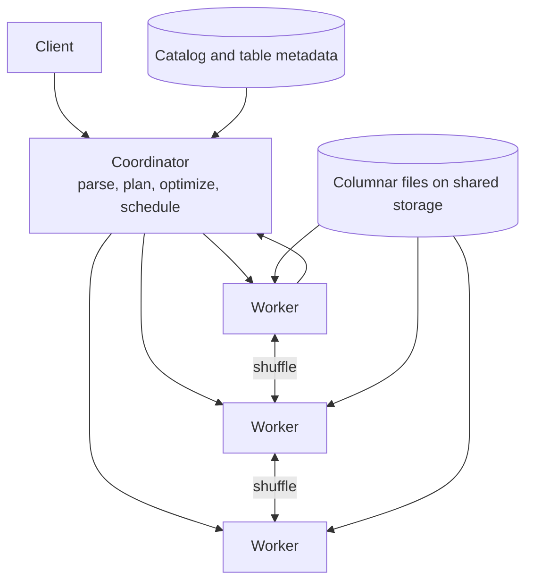

# Analytical Query Engines

## TL;DR

An analytical query engine answers questions that read a large fraction of a table and return a small result: sums, counts, joins across facts and dimensions, top-k by some measure. Its performance comes from three sources, in decreasing order of leverage: **pruning** (never reading data the query cannot need) is worth orders of magnitude, **columnar and vectorized execution** is worth one order, and **parallelism** only divides what remains by the worker count.

The engine is a distributed system with three hard problems that are not about scanning. The **optimizer** must choose join order and join distribution from cardinality estimates that are routinely wrong by large factors. The **shuffle** moves intermediate data between workers and is where skew, memory pressure, and failure recovery concentrate. **Admission** decides how many queries share a fixed memory budget, because one unbounded query can take down every other tenant. [Column-Oriented Storage](../03-storage-engines/06-column-storage.md) owns the file and encoding layer, [Lakehouse Table Formats](./05-lakehouse-table-formats.md) owns table metadata and commits, and [Batch Execution](./01-batch-processing.md) owns long-running fault-tolerant jobs. The subject here is the interactive engine that sits on top of them.

## Primary Evidence and Scope

| Source | What it establishes | Boundary |
|---|---|---|
| Graefe, Volcano (SIGMOD 1990) | The iterator model and the exchange operator, which encapsulates parallelism so other operators stay single-threaded | An execution framework, not a performance claim for modern hardware |
| Boncz, Zukowski, and Nes, MonetDB/X100 (CIDR 2005) | Processing vectors of values per call removes most per-tuple interpretation overhead | Measured on the hardware and benchmarks of that paper |
| Neumann (VLDB 2011) | Compiling query pipelines into tight data-centric loops as an alternative to vectorization | One compiling engine's results |
| Melnik et al., Dremel (VLDB 2010, 2020) | Columnar nested data, a multi-level serving tree, and later disaggregated storage, compute, and shuffle | Google's system and workload |
| Dageville et al., Snowflake (SIGMOD 2016) | A shared-data architecture: object storage, independent compute clusters, and pruning from per-partition metadata instead of indexes | One commercial system at publication time |
| Sethi et al., Presto (ICDE 2019) | A federated engine with pipelined in-memory execution across connectors | At publication, a worker failure failed the query |
| Leis et al. (VLDB 2015) | Cardinality estimation errors, not cost models, dominate bad plans, and they compound with each join | Benchmark study on specific optimizers |

Worked numbers below are illustrative inputs.

## Workload and Contract

Analytical workloads differ from transactional ones along every axis that drives design:

| Axis | Transactional | Analytical |
|---|---|---|
| Rows touched per query | A few, by key | Millions to billions, by predicate |
| Columns touched | Most of the row | A handful of many |
| Writes | Small, frequent, concurrent | Bulk appends and periodic rewrites |
| Concurrency | Thousands of short operations | Tens to hundreds of heavy queries |
| Latency target | Milliseconds, tight tail | Seconds, with high variance by query |
| Correctness anchor | Isolation between writers | A consistent snapshot per query |

State the contract explicitly: snapshot semantics (does a query see one table version throughout?), freshness (how old may the data be?), result exactness (are approximate aggregates allowed?), resource limits per query and per tenant, and what happens to a query when a worker dies.

## Architecture: Coordinator, Workers, and Storage



The coordinator parses SQL, resolves tables against a catalog, produces a logical plan, optimizes it, cuts it into **stages** at the points where data must be redistributed, and schedules stage fragments on workers. Workers scan files, run operators, and exchange intermediate rows.

**Documented, Snowflake and Dremel:** both systems separate storage from compute. Data lives in shared object storage; compute clusters are stateless with respect to the data and can be resized or added independently. The consequences are architectural: scans pay object-store latency unless a local cache absorbs it, metadata must be good enough to avoid listing and opening files to decide relevance, and two compute clusters can read the same table without coordinating beyond the catalog. See [Object Storage Architecture and Commit Protocols](../03-storage-engines/08-object-storage.md).

## Pruning: The Cheapest Row Is the One Never Read

Pruning happens at four levels, each removing data before the next is consulted:

1. **Partition pruning.** A predicate on the partition column eliminates whole directories or manifest entries.
2. **File or block skipping.** Per-file and per-block minimum and maximum values (zone maps) eliminate chunks whose range cannot match. Membership filters on high-cardinality columns do the same for equality predicates. See [Bloom Filters](../03-storage-engines/05-bloom-filters.md).
3. **Column projection.** Only referenced columns are read.
4. **Late materialization.** Evaluate the predicate on its column, then fetch other columns only for surviving row positions.

Min/max skipping only works when the data is **clustered** on the filtered column. If rows arrive in random order with respect to `customer_id`, every block's range spans all customers and nothing is skipped. Sort order, clustering keys, and multi-dimensional orderings exist to make block ranges narrow. This is a write-time decision that determines read-time cost, and it can serve only a few columns well.

**Documented, Snowflake:** the paper describes relying on per-partition metadata for pruning in place of conventional indexes, because maintaining indexes over very large, frequently rewritten data is expensive and random access to object storage is slow.

## Execution: Vectors, Compiled Pipelines, and Operators

The classical Volcano model pulls one row at a time through a tree of operators via a virtual `next()` call. On analytical workloads the per-row call overhead and branch mispredictions cost more than the actual arithmetic.

Two designs remove that overhead:

- **Vectorized execution** passes batches of column values, typically around a thousand at a time, so each operator runs a tight loop over an array. Interpretation cost is paid once per batch, loops are friendly to the CPU cache and to SIMD instructions, and the engine stays an interpreter that is easy to profile and debug.
- **Compiled execution** generates code for each pipeline of operators so that a row flows from scan to the next materialization point inside one loop, keeping values in registers.

Both reach comparable speed on scans and aggregations; they differ in engineering cost, compilation latency for short queries, and how naturally they adapt at runtime. The decision that matters to a system designer is elsewhere: operators that must materialize (hash join build sides, hash aggregation tables, sorts) need memory proportional to their input or group count, and that memory is what admission control has to budget.

## Joins and the Optimizer

A distributed join has two decisions: order and distribution.

**Distribution.** A **broadcast** join copies the smaller input to every worker holding the larger one. A **partitioned** (shuffle) join hashes both inputs on the join key so matching rows meet on the same worker. Broadcast avoids shuffling the large side but multiplies the small side by the worker count; it is correct only when the small side is in fact small.

**Order.** For a query joining several tables, the number of possible orders grows factorially, and a bad order can produce an intermediate result thousands of times larger than the final one.

Both decisions rest on **cardinality estimates**: how many rows survive each filter and each join. **Documented, Leis et al.:** in their study, estimation errors grew rapidly with the number of joins and were the dominant cause of poor plans, more than the cost model itself. Estimates assume independence between predicates and uniformity within histograms, and real data violates both.

Engines defend themselves in three ways:

- **Statistics**: row counts, distinct-value sketches, histograms, kept fresh after bulk loads. See [Probabilistic Sketches](../03-storage-engines/10-probabilistic-sketches.md).
- **Runtime filters**: after building the hash table for the small side, send a compact summary of its keys to the scan of the large side so non-matching rows are dropped at the source.
- **Adaptive execution**: observe actual sizes at stage boundaries and switch join strategy or repartition before continuing.

## Shuffle, Skew, and Failure

Shuffle is the exchange of intermediate rows between stages. It is the part of the engine most like a distributed storage problem.

- **Skew.** Hash partitioning sends all rows with one key to one worker. A join or aggregation on a column where a single value (often `NULL` or a default such as `0`) holds 30% of rows gives one worker 30% of the data. Mitigations are splitting hot keys across several partitions with a salt, handling the dominant value separately, or filtering it out when it carries no meaning.
- **Memory.** A stage that cannot hold its hash table spills to disk or fails. Spilling keeps the query alive at a large latency cost.
- **Failure.** If shuffle data lives only in worker memory, losing a worker loses the query. Engines that persist shuffle output to a separate service or to storage can retry a stage instead. **Documented, Dremel (2020):** the retrospective describes moving shuffle into a disaggregated service for this reason and to decouple it from worker memory.

The contract to state is which of the two a system is: fast and fail-on-loss, appropriate for interactive queries that a client can rerun, or durable-shuffle with stage retry, appropriate for hour-long transformations. Running the second kind of workload on the first kind of engine is a common source of pages.

## Admission, Isolation, and Caching

An analytical cluster has a fixed memory and CPU budget and a workload whose per-query cost varies by six orders of magnitude. Without admission control the cluster's behavior is set by its most expensive concurrent query.

- **Queues and resource groups** cap concurrency and memory per tenant or workload class, so scheduled reports cannot starve interactive users. The fairness mechanics are in [Priority, Fairness, and Backpressure](../18-workflow-job-systems/07-priority-fairness-backpressure.md).
- **Per-query limits** on scanned bytes, memory, and runtime turn a runaway query into an error for one user.
- **Result and fragment caches** absorb repeated dashboard queries; correctness depends on keying the cache by table snapshot version.
- **Materialized views and rollup tables** precompute expensive aggregates. They move cost to write time and add a freshness contract that must be visible to the reader.

## Capacity Model

All inputs are illustrative.

A fact table holds 10 billion rows at 200 bytes per row uncompressed (2 TB), stored columnar at 5x compression (400 GB) across 50 columns of similar size, partitioned by day for one year. A dashboard query reads 4 columns for the last 30 days.

```text
column projection   = 400 GB x 4/50          = 32 GB
partition pruning   = 32 GB x 30/365         = 2.63 GB
scan cost           = 2.63 GB / 100 MB/s     = 26 core-seconds
on 64 cores         = 26 / 64                = 0.4 s plus planning and merge

without pruning     = 400 GB / 100 MB/s      = 4,000 core-seconds = 62 s on 64 cores
```

The same hardware answers in under a second or in a minute depending on whether the layout lets the engine skip 99.3% of the bytes. No amount of vectorization closes a 150x gap.

For join distribution, broadcasting a 50 MB dimension table to 100 workers costs 5 GB of cluster memory, which is acceptable. Broadcasting a 20 GB table because the optimizer estimated 20 MB costs 2 TB and fails. The estimate, not the operator, was the bug.

## Failure Traces

### The default key that ate one worker

1. Orders are joined to customers on `customer_id`; guest checkouts store `0`.
2. A quarter of all orders hash to the same partition.
3. One worker builds a hash table several times its memory limit while the others sit idle.
4. The query spills for twenty minutes or is killed, depending on configuration.

The plan was correct and the data was skewed. Detect the dominant key in statistics and split or special-case it.

### Stale statistics choose a broadcast

A table grows from one million to two billion rows after a backfill, but statistics are not refreshed. The optimizer broadcasts it. Every worker runs out of memory at the same moment. Refresh statistics as part of the load, and cap broadcast size with a runtime check, not only a plan-time estimate.

### Metadata becomes the query

A table accumulates four million small files from a streaming writer. Planning lists and reads footers for minutes before the first row is scanned, and the coordinator's heap fills with file descriptors. Compaction and manifest-level statistics are prerequisites for interactive latency; see [Lakehouse Table Formats](./05-lakehouse-table-formats.md).

### Monday morning stampede

Two hundred dashboards refresh at 09:00, each issuing ten queries. Without queues, all two thousand run concurrently, each gets a sliver of memory, most spill, and none finish before clients time out and retry. Admission with bounded concurrency finishes the same work sooner because queries that run get enough memory to stay in RAM.

## Operations and Verification

Track bytes scanned versus bytes in the table per query (pruning effectiveness), estimated versus actual rows at each plan node (estimation error), shuffle bytes and per-partition skew, spill volume, queue wait versus execution time, planning time, and cache hit rate by snapshot version.

Verify correctness by differential testing against a reference engine on generated queries and data, including `NULL` handling, empty inputs, and overflow. Verify robustness with a query at every configured limit, a worker killed mid-shuffle, a table with adversarial skew, and a statistics refresh withheld after a large load.

## Decision Framework

| Situation | Choice | Reason |
|---|---|---|
| Sub-second dashboards over known dimensions | Pre-aggregated rollups or materialized views on a clustered layout | Pruning and precomputation beat any scan speed |
| Ad hoc exploration over a data lake | Federated MPP engine with in-memory pipelining | Low latency; a failed query is rerun by the user |
| Hours-long transformations with large joins | Engine with durable shuffle and stage retry | A worker loss must not restart the job |
| Operational analytics on fresh rows | Real-time OLAP store with ingestion-time indexing, or read replica with columnar projection | Freshness contract in seconds, bounded query shapes |
| Mixed tenants on one cluster | Resource groups, per-query limits, separate compute per class | Isolation is a product requirement, not a tuning step |
| Filters on a few known columns | Cluster or sort on those columns | Min/max skipping only works on clustered data |
| Distinct counts and percentiles at scale | Approximate aggregates with stated error | Exact versions require shuffling every value |

Before choosing an engine, measure three ratios on the real workload: bytes scanned to bytes stored, estimated to actual cardinality at the worst join, and the largest shuffle partition to the median. They predict cost and incidents better than any benchmark number.

## References

- [Graefe, *Encapsulation of Parallelism in the Volcano Query Processing System* (SIGMOD 1990)](https://doi.org/10.1145/93597.98720)
- [Boncz, Zukowski, and Nes, *MonetDB/X100: Hyper-Pipelining Query Execution* (CIDR 2005)](https://www.cidrdb.org/cidr2005/papers/P19.pdf)
- [Neumann, *Efficiently Compiling Efficient Query Plans for Modern Hardware* (VLDB 2011)](https://www.vldb.org/pvldb/vol4/p539-neumann.pdf)
- [Melnik et al., *Dremel: Interactive Analysis of Web-Scale Datasets* (VLDB 2010)](https://research.google/pubs/dremel-interactive-analysis-of-web-scale-datasets-2/)
- [Melnik et al., *Dremel: A Decade of Interactive SQL Analysis at Web Scale* (VLDB 2020)](https://www.vldb.org/pvldb/vol13/p3461-melnik.pdf)
- [Dageville et al., *The Snowflake Elastic Data Warehouse* (SIGMOD 2016)](https://doi.org/10.1145/2882903.2903741)
- [Sethi et al., *Presto: SQL on Everything* (ICDE 2019)](https://trino.io/Presto_SQL_on_Everything.pdf)
- [Leis et al., *How Good Are Query Optimizers, Really?* (VLDB 2015)](https://www.vldb.org/pvldb/vol9/p204-leis.pdf)
- [Schulze et al., *ClickHouse: Lightning Fast Analytics for Everyone* (VLDB 2024)](https://www.vldb.org/pvldb/vol17/p3731-schulze.pdf)

---

## Related Chapters

- [Column-Oriented Storage](../03-storage-engines/06-column-storage.md): the file layout and encodings every scan in this chapter depends on
- [Lakehouse Table Formats](./05-lakehouse-table-formats.md): snapshots, manifests, and the file statistics that make pruning possible
- [Batch Execution](./01-batch-processing.md): the fault-tolerant sibling for jobs too long to rerun on failure
- [Probabilistic Sketches](../03-storage-engines/10-probabilistic-sketches.md): planner statistics and approximate aggregates with stated error
- [Workload-Driven Data Modeling and Derived Projections](../02-distributed-databases/10-data-modeling.md): deciding which questions get a precomputed projection
- [Time-Series Storage Engines](../03-storage-engines/09-time-series-storage.md): the specialized engine for bounded-cardinality, time-ordered samples
