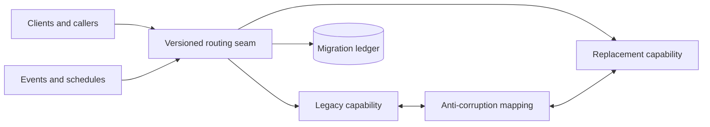

# Service and Platform Migration

> The old system and the new one will both be live for six months. Which one is right when they disagree, and how do you know when you can turn the old one off?

## TL;DR

A migration changes which system is the authority for live behavior or durable state, and it does so while the old and new systems are both running. Safety depends on preserving invariants across mixed versions, delayed replication, retries, backfills, and rollback. We treat a migration as a durable protocol with explicit steps:

1. define the unit that moves and the authority for each operation;
2. establish a routing or abstraction seam;
3. make old and new representations mutually compatible;
4. copy historical state without overwriting newer writes;
5. verify equivalence on production-shaped inputs;
6. transfer read authority, then write authority, through explicit gates;
7. preserve a bounded rollback path;
8. delete the old path and its data only after dependency evidence reaches zero.

The strangler fig, branch by abstraction, shadow traffic, and expand/contract are mechanisms used inside that protocol. None of them is safe without a state ledger, reconciliation, capacity controls, and a declared point after which rollback becomes another forward migration.

---

## Start With the Migration Contract

Migrations are among the riskiest things an engineering organization does routinely. Most production change is additive, in that new code is deployed and, if it misbehaves, the old code is restored. A migration is different in kind. For its duration there are two systems that each believe, in some respect, that they hold the truth, and the work consists of moving that truth from one to the other without ever having zero copies of it or two copies that disagree. The failures that follow are also unusually quiet. A bad deployment produces errors that someone notices. A bad migration produces two databases that differ in a few thousand rows, and nobody finds out until a customer does.

For that reason "move billing to the new service" is a goal and cannot serve as a plan. A plan defines:

- **migration unit:** tenant, account, object, route, region, shard, or capability;
- **source authority:** which system owns reads and writes initially;
- **target authority:** which system must own them at completion;
- **identity mapping:** how source identifiers map to target identifiers;
- **semantic mapping:** how each source state maps to a target state;
- **consistency target:** what temporary divergence is allowed and for how long;
- **compatibility envelope:** which old and new binary/schema versions may coexist;
- **cutover gates:** evidence required to advance each phase;
- **rollback boundary:** the last phase from which routing alone can restore service;
- **retention/deletion rule:** when old code, data, keys, and infrastructure may be removed.

### Core invariants

A production migration normally needs these invariants:

1. **Single logical authority:** for a migration unit and operation type, one system is authoritative at a time.
2. **No lost accepted writes:** every acknowledged mutation is durable in the current authority and eventually represented in the target.
3. **No stale overwrite:** a backfill or delayed replication record cannot replace a newer target state.
4. **Stable routing:** retries for one logical operation resolve to the same authority or carry an idempotency identity valid across both.
5. **Monotonic phase:** a unit cannot silently move from `TARGET_WRITE` back to `SOURCE_WRITE`.
6. **Auditable transition:** every phase change records revision, actor, evidence, and time.
7. **Bounded divergence:** reconciliation can state how far replicas may differ and identify exceptions.
8. **Isolation:** one tenant's migration cannot expose or overwrite another tenant's state.
9. **Deletion safety:** old state is deleted only after callers, readers, writers, replay consumers, and rollback dependencies are proven absent.

The first invariant is the most important and the most often misread. It does not forbid writing to both systems. It says that for any given piece of data, at any given moment, exactly one system's answer defines what is true. The other system may receive a copy of every write, and that copy is replication, with its own rules for retry and repair. The dangerous arrangement is the one in which both systems accept writes as equals, because when they disagree there is then no rule for deciding which is right.

---

## Model Migration State Explicitly

Migrations are commonly controlled by a handful of feature flags: one to read from the new system, one to write to it, one to enable the backfill. The trouble is that flags are independent and the states they describe are not. Three booleans have eight combinations, of which perhaps four are safe. Sooner or later someone, under pressure during an incident, sets a combination nobody had considered, such as reading from the target while writes still go only to the source and the copy has not caught up.

A state machine for each unit removes the invalid combinations by construction:

```text
SOURCE_ONLY
  -> SHADOW_COPY
  -> DUAL_READ_COMPARE
  -> TARGET_READ
  -> TARGET_WRITE_REVERSE_SYNC
  -> TARGET_ONLY
  -> RETIRED
```

Each state is a complete statement of who is responsible for what:

| State | Read served from | Write accepted by | Replication | Routing rollback |
|---|---|---|---|---|
| `SOURCE_ONLY` | source | source | none | not needed |
| `SHADOW_COPY` | source | source | source to target | yes |
| `DUAL_READ_COMPARE` | source | source | source to target | yes |
| `TARGET_READ` | target | source | source to target | yes |
| `TARGET_WRITE_REVERSE_SYNC` | target | target | target to source | yes, while mapping is lossless |
| `TARGET_ONLY` | target | target | optional audit only | no simple rollback |
| `RETIRED` | target | target | none | no |

Read down the columns and the logic of the sequence appears. Reads move to the target two states before writes do. Replication runs from source to target until write authority transfers, and then reverses direction, so that whichever system is not the authority continues to be fed by the one that is. The rollback column stays at "yes" for as long as the old system is being kept current, and changes only when that stops.

The state is stored in a strongly consistent migration ledger:

```text
migration_unit
phase
phase_revision
source_checkpoint
target_checkpoint
mapping_version
routing_revision
entered_at
verified_at
rollback_deadline
evidence_digest
```

Transitions use compare-and-swap on `phase_revision`, so two operators or two automation runs cannot both advance the same unit. The router reads a versioned snapshot of the ledger and refuses to act on an older revision than one it has already seen. Operators never toggle "read new" and "write new" independently, because those switches do not exist. They move a unit from one named state to the next.

### Global, cohort, or entity-level state

The choice of migration unit determines how much complexity the migration carries:

- **route or capability:** simple routing, but state shared across capabilities can couple cutovers;
- **tenant/account:** clean reconciliation and rollback boundary; creates skew when large tenants differ greatly;
- **object:** fine-grained progress and load smoothing; routing metadata can become enormous and transactions spanning objects become difficult;
- **shard/region:** operationally efficient, but each step has larger blast radius.

The guiding rule is to choose the largest unit whose data, invariants, and dependencies can move independently. Smaller units give finer control and cost more routing metadata. Larger units are cheaper to operate and put more at risk with each step. The tenant is very often the right answer, because it usually coincides with a natural boundary in the data: a tenant's records refer to one another and rarely to another tenant's.

Routing by percentage deserves a caution. Sending five percent of requests to a new stateless read path is safe, since any request can go either way. For stateful writes it is not, because the same entity's requests must all go to the same authority, and routing has to be sticky to the entity.

---

## Establish a Seam Before Replacing Behavior

Before any traffic can be moved, there has to be a single place where the decision about where traffic goes is made. In a system that grew without planning for migration, no such place exists. Callers reach the old system directly from many locations, each with its own connection and its own assumptions. The first task is to create that place, and it is frequently the largest part of the whole effort.

### Strangler seam

The pattern is named after the strangler fig, a plant that grows around a host tree, gradually takes over its structure, and eventually stands where the tree stood. For networked systems, every relevant entry point is routed through a controlled seam:



The seam may live in an [edge gateway](../07-service-mesh/03-api-gateway.md), a service router, a facade, a queue consumer, a scheduler, or a client library. The diagram has a second arrow entering the seam, from events and schedules, and it is there because teams reliably remember HTTP traffic and forget everything else. Cron jobs, event subscriptions, webhooks, administrative tools, and analysts with direct database access all reach the old system by paths that an HTTP router never sees. A seam that covers only the front door leaves all of those untouched.

The seam is deployed first as a pure pass-through, sending everything to the legacy system, and it is verified to preserve identity, deadlines, idempotency keys, authorization context, tracing, and response semantics. Only then does migration begin. The reason is the ordinary discipline of changing one thing at a time. If the seam and the migration are introduced together and something breaks, there are two candidate causes and no easy way to tell them apart.

### Branch by abstraction

Within a single codebase the same idea takes the form of an interface:

1. place an interface around the old implementation without changing behavior;
2. route every caller through it;
3. implement the new path behind the same semantic contract;
4. select per migration unit from the ledger;
5. compare, transfer authority, and remove the old path;
6. remove the temporary abstraction if it has no long-term architectural value.

The interface must express what the domain needs. An interface that simply mirrors the method signatures of the legacy implementation carries the old system's assumptions into the new one, including the quirks and couplings that motivated the migration.

### Anti-corruption boundary

The old and new systems model the world differently, or there would be little reason to migrate. Translation between them is made explicit and versioned:

```text
source representation
  -> normalize
  -> validate source invariants
  -> map(mapping_version)
  -> validate target invariants
  -> target representation
```

Every legacy system contains records that violate its own rules: a status that was removed years ago, a required field that is empty in a few thousand rows, a date in an impossible format. The mapping will meet all of them. A mapping failure is recorded as durable repair work. It must not be handled by discarding the record or by substituting a permissive default, both of which turn a visible problem into silent data loss. When a source state cannot be represented in the target, the choice is made deliberately among extending the target model, transforming with documented loss of information, quarantining the unit, or blocking its cutover.

---

## Moving Historical State Safely

### Snapshot plus change stream

The existing data must be copied while the source continues to change. A simple scan of a large table takes hours, and rows that have already been scanned can be modified before the scan finishes, so the copy describes no single moment and is missing recent changes to its early rows.

The standard solution combines a snapshot with a stream of changes:

1. obtain a consistent source snapshot at checkpoint `C0`;
2. begin or retain a change stream from `C0`;
3. scan and transform snapshot rows;
4. apply each target record conditionally;
5. consume changes after `C0` in source order;
6. declare catch-up only when the applied checkpoint reaches the required boundary.

The checkpoint `C0` ties the two together. The snapshot contains everything up to that point in the database's log, and the change stream contains everything after it. Between them they cover all of history exactly once. If the two are started independently, there is either a gap, in which changes are lost, or an overlap that is applied in the wrong order.

### Version-fenced upsert

Even with a correct checkpoint, the snapshot scan and the change stream run concurrently, and they race. A row is read by the scan at version 7. A moment later a user updates it, and the change stream delivers version 8 to the target promptly. The scan worker, running slowly, then writes its version 7. If that write is unconditional, the target now holds stale data, permanently, with nothing to indicate the fact.

Each copied record therefore carries an ordering token from the source, and the target applies it conditionally:

```text
apply(target_key, value, source_version):
  atomically write only if source_version > stored_source_version
```

The token may be a log position, a per-entity version, a commit timestamp with a deterministic tie-breaker, or a database transaction identifier. With it, the late write of version 7 finds version 8 already present and does nothing. The order in which writes arrive no longer matters, which is the property a migration needs, since it has two writers with no coordination between them.

A subtlety arises when one target record is derived from several source rows. A version on each row does not describe the combination. Either the version must describe the derived snapshot as a whole, or the job must recompute from a transactionally consistent read of all its inputs.

### Idempotent work partitioning

The scan is divided into work items by stable key ranges or immutable snapshot files, each recorded as:

```text
range_start
range_end
snapshot_id
mapping_version
attempt
checkpoint
result_counts
checksum
```

A retry reprocesses the same immutable input, and the version-fenced writes make the repetition harmless. Paging through a live table with `OFFSET` and `LIMIT` is a common mistake here. If rows are inserted or deleted while the scan is in progress, every subsequent offset shifts, and rows are skipped or read twice. Key ranges do not shift, since "all rows with keys between A and B" means the same thing however the rest of the table changes.

### Capacity model

Suppose:

- 2.4 billion source records;
- average transformed record size 1.5 KiB;
- target write budget available to migration: 18,000 records per second;
- 15 percent retry and validation overhead;
- a 10-hour nightly window at full budget.

Effective throughput is:

```text
18,000 / 1.15 = 15,652 records/s
```

Ideal scan time is:

```text
2,400,000,000 / 15,652 = 153,335 s = 42.6 h
```

At ten hours a night the lower bound is five nights, before skew, throttling, and catch-up are considered. The arithmetic is worth doing early because it is so often surprising: a rate that sounds fast, applied to a table that does not sound enormous, comes to the better part of a week. The transformed payload is about 3.35 TiB, though bytes are seldom the binding constraint. Read capacity on the source, index maintenance on the target, network, and the retention of transaction logs will usually bind first.

The backfill competes with production traffic for the same databases, and it must lose that competition. Its admission is governed by a token bucket or resource governor tied to source replica lag, target latency, error budget, log growth, and queue age, and it pauses itself automatically when any of these degrades. A migration that causes an outage in the system it is migrating has failed at the one thing it was required not to do.

---

## Replication and Write Authority

### Prefer durable asynchronous replication

The obvious way to keep two systems in step is to have the application write to both. This approach, called dual-writing, has a flaw that no amount of careful coding removes:

1. source commit succeeds;
2. target call times out after committing;
3. the application cannot know whether to retry;
4. retries may duplicate effects or return a false failure after a durable source write.

The problem is the timeout. When a call to the second system times out, the application does not know whether the write happened. If it assumes failure and retries, it may write twice. If it assumes success, it may have written nothing. If it reports an error to the user, the first system already holds a committed write that the user has been told failed. Two independent systems cannot be updated atomically by an application sitting between them.

The safer design commits once, to the current authority, and records the need to replicate in that same transaction:

```text
client mutation
  -> authoritative transaction
       business state
       migration event / outbox
  -> async apply to shadow
  -> reconciliation and repair
```

Because the replication record is part of the authoritative transaction, it exists if and only if the write does. A separate process delivers it to the other system and retries until it succeeds. The second system lags by a moment and cannot diverge permanently.

Where synchronous coordination is truly required, both sides need a shared operation identity and a durable idempotency record. Two-phase commit is available only when both resources support it and the blocking behavior under failure is acceptable. It does not solve the problem for arbitrary services.

### Transfer authority in two steps

Reads are transferred before writes:

1. source remains the writer;
2. target catches up and serves a controlled read cohort;
3. target read results are observed under real load;
4. write authority moves to target;
5. reverse replication keeps the source rollback-capable for a bounded period.

The order is chosen for reversibility. While the target serves reads and the source still takes writes, the target is being exercised by real users under real load, and it contains nothing the source lacks. If it misbehaves, reads are pointed back at the source and nothing has been lost. Once the target accepts writes, it begins to accumulate state that exists nowhere else, and going back requires carrying that state with it. The reverse replication in step 5 does this, and it works only for as long as every target write can be represented in the source.

### Define the point of no return

Every migration has a moment after which it cannot simply be undone. That moment usually arrives as a side effect of something else, and nobody notices until a rollback is attempted and fails. The boundary is reached when any of the following occurs:

- target accepts a state the source schema cannot represent;
- reverse replication is stopped;
- target-only side effects escape;
- source credentials or infrastructure are removed;
- new encryption or identity mapping makes old data unreadable;
- external callers adopt a contract the source cannot serve.

Before the boundary, rollback is a change in the ledger and the router. After it, "rollback" means designing and executing a new migration in the opposite direction, which is not something to attempt during an incident. We therefore record the crossing as a reviewed transition with an owner and a date. It should never come about as an incidental result of cleanup.

---

## Shadowing and Equivalence

### Comparison modes

Before the new system is trusted with real answers, it should be shown to give the same answers as the old one. There are several ways to arrange this, of increasing realism and risk:

| Mode | Served result | New path behavior | Primary use |
|---|---|---|---|
| Offline replay | none | isolated input corpus | deterministic functional comparison |
| Shadow request | source | asynchronous target execution | production shape and performance |
| Dual read | source | target response compared inline or sampled | per-request semantic equivalence |
| Target read canary | target for cohort | source retained for comparison | user-visible validation |

Shadow execution carries a hazard that has caused real incidents. Running a request against the new system "for comparison only" still runs it. If that request sends an email, charges a card, calls a webhook, or reserves inventory, the effect happens, and discarding the HTTP response does not undo it. Shadow paths must suppress or redirect every irreversible effect.

### Semantic diffing

Comparing responses byte for byte almost always reports differences that do not matter. The two systems order fields differently, generate different identifiers, and record timestamps a few milliseconds apart. The comparator must normalize what the contract declares irrelevant:

- map field ordering;
- generated identifiers through an explicit identity table;
- timestamps into an allowed interval;
- floating-point values with domain-specific tolerance;
- unordered collections by a stable key;
- redacted nondeterministic fields.

Every normalization rule, however, weakens the proof. Each ignored field is a place where a real difference could hide. The comparator is therefore versioned, the excluded fields are counted, privacy-safe samples are retained, and a change to the normalization rules is reviewed as carefully as a change to the mapping code. The failure traces include a case where this discipline was missing.

### Coverage matters more than one aggregate rate

A match rate of 99.99 percent across all traffic sounds conclusive and may conceal a complete failure. Suppose one unusual account type makes up a hundredth of a percent of requests and the new system handles it wrongly every time. The aggregate hardly moves, and every customer of that type will be affected at cutover. Comparison results are broken down by:

- migration unit and cohort;
- operation type;
- source state or schema version;
- error class;
- data age;
- region;
- authorization class;
- mapping version.

A coverage ledger records which states and callers have been observed, which have not yet appeared, and which are accepted exceptions. A case that has never been compared has not been validated, however good the overall number looks.

---

## Routing, Retries, and Mixed Versions

Routing uses the revision of the migration ledger as its configuration. Routers cache it locally so that they keep working when the ledger is unreachable, and the design states what a router may do with a stale copy. In particular, a stale router must never send a write to an authority that has been retired.

Useful mechanisms include:

- monotonic routing revisions;
- short-lived signed route tokens carried across retries;
- compare-and-swap phase changes;
- drain intervals before authority transfer;
- request idempotency keys valid on both paths;
- rejection by the non-authoritative writer with the current authority revision;
- caller inventories and deprecation telemetry.

The route token addresses a race that is easy to overlook. A request is routed to the source, fails transiently, and is placed on a retry queue. While it waits, authority transfers to the target. The retry then arrives at the source, which accepts it, and a write lands in a system that is no longer authoritative. The token records the routing decision that was made:

```text
migration_unit
authority
phase_revision
issued_at
expires_at
operation_id
signature
```

The receiving service checks that the phase has not advanced incompatibly since the token was issued, and rejects the request if it has. The sixth mechanism in the list is the complementary defense: the old system knows it is no longer authoritative and refuses writes on its own account, which protects against any caller that bypassed the router altogether.

Mixed versions are unavoidable during a rolling deployment. Protocol and schema compatibility must cover at least the oldest live caller, the current caller, the source service, the target service, and any consumer that replays old events. Feature flags can select among compatible behaviors. They cannot make incompatible states safe.

---

## Multi-Region Migrations

Adding regions adds a way to violate the first invariant by accident. If each region transfers write authority on its own schedule, there will be an interval in which one region writes to the source and another to the target for the same data. The migration has then created, temporarily, a multi-writer system with weaker consistency than production normally provides.

The design decides explicitly whether authority is:

- global per migration unit;
- regional with disjoint ownership;
- home-region based with routed writes;
- conflict-resolved by an existing multi-writer protocol.

A conservative sequence is:

1. copy and verify in one non-primary region or isolated cohort;
2. publish target read replicas;
3. migrate read traffic region by region;
4. transfer write authority per unit through the global ledger;
5. retain reverse replication across the rollback window;
6. remove source replicas only after regional caller inventories reach zero.

Reads move region by region, and writes move through one global ledger. A region that is slow to learn of a read change serves somewhat stale data. A region that is slow to learn of a write change corrupts data.

Inter-region log lag, data-residency rules, the locality of encryption keys, and failover all need attention. If the primary region fails in the middle of a migration, recovery must be able to determine the last committed phase and replication checkpoint. The phase ledger and the change log therefore belong in the disaster-recovery plan.

---

## Security, Privacy, and Compliance

For its duration, a migration expands the attack surface. There are two systems where there was one, two stores, a set of new workers with broad read access, mapping tables linking old identifiers to new, and reconciliation exports sitting in temporary locations. Each exists for good reason, and each is a place where data can leak. The expansion is controlled as follows:

- grant migration workers time-bounded, least-privilege credentials;
- isolate repair queues and snapshots by tenant and environment;
- encrypt temporary exports and delete them through a tracked retention workflow;
- preserve audit lineage from source ID to target ID;
- avoid copying fields the target does not need;
- re-evaluate consent, residency, legal hold, and deletion requirements;
- rotate or retire credentials after each phase;
- prevent shadow traffic from reaching real third-party effectors;
- prove that subject deletion reaches source, target, outbox, snapshots, and repair data.

The last item is demanding. A user who asks for their data to be deleted during a migration has data in the source, the target, the replication stream, the snapshot files, and possibly a repair queue. A deletion that reaches only the first of these is incomplete.

A temporary copy can also violate a control that requires data to reside in a single approved location, and the fact that it is temporary is not a defense. Compliance review belongs in the migration contract, before the backfill exists.

---

## Failure Traces

### Backfill overwrites a live update

1. Snapshot records account version 7.
2. CDC applies a live update at version 8 to target.
3. A slow backfill worker later performs an unconditional upsert of version 7.
4. Target read cutover serves stale state.

**Prevention:** version-fenced writes and checkpoint-aware application.

### Percentage routing splits one tenant

1. Each request is hashed independently without a tenant key.
2. A write goes to target; a later read goes to source.
3. The user sees missing state and retries.
4. The retry creates a second object.

**Prevention:** route stateful operations by a stable migration unit and share idempotency identity.

### Dual-write returns failure after success

1. Source commits.
2. Target commits but its response is lost.
3. The application reports failure.
4. The caller retries and creates another target effect.

**Prevention:** one authoritative commit plus durable replication, or end-to-end idempotency with a stored result.

### Comparator hides a semantic regression

1. A field differs frequently.
2. Engineers add it to the ignore list as “nondeterministic.”
3. The field actually controls tax calculation for one region.
4. Aggregate match rate becomes green while the critical branch is wrong.

The second step is taken under ordinary pressure. A dashboard full of mismatches blocks the migration, and marking a noisy field as ignorable clears it at once. Nobody examined why the field differed.

**Prevention:** contract-based normalization, versioned comparator review, and segmented coverage.

### Old scheduled job survives cutover

1. HTTP callers migrate and source traffic reaches zero.
2. A monthly source cron remains enabled.
3. It writes legacy state after reverse replication has stopped.
4. Finance discovers divergence weeks later.

A week of zero traffic appeared to be good evidence that nothing still used the old system. The job ran monthly.

**Prevention:** inventory every entry point, observe at least one full business cycle where required, and fence non-authoritative writers.

### Rollback restores code but not data semantics

1. Target begins accepting a new enum value.
2. An incident triggers routing back to source.
3. Source cannot parse reverse-replicated records.
4. Rollback increases the outage.

Here the point of no return was crossed without anyone marking it. The moment the target accepted a value the source did not understand, rollback ceased to be possible, and the team learned this only by attempting it.

**Prevention:** keep target writes inside the source compatibility envelope until the declared point of no return.

---

## Observability, Reconciliation, and Repair

A migration makes progress in three different senses, and the three are easily confused:

1. **copy progress:** units scanned, bytes read, target writes, remaining ranges;
2. **convergence:** source checkpoint versus applied target checkpoint, lag, repair backlog;
3. **authority progress:** units in each phase and traffic actually served by each system.

A backfill that reports one hundred percent complete has finished copying. It has shown nothing about whether the two systems agree, or about whether any traffic has moved. Required signals include:

- read and write volume by authority, phase, route revision, and unit class;
- mismatch rate and coverage by comparator version;
- backfill throughput, retry rate, throttling, and estimated completion;
- replication lag by partition;
- rejected stale-authority writes;
- reconciliation discrepancy count, age, and value magnitude;
- source/target latency and error differences;
- reverse-sync health during rollback window;
- callers and jobs still touching deprecated interfaces;
- target resource saturation and source impact.

Reconciliation compares business invariants. Two tables with the same number of rows may have entirely different contents, so row counts establish very little. The checks worth making are:

- conservation of ledger totals;
- referential completeness;
- uniqueness constraints;
- per-state counts;
- cryptographic or partition checksums over canonical records;
- sampled full semantic diffs;
- freshness at a declared checkpoint.

The first of these is the strongest check available for financial data. If the balances in the source sum to one figure and those in the target to another, something is wrong, whatever else agrees.

Discrepancies will be found, and repairing them is a workflow in its own right, with idempotent operations, provenance, approval for destructive changes, and a dead-letter state. Hand-written SQL run against production is how repairs introduce new discrepancies.

---

## Phase Gates and Verification

Each transition between states consumes evidence. The gates are listed here in full, because their content is the practical substance of a safe migration.

### Enter `SHADOW_COPY`

- mapping and inverse/compatibility behavior tested;
- target capacity reserved;
- change-stream checkpoint established;
- backfill pause control verified;
- temporary-data security review complete.

### Enter `DUAL_READ_COMPARE`

- snapshot copy complete for cohort;
- applied change checkpoint within lag budget;
- reconciliation invariants pass;
- shadow effects isolated;
- comparator coverage includes critical states.

### Enter `TARGET_READ`

- sustained semantic match under production-shaped traffic;
- target error, latency, and saturation within gates;
- fallback route rehearsed;
- stale route behavior tested.

### Enter `TARGET_WRITE_REVERSE_SYNC`

- every writer identified and routed;
- idempotency works across authority transfer;
- reverse mapping is lossless for the allowed target schema;
- non-authoritative source writes are fenced;
- rollback drill has restored both routing and data.

### Enter `TARGET_ONLY`

- rollback boundary explicitly approved;
- source caller and writer telemetry remains zero for the required window;
- no unresolved reconciliation discrepancies;
- target DR and operational ownership ready;
- retention and legal-hold requirements recorded.

### Enter `RETIRED`

- source code and infrastructure deleted;
- credentials revoked;
- data archived or deleted by policy;
- alerts, dashboards, runbooks, queues, and flags cleaned up;
- cost and dependency inventories confirm removal.

Two of these gates call for a rehearsal as well as a plan: the fallback route before `TARGET_READ`, and the rollback drill before `TARGET_WRITE_REVERSE_SYNC`. A rollback that has never been performed cannot be relied on, and the time to find out that it does not work is before it is needed.

The final state matters as much as the others and is the one most often left unfinished. A migration that stops at `TARGET_ONLY` leaves the organization running and paying for two systems, with the old one unowned and slowly decaying. The work is complete when the old system is gone.

The state machine itself is tested with model-based or property tests, which check that transitions preserve the authority invariants, that duplicate events are harmless, that stale revisions cannot reactivate old writers, and that every failure can be resumed from durable state.

---

## Choosing a Migration Strategy

| Situation | Primary seam | Migration unit | Verification emphasis |
|---|---|---|---|
| Replace one internal library | interface | call site or cohort | dual execution and contract tests |
| Extract a service | gateway/facade/event router | capability or tenant | shadow traffic and dependency inventory |
| Move a database/table | data-access abstraction + log | key range or tenant | checkpointed backfill and reconciliation |
| Replace an external API | adapter | caller cohort | contract replay and side-effect isolation |
| Replatform a region | global router | region or tenant home | state convergence and failover |
| Small, disposable system | deployment boundary | whole system | complete restore/rollback rehearsal |

Incremental replacement is usually the safer course, and the reason is how quickly it produces evidence. Each small step goes to production and is confirmed or corrected before the next one. A large cutover defers all of that evidence to a single night, and by then months of work rest on assumptions that have never been tested against real traffic.

A whole-system cutover can still be the rational choice when the state is disposable, when the system is really small, when compatibility between old and new is impossible, or when a scheduled downtime window costs less than a long period of running both. The requirements do not change: a rehearsed copy, verification, a bounded freeze, a rollback artifact, and an explicit transfer of authority.

On the question of where to begin, the common instinct is to start with the least important feature, because it is the safest. That choice often teaches little, since unimportant features tend to be unrepresentative. The best first slice is independently routable, representative enough to exercise the migration machinery, small enough in blast radius to learn from safely, and useful enough that finishing it matters to someone.

---

## References

- [Martin Fowler: Strangler Fig Application](https://martinfowler.com/bliki/StranglerFigApplication.html)
- [Martin Fowler: Branch by Abstraction](https://martinfowler.com/bliki/BranchByAbstraction.html)
- [Stripe Engineering: Online Migrations at Scale](https://stripe.com/blog/online-migrations)
- [GitHub Scientist](https://github.com/github/scientist)
- [AWS Prescriptive Guidance: Strangler Fig Pattern](https://docs.aws.amazon.com/prescriptive-guidance/latest/modernization-decomposing-monoliths/strangler-fig.html)
- [PostgreSQL: Logical Decoding Concepts](https://www.postgresql.org/docs/current/logicaldecoding-explanation.html)
- [Google SRE Book: Data Integrity](https://sre.google/sre-book/data-integrity/)

---

## Related Chapters

- [Database Schema Migrations](05-database-migrations.md): schema change mechanics are one migration type; this chapter supplies the traffic side of the cutover
- [Feature-Flag Control Planes](04-feature-flags.md): a flag can gate which behavior is live, so it becomes the switch a dual-write cutover needs
- [Change Data Capture](../10-data-pipelines/03-change-data-capture.md): snapshot plus tail plus repair is the machinery that keeps a shadow copy converging
- [Transactional Outbox, Inbox, and CDC Publication](../05-messaging/05-outbox-pattern.md): dual writes need a durable publish path or the two systems diverge silently under retries
- [Idempotency and Operation Identity](../01-foundations/07-idempotency.md): a backfill is only safe to retry, resume, and overlap if every write in it is idempotent
- [Multi-Tenant Isolation and Tenant Lifecycle Architecture](../06-scaling/12-multi-tenancy.md): tenant-by-tenant cutover is how a migration bounds its own blast radius
- [Durable Execution and Workflow Engines](../09-workflow-job-systems/07-durable-execution-workflow-engines.md): a multi-day cutover wants recorded progress so an operator resumes rather than guesses
