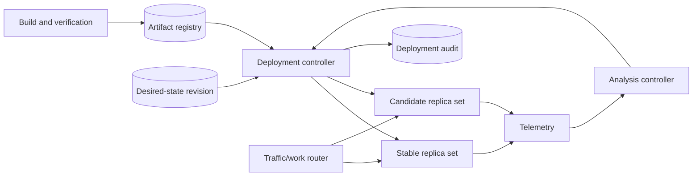

# Progressive Delivery and Deployment Strategies

## TL;DR

A deployment changes the executable artifact serving a workload. A release changes which users or operations exercise new behavior. We keep the two separable. Deployment safety concerns artifact identity, mixed-version compatibility, capacity, routing, health, draining, and rollback, and the exposure of new behavior can be controlled separately through [feature-flag control planes](./02-feature-flags.md).

Every safe strategy implements the same protocol:

1. publish one immutable, verified artifact;
2. establish enough old/new capacity for the chosen topology;
3. move a bounded traffic or workload cohort;
4. observe user-impact and resource signals over a meaningful window;
5. promote, pause, or restore the prior artifact through explicit state transitions;
6. retain data and protocol compatibility until rollback is no longer required.

Rolling, blue-green, canary, shadow, and regional waves differ in cost, blast radius, and the quality of evidence they produce. None of them can make an incompatible schema change reversible.

---

## Deployment Contract

Changes to a running system are the leading cause of outages. Hardware fails and traffic surges, but in most production postmortems the trigger turns out to be something an engineer did deliberately: a new binary, a configuration edit, a flag flipped. The reason is simple enough. Testing can only cover the conditions somebody thought to test, and production contains the ones nobody thought of.

An organization cannot respond to this by ceasing to change things. What it can do is arrange for each change to meet production in small steps, where its effect can be observed and the change withdrawn before many users are affected. Each strategy in this chapter is a way of meeting production a little at a time, and each depends on the deployment having been specified precisely enough to observe and to withdraw. That specification defines:

- artifact digest and provenance;
- configuration and policy revision;
- target services, regions, cells, and resource class;
- strategy and cohort unit;
- desired capacity and failure headroom;
- health/readiness contract;
- connection/work draining behavior;
- compatibility window for APIs, data, queues, and clients;
- observation and promotion gates;
- rollback artifact and deadline;
- point after which rollback becomes a forward fix.

### Core invariants

1. **Artifact identity:** every instance reports the immutable digest it executes.
2. **Build once:** promotion reuses the same artifact; it does not rebuild per environment.
3. **Atomic desired state:** one deployment revision names artifact, config, capacity, and strategy.
4. **Bounded exposure:** canary/preview traffic cannot exceed its declared cohort without a revision change.
5. **Capacity safety:** removing old capacity does not violate the failure-headroom target.
6. **Readiness truth:** a ready instance can serve its assigned workload correctly, not merely accept TCP.
7. **Drain before termination:** new work stops before in-flight work is forcibly ended.
8. **Mixed-version compatibility:** any versions live together during the rollout can communicate and share state safely.
9. **Monotonic rollout state:** stale controllers cannot re-promote an aborted revision.
10. **Evidence-backed transition:** promotion and rollback record the measurements and actor/policy that authorized them.

The second invariant is frequently broken in a way that seems harmless. A pipeline that rebuilds the code for each environment produces a staging artifact and a production artifact that are nominally the same and are in fact different files. They may have been built with different dependency versions resolved at different times, and whatever was tested in staging is not what runs in production. Building once and promoting that exact artifact, identified by its digest, ensures that what was verified is what is deployed.

---

## Control Plane and State Machine



The diagram contains a feedback loop. The controller places a candidate beside the stable version, the router sends some traffic to each, telemetry from both feeds an analysis component, and the analysis tells the controller whether to proceed. Without the loop, a deployment is merely the copying of files. The loop is what makes delivery progressive: the system decides, on evidence, whether to continue.

The deployment's progress is held in a durable state machine:

```text
CREATED
  -> PROVISIONING
  -> VERIFYING
  -> EXPOSING
  -> PROMOTING
  -> SUCCEEDED

VERIFYING/EXPOSING/PROMOTING
  -> PAUSED
  -> ABORTING
  -> ROLLED_BACK
  -> FAILED
```

Each desired-state revision names the revision it expects to replace. Controllers reconcile idempotently and compare the revision or epoch before changing routes or replica sets. The reason is that controllers are distributed and their messages can be delayed. A delayed event from deployment 41, arriving after deployment 42 has begun, must be recognized as stale and ignored.

### Data plane versus control plane

The deployment controller may be unavailable without any effect on serving. Routers and instances continue on the last state they were given. Promotion simply stops until telemetry and desired state can be trusted again, and a paused rollout is a safe condition to be in.

Rollback must be possible without rebuilding anything and without depending on the artifact that is failing. The prior digest and configuration remain available, and the serving control plane can restore them even if source control and CI are down. This matters because the incidents that require rollback often coincide with trouble elsewhere, and a rollback procedure that begins with a build depends on the build system being healthy at the worst possible moment.

---

## Rolling Replacement

A rolling deployment replaces instances a few at a time within one pool, removing old ones and adding new ones until none of the old remain. It is the default in most orchestrators and requires no additional infrastructure.

Its controls are:

- **maximum unavailable:** how much serving capacity may disappear;
- **maximum surge:** temporary extra instances;
- readiness/startup probes;
- minimum ready/soak time;
- progress deadline;
- disruption and topology constraints;
- connection/work drain.

### Capacity model

The first two controls decide whether a rollout is safe, and their interaction with failure headroom is commonly overlooked. Suppose:

- steady load requires 80 instances at target utilization;
- one-zone failure headroom requires 25 percent spare;
- rollout permits 10 unavailable;
- no surge.

Required steady capacity with headroom:

```text
80 / (1 - 0.25) = 106.7 -> 107 instances
```

Taking 10 instances out for the rollout leaves 97. That is ample for normal traffic, which needs 80, so every dashboard stays green. But the service was provisioned at 107 so that it could lose a zone and survive, and for the duration of the rollout it cannot. If a zone fails in that window, the remaining capacity is insufficient. The rollout has quietly spent the safety margin, and it has done so at a time when the risk of something going wrong is already raised.

With `maxSurge = 10` and `maxUnavailable = 0`, new instances are started before old ones are removed, and capacity never falls below 107. The price is ten extra instances for the duration. Surge is a purchase of capacity, and it should be budgeted as one.

### Where rolling works

Rolling replacement is appropriate when:

- old and new versions are compatible;
- instances are relatively cheap to duplicate;
- per-instance exposure gives enough signal;
- rapid full-environment swap is unnecessary.

It has a limitation that follows from what it bounds. A rolling update limits the fraction of instances running new code. It does not limit the damage one instance can do to shared state. A single candidate instance that writes corrupt records to the database, or publishes malformed events, affects everyone who reads them, whatever percentage of the fleet it represents. Where a change can damage shared data, a small replica percentage offers no protection, and other guards are needed.

---

## Blue-Green Deployment

Blue-green maintains two complete environments:

```text
blue: current production, serving
green: candidate, synchronized and verified
cutover: route/pointer changes from blue to green
```

The candidate is built out fully, verified while it serves no users, and then all traffic is switched to it. The old environment remains intact, so reverting is a matter of switching back. The advantages are:

- fast routing rollback;
- clean environment-level comparison;
- no mixed application versions after cutover;
- useful for runtime/platform changes.

The costs are:

- near-double serving infrastructure during overlap;
- state synchronization and identity complexity;
- environmental drift if green is long-lived;
- connection/DNS/cache propagation means cutover is not truly instantaneous.

The last cost qualifies the main advantage. The switch is often described as instantaneous, and in practice it converges. Clients hold open connections to the old environment, DNS answers are cached for their time-to-live, and intermediate caches hold old responses. For some period after the switch, both environments serve traffic.

### State still shares a boundary

Blue-green duplicates the stateless tier easily. The database is another matter. If both environments use the same database, the two versions of the code must be compatible with one schema, and the mixed-version problem that blue-green appeared to avoid returns at the data layer. If each environment has its own store, the design needs:

- replication direction and checkpoint;
- cutover authority;
- reverse sync during rollback window;
- reconciliation;
- point of no return.

These are the concerns of a [service and platform migration](./06-migration-strategies.md), and they cannot be delegated to a deployment controller.

### Warmth and hidden state

A green environment can pass every health check and still perform badly when traffic arrives, because a freshly started system is cold:

- JIT/runtime caches;
- connection pools;
- CDN/application caches;
- model/index state;
- lazy schema initialization;
- autoscaling history.

A runtime with a just-in-time compiler runs interpreted, slow code until it has observed enough traffic to compile the hot paths. Caches are empty, so every request reaches the database. Connection pools must be established. The blue environment acquired all of this state gradually over days, and green is asked to take full load without it. The remedy is to warm green with controlled traffic that does not duplicate side effects, and to include cold-start latency and resource behavior in the promotion gate.

---

## Canary Deployment

A canary sends a small, stable cohort of traffic to the candidate while the stable version continues to serve everyone else. The name comes from the practice of carrying canaries into coal mines, where the bird's distress gave early warning of gas. If the candidate is faulty, a small fraction of users is affected and the fault is detected before the rest are exposed.

The cohort can be chosen by:

- deterministic user/account/tenant key;
- region/cell;
- endpoint or operation;
- workload class;
- random request only for stateless, non-sticky behavior.

For anything stateful, each entity should stay on one version. Routing each request at random means that a single user's session alternates between old and new code, which may not agree about the session's state. Errors then appear that neither version would produce alone, and the comparison between cohorts is contaminated because no user belongs cleanly to either.

### Stage plan

A canary proceeds in stages of increasing exposure, and each stage declares what it needs to see before the next:

```text
candidate_weight_or_cohort
minimum_sample_or_workload_coverage
minimum_observation_time
upper-bound guardrails
lower-bound guardrails
telemetry completeness
promotion action
abort action
```

Guardrails come in two directions, and the second is often omitted. Upper-bound signals are things that should not rise: error rate, latency, saturation, integrity discrepancies, cost. Lower-bound signals are things that should not fall: success rate, throughput, and the completeness of telemetry itself. A candidate that crashes on startup and serves nothing has an error rate of zero, since it has no requests to fail. Only a lower bound on throughput notices that it is doing no work. Missing, stale, or non-finite data blocks promotion.

### Comparative analysis

The candidate is compared with the stable version under equivalent traffic at the same time:

```text
delta_error = candidate_error - stable_error
ratio_latency = candidate_p99 / stable_p99
```

Comparing against the stable version running concurrently, and not against a fixed threshold or yesterday's numbers, controls for everything else that is going on. If a downstream dependency is slow this afternoon, both cohorts are slow, and the difference between them still isolates the effect of the change.

Results are segmented by endpoint, tenant class, region, and dependency, because an aggregate can conceal the complete failure of a rare but critical path.

The observation window must be long enough for the effect to appear, and effects appear on very different timescales:

- request errors: seconds/minutes;
- cache warming: minutes;
- async jobs: queue delay plus execution;
- billing/reconciliation: hours or business cycle;
- data corruption: perhaps days and explicit reconciliation.

A five-minute canary can establish that a change does not increase request errors. It cannot authorize a change whose main effect is on a batch job that runs overnight.

### Statistical caution

A small cohort produces few events, and for rare failures it may produce none. If a code path is exercised once in ten thousand requests and the canary has seen two thousand, the absence of errors on that path means only that the path was probably never taken. Absence of failures is weak evidence of safety. Where a rare path matters, it needs explicit coverage through a targeted test or a synthetic probe.

Noisy business metrics should also not be watched continuously with the intention of promoting at the first favorable reading. Any noisy metric will look good at some moment by chance. The statistics of online experiments belong to [Online Experiments](../16-ml-systems/08-online-experiments.md). Deployment guardrails have a different aim, which is to detect harm quickly and act conservatively.

---

## Shadow and Dark Deployment

Shadowing copies real requests to a candidate while the stable version continues to serve the actual responses. The candidate's output is compared and then discarded, so users are never exposed to it. It is useful for:

- compatibility and response diffing;
- performance/resource behavior;
- production-shaped edge cases;
- validating a replacement before user exposure.

Shadowing gives the most realistic input obtainable without risk to users, and it has limits. It does not prove user-visible behavior, routing, or state authority, since the candidate never actually serves anyone.

It also has a hazard. A shadowed request is executed, and if executing it has side effects, those effects occur whether or not the response is thrown away. The following must be isolated or stubbed:

- payments;
- email/webhooks;
- messages;
- writes;
- rate-limit consumption;
- third-party quotas;
- audit events.

Comparison uses an input identity and normalized semantic outcomes. Full payloads containing sensitive data should not be logged merely to make diffing convenient.

A dark deployment starts candidates and sends them no traffic at all. It confirms that the artifact starts, loads its configuration, and registers correctly, and it provides little evidence about behavior.

---

## Regional, Cell, and Tenant Waves

For large systems the unit of rollout is a failure domain, and the rollout proceeds through domains in order of increasing consequence:

```text
internal
  -> test cell
  -> low-risk production cell
  -> one region
  -> several regions
  -> global
```

The argument for waves is about correlated failure. If a change is deployed to every region simultaneously and it is bad, every region fails together and there is nowhere to send traffic. If it reaches one region first, the others remain healthy and can absorb that region's load while the change is reverted. Redundancy across regions protects against a bad deployment only if the deployment does not reach all of them at once.

Each wave must stay within the available global failover capacity. If one region is already degraded, continuing a rollout in another consumes the headroom that recovery depends on.

The choice of unit involves trade-offs. Tenant cohorts isolate state well and allow coordination with customers, though one large tenant may dominate the load. Region cohorts exercise regional dependencies, though regions differ in their traffic mix. Cell cohorts match the blast radius to the architecture. The right unit is the smallest one that is both representative and independently reversible.

---

## Health, Readiness, and Draining

### Probe semantics

An orchestrator asks three different questions of an instance, and treating them as one question causes outages:

- **startup:** process has completed expensive initialization; prevents premature liveness restart.
- **liveness:** process is irrecoverably stuck and should restart.
- **readiness:** instance can accept its assigned workload now.

The responses differ. A failed liveness probe causes the instance to be killed and restarted. A failed readiness probe only removes it from the load balancer and leaves it running. An instance that is busy, or waiting on something, should be unready. It should not be killed.

The scope of the readiness probe needs care. It should check local prerequisites. It should not check every downstream dependency, for a reason that is clear once stated. Suppose every instance's readiness probe checks the database, and the database becomes slow. Every instance reports unready at the same moment, the load balancer removes the whole fleet, and a partial degradation, in which requests not needing the database would have worked, becomes a total outage. A shared dependency should not be able to mark every instance unready. Its failure is handled by degrading the features that depend on it.

### Drain protocol

Removing an instance without dropping the work it is doing requires a sequence:

1. mark candidate/old instance non-ready or lower routing weight;
2. wait for router/discovery convergence;
3. stop accepting new connections/jobs;
4. signal long-lived streams to reconnect;
5. let in-flight work finish within budget;
6. checkpoint/requeue durable work;
7. terminate after deadline;
8. track forced termination.

Step 2 is the one most often missing. Marking an instance unready does not stop traffic to it at once. The change has to propagate to every load balancer and every client holding a cached list of endpoints, which takes seconds. An instance that shuts down the moment it is marked unready will receive requests for those seconds and refuse them. It must go on serving for a short time after it has announced that it is leaving.

The grace period is set from the measured duration of requests and jobs, plus propagation time. A default copied from an example is a guess.

The mechanics of "stop new work" differ for HTTP keep-alive connections, gRPC and WebSocket streams, queue consumers, and workflow workers, and each needs its own definition.

---

## Mixed-Version and Data Compatibility

Every gradual strategy has a consequence that is easy to forget: for the duration of the rollout, old and new code run side by side, exchange messages, and read each other's data. They must be compatible in both directions. Rollback additionally means that old code will read data written by new code. The cases to test are:

- old client to new server and new client to old server;
- old producer to new consumer and the reverse;
- schema readers/writers across versions;
- queue payload versions;
- cache keys/serialization;
- feature flags and default behavior;
- rollback after new writes.

Database changes follow the expand/contract sequence, which splits one incompatible change into several compatible ones:

```text
expand schema
  -> deploy compatible readers/writers
  -> migrate/backfill
  -> switch authority
  -> observe
  -> contract old schema
```

To rename a column, for example, a new column is added first, which is the expansion. Code is deployed that writes to both and reads from either. Existing rows are copied across. Reads are switched to the new column. Only after a period of observation is the old column removed, which is the contraction. At every step, the code that is running is compatible with the schema that exists. The contraction usually ends the possibility of rolling back to older code, so it is delayed well beyond the application rollout. See [Database Schema Migrations](./03-database-migrations.md).

Events deserve the same care and receive less of it. An event written to a log is a durable interface that will be read by consumers long after it was produced. A producer that begins emitting a new required field or type can break old consumers, and rolling the producer back does not help, since the incompatible events are already in the log. Events are evolved compatibly, with an inventory of who consumes them.

---

## Promotion and Rollback

### Gate evaluation

A promotion controller consumes versioned metrics, each carrying:

- query/evaluation timestamp;
- cohort identity;
- sample/coverage;
- missing-data policy;
- threshold direction;
- comparator baseline;
- result and evidence digest.

Missing and non-numeric values fail closed. The telemetry pipeline itself must be shown to be healthy, because a deployment that breaks its own metrics would otherwise look perfect: no errors are reported because nothing is reported. This is a real and recurring cause of bad promotions, and one of the failure traces below follows it.

Gates use several windows at once:

- short window catches catastrophic regression;
- longer window prevents promotion through transient noise;
- cumulative integrity/reconciliation checks detect state damage.

### Rollback semantics

Rollback restores:

- prior artifact digest;
- compatible configuration;
- routing;
- capacity;
- feature behavior if coupled;
- data path only if the compatibility boundary permits.

It does not undo:

- corrupt writes;
- sent messages/email/payments;
- deleted data;
- external contract adoption;
- irreversible migrations.

The second list is the reason rollback is not a complete safety net. Rollback restores the code. Whatever the code did while it ran remains done. Records written incorrectly are still incorrect, and emails that were sent stay sent. Those need repair or compensation, which is separate work. Every deployment has a point of no return, and it should be named in advance.

### Abort convergence

An abort is a state transition in the control plane, and like every such transition it takes time to reach every router, controller, and region. We track:

- time to stop new candidate exposure;
- in-flight candidate work;
- candidate connections;
- old-capacity restoration;
- stale route/config revisions.

The moment someone clicks the rollback button is not the moment the candidate stops affecting users. The interval between the two is part of the incident's duration and is worth measuring.

---

## Security and Supply Chain

The deployment system can replace every binary in production, which makes it one of the most powerful and most attractive targets in the organization. It requires:

- artifact digest, signature, and provenance;
- dependency/SBOM policy appropriate to risk;
- admission that rejects mutable tags or untrusted signatures;
- environment-scoped deploy authority;
- separation between artifact publication and production promotion;
- audited emergency override;
- secret resolution at runtime;
- no production secrets baked into artifacts;
- candidate identity and network policy equal to intended production posture.

Mutable tags are rejected because a tag such as `latest` is a name that can be pointed at different content at any time. A deployment that refers to a tag does not determine what will run. A digest is a hash of the content and can refer to only one thing.

There is a subtle risk in the last item. A canary deployed with broader permissions than the stable version may pass every functional check while introducing a privilege escalation. A semantic comparison of policy, identity, and configuration between candidate and stable belongs in the deployment evidence.

Deployment webhooks and GitOps sources are protected against replay and unauthorized change. A compromised controller affects the whole fleet, so its credentials are isolated and desired state is versioned.

---

## Failure Traces

### Readiness before initialization

1. Process opens port immediately.
2. Router sends production traffic.
3. schema/cache/model initialization is incomplete.
4. Candidate produces failures and rollout churn.

**Prevention:** startup/readiness reflect actual local serving state.

### Global canary is not sticky

1. Ten percent of requests route randomly to candidate.
2. One checkout session alternates old/new state machines.
3. Neither path sees a coherent session.
4. Errors appear only under mixed routing.

**Prevention:** cohort by stable entity for stateful behavior.

### Auto-promotion on missing metrics

1. Candidate breaks telemetry export.
2. query returns empty/NaN.
3. gate treats comparison as zero regression.
4. candidate promotes globally.

The gate asked whether the candidate's error rate was higher than the stable version's. The candidate reported no error rate at all, and a comparison that was written without that case in mind evaluated to "no regression." The candidate that broke its own telemetry was thereby judged the healthiest ever deployed.

**Prevention:** explicit completeness lower bound and fail-closed parsing.

### Rolling update consumes failover capacity

1. rollout removes ten percent of fleet.
2. zone fails.
3. remaining capacity saturates.
4. retries amplify collapse.

**Prevention:** capacity calculation includes rollout plus failure headroom.

### Rollback cannot read new data

1. candidate writes a new enum/shape.
2. latency regression triggers rollback.
3. old code cannot parse committed records.
4. rollback expands outage.

**Prevention:** maintain backward-compatible writes until rollback window closes.

### Stale controller reopens candidate route

1. analysis aborts revision 52.
2. delayed promote event from an earlier state arrives.
3. router accepts it without expected revision.
4. bad candidate receives traffic again.

**Prevention:** compare-and-swap desired state and monotonic deployment epoch.

### Shadow duplicates side effects

1. gateway mirrors a POST to candidate.
2. candidate sends a real webhook.
3. customer receives duplicate effect though response was discarded.

**Prevention:** effect isolation and stable idempotency identity for shadow paths.

---

## Observability and Verification

From the deployment control plane, we watch:

- state/revision transitions;
- controller reconcile latency/errors;
- desired versus actual artifact/config/capacity;
- route weight/cohort convergence;
- active digest distribution;
- readiness/startup/drain timing;
- forced terminations and stalled rollout.

The distribution of active digests answers the question "what is actually running?" directly. Each instance reports the digest it executes, and the fleet-wide distribution shows whether a rollout has completed, stalled, or been partly reverted. It is the ground truth against which the controller's own belief can be checked.

Comparing candidate with stable, we watch:

- request/job success, latency, saturation;
- dependency calls and resource use;
- queue/stream age;
- business/integrity guardrails;
- telemetry completeness;
- cost/unit work;
- semantic shadow mismatches;
- segmented coverage.

Verification is layered:

1. artifact provenance and reproducibility;
2. config/policy semantic diff;
3. compatibility matrix tests;
4. startup/readiness/drain tests;
5. load and cold-state tests;
6. shadow diff with isolated effects;
7. canary gate parser and direction tests;
8. missing/stale telemetry tests;
9. controller crash/replay/stale-event tests;
10. rollback drill including data compatibility;
11. regional/cell failure during rollout;
12. post-deploy reconciliation.

Items 7 and 8 test the safety mechanism itself, and they are the ones teams tend to skip. A gate whose threshold has the wrong sign, or that passes when its query returns nothing, is worse than having no gate, because people trust it.

Each deployment produces one evidence object linking artifact, configuration, cohort, metrics, approvals, transitions, and final disposition.

---

## Decision Framework

| Constraint | Strategy tendency |
|---|---|
| cheap compatible replicas, ordinary service update | rolling |
| fast environment swap, enough duplicate capacity | blue-green |
| high behavioral risk, measurable cohort outcomes | canary |
| compare computation without user exposure | shadow |
| regional/cell blast-radius architecture | waves |
| stateful tenant migration | tenant cohort plus migration protocol |

These combine freely. A typical large deployment is a canary within a cell, rolled within each cell's pool, proceeding in regional waves.

Before choosing, we ask:

1. What is the independent blast-radius unit?
2. Can old and new binaries/protocols/data coexist?
3. How much surge/duplicate capacity exists while preserving failure headroom?
4. Which health signal proves readiness?
5. What traffic/work is representative, and how is it kept sticky?
6. Which effects appear only after delay?
7. Which upper and lower gates authorize promotion?
8. What happens on missing telemetry?
9. How long does drain take for requests, streams, and jobs?
10. What does rollback restore, and what effects require repair?
11. Which state transition ends simple rollback?
12. Can a stale controller or region undo an abort?

The strategy matters less than the protocol around it. A well-instrumented rolling deployment with tested compatibility and revision fencing is safer than a nominal canary whose cohort, metrics, or rollback has never been defined.

---

## References

- [Google SRE Workbook: Canarying Releases](https://sre.google/workbook/canarying-releases/)
- [Kubernetes Documentation: Deployments](https://kubernetes.io/docs/concepts/workloads/controllers/deployment/)
- [Kubernetes Documentation: Pod Lifecycle and Probes](https://kubernetes.io/docs/concepts/workloads/pods/pod-lifecycle/)
- [Argo Rollouts Documentation: Concepts](https://argo-rollouts.readthedocs.io/en/stable/concepts/)
- [SLSA Specification](https://slsa.dev/spec/)
- [Sigstore Documentation](https://docs.sigstore.dev/)

---

## Related Chapters

- [Feature-Flag Control Planes](02-feature-flags.md): behavior exposure is a separate control plane, and keeping it out of the release is the point
- [Database Schema Migrations](03-database-migrations.md): mixed versions must survive a rollout, which makes schema compatibility a deployment constraint
- [Software Delivery Control Planes and GitOps Reconciliation](04-cicd-gitops.md): the pipeline that builds an artifact and the policy that decides how it lands are different designs
- [Service and Platform Migration](06-migration-strategies.md): a migration is a deployment where old and new systems both hold authority for a while
- [SLOs and Error-Budget Control](../11-observability/05-slos-error-budgets.md): the release decision wants the same error-budget evidence that the objective review uses
