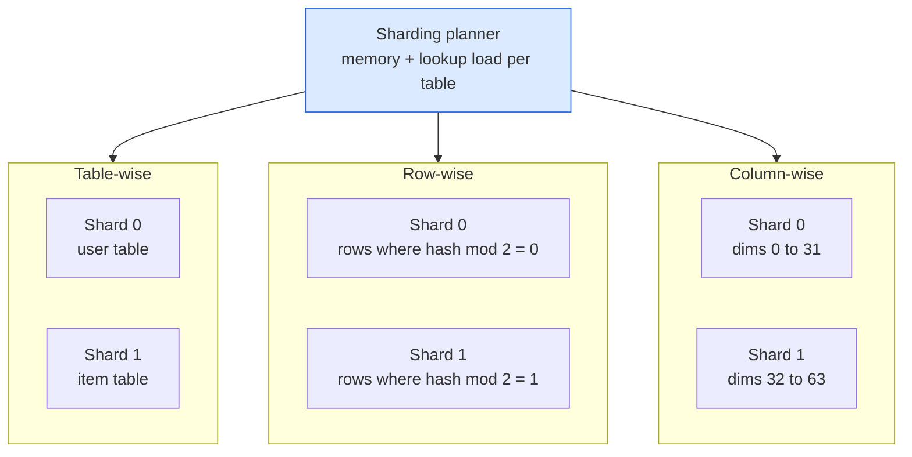

# Embedding Tables and Sparse Model Infrastructure

> The model has a billion parameters and nearly all of them sit in one lookup table that does not fit on any single machine. How do you train and serve it?

## TL;DR

The models behind ads, feeds, and recommendations are mostly lookup tables. A small neural network sits on top of embedding tables that hold one learned vector per user, item, query, or other categorical value, and those tables run to billions of rows and hundreds of gigabytes or more. This inverts the engineering problem of dense deep learning. Compute is cheap, and the binding constraints are memory capacity, memory bandwidth, and the network between whoever holds a row and whoever needs it. The table also behaves like a database: identifiers arrive that it has never seen, most are never seen again, a few are read on every request, and each update touches a vanishing fraction of rows. The design questions are therefore storage questions. We have to decide how identifiers map to rows, which identifiers deserve a row, how tables are partitioned, what consistency concurrent updates need, how terabytes of state are checkpointed while changing, and how serving reads it within a latency budget.

Dense-model parallelism is covered in [Distributed Training Internals](06-distributed-training-internals.md). The retrieval and ranking stages that consume these embeddings are in [Recommendation Systems](15-recommendation-systems.md), and continuous updating in [Continual Learning and Model Freshness](14-continual-learning-model-freshness.md).

---

## A Different Machine

A categorical feature such as an item ID cannot be fed to a network as a number, because the numeric value of an identifier means nothing. The model instead learns a vector for each distinct value and looks it up. With a billion items and 64 dimensions at four bytes each, one table occupies 256 GB before any optimizer state. A production ranking model has dozens to hundreds of such tables.

The work per example is small by comparison. A request reads a few hundred rows, pools them, concatenates the result with some dense features, and runs a multilayer perceptron of a few million parameters. The arithmetic would fit comfortably on a fraction of one accelerator. What does not fit is the state, and the accesses to it are random reads scattered across hundreds of gigabytes, each of which misses every cache.

The contrast with a transformer is worth stating plainly, because intuitions from one mislead in the other. In a dense model every parameter participates in every example, gradients are dense, and throughput is bounded by matrix multiplication. In a sparse model almost no parameter participates in a given example, gradients are nonzero on perhaps one row in a million, and throughput is bounded by how fast rows can be fetched and written back. Adding accelerators to a job that is waiting on memory or the network buys nothing.

---

## Anatomy of a Lookup

Each sparse feature of an example is a short list of identifiers: the single item being scored, the last fifty items the user viewed, the three categories the item belongs to. For each feature the model fetches the rows for those identifiers and reduces them to one vector by sum, mean, or attention pooling. A batch of a few thousand examples therefore issues several hundred thousand row reads, spread across every table.

On the backward pass the gradient with respect to a table is nonzero only on the rows that were read. The optimizer must update those rows and leave the rest alone, which rules out any implementation that touches the whole table per step. Sparse optimizers are written to take a list of row indices and a matching block of gradients, and their per-row state is updated the same way.

Two properties of the access pattern drive everything that follows. Identifier popularity is heavily skewed, so a small set of rows receives a large share of reads and writes, while the long tail is touched rarely. And within one batch, the same popular identifier appears many times, so deduplicating identifiers before fetching reduces traffic to the table by a large factor at no cost in correctness.

---

## Mapping Identifiers to Rows

The table is an array, and identifiers are arbitrary 64-bit values drawn from a set that grows without bound. Something has to map one to the other, and the choice has consequences for quality, memory, and operations.

| Scheme | How it maps | Memory | What it costs |
|---|---|---|---|
| Vocabulary | Dictionary built from training data; unknowns share one row | Proportional to vocabulary | New identifiers get no representation until the next rebuild |
| Hashing | `hash(id) mod N` | Fixed at `N` rows | Unrelated identifiers collide and share a vector |
| Multiple hashing | Combine rows from two or more independent hashes or from quotient and remainder | Fixed, much smaller than the identifier space | Extra lookups per identifier; collisions are partial and not eliminated |
| Collisionless hash table | Key-value map from identifier to row, grown on demand | Proportional to admitted identifiers | Needs admission, eviction, and a resizable store |

The hashing trick is attractive because it has no state beyond the table: any identifier maps somewhere, the table never grows, and training and serving agree by construction. Its cost falls unevenly. When a popular identifier collides with a rare one, the shared vector is dominated by the popular one's gradients and the rare identifier is simply misrepresented. When two popular identifiers collide, both are damaged, and the damage lands on the rows that matter most to traffic. Enlarging `N` reduces collisions and spends memory on rows that no identifier ever maps to.

Multiple hashing softens this by giving each identifier a combination of rows that is unlikely to be shared in full with any other. The quotient-remainder construction, for instance, uses two small tables indexed by `id div m` and `id mod m` and combines the two rows, so that every identifier receives a distinct pair from tables whose total size is a small multiple of the square root of the identifier space.

A collisionless table removes the quality loss by giving each admitted identifier its own row, located through a hash map, commonly a cuckoo hash for its bounded lookup time. In exchange the table becomes a dynamic data structure whose size depends on traffic, and it needs the policies of the next section to stay bounded.

---

## The Table Is a Cache

In a collisionless table, identifiers arrive forever. New items are created, new users sign up, and crawlers and bots mint identifiers that will never recur. If every new identifier is given a row, the table grows with the cumulative number of distinct identifiers ever seen, most of the memory holds vectors that received one gradient and were never read again, and those vectors are noise, since a single update moves a row barely away from its initialization.

Admission addresses the front door. An identifier is given a row only after it has been seen some threshold number of times, with the counts kept in a compact structure such as a count-min sketch, or approximated by admitting each occurrence with a fixed probability. Until admission, lookups for the identifier return a shared default row. The threshold trades memory against how quickly a new identifier gets its own representation, and so it interacts directly with freshness. A threshold of ten occurrences is immaterial for a popular new item and means that a niche one may never be learned.

Eviction addresses the back door. Rows that have not been updated within a time-to-live are removed, on the reasoning that an identifier absent from traffic for weeks either is gone or has drifted far enough that its vector is stale. Each table gets its own setting, since the turnover of items in a short-video catalog and the turnover of country codes differ by many orders of magnitude.

Framing these as cache policies makes the failure behavior easy to predict. An evicted identifier that returns is a cache miss and starts again from the default row. An admission threshold set too high is a cache that never warms for the tail. And as with any cache, the memory a table needs is set by the working set under the policy and not by the size of the identifier space, which is what makes capacity planning tractable.

---

## Sharding the Tables

A model whose tables total a terabyte has to be spread across machines or devices, and there are three ways to cut a table.



Table-wise placement puts each whole table on one shard. It is the simplest, a lookup involves one destination per table, and it fails when a single table exceeds one shard's memory or when one table receives a disproportionate share of lookups. Row-wise sharding splits a table's rows across shards by hash, which handles tables of any size and turns every pooled lookup into a scatter and gather across shards. Column-wise sharding splits the embedding dimension, so that each shard holds a narrower slice of every row; it balances load well for very hot tables because every lookup touches every shard equally, at the price of multiplying the number of messages.

Choosing among these per table is a bin-packing problem with two resources. Each table has a memory cost, which is rows times dimension times bytes plus optimizer state, and a load cost, which is the lookups per example times the pooling size. A plan that balances memory alone will place a small, extremely hot table beside a large, cold one and produce a shard that is the bottleneck for the whole job. The planner therefore needs measured access frequencies, and it should be rerun when feature definitions change, since adding one long user-history feature can shift the load balance of the entire model.

Skew within a table does not go away when rows are hashed across shards, because hashing balances the number of rows and not the traffic to them. The usual remedy is to cache the hottest rows on the worker side. A few thousand rows often account for a large share of all reads, and a worker-local cache for them, refreshed every few steps, removes that share from the network at the cost of slightly stale values for exactly the rows that are updated most often.

---

## Parameter Servers and What Consistency They Need

The classic architecture for sparse training separates the holders of state from the performers of computation. Parameter servers hold the shards. Workers read a batch, pull the rows it needs, compute gradients, and push them back. The servers apply updates as they arrive.

The interesting question is how much coordination the updates need. In fully synchronous training, all workers compute against the same parameter version and their gradients are combined before any is applied. In asynchronous training, each worker pushes whenever it finishes, and so a gradient may be applied to parameters that have moved since the worker read them.

For embedding rows, asynchrony is cheap in a specific sense. Two workers interfere only when their batches touch the same row, and for most rows that almost never happens within one step, because each batch touches a tiny fraction of the table. A stale gradient on such a row is not stale at all. The rows where collisions are frequent are the hot ones, which receive so many updates that each individual gradient matters little. This is the argument behind lock-free sparse updates, and it is why asynchronous parameter servers scaled sparse models long before anything similar worked for dense ones.

The same argument fails for the dense layers. Every example updates every dense parameter, so every asynchronous gradient is stale with respect to every other, and beyond a modest number of workers the staleness degrades convergence. Modern systems therefore split the model along this line. Dense parameters are replicated on each trainer and synchronized with all-reduce, exactly as in [Distributed Training Internals](06-distributed-training-internals.md). Sparse parameters live in sharded tables, on parameter servers or in accelerator memory, and are updated with whatever relaxed consistency the access pattern tolerates.

Holding tables in accelerator memory removes the network hop from the lookup and makes fully synchronous sparse training practical, which improves model quality and reproducibility. It also makes accelerator memory, the most expensive memory in the fleet, the container for mostly cold rows. Hybrid placements keep hot rows or hot tables on accelerators and the tail in host memory or on parameter servers, and the split is one more output of the sharding planner.

---

## Optimizer State Per Row

Adaptive optimizers keep statistics per parameter. Applied naively to an embedding table, Adagrad doubles its memory by storing one accumulator for every element, and Adam triples it. On a 256 GB table, that is the difference between a model that fits a tier of hardware and one that does not.

The common economy is a row-wise optimizer, which keeps a single accumulator per row in place of one per element, adding four bytes to a row of 256. The approximation is mild, because the elements of one row are updated together and see gradients of similar scale.

Sparse updates also change what familiar regularizers mean. Weight decay, applied properly, shrinks every parameter on every step, and doing so on a table would touch every row and discard the sparsity that makes training feasible. Implementations apply decay lazily, only to rows that are read, scaled by the number of steps since the row was last touched. That requires a last-updated step per row, which the eviction policy needs in any case. An implementation that applies decay only on touch without the scaling is quietly regularizing rare rows far less than popular ones.

---

## Checkpointing State That Never Stops Changing

A checkpoint of a terabyte-scale model takes long enough to write that the naive approach breaks down. If a full snapshot takes an hour and failures arrive every few hours across a large job, a significant share of the fleet's time goes to writing snapshots and to redoing work lost between them. Pausing training for the duration is expensive, and not pausing yields a snapshot in which different shards reflect different steps.

Incremental checkpointing uses the same sparsity that training does. Between two checkpoints only a fraction of rows change, so each shard tracks its dirty rows and writes only those, as a delta against a baseline. Recovery loads the baseline and replays deltas in order. Because a chain of deltas lengthens restore time and widens the set of files whose loss is fatal, a fresh baseline is written periodically, which is the compaction trade-off of [LSM Trees](../02-storage-engines/03-lsm-trees.md) in different clothing. Checkpoints can also be stored at reduced precision when their purpose is failure recovery within a run, since a restart from slightly quantized rows costs far less than the storage and write bandwidth saved.

The consistency question deserves a deliberate answer and seldom gets one. A snapshot taken shard by shard without a barrier is not a consistent cut: shard 0 may reflect step 1,000 and shard 7 step 1,040. For asynchronous sparse training this is frequently accepted, on the grounds that training already tolerates that much disagreement between rows. It is not acceptable for the relation between dense and sparse parameters, or for a checkpoint that will be promoted to serving, or for any claim of reproducibility. A system should say which of its checkpoints are consistent cuts and which are recovery aids, and should never promote the second kind.

The same dirty-row tracking produces the deltas that a continually trained model publishes to serving, so one mechanism supports both fault tolerance and freshness. [Continual Learning and Model Freshness](14-continual-learning-model-freshness.md) covers the publication protocol.

---

## Serving the Tables

Serving faces the training problem with a tighter latency budget and no gradients. A ranking request that scores a few hundred candidates reads tens of thousands of rows, and it has milliseconds in which to do so.

The first decision is where the tables live in relation to the model. If each ranking replica holds every table in its own memory, lookups are local and fast, and the memory cost is multiplied by the replica count, so the fleet is sized by memory and not by compute. If tables are moved to a separate embedding service, ranking replicas become small and scale with compute, and every request pays a network round trip, which must be a single batched multi-get per shard and never a call per row. Large systems usually land in between, with small, hot tables local and the large ones remote, fronted by a per-replica cache.

The second decision is how many bytes a row needs at inference. Trained rows are 32-bit floats, and inference tolerates much less. Quantizing rows to 8 bits with a per-row scale and offset cuts memory by about four with small loss on most tables, and the tables that suffer can be identified by evaluation and kept at higher precision. Because memory sets the size of the fleet, this is among the largest cost levers available in a recommendation stack.

The third is tiering. Popularity skew means most rows are cold, and cold rows can live on flash behind an in-memory cache of the hot set. A cache miss then costs a device read in the tens to hundreds of microseconds, which is affordable if misses are rare and the reads for a request are issued in parallel. The design is sensitive to anything that shifts the hot set quickly, such as a traffic spike on new content, because the miss rate and the tail latency rise together at the moment when load is highest.

Capacity for all of this follows from a handful of measured quantities:

```python
def table_bytes(rows: int, dim: int, bytes_per_elem: float,
                per_row_overhead: int = 16) -> float:
    """Memory for one table. per_row_overhead covers the hash-map slot,
    last-updated step, and row-wise optimizer state where present."""
    return rows * (dim * bytes_per_elem + per_row_overhead)

def serving_fleet_by_memory(tables: list[tuple[int, int]],
                            bytes_per_elem: float,
                            usable_bytes_per_replica: float) -> float:
    """Replicas needed to HOLD the model once, before any redundancy.
    Compare with replicas needed for compute; the larger one binds."""
    total = sum(table_bytes(r, d, bytes_per_elem) for r, d in tables)
    return total / usable_bytes_per_replica

# One billion rows at dim 64: fp32 training rows vs int8 serving rows.
train = table_bytes(1_000_000_000, 64, 4.0)   # ~272 GB with overhead
serve = table_bytes(1_000_000_000, 64, 1.0)   # ~80 GB with overhead
```

The rows figure in that calculation is the admitted working set under the table's admission and eviction policy, measured from traffic. Using the size of the identifier space instead overstates the requirement by orders of magnitude, and using yesterday's row count ignores growth, which for a collisionless table continues until eviction balances admission.

---

## Failure Modes

**Unbounded table growth.** A collisionless table runs without eviction, or with an admission threshold of one. It grows with every distinct identifier ever seen, including those minted by bots, until a shard runs out of memory during a traffic peak. The table needs the same treatment as any cache: a bound, a policy, and an alert on occupancy and admission rate.

**Hot-shard bottleneck.** The sharding plan balanced bytes, and one shard holds the tables or rows that receive most lookups. The whole job's throughput is that shard's throughput while the others idle. Per-shard request rate and latency, and not only memory, reveal it, and the remedy is a plan built from measured access frequency plus worker-side caching of hot rows.

**Hash collision on important identifiers.** Two high-traffic identifiers share a row in a hashed table. Both are represented by a vector that fits neither, and the loss appears as a small, unexplained deficit on head traffic. Because the hash is deterministic the collision is permanent, and it changes only when the table size or seed does, which makes model quality depend on a constant no one thought of as a hyperparameter.

**Training and serving disagree on the mapping.** The hash function, seed, table size, or vocabulary used at serving differs from training, perhaps because one side was upgraded. Every lookup succeeds and returns the wrong row. The model's output is plausible and uncorrelated with what it learned. The mapping configuration belongs in the model's serving contract in the [registry](09-model-registry-metadata.md), and a lookup-parity test on sampled identifiers belongs in the promotion gate.

**Promoting an inconsistent checkpoint.** A snapshot taken across shards without a barrier is promoted to serving. Dense layers and embedding rows correspond to different steps, and the combination was never evaluated. Marking checkpoints by kind, and allowing promotion only from consistent ones, prevents it.

**Cold-tier latency collapse.** Rows are tiered to flash, a surge of new or newly popular identifiers shifts the hot set, the cache miss rate climbs, and tail latency breaches the budget during the surge. Sizing the cache for the shifted hot set and not the average one, and shedding or degrading under a miss-rate threshold, keeps the failure bounded.

**Lost delta in a chain.** An incremental checkpoint chain is missing one delta, through a failed upload or premature garbage collection. Everything after the gap is unrecoverable, and the fact is discovered during a restore. Each delta should name its parent, the chain should be verified when written, and deltas should be retained as a unit with their baseline.

---

## Decision Framework

Most choices follow from the cardinality of the feature, how fast its identifiers turn over, and how often it is read.

| Situation | Design consequence |
|---|---|
| Small, stable identifier set | Vocabulary table, held locally everywhere |
| Large, slowly changing set; some quality loss acceptable | Hashed table, sized from the measured collision rate on head traffic |
| Large set under tight memory | Multiple hashing or compositional embeddings |
| Rapid turnover; freshness matters | Collisionless table with admission and time-to-live eviction |
| One table too large for one shard | Row-wise sharding with batched, deduplicated lookups |
| A few tables dominate lookups | Column-wise sharding, or accelerator placement for those tables |
| Serving fleet sized by memory | Quantize rows, tier cold rows to flash, or move tables to an embedding service |

Before approving a sparse model platform, we ask what bounds each table's size and who watches it; what the sharding plan was balanced on and when it was last recomputed; which parameters are updated synchronously and why the rest need not be; which checkpoints are consistent cuts; how the identifier mapping is guaranteed to match between training and serving; and whether memory or compute sets the size of the serving fleet, since the answer decides where the next optimization should go.

---

## Key Takeaways

1. Sparse models are bounded by memory and by the network, and their compute is small. Scaling them is a storage problem.
2. Gradients touch only the rows that were read, so every component, from the optimizer to the checkpoint writer, has to work on row subsets.
3. Hashing gives a fixed-size, stateless mapping and pays in collisions that fall hardest on popular identifiers. Collisionless tables remove the collisions and need cache policies.
4. Admission and eviction determine table size. Capacity is set by the working set under those policies and not by the identifier space.
5. Sharding must balance lookup load as well as bytes, using measured access frequencies, and hot rows are best cached at the worker.
6. Asynchronous updates are safe for embedding rows because batches rarely touch the same row, and unsafe for dense layers, which is why hybrid synchronous-dense and relaxed-sparse designs prevail.
7. Row-wise optimizer state and lazily applied regularization keep the sparse update sparse.
8. Incremental checkpoints write only dirty rows. Distinguish consistent cuts from recovery aids, and promote only the former.
9. Serving cost is driven by table memory. Quantization, tiering, and the choice between local and remote tables are the main levers.
10. The identifier-to-row mapping is part of the model contract. A mismatch between training and serving produces confident nonsense with no error.

---

## References

1. [Scaling Distributed Machine Learning with the Parameter Server](https://www.usenix.org/conference/osdi14/technical-sessions/presentation/li_mu): Li et al., OSDI 2014
2. [Deep Learning Recommendation Model for Personalization and Recommendation Systems](https://arxiv.org/abs/1906.00091): Naumov et al., 2019; the DLRM architecture and its memory-bound profile
3. [Feature Hashing for Large Scale Multitask Learning](https://arxiv.org/abs/0902.2206): Weinberger et al., 2009; the hashing trick and its collision analysis
4. [Compositional Embeddings Using Complementary Partitions for Memory-Efficient Recommendation Systems](https://arxiv.org/abs/1909.02107): Shi et al., 2019; the quotient-remainder construction
5. [Monolith: Real Time Recommendation System With Collisionless Embedding Table](https://arxiv.org/abs/2209.07663): Liu et al., 2022; cuckoo-hash tables with frequency admission and expiry
6. [Software-Hardware Co-design for Fast and Scalable Training of Deep Learning Recommendation Models](https://arxiv.org/abs/2104.05158): Mudigere et al., 2021; table, row, and column sharding on accelerator clusters
7. [Check-N-Run: a Checkpointing System for Training Deep Learning Recommendation Models](https://www.usenix.org/conference/nsdi22/presentation/eisenman): Eisenman et al., NSDI 2022; incremental and quantized checkpoints
8. [Bandana: Using Non-volatile Memory for Storing Deep Learning Models](https://arxiv.org/abs/1811.05922): Eisenman et al., 2018; tiering embedding rows behind a DRAM cache
9. [Hogwild!: A Lock-Free Approach to Parallelizing Stochastic Gradient Descent](https://arxiv.org/abs/1106.5730): Recht et al., 2011; why sparse updates tolerate asynchrony

---

## Related Chapters

- [Distributed Training Internals](06-distributed-training-internals.md): the dense half of the model, where synchronization is mandatory
- [Continual Learning and Model Freshness](14-continual-learning-model-freshness.md): dirty-row deltas published to serving every few minutes
- [Recommendation Systems](15-recommendation-systems.md): the retrieval and ranking funnel that these tables feed
- [Partitioning Strategies](../03-distributed-databases/08-partitioning-strategies.md): hash partitioning balances keys, and skewed traffic still produces hot shards
- [Cache Semantics and Economics](../04-caching/01-cache-strategies.md): admission, eviction, and working-set sizing applied to model parameters
- [Probabilistic Sketches](../02-storage-engines/09-probabilistic-sketches.md): the count-min sketch behind frequency-based admission
