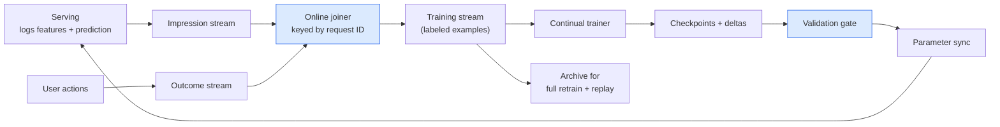

# Continual Learning and Model Freshness

> Yesterday's model does not know about today's trend. Retrain hourly and you may learn from your own mistakes. How fresh is fresh enough?

## TL;DR

A model is a compressed copy of the data it was trained on, and that copy ages. Continual training shortens the interval between an event happening and the model knowing about it, from days to minutes, by training on a stream instead of a snapshot. The gain is real for workloads whose inputs turn over quickly, such as ads, feeds, fraud, and marketplaces. The price is that almost every safeguard built for batch training assumed a finished dataset and a discrete model version, and a stream offers neither. Labels are still arriving when the example is consumed, the validation set is the future, the optimizer carries state that ages on its own clock, and "roll back to the previous version" has no meaning until we manufacture versions. This chapter treats freshness as a quantity to be measured and bought, and continual training as a streaming system whose output happens to be weights.

Scheduled retraining and its triggers are covered in [Training Pipelines](05-training-pipelines.md). Label maturation is covered in [Label and Ground-Truth Systems](02-label-ground-truth-systems.md). The sparse-parameter machinery that makes minute-level updates affordable is in [Embedding Tables and Sparse Model Infrastructure](07-embedding-tables-sparse-models.md).

---

## Freshness Is a Measurable Property

The case for continual training is usually made by anecdote: a competitor retrains hourly, so we should too. We can do better, because the value of freshness is measurable offline with data we already have.

Take a model trained on data up to time `T - d` and evaluate it on traffic from the window just after `T`. Repeat for several delays `d`: one hour, six hours, a day, a week. The resulting curve of metric against `d` is the *freshness curve*, and its slope is what an hour of staleness costs. For a credit-default model the curve is flat for months, and continual training would add operational risk for no return. For a click model on a feed where a large share of impressions go to items created in the last day, the curve is steep in its first hours, because the model has never seen the identifiers that dominate the traffic.

The curve also tells us where the staleness lives. If freezing the dense network and refreshing only the embedding rows for new items recovers most of the loss, the system needs fresh sparse parameters and not a fresh model, which is a much cheaper thing to build. If recomputing features more often recovers it, the remedy belongs in the [feature store](04-feature-stores.md) and not in the trainer. We run these ablations before committing to an architecture, since the three remedies differ by an order of magnitude in cost.

---

## The Cadence Spectrum

"Online learning" names a range of designs, and they differ in what can go wrong.

| Cadence | Unit of work | Model identity | Typical freshness | What it gives up |
|---|---|---|---|---|
| Scheduled full retrain | Whole snapshot, from initialization | One immutable version per run | Days | Freshness |
| Warm-start incremental | New partition, from previous checkpoint | One version per increment | Hours | Independence from history: errors compound across increments |
| Micro-batch continual | Minutes of stream | Periodic minted checkpoints | Minutes | A held-out validation set that predates serving |
| Per-event online | Single example | None unless manufactured | Seconds | Batch-level validation of any kind |

Moving down the table, each row removes a place where a human or a gate could have stopped a bad model. A full retrain can be evaluated for hours before promotion. A micro-batch trainer that publishes every five minutes has five minutes, and whatever checks it runs must be automatic. Most production systems that describe themselves as real-time sit in the third row, and they keep a scheduled full retrain running beside the stream as an anchor, for reasons the section on forgetting explains.

---

## The Pipeline Becomes a Streaming System

In batch training, the dataset is assembled, validated, and frozen before the trainer starts. In continual training the dataset never finishes, so each of those stages becomes a long-running operator with its own lag, backlog, and failure behavior.



The loop in the diagram is the important feature. The model's predictions decide what is shown, what is shown decides what can be clicked, and the clicks become the next training examples. In a batch system that loop closes once a day and passes through a validation stage. Here it closes in minutes, so a bad update can corrupt its own next batch of training data before anyone has looked at it.

Two properties follow from treating the trainer as a stream consumer. First, its position in the training stream is part of its state. A checkpoint that records weights without the stream offset they correspond to cannot be resumed without either skipping examples or training on some twice. Second, the trainer has a throughput, and when the stream outruns it the model falls behind in a way no loss curve shows. Trainer lag, measured as the event-time gap between the newest example trained on and now, is the primary freshness metric, and it deserves an alert before any accuracy metric does.

---

## The Online Joiner

A training example needs features and a label, and the two are produced at different times by different systems. The features exist at the moment of the prediction. The label exists when the user acts, or when enough time has passed that we conclude they will not.

The joiner holds each impression in a keyed buffer and waits for a matching outcome. When a click arrives with the same request ID, it emits a positive example. When the join window `W` expires with no match, it emits a negative. Three design decisions in this small component determine most of the system's correctness.

The first is where the features come from. The joiner must emit the feature values that the serving path actually used, logged at prediction time, and must not recompute them when the label arrives. Recomputing at join time reads feature values that postdate the decision, which is the point-in-time leak of [Feature Stores](04-feature-stores.md) reintroduced through the streaming path. Logging features costs storage and network on every request, and it is the only approach that makes training-serving skew impossible by construction.

The second is the join key. A request ID that the client echoes back is exact. Joining on user and item within a time window is a guess, and it mislabels repeated impressions of the same item.

The third is the window itself, which is a direct trade between freshness and label accuracy. A window of `W` delays every negative example by `W`, so the model is at least `W` stale on negatives however fast the trainer runs. Shrinking `W` improves freshness and converts more eventual positives into emitted negatives. The next section is about that conversion.

The joiner's buffer is also the system's largest piece of streaming state: one entry for every impression in the last `W`. It must survive restarts, which means checkpointing it or rebuilding it from the stream, and its memory footprint scales with traffic multiplied by the window.

---

## Delayed Feedback and the False-Negative Problem

Suppose the true conversion probability of an impression is `p`, and let `F(t)` be the fraction of eventual conversions that arrive within `t` of the impression. A joiner with window `W` observes a positive with probability `p · F(W)` and labels the rest negative. A model trained on that stream converges toward `p · F(W)`, and so underpredicts by the factor `F(W)`.

For clicks, `F` reaches 0.99 within minutes and the bias is negligible. For purchases, installs, or subscription starts, `F(1 hour)` can be below one half, and a one-hour window teaches the model that most converters did not convert. The bias is also not uniform. Expensive items convert later than cheap ones, so the model learns to underrate precisely the outcomes that are worth the most.

There are four responses, in increasing order of complexity. We can wait, setting `W` large enough that `F(W)` is near one and accepting the staleness. We can correct afterward, estimating `F(W)` per segment and dividing predictions by it, which repairs calibration in aggregate and leaves ranking distorted wherever delay correlates with features. We can train on a negative immediately and then, when the conversion finally arrives, emit a second, positive copy of the example with weights chosen so that the expected gradient matches that of the true label distribution. Or we can model the delay explicitly, learning the conversion probability jointly with a delay distribution so that an unconverted impression of age `a` contributes the likelihood of "has not converted yet" and not the likelihood of "will not convert."

The third approach is the one most continual systems adopt, because it keeps the trainer simple and puts the correction into the stream:

```python
# Emitted by the joiner. An impression first appears as a negative at
# window close; if its conversion arrives later, a positive copy follows.
#
# With q = model's current estimate of the biased (observed) positive
# rate, the importance weights below make the expected gradient equal
# that of training on true labels (the "fake negative weighted" loss).

def example_weight(label: int, q: float) -> float:
    if label == 1:
        return 1.0 + q          # late positive, counted once as a negative already
    return (1.0 - q) * (1.0 + q)  # negative that may yet turn out positive
```

Whichever correction is chosen, it has to be validated against labels that have fully matured, which means the continual system still depends on a slow, batch evaluation path that waits out the whole delay distribution. Freshness in training does not remove the label clock. It moves the place where we pay for it.

---

## Forgetting and Whiplash

A model trained on a stream sees data in time order, and stochastic gradient descent weights recent examples most heavily. That is the purpose of the exercise, and also its main hazard. Traffic has cycles. The users active at four in the morning differ from those active at noon, and weekend behavior differs from weekday behavior. A continual trainer with a learning rate high enough to track real change will also track the cycle, so that by morning the model has partly overwritten what it knew about daytime traffic. This is the practical face of catastrophic forgetting: the network does not lose a task in the academic sense, it loses the off-peak half of its own distribution every day.

The mitigations all work by restoring some memory of the past. Replay mixes a sample of archived examples from a longer horizon into each fresh batch, so that every update sees both yesterday and the last five minutes. Separate learning rates let the embedding rows for new identifiers move quickly while the dense layers, which encode slow-moving structure, move slowly or not at all between full retrains. And the scheduled full retrain acts as an anchor. Periodically, a model trained from scratch on a long, shuffled window replaces the continual model's dense parameters, discarding whatever drift accumulated. Systems that drop the anchor tend to rediscover it after an incident in which the stream delivered a few hours of unrepresentative data, such as a bot wave, a logging bug, or a holiday, and the model could not find its way back.

---

## Optimizer State Ages Too

The optimizers that suit sparse models, Adagrad and FTRL among them, keep a per-parameter accumulator of squared gradients and divide the learning rate by its square root. In a batch run this is desirable, since frequently updated parameters take smaller steps. In a run that never ends, the accumulator only grows, the effective learning rate of every long-lived parameter decays toward zero, and the model gradually loses the ability to adapt. The symptom is a system that is nominally training in real time and whose freshness curve looks like a daily retrain's.

A continual trainer therefore needs a policy for its optimizer state, and the policy is as much a part of the model as the weights. Common choices are to decay the accumulators exponentially, to reset them at each anchor retrain, or to bound the effective learning rate from below. Whatever the choice, a warm start must restore the accumulators along with the weights. A checkpoint that saves weights alone resumes with fresh accumulators and takes very large steps on parameters that had settled, which looks like a loss spike immediately after every restart.

---

## Publishing Deltas

A model with a few billion embedding rows cannot be re-exported and reloaded every few minutes. Fortunately, in a short interval only a small fraction of rows receive gradients, because only a small fraction of identifiers appear in traffic. The trainer tracks which rows were touched and publishes those rows as a delta, and serving replicas apply the delta to parameters already in memory. Dense layers, which every example updates, are small enough to ship whole and are usually published less often.

This creates a consistency question that batch serving never faces. During the interval in which a delta is being applied, a request may read some rows from the new generation and some from the old. For embedding rows this is generally tolerable, since consecutive generations of a row are close together. It is not tolerable across a change to the dense layers, because a new dense network reading embeddings trained against the old one is a combination that was never trained or evaluated. The publication protocol therefore tags every delta with a generation, applies sparse deltas continuously, and switches dense parameters atomically at a generation boundary, with the sparse rows that belong to that boundary already in place. The storage and serving mechanics are the subject of [Embedding Tables and Sparse Model Infrastructure](07-embedding-tables-sparse-models.md).

---

## Validation When the Test Set Is the Future

Batch evaluation holds out data the model has not seen. A stream provides this for free, exactly once: every example is unseen at the moment it arrives. *Progressive validation* scores each example with the current model before training on it and accumulates the metric. The estimate is computed on all the data and has low variance, and because prediction precedes the update it is an honest out-of-sample measurement of how the model performs on the immediate future.

Progressive validation is the continual system's main instrument, and the publication gate reads it over short windows. A gate that holds a delta typically checks that progressive loss has not jumped relative to a trailing baseline, that the ratio of mean prediction to observed positive rate has stayed inside a band, that no parameter or gradient is non-finite, that the share of examples with missing or defaulted features is normal, and that the volume and label rate of the training stream itself look like the same hour on previous days. The last check matters most, since the commonest cause of a bad continual model is an upstream change that altered the stream and left the trainer working correctly on wrong data.

When the gate fails, the safe action is to stop publishing and keep serving the last good generation, which grows stale gracefully. Continuing to train while publication is held is usually a mistake if the cause lies in the data, because the trainer is absorbing the bad interval into its weights. Recovery then requires rolling the trainer back as well as the server.

Progressive metrics share the stream's label bias, so they cannot detect a miscalibration that the delayed-feedback correction introduced. That is the job of the slow path: a daily job that re-scores a sample against matured labels and compares the result with what the gate believed at the time.

---

## Versions Must Be Manufactured

Registry, rollout, and rollback machinery all assume that a model is an immutable artifact with an identity. A continual model is a process. To get the benefits of [Model Registry and ML Metadata](09-model-registry-metadata.md) back, we mint versions deliberately: at a fixed cadence the trainer writes a full, consistent checkpoint that includes dense weights, sparse rows, optimizer state, and the training-stream offset, and registers it with the generation number that serving reports in its prediction logs.

Rollback then has a precise meaning with two parts. Serving reverts to the parameters of generation `g`. The trainer restores checkpoint `g`, seeks the stream to the offset recorded in it, and resumes, skipping or repairing the interval that caused the trouble. Reverting serving without the trainer accomplishes nothing, since the next delta reapplies the damage. Skipping an interval requires the stream to be replayable and filterable, which is one more reason the archive branch in the pipeline diagram is not optional.

The interval between minted checkpoints bounds how much training is lost in a rollback, and the retention of the stream bounds how far back a rollback can reach. Both are recovery objectives in the ordinary sense and are sized the same way.

---

## Experiments on a Moving Model

An A/B test of two continual models has a contamination path that static models lack. If both arms train on the full stream, each learns from impressions the other arm chose, and the arms converge on each other, so the measured difference shrinks toward zero. If each arm trains only on its own traffic, a 5 percent arm trains on a twentieth of the data and loses for reasons unrelated to the idea under test.

Neither choice is free, and the experiment design has to state which was made. Training on the full stream measures the serving-side difference between the arms while sharing whatever is learned. Training on separate streams measures the whole closed loop at a data disadvantage for the smaller arm, which can be offset by running arms of equal size. [Online Experiments](12-online-experiments.md) treats interference of this kind generally. The point particular to continual learning is that the training data assignment is part of the treatment and belongs in the experiment's record.

---

## Failure Modes

**Silent stall.** The trainer falls behind the stream, or publication is held and never released, and the system serves a model that is hours or days old while every dashboard reports that real-time training is running. Nothing fails, and quality decays along the freshness curve. The defense is to alert on trainer event-time lag and on the age of the serving generation, and to treat both as service-level indicators.

**Self-reinforcing collapse.** A bad update lowers scores for a class of items, those items stop being shown, no positive examples arrive to correct the scores, and the model's error becomes permanent because it has removed the evidence against itself. A reserved slice of exploration traffic whose exposure does not depend on the model's score keeps the evidence flowing, as [Recommendation Systems](15-recommendation-systems.md) describes.

**Poisoning through the feedback path.** Anyone who can generate events can write to the training set, and in a continual system the write takes effect within minutes. Coordinated fake engagement moves the model before abuse detection has classified the traffic. Training on events only after they pass an abuse filter, with the delay that implies, and capping the gradient contribution of any single account or source both bound the damage.

**Join-window false negatives.** The window is shortened to improve freshness, the share of conversions that arrive after it rises, and the model's predictions for slow-converting segments sink. Aggregate calibration is repaired with a global constant, which hides the per-segment distortion. The matured-label evaluation, sliced by conversion delay, is what reveals it.

**Restart amnesia.** A trainer restarts from a checkpoint that lacks optimizer state or the stream offset. It either replays an hour of data twice or skips it, and takes oversized steps on settled parameters. The checkpoint contract of [Distributed Training Internals](06-distributed-training-internals.md) applies unchanged: a checkpoint is a consistent cut across everything the next step depends on.

**Mixed-generation serving.** Dense parameters are swapped before the corresponding sparse delta has finished applying, or replicas apply deltas at different rates, and the same request scores differently depending on which replica answers. Generation-tagged deltas, an atomic dense switch, and a per-prediction generation in the log make the condition both preventable and visible.

---

## Decision Framework

Whether to train continually is settled by the freshness curve and by what the organization can operate, in that order.

| Observation | Design consequence |
|---|---|
| Freshness curve flat over days | Scheduled retraining; continual training adds risk without return |
| Loss recovered by refreshing features alone | Invest in feature freshness, keep batch training |
| Loss recovered by refreshing sparse rows for new identifiers | Continual sparse updates over a frozen dense network |
| Loss recovered only by updating everything | Full continual training with an anchor retrain |
| Labels mature slowly relative to the desired cadence | Delayed-feedback correction is mandatory, and a matured-label evaluation path must exist first |
| Events can be forged cheaply | Abuse filtering precedes training, and its latency bounds achievable freshness |

A design that passes this table still has to answer four operational questions before it ships. What is the event-time lag objective for the trainer, and who is paged when it is breached? What does the gate check, and what does the system serve while the gate is closed? How far back can training be rolled, and has that been rehearsed with the stream seek included? And which slow evaluation, on matured labels, has the authority to overrule the fast one?

---

## Key Takeaways

1. Freshness has a measurable value. Train at several delays, plot the metric, and let the slope decide how much machinery the problem deserves.
2. Locate the staleness before building. Fresh features, fresh sparse rows, and a fresh model are three different systems with very different costs.
3. A continual trainer is a stream consumer. Its lag is the primary health metric and its stream offset is part of every checkpoint.
4. The joiner must emit features logged at prediction time. Recomputing them at label time reintroduces the point-in-time leak.
5. A join window turns late positives into negatives, and the resulting bias is largest on the slowest and often most valuable outcomes. Correct for it, and verify the correction on matured labels.
6. Recency weighting causes forgetting of anything cyclical. Replay, slower dense learning rates, and a periodic full retrain keep a memory of the longer distribution.
7. Optimizer accumulators are model state. Left alone they freeze a long-running model, and dropped at restart they destabilize it.
8. Publish sparse deltas continuously and switch dense parameters atomically, with a generation on every delta and every logged prediction.
9. Progressive validation gives an honest fast signal, but it inherits the stream's label bias, so a slow evaluation on matured labels keeps the final say.
10. Versions and rollback exist only if we mint consistent checkpoints, and rollback always involves the trainer and the stream as well as the server.

---

## References

1. [Ad Click Prediction: a View from the Trenches](https://research.google/pubs/ad-click-prediction-a-view-from-the-trenches/): McMahan et al., 2013; FTRL-Proximal, progressive validation, and calibration in a continuously trained system
2. [Practical Lessons from Predicting Clicks on Ads at Facebook](https://research.facebook.com/publications/practical-lessons-from-predicting-clicks-on-ads-at-facebook/): He et al., 2014; the online joiner, data freshness measurements, and join-window trade-offs
3. [Modeling Delayed Feedback in Display Advertising](https://dl.acm.org/doi/10.1145/2623330.2623634): Chapelle, 2014; joint modeling of conversion and delay
4. [Addressing Delayed Feedback for Continuous Training with Neural Networks in CTR Prediction](https://arxiv.org/abs/1907.06558): Ktena et al., 2019; fake-negative weighted and calibrated losses
5. [Monolith: Real Time Recommendation System With Collisionless Embedding Table](https://arxiv.org/abs/2209.07663): Liu et al., 2022; minute-level sparse parameter synchronization and its fault-tolerance trade-offs
6. [Overcoming Catastrophic Forgetting in Neural Networks](https://arxiv.org/abs/1612.00796): Kirkpatrick et al., 2017
7. [TFX: A TensorFlow-Based Production-Scale Machine Learning Platform](https://dl.acm.org/doi/10.1145/3097983.3098021): Baylor et al., 2017; warm-starting and continuous pipelines with validation gates

---

## Related Chapters

- [Training Pipelines](05-training-pipelines.md): scheduled retraining, the anchor that a continual system still needs
- [Label and Ground-Truth Systems](02-label-ground-truth-systems.md): the label clock that a join window can truncate but not remove
- [Embedding Tables and Sparse Model Infrastructure](07-embedding-tables-sparse-models.md): the parameter storage that makes delta publication possible
- [Model Monitoring](13-model-monitoring.md): drift detection when the model itself is one of the things drifting
- [Stream Execution](../10-data-pipelines/02-stream-processing.md): watermarks, keyed state, and replay, which the joiner and trainer inherit
