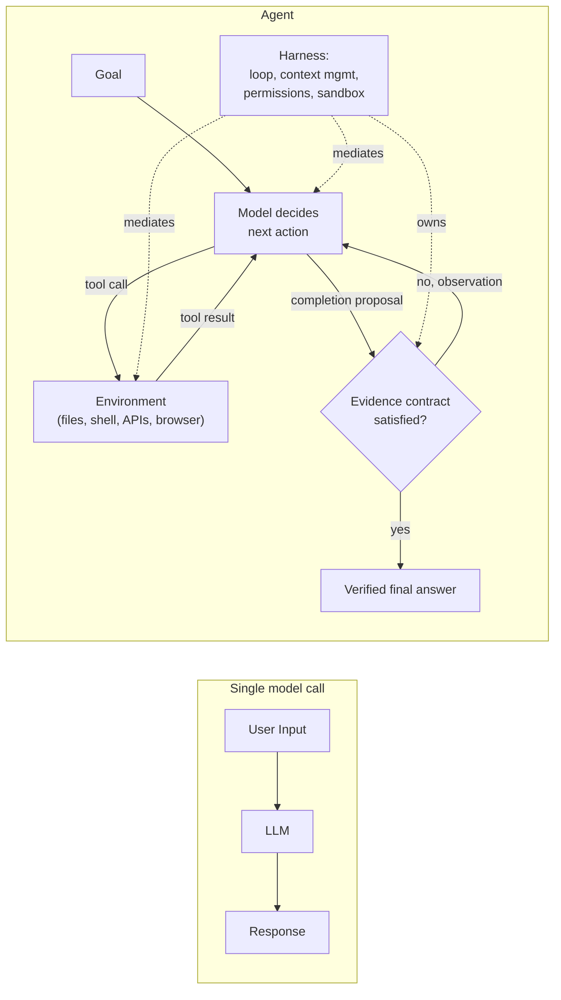
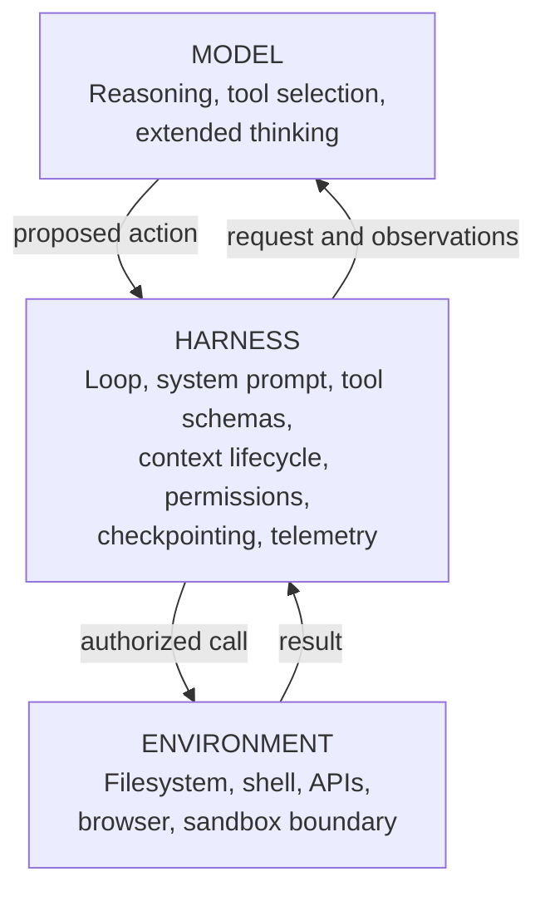
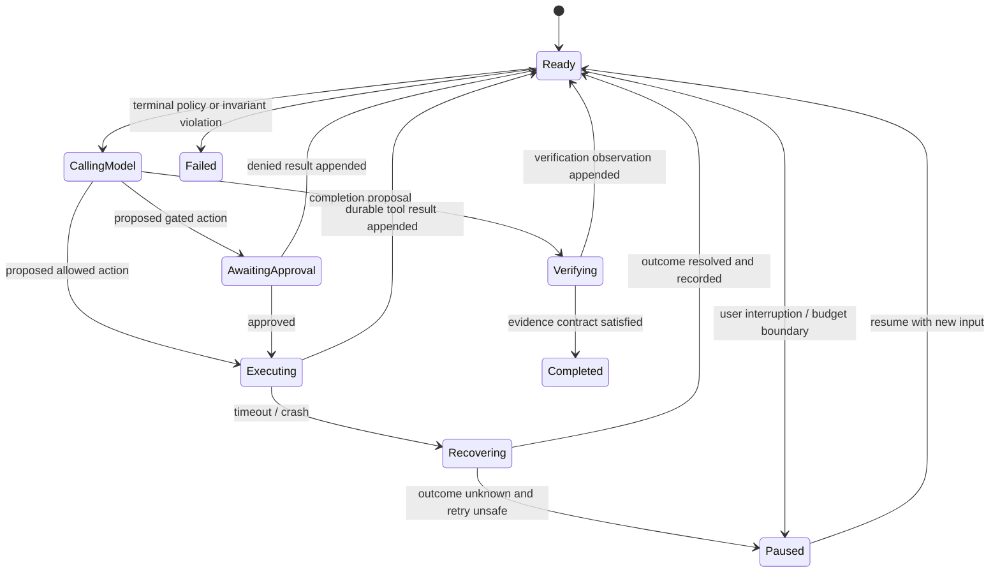
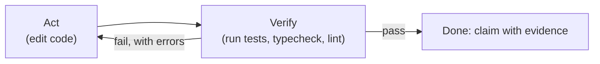

# LLM Agent Fundamentals

## Overview {#tl-dr}

An agent observes part of its environment, chooses an action, and uses the result to decide what to do next. Results can arrive late or omit information. The harness records state, limits what the model can do, and checks the evidence before marking the task complete.

Give the model a decision only when the next useful action depends on something it can observe. A build agent can use a compiler error to choose a repair and rerun the build to check it. A successful build still leaves a separate question for the harness: does the change meet the user's acceptance criteria? Use an explicit workflow when the steps and their order are already known.

---

## What Makes an Agent Different from a Chatbot?



A chat interface can front any of these designs. Here, the simplest case is a single model call that returns text. A workflow uses code to choose the next step. An agent delegates that choice to the model, which can inspect a tool result and choose a different action on the next turn.

| Design choice | Single model call | Workflow | Agent loop |
|---|---|---|---|
| Who selects the next step? | Caller receives one answer | Application follows declared transitions | Model proposes an action after each observation |
| What limits the work? | Input and output limits | Branch, loop, and retry limits | Harness enforces permissions, deadline, and spend |
| Typical failure | Unsupported answer | Invalid intermediate result propagates | Repeated actions compound an early error |
| Example | Summarize supplied text | Route and validate an expense report | Investigate a failed build and verify a repair |

For a failed build, parsing a known error code can stay in a workflow. Give the model a choice when the next file or test to inspect depends on what it just learned. [Orchestration Patterns](./02-orchestration-patterns.md)

## The Three Components



- **Model.** Given the available observations, it proposes a response or an action. Measure whether those proposals lead to successful tasks with the actual tools and verifier.
- **Harness.** This runtime builds the request, enforces policy, dispatches approved work, and records the result. [Harness Engineering](./09-harness-engineering.md)
- **Environment.** The agent needs a place to observe progress. A build log can identify a failing test, a scoped checkout lets the agent propose a fix, and an independent test run can check it.

---

## The Agent Loop

One turn moves from a recorded observation to a proposed action and back to observed state.

```text
state snapshot → model proposal → policy/execution → observation → new state
```

A tool proposal carries arguments. The harness authenticates the caller, validates the arguments against current state, and assigns the logical action an ID before dispatch. A request for information or a completion claim follows its own transition.

A schema can require an integer refund amount. The application must still check the currency, the refundable balance, and the caller's authority over that order.

Schedule concurrent reads against a defined snapshot. Serialize conflicting writes or make the destination reject a stale revision. When a second call depends on a first write, wait for the receipt and read the committed revision.

Record why the loop stopped. An approval wait can resume, a denied action may require a new plan, and a depleted budget stops further work. Mark success only after checking the task's acceptance criteria. [Harness Engineering](./09-harness-engineering.md) and [Orchestration Patterns](./02-orchestration-patterns.md)

### Reasoning effort is a resource allocation

Compare reasoning budgets on the same tasks. Extra computation may pay for itself before an expensive search branch. In a build loop, running a cheap failing test may resolve the uncertainty sooner. Compare verified completions, latency, tokens, and tool calls before changing the default.

---

## Execution Semantics: The Loop Is a Durable State Machine

Keep a durable record for the user goal, each model call, each proposed effect, and each execution attempt. After a restart, these IDs distinguish an unfinished action from a new request.

```text
run_id       names one user goal and its durable lifetime
turn_id      names one model invocation against a specific context snapshot
action_id    names one logical side effect requested by that invocation
attempt_id   names one infrastructure attempt to execute the action
```

A lost model response can cost a second generation. A lost refund response can cost a second refund. Persist the action ID and exact parameters before dispatch. Send the same key on a retry only while the destination guarantees deduplication for that operation.



Suppose the refund request timed out after dispatch. Keep it pending while you check the provider's authoritative record. A matching receipt lets the run continue. If the result is still unknown, a retry is safe only under the provider's idempotency contract. Stripe's v1 API, for example, can prune a key after 24 hours. Once pruned, the same key can start a new request. If replay protection may have expired and the original result remains uncertain, stop automatic retries and route the case for reconciliation. [Stripe idempotent requests](https://docs.stripe.com/api/idempotent_requests)

Record the order in which the model saw concurrent results. Replay that order, including failures and truncation. On cancellation, stop admitting new actions, signal running attempts, and retain any unresolved effect until the destination confirms its outcome.

Store action receipts, approvals, version identifiers, and completion evidence independently of the chat transcript. Keep sensitive payloads in access-controlled storage with a retention period. After deletion, record which evidence remains available for recovery.

---

## Tools as Effect Contracts

For each tool, document who can invoke it, which state it reads or changes, its timeout, result-size limit, and how to resolve an uncertain outcome. Give the model enough information to choose the tool. Keep authorization and execution checks in the handler.

A shell is useful for inspecting a changing codebase. A typed refund API can enforce a balance check and a deduplication key at the destination. Choose the smallest surface that supports the task. Load rarely used tool descriptions when needed.

Return a status the caller can act on. A stale revision should identify the revision to refresh. A successful write should include a receipt. For large results, return an artifact reference or continuation token and mark the visible excerpt as partial.

For a remote tool, authenticate its operator and verify the capability, schema revision, and data policy before exposing it to a run. Treat instructions in its results as untrusted input. [Harness Engineering](./09-harness-engineering.md) and [Coding Agent Tool Design](../19-compound-engineering/02-coding-agent-tool-design.md)

---

## State, Context, and Memory

**Run state** records the current goal, permissions, pending actions, budgets, and receipts. **Context** contains the subset the model may see on this turn. **Memory** carries selected information across runs, such as a project convention.

After compaction, rebuild the prompt from current state. Preserve outstanding actions and their receipts even if the summary drops the conversation that produced them. Give memory records a source, scope, expiry, and revocation path. [Context Management](./08-context-management.md)

---

## Verification as an Observation Channel

Choose a check that can distinguish real progress from a plausible report. A build log proves the compiler ran. A passing regression test provides evidence about a particular behavior. Neither alone establishes that the user received the requested change.



Measure how often the verifier accepts bad results and rejects good ones. Put cheap, high-coverage checks close to each action. Reserve slow integration checks or human review for changes whose consequences justify the delay. Calibrate a model judge against independent labels before relying on it.

For a fixed path, let $p_i$ be the probability that transition $i$ succeeds given that all earlier transitions succeeded. The probability they all succeed is $\prod_i p_i$ by the chain rule. Marginal stage pass rates cannot be substituted without an independence assumption. Measure failures detected, recoveries attempted, and final outcomes on complete runs. [LLM Evaluation](./10-llm-evaluation.md)

---

## Security Model

A retrieved document can name an action the user never authorized. Bind execution to the authenticated principal, tenant, resource, verb, expiry, and approved parameters. Check those values outside the model.

Run untrusted code with scoped filesystem and network access. Keep credentials behind the tool boundary. For a newly approved action, recheck its parameters and resource revision immediately before execution. [Harness Engineering](./09-harness-engineering.md)

---

## Evaluating Agents

Evaluate what changed in the environment, how the system got there, and what the run cost. An agent can return the right final document after sharing an intermediate draft with the wrong recipient. The final artifact alone misses that failure.

Repeat representative tasks and report first-attempt success, consistency across attempts, latency, and cost per verified completion. Use traces to investigate policy interventions and unnecessary work. [LLM Evaluation and Observability](./10-llm-evaluation.md)

---

## Bounded Autonomy as a Control System

Set permissions independently for observation, mutation, spend, and completion. A coding agent may inspect a repository and run local tests while a production deployment requires separate approval.

Budget each run and reserve a share for verification. A delegated task inherits only the tools and resources it needs. When a limit is reached, return a reason such as `budget_exhausted` or `approval_required` so the caller can decide whether the work may resume.

Look for repeated actions that add no information. Three identical status polls may be reasonable for a running build. Three edits that restore the same failing revision call for a different plan. Compare the observed state as well as the call signature.

The harness closes the run when the verifier accepts the current artifact revision. Store that revision with the check results and any human decision. Reopen verification if the artifact changes.

Widen permissions one task class at a time. Compare the new policy with the read-only or approval-gated baseline on the same workload. Inspect silent failures and high-impact actions before granting further authority.

---

## Failure Modes

**Lost constraint.** A compacted run proposes a change the user ruled out. Restore the current constraint from durable state and test the same continuation after compaction.

**Duplicate effect.** Two attempts report different outcomes for one action. Group receipts by logical action ID, inspect the destination, and suspend retries where the result remains uncertain.

**Untrusted instruction.** A tool result asks the agent to send data elsewhere. Check the destination and disclosure authority against the user's task before issuing any credential.

**Weak verification.** A generated test repeats an erroneous implementation assumption. Check an independently specified invariant or a previously observed failing case.

**Repeated work.** The same operation consumes budget while the environment stays unchanged. Require new evidence, change the strategy, or pause with the unresolved question.

**Partial completion.** One parallel write commits and another fails. Persist both outcomes, recheck the failed action's preconditions, and resume only the unfinished work.

**Failed resume.** The chat transcript survives but the checkout or deployment receipt is missing. Recover authoritative state before asking the model to continue.

## Decision Framework

Use a single call for a bounded transformation, such as extracting fields from a supplied record. Use a workflow when code can express the branches. Delegate the next step when observations materially change which action is useful.

For an incident investigator, the design review should trace one uncertain operation end to end. Which observation identifies the next useful check? Which action could change production? Who authorizes it? What survives a lost response?

Enable autonomous writes only for task classes with enforceable permissions, bounded spend, and a tested path from timeout to a known result. Keep an explicit escalation route for the remaining cases.

## Key Takeaways

1. Let the model choose where to investigate and give the harness authority over execution.
2. Keep a stable ID for each logical action and a separate ID for every attempt.
3. Test recovery after the destination commits and before the caller records the receipt.
4. Measure completion against the current artifact, the user's constraints, and the observed external effects.
5. Increase autonomy when representative runs demonstrate that the system can detect and contain errors.

## References

- [Building Effective Agents](https://www.anthropic.com/research/building-effective-agents): Anthropic's workflow/agent taxonomy
- [Effective Context Engineering for AI Agents](https://www.anthropic.com/engineering/effective-context-engineering-for-ai-agents): Anthropic
- [Writing Effective Tools for Agents](https://www.anthropic.com/engineering/writing-tools-for-agents): Anthropic
- [Code Execution with MCP](https://www.anthropic.com/engineering/code-execution-with-mcp): scripts instead of chained tool calls
- [Model Context Protocol](https://modelcontextprotocol.io/): specification and SDKs
- [The Lethal Trifecta for AI Agents](https://simonwillison.net/2025/Jun/16/the-lethal-trifecta/): Simon Willison
- [SWE-bench](https://www.swebench.com/) / [τ-bench](https://arxiv.org/abs/2406.12045) / [GAIA](https://arxiv.org/abs/2311.12983): agent benchmarks
- [Context Rot: How Increasing Input Tokens Impacts LLM Performance](https://research.trychroma.com/context-rot): Chroma research
- [ReAct: Synergizing Reasoning and Acting in Language Models](https://arxiv.org/abs/2210.03629): reasoning-and-action feedback-loop formulation

---

## Related Chapters

- [Agent Orchestration Patterns](02-orchestration-patterns.md): the loop promoted into a topology, with retries and budgets attached
- [Harness Engineering](09-harness-engineering.md): the harness is where an agent model becomes a program you can operate
- [LLM Evaluation and Observability](10-llm-evaluation.md): an agent without evaluation is a stochastic distributed system with no tests
- [Tool and Runtime Contracts for Coding Agents](../19-compound-engineering/02-coding-agent-tool-design.md): the tool contract, where most agent capability claims quietly fail
- [Always-On Agents](../22-always-on-agents/01-always-on-agent-fundamentals.md): the same loop when nobody starts it, watches it, or reads its result
