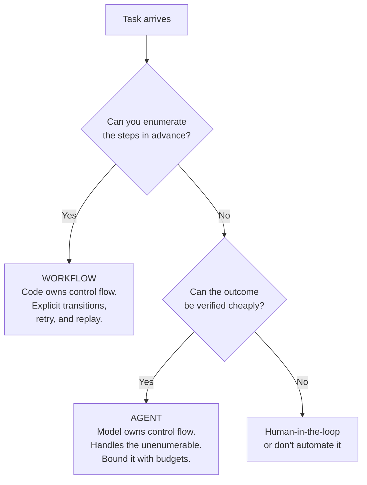
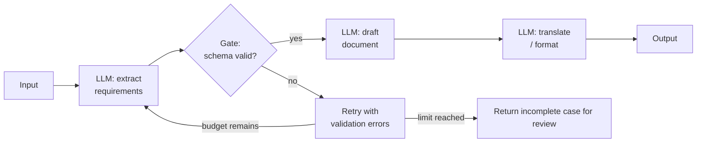
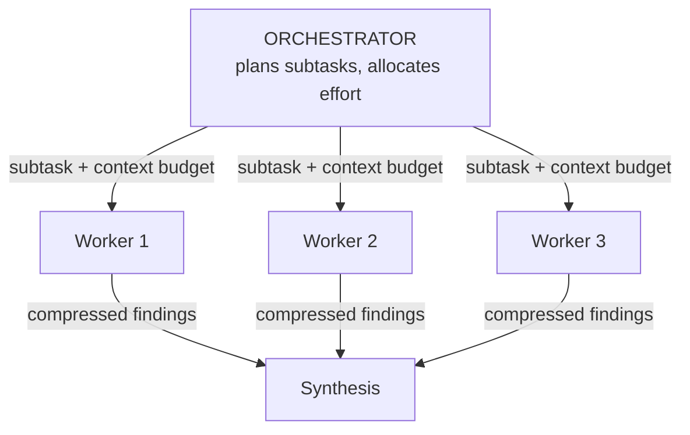
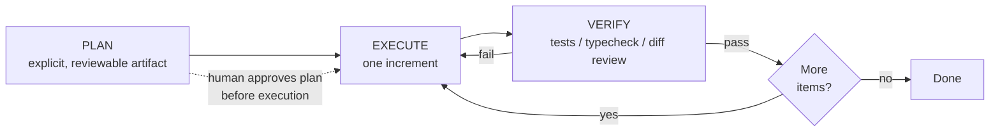
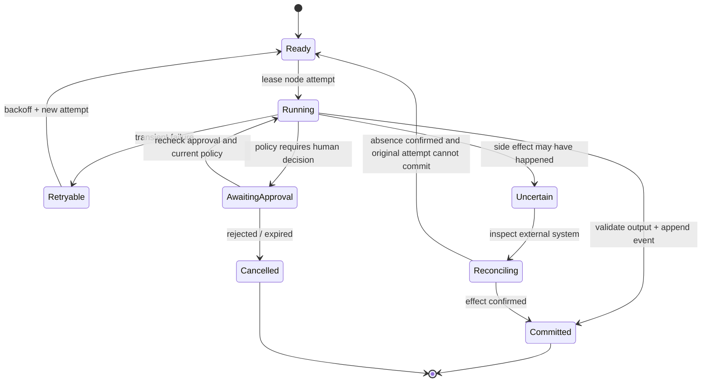

# Agent Orchestration Patterns

## Overview {#tl-dr}

Orchestration determines who chooses the next step and what evidence allows it to proceed. In a workflow, code defines the paths. In an agent loop, the model chooses a path based on what it observes. When branches run in parallel, the orchestrator also decides which results to wait for.

A fixed sequence works when the dependencies are known in advance. Parallel branches need a rule for what happens if one is late. A report that requires every regional total must record a missing region or wait for it. A lookup against equivalent replicas can finish after the first valid reply. Make that decision before setting branch deadlines and cancellation rules.

---

## Workflows vs. Agents



A workflow can branch, loop, and call a model. Application code still defines which transitions are available. In an agent loop, the model can select the next investigation after seeing an unexpected result. The harness checks whether the proposed step is authorized and affordable.

A support service can combine both. Code checks the refund policy and owns payment execution. A bounded investigation can search the customer's records when the reason for the request is unclear.

---

## Workflow Patterns

### Prompt Chaining

Chain calls when the output of one stage gives the next a reliable input. For example, validate extracted requirements before generating a document. A schema check can confirm that a field is present. A reviewer or an independent source may be needed to decide whether the requirement is correct.



Record the input revision, output, checker revision, and decision at each gate. If the source was wrong, invalidate the extraction and its descendants. If a provider was temporarily unavailable, retry that call within the remaining deadline.

Keep a stage when its check catches an error that would otherwise reach the user. Try removing it on a representative evaluation set when changing the model.

### Routing

A router is worthwhile when different requests benefit from different capabilities. A refund lookup may fit a small model and a narrow read-only toolset. Troubleshooting may need a larger model and access to technical documentation.

```python
ROUTES = {
    "refund":    {"model": SMALL, "system": REFUND_PROMPT,  "tools": [refund_lookup]},
    "technical": {"model": LARGE, "system": DEBUG_PROMPT,   "tools": [search_docs, run_repro]},
    "general":   {"model": SMALL, "system": GENERAL_PROMPT, "tools": []},
}

async def handle(ticket: str) -> str:
    route = await llm(f"Classify this ticket: {ticket}",
                      response_format=Route, model=SMALL)
    cfg = ROUTES.get(route.category)
    if cfg is None:  # The classifier can abstain.
        return await request_triage(ticket)
    return await run(cfg, ticket)
```

Measure misrouting separately for the expensive or high-impact classes. Give low-confidence cases an explicit fallback. A classified refund request still needs a policy decision before it can move money.

### Parallelization

Parallel calls can divide the work or repeat it.

- **Divide the work.** Give reviewers of the same code revision separate questions about performance, correctness, and maintainability. Merge their findings by evidence and location.
- **Repeat the work.** Run several candidate answers for the same case. Decide up front who ranks them, which evidence that decision requires, and how much extra work the result is worth.

```python
findings = await asyncio.gather(
    llm(SECURITY_REVIEW + diff),
    llm(PERF_REVIEW + diff),
    llm(STYLE_REVIEW + diff),
)                                   # sectioning

proposals = await asyncio.gather(*[
    run_candidate(case, seed=s) for s in selected_seeds
])
decision = aggregate(proposals, rule=qualified_join_policy)
```

Readers can share the same immutable input. For writers, define ownership or check the revision at commit. For replicated answers, inspect whether two workers rely on the same source before treating their agreement as additional evidence.

### Orchestrator–Workers

Use a model to propose subtasks when their number or scope depends on the input. A scheduler checks dependencies and reserves worker capacity before accepting the plan. Give the final writer a deadline and the evidence required to combine results. [Multi-Agent Systems](./03-multi-agent-systems.md)



### Evaluator–Optimizer

Make the evaluator name the failed criterion and point to the evidence. Preserve criteria that already passed. Stop when the artifact passes, revisions stop improving it, or the budget expires. Test the evaluator on known defects, including defects the generator tends to miss. [LLM Evaluation](./10-llm-evaluation.md)

---

## The Agent Loop

An investigation may start with a trace and lead to a queue, a database, or a deployment. Bound the search by deadline, allowed tools, and the observation needed for completion. [Agent Fundamentals](./01-agent-fundamentals.md)

### Plan, Context Fork, and Durable Resume

For a run that can outlive one process, store the plan as records with owners, dependencies, base revisions, acceptance criteria, and status. Advance dependent work only when the required result has been verified.



When new evidence changes the plan, record which tasks it invalidates. A worker investigating one branch receives a task packet and the relevant revision. It returns evidence to the owner, who decides whether to change shared state.

After interruption, reload the last committed transition and pending action receipts. Rebuild the prompt from the current state, including any user decisions made during the pause. [Context Management](./08-context-management.md) and [Harness Engineering](./09-harness-engineering.md)

## Orchestration as a Typed State Graph

Define each logical node separately from the attempts used to execute it. A useful node contract is

$$
N = (I, O, P, S, R, C, B)
$$

where $I$ and $O$ describe the input and output, $P$ says when execution may start, and $S$ defines success. $R$ specifies retry behavior, $C$ describes reconciliation or compensation, and $B$ limits resources. These fields also apply to a human approval or deterministic tool handler.



Store the run, node, and logical action IDs with every attempt. A retry gets a fresh attempt ID and retains the action ID. When the tool supports deduplication, send that action ID with the same parameters. This lets an operator count both provider calls while tracing one intended refund.

A transactional outbox can atomically record a node transition and the message that requests its next action. The relay can publish the message twice. The consumer still needs duplicate detection, and an external write still needs a destination-enforced idempotency key or a way to reconcile its outcome. [AWS transactional outbox guidance](https://docs.aws.amazon.com/prescriptive-guidance/latest/cloud-design-patterns/transactional-outbox.html)

Specify the join before launching branches. An `all` join needs every required result. An `any` join can accept the first valid result. A quorum counts eligible responses and therefore needs an explicit rule for duplicates and shared sources. For `best-of-n`, persist the ranking rule and how ties are resolved.

On cancellation, stop new work and track running children until they acknowledge or their effects are reconciled. A draft may be removable. A notification already delivered may need a correction. Tell the caller which actions are still pending.

### Determinism and Replay

During replay, read the recorded model response, external results, relevant clock values, and routing decisions. Running the model again can produce a different tool proposal. Version control-flow changes so old event histories still follow a compatible path.

A recovery test should restart the same run at each transition and compare the next requested action and its ID with the original trace.

## Reliability, Latency, and Cost Composition

First consider a fixed sequence that requires every stage to succeed. If stage success probabilities $p_i$ are independent, the probability of success on one pass is

$$
P(\text{success}) = \prod_{i=1}^{n} p_i.
$$

Ten independent stages at 98% each give about 81.7% end-to-end success. Shared evidence can cause several stages to fail on the same cases. For release decisions, count completed tasks on full traces and record how often a gate detects a defect, blocks a valid result, or enables recovery.

Let $Q_i$ be a branch's queue time and $E_i$ its execution time, including any retries. If branches start together and $J$ accounts for fork and join overhead, the latency estimates are

$$
L_{\text{chain}} \approx \sum_i (Q_i + E_i), \qquad
L_{\text{fork-all}} \approx \max_i(Q_i + E_i) + J.
$$

Suppose each of ten independent workers finishes by its cutoff 99% of the time. An all-worker join meets the cutoff only $0.99^{10}$, or 90.4%, of the time before synthesis. Shared provider queues can change that estimate. Measure joint completion on real traces. Drop an optional branch only when the remaining evidence satisfies the task contract. [The Tail at Scale](https://research.google/pubs/the-tail-at-scale/)

Charge every attempt to its task, including candidates discarded at the join. For an illustrative per-token billing model, total cost is

$$
C_{run} = \sum_{a \in attempts}
  (t^{in}_a c^{in}_{m_a} + t^{out}_a c^{out}_{m_a} + c^{tool}_a + c^{infra}_a).
$$

Reserve spend and capacity before launching children. Return unused reservations after completion. A turn cap alone permits one expensive turn with a large prompt and many tool calls. Track tokens, tool spend, concurrency, and remaining time independently.

Five model responses can agree because every prompt contains the same incorrect source. Compare voting with a single answer at equal total spend. Inspect cases where the majority is wrong, and require independent evidence for high-impact decisions.

For iterative revision, record pass or fail by criterion. If fixing one criterion breaks another, retain both observations and cap further attempts. Escalate when the next revision has no new evidence to work with.

## Human Control and Policy Boundaries

Show the reviewer the proposed change, destination, base revision, and expected impact. Store approval against those exact parameters. Changing a recipient or regenerating a patch requires a new decision.

Authorize execution from verified identity and current policy. A route chosen by the model can narrow the available tools. It cannot expand the user's authority. Keep credentials outside the model's context.

During an approval wait, release compute and persist the proposed action. On resume, check whether the user still has authority, the destination still matches, and the approved revision is current before reacquiring credentials.

---

## Model-Internal Reasoning and External Control Flow

Some search and revision can happen within a model call. Other decisions require a new observation, an external tool, or permission to change state. Choose where each decision runs based on the evidence it needs and how the system can verify it.

| Technique | Computation it exposes | External orchestration role |
|---|---|---|
| ReAct (`Thought:/Action:` text) | Interleaved reasoning + tool use via parsed text | Structured tool protocols usually replace text parsing. The observe–act feedback pattern remains. |
| Chain-of-Thought ("think step by step") | Elicited intermediate reasoning | May be redundant on reasoning-oriented models. Explicit concise rationales remain useful when the product requires reviewable decision evidence. |
| Self-consistency (sample N, vote) | Reliability via diversity | Survives as the voting form of parallelization: applied at the *task* level where verification is hard. |
| Tree-of-Thought (explicit search) | Explored alternative reasoning paths | External search remains valuable where candidates can be checkpointed, evaluated independently, or distributed. |
| Reflexion (verbal self-critique across retries) | Revision conditioned on a prior attempt | Useful only when feedback adds evidence or a qualified evaluator. Self-critique alone can preserve the original blind spot. |

Compare a reasoning scaffold with a direct goal and constraints on matched tasks. Record the observed decision and supporting evidence for review. Keep external branches when they need different tools, independent verification, or a checkpoint from which the run can recover.

---

## Pattern Selection

| Pattern | Who decides | What to check before rollout |
|---|---|---|
| Single call | Caller supplies one bounded task | Can the output be checked directly? |
| Chain | Code selects the next stage | Does each intermediate check catch enough errors to justify another call? |
| Route | Classifier proposes a destination | Where do ambiguous or high-impact cases go? |
| Parallel review | Coordinator splits a shared snapshot | Are the reviews independent enough to buy extra coverage? |
| Sample and vote | Aggregator applies a decision rule | How often do the candidates share the same wrong answer? |
| Orchestrator and workers | Model proposes tasks and scheduler admits them | Can the final writer verify and combine the results by deadline? |
| Evaluator and optimizer | Evaluator identifies a defect and code bounds revisions | Does the checker reliably recognize progress? |
| Agent loop | Model selects the next observation or action | Which verifier, permission boundary, and budget stop the run? |

When composing patterns, define who owns each transition. A router selects the eligible branch, a loop may add new work, and a join decides whether its results suffice. Include their latency, spend, and cancellation behavior in the same task trace.

---

## Failure Modes

**Obsolete stage.** A newer model can handle extraction and drafting in one call. Remove the intermediate stage in a paired evaluation and check whether the original gate still catches user-visible defects.

**Grader drift.** A judge starts accepting fluent answers with unsupported claims. Re-score a blinded calibration panel and inspect disagreement by rubric dimension before trusting the release comparison.

**Loop without progress.** A worker keeps issuing the same query with different wording. Compare source revisions and new evidence across attempts. Pause or switch strategy when the search stops producing information.

**Uncertain write.** A provider times out after dispatch. Recover the logical action ID and resolve its state at the destination before authorizing another write.

**Runaway fan-out.** One parent starts children faster than they finish. Close admission for that run, retain capacity for reconciliation, and identify the plan revision that expanded the graph.

**Conflicting branches.** Two workers produce edits that merge cleanly but disagree about the API contract. Compare both with the same base revision and let one owner verify the integrated result. [Multi-Agent Systems](./03-multi-agent-systems.md)

**Work after cancellation.** A run stops returning results while children keep consuming tokens. Trace cancellation acknowledgements and reconcile outstanding effects before marking cleanup complete.

## Decision Framework

Start the design review with the step whose failure would have the largest user impact.

| Question | Decision |
|---|---|
| Are the valid branches known? | Encode the transitions and validate intermediate outputs. |
| Does useful work emerge only after an observation? | Give the model a bounded choice and verify the result before advancing. |
| Can branches share a snapshot and commit independently? | Run them concurrently within a common deadline. |
| Did an attempt fail before dispatch or after an external write became possible? | Retry a transient pre-dispatch failure within budget. Reconcile an uncertain effect. |
| Can the evaluator reliably detect the relevant defect? | Use it to guide revision after measuring its false accept and reject rates. |
| Does the action require approval? | Bind the approval to its destination, arguments, and revision. |
| Must every branch finish? | Reserve time for synthesis and expose an explicit partial-result contract where valid. |
| Is cost the limiting resource? | Compare each additional branch with spending the same budget on the simpler path. |

Ship the smallest graph that meets the acceptance criteria on representative traffic. For each added branch, retain the evaluation slice that justified it and the condition under which it can be removed.

## Key Takeaways

- Assign an owner, acceptance test, and retry policy to each transition.
- Use end-to-end traces to measure success, fork latency, and cost of discarded work.
- Persist nondeterministic results and reconcile uncertain writes before resuming.
- Require evidence that an evaluator or additional worker catches errors the existing path misses.
- Keep authority in application policy and bind approvals to the exact effect.

---

## References

- [Building Effective Agents](https://www.anthropic.com/research/building-effective-agents): Anthropic. The workflow/agent taxonomy this article follows
- [DeepSeek-R1: Incentivizing Reasoning Capability in LLMs via Reinforcement Learning](https://arxiv.org/abs/2501.12948): how reasoning got internalized
- [ReAct: Synergizing Reasoning and Acting](https://arxiv.org/abs/2210.03629), [Tree of Thoughts](https://arxiv.org/abs/2305.10601), [Reflexion](https://arxiv.org/abs/2303.11366), [Self-Consistency](https://arxiv.org/abs/2203.11171): the historical scaffolds and what they taught the field
- [How We Built Our Multi-Agent Research System](https://www.anthropic.com/research/multi-agent-research-system): orchestrator–workers at production scale
- [Don't Build Multi-Agents](https://cognition.ai/blog/dont-build-multi-agents): Cognition. The context-sharing counterargument
- [Temporal](https://temporal.io/): durable execution for long-running workflows

---

## Related Chapters

- [LLM Agent Fundamentals](01-agent-fundamentals.md): single-loop behaviour first, because a topology only amplifies what the loop does
- [Multi-Agent Systems](03-multi-agent-systems.md): when a second model earns its keep, and the coordination cost you accept for it
- [Durable Execution and Workflow Engines](../18-workflow-job-systems/04-durable-execution-workflow-engines.md): durable execution as the substrate for an agent that has to survive a restart
- [Context Management](08-context-management.md): orchestration decides who writes to the context window, which is the real budget
