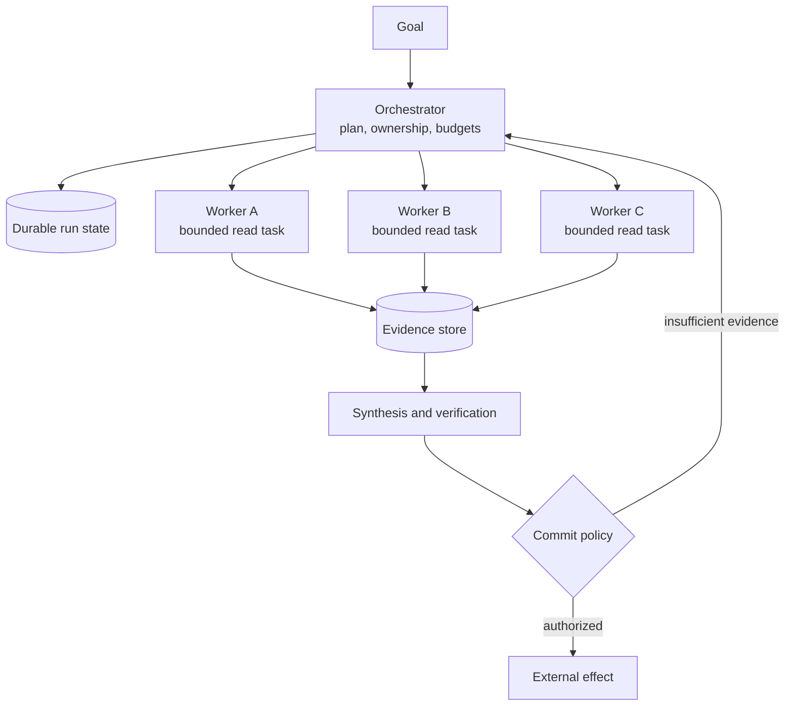

# Multi-Agent Systems

## Overview {#tl-dr}

Add a worker when it can contribute independent evidence or complete a separable piece of work. Decide who owns each write, how workers report results, and what happens when a worker times out. Those decisions determine whether parallel work helps the task finish.

For an investigation across independent sources, let workers collect evidence and give one coordinator responsibility for resolving disagreements and publishing the result. If every worker reads the same stale source, agreement adds little confidence. If workers must edit the same record, define who can commit and how stale writes are rejected.

Compare the team with one worker on the same tasks. Measure verified completions by deadline and total cost, including the coordinator's work combining results. That comparison shows whether the extra workers earn their place.

---

## The Decision Before the Architecture

A team can spend its extra calls in three ways.

1. Sample several answers to the same question and select one.
2. Assign separate tasks such as retrieval, editing, and verification.
3. Let a worker propose additional tasks as it discovers new evidence.

Sampling helps when candidates make different errors. Specialization helps when the handoff carries enough information. Delegation helps when the task requires more search than one worker can perform within its deadline.

Estimate the incremental value over a single worker in common units, such as expected cost per incoming task.

$$
V_{multi} = \Delta Q \cdot V_{outcome}
            + \Delta T \cdot V_{time}
            - C_{tokens}
            - C_{tools}
            - C_{coordination}
            - E[L_{failure}],
$$

Here $\Delta Q$ and $\Delta T$ measure the change in quality and time saved relative to the baseline. Price the extra tokens, tools, coordination, and expected harm on the same workload. Count only incremental costs and avoid charging for a failure already included in the quality term.

### Workload shape matters

| Workload | Likely architecture | Reason |
|---|---|---|
| Breadth-first research over independent sources | Orchestrator plus parallel researchers | Retrieval dominates. Evidence can be unioned and deduplicated. |
| Large read-only audit | Partitioned reviewers plus one synthesizer | Read sets overlap safely. Findings retain file/source coordinates. |
| One tightly coupled repository change | One writer, optional read-only investigators | Design intent and mutable state are shared. Semantic merge conflicts dominate. |
| Independent services with versioned interfaces | Owner per service plus contract/integration stage | Write sets are separable and integration has an executable boundary. |
| Classification with weak single-sample accuracy | Ensemble only after correlation analysis | Voting may help, but shared errors can erase the theoretical gain. |
| High-impact decision with no ground truth | Human decision support | More model opinions do not create authority or truth. |

Give the single worker the same tools, verifier, and total token allowance. Record the deadline success rate for both systems. This reveals whether gains come from dividing the work or simply from buying more inference.

## Architecture Topologies

### Orchestrator–worker



Give the orchestrator ownership of the plan and the final decision. Workers return findings, source revisions, unresolved questions, and receipts for any permitted actions. The owner verifies those results before committing a change.

Keep routine scheduling in code. A completed dependency can release a task immediately. Call the planner again when a finding changes which work is worth doing.

### Pipeline

A pipeline suits ordered operations with stable intermediate artifacts, such as extracting fields, normalizing them, and checking the result. Separate prompts can run inside a single workflow.

If stage $i$ misses a defect with unconditional probability $e_i$ and those failure events are independent, the probability of at least one miss is

$$
P(error) = 1 - \prod_i (1-e_i).
$$

Two stages using the same stale document can both miss the same defect. Estimate end-to-end failures on complete tasks and inspect which misses occur together before relying on an independence model.

Pass the original source revision along with derived facts. If verification finds a bad extraction, invalidate that artifact and repeat only the dependent work.

### Blackboard

Use a shared board when a new finding can advance several investigations. Store each contribution with a stable ID, source revision, author, and evidence. Readers can then distinguish a new observation from a correction.

Append contributions or require the expected revision on updates. Subscribe workers only to records relevant to their assignment. Waking every worker for every update can spend the entire run budget on repeated reviews.

### Peer-to-peer and federated agents

Across organizations, each service controls its own workers and credentials. Agree on task identity, supported versions, deadlines, status queries, cancellation, and how the caller can retrieve a verified result.

A remote worker may finish after the client's connection drops. Persist the remote task ID, query its status, validate the returned artifact, and record the result locally. Allow for duplicate deliveries and incompatible versions at the handoff.

### Debate, critique, and ensemble topologies

Use critique when reviewers can test competing claims against different evidence. A blinded initial review limits copying. Common sources and model behavior can still correlate the errors.

Ask each reviewer for a claim, source, and reason it might be wrong. Have the adjudicator inspect the original artifacts. Stop when the evidence resolves the disagreement or the remaining budget cannot buy another useful check.

## The Core Control-Plane Model

Represent dependencies as a task graph. Adding a new task can preserve acyclicity. An intentional revision loop needs a bound and an explicit condition for exit. Record the following entities.

- **Run:** original goal, principal, tenant, policy snapshot, global deadline, and budget.
- **Task:** logical unit of work, input contract, dependencies, read/write sets, success predicate, and owner.
- **Attempt:** one execution of a task with a lease, worker identity, start/end times, model/tool versions, and outcome.
- **Artifact:** immutable, content-addressed output with schema and provenance.
- **Claim:** an assertion linked to supporting or contradicting evidence.
- **Commit:** authorized transition from proposed artifact or action to authoritative state.

Keep the same task ID across retries and assign a new attempt ID and lease generation on reassignment. An expired lease means the worker lost its authority to commit. It may still be computing or have a write in flight.

### Dynamic decomposition

Before admitting a new task, the scheduler checks that

- every task has a bounded objective and output schema
- dependencies exist and do not introduce an unintended cycle
- the task's estimated reservation fits remaining budget and deadline
- its requested tools are permitted for the run principal
- its read and write sets do not violate ownership rules
- its result has an identified consumer or verifier.

Reserve resources atomically with admission. A burst of simultaneous requests must see the same enforced run limit even when several workers propose children at once.

### Hierarchical budgets

For an additive resource such as tokens or spend, reserve part of the parent's budget for its own work and for recovery.

$$
B_{parent} \ge B_{self} + \sum_j B_{child,j} + B_{reserve}.
$$

Track additive resources and concurrent capacity separately. A child consumes spend, occupies a worker slot temporarily, and runs against a shared deadline. Charge retries to the same parent and return unused reservations after the attempt settles.

If the parent has 30 seconds left and needs five seconds for synthesis, give parallel children at most 25 seconds each, including queue time. Measure whether five seconds actually covers synthesis on large result sets.

## State Ownership and Consistency

For each kind of state, identify who may change it and how a reader detects that its copy is stale.

| State | Typical owner | Consistency requirement |
|---|---|---|
| Goal, plan, task graph | Orchestrator | Linearizable or single-writer revision history |
| Worker scratch context | Worker | Private, disposable after result publication |
| Evidence and artifacts | Producing worker, then immutable | Content-addressed, append-only metadata |
| Shared derived view | Deterministic reducer | Rebuildable from events/artifacts |
| User-facing draft | One designated writer | Optimistic version or serialized commits |
| External side effects | Policy-authorized committer | Idempotency plus reconciliation |

### The one-writer default

Allow several workers to propose changes while one owner commits against the current revision. This works well for a document, configuration, or repository whose correctness depends on choices across several files.

Require patches to name their base commit, affected interfaces, and tests. Apply them to the current base and run integration checks. Two edits on different lines can still disagree about the meaning of a field.

### Partitioned writers

Give each writer a resource namespace and a versioned interface. A change that crosses the boundary requires a decision by the affected owners before either side publishes an incompatible revision.

Suppose worker A holds generation 7, pauses, and resumes after B takes generation 8. The destination must atomically check the current generation with the write, or enforce a monotonically increasing fencing token that rejects A once it has accepted B's newer token. An orchestrator-side lease check alone leaves a race. If the destination cannot fence writes, route mutations through a committer that can. Use expected revisions to prevent lost updates within an authorized generation. [Chubby design, section 2.4](https://research.google/pubs/the-chubby-lock-service-for-loosely-coupled-distributed-systems/)

### Event sourcing and projections

Record transitions such as `TaskAdmitted`, `AttemptStarted`, `ClaimRetracted`, and `CommitApplied`. Version the events and retain the inputs required to rebuild state under the applicable retention policy.

A dashboard can display a lagging projection. A commit must check the authoritative task and resource revisions. Otherwise a worker can publish after cancellation while its dashboard still shows the task as open.

## Communication Semantics

Keep operational fields in a versioned envelope so the receiver can process duplicates and late messages before interpreting the prose.

```text
message_id, schema_version, run_id, task_id, attempt_id
sender, authenticated_principal, recipient
kind, created_at, expires_at, correlation_id
payload_ref_or_inline_payload, content_hash
trace_context, priority, expected_base_revision
```

Validate the payload schema, authenticate the sender independently of its claimed identity, and check the task revision before accepting the message.

### Delivery guarantees

A worker may lose its acknowledgement after committing. Make redelivery safe at the consumer.

1. Receive the message and start a database transaction.
2. Insert its ID into an inbox protected by a unique constraint. On a committed duplicate, skip the state change.
3. For a new message, apply the local transition and insert outbound events into the outbox in the same transaction. Acknowledge the incoming message after commit.
4. Publish outbox records asynchronously. A relay crash after publication can cause another delivery, so the next consumer needs its own duplicate handling. [AWS transactional outbox guidance](https://docs.aws.amazon.com/prescriptive-guidance/latest/cloud-design-patterns/transactional-outbox.html)

Maintain ordering per task with a sequence number or expected revision. Preserve late results for diagnosis and prevent cancelled or superseded attempts from changing current state.

### Context transfer is lossy compression

Send each worker the goal, scope, source revisions, relevant prior decisions, budget, and acceptance test. Include the condition for returning control when the assignment turns out to require information or authority it lacks.

A useful result separates these fields.

- observed facts with source coordinates
- inferences and their premises
- proposed changes
- uncertainty and missing evidence
- actions performed and their receipts
- a compact result intended for the parent context.

Link every material claim in the synthesis back to the original source. If two workers paraphrase the same passage, count it as one source.

### Backpressure and overload

Bound queued work by tenant, worker pool, deadline, and remaining provider quota. Under overload, remove optional speculative tasks first. If required tasks cannot finish in time, reject the run or offer an explicitly partial result.

Reserve enough capacity to serve interactive requests and settle uncertain operations during saturation. Track runnable children per parent to catch a single plan exhausting the fleet.

## Scheduling and Straggler Control

When all children must finish, the join waits for $\max_i L_i$. Look at both queue wait and execution time for the last required child. Adding workers will not shorten a shared provider queue that is already saturated.

Choose a response that preserves the task's acceptance criteria.

- use partial joins when missing branches reduce coverage rather than invalidate the answer
- split oversized tasks using observed cost, not equal item counts
- speculatively duplicate only idempotent, high-tail read tasks and accept the first valid result
- cancel redundant attempts and account for leaked provider work
- reserve synthesis time and stop admitting children near the deadline
- checkpoint long searches so a replacement worker resumes rather than starts over.

Estimate task size from observed tool use, token counts, and duration for similar cases. When one oversized partition dominates the join, test a split by estimated cost and include the extra merge time in the result.

## Reliability and Recovery

Classify the failure before spending another attempt.

1. **Infrastructure:** process loss, queue outage, provider timeout, quota rejection.
2. **Protocol:** duplicate, stale, malformed, or unauthorized messages.
3. **Semantic:** plausible but incorrect work, ignored constraint, incompatible outputs.
4. **Coordination:** missing dependency, cyclic delegation, inconsistent commit, orphaned child.

Back off on transient infrastructure faults within the original deadline. A timeout after dispatch requires reconciliation. An exhausted quota needs new capacity or a later admission time. Invalid messages and bad reasoning need corrected input or new evidence.

On restart, reload the task graph and check the durable status of active attempts. Reassign eligible work under a new lease, query uncertain external actions, and trace children whose parent has stopped. Count post-cancellation work until it settles.

### Sagas for external effects

For a multistep business operation, persist each committed effect and the action that can remedy it. A reserved item may be released. An already delivered message may require a correction. Give compensations stable IDs and surface any compensation that fails.

## Security and Trust Boundaries

Delegate the user's authority only for the assigned task, resource, tenant, and time window. Keep broader credentials at the tool boundary and give each worker an independently revocable capability.

A handoff can contain private data or instructions copied from an untrusted source. Check the receiving worker's scope and permitted destinations before exposing the payload or authorizing an action.

Pass artifact references with access controls when a worker needs only selected records. Redact traces and retain sensitive payloads only for their documented purpose and lifetime.

Bind an approval to the proposed effect and the destination revision. If a worker changes the recipient or document after approval, the committer must request authorization for the revised action.

## Evaluation and Observability

Measure whether extra workers improve the user's outcome and whether the system recovers when one disappears.

At the component level, inspect decomposition, source coverage, worker accuracy, and verifier error rates. At the coordination level, interrupt workers and inject duplicates, stale writes, and delayed responses. At the task level, measure verified completion by deadline, spend, and required human correction.

Run paired cases against these alternatives.

- best single agent with equal total token budget
- orchestrator without parallelism
- workers without role-specific prompts
- smaller fan-out
- no debate or no second review
- deterministic decomposition where available.

Compare designs at a common quality target and deadline. Report when added coverage is worth its incremental cost and where another branch only adds latency.

Trace the run, task, attempt, generation, action, artifact, verification, and commit with their revisions. Record the lease generation, retry cause, policy decision, and queue times. Keep observable evidence and protect sensitive payloads.

Break results down by task type, tenant class, and tool. Include

- useful completion rate and verified completion rate
- tasks, attempts, and retries per run
- fan-out and active-agent concurrency distributions
- queue wait, worker time, join wait, synthesis time, and end-to-end percentiles
- tokens and currency per successful run, not merely per call
- stale-result, duplicate-message, orphan-attempt, and write-conflict rates
- verifier disagreement, human override, and unsupported-claim rates
- cancellation acknowledgement and post-cancellation spend.

When task deadlines start failing, compare completed and timed-out runs for the same task class. Locate the last required child, then check its queue wait, execution, and synthesis time before changing concurrency.

## Failure Modes

**Duplicate investigation.** Several workers return the same source. Deduplicate evidence and compare with an equal-budget single-worker run.

**Lost constraint.** A delegated decision contradicts an accepted requirement. Check whether the task packet contained the applicable revision and acceptance criteria.

**Conflicting edits.** Two patches pass local checks but break a shared interface. Require a common base and an integration check at commit.

**Correlated error.** Independent prompts cite the same outdated source. Verify freshness at the source before accepting consensus.

**Recursive fan-out.** The queue fills with descendants while verified completions fall. Limit outstanding children at admission and reserve time for synthesis.

**Stale writer.** A replaced attempt publishes late. Inspect the destination's fencing decision and reject stale generations at the write boundary.

**Orphaned child.** Work continues after cancellation. Trace live attempts by parent and reconcile writes already dispatched.

**Ambiguous acknowledgement.** A message says “done” without a receipt. Check the typed outcome and verify the artifact before advancing.

**Lost contribution.** Two updates replace the same board revision. Append independent findings or require a compare-and-swap on the revision.

**Unsupported approval.** A reviewer sees only the writer's conclusions. Give the reviewer independent access to the relevant sources.

**Slow join.** Timely branches wait for one required result. Check the coverage contract before making that branch optional.

**Excess authority.** A child inherits the parent's unrestricted tool access. Scope credentials to the child task and recheck each external action.

## Decision Framework

Use observed workload behavior to choose whether a second worker earns its cost.

| Evidence from the workload | Design consequence |
|---|---|
| Workers need different sources and can return traceable findings | Trial parallel readers against an equal-budget single investigator. |
| Writers regularly change a shared contract | Assign one commit owner until the interface and its verification are stable. |
| Multiple candidates repeat the same errors | Change the evidence or evaluation. Measure whether another sample adds value. |
| A reviewer can detect material defects at acceptable cost | Use the review at the commit boundary and measure misses. |
| A tool lacks a safe recovery path after dispatch | Restrict autonomous retries and assign a reconciliation owner. |
| Required children often miss the synthesis cutoff | Reduce task size or fan-out. Make results optional only if partial coverage is acceptable. |

Match the topology to the state that workers must share.

- central authoritative goal and coupled output → orchestrator–worker
- stable ordered transformation → pipeline
- opportunistic independent contributions → versioned blackboard
- organizational boundary → federated peer protocol
- independent hypotheses plus external verifier → ensemble or debate.

Before rollout, interrupt a worker between its last external write and its acknowledgement. Show that the replacement can finish within budget and that exactly one authorized logical effect is recorded at the destination. If that guarantee cannot be enforced for a tool, restrict its retry behavior and expose the unresolved state.

## Key Takeaways

- Give workers independent responsibilities, a shared view of relevant source revisions, and a named owner for every commit.
- Keep task identity stable across attempts and enforce lease generations at the destination.
- Reserve spend before fan-out and leave enough time for the slowest required child and synthesis.
- Exercise duplicate messages, uncertain writes, and cancellation after dispatch in recovery tests.
- Judge the team on verified outcomes relative to a single worker with the same resources.

## References

- [How We Built Our Multi-Agent Research System](https://www.anthropic.com/research/multi-agent-research-system): orchestrator–worker research architecture and token economics
- [Don't Build Multi-Agents](https://cognition.ai/blog/dont-build-multi-agents): the context-sharing and coherence counterargument
- [AutoGen: Enabling Next-Gen LLM Applications](https://arxiv.org/abs/2308.08155): multi-agent conversation framework
- [MetaGPT: Meta Programming for Multi-Agent Collaborative Framework](https://arxiv.org/abs/2308.00352): role- and artifact-oriented collaboration
- [Improving Factuality and Reasoning in Language Models through Multiagent Debate](https://arxiv.org/abs/2305.14325): debate as an inference strategy
- [Model Context Protocol specification](https://modelcontextprotocol.io/specification/): agent-to-tool/context interoperability
- [Agent2Agent Protocol specification](https://a2a-protocol.org/latest/specification/): inter-agent task and artifact exchange
- [Designing Data-Intensive Applications](https://dataintensive.net/): logs, replication, consistency, and distributed coordination foundations
- [Temporal documentation: durable execution](https://docs.temporal.io/): replay, activities, retries, signals, and workflow versioning

---

## Related Chapters

- [LLM Agent Fundamentals](01-agent-fundamentals.md): each worker still has to satisfy the single-agent tool loop, budget, and termination contract
- [Agent Orchestration Patterns](02-orchestration-patterns.md): the single control plane that most multi-agent designs should exhaust before splitting
- [Context Management](08-context-management.md): context is the scarce resource the moment workers exchange state through prompts
- [LLM Infrastructure](05-llm-infrastructure.md): a shared GPU budget turns worker fan-out into a queueing and admission problem
- [Durable Execution and Workflow Engines](../18-workflow-job-systems/04-durable-execution-workflow-engines.md): deterministic replay versus probabilistic re-execution when a worker dies mid-effect
