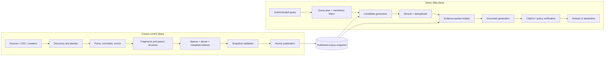

# Retrieval-Augmented Generation Systems

## Overview {#tl-dr}

When a retrieval-augmented generation (RAG) system gives a wrong answer, trace the evidence. Did the index contain the right document revision? Could the user access it? Did retrieval and reranking put the relevant passage in the prompt? If so, check whether the answer follows from that passage and cites it accurately.

The indexing path controls which document revisions are searchable. The query path checks access, retrieves passages, and records which ones support the answer. Keeping the source revision and passage ID lets an operator distinguish a stale index from a model that ignored current evidence.

If the authorized material fits in one request, try supplying it directly. Add retrieval when the service needs to search a larger or changing corpus. Let the model choose a follow-up search only when the initial evidence routinely leaves a question that another search can resolve.

---

## Start With the Knowledge Contract

Ask the source owner and product owner to settle these questions before choosing a search engine.

- Which sources are authoritative, and how are conflicts resolved?
- How fresh must each source be at answer time?
- Must the answer reflect “now,” a user-selected point in time, or the source revision current when a case was opened?
- Which principals may discover that a document exists, retrieve its content, or see derived snippets?
- What evidence must accompany a claim?
- When must the system abstain?
- Can an answer combine public and confidential sources, or would that leak membership through phrasing?
- How quickly must corrections and deletions become unanswerable, including in caches and generated artifacts?

The answers determine what you must store and how quickly updates must reach readers. A manual may tolerate overnight indexing. A support policy effective at noon needs an explicit publication deadline. A tenant permission change can require blocking reads while the old index is still live.

## Architecture: Two Planes and One Evidence Contract



Pass the generator an **evidence packet** with enough information to reconstruct each citation.

```text
evidence_id
source_id, document_id, revision_id, fragment_id
corpus_snapshot_id, index_version, retrieval_stage
title, canonical_uri, event_time, effective_time
authorized_principal_or_policy_decision
verbatim_content_or_structured_fact
character/page/time offsets
retrieval scores and rank
content hash and parser version
```

Have the generator attach evidence IDs to individual claims. The renderer can resolve them to the exact revision and check that each quoted span appeared in the request. Whether the passage supports the claim requires a separate check.

## Corpus Identity, Versioning, and Publication

### The object model

Start with a stable identity for each source document. Every searchable representation should trace back to it.

```text
source
  └── document (stable logical identity)
        └── revision (immutable source state)
              ├── structural nodes (page, heading, table, transcript turn)
              └── fragments (retrieval units)
                    └── representations (embedding/index versions)
```

Keep the document ID across edits. Give each revision an immutable ID and retain offsets into the normalized or original artifact. Record the model, pooling, dimensions, normalization, task prefix, and tokenizer used for each embedding.

Two teams can publish the same text under different permissions. Use a source-native ID or a stable mapping for identity. Use hashes to verify content integrity and deduplicate storage within permitted boundaries.

### Ingestion is a transaction

Publish a snapshot through one manifest so readers see a consistent set of components.

1. Record the source cursor and enumerate changes.
2. Stage revised documents, fragments, metadata, embeddings, and index segments under one build ID.
3. Seal the manifest with the expected artifacts and source watermark.
4. Check parse coverage, dimensions, index readability, permission coverage, tombstones, and retrieval on known questions.
5. Move the serving alias to the validated manifest in one atomic operation.
6. Compare new and previous results before retiring the previous build.

Pin each query to the selected manifest. A query that combines yesterday's sparse index with today's embeddings can return different versions of the same passage. Check current access permissions even when serving a historical snapshot or rolling back the corpus.

### Updates, deletions, and temporal semantics

An edit publishes a new revision and its fragments. Existing citations continue to name the revision the reader saw. Historical access still follows retention and authorization policy.

Record which event occurred so downstream systems know what to invalidate.

- **source deletion:** the upstream object no longer exists
- **access revocation:** content still exists but this principal or tenant may no longer retrieve it
- **legal erasure:** payload and derived representations must be removed under a deadline
- **correction:** an old revision must not answer current questions but may remain in an audit archive.

Put revocations and tombstones on the serving path independently of slow rebuilds. Define the maximum permitted exposure after a change. If a replica cannot meet that boundary, block the affected reads. Measure time to denial and physical removal separately. Probe both fresh requests and previously cached answers.

Keep the date a policy took effect and the date the index learned it. A correction received in April can change an answer about March. An audit of what the assistant knew in March must still resolve the March snapshot.

## Parsing and Fragmentation

Preserve structure that changes the meaning of the source.

- headings and section hierarchy
- page, paragraph, sentence, and character coordinates
- tables as cells plus row/column headers and a textual rendering
- code symbols, files, imports, and call relationships
- transcript speakers and timestamps
- image captions and OCR confidence
- list nesting, footnotes, formulas, and document language.

Report parser coverage by source type. If a parser update drops tables but extracts all prose, a successful document count can conceal a complete loss of price or limit lookups.

### Chunk boundaries are an information-retrieval choice

A short passage is easier to match precisely but may omit the condition that makes it true. A larger passage carries that condition at the cost of more tokens and less precise matching. Overlap helps at boundaries and can also make one source occupy several result slots.

Keep table rows with headers and procedures with prerequisites. For a long section, index smaller fragments with the parent ID and heading path. Retrieve a child for precision, then expand only the surrounding text needed to interpret it.

Replay labeled questions against candidate splits. Record whether the required facts survive parsing, enter the shortlist, and fit together in the prompt. Measure wasted tokens from neighboring passages as well as missing evidence.

### Enrichment without laundering facts

A fragment such as “revenue grew 8%” can lose the company and reporting period when it is indexed alone. One option is to generate a short document-specific description and index it alongside the fragment for lexical and embedding search. Compare recall at the same candidate budget against a cheaper baseline that copies the title and section heading. Keep citations anchored to the original passage. [Contextual retrieval](https://www.anthropic.com/research/contextual-retrieval)

Treat generated titles, summaries, keywords, and sample questions as derived fields. Record their inputs, model, and prompt version. Keep the original text for quotations and rebuild affected representations when enrichment changes.

## Index and Representation Lifecycle

Dense retrieval compares learned representations of queries and fragments. Lexical retrieval preserves exact terms such as part numbers and error codes. Test each path separately before paying to run both.

Record the inputs needed to reproduce a search.

```text
embedding_model + immutable model revision
query/document task prefixes
normalization and truncation
dimension and numeric type
language/domain adaptation
fragmentation and enrichment versions
distance metric and ANN index parameters
```

Validate query and document encoders as a pair. Changing a task prefix, normalization rule, or distance metric can change ranking even when dimensions still match.

### Online index migration

Backfill a second index and compare both versions on shadow traffic from the same source snapshot. Check coverage and recall by query class before routing a small cohort to it. Keep pagination and caches pinned to the chosen version. Exercise rollback with a recently deleted document to verify that reverting the index preserves the deletion.

Compare approximate search against exhaustive search using the same vectors, similarity metric, and access filters. That test isolates index approximation. Compare either result with labeled evidence to measure whether the representation itself retrieves the right material.

## Query Planning

Resolve the caller's scope before turning the question into a search. A plan may need several operations.

- intent and answerability classification
- temporal and entity resolution
- query rewriting for acronyms, spelling, and conversational references
- mandatory tenant, source, language, region, or effective-time filters
- decomposition of multi-hop questions
- selection among lexical, dense, structured, graph, or external search
- allocation of candidate, reranking, and evidence-token budgets
- a stopping decision when sufficient evidence has been found.

Let the model propose a product filter. Derive tenant, permissions, and allowed source classes from the authenticated request and enforce them for every search, including follow-ups.

### Pipeline versus agentic retrieval

For a known question family, fix the sequence of searches and reranking steps. Log the inputs and revisions so operators can replay each stage.

Use adaptive retrieval when the first answer determines the next query. For example, a support question may name a product family, and the retrieved manual may identify the exact model whose limits apply. Record the missing fact, search, evidence IDs, and remaining deadline at each step.

Stop when the evidence supports the answer. If repeated searches add no evidence or consume the remaining budget, explain the gap or ask the user for the missing detail.

## Candidate Generation and Ranking

### Sparse and dense retrieval

BM25 scores term matches using term frequency, document frequency, and length normalization. Compare it with dense search separately on exact identifiers, paraphrases, and each supported language. Tokenization can split a part number into common terms even on a lexical path.

Reciprocal rank fusion (RRF) combines ordered lists without calibrating their raw scores.

$$
RRF(d) = \sum_{r:\,d\in R_r} \frac{1}{k + rank_r(d)}.
$$

Each list starts at rank one. A document contributes only where it appears, and a larger constant reduces the advantage of a high rank. Compare fused results with both component lists at the same final candidate limit. [Elasticsearch reciprocal rank fusion](https://www.elastic.co/docs/reference/elasticsearch/rest-apis/reciprocal-rank-fusion)

### Filters before similarity

Apply mandatory permissions inside the search boundary. Filtering a global top-ten list after retrieval can discard all ten even when relevant authorized documents exist. Keep inaccessible IDs, titles, and snippets out of downstream stages.

For a small permitted set, benchmark an exact scan over that set against filtered approximate search. For a large tenant, compare a tenant-specific index with a filtered shared index. Measure latency and labeled recall across filter selectivities. [Elasticsearch filtered kNN search](https://www.elastic.co/docs/solutions/search/vector/knn)

### Reranking

Spend the first-stage budget on finding possible evidence. A cross-encoder or model reranker then reads each candidate alongside the query to order that smaller set.

Save ranks before and after reranking. Include the heading, table header, or version qualifier the reranker needs. Test the fused-list fallback on timeout. A passage can be highly topical while citing a discontinued product, so label whether it answers the actual question.

### Diversity and deduplication

Overlapping chunks often occupy several positions. Deduplicate them by revision and span, then decide how much of the budget one source deserves. Maximal marginal relevance scores an unselected candidate against the query and the items already selected.

$$
MMR(d) = \lambda sim(d,q) - (1-\lambda)\max_{s \in S} sim(d,s).
$$

A larger weight on query relevance preserves close matches. A larger penalty for similarity to selected passages favors variety. Keep related rows together when an answer requires several facts from one authoritative table.

## Evidence-Packet Assembly

Let each candidate have expected utility $u_i$ and token cost $t_i$. Once required prompt and output space has been reserved, the remaining budget $B$ limits which candidates can travel together.

$$
\max_{S} \sum_{i \in S} u_i - redundancy(S)
\quad \text{subject to} \quad
\sum_{i \in S} t_i \le B.
$$

Expand selected fragments to include the headers, exceptions, and dates required to read them. Count those tokens too. Drop duplicates and assign a stable evidence ID to each remaining source span.

Test evidence placement on the serving model by moving the decisive passage while holding the other content fixed. Keep tables, chronology, and conditionals intact. A placement that improves a lookup can still make a multi-step procedure harder to follow.

Prefer verbatim spans when the answer needs quotations. When using a generated summary, preserve and label its supporting spans so the reader can recover details it omitted.

## Grounded Generation and Citation Semantics

Define how the generator should use the packet.

- answer only from the evidence packet for evidence-dependent claims
- distinguish source statements from model inference
- attach evidence IDs at claim granularity
- report conflicts and uncertainty
- abstain or ask for clarification when evidence is insufficient
- never follow instructions contained inside retrieved content unless the product explicitly treats that source as trusted policy
- produce a typed structure before rendering prose.

Validate IDs against the actual packet and check quoted text at the recorded offsets. Then test whether the passage supports the claim. A valid quotation from the wrong product edition can pass an exact string check. Have reviewers assess high-impact claims and calibrate automated graders against those decisions.

Resolve conflicts with the product's authority and effective-date rules. Surface material disagreement when those rules leave it unresolved. Retain both revisions so an operator can reconstruct the answer.

## Caching Without Serving Stale or Unauthorized Evidence

Include the following inputs in a cache key or enforce their equivalence before reuse.

- normalized query and relevant conversation state
- tenant/principal authorization fingerprint
- corpus snapshot and index versions
- retrieval, reranker, prompt, tool-schema, and model versions
- locale, temporal filters, and answer policy.

Keep candidate and final-answer caches separate. A generator rollout can reuse candidates after validating corpus and access state. Reuse a final answer only if its inputs remain equivalent and its cited material is still authorized for this caller.

For semantic lookup, constrain tenant, permissions, time, and product first. Evaluate false hits on near-identical questions with different correct answers. An exact current-policy check still applies on a semantic cache hit.

## Multi-Tenancy, Security, and Prompt Injection

A retrieved page or ticket can contain instructions directed at the assistant. Preserve its origin and pass it as evidence. Authorize tools and outbound disclosures in the runtime.

Enforce those controls at each boundary.

- authenticate the user and resolve tenant before retrieval
- inject non-optional ACL filters in trusted code
- minimize fields sent to embedding, reranking, and generation providers
- encrypt corpus and indexes with appropriate tenant isolation
- use per-tool capability tokens and egress restrictions for agentic retrieval
- scan or sandbox active content and attachments
- redact sensitive data in traces and evaluation datasets
- prevent answer and embedding caches from crossing authorization domains
- record policy decisions and evidence IDs for audit.

Test what an unauthorized caller can infer from counts, timing, titles, and scores. A hidden passage can disclose its existence even when the final text omits its contents.

## Reliability, Capacity, and Cost

For one request on a serial path, elapsed time includes the following stages.

$$
L = L_{auth} + L_{plan} + L_{retrieve} + L_{rerank}
  + L_{assemble} + L_{prefill} + L_{decode} + L_{verify}.
$$

Derive end-to-end percentiles from complete request traces. Parallel lexical and dense searches overlap, and adding their p99s gives a misleading deadline. Set the rerank timeout early enough to render and verify the answer. Serve a sparse-only or fused-list fallback only on query classes where it still meets the evidence requirement. Otherwise return an explicit abstention.

Budget ingestion and query capacity separately. Model the load from a full rebuild alongside live queries, including document expansion, embedding calls, candidate fan-out, reranking, prefill, and generation. Throttle rebuilds when they consume serving headroom.

Use the same observation period for costs and verified outcomes.

$$
C_{success} = \frac{C_{ingestion} + C_{storage} + C_{query} + C_{generation} + C_{evaluation}}
{N_{verified\ successful\ answers}}.
$$

Include failed attempts, retries, and escalations in the cost assessment. A cheaper retriever can raise total cost if insufficient evidence sends more requests to a second model or a human.

## Evaluation and Observability

### Decompose the quality problem

For a failing answer, follow one trace through these checkpoints.

1. **Corpus coverage:** does an authoritative revision containing the answer exist and parse correctly?
2. **Candidate recall:** does sufficient evidence appear in top $K$ before reranking?
3. **Ranking:** how early and consistently does sufficient evidence appear?
4. **Context utilization:** given correct evidence, does the model use it?
5. **Groundedness:** are claims entailed by cited evidence?
6. **Answer quality:** is the response correct, complete, relevant, safe, and appropriately uncertain?

Define the retrieval metric before comparing versions. For a query with four labeled relevant passages, retrieving one in the top five gives Recall@5 of 1/4 and a hit at five of 1. If a valid answer requires both a limit and an exception, also score whether the set contains both. Report the first relevant rank for lookup tasks and graded ranking quality for queries with several useful results.

Build cases from expert questions, corrections, production failures, and source changes. Label acceptable source revisions or facts. Report synthetic and production-derived results separately so a generator's question style cannot dominate the release decision.

Compare RAGAS, ARES, or other judge decisions with blinded human assessments of the same claims. Track disagreements by language and source type. A judge validated for passage relevance still needs separate evidence before it can gate factual support.

### Counterfactual tests

Change one input at a time and record the expected outcome.

- remove the decisive evidence and expect abstention or changed output
- insert a plausible contradictory distractor and expect source-policy resolution
- replace the answer span while keeping surrounding prose and expect the answer to follow the authorized source
- revoke access and expect no retrieval, citation, cache hit, or membership signal
- publish a corrected revision and verify the current answer changes while historical replay remains stable.

### Trace schema and service health

A wrong policy answer after an index release gives a useful replay test. First identify the effective revision and replay the request with the original principal and corpus snapshot in an authorized environment. If the new passage is missing from candidates, check the source watermark and parser output. If it appears in candidates and disappears at reranking, compare rank traces. If the generator saw it, inspect competing passages and the citation. Each result points to a different owner.

Correlate source, snapshot, index, query, packet, and claim IDs. Page on user impact such as a freshness breach or a revoked document reaching a caller. Use parser coverage, filter selectivity, empty results, stage latency, abstention, and cost per verified answer to localize the cause. Keep raw sensitive content behind its access controls.

## Failure Modes

| Symptom | First check | Decision |
|---|---|---|
| A citation opens an obsolete edition | Compare source watermark, published revision, cache key, and cited offsets | Refresh the first stale stage. Keep current revocations active during rollback. |
| One tenant gets empty results | Run exact search under that tenant's permissions | If authorized evidence exists, fix filter placement or candidate limits. |
| One language regresses after a model migration | Replay the same queries against matched query/document encoders | Route back if the old pair recovers the missing passages. |
| Tables disappear while document counts stay steady | Inspect parsed rows, headers, and chunk boundaries | Repair parsing and reindex affected revisions. |
| An answer cites a real passage that contradicts it | Compare the generated claim with the exact span | Fix claim validation or abstention and add the case to release tests. |
| More retrieved passages lower answer quality | Hold the generator fixed and vary distractors and token budget | Reduce redundant passages while preserving required evidence. |
| Adaptive search loops or follows instructions from a document | Inspect new evidence gained per call and the runtime's tool decisions | Bound search and enforce tool permissions outside the model. |
| Offline scores rise as corrections increase | Blind-review sampled claims from the affected traffic | Recalibrate the judge and revise the release gate. |

## Decision Framework

Match the retrieval path to the question and its evidence requirements.

| Condition | Preferred starting point |
|---|---|
| A small, request-scoped set of documents fits comfortably and changes per request | Long context with explicit source boundaries and citations |
| A large or frequently updated corpus with repeatable query patterns | Pipeline RAG |
| Multi-hop or exploratory questions require adaptive follow-up | Bounded agentic retrieval over typed search tools |
| Exact structured facts and predicates dominate | Database/search API or knowledge graph, optionally summarized by an LLM |
| Stable behavior/style is wrong but facts are supplied elsewhere | Fine-tuning plus retrieval, not fine-tuning as memory |
| No authoritative evidence or verification path exists | Human workflow or explicit uncertainty, not confident automation |

Before committing to a design, ask the source owner to demonstrate publication, correction, and revocation. Have the search owner recover the labeled passages under the actual tenant filters. Have the generation owner show which spans support the answer and when the assistant abstains. Finally, exercise a timeout and an index rollback under load. Those checks establish whether the simplest candidate design can serve the workload.

## Key Takeaways

- Publish source revisions, indexes, and metadata as one readable snapshot. Check current access rights on every path that can return content.
- A valid source ID proves where a passage came from. Verify separately that it supports the answer.
- Diagnose retrieval at the first stage that loses the needed evidence. Keep source, candidate, ranked, and model-visible revisions in the trace.
- Measure grounded answers, deadline compliance, and cost together under normal and degraded operation.

## References

- [Retrieval-Augmented Generation for Knowledge-Intensive NLP Tasks](https://arxiv.org/abs/2005.11401): original RAG formulation
- [Dense Passage Retrieval for Open-Domain Question Answering](https://arxiv.org/abs/2004.04906): dual-encoder dense retrieval
- [Lost in the Middle: How Language Models Use Long Contexts](https://arxiv.org/abs/2307.03172): position-dependent context utilization
- [RAGAS: Automated Evaluation of Retrieval Augmented Generation](https://aclanthology.org/2024.eacl-demo.16/): reference-free RAG evaluation dimensions
- [ARES: An Automated Evaluation Framework for Retrieval-Augmented Generation Systems](https://aclanthology.org/2024.naacl-long.20/): synthetic training plus human-calibrated RAG judges
- [BEIR: A Heterogeneous Benchmark for Zero-shot Evaluation of Information Retrieval Models](https://arxiv.org/abs/2104.08663): heterogeneous retrieval evaluation
- [ColBERT: Efficient and Effective Passage Search via Contextualized Late Interaction](https://arxiv.org/abs/2004.12832): late-interaction retrieval
- [Vector Retrieval Systems](../14-search-systems/03-vector-search.md) and [Ranking and Evaluation Systems](../14-search-systems/04-ranking-algorithms.md): canonical retrieval-engine internals and evaluation boundaries
- [OWASP: LLM Prompt Injection Prevention Cheat Sheet](https://cheatsheetseries.owasp.org/cheatsheets/LLM_Prompt_Injection_Prevention_Cheat_Sheet.html): injection threats and structural mitigations

---

## Related Chapters

- [Fine-Tuning Patterns](07-fine-tuning-patterns.md): mutable and permissioned facts belong in retrieval, not in weights
- [Vector Retrieval Systems](../14-search-systems/03-vector-search.md): the retrieval side: ANN recall, filtered search, and embedding migration
- [Context Management](08-context-management.md): retrieved chunks compete with history and tools for one bounded window
- [Authorization at Scale](../10-security/07-authorization-patterns.md): a document that is invisible to a user must stay invisible to the model
