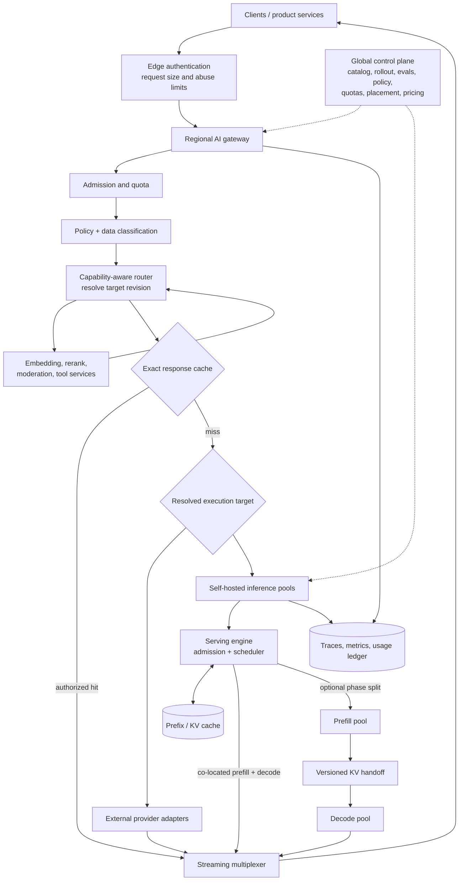

# LLM Infrastructure

## Overview {#tl-dr}

A long prompt can delay users who are already receiving a response. The server must process the incoming prompt while active streams compete for time on the same accelerator. To locate the delay, measure queue wait, time to first token, and the gaps between tokens. If those gaps widen during long prefills, test a smaller prefill chunk. Check whether active streams recover and whether new requests still meet their first-token deadline. [vLLM scheduler tuning](https://docs.vllm.ai/en/latest/configuration/optimization/)

Regional gateways admit requests and select a deployment using published model, quota, and policy settings. During a provider outage, a backup route is usable only if it supports the request's context length, tools, and policy requirements. Measure the rate of valid completions within deadline alongside cost per successful request, including failed attempts.

For device-level limits, see [GPU Inference Internals](./11-gpu-inference-internals.md). When each call is healthy but the task is slow, follow the turns and tool waits in [Agent Inference](./12-agent-inference.md).

---

## Begin With the Workload and SLO

Size the platform from requests as they arrive. Keep the following fields together so a long prompt from a busy tenant remains a long prompt in the replay.

- arrival rate by tenant, endpoint, and traffic class
- input, cached-prefix, reasoning, and output token distributions
- context length and image/audio dimensions for multimodal traffic
- streaming versus batch behavior
- tool-call frequency and inter-step think time
- model and adapter mix
- deadline, time-to-first-token (TTFT), inter-token latency (ITL), and completion SLOs
- retry, cancellation, and disconnect rates
- data residency, retention, safety, and availability requirements.

A 100,000-token repository prompt and a 1,000-token chat prompt can produce the same 150-token answer. They place different demands on the prefill queue. Preserve their arrival times and cache history when comparing schedulers.

Measure streaming latency at the client. Let $t_0$ be request submission, $t_1$ the first visible content, $t_n$ the last visible content, and $t_f$ the terminal event. When each event carries one token and $n$ tokens arrive,

$$
TTFT=t_1-t_0,\qquad T_{complete}=TTFT+\sum_{j=2}^n(t_j-t_{j-1})+(t_f-t_n).
$$

A single-token answer has zero inter-token gaps. For a stream that bundles tokens, measure the gaps between content events directly. Server-side token timings help explain a stall that the client observed. Exclude heartbeats from first-content timing, and count failures before first content in availability. [NVIDIA AIPerf metric definitions](https://docs.nvidia.com/aiperf/dev/reference/ai-perf-metrics-reference)

Count a completion as qualified when it meets the product's correctness, latency, and policy criteria. For the same cohort, compute

$$
G = \frac{N_{qualified\ completions}}{time},
\qquad
E_C = \frac{N_{qualified\ completions}}{cost}.
$$

Report offered load, rejections, and cancellations beside these rates. Dropping slow requests can improve the latency of survivors while fewer users finish.

## Reference Architecture



The edge rejects malformed, oversized, and unauthenticated traffic before it reaches a model. The regional gateway owns admission and the client stream. It resolves the capability to a deployment, reserves budget, and records the revision that served the request. Adapters translate between provider protocols and the events the client understands.

### Logical generation contract

Carry the caller's constraints through every adapter:

```text
generation_id, tenant_id, principal_id, product/use_case
requested capability and acceptable model set
messages/content references, tool-schema versions, output schema
max input/output/reasoning budgets
deadline and traffic class
data classification, residency, retention policy
idempotency key, trace context, experiment assignment
```

Emit a start event, content or tool-argument deltas, usage, and one terminal outcome. Mark completion, cancellation, and interruption distinctly. A client holding half a JSON object needs to know whether more data can arrive.

Version this contract. A request that requires strict structured output can only run on a target qualified for that schema. Reject an incompatible request at admission and record the missing capability.

## Control Plane

### Model and capability catalog

Publish the evidence a gateway needs to choose a target:

- provider/model identifier or immutable artifact digest
- tokenizer and context limits
- modalities, tool-calling, structured-output, and streaming capabilities
- region and data-handling constraints
- measured quality by evaluation slice
- latency and cost curves by input/output band
- safety policy compatibility
- rollout status, owner, and rollback target.

Resolve aliases at admission. Record the immutable revision when the provider exposes it. If it exposes only an alias, preserve the provider response metadata and monitor a fixed set of probes for behavioral drift. For multi-turn sessions, choose when a revision may change and how the harness will reconstruct compatible context.

### Evaluation-gated rollout

Replay representative requests on the candidate. Check tool selection, refusal behavior, schema validity, response length, latency, and cost alongside task success. A shorter answer can arrive faster while omitting information the task requires.

Shadow model calls only where data policy allows another copy. Simulate write-capable tools in shadow. In the canary, compare eligible sessions by assigned revision and record the revision actually used after fallback. Set abort conditions for exposed groups that would disappear in a fleet average.

### Configuration publication

Publish routes, policy, quotas, and target requirements together under one signed revision. Regional gateways keep a validated last-known-good copy so they can serve through a control-plane outage.

A consistent route table still needs ready replicas. Advertise the new route after its workers report the expected model, tokenizer, and adapter digests. During rollback, select a compatible older snapshot and check the digest on a live probe before reopening traffic.

## Regional Data Plane

### Admission control

Check whether the request is permitted, fits the target, and has enough time left to finish. Admission must reserve every resource for which accepting one more request could break another caller's guarantee:

- request concurrency
- input, cached, reasoning, and output tokens
- provider currency or internal accelerator seconds
- tool calls and retrieval fan-out
- KV-cache memory for self-hosted serving.

Use an output cap for hard commitments and a workload-conditioned estimate for capacity planning. Settle the reservation against actual usage when the attempt ends. An upstream provider may report usage after a timeout. Keep that attempt open for reconciliation.

Bound the queue by age and capacity. When it fills, shed the lowest-priority work permitted by the product contract. Shorter output, a cheaper model, and fewer candidates each change the answer. Use only alternatives already qualified for that traffic class.

### Routing is constrained optimization

First discard deployments that cannot meet hard requirements. Among the remaining targets, a router can score expected quality, latency, cost, and risk:

$$
m^* = \arg\max_{m \in M_{eligible}}
  \left[Q(m,x) - \lambda_L E[L|m,x] - \lambda_C E[C|m,x] - \lambda_R Risk(m,x)\right].
$$

For request $x$, eligibility includes context length, tool support, region, policy, health, and experiment assignment. The weights express product tradeoffs. Check predictions by traffic class against observed outcomes. An apparently cheap route can become expensive when its answers require a second attempt.

Straightforward capability rules can live in the catalog. If a classifier estimates difficulty, measure how often it sends a hard request to a weaker target. Record the candidates and chosen route so the team can replay routing changes.

### Fallback semantics

A recovery path depends on how far the request progressed. Distinguish these outcomes:

- transient connection or server failure before any output
- rate or quota rejection
- timeout before first token
- interrupted stream after partial output
- invalid structured output
- safety refusal
- semantic quality failure.

Retry transient pre-output faults only within the remaining deadline and attempt budget. Route quota failures to targets with available capacity. After the client has received content, resume from a supported checkpoint or end the stream with an interruption. Starting over silently can give the user two conflicting answers.

For each fallback pair, test the target's context budget, schema, tools, residency, and policy on the same product workload. Route refusals according to policy. Send wrong answers through the product's verification and recovery path. A healthy endpoint can still fail both contracts.

## Self-Hosted Inference Data Path

**Prefill** processes the incoming prompt and produces state for later tokens. A long prompt can keep an active stream waiting for its next decode step. **Decode** repeatedly advances active sequences. Short batches often spend much of each step reading weights. Long contexts also read substantial cached state. Measure the two phases separately before choosing the scheduling policy. [GPU Inference Internals](./11-gpu-inference-internals.md)

### Request scheduler

On each iteration the scheduler chooses which sequences advance and which prompts may enter. It needs remaining prompt work, allocated KV pages, adapter, tenant, deadline, and cancellation state. Every batching decision trades one class of work against another:

- large batches improve device efficiency
- long prefills can block decode and inflate ITL
- short-request priority improves median latency but can starve long work
- grouping by adapter or model improves locality but delays rare variants
- prefix-cache affinity saves compute but may imbalance replicas.

Start with a mixed replay. Reduce the prefill chunk if active streams stall, then check first-token latency on the longest prompts. Add fairness for rare adapters and long requests. Include swap or recomputation time when comparing a preemptive policy with early rejection.

### KV-cache management

For $L$ identical full-attention layers, $H_{kv}$ KV heads, head dimension $D$, and $b$ bytes per cache element, a sequence of $S$ tokens requires this many logical bytes:

$$
M_{KV} \approx 2 \times L \times H_{kv} \times D \times S \times b.
$$

Keys and values account for the factor of two. For hybrid attention, compute each layer's retained length and sum the bytes. Per-device allocation also depends on sharding, replication, page rounding, and speculative branches. Reserve space for active sequences to grow between admission decisions.

Paged allocation allows non-contiguous blocks and shared prefix pages. Before reusing a page, check the token prefix, model and adapter, position handling, multimodal inputs, and access domain. Charge shared blocks once for physical capacity and give each consumer a share of their cost.

### Model loading and placement

Pin model weights, tokenizer, adapters, quantization settings, generation defaults, and runtime together. A worker becomes ready after it verifies the artifact digests and completes a representative generation on the intended kernel path.

Measure cold start from allocation through readiness, including image pull, weight load, compilation, and warm-up. When load rises faster than new replicas start, keep warm headroom or reserve capacity that interruptible work can release within the deadline.

During upgrade, the old and new pools both need capacity. Stop new admissions to a draining worker, give its streams a deadline to finish, and surface interruptions when migration is unavailable. Track the cold-prefill load those sessions cause on their next turn.

### Parallelism and disaggregation

Tensor parallelism splits layer operations and adds frequent collectives. Pipeline parallelism transfers activations between stages. Expert parallelism routes tokens to the devices holding their experts. Match each exchange to measured topology and include the slowest participating device in the latency budget.

Separate prefill and decode pools can scale independently. The price is an extra queue and a KV handoff. Replay the same arrivals on split pools and on a co-located pool with chunked prefill. Compare qualified completions per accelerator at the same tail-latency targets.

## Provider-API Infrastructure

A provider operates the inference engine. The calling team still owns these boundaries:

- per-project and per-model quota allocation
- regional routing and data-handling configuration
- timeout, retry, and stream parsing
- provider-specific token accounting and price changes
- model alias drift and deprecation
- safety/retention contract mapping
- idempotency of downstream tool effects
- quality and fallback evaluation.

Separate credentials and quotas by environment and product. Enforce limits before dispatch so one tenant cannot exhaust a shared provider allocation. Where provider internals are opaque, instrument the time from dispatch to first content and from cancellation to terminal acknowledgement.

Scope a circuit breaker to the target and region showing errors. Apply backoff with jitter inside the caller's remaining deadline. Use a small half-open probe to decide when to restore the route.

Test a fallback account under realistic load before counting it as redundancy. Verify reserved quota, independent failure domains, regional data policy, tool behavior, and cost. A successful health probe establishes reachability only.

## Streaming, Cancellation, and Idempotency

The gateway assigns ordered event IDs, bounds its output buffer, and owns the terminal event. Send heartbeats when needed for idle timeouts. Decide how long a slow consumer can retain a generation before the gateway pauses it, spills buffered events, or cancels it.

Propagate a disconnect to the backend. Record when cancellation was requested and when the worker released its slots. If the provider cannot confirm it stopped, record outstanding usage as unknown until reconciliation.

Scope each idempotency key to the caller and request digest. Reject a reused key with different inputs. To rejoin a stream, check current authorization and replay retained events after the client's last acknowledged ID. If the history expired, return the documented recovery outcome.

A generation attempt and a tool effect have different identities. A client retry may need a stored result or an interrupted stream report. Only the harness can decide whether an effect still needs execution.

## Caching

Choose a cache by what the platform can safely reuse:

| Cache | Reuses | Principal risk |
|---|---|---|
| Exact response | Complete logical result | Stale policy/data, authorization mismatch, nondeterministic expectation |
| Semantic response | Similar intent result | False equivalence and cross-tenant leakage |
| Prompt/prefix KV | Prefill computation | Incorrect cache identity, memory pressure, replica imbalance |
| Provider prompt cache | Provider-side prefix work | Vendor-specific accounting and retention semantics |
| Retrieval/tool cache | Evidence or tool result | Freshness and permission changes |

For a stored answer, key the request, source snapshot, policy, variant, and model settings. Recheck access and freshness before returning it. For prefix KV, match the exact model inputs and execution format that produced hidden state. Keep stable request material together to increase the length of reusable prefixes within an authorized domain.

Measure fresh prefill tokens avoided per byte held. A high hit rate on short prompts can coexist with more expensive misses when a few large entries displace popular ones. Compare tenant quotas and size-aware eviction on the same trace.

## Safety and Policy Architecture

Authenticate the caller and determine where its data may go before routing. Bound request size and restrict retrieval and tools to the caller's capabilities. Validate generated arguments, then authorize the specific operation at the point of execution. Log the policy revision and enough decision evidence for review.

Give each policy dependency an explicit timeout outcome for each risk class. For a high-impact write, a timeout can leave the proposal pending for review. A prompt alone cannot enforce permissions on a credential or a network request. Use scoped credentials, restricted egress, and an isolated executor. [Harness Engineering](./09-harness-engineering.md)

## Multi-Region and Disaster Recovery

Place a recovery target only where its data policy permits prompts, outputs, KV, and traces. Pre-position eligible artifacts and a last-known-good configuration. Exercise the exact route clients will use after a region fails.

For a hard global spend limit, the sum of issued regional allowances must stay within the remaining budget. Partitioned regions can spend their outstanding allowance. Stop further admissions once it runs out. If each region can spend before reporting centrally, document the maximum unreported spend and cap it locally.

Run the exercise at the offered load expected after failover. Measure time to ready capacity, first successful generation, and recovery of the priority SLO. Include model loading for self-hosted pools and actual quota for provider targets.

## Capacity and Cost Engineering

For traffic class $s$, let $\lambda_s$ be arrivals per unit time. Sum the charges for every attempt serving one arrival, including retries and discarded candidates. Add fixed costs over the same unit of time:

$$
C_{rate} = \sum_s \lambda_s E\!\left[
      \sum_{a\in A_s}
      \left(T^{fresh}_{sa}c_f + T^{cached}_{sa}c_h
            + T^{output}_{sa}c_o + T^{reason}_{sa}c_r
            + C^{tools}_{sa}\right)\right] + C_{fixed,rate}.
$$

Normalize usage into disjoint billable categories before applying the price revision effective at dispatch. Cached input can be a subset of reported input, and reasoning can be a subset of reported output. Reconcile delayed or missing attempt records against provider totals.

For self-hosting, first check that the assigned hardware can hold the weights, KV, and runtime workspaces. Then replay the arrival and length distributions at the product SLO. Retain failed attempts in accelerator cost. Divide total spend by verified successes for the same cohort.

To size a failure reserve, suppose each healthy replica sustains 8 qualified requests per second at the target latency on a representative replay. Priority traffic peaks at 30 requests per second. Four healthy replicas cover the measured rate. If either zone must carry that peak by itself, place four ready replicas in each zone and test the surviving zone with cold prefixes. The arithmetic gives a starting count. The failover replay determines whether it holds.

## Observability and Operations

Link the logical request to all generation attempts, cache decisions, and tool actions in its trace. Record measurements the operator can obtain at each boundary. Provider queue, prefill, and decode times may be unavailable. Keep the combined upstream interval labeled accordingly. [OpenTelemetry GenAI conventions](https://opentelemetry.io/docs/specs/semconv/gen-ai/)

Capture these fields:

- requested capability and resolved target
- control-plane, prompt, tool-schema, and policy versions
- input/output/cached/reasoning tokens
- queue, prefill, TTFT, ITL, completion, and postprocess times
- admission, routing, fallback, retry, and finish reasons
- cache keys by hash and hit type
- safety decisions without indiscriminate sensitive payload logging
- cost estimate, actual usage, and ledger reconciliation
- cancellation time and work observed afterward.

Compare target, region, context band, and traffic class. Keep session IDs in traces so metric labels remain bounded. Sample the traces that explain long waits, excess attempts, and cancellation after dispatch.

Suppose first-content latency jumps after a canary while active streams stay smooth. If ingress queue age rises before dispatch, inspect admission and route capacity. If dispatch is prompt but fresh prefill work rises, check prefix compatibility on the new revision. Pause expansion while comparing with the control. Restore traffic only when first-content latency, rejection rate, and qualified completions recover at comparable offered load.

## Failure Modes

| Symptom | Evidence to inspect | First corrective action |
|---|---|---|
| GPU utilization rises while fewer users finish | Queue age, deadlines, cancellations, and useful completions | Bound admission and shed expired work before prefill. |
| Active streams stall when long prompts arrive | Per-iteration prefill size and gaps in delivered content | Reduce prefill chunk size and check both stream gaps and first-token latency. |
| New replicas arrive after a burst has ended | Queue growth versus measured time to ready | Keep warm headroom for bursts shorter than startup time. |
| Memory fills late in generation | Reserved and allocated KV, sequence growth, and speculative branches | Reduce admitted growth before preemption causes more prefill. |
| A fallback returns invalid tools or changes a refusal | Attempt outcome and target capability and policy revisions | Disable that route for the affected class and replay the compatibility tests. |
| A reconnect repeats or contradicts visible text | A new attempt begins after a content event was delivered | Resume retained events by ID or report an interrupted stream. |
| Only one region fails after rollout | Route snapshot and model, adapter, and tokenizer readiness | Restore the last compatible route to a ready pool. |
| Cached content is stale or belongs to another caller | Access checks, source revision, and cache domain | Bypass the affected cache and invalidate entries before restoring reads. |
| Quality shifts behind an unchanged alias | Provider metadata, canary outcomes, and pinned comparison if available | Pause expansion and route to a qualified target. |
| Sensitive content appears in traces | Payload capture setting, readers, and retention | Stop payload collection and restrict access while tracing the affected records. |

## Decision Framework

### Provider API, self-hosting, or hybrid

| Consideration | Provider API favors | Self-hosting favors |
|---|---|---|
| Demand | uncertain, bursty, many model experiments | sustained, predictable, high-volume workload |
| Capability | frontier/proprietary features | open weights, custom runtime, adapters, deterministic artifact control |
| Operations | small platform team | accelerator, kernel, scheduler, and SRE expertise |
| Data/control | contract satisfies residency and retention | strict placement, network, or artifact requirements |
| Economics | low utilization or rapid model churn | measured goodput gives lower total cost at required SLO |
| Availability | vendor quota and regional dependency acceptable | capacity can be reserved across owned failure domains |

For a hybrid deployment, specify which requests can cross the boundary, how much overflow the second target can accept, and who owns its quality and cost. Test the intended load shift with the real fallback policy.

### Design sequence

1. Define an eligible request and a successful user outcome. Collect representative arrivals, prompt lengths, output lengths, and cancellations.
2. Eliminate targets that fail policy, capability, or memory requirements. Measure remaining candidates at the deadline and quality thresholds.
3. Implement admission, routing, streaming, and recovery around the logical request. Trace every attempt and reconcile its cost.
4. Test a rollout, provider outage, quota exhaustion, and cold recovery. Use the measured failure capacity when choosing between provider, self-hosted, and hybrid operation.

## Key Takeaways

- Count qualified completions under offered load and cost per verified outcome. Include rejected requests and failed attempts in the report.
- Couple route publication to worker readiness. A gateway can hold a valid snapshot while its chosen deployment is still loading.
- Trace first content, stream gaps, terminal status, and backend cancellation independently. Each points to a different operating decision.
- Qualify every fallback for the caller's data, tools, quality, and deadline. Prove that the recovery route has capacity before relying on it.

## References

- [Orca: A Distributed Serving System for Transformer-Based Generative Models](https://www.usenix.org/conference/osdi22/presentation/yu): iteration-level scheduling and selective batching
- [Efficient Memory Management for Large Language Model Serving with PagedAttention](https://arxiv.org/abs/2309.06180): paged KV-cache management and vLLM
- [SGLang: Efficient Execution of Structured Language Model Programs](https://arxiv.org/abs/2312.07104): structured generation runtime and prefix reuse
- [DistServe: Disaggregating Prefill and Decoding for Goodput-optimized Large Language Model Serving](https://www.usenix.org/conference/osdi24/presentation/zhong-yinmin): phase disaggregation
- [Taming Throughput-Latency Tradeoff in LLM Inference with Sarathi-Serve](https://www.usenix.org/conference/osdi24/presentation/agrawal): chunked prefills and stall-free scheduling
- [FlashAttention-3: Fast and Accurate Attention with Asynchrony and Low-precision](https://arxiv.org/abs/2407.08608): accelerator-aware attention kernels
- [OpenTelemetry GenAI semantic conventions](https://opentelemetry.io/docs/specs/semconv/gen-ai/): trace and metric vocabulary for generative AI systems
- [NIST AI Risk Management Framework: Generative AI Profile](https://www.nist.gov/publications/artificial-intelligence-risk-management-framework-generative-artificial-intelligence): generative-AI risk management guidance

---

## Related Chapters

- [GPU Inference Internals](11-gpu-inference-internals.md): the scheduler and cache behaviour underneath every capacity number here
- [Model Serving](../16-ml-systems/03-model-serving.md): serving a stateless model, which is simpler than this in almost every way
- [Backpressure](../06-scaling/07-backpressure.md): a token stream is a slow response, so overload must be shed at admission
- [LLM Inference Platforms](../08-case-studies/13-llm-inference-platforms.md): the same infrastructure sold as a product, with tenants, quotas, and incidents
