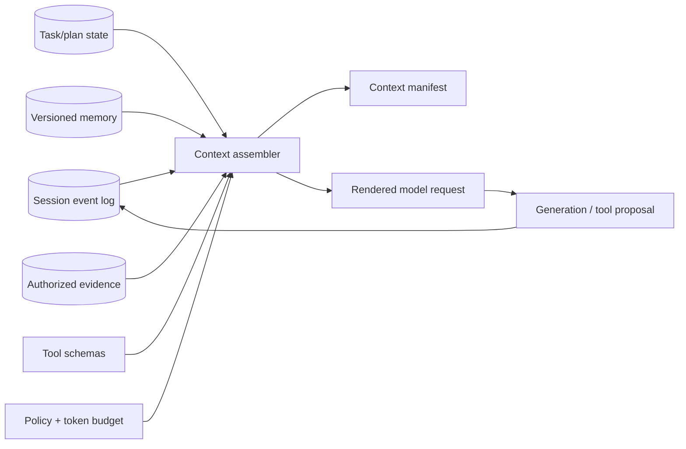

# Context Management

## Overview {#tl-dr}

On every call, the context builder decides what the model can see. It draws from task state, session history, retrieved evidence, tool results, and memory. Track where each item came from, who may use it, how current it is, and how much of the token budget it consumes.

A long-running agent may need an old user decision more than its latest tool output. Keep decisions and outstanding work in durable state. When the window fills, summarize bulky observations and reconstruct the next request from that state. Test compaction by resuming the task: can the agent still identify the approved target and find the evidence it needs to finish?

---

## The Context Window Is a Budget

Count what the server actually renders. Instructions, tool schemas, session history, evidence, attachments, and the current question all consume capacity. Reserve room for the response. Test task quality at realistic lengths because a request can fit the protocol limit and still lose a decisive fact.

Let $W_m$ be the largest usable window qualified for this model and workload, subject to the protocol limit. Before choosing optional material, check

$$
T_{instructions}+T_{tools}+T_{active\ state}+T_{evidence}+T_{history}
+T_{current}+R_{output}+R_{variance} \le W_m.
$$

Reserve $R_{output}$ for a complete answer or tool call and $R_{variance}$ for estimation error or other model-specific usage. Compare planned and actual use by class. If mandatory material exceeds the limit, choose a compatible route or stop with a reason. Silently dropping a permission condition changes the task.

## Context Assembly as a Materialized View

Keep task state outside the model. Give the assembler enough metadata to decide which items this request may use.

```text
item_id, type, immutable content reference/hash
source and provenance, author/principal, trust class
created_at, valid_at, expires_at, supersedes
tenant/ACL policy, sensitivity and retention class
estimated tokens, priority, dependencies
compaction level and source-item IDs
```

Resolve the caller, task revision, model, and budget first. Remove expired and unauthorized items, apply corrections, and render the selected material in a stable order. Alongside the request, record a **context manifest** with item IDs, source revisions, token counts, omissions, transformations, and a hash of the result.



The event log, artifacts, task state, and reviewed memory let the runtime rebuild the view. During an incident, the manifest identifies which revision the model saw. Traces can refer to restricted payloads without copying them into a general logging system.

### Allocation as constrained selection

For optional items, estimate the benefit $u_i$, token cost $t_i$, and risk $r_i$ of stale content. One way to express the selection problem is

$$
\max_S \sum_{i\in S}(u_i-r_i)-redundancy(S)
\quad \text{subject to} \quad
T_{fixed}+\sum_{i\in S}t_i+T_{current}+T_{output}+T_{safety}\le W.
$$

First include the current intent, mandatory policy, open tool calls and results, and active constraints. Keep dependent items together. A table row can be useless without the column header. Score optional material only after reserving those costs.

Set separate limits for sources that can grow independently. When a tool returns a long log, retain the relevant excerpt and an authorized handle to the complete output. When search returns too many passages, rerank them inside the evidence budget. Both choices preserve space for the user's question.

---

## Token Economics: The Bill Is Shaped Like a Triangle

Let $B$ be a fixed prefix sent on each of $n$ calls. Let $d_i$ be the new input first included at call $i$, including any previous assistant output or tool result carried into that request. With an append-only transcript, the total submitted input is

$$
T_{input}=nB+\sum_{i=1}^{n}\sum_{j=1}^{i}d_j.
$$

With a 2,000-token fixed prefix and 500 new tokens per turn, ten calls submit 47,500 input tokens. Only 7,000 tokens appear in the last request. This counts logical input. A warm prefix cache can reduce the work and price of repeated tokens.

For a cost model, assign every billed token to exactly one pricing category. For a provider that prices reads, writes, and uncached input separately, use

$$
C = c_f T_{fresh} + c_w T_{write} + c_h T_{hit} + c_o T_{output} + C_{tools} + C_{storage}.
$$

Map usage fields to the provider's billing rules. Count reasoning tokens once when the output total already includes them. Separate cache writes only when billed separately, and include pricing tiers or TTL differences where applicable. Compare the estimate with actual usage records. [Claude prompt caching](https://platform.claude.com/docs/en/build-with-claude/prompt-caching)

A warm hit can reduce prefill time. A rollout, failover, eviction, or expired entry can turn the same logical input into cold work. Replay the workload under both conditions and compare first-token latency, task cost, and admitted throughput.

---

## Attention Is Not Uniform: Lost in the Middle and Context Rot

In multi-document question answering and key-value retrieval experiments, moving the evidence changed accuracy even when all tokens fit. The tested models often performed better with evidence near the beginning or end. Recheck placement on the deployed model and task. [Lost in the Middle](https://arxiv.org/abs/2307.03172)

Keep dates with the rules they qualify and units with table values. Test whether placing active constraints near the decision improves compliance. If a constraint must appear twice, render both copies from the same authoritative field so a correction reaches both.

Hold the required evidence fixed and vary position, distractors, and length independently. A model that locates an isolated fact may still fail to combine two passages. Include multi-step tasks and score the resulting decision.

---

## Prefix Identity, Reuse, and Revision

A serving engine can reuse prefix state when the rendered tokens and the inputs that determine their activations are compatible. Include model revision, adapter, positions, and multimodal inputs where relevant. The caller's cache isolation scope also has to match. Two identical strings can belong to different domains.

The longest compatible prefix is an upper bound on reuse. Cache block size, minimum length, configured cache points, expiration, and replica placement can shorten the actual hit. Put stable material before volatile fields where the protocol allows. Invalidate a stale or unauthorized prefix immediately even when reuse was saving money.

To diagnose a sudden drop in cached tokens, compare manifests for successive calls. If the first changed token moved near the front after a template rollout, examine timestamps or unstable schema ordering. If the eligible prefix is unchanged, investigate expiry, routing, and eviction. Restore the affected configuration and confirm both first-token latency and cost per completed task. [Agent inference](./12-agent-inference.md)

---

## Long Context vs RAG

Choose where the system should select evidence and how it will handle a miss.

**Long context.** Load a bounded, authorized snapshot when the task repeatedly needs much of its content. Measure cold prefill and whether the model can find the decisive passages among distractors.

**Indexed retrieval.** Search at request time when the corpus changes frequently, permissions differ by caller, or only a small fraction of documents is relevant. Monitor publication lag and evidence recall.

**Just-in-time retrieval.** Let the model request additional evidence after observing earlier results. Bound the number and duration of reads, record source revisions, and stop when the evidence supports the answer. A hybrid can load stable high-use material and retrieve the rest on demand.

| Dimension | Long context | RAG | Agentic (just-in-time) |
|---|---|---|---|
| Corpus scope | Bounded request/session snapshot | Indexed corpus | Tool-navigable namespace |
| Freshness boundary | Snapshot reload | Corpus publication lag | Source state at each read |
| Primary failure | Distractor/position use and cold prefill | Coverage or ranking miss | Incomplete search or wandering |
| Reproducibility | Pin rendered source revisions | Pin corpus/index snapshot | Persist read queries and receipts |
| Selection authority | Context assembler | Retrieval pipeline | Model proposes. Tool/policy enforces |

---

## Compaction Lifecycle and Publication

Compact before projected prompt length, latency, or cost exceeds its qualified budget. The compactor reads a specific range of canonical events and produces a shorter artifact linked to that range. Keep authoritative decisions and receipts according to their retention policy.

Pin the source revision. Copy required structured fields, summarize residual prose, and validate the result. Publish with a compare-and-swap against the active revision. If a user corrected the task during summarization, retry against the new state. Record the new prefix boundary and which source artifacts remain available.

Estimate the benefit over the remaining calls. In an illustrative session, compaction costs 0.06 including validation and the first cold call. If each subsequent call saves 0.01 at the expected cache mix, six subsequent calls recover the cost. A task likely to finish in two calls gains little unless it would otherwise exceed the window. Validate constraint retention before applying either policy.

---

## Context Editing and Artifact Rehydration

Give large observations a bounded excerpt and an artifact reference. Record revision, size, access scope, truncation, and retrieval method. Once a task no longer depends on the entire payload, later calls can carry only the reference and relevant excerpt.

Cap output before inserting it into the request. Mark incomplete reads explicitly and provide pagination or an authorized read operation. Preserve continuation items required by the model protocol. Keep records of decisions and observed effects in canonical state.

Recheck access, revision, and freshness on every rehydration. If the underlying file was deleted or permission revoked, mark the evidence unavailable and reconsider any pending claim that depended on it. Preserve unresolved call/result pairs when editing the prompt. [Backpressure](../06-scaling/07-backpressure.md)

---

## Memory: What Survives the Session

A saved preference or project convention can outlive a session. Assign it a subject, scope, provenance, and review policy. Give the model a way to propose updates while the runtime owns retention, authorization, and loading.

Treat an embedding match as a candidate. Verify it belongs to this user or project, check whether it was superseded, and distinguish a declared preference from a model inference. Repeated retrieval of an inference can otherwise make it look independently confirmed. [Feedback loops](../16-ml-systems/01-ml-system-fundamentals.md)

A remembered deploy command can outlive the script it names. Display the source and last confirmation time, allow correction, and scope project conventions to the correct repository and tenant. [Dataset versioning](../16-ml-systems/11-dataset-management-versioning.md)

### Memory lifecycle and write authority

Record who made the claim, when it was observed, which tasks it applies to, when to review it, and who can change it. A model-inferred preference should never silently replace an explicit user setting.

Validate a proposed memory write and record the accepted revision. For deletion, stop future loading immediately and propagate the tombstone to indexes and caches. Apply retention policy to historical payloads. Record the memory revision in each context that uses it.

Keep in-progress task state in a checkpoint with its own lifetime. Loading a transient decision as a lasting preference can change the behavior of unrelated future sessions.

## Context State, Branches, and Concurrency

Represent user edits, regenerated answers, and parallel results with event IDs and parent revisions. A worker may finish after the user changes the task. Compare its base revision with current state before incorporating its result.

Connect each tool result to its call ID. A late result can still prove a write occurred even after cancellation. Preserve that receipt, reconcile any effect, and apply the current task rules before allowing more work. A linear transcript alone loses this distinction.

On migration, rebuild the request from canonical events. Verify the new model can express the active tools, modalities, and continuation state. If an open action cannot be represented, reconcile or pause it first.

## Compaction Correctness and Evaluation

Define which fields must survive compaction. Check the compacted artifact against the canonical state for each of the following.

- the latest goal and acceptance criteria
- active constraints, prohibitions, approvals, and unresolved questions
- decisions plus reasons and rejected alternatives that prevent repetition
- exact identifiers and values whose mutation would change an action
- open work, committed work, failures, and external side-effect receipts
- provenance references for claims that may need rehydration.

Copy exact IDs, permissions, open actions, and acceptance criteria from structured state. Have the model shorten narrative where a paraphrase is acceptable. Preserve recent turns or authorized links to larger evidence where the task needs them.

Replay the next action from full and compacted state on the same cases. Change a resource ID, omit a pending action, or drop a prohibition in a test artifact. Verify the runtime rejects the altered summary. Compare verified task success, redundant tool calls, latency, and cost after the checks pass.

## Context Observability

Tie each model call to its context manifest. Record budget by source, selected and omitted item IDs, truncation, compaction revision, eligible prefix length, and reported cached tokens where available. Restrict access to payloads.

When quality drops on long tasks, compare failure rates by evidence position, compaction generation, memory age, and tool truncation. For latency or cost changes, split context-build time, fresh input, cache reads, and output growth. Start the investigation at the first stage that changed.

Place known obligations at controlled positions in representative tasks. Exercise a user correction, a revoked source, and a late tool result. The probe succeeds when the next action follows the current constraint and cites available evidence.

---

## Structure the Context for the Agent's Own Attention

Two design choices can reduce how much history the model has to interpret on a decision turn.

**Render active obligations.** Place the current goal, acceptance criteria, approvals, and outstanding dependencies near the decision they govern. Generate them from authoritative state and track its revision. Vary placement in tests before paying the token cost on every turn.

**Delegate bounded reads.** Give an independent investigation its own context and require a compact result with source revisions. Compare with a single-agent run on the same tasks. Count duplicated prefixes, coordination time, and omitted evidence alongside any latency gain. [Multi-agent systems](./03-multi-agent-systems.md)

---

## Failure Modes

| Symptom | Evidence to inspect | Recovery |
|---|---|---|
| Cost rises with turn count | Plot submitted, cached, and newly billed tokens by turn | Limit repeated history or compact where the measured savings justify it. |
| First-token latency jumps after rollout | Compare rendered prefixes and actual cache reads for equivalent requests | Repair early prefix churn or routing and watch task latency recover. |
| An agent repeats a prohibited action after compaction | Compare structured constraints and the next proposed action across revisions | Reject the bad summary and rebuild with the missing constraint. |
| A tool error reappears as an asserted fact | Follow the claim to the original source and check trust and validity | Invalidate derived summaries and rebuild the view from verified state. |
| More context lowers accuracy | Replay the same task with controlled distractors | Remove low-value passages while retaining evidence dependencies. |
| A stale or foreign preference appears | Inspect memory subject, scope, policy, and revision | Revoke the incorrect entry, invalidate derivatives, and test affected scopes. |
| A summary is the only surviving record of a write | Query the destination for the action receipt | Reconcile before another attempt and persist future receipts outside the prompt. |
| An old branch supplies a new instruction | Compare parent revision and active task revision | Fence late results from active state and reconcile any external effects. |
| Output parses correctly but omits a decisive field | Inspect truncation markers and compare rendered input with the manifest | Reserve space for mandatory items and fail admission when they do not fit. |

---

## Decision Framework

Record the following decisions for each task class and test them together.

| Decision | Mechanism | Required evidence |
|---|---|---|
| Authority and lifetime | Separate operator policy, run state, evidence, session events, and cross-session memory | Owner, provenance, valid time, ACL, retention |
| Mandatory versus optional state | Reserve instructions, active obligations, protocol pairs, and output before scored selection | Manifest proves no required item was silently omitted |
| Working-set selection | Load bounded snapshots, use RAG, or permit bounded just-in-time reads | Coverage, attention use, freshness, and latency by slice |
| Reuse boundary | Canonical renderer and complete prefix-compatibility identity | Reused tokens/work and legitimate invalidation reason |
| Overflow behavior | Type-specific pruning, artifact receipts, or validated compaction | Continuation eval and rehydration success |
| Branch and correction semantics | Parent-linked context revisions with compare-and-swap publication | Late branches cannot enter authoritative state |
| Persistent memory | Versioned canonical records plus optional derived index | Scope, revocation, expiry, and tenant isolation |

Accept the policy when representative continuations meet their task and latency goals and survive correction, revocation, and branch changes. When a mandatory field is missing, reject the rendered request or compacted revision before it reaches the model.

---

## Key Takeaways

1. Rebuild the model's working view from authorized, versioned state on each call.
2. Reserve room for active obligations and the response before allocating space to optional evidence.
3. Measure eligible prefix length, actual cache reads, and cold-request latency separately.
4. Treat compaction as a candidate revision. Check what the agent does next before accepting it.
5. Keep memory scoped, correctable, and traceable. Recheck authorization when restoring older evidence.
6. Use parent revisions to keep late tool results from silently changing the active task.

---

## References

1. [Lost in the Middle: How Language Models Use Long Contexts](https://arxiv.org/abs/2307.03172): Liu et al., 2023
2. [Effective Context Engineering for AI Agents](https://www.anthropic.com/engineering/effective-context-engineering-for-ai-agents): Anthropic, 2025
3. [Context Rot: How Increasing Input Tokens Impacts LLM Performance](https://research.trychroma.com/context-rot): Chroma Research, 2025
4. [MemGPT: Towards LLMs as Operating Systems](https://arxiv.org/abs/2310.08560): Packer et al., 2023
5. [Context Engineering for AI Agents: Lessons from Building Manus](https://manus.im/blog/Context-Engineering-for-AI-Agents-Lessons-from-Building-Manus): Manus, 2025 (KV-cache discipline, recitation, filesystem-as-context)
6. [Prompt Caching: Anthropic Documentation](https://platform.claude.com/docs/en/build-with-claude/prompt-caching): prefix semantics, TTLs, cache pricing
7. [LLMLingua: Compressing Prompts for Accelerated Inference](https://arxiv.org/abs/2310.05736): Jiang et al., 2023
8. [How Long Contexts Fail](https://www.dbreunig.com/2025/06/22/how-contexts-fail-and-how-to-fix-them.html): Breunig, 2025 (poisoning/distraction/confusion taxonomy)

---

## Related Chapters

- [Retrieval-Augmented Generation Systems](04-rag-patterns.md): retrieval as one writer into a budget this chapter is trying to spend well
- [Harness Engineering](09-harness-engineering.md): the harness decides what enters the window, and when it gets compacted away
- [Backpressure](../06-scaling/07-backpressure.md): a context window is a bounded buffer with the same shedding decisions
- [Repository Context and Policy Plane](../19-compound-engineering/03-agent-context-engineering.md): the repository-specific version: what to load from the codebase, and when
