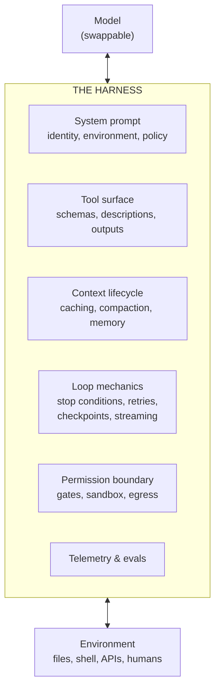
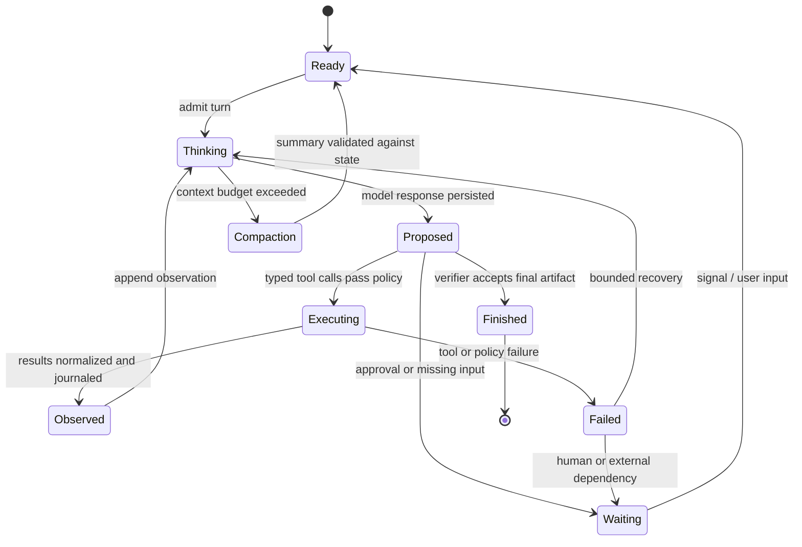
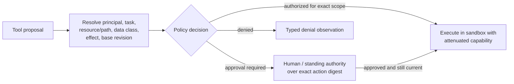

# Harness Engineering

## Overview {#tl-dr}

The harness controls what happens between a model proposing an action and a tool changing state. It checks permissions and budgets, records the outcome, and verifies completion. Evaluate the model and harness together because changing either can change the result.

Consider a worker that crashes after a tool accepts a write but before the worker records the receipt. On restart, the harness has to discover whether the write committed. If the destination can look it up by a stable action ID, reconcile the result before resuming. If the outcome is unknowable and repeating the write could cause harm, pause the run for review.

---

## Why the Harness Is the Product

Changing the tool handler can change task success with the same model and prompt. For example, a file reader that silently truncates its response may hide the failing test the agent needs to fix. A reader that reports the omitted range lets the agent request it. Evaluate the complete runtime on tasks that exercise those differences.



## The Harness as a Runtime

The runtime decides when a run can advance. Persist the model's proposal before executing it, then record the tool observation before issuing another model call. Separate waiting for an approval from waiting for a tool reply. The former can expire without an effect. The latter can leave the external outcome unknown.



Journal the run ID, attempt, state revision, logical action ID, and terminal evidence. A restarted worker should be able to explain what it can safely repeat using those records. Replay recorded observations when reconstructing history. A fresh execution of the same model call can produce a different proposal.

## Request Assembly Boundary

Assemble each request from one revision of task state. Include the goal, current constraints, relevant observations, available tools, and the output budget. Keep the provenance of a tool result attached when the result is summarized or moved. A file read from the workspace can contain user data, generated output, or third-party instructions.

If a mandatory constraint and the minimum output reservation cannot fit together, fail the assembly step explicitly. Log sizes and revisions so an operator can tell a larger tool result from a smaller model window. The [context builder](./08-context-management.md) owns selection and the harness checks its result before admission.

## Tool Registry and Action Transactions

A registry entry describes a tool's input schema, side effects, resource scope, and recovery contract. Reject unknown tools and unexpected fields before execution. Bind the proposed action to the authenticated principal, target revision, and any required approval.

Consider a ticket creation call. Persist its logical ID, send it to the destination, then save the returned ticket ID. If the reply is lost, look up the original operation or retry with the same key under the destination's documented deduplication guarantee. A fresh key describes a second ticket. If the service offers neither lookup nor durable deduplication, record the ambiguous outcome and send it for reconciliation.

## Context Revision Lifecycle

Keep authoritative events separately from each model-visible context revision. A summary may replace ten tool observations in a prompt while the underlying receipts remain available subject to retention policy. Record the source range and revisions used to build the summary.

Publish a compacted context only after checking that required constraints, approvals, and outstanding actions survived. If the user changes the target while compaction runs, discard or rebuild the stale result. Letting the last summary to finish win can restore a superseded instruction.

## The Loop: Mechanics That Separate Demos from Products

The loop below sketches the order of operations. In this sketch, the batch executor must persist individual outcomes and reconcile ambiguous writes before retrying. A turn checkpoint alone cannot provide that guarantee.

```python
async def run(session: Session) -> Outcome:
    while True:
        budget.check(session)                      # turns, tokens, wall-clock, spend

        response = await model.call(
            system=PROMPT, tools=session.tools,
            messages=session.messages, stream=True,  # stream for UX + early interrupt
        )
        await session.checkpoint(response)          # durable: resume from any turn

        if response.stop_reason == "end_turn":
            return await verify_and_close(session)  # never trust "done" unverified

        calls = response.tool_calls
        decisions = await asyncio.gather(*[gate(c, session.policy) for c in calls])
        batches = conflict_aware_batches(calls, decisions, session.state)
        results = await execute_batches(batches, session.state)
        session.append(response, normalize(results))  # uniform shape, budget-truncated

        if loop_detector.repeating(session):         # same call-signature N times
            session.inject_steering("This approach is repeating. Re-read the plan "
                                    "and choose a different strategy, or escalate.")
```

Parallel reads can share a pinned snapshot. A read that depends on a pending write must wait for the commit or explicitly read the earlier revision. Check budgets before dispatch so concurrent children cannot each spend the same remaining allowance. On cancellation, stop admitting new actions and reconcile any already in flight.

A repeat detector should compare the tool, normalized arguments, resource revision, and outcome. Repeated reads can be legitimate if the worker is awaiting a changing resource. Identical writes against an unchanged revision after the same permanent rejection are a reason to stop. Return the rejection and the remaining alternatives explicitly so the model can choose a different action.

### Durable workspace state

Record which artifacts live on a mounted volume, in a remote store, or only on a disposable worker. Resume a test run against the recorded workspace revision. A surviving local file cannot establish whether a remote deployment completed.

### Verification layer

Define the observation that permits closure. A passing local test verifies the cases it ran. A request to deploy also needs evidence from the target environment. If required evidence cannot be obtained, return a pending or failed result that names the missing observation.

## Permission Boundary and Sandbox

A sandbox limits what a tool process can reach. Authorization decides whether this caller may perform this operation on this resource. Apply both when a write has consequences beyond the worker.



### Capability attenuation

Give a tool credentials scoped to the destination, operation, and lifetime it needs. Recheck the action digest and resource revision after a human approves. If the destination changed while approval was pending, present the revised action for a new decision. For a remote tool service, validate credential audience and use its documented authorization flow. Keep credentials out of model-visible observations.

Remote tool discovery needs its own change control. A server can retain the same URL while changing a tool's schema, description, or destination. Register the origin and allowed capability classes, pin the approved registry revision for each run, and review changes before admitting new capabilities. Derive tenant identity from the authenticated caller. An identifier returned by a model or supplied in a tool argument cannot establish who is calling.

For HTTP MCP, issue credentials for the intended resource and validate the audience at that resource. A broker that calls another service needs the credential for that service. Passing the client's original bearer token downstream crosses the boundary the audience check was meant to enforce. A session ID lets the server correlate messages but grants no authority to act. [MCP authorization specification](https://modelcontextprotocol.io/specification/2025-11-25/basic/authorization)

## Harness Verification and Fault Injection

Inject failure at the boundaries where two systems can disagree. Kill a worker after the destination accepts a write and before the journal contains the receipt. Redeliver an old completion after a replacement worker takes over. Revoke approval while an action is queued. For each case, inspect the destination, journal, and user-visible terminal state.

Verify restart against the same durable records the production runtime uses. A mock that makes the journal update and external write atomic removes the failure window the test is meant to exercise. Include failures of the verifier itself so an unavailable check cannot be mistaken for a pass.

## Cost, Backpressure, and Tenant Isolation

Reserve spend, tool concurrency, and time against the parent run before launching a child. Reconcile the reservation with actual use, including failed and cancelled attempts. Track work performed after cancellation because the customer may have stopped waiting while the platform continues to pay.

Partition queues by tenant or service class where one customer's fan-out can exhaust shared workers. Under overload, reject or defer before starting work that cannot finish on time. Watch the oldest eligible request and completions by deadline alongside occupancy.

For example, suppose a run has 12,000 tokens left and three workers each request 5,000. Admit two under the existing reservation, then queue or resize the third. Return unused reservations on termination, but keep unconfirmed provider usage outstanding until the ledger reconciles it. Otherwise a timeout can release capacity for new work while the original call is still consuming it.

## Harness Versioning and Rollout

Version the state schema, tool contracts, prompt, model adapter, and verifier together. An old worker may still return a tool receipt after a rollout. The new reader must accept that receipt or route the run to a compatible worker.

Canary new sessions first. Rehearse resuming an old run with a pending write and with a pending approval. Keep a compatible reader during rollback. Reverting a binary cannot restore state it no longer understands.

## Failure Modes

| Report | Evidence to inspect | Safe action |
|---|---|---|
| A restart creates a duplicate ticket | Logical IDs and destination receipts across attempts | Reconcile the original write before opening another |
| Runs say “done” with missing artifacts | Terminal transition and verifier result | Require acceptance evidence before closing |
| Two branches overwrite a file | Input revisions and commit order | Serialize the commit or reject a stale base revision |
| A previously approved write changes target | Approved digest and execution-time resource | Invalidate the approval and present the new action |
| Cancellation leaves spend rising | In-flight children, late completions, and reservation ledger | Stop dispatch, propagate cancellation, and account for outstanding work |
| Resumed runs lose a constraint | Compaction source range and accepted task revision | Restore canonical state and rebuild the context |

## Decision Framework

Begin with the operation whose outcome would be hardest to reverse. Trace who proposes it, who authorizes it, where it commits, and how another worker could discover the result after a crash. Use that trace to decide which guarantees belong in the harness.

| Design question | Consequence |
|---|---|
| Is the task a fixed sequence with typed checks? | Use a workflow and keep model control local to bounded nodes. |
| Can the environment verify progress after each action? | A bounded agent loop is viable. Make the verifier the commit gate. |
| Are actions read-only, reversible, or irreversible? | Increase sandboxing and approval strength as effect reversibility decreases. |
| Are concurrent tool calls independent? | Parallelize only after read/write and snapshot analysis. |
| Can a run outlive one process or context window? | Persist event state, workspace revisions, and idempotency/reconciliation data. |
| Is quality judged by a reliable oracle? | Automate acceptance. Otherwise route uncertainty to a human. |
| Does the model see untrusted content and private data? | Remove an exfiltration channel or put outward effects behind a gate. |

If the destination cannot support a guarantee, expose that limit in the run state and user interface. An explicit request for reconciliation is more useful to an operator than an automatic retry that may repeat a write.

## Key Takeaways

- Persist action intent before execution and use destination evidence to reconcile the result.
- Bind approval to the precise effect and check the resource revision at execution.
- Test failures between the tool, journal, and verifier, including failures after an external commit.
- Roll out changes against both new sessions and runs that still hold old receipts or approvals.

---

## References

- [Building Effective Agents](https://www.anthropic.com/research/building-effective-agents): Anthropic
- [Effective Context Engineering for AI Agents](https://www.anthropic.com/engineering/effective-context-engineering-for-ai-agents): Anthropic
- [Writing Effective Tools for Agents](https://www.anthropic.com/engineering/writing-tools-for-agents): Anthropic
- [Code Execution with MCP](https://www.anthropic.com/engineering/code-execution-with-mcp): scripts over chained tool calls
- [Claude Code Best Practices](https://www.anthropic.com/engineering/claude-code-best-practices): a production harness, documented
- [Model Context Protocol](https://modelcontextprotocol.io/): tool/context integration standard
- [MCP Authorization specification (2025-06-18)](https://modelcontextprotocol.io/specification/2025-06-18/basic/authorization) and [MCP Security Best Practices](https://modelcontextprotocol.io/docs/tutorials/security/security_best_practices): audience binding, token handling, session and confused-deputy defenses
- [The Lethal Trifecta for AI Agents](https://simonwillison.net/2025/Jun/16/the-lethal-trifecta/): Simon Willison
- [Context Rot](https://research.trychroma.com/context-rot): Chroma research on long-context degradation
- [SWE-bench Verified](https://www.swebench.com/), [Terminal-Bench](https://www.tbench.ai/), [τ-bench](https://arxiv.org/abs/2406.12045), [OSWorld](https://os-world.github.io/): harness-sensitive benchmarks
- [OpenTelemetry GenAI Semantic Conventions](https://opentelemetry.io/docs/specs/semconv/gen-ai/): tracing standard for LLM systems
- [Temporal](https://temporal.io/): durable execution

---

## Related Chapters

- [Agent Orchestration Patterns](02-orchestration-patterns.md): topology is one of the harness decisions rather than a separate concern
- [LLM Evaluation and Observability](10-llm-evaluation.md): a harness without regression tasks is a demo with good ergonomics
- [Tool and Runtime Contracts for Coding Agents](../19-compound-engineering/02-coding-agent-tool-design.md): tool contracts as the interface between an agent and a machine you trust
- [Context Management](08-context-management.md): the part of the harness that decides what the model is allowed to remember
