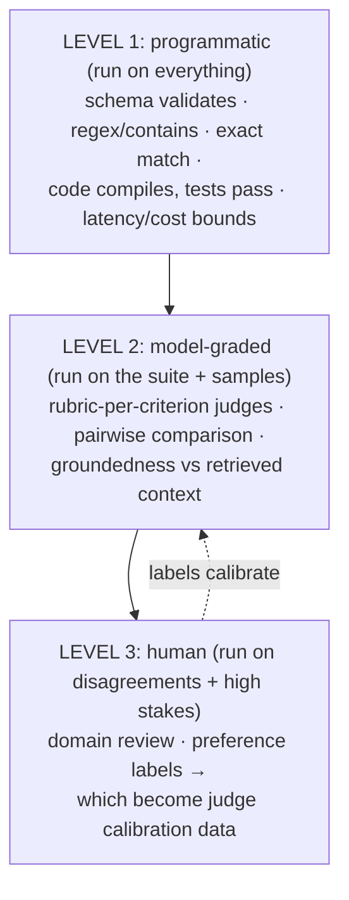

# LLM Evaluation and Observability

## Overview {#tl-dr}

Start an evaluation by naming the release decision it must support. Define whose tasks the result should represent and which outcome matters. Record the system revision, choose a check that can establish that outcome, and report uncertainty alongside the result.

For an agent that books appointments, verify that the intended reservation exists exactly once. Repeat the trial from a clean starting state to measure reliability. In a production canary, count every eligible task assigned to each release and separately record which release served it. A timeout before any answer reaches the user still belongs in the release decision.

---

## Measurement Complications

A request can return HTTP 200 and book the wrong appointment. A string match can also fail a correct answer simply because the wording changed. Choose a check that observes the property the user depends on. For a booking, read the reservation from the destination and compare its owner, time, and count with the request.

Keep the system revision, task population, and grader revision with every score. A decline after a release could come from worse retrieval, a shift toward harder cases, or a stricter grader. Preserve enough evidence to distinguish them before assigning the incident.

## Evaluation Contract and Data Model

Write the decision rule before running the candidate. For example, a team may tolerate a small increase in latency to reduce incorrect bookings, while treating any observed cross-account booking as a release blocker. Set the margin and stopping rule while the outcome is still unknown.

```text
target population and time window
system revisions being compared
unit of analysis and clustering key
primary estimand and non-inferiority/superiority margin
hard safety/correctness gates
slice and weighting policy
evaluator versions and calibration evidence
sample size / stopping rule
allowed cost and latency trade-offs
owner, decision, and rollback evidence
```

Give each case a stable ID, fixture revision, slice, expected properties, and forbidden effects. Each trial records the system it actually ran, the environment state, and the grader observations. Preserve protected raw evidence only as long as its retention policy allows. Record customer, repository, or session keys where outcomes cluster. Ten turns of one broken session provide less independent evidence than ten unrelated tasks.

## The Evaluator Ladder

Use the strongest available observation for each claim. The ladder shows how executable checks, model judges, and human reviewers contribute to one evaluation.



A database check can establish that a reservation exists. It cannot determine whether a customer-facing explanation is clear. Give a model judge the request, answer, supporting evidence, and a separate criterion for each judgment. Allow “insufficient evidence” or “inapplicable” where the criterion cannot be scored. Route those results explicitly when computing rates.

Blind reviewers to the candidate, randomize pair order, and compare judgments with expert labels across relevant languages and risk classes. Sample some cases the judge passes confidently. Reviewing disagreements alone misses shared mistakes. For high-impact failures, measure how often actual violations pass the judge and whether the review queue can absorb the resulting workload.

For example, suppose violations occur in 1% of 10,000 cases. A judge with 90% sensitivity and 99% specificity flags 90 true violations and 99 acceptable cases. Reviewing only the flagged queue still misses ten violations. Budget for that queue and sample unflagged cases independently. Write down which class counts as positive before quoting a false-accept or false-reject rate.

## The Dataset Is the Asset

Maintain three distinct uses for cases. A representative sample estimates how often users succeed. A risk set probes rare failures such as a write against the wrong account. A locked qualification set supports the final decision after prompt or checkpoint selection. Publish each result with its sampling rule.

Split by the entity that can leak information. Putting one customer's paraphrased requests in both development and qualification can inflate performance even after exact duplicates are removed. Preserve provenance and source dates. A corrected label creates a new case revision so yesterday's result remains interpretable.

## Agent Evals: Trajectories, Reliability, Cost

Restore a clean fixture for every trial. If yesterday's trial already created the reservation, a new agent can appear to succeed by doing nothing. Inspect the final destination and any forbidden side effects. Score the path only where the path matters, such as requiring approval before a write. [Agent evaluation guide](https://www.anthropic.com/research/demystifying-evals-for-ai-agents)

Report both the fraction of tasks solved at least once in $k$ attempts and the fraction solved on every attempt. Under independent trials with constant success probability $p$, these probabilities are $1-(1-p)^k$ and $p^k$. A shared outage or a hard case breaks that assumption. Repeat trials on the same tasks, retain case identity, and report the observed distribution. Include failed attempts when computing cost and time per verified success.

## CI Integration and Statistics

Run deterministic contract checks on each change. Use paired trials on the affected cases for behavioral regressions, then run the protected qualification suite before promotion. A provider model revision can warrant qualification even when the application commit is unchanged.

### Measurement design

Compare releases on the same cases and inspect the discordant pairs. Those are the tasks one release solved and the other missed. For independent binary pairs, McNemar's test uses these disagreements. For repeated tasks from the same customer, resample whole customer groups or use a model that represents the dependence. A fixed-horizon confidence interval loses its advertised coverage if the team keeps checking and stops at the first favorable result.

Zero observed failures also needs an uncertainty bound. Under independent trials with a constant failure probability $q$, the probability of seeing zero failures in $n$ trials is $(1-q)^n$. With 100 clean trials the one-sided 95% upper bound is $1-0.05^{1/100}$, about 2.95%. That test cannot establish a failure rate below one in a thousand. For a rare write-safety failure, combine targeted boundary tests with enough representative observations to support the rate claim.

### Judge calibration and disagreement

Keep a panel with expert labels from both common and consequential slices. When changing the rubric or judge model, score the same stored outputs with both versions. If the score moves while the outputs stay fixed, investigate the measurement change before attributing a product regression.

### End-to-end versus component attribution

When answer quality drops, replay generation against the old evidence packet. If the failure disappears, inspect retrieval, reranking, and prompt assembly. If it persists, hold the renderer and model revision fixed in turn. Record which intervention changed the outcome. A correlation in a trace is a lead for the next test.

## Production: Observability and Online Evaluation

Log assignment, actual serving revision, fallback, terminal status, and the eventual task outcome. Consider a randomized canary with 1,000 eligible tasks in each arm. The deadline has passed for all tasks and every terminal outcome is recorded.

| Outcome | Current release | Canary |
|---|---:|---:|
| Verified completions by deadline | 900 | 855 |
| Other tasks that returned an answer | 100 | 45 |
| Tasks that timed out before an answer | 0 | 100 |

Among returned answers, apparent success rises from 900/1,000 to 855/900, or 95%. Across assigned tasks, success falls from 90% to 85.5%. Hold the rollout and locate the 100 timeouts. Keep fallback traffic with its original assignment for the release comparison. Use actual exposure to diagnose which route failed. [Microsoft Research on missing users in experiments](https://www.microsoft.com/en-us/research/articles/diagnosing-sample-ratio-mismatch-in-a-b-testing/)

If labels arrive days later, compare cohorts at the same age and publish the pending count. Page immediately on a fast, independently verified signal such as an unauthorized write. Use slower adjudicated outcomes to assess quality once the observation window closes. A change in thumbs-down volume alone cannot distinguish quality drift from a change in who leaves feedback.

## Failure Modes

| Misleading result | What to inspect | Release decision |
|---|---|---|
| A judge upgrade improves the score overnight | Grade frozen outputs with both judge revisions | Reestablish the baseline before comparing candidates |
| Overall accuracy rises while a language regresses | Paired outcomes and sample size by language | Apply the agreed slice threshold |
| Every repeated trial books successfully | Check whether reservations survive between trials | Reset the fixture and rerun |
| The fastest route looks most accurate | Count abandoned and timed-out tasks by assignment | Restore the eligible denominator |
| The development set improves after many prompt edits | Compare selection history with locked qualification results | Base promotion on independent evidence |

## Decision Framework

Pick evidence by the decision it supports.

| Need | Appropriate evidence |
|---|---|
| Protocol or safety invariant | Deterministic assertion and policy test |
| Artifact correctness | Executable verifier, test suite, database state, or diff checker |
| Groundedness or nuanced quality | Calibrated rubric judge plus human disagreement review |
| High-impact or irreversible decision | Human authority with evidence package |
| Agent reliability | Repeated trials with dependence-aware uncertainty, trajectory and side-effect metrics |
| Model/prompt/index migration | Paired slice evaluation, shadow traffic, canary, rollback |
| Production drift | Trace-linked sampled scoring and outcome feedback |

Record who owns the decision and what evidence would reverse it. A release that meets the overall quality target can still fail a hard permission check. A statistically uncertain gain can justify more sampling if the expected value of deciding exceeds the cost of those trials.

## Key Takeaways

- Define success, eligibility, the observation window, and the release margin before seeing scores.
- Grade external effects from a clean environment and keep the per-trial evidence needed for diagnosis.
- Preserve assignment through timeout and fallback. Use serving revision to investigate differences.
- Track grader errors and sampling uncertainty on the slices where a wrong release decision would matter.

---

## References

- [Judging LLM-as-a-Judge with MT-Bench and Chatbot Arena](https://arxiv.org/abs/2306.05685): the judge-bias catalog (position, verbosity, self-preference)
- [Your AI Product Needs Evals](https://hamel.dev/blog/posts/evals/): Hamel Husain. The practitioner's playbook this article compresses
- [OpenTelemetry GenAI semantic conventions](https://opentelemetry.io/docs/specs/semconv/gen-ai/): the tracing standard
- [SWE-bench Verified](https://www.swebench.com/), [τ-bench](https://arxiv.org/abs/2406.12045), [OSWorld](https://os-world.github.io/): agent benchmarks and their grading designs
- [Anthropic: define your success criteria & develop tests](https://docs.anthropic.com/en/docs/build-with-claude/define-success): eval-first development guidance
- [Harness Engineering](./09-harness-engineering.md) and [RAG Patterns](./04-rag-patterns.md): where these evals plug into the systems they protect

---

## Related Chapters

- [Offline Evaluation and Metric Design](../16-ml-systems/12-offline-evaluation-metrics.md): offline measurement with a classical statistics vocabulary already attached
- [Harness Engineering](09-harness-engineering.md): the harness produces the trajectory an agent evaluation scores
- [Model Monitoring](../16-ml-systems/04-model-monitoring.md): drift detection when the metric is itself a model with an error profile
- [Online Experiments](../16-ml-systems/08-online-experiments.md): online comparison against a control, with the same estimator caveats
