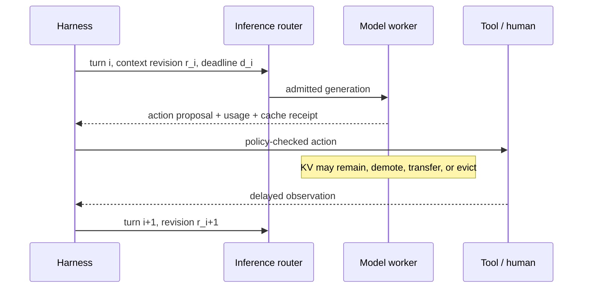

# Agent Inference: Serving Multi-Step LLM Workloads

## Overview {#tl-dr}

Measure how many agent tasks finish within their deadlines and budgets. A task can make several model calls, wait for tools or approval, and launch parallel calls that compete for prefill capacity. Later calls may reuse earlier context. Plan capacity around the reuse you observe under your routing and eviction policies.

A session waiting for a tool can release its accelerator while its cached keys and values still occupy device memory. Keeping them speeds up the next turn if the session returns soon. Evicting them frees capacity for another task but may force a second prefill. Preserve enough authorized session state to rebuild the request, then replay representative tool waits and bursts to choose an eviction policy. Report deadline success and cost per completed task.

---

## The Workload Is an Alternating Session

A worker can finish a generation while the user's task is still waiting for a tool. The next model call may arrive seconds or hours later:



This changes what the serving system schedules and measures:

| Dimension | Independent generation | Agent task |
|---|---|---|
| Scheduling unit | Request | Turn inside a task and deadline |
| Reuse | Coincidental prefix overlap | Structural overlap between consecutive revisions and siblings |
| Idle period | Ends after response | Tool or approval wait while reusable state may remain valuable |
| Latency contract | One TTFT/decode path | Sum and critical path across turns, tools, joins, and retries |
| Cost attribution | Request or token | Successful task including failed attempts and fan-out |
| Burst shape | Arrival process of users/jobs | Arrival process multiplied by model-directed fan-out |
| Cancellation | Stop one generation | Stop descendants, streams, and derived cache reservations |

Group traces by task class and retain the sequence of turns within each trace. Two classes can both average twelve turns while only one regularly produces hundred-turn sessions. Long sessions can account for most cached bytes, repeat prefill, and recovery work. Check their share directly.

## Logical State and Derived Cache State

The harness persists enough information to restart the next valid turn:

```text
task_id, session_id, turn_id, context_revision
model/prompt/tool/policy revisions
parent deadline and remaining budgets
action and side-effect status
completion evidence
```

The server can return a cache receipt to help route a later request:

```text
cache_object_id, exact prefix digest, token count
model + adapter + tokenizer + template + runtime digest
security/tenant domain, creation and last-access times
residency tier and worker/failure-domain location
size, generation/fencing token, expiry/eviction status
```

A cache receipt is a hint that compatible state may still be available. Persist the underlying prompt inputs or authorized source revisions separately. If a worker loses its cache, the harness can reconstruct a request, subject to current policy, and the server can recompute the prefix.

A match requires identical state-producing inputs over the shared prefix. Check token positions, model and adapter weights, multimodal inputs, attention and positional configuration, and runtime layout. Restrict reuse to authorized security domains even when two token sequences match exactly.

### Context revisions and forks

Record the base revision when a turn starts. A compacted history, corrected tool result, or model change can shorten the reusable prefix. Sibling requests may share blocks up to their first differing token. The server must verify which compatible blocks still exist.

Before publishing a late result, the harness checks that the task still expects that action from the same revision. Holding warm KV on the old worker gives it no authority to update the task after a newer turn has committed.

## Task-Level Resource Ledger

For attempt $a$ of turn $i$, let $P_{ia}$ be input tokens, $H_{ia}$ the tokens billed at the cache-hit rate, and $U_{ia}=P_{ia}-H_{ia}$ the remaining input. Count output and separately billed reasoning tokens in disjoint categories $O_{ia}$ and $R_{ia}$. With per-token prices $c$ and distinct tool executions $e$, the task charge under a linear tariff is

$$
C_{task}=\sum_i\sum_{a\in A_i}
(c_f U_{ia}+c_h H_{ia}+c_o O_{ia}+c_r R_{ia})
+\sum_e C^{tool}_e+C_{storage}+C_{coordination}.
$$

Include retries and discarded candidates. If reasoning is included in reported output, leave its separate charge at zero. Track a tool execution by its own identity so reusing its result across model attempts does not duplicate the charge. Apply cache-write fees and pricing tiers separately if the provider charges them. For self-hosting, measure accelerator time and allocated capacity. Provider-billed cache hits and physical tokens skipped are distinct measurements.

Suppose three prompts contain 2,000, 2,500, and 3,000 tokens, and each is an exact extension of the previous input. With a cold start and no reuse, the server processes 7,500 input-token positions. If it retains exactly the preceding input at each turn, it processes 3,000 fresh positions in total. The 4,500 avoided positions estimate prefill demand. Actual time saved depends on context length, scheduling, and the kernel.

### Cost per successful task

Aggregate spend over a cohort of attempted tasks and join it to verified final outcomes:

$$
C_{success}=\frac{\sum C_{attempted\ tasks}}
{N_{verified\ successful\ tasks}}.
$$

Include spend on cancelled tasks, failed attempts, and branches discarded at synthesis. State the outcome window and count tasks still awaiting verification separately. For example, two policies that each spend 100 units cost 1.25 and 2 units per success if 80 and 50 tasks succeed. Compare at the same task mix and deadline.

## KV Capacity and Residency Economics

At a tool boundary, release the active generation slot. Decide separately whether to retain reusable KV. For a full-attention model with $k$ bytes per token and $S$ retained tokens, the logical cache size is $M=Sk$. Use allocated pages for the physical decision and charge only the marginal pages that holding this session would keep resident.

Compare three policies over the same retention window. Let $W$ be the time until return, expiry, or invalidation, $p$ the probability of a compatible return within the window, and $v$ the cost per byte-second of holding the relevant tier. In shared cost units, a first estimate is

$$
\begin{aligned}
C_{hold} & = v_{HBM} M E[W] \\
C_{demote} & = C_{write}+v_{host} M E[W]+p E[C_{restore}\mid return] \\
C_{evict} & = p E[C_{prefill}\mid return].
\end{aligned}
$$

Demotion pays its write cost even when the task never resumes. Eviction gives up that copy, so budget for recomputation unless another compatible copy is known to exist. Exclude any policy that would miss the resume deadline or cross a data boundary. Storage duration, restore cost, and return probability depend on tool type and queue pressure. Measure them by task class. [Production KV cache workload study](https://www.usenix.org/conference/atc25/presentation/wang-jiahao)

### Tiered cache

A lower tier buys back HBM at the cost of writes, storage, and reads on resume. For a serialized restore that starts after lookup and queueing, use the measured path bandwidth:

$$
T_{promote}\ge \frac{M_{KV}}{\eta B_{path}}+T_{lookup}+T_{queue}.
$$

For a 4 GiB object and 20 GiB/s sustained bandwidth, data transfer alone takes 200 ms. If cold prefill takes 150 ms on an otherwise available worker, a full restore cannot beat it on that path. Re-evaluate under contention and for partial-prefix restores. Bound wait time on failed reads, fence stale objects, and apply deletion and regional access policy to every copy.

## Routing: Reuse Versus Queueing

A warm worker can finish later than a cold worker if its queue is long. Compare eligible workers using the predicted saved prefill, queue delay, migration cost, and failure risk:

$$
score(w)=V_{reuse}(H_w)-\lambda_q E[Q_w]
-\lambda_r Risk_w-\lambda_m MigrationCost_w,
$$

Evaluate the score only for workers that satisfy model, tenant, region, and policy constraints. Put its terms in common units or calibrate the weights. Suppose worker A has 450 ms of queueing and needs 40 ms of remaining prefill. Worker B has 30 ms of queueing and needs 250 ms of prefill. With the same decode path and no transfer, B should reach first content about 210 ms sooner. Track prediction error using actual queue and first-content times.

A worker can evict pages between lookup and dispatch. Have it validate the receipt generation on arrival. If the receipt is stale, recompute or seek another eligible worker only while the request has enough deadline and capacity remaining.

### Failure and drain

When a worker fails, check durable task and tool state before resuming elsewhere. Record how many fresh input tokens recovery adds, tagged by model, context band, and cause. Losing a worker full of long-lived sessions can add considerably more load than its current request rate suggests.

Drain by closing admission and allowing existing generations to finish within a deadline. Transfer reusable pages only if they will remain compatible and arrive in time. For a model revision that invalidates old KV, stage the new pool with cold-prefill capacity. Advance the rollout after resumed sessions meet their deadline at representative load.

## Deadlines and Admission Across Turns

For a sequential task, the user waits for every turn on its path. Count non-overlapping queue, prefill, decode, tool, and verification intervals. Include human wait when the product deadline includes it.

$$
T_{task}=\sum_{i=1}^N(Q_i+T^{prefill}_i+T^{decode}_i+T^{tool}_i)+T_{verify}+T_{human}.
$$

For parallel branches, use the dependency graph to compute wall time along the critical path. Count the resource consumption of every branch in cost. If the product pauses its deadline during an approval, publish both active processing time and elapsed time to the user.

Estimate how much work remains for this task class. Give each turn a deadline that leaves time for required tools, verification, and delivery. Use age and tenant share to bound starvation when short tasks take priority. Stop admitting work that can no longer produce an acceptable result.

A complete, validated tool call may begin early only when the protocol establishes that the action is final and permitted. Streaming argument fragments can still change. The commit boundary belongs to the harness.

## Fan-Out and Shared Prefixes

Consider $n$ child requests with identical prefix $S$ and divergent suffixes $D_j$. If every child starts cold, the total number of input positions processed is

$$
nS+\sum_j D_j.
$$

If the server computes the common prefix once and every child can reuse it, the ideal number of fresh positions falls to

$$
S+\sum_j D_j,
$$

Every child still attends to the common prefix when processing its suffix and generating output. Block boundaries, isolation, and worker placement can reduce the realized savings. Eight children sharing 4,000 prefix tokens avoid at most 28,000 repeated input positions under these assumptions.

An all-branch join waits for the last required result. Reserve child capacity against the parent before launch, cap concurrency, and define whether partial results satisfy the task. Routing every sibling to one warm worker can eliminate the parallelism that justified fan-out.

Compare amplification against a qualified single-agent baseline on the same tasks:

$$
A_{tokens}=\frac{\text{all attempted child + parent tokens}}
{\text{tokens in the best qualified single-agent baseline}}.
$$

Count parent, child, synthesis, retries, and cancelled branches in the numerator. Report fresh prefill, decode, and tool cost separately. A shared input token can be cheap to process while each extra generated token still consumes capacity.

## Speculation and Structured Agent Output

Repeated file edits and structured tool calls can have predictable continuations. Candidate mechanisms include a draft model, prompt lookup, and multi-token prediction. Break down accepted tokens per verification round by output class. Measure draft cost, target cost, and extra KV at the deployment's concurrency.

For example, if a round averages two delivered tokens in 30 ms including drafting and verification, its rate is about 67 tokens/s. A target alone producing one token in 12 ms already delivers about 83 tokens/s. A seemingly high acceptance rate is only one input to this comparison. Measure tail gaps and qualified task completions as well. [Speculative decoding](https://arxiv.org/abs/2211.17192)

A constrained decoder can also mask invalid next tokens. Cache compiled schemas where compatible and include first-use compilation in latency measurements. The harness must still validate argument values and authorize the action before dispatch.

## Service Classes and Overload

Assign deadlines and overload behavior by product class:

| Class | Scheduling and cache posture |
|---|---|
| Interactive supervised task | Tight TTFT/ITL, bounded turn effort, preserve useful affinity, rapid cancellation |
| Background durable task | Deadline-aware queue, larger batches, aggressive KV demotion during waits |
| Evaluation/backfill | Reproducible pinned configuration, high batching, no competition with interactive reserve |
| Approval-waiting task | No active accelerator lease. Demote/evict state and resume from canonical context |
| High-impact action turn | Reserved verification/approval time. No unsafe fallback under deadline pressure |

Reserve fan-out, concurrent calls, estimated tokens, and KV growth against the parent task and tenant. At overload, stop launching optional work first. Reducing model tier or reasoning effort changes expected quality, so use an alternative only for task classes where it passed evaluation.

One user request can create fifty child generations. Charge them to the parent as they are admitted, release unused reservations on cancellation, and count backend work that continues afterward. Track the oldest waiting task by class to catch starvation.

## Observability and Capacity Planning

Propagate a task identifier through session, turn, attempt, worker, cache lookup, join, and tool execution. Keep high-cardinality identifiers in traces. For each trace, capture:

- total, fresh, reused, and generated tokens by turn
- cache identity, residency tier, lookup, transfer, hit length, miss reason, and eviction cause
- queue, prefill, TTFT, ITL, decode, tool-wait, join, and end-to-end task latency
- remaining deadline and budgets at admission
- routing candidates and selected reuse/queue trade-off
- fan-out, child cancellation, and synthesis cost
- re-prefill caused by rollout, failure, compaction, and load balancing
- post-cancellation tokens and cost
- verified task outcome and human intervention.

For a first-pass capacity estimate, take the peak task arrival rate and multiply by mean fresh input tokens **per offered task** for that same peak mix. Divide by measured sustainable fresh-token capacity per replica under the corresponding decode mix. Repeat for decode traffic and check KV occupancy separately. If isolated phase measurements come from different load tests, replay both phases together before treating the estimate as capacity.

For example, 4 tasks/s at 6,000 fresh tokens/task offer 24,000 fresh tokens/s. A replica sustaining 8,000 fresh tokens/s under that traffic mix gives a starting count of three. That leaves no reserve for bursts or worker loss. Replay actual task arrivals with correlated tool returns, fan-out, cancellation, and cold-prefix recovery. Use the smallest surviving fleet that sustains the task deadline and spend target in the required failure case.

## Failure Modes

| Symptom | What to check | Operating decision |
|---|---|---|
| Each turn repeats a long prefill | Compare compatible prefix length, worker placement, and miss reason | Restore useful affinity where the queue savings justify it. |
| Warm workers queue while peers idle | Estimate arrival-to-first-content on warm and cold routes | Allow cold placement once it wins including prefill and transfer. |
| Reported hits become misses on dispatch | Compare receipt generation with worker allocation | Fence old references and budget an explicit cold path. |
| Approval waits fill HBM | Separate active and idle allocation by wait class | Bound idle retention or demote pages that are worth restoring. |
| A rollout raises both evictions and prefill work | Trace returning sessions on the cold revision | Slow rollout and reserve cold-prefill headroom before accepting more tasks. |
| One task delays unrelated tenants | Attribute concurrent children, retries, and KV reservations to their root task | Enforce parent and tenant budgets before spawning. |
| Many tool results arrive after task expiry | Compare child deadlines with remaining verification and delivery time | Reject infeasible turns and cancel descendants. |
| A retry repeats a committed action | Inspect the destination receipt and durable action ID | Reconcile the effect before any further attempt. |
| A hit crosses a trust boundary | Inspect tenant scope and token, model, and adapter identity | Bypass that reuse path and invalidate affected objects. |
| Per-turn latency falls but fewer tasks finish | Compare turns per task, abandoned work, joins, and verifier outcomes | Gate the change on task goodput and cost per success. |

## Decision Framework

| Decision | Evidence to collect before enabling it |
|---|---|
| Retain KV during a tool wait | Return probability, marginal resident bytes, idle duration, and pressure on other sessions. |
| Move KV to another tier | Write cost on every demotion, storage time, restore latency, and cold-prefill cost on return. |
| Prefer the warm worker | Saved prefix work relative to predicted queue delay, plus observed miss rate on dispatch. |
| Share a prefix across siblings | Exact compatible blocks, authorized sharing, and enough concurrent capacity to improve join latency. |
| Add speculative generation | Delivered tokens per round, draft and verification time, cache growth, and task outcomes at target load. |
| Admit another background task | Residual capacity after interactive reservations and enough slack to meet that task's deadline. |

Test the cold path before enabling a cache optimization. Evict a live session's pages during a tool wait, resume on a different worker, and verify that the task rebuilds the correct context revision without repeating an effect. Measure how much deadline slack recovery consumes.

## Key Takeaways

- Use successful tasks per unit time at the product deadline as the serving objective. Retain per-turn metrics to explain changes.
- Keep durable task state and versioned prompt inputs available independently of evictable KV. A cache miss can require a new placement decision.
- Size from fresh and reused input, output, fan-out, and tool waits observed together. Replaying isolated request averages can hide the peak.
- Price each residency choice over the whole wait. Include writes that never lead to a return and the opportunity cost of holding scarce memory.
- Tie child budgets, retries, and cancellation to one root task. Account for every attempted branch even when only one result reaches the user.

## References

- [SGLang: Efficient Execution of Structured Language Model Programs](https://arxiv.org/abs/2312.07104): radix-tree prefix reuse and structured-program execution
- [Efficient Memory Management for Large Language Model Serving with PagedAttention](https://arxiv.org/abs/2309.06180): paged KV allocation and sharing
- [Stateful Large Language Model Serving with Pensieve](https://arxiv.org/abs/2312.05516): multi-turn KV retention and migration
- [DistServe: Disaggregating Prefill and Decoding for Goodput-optimized Large Language Model Serving](https://www.usenix.org/conference/osdi24/presentation/zhong-yinmin): phase-specific goodput and disaggregation
- [Mooncake: A KVCache-centric Disaggregated Architecture for LLM Serving](https://arxiv.org/abs/2407.00079): distributed KV cache and disaggregated serving
- [Fast Inference from Transformers via Speculative Decoding](https://arxiv.org/abs/2211.17192): exact speculative decoding
- [Orca: A Distributed Serving System for Transformer-Based Generative Models](https://www.usenix.org/conference/osdi22/presentation/yu): iteration-level scheduling
- [Context Management](./08-context-management.md): context construction, compaction, and token economics
- [GPU Inference Internals](./11-gpu-inference-internals.md): phase rooflines, KV footprint, kernels, and parallelism
- [LLM Infrastructure](./05-llm-infrastructure.md): admission, routing, streaming, rollout, and regional serving architecture

---

## Related Chapters

- [GPU Inference Internals](11-gpu-inference-internals.md): the scheduler-level detail this workload has to be designed around
- [Context Management](08-context-management.md): a session is a context budget, and its history is what you are caching
- [LLM Infrastructure](05-llm-infrastructure.md): the platform boundary where sessions, retries, and tenant fairness live
- [Model Serving](../16-ml-systems/03-model-serving.md): single-request serving, still the right baseline to compare against
