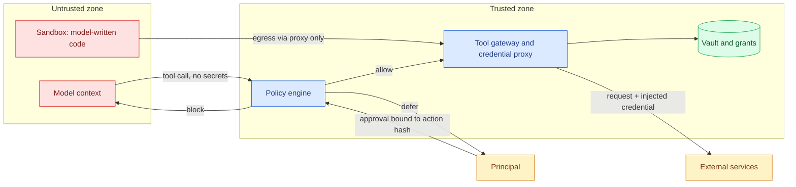

# Standing Authority and Containment

> The agent holds credentials for months and reads web pages written by strangers. What stops one sentence on one page from spending its authority?

## TL;DR

An always-on agent combines the three conditions that security engineering normally keeps apart. It holds a person's access, it reads content written by strangers, and it acts while that person is asleep. No filter reliably separates instructions from data inside a model, and adaptive attackers have defeated the published defenses that try. The design position is therefore that the model will sometimes be steered by what it reads, and that the system around it must make that survivable.

Containment is built from controls that do not depend on the model. The agent has its own identity and carries its principal's authority as a narrow, short-lived, audience-bound delegation, never as a copy of their credentials. Credentials stay in a proxy outside the agent's environment. Each run is assigned a capability set from the trust label of what woke it and what it has read, so that a run which has ingested untrusted content cannot both reach sensitive data and send anything outward. Every tool call is allowed, blocked, or *deferred*: a deferred call ends the run with the session saved, and the human's answer returns later as an ordinary inbox event bound to the exact action that was proposed.

A standing agent also needs what a session never did: a pause that works without the agent's cooperation, authority that expires unless renewed, and an audit trail that attributes every effect to a mandate version, a wake event, and a model version.

---

## The Threat Model Changes

[Agent Fundamentals](../17-llm-systems/08-agent-fundamentals.md) sets out the security model for a supervised agent, where the user's presence is a control: they see the tool call, they notice the odd request, they close the tab. Removing the user changes four things.

*Untrusted input arrives unattended.* The agent's wake sources are emails, tickets, web pages, pull requests, and messages from other agents. Most of what a standing agent reads was written by someone other than its principal, and some of it was written to be read by an agent.

*Authority is exercised offline.* The principal consented once, at setup. Every later action is taken on that consent with nobody to ask "did you mean this."

*Compromise persists.* Chapter 4 showed how an injection that writes to memory outlives its session. Timers are a second persistence channel: a hostile instruction can schedule its own future wake.

*Detection is delayed.* A wrong action in a chat is seen in seconds. A wrong action by a background agent is found when its consequence surfaces, which may be never.

Simon Willison's *lethal trifecta* names the dangerous combination for data theft: access to private data, exposure to untrusted content, and a way to communicate externally. An agent with all three can be told by a web page to read the inbox and send it somewhere. Meta's *Agents Rule of Two* generalizes it to state changes: within one session, an agent should hold at most two of processing untrusted input, accessing sensitive systems or private data, and changing state or communicating externally. A useful standing agent wants all three across its life. The engineering question is how to keep any single run from holding all three at once, and what to require when one must.

## Identity: The Agent Is Its Own Principal

The first decision is whose name is on the request. The convenient answer, running the agent with the user's own token, is the wrong one for three reasons. Downstream services cannot tell the user's actions from the agent's, so they cannot apply different policy or produce a useful audit. The token carries everything the user can do, when the mandate covers a small part of it. And revoking the agent means revoking the user.

The agent is a workload with its own identity and acts for its principal through *delegation*: OAuth token exchange (RFC 8693) yields a token whose subject is the user and whose `act` claim names the agent, so a resource server can enforce and log "this user, through this agent, for these scopes." [Workload & Agent Identity](../12-security/12-workload-and-agent-identity.md) covers the mechanism, along with audience binding, sender constraint, and the Model Context Protocol's authorization rules. A standing agent changes three things about how it is applied.

**Scope comes from the mandate, not from the task.** There is no user request to derive scopes from, so the token broker derives them from the mandate's `authority` block and binds each token to one resource (RFC 8707). A token for the calendar is useless at the bank.

**Tokens are minted per run.** The agent lives for months and its access tokens live for minutes. Nothing long-lived sits in the runtime between wakes, so a credential copied out of a sandbox or a log expires before it is useful, and sender constraint (DPoP, RFC 9449, or mutual TLS) stops it from being replayed elsewhere in the meantime.

**Delegation only attenuates.** Each hop to a subagent or a downstream agent can reduce scope and never add to it, so a chain that runs unattended for weeks cannot end with more authority than the mandate granted.

The standards are still moving. The IETF WIMSE working group is drafting how agents should combine workload identity with OAuth, including authorization chaining across domains and translating a user's confirmation into an authorization event. That work is worth following and should not be waited for: all three properties can be built today from token exchange and audience restriction.

### Consent Without Presence

A human's OAuth consent assumes a browser and a person. A run at three in the morning has neither. Two mechanisms fill the gap.

For routine authority, the principal grants a *standing delegation* at setup, bounded by the mandate: these scopes, for this agent, until this date. It is stored as a grant at the authorization server and not as a long-lived token in the agent, so the agent mints short tokens against it and the server can revoke it centrally. The mandate's expiry is the grant's expiry.

For authority the agent does not hold, it asks. Client-Initiated Backchannel Authentication (CIBA) is the OAuth shape for this: the agent requests authorization, the authorization server reaches the user on their own device, and the token is issued when they approve. The agent is never in the browser flow and never sees the user's credentials. This is step-up authorization for a party that is not present, and it is the protocol-level form of the deferred call described below.

## Credentials Stay Outside

The agent's context window and its sandbox are both places an attacker's text can reach. A credential in either should be considered exposed. Anthropic's guidance for always-on agents and the Managed Agents design make the same recommendation: put a proxy outside the agent's environment that adds credentials to outgoing requests, so that the agent never holds them.

The proxy does more than hide secrets. Because every outbound request passes through it, it is where egress is restricted to the destinations the mandate names, where requests are stamped with the agent's identity so that ingress can recognize the agent's own effects, where rate and spend budgets are enforced, and where the audit record is written. A sandbox with no direct network route and a proxy with an allowlist turns "the injected code tried to post the data to an attacker's server" into a blocked connection and an alert.

What the proxy does not solve is misuse of authority the agent legitimately holds. If the mandate permits sending email, a steered agent can send email. That is what the next two sections are for.

## Capability by Taint

The Rule of Two is a statement about a session. We enforce it per run, using the trust labels that ingress attached in chapter 2 and that memory records carry from chapter 4.

A run starts with a capability set computed from what woke it. As the run reads, the harness tracks the lowest trust level of anything that has entered the context, and capabilities are removed when that level drops. They are never added back within the run.

| Run has ingested | Read private data | Write internal state | Communicate externally or irreversibly |
|---|---|---|---|
| Principal and internal content only | Allowed | Allowed | Allowed within mandate |
| Third-party content | Allowed | Allowed for low-impact, reversible writes | Deferred to the principal |
| Third-party content, no private-data scope requested | Not granted | Not granted | Allowed for replies to that third party |

The middle row is the common case, an agent that reads an inbound email and has access to the principal's files. It may read and think. Anything that leaves the system waits for a human. The third row is the pattern for public-facing work: a run that answers an external message can reply freely because it was never given anything worth stealing.

Taint is coarse, and it will defer some actions that were safe. Two architectural patterns recover precision where it is needed.

*Quarantined reader.* A separate model call with no tools and no memory access reads the untrusted content and returns a constrained result: a classification, extracted fields validated against a schema, or a summary that is itself labeled untrusted. The privileged run sees the structured result and never the raw text. This is the dual-model pattern, and it works to the extent that the return channel is narrow. A free-text summary is a channel for instructions; an enumerated label is not.

*Plan before reading.* In the CaMeL design, a privileged model writes a plan as a program from the principal's request alone. An interpreter outside the model executes it, tracks which values derive from untrusted sources, and checks a policy before any value flows into a tool call. Untrusted content can change the data the plan operates on. It cannot change the plan. This gives a guarantee that does not depend on model behavior, at the cost of flexibility, since a plan that cannot adapt to what it reads is a weaker agent. It suits standing agents better than it suits open-ended ones, because recurring mandates have recurring plans.

None of these should be read as making injection impossible. A study in which the authors of leading defenses were also the attackers found that adaptive attacks bypassed every one of twelve published defenses. The controls in this chapter are valuable because they bound the outcome when the model is steered, and they should be evaluated that way.

## Allow, Block, or Defer

Every tool call a standing agent proposes has one of three outcomes: it proceeds, it is blocked, or it waits for approval. The policy engine decides from the tool's declared risk tier, the run's taint, the mandate, and the budgets.

| Tier | Examples | Default for a clean run | Default for a tainted run |
|---|---|---|---|
| Observe | Read a dashboard, search the log | Allow | Allow |
| Reversible internal write | Add a comment, label a ticket, save a draft | Allow | Allow, with action digest |
| External or hard to reverse | Send a message, merge, change a calendar | Allow within standing bounds | Defer |
| Irreversible or high value | Pay, delete, grant access | Defer | Defer, with step-up authentication |
| Outside mandate | Anything not in `authority` | Block | Block |

A model-based classifier can sit in this path as well. Auto-approval modes that use classifiers to stop dangerous actions reduce the volume a person has to review, and they are a layer on top of the tiers and not a replacement, since the most consequential decisions still need a human.

### The Deferred Call

Deferral in a supervised agent is a dialog box. In a standing agent nobody is there, and the person may take a day to answer. Holding the run open for a day would hold a worker, a sandbox, and the agent's single-turn lease, and it would stop the agent from handling anything else.

The mechanism is to end the run. A hook intercepts the gated call, the session is saved with the call pending, and the request goes to the principal through the outbox. The worker is free to process other events for the same agent. When the person answers, the answer arrives as an inbox event, and the run that takes it resumes the saved session at the pending call. In the terms of chapter 3 this is a durable wait: an `EffectIntent` with no result, a pending approval record, and no compute.

Four details decide whether this is a control or a ritual.

*The approval is bound to the action.* The request shows the exact tool and arguments, and the approval carries a hash of them. On resume, the policy engine recomputes the hash. If the agent's pending call differs from what was approved, the approval does not apply. Otherwise a steered agent could ask to send a harmless message and then send a different one.

*The request is rendered by the trusted side.* The description the human reads is generated from the structured call by the gateway, and not written by the model. A model that has been steered will also write a reassuring explanation.

*Approvals expire, and the world is rechecked.* An approval given on Monday for a rollback is not authority to roll back on Thursday's very different system. The resumed run verifies preconditions before executing.

*Silence has a defined meaning.* Every deferred request has a timeout and a default, and the default is the safe direction, which is nearly always not to act and to say so in the next digest.

### Approval Fatigue

A person who is asked forty times a day approves without reading, at which point the gate provides an audit trail and no safety. The countermeasure is to make approvals rare enough to deserve attention. *Standing approvals* convert a repeated decision into a bounded rule, such as permission to reschedule internal meetings within working hours, that the policy engine enforces without asking. The agent may propose such a rule after the same request has been approved several times, and the proposal is itself a gated action. Approval rate and time-to-decision are monitored, and a rate near one hundred percent with decisions in under two seconds means the gate has stopped working.

## Budgets Are Security Controls

A steered or looping agent is limited first by what it is allowed to spend. The mandate's budgets, tokens per day, actions per hour, money per day, messages per recipient, are enforced at the gateway and scheduler. They turn an unbounded incident into a bounded one and they produce the earliest signal, since a budget stop on an agent that normally uses a tenth of its allowance is an anomaly worth a page.

Budgets should be set from observed use with modest headroom, and not from the worst case anyone can imagine. The purpose is that abnormal behavior hits a wall quickly.

## Pause, Revoke, Expire

Every standing agent needs a stop that works when the agent is the problem.

*Pause* is a control-plane flag checked by the scheduler before admitting a run and by the gateway before executing an effect. It does not ask the model to stop. Setting it takes effect at the next tool boundary of a running turn and immediately for new ones. The mailbox continues to accept events so that resuming is lossless.

*Revocation* withdraws the standing grant at the authorization server. Because access tokens are short-lived and minted per run, revocation latency is bounded by token lifetime, which is the argument for keeping that lifetime to minutes. The lease epoch is bumped at the same time so that any brain still running fails its next log append.

*Expiry* is the dead-man's switch. The mandate lapses on its date unless the owner renews it, and a lapsed mandate is a pause. This is the only control that works against the failure nobody notices: the agent whose owner moved on.

*Fleet stop* applies a pause by cohort: by tenant, by model version, by tool. When a vulnerability is found in a tool or a bad model version is rolling out, an operator needs to stop every agent using it with one action.

## Audit

Because nobody watched, the record has to answer afterwards the questions a witness would have. For every effect, the gateway logs the agent identity and the delegating principal, the mandate version, the wake event and its trust label, the run and session identifiers, the model and prompt versions, the taint level at the time of the call, the policy decision and the rule that produced it, and for deferred calls the approver and the action hash. The session log holds the reasoning; the gateway log holds the facts, written by a component the model cannot influence.

Two standing reports come from this. A daily digest to the owner lists what the agent did, which is the minimal substitute for supervision. And a periodic access review compares the authority the mandate grants with the authority the agent actually used, and removes the difference.

## Failure Modes

| Failure | Mechanism | Detection | Mitigation |
|---|---|---|---|
| Exfiltration by injection | Untrusted content steers a run holding private data and an outbound channel | Egress blocks; deferred sends from tainted runs | Capability by taint; egress allowlist; credential proxy |
| Confused deputy | Agent uses the user's full token; service cannot narrow | Agent actions indistinguishable in service logs | Delegated tokens with actor claim; audience binding |
| Credential theft from sandbox | Secret in environment read by injected code | Token used from unexpected origin | Proxy-held credentials; sender-constrained tokens |
| Approval swap | Approved action differs from executed action | Hash mismatch at resume | Approval bound to action hash; trusted rendering |
| Rubber-stamp approvals | Too many requests; human stops reading | Approval rate near 100%, decision time near zero | Standing approvals with bounds; fewer, better requests |
| Persistent compromise | Injection writes memory or sets a timer | Imperative memory writes; timers set in tainted runs | Quarantine; tainted runs cannot set timers without review |
| Privilege creep | Scopes added over time, never removed | Granted minus used scopes grows | Access review from gateway logs; expiry |
| Unstoppable agent | Stop implemented as a message to the model | Pause has no effect under loop or compromise | Pause at scheduler and gateway; epoch bump; revocation |
| Delegation amplification | Subagent receives more authority than its parent | Token scopes wider downstream | Attenuation enforced at token exchange |
| Stale approval executed | Conditions changed between approval and resume | Precondition check fails | Approval expiry; recheck before effect |

## Decision Framework

Start from what a single compromised run could do, and reduce it until the answer is acceptable to the mandate's owner.

If the agent never reads third-party content, taint tracking is unnecessary and the tiers plus budgets suffice. Few useful standing agents are in this position, and it should be verified and not assumed, since web search and inbound email both break it.

If it reads third-party content and holds private data, remove the outbound channel from tainted runs and defer what must leave. This is the default configuration for assistants over mail, documents, and tickets.

If it must act externally on untrusted input without waiting, as an auto-responder does, remove the private data. Give that run its own narrow scope and nothing else.

If the workload truly needs all three in one run, with no human gate, treat it as a high-risk system: plan-then-execute with an external policy interpreter, the narrowest possible scopes, low budgets, full audit, and an owner who has accepted the residual risk in writing.

## Key Takeaways

- Assume the model can be steered by what it reads. Containment comes from controls outside it.
- The agent has its own identity and carries its principal's authority as a narrow, short-lived, audience-bound, sender-constrained delegation with an actor claim.
- Credentials live in a proxy outside the context and the sandbox. The proxy is also the egress, budget, and audit point.
- Assign capabilities per run from the trust level of what the run has ingested, and only ever remove them. No run should hold private data, untrusted input, and an outbound channel together without a human gate.
- Every tool call is allowed, blocked, or deferred. A deferred call ends the run, and the answer resumes the session as an inbox event.
- Bind approvals to a hash of the exact action, render requests from the trusted side, expire them, and define what silence means.
- Keep approvals rare. Convert repeated decisions into bounded standing rules and watch for rubber-stamping.
- Pause at the scheduler and gateway, revoke at the authorization server, and let mandates expire. None of these may depend on the model.

## References

- [Building always-on agents](https://claude.com/resources/articles/building-always-on-agents): the credential proxy, allow, block, or wait decisions, and deferred tool calls that resume through the inbox
- [The lethal trifecta for AI agents](https://simonwillison.net/2025/Jun/16/the-lethal-trifecta/): private data, untrusted content, and external communication as the exfiltration condition
- [Agents Rule of Two: A Practical Approach to AI Agent Security](https://ai.meta.com/blog/practical-ai-agent-security/): holding at most two of three risky properties per session
- [Defeating Prompt Injections by Design](https://arxiv.org/abs/2503.18813): CaMeL, with plans from trusted input and capability-checked data flow
- [The Attacker Moves Second](https://arxiv.org/abs/2510.09023): adaptive attacks bypassing published prompt-injection defenses
- [RFC 8693: OAuth 2.0 Token Exchange](https://www.rfc-editor.org/rfc/rfc8693): delegation with subject and actor tokens
- [RFC 9449: OAuth 2.0 Demonstrating Proof of Possession](https://www.rfc-editor.org/rfc/rfc9449): sender-constrained tokens
- [OpenID Connect Client-Initiated Backchannel Authentication](https://openid.net/specs/openid-client-initiated-backchannel-authentication-core-1_0.html): out-of-band user authorization for a client the user is not in front of
- [Model Context Protocol: Authorization](https://modelcontextprotocol.io/specification/draft/basic/authorization): MCP servers as OAuth resource servers with resource-bound tokens
- [AI Agent Authentication and Authorization (draft-ietf-wimse-aims)](https://datatracker.ietf.org/doc/draft-ietf-wimse-aims/): combining workload identity and OAuth for agents; a working draft

---

## Related Chapters

- [Workload and Agent Identity Delegation](../12-security/12-workload-and-agent-identity.md): workload credentials and delegation chains the agent's identity is built from
- [OAuth 2.1 and High-Assurance Authorization Profiles](../12-security/06-oauth-security-profiles.md): sender-constrained tokens and the hardened flows a standing grant should use
- [Authorization at Scale](../12-security/07-authorization-patterns.md): the policy engine and decision model behind allow, block, and defer
- [Threat Modeling and Abuse Case Engineering](../12-security/01-threat-modeling-and-abuse-cases.md): a structured way to enumerate what one compromised run can reach
- [LLM Agent Fundamentals](../17-llm-systems/08-agent-fundamentals.md): the supervised-agent security model that this chapter extends
