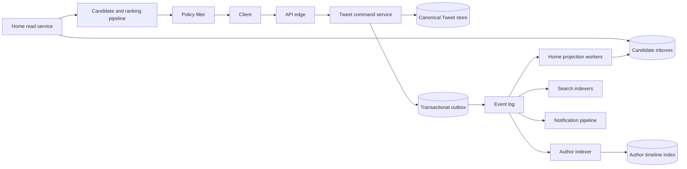

# Twitter/X Timelines: Evidence, Inference, and Reference Design

> A user with a hundred million followers posts once. Do you write to a hundred million timelines now, or compute them when people read?

## TL;DR

A Tweet is a few hundred bytes, written once. Delivering it can mean expanding a follower graph of millions, updating a search index, scoring it for ranking, sending notifications, and feeding analytics. The gap between the size of the write and the size of the work it sets off is the central fact of the system, and the timeline architecture is largely a set of decisions about when and where that work is done. The subject has gathered a good deal of folklore, so claims here carry one of three labels:

- **Documented** means a dated Twitter/X engineering source or paper states the behavior.
- **Inference** means the conclusion follows from documented constraints, but the private implementation is not published.
- **Reference design** means a defensible design for a Twitter-like service, not a claim about Twitter/X production.

“Current” means current in the cited source, not necessarily today.

## Evidence Boundary

| Evidence | What it establishes | What it does not establish |
|---|---|---|
| Twitter's April 2014 Manhattan post | An eventually consistent, multi-tenant key-value core with pluggable storage, cross-datacenter replication, repair, and optional strong-consistency services | The complete 2026 storage topology |
| Twitter's 2017 infrastructure retrospective | A historical path from MySQL through Gizzard, FlockDB, Snowflake, and Manhattan; a Redis-derived timeline cache written by Timeline and Fanout services | A universal rule for every timeline surface |
| The public 2023 Home Mixer repository | Candidate pipelines, feature hydration, scoring, filtering, mixing, fallback, and serving stages for the published Home Timeline code | Undisclosed models, feature values, fleet layout, or later private changes |
| The 2012 Earlybird paper | A segment-oriented real-time search engine designed for rapidly arriving Tweets | The present search stack |
| Twitter's October 2021 event-processing post | A dated snapshot of approximately 400 billion real-time events and petabyte-scale daily data, with real-time and batch processing in three datacenters | Tweet request rate or user count |

Scale figures keep the dates of their sources. They are historical observations and should not be used as sizing constants.

## Workload and Requirements

The workload is asymmetric in several ways at once, and each asymmetry leaves a mark on the design:

- A Tweet is written once, but may become a candidate for many readers.
- Follow and safety relationships change less often than timelines are read, yet they affect every read.
- Search needs low indexing delay, while ranking needs fresh behavioral features.
- Media bytes dominate object size and egress; Tweet metadata dominates online lookup count.
- A small number of authors can have far more followers than the median author.

The last item is the one that makes the problem hard. If every account had roughly the same number of followers, any reasonable design would work. They do not. Follower counts follow a heavy-tailed distribution in which the typical account has a few hundred and a small number have tens of millions. A design tuned to the typical case meets, several times a day, an input five orders of magnitude larger than the one it was tuned for.

**Documented (2023):** the public Home Mixer source describes separate “For You,” reverse-chronological “Following,” and List pipelines. “For You” draws candidates from several sources, hydrates features, scores, filters, mixes non-Tweet content, and prepares client instructions. It also exposes a reverse-chronological conversation-service fallback.

**Reference design requirements:**

| Capability | Correctness target | Degradation target |
|---|---|---|
| Create a Tweet | An acknowledged Tweet has one stable ID and durable canonical body | Delay secondary work rather than lose the Tweet |
| Follow/unfollow | Authorization and graph state converge without exposing blocked content | A stale follow may affect ranking briefly, but a block must take the safety path |
| Home timeline | No duplicates within a cursor traversal; visibility checked against current policy | Serve a smaller, older, or chronological feed |
| User timeline | Monotonic pagination over an author's published Tweets | Read canonical author history if caches are cold |
| Search | Results honor deletion and visibility policy | Admit indexing lag and show an incomplete result set |
| Delete | Canonical state changes once; derived copies are eventually removed or suppressed | Tombstone at read time until physical cleanup completes |

The second row distinguishes two kinds of change to the same graph. A follow that takes a few seconds to appear in someone's timeline is an inconvenience. A block that takes a few seconds to apply means a user is still shown content from someone they have just blocked, which is a safety failure. The two travel on different paths with different urgency.

Latency goals belong to a product SLO and not to a case study. Publish acknowledgement, home-feed freshness, search freshness, and read latency each need a separate objective, because most of the work is asynchronous and a single "API latency" percentile measures none of it. A Tweet can be acknowledged in ten milliseconds and take a minute to reach its readers, and only a freshness objective would notice.

## State, Authority, and Invariants

The choice of database matters less than deciding which representation of each piece of state is the truth and which are copies that can be thrown away:

| State | Authority in the reference design | Consistency | Rebuildable? |
|---|---|---|---|
| Tweet body and lifecycle | Tweet store, keyed by Tweet ID | Read-after-write for the author; durable state transitions | No |
| Follow, mute, and block edges | Relationship service | Strong per edge; safety edges take precedence | No |
| Author timeline | Ordered index of Tweet IDs by author | Monotonic append plus tombstones | Yes, from canonical Tweets |
| Home candidate inbox | Materialized Tweet-ID references by reader | Eventually consistent | Yes |
| Search index | Token-to-Tweet postings plus policy metadata | Eventually consistent | Yes |
| Ranking features | Stream/batch feature stores | Versioned and bounded-stale | Yes |
| Media | Immutable object store addressed by an asset/version ID | Durable after publish commit | No; derivatives are rebuildable |

The "Rebuildable?" column divides the system in two. Three kinds of state are irreplaceable: what was said, who is connected to whom, and the media. Everything else, including every timeline and the whole search index, can be regenerated from those three. That gives the derived systems room to be fast, approximate, and occasionally wrong, because their errors can be repaired by recomputation, and it concentrates the need for durability in a small part of the system.

The invariants are explicit:

1. A Tweet ID identifies at most one canonical Tweet.
2. Publishing never depends on completing follower fan-out.
3. A derived copy cannot override canonical deletion, account suspension, block, or audience policy.
4. Timeline cursors identify a stable ordering boundary, not an offset into a changing list.
5. Retryable commands carry an idempotency identity; event consumers deduplicate by event identity and projection version.
6. Search and timeline projections expose their freshness so operators can distinguish “fast but stale” from “slow.”

The fourth invariant deals with a problem every feed has. Suppose a client fetches the first twenty items and asks for "the next twenty, starting at offset twenty." If five new Tweets arrived in the meantime, everything has shifted down by five, and the client receives five items it has already seen. A cursor that names a position in the ordering itself, such as "items older than this ID," is unaffected by what arrives at the top.

**Documented (2010):** Twitter introduced Snowflake because database-local auto-increment IDs did not provide a suitable distributed identifier. The public announcement establishes the service and its purpose. It does not prove that the original bit allocation remains unchanged.

The problem Snowflake addressed arises as soon as writes are spread over more than one database. A single database issues identifiers by counting. Several databases counting independently issue the same numbers. A central counter that all of them consult restores uniqueness and becomes a bottleneck and a single point of failure for every write in the system. The announcement described identifiers composed of a timestamp, a worker number, and a sequence number, which lets many machines generate identifiers independently, with no coordination on each request, while the results still sort roughly by time.

**Reference design:** use a time-sortable, globally unique 64- or 128-bit ID whose generator lease and clock behavior are observable. Time ordering helps storage locality and cursors. The canonical `created_at` is nonetheless stored separately, because clocks can move backward and an ID can be generated some time before its Tweet commits.

## Data Plane and Control Plane

The **data plane** accepts commands, stores canonical state, publishes events, builds projections, retrieves candidates, evaluates policy, and serves responses. The diagram has the shape of the rebuildable column. One small synchronous write lands in the canonical store, and everything else fans out from the event log at its own pace.

The **control plane** owns shard placement, consumer assignments, quota policy, ranking and model versions, feature definitions, search schema, cache TTL policy, rollout state, and regional traffic steering. If it becomes unavailable, the data plane continues on a frozen, known-good configuration. A control-plane outage must not erase the data plane's routing.

**Documented (2014):** Manhattan separated interfaces, storage services, engines, and a core responsible for routing, topology, replication, and conflict resolution. ZooKeeper held topology information but was not in the read/write critical path. That is evidence for a split between control and data planes and not a requirement to copy Manhattan.

The detail about ZooKeeper is the important part. A coordination service is the natural home for cluster topology, and it is also slower and less available than the data path it describes. If every read had to consult it, its availability would cap the database's. Keeping it off the critical path means storage nodes cache the topology and go on serving through a coordination outage, with the cost that topology changes wait until it returns.

## Tweet Write Flow

This flow is an **explicit reference design**:

1. The edge authenticates the actor, applies request and account quotas, and attaches an idempotency key.
2. The command service validates text, audience, reply/quote references, media readiness, and abuse-policy preconditions.
3. The service allocates a Tweet ID and atomically stores the Tweet plus an outbox record. The acknowledgement boundary is this durable commit.
4. A relay publishes `TweetPublished(tweet_id, author_id, audience_version, event_id)` to a partitioned event log.
5. Independent consumers update the author index, home candidate projections, search, notifications, counters, and offline datasets.
6. Each projection records its source offset and projection version. Retrying the same event is harmless.

Step 3 is where the user's request ends. The acknowledgement is sent when the Tweet is durable, before any follower's timeline has been touched. This is invariant 2 put into practice, and it is the decision that keeps publishing fast and reliable whatever the size of the audience. An author with fifty million followers waits exactly as long as one with fifty.

Writing to a database and publishing an event are two operations, and a crash can fall between them. If the Tweet commits and the event is never published, the Tweet exists and appears in no timeline. If the event is published and the commit fails, timelines point at a Tweet that does not exist. The transactional outbox removes the gap by writing the event into the same database transaction as the Tweet, so that both exist or neither does, and a separate relay reads the outbox and publishes, retrying until it succeeds. See [Outbox Pattern](../05-messaging/05-outbox-pattern.md) and [Delivery Guarantees](../05-messaging/04-delivery-guarantees.md).

Media upload is a separate reservation flow. The bytes are uploaded, scanned, and transcoded first, and the Tweet then references a ready asset version. Otherwise a committed Tweet could point at media that was never made durable.

## Timeline Write and Read Paths

### The Two Ways to Build a Timeline

A home timeline is the merged, ordered stream of Tweets from every account a user follows. There are two ways to produce it, and they are mirror images of each other.

The first is to compute it when the user asks. On each request, the system looks up the accounts the user follows, fetches recent Tweets from each, and merges them. Publishing is then trivial, since a Tweet is stored once and nothing else happens. Reading is expensive: a user following two thousand accounts needs two thousand lookups and a merge every time they open the application. This is fan-out on read, or pull.

The second is to compute it when the Tweet is published. Each user has a precomputed inbox, and when someone tweets, a reference to that Tweet is appended to the inbox of every follower. Reading becomes a single lookup of a list that is already built. Publishing becomes expensive, because one Tweet from an account with a million followers is a million writes. This is fan-out on write, or push.

The choice between them rests on a ratio. Timelines are read far more often than Tweets are written, so moving work from the read path to the write path is, on average, a large saving, and for the typical account push is clearly better. The heavy tail spoils the simple answer. For the account with fifty million followers, push means fifty million writes for one Tweet, most of them into the inboxes of users who will not open the application before that Tweet is buried. For those accounts pull is better, because a handful of very popular authors can be fetched at read time and merged into the precomputed list at small cost.

### What Is Documented

**Documented (2017):** Twitter described Haplo as a primary cache for Tweet timelines backed by a customized Redis `HybridList`, read by Timeline Service and written by Timeline Service and Fanout Service. This establishes materialized timeline caching in that historical architecture.

**Documented (2023):** Home Mixer shows that serving is not “read one cached list.” The published pipeline retrieves heterogeneous candidates, hydrates features, scores, filters, mixes, decorates, and emits client instructions. Its “For You” path includes a reverse-chronological fallback.

Those sources do not publish a complete rule for which authors are pushed to which readers. A claim such as "Twitter always fans out ordinary users and always pulls celebrities" is a reasonable description of the general technique. As a statement about the production system it is unsupported unless tied to a dated source.

### Hybrid Reference Design

The reference design uses both candidate paths:

- **Materialize-on-write:** append a compact Tweet reference to bounded follower inboxes when predicted fan-out cost fits the publish-freshness budget.
- **Merge-on-read:** retrieve recent author items for high-fan-out, rapidly posting, or otherwise expensive sources and merge them at read time.

The usual way of dividing authors between the two is a fixed follower-count threshold, and we recommend against it. A threshold is a guess at a cost that can be estimated directly. The controller estimates:

`fanout_cost = eligible_followers × reference_bytes × replication_factor`

and

`completion_time = eligible_followers / available_projection_writes_per_second`.

A Tweet is pushed only while the expected work fits both the author's quota and the global freshness budget. This adapts where a fixed threshold cannot. An author with a moderate following who posts sixty times an hour may cost more than a celebrity who posts once a day, and the capacity available for fan-out varies with the time of day. Because inboxes are derived data, the policy can change at any time without touching canonical state.

The home read path is then:

1. Resolve a cursor containing an ordering boundary, ranking configuration, and snapshot epoch.
2. Fetch materialized references plus merge-on-read candidates.
3. Deduplicate by Tweet ID and hydrate canonical Tweet, author, conversation, and feature data in batches.
4. Apply hard visibility filters before ranking output is returned. Apply safety rules again if cached policy state is older than its allowed staleness.
5. Rank or reverse-sort, mix product modules, and return a signed opaque continuation cursor.
6. Record candidate-source coverage and freshness, not just response latency.

Inboxes hold references, meaning Tweet IDs, and not the Tweets themselves. Step 3 fetches the content, and this has a useful consequence for deletion. If a Tweet is deleted, the millions of inbox entries pointing to it need not be found and removed. They remain as dangling references, hydration finds no Tweet behind them, and they are dropped. Step 4 applies the same reasoning to blocks and other policy.

Inboxes are bounded. Retaining every historical reference for every reader would turn a cache into an unbounded database. Older pages can be served from author and search indexes or from a compact archival projection.

## Search, Trends, and Recommendations

**Documented (2012):** the Earlybird paper describes a real-time search engine using in-memory segments for incoming Tweets and optimized immutable segments. It was designed around the tension between rapid ingestion and efficient retrieval. The paper is historical evidence, not a current component inventory.

That tension is fundamental to search. An inverted index maps each word to the list of documents containing it, and it is fastest to query when those lists are compact, sorted, and immutable. It is fastest to update when they are loose and appendable. Conventional search engines resolve this in favor of queries and accept that new documents take a while to become searchable. A service whose value lies in what is happening now cannot accept that. The segmented design divides the index by time: the newest Tweets go into a small, mutable, in-memory segment built for fast insertion, and once a segment fills it is frozen and converted into a compact read-only form. Queries search both kinds. Only a small part of the index is ever being written to, and the bulk has the efficient immutable layout.

**Reference design search path:**

1. Consume the canonical Tweet lifecycle stream.
2. Normalize text and entities under a versioned analyzer.
3. Write an immutable posting segment and a mutable deletion/visibility overlay.
4. Query multiple time/term partitions in parallel with a deadline.
5. Retrieve candidates, enforce the requesting user's ACL and safety state, then rank.
6. Compact segments and physically remove expired tombstones later.

Immutable segments leave one difficulty, which step 3 answers. A deleted Tweet cannot be removed from a segment that cannot be modified. A small mutable overlay records which documents are deleted or hidden, and queries consult it to suppress them. Physical removal happens later, when segments are merged. The overlay must be fast, because until a deletion reaches it, the search cluster will continue to serve content that the canonical system has already removed.

**Documented (2023):** public Home Mixer code names candidate generation, feature hydration, scoring, ranking, filters, heuristics, and fallback stages. **Inference:** separating those stages permits independent deadlines, feature/model versioning, and graceful degradation. The source does not disclose every production feature or model.

Trending topics are more than a global counter. Counting the most frequent terms would report the same common words every day. A trend is a term whose current volume is unusual compared with its own history. An **explicit reference design** maintains decayed counts per locale and time bucket, compares observed volume with a learned or historical baseline, applies controls for spam and coordinated behavior, and merges only aggregates across regions.

The counting is a problem of scale in its own right, since the number of distinct terms is effectively unbounded and an exact counter for each would not fit in memory. A count-min sketch gives approximate counts in fixed space. It keeps a small table of counters with several rows, hashes each term to one counter in every row, and increments them all. A term's estimated count is the smallest of its counters. Collisions with other terms can inflate a counter and can never reduce one, so the estimate may be too high and is never too low, and taking the minimum across rows makes a large overestimate unlikely.

## Partitioning and Illustrative Capacity Model

The following numbers are intentionally illustrative and are not Twitter measurements.

Assume a design target of:

- 8,000 Tweet creates/s average and 32,000/s peak;
- 1.2 KiB of canonical Tweet metadata after indexing overhead, excluding media;
- 280 eligible followers per ordinary publish on average after excluding merge-on-read sources;
- 24 bytes per materialized inbox reference before storage-engine overhead;
- replication factor 3 for online state.

Canonical Tweet growth is approximately:

`8,000 × 86,400 × 1.2 KiB ≈ 791 GiB/day` before replication, or about `2.3 TiB/day` at three copies.

Average inbox projection work is:

`8,000 × 280 = 2.24 million reference writes/s`.

Raw reference growth is approximately:

`2.24 million × 24 B ≈ 51 MiB/s`, or `4.3 TiB/day` before replication and retention.

The system receives eight thousand writes a second from users and performs more than two million a second on their behalf, an amplification of 280 times. The derived inbox data grows several times faster in bytes than the canonical Tweets, even though each reference is a fiftieth the size of a Tweet. The busiest write path in this design is one that no user ever calls directly.

The arithmetic shows where the pressure lies and does not, by itself, justify any particular threshold. The figure of 280 is an average, and the average of a heavy-tailed distribution describes almost none of its members. The real follower-degree distribution, the fraction of readers who are active, inbox retention, write amplification, and bursts from hot authors all have to be measured before a policy is chosen.

Each dataset is partitioned for its own access pattern:

| Dataset | Candidate key | Hotspot concern | Mitigation |
|---|---|---|---|
| Tweets | Hash of Tweet ID | Recent-time locality if IDs are range-partitioned | Hash or salted time ranges |
| Author timeline | Author ID | A prolific author | Subpartition by time bucket |
| Home inbox | Reader ID | Highly active readers and rebuilds | Bounded buckets plus generation |
| Follow graph | Source or destination ID, depending query | High-degree accounts | Maintain query-specific projections |
| Search | Term/time segment | Viral terms and fresh segment | Scatter limits, replicas, admission control |
| Event log | Author or Tweet ID | A hot author pins one partition | More virtual partitions or keyed substreams while preserving required order |

The first row records a consequence of time-sortable identifiers. If Tweets are range-partitioned by ID and IDs increase with time, every new Tweet falls into the last partition, which takes all the write load while the others sit idle. Hashing the ID spreads writes evenly and gives up the ability to scan a range of time efficiently.

See [Partitioning Strategies](../03-distributed-databases/08-partitioning-strategies.md), [Database Sharding](../06-scaling/11-database-sharding.md), and [Capacity Planning](../01-foundations/09-capacity-planning.md) for the general mechanisms.

## Concrete Failure Trace: Viral Publish Overloads Fan-Out

This is a **reference-design failure trace**, not a report of a Twitter incident.

1. An author with a very large active audience publishes during an external event.
2. The projection planner underestimates eligible recipients and admits the job to materialize-on-write.
3. One event becomes millions of reference writes. Inbox shards saturate and consumer lag grows.
4. Timeline reads miss their freshness objective. Clients refresh, raising read QPS.
5. Projection workers time out and retry without a shared retry budget, adding duplicate work.
6. Search and notification consumers sharing the same event-log or storage quota fall behind.

The trace escalates in three stages. Step 3 is the initial overload, a job much larger than expected. Step 4 is contributed by human behavior: users who see a stale timeline pull to refresh, so the read load rises as a result of the write path falling behind. Step 5 is contributed by the machinery, as workers that time out retry and add work to a system that is failing for want of capacity. By step 6 the damage has spread to search and notifications, which had no part in the original problem and merely shared a resource with it.

The system survives only if protection was in place before the burst:

- Reserve separate quotas for canonical writes and each derived projection.
- Convert an admitted fan-out job to merge-on-read when its measured completion cost exceeds budget.
- Deduplicate projection writes and use checkpointed resumable ranges.
- Bound queues by bytes and age; shed low-value notification or precomputation work before canonical data.
- Expose feed freshness and consumer lag to the response path so it can select chronological fallback.
- Apply one retry owner and a global attempt budget; see [Backpressure](../06-scaling/08-backpressure.md) and [Retries, Timeouts, and Hedging](../06-scaling/09-retries-timeouts-hedging.md).

The second defense is the adaptive policy from earlier doing its job in an emergency. A fan-out job that proves far more expensive than predicted is abandoned partway through, and its author is served by pull. Since inboxes are derived data, nothing is lost. Readers get that author's Tweets by the other path.

## Multi-Region Design

**Documented (2014):** Manhattan's core handled intra- and inter-datacenter replication and conflict resolution; its eventual model included reconciliation, read repair, and hinted handoff, while strong consistency was opt-in. **Documented (2021):** a Twitter event-processing pipeline ran real-time components and query services in three datacenters, with batch work in one and data replicated to two others. Neither source proves one global topology for all Twitter products.

An **explicit reference design** assigns each account or Tweet partition a write authority epoch:

- Route commands to the authority region or reject them when authority is uncertain.
- Replicate canonical Tweet and graph logs asynchronously to serving regions.
- Build disposable timeline/search projections regionally from those logs.
- Fence a previous writer before promoting another region.
- Preserve source offsets so a recovered region can prove its replay point.
- Size failover headroom before declaring a region evacuable.

The third item follows from the rebuildable column. Timelines and search indexes need not be replicated between regions, which would mean shipping the amplified write volume across the world. Each region receives the small canonical stream and builds its own projections locally.

Feeds can tolerate bounded staleness. Blocks, account suspensions, and the suppression of deleted content need a faster global safety channel. Multi-region design is therefore decided separately for each class of data, and "active-active" is too coarse a description to be a decision. See [Multi-Region Architecture](../06-scaling/14-multi-region-architecture.md).

## Operations, Security, and Observability

Operational signals have to follow the graph of work, since most of the work happens after the request has returned:

- Publish commit latency, failure rate, and idempotency replay rate.
- Outbox age and event-log produce/consume offsets.
- Fan-out jobs admitted, converted to pull, completed, retried, and abandoned.
- Timeline candidate coverage, deduplication rate, source freshness, policy-filter count, and fallback rate.
- Search ingest lag, tombstone lag, segment age, scatter width, and partial-result rate.
- Storage hot keys, per-tenant quota consumption, reconciliation backlog, and replica divergence.
- Ranking feature age, model/config version, timeout contribution, and result-quality guardrails.

A publish is traced with `tweet_id`, `event_id`, projection generation, region, and source offset. Sampling only successful home reads would miss the expensive tail of the publish path entirely.

Security boundaries are part of correctness:

- Authenticate users and services independently; authorize every object access against audience and relationship state.
- Treat blocks, mutes, legal holds, geo restrictions, and account status as versioned policy inputs.
- Encrypt private content and credentials in transit and at rest; isolate encryption keys from content stores.
- Rate-limit by actor, application, destination, and cost, not only by IP.
- Prevent model and analytics pipelines from becoming an unreviewed copy of deleted or restricted data.
- Audit privileged reads and policy changes with immutable event identities.

The fifth item names a leak that is easy to miss. A deletion that reaches the Tweet store, the timelines, and the search index may still leave the content in a training dataset or an analytics table, where it persists indefinitely and may influence a model. Deletion has to follow data into every pipeline that copied it.

Search and caches should store enough policy metadata to reject safely, and a cached "allow" must expire quickly or be invalidated. The authorization model is covered in [Authorization Patterns](../12-security/07-authorization-patterns.md).

## Evolution and Migration

**Documented historical evolution:** Twitter's 2017 retrospective describes an early MySQL deployment, Gizzard for distributed storage, FlockDB for graph storage, Snowflake for IDs, and later Manhattan adoption. The 2021 RocksDB post says Manhattan had become the default persistent real-time store for core nouns including Tweets, Users, and Direct Messages at that date.

The reusable lesson is the discipline of migration, and the component names are incidental. A safe reference migration from one Tweet or timeline store to another is:

1. Define the new authority and compatibility contract.
2. Backfill immutable history with source checksums and source positions.
3. Dual-write through an outbox, but keep one declared authority.
4. Shadow-read and compare presence, version, order, and policy outcome.
5. Cut over a small tenant or partition cohort behind a reversible routing flag.
6. Hold the old projection until the rollback window and reconciliation prove the new path.
7. Retire dual writes before adding new semantics; permanent dual authority creates ambiguity.

For changes to the timeline algorithm, candidate sets and ranking decisions are logged under both versions and guarded online experiments follow. Engagement alone does not establish that a change is correct. A ranking change can raise engagement by promoting content that is inflammatory or repetitive, so the guardrails include safety, diversity, latency, freshness, and resource cost. See [Migration Strategies](../14-deployment/06-migration-strategies.md) and [Online Experiments](../16-ml-systems/12-online-experiments.md).

## Verification

A design review should require evidence for these properties:

- Replaying any published event twice produces the same projection.
- Killing a fan-out worker leaves resumable work rather than an acknowledged gap.
- A deletion or block suppresses content even while timeline and search indexes are stale.
- Cursor pagination does not duplicate or skip items when new Tweets arrive.
- A hot author cannot consume canonical-write, search, or unrelated-tenant quotas.
- A regional promotion is fenced and preserves the declared RPO.
- A stale ranking feature or failed candidate source selects a known fallback.
- A full projection can be rebuilt from canonical history within a measured recovery objective.

These are tested with skewed follower graphs and viral bursts. Uniform random traffic conceals the heavy-tail failure this architecture exists to absorb, and a load test in which every account has the average number of followers will pass comfortably and prove nothing.

## Design Lessons

1. Separate canonical social state from disposable delivery and ranking projections.
2. Model write amplification from the degree distribution, not the average follower count alone.
3. Make fan-out policy adaptive and reversible; never put full fan-out on the publish acknowledgement path.
4. Enforce safety and visibility after candidate retrieval, even when earlier projections attempted filtering.
5. Treat feed freshness, search freshness, and publish durability as different SLOs.
6. Keep control-plane failure from invalidating known-good data-plane routing.
7. Cite dated public architecture as evidence and label the remainder as inference or reference design.

## References

- Twitter Engineering, [“Announcing Snowflake”](https://blog.x.com/engineering/en_us/a/2010/announcing-snowflake.html), June 2010.
- Busch et al., Twitter, [“Earlybird: Real-Time Search at Twitter”](https://cs.uwaterloo.ca/~jimmylin/publications/Busch_etal_ICDE2012.pdf), ICDE 2012.
- Twitter Engineering, [“Manhattan, our real-time, multi-tenant distributed database for Twitter scale”](https://blog.x.com/engineering/en_us/a/2014/manhattan-our-real-time-multi-tenant-distributed-database-for-twitter-scale), April 2014.
- Twitter Engineering, [“The Infrastructure Behind Twitter: Scale”](https://blog.x.com/engineering/en_us/topics/infrastructure/2017/the-infrastructure-behind-twitter-scale), January 2017.
- Twitter Engineering, [“Processing billions of events in real time at Twitter”](https://blog.x.com/engineering/en_us/topics/infrastructure/2021/processing-billions-of-events-in-real-time-at-twitter-), October 2021.
- Twitter Engineering, [“Adopting RocksDB within Manhattan”](https://blog.x.com/engineering/en_us/topics/infrastructure/2021/adopting-rocksdb-within-manhattan), April 2021.
- Twitter, [Home Mixer README in the public recommendation repository](https://github.com/twitter/the-algorithm/blob/main/home-mixer/README.md), public repository released in 2023.

---

## Related Chapters

- [Partitioning Strategies](../03-distributed-databases/08-partitioning-strategies.md): fan-out on write is a partitioning decision wearing a product name
- [Backpressure](../06-scaling/08-backpressure.md): a viral account is a hot key, and fan-out is where it surfaces first
- [Transactional Outbox, Inbox, and CDC Publication](../05-messaging/05-outbox-pattern.md): the delivery promise behind everyone-who-follows-you-sees-this
- [Online Experiments](../16-ml-systems/12-online-experiments.md): how a ranking change gets judged at this scale, which is where most of the risk sits
