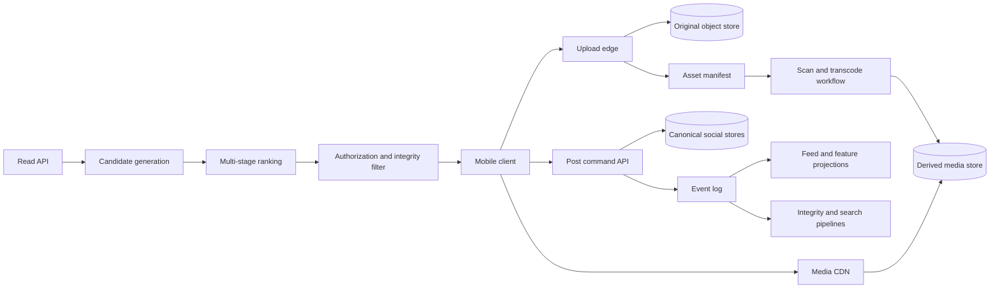

# Instagram: Evidence, Inference, and a Media-System Reference Design

> A photo is uploaded once and viewed a hundred million times, from every country, at every screen size. Where do the bytes live, and what is computed ahead of time?

## TL;DR

Instagram combines durable social state, a large media pipeline, personalized retrieval, and privacy-sensitive delivery. These are four systems with different shapes, joined by the fact that a single post touches all of them. Public sources describe slices of the architecture at particular dates, and no source describes one timeless design. Claims here use three labels:

- **Documented**: stated in a dated Instagram or Meta primary source.
- **Inference**: a consequence of documented behavior whose implementation is not public.
- **Reference design**: a proposed Instagram-like architecture, never a statement about Meta's private system.

## Evidence Boundary and Dated Scale

| Source snapshot | Supported claim | Boundary |
|---|---|---|
| Instagram Engineering, December 2012 | PostgreSQL logical sharding and time/shard/sequence IDs were used in that historical design; the post reported more than 25 photos and 90 likes per second | Not evidence of today's database or rate |
| Instagram Engineering multi-datacenter migration, 2015 | The migration distinguished global from region-local data and discussed PostgreSQL/Cassandra replication | Not a complete modern regional topology |
| Meta Engineering, December 2020 | Suggested Posts used candidate generation and selection, embedding/co-occurrence sources, filtering, ranking, and diversification | Not every Feed or Reels pipeline |
| Meta Engineering, August 2023 | Explore used retrieval, first-stage ranking, second-stage ranking, and final reranking over a pool described as billions of media; the post says hundreds of millions visited Explore daily | A dated product-specific scale statement, not request throughput |
| Meta Engineering, May 2025 | Instagram operated more than 1,000 ML models across many ranked surfaces and introduced a registry, launch workflow, stability metrics, and SLOs | Model count is dated and does not reveal fleet size |

The sources span thirteen years, and the product they describe changed almost beyond recognition in that time, from a photo-sharing app run by a handful of engineers to a recommendation-driven video platform. Scale figures from different years cannot be combined into a "current peak" without inventing one. The capacity work below therefore uses assumptions that are stated and labeled as illustrative.

## Workload and Product Contract

The system is under pressure at four distinct points, and they pull the design in different directions:

1. **Media ingestion:** bursty, byte-heavy uploads followed by CPU/GPU-heavy derivation.
2. **Social writes:** posts, follows, likes, comments, saves, blocks, and audience changes.
3. **Personalized reads:** Feed, Stories, Reels, Explore, profiles, and notifications have different candidate sets and freshness objectives.
4. **Policy enforcement:** privacy, integrity, copyright, age, geography, deletion, and account status can override a previously materialized candidate.

The fourth is the one that most distinguishes a social product from an ordinary read-heavy system. Nearly everything a user sees was computed ahead of time and stored somewhere: a feed entry, a search result, a cached image. Any of it can become impermissible in an instant, when someone blocks an account, makes a profile private, or deletes a post. The design must be able to withdraw a result that has already been computed and distributed, and much of what follows is shaped by that requirement.

An **explicit reference-design contract** is:

| Operation | Success means | Permitted degradation |
|---|---|---|
| Upload media | Original bytes are checksum-verified and durably associated with an upload reservation | Defer expensive renditions |
| Publish post | Canonical post and audience version commit exactly once | Feed/search propagation may lag |
| Read Feed | Results are authorized, cursor-stable, deduplicated, and version-attributed | Fall back to cheaper candidates or chronological ordering |
| Read Explore/Reels | Results pass integrity policy and identify candidate/model versions | Return fewer results instead of bypassing policy |
| Story expiry | Expired content is no longer served after the contract's grace bound | Physical deletion may complete later |
| Delete content | Canonical tombstone immediately dominates every derived copy | Cache/index cleanup is asynchronous |

The degradation column shows a consistent rule. Freshness and richness may be given up under stress, and policy may not. A feed may arrive late, in a cruder order, or with fewer items. It may never contain something the viewer is not permitted to see.

Each of these operations needs its own service-level objective: upload availability, publish acknowledgement, rendition readiness, Feed freshness, ranking availability, and media startup. They fail independently, and a single aggregate hides the failure that matters. A metadata API answering in milliseconds does nothing for a user whose video will not start.

## State, Authority, and Invariants

| State | Reference-design authority | Derived representations |
|---|---|---|
| Original media asset | Immutable object store plus asset manifest | Encoded images/videos, thumbnails, CDN copies |
| Post metadata and lifecycle | Post store keyed by post ID | Profile indexes, feed candidates, search documents |
| Follow/block/audience edges | Relationship and policy service | Candidate eligibility caches |
| Interaction event | Append-only interaction log | Counts, ranking features, notifications, analytics |
| Story lifecycle | Story store with explicit publish and expiry times | Story trays and CDN entries |
| Recommendation model | Model registry entry plus immutable artifact | Replicated serving instances |
| Experiment assignment | Experiment authority | Request-local treatment cache |

The right-hand column is long, and that is the nature of the product: one post becomes a profile entry, a candidate in many feeds, a search document, a set of image files in caches around the world, and a row in several machine-learning feature tables. The table's purpose is to establish that all of those are copies and that exactly one place is the truth for each kind of state. The invariants say what the copies may and may not be trusted for:

1. A published post references only media variants whose manifest is valid.
2. Original media is immutable; edits create a new version and atomically change the post's pointer.
3. A block, audience restriction, or deletion can suppress content without waiting for every feed, search, and CDN copy to disappear.
4. Interaction retries do not multiply durable side effects.
5. Ranking output records model, feature, candidate-source, and policy versions.
6. A story's logical expiry is enforced on reads even if physical cleanup is delayed.
7. Derived counts and recommendations never become authority for billing, access, or deletion.

Invariants 3 and 6 describe one technique. Deleting every derived copy of a post takes time, since there may be thousands in caches and indexes across regions. We do not wait for that. The authoritative record is marked deleted, or expired, or restricted, and every read path checks that record before returning anything. The copies become unreachable at once and are physically cleaned up later. Correctness then depends on a single write and a check at read time, and no longer on a distributed deletion finishing.

**Documented (2012):** Instagram's sharded-ID post encoded time, logical shard, and a per-shard sequence into a 64-bit identifier generated inside PostgreSQL.

The scheme rewards a closer look, because it solves several problems with one integer. An identifier in a sharded system should be unique without consulting a central allocator, which would be a bottleneck and a single point of failure. It should sort by creation time, since "most recent first" is the commonest query. And it should fit in 64 bits so that it indexes compactly. The 2012 design placed a millisecond timestamp in the high bits, the logical shard number in the middle, and a small per-shard counter in the low bits. Because the timestamp occupies the most significant bits, numeric order is chronological order. Because the shard number is embedded, each shard can mint identifiers independently with no possibility of collision, and anyone holding an identifier can tell which shard owns the row with no lookup. We treat this as historical evidence of the value of locality-aware identifiers, and not as a layout to copy.

## Data Plane and Control Plane

The **data plane** handles uploads, post commands, event propagation, candidate retrieval, ranking, policy filtering, and media delivery. The diagram shows two paths leaving the client on a write. Bytes go to the upload edge and the object store. The post itself, a small record that points at those bytes, goes to the command API. This is the same separation of bulk data from metadata that appears in every large media system, and it is made for the same reason: the two have different sizes, different costs, and different failure behavior.

The **control plane** governs media recipes, model and feature versions, experiment allocation, shard maps, data residency, integrity policy, cache keys, CDN invalidation, quota policy, and regional routing. If it becomes unavailable, serving continues on signed last-known-good versions with a bounded lifetime. It must never fall back to an unregistered model, or to running with policy disabled.

**Documented (2025):** Meta described an Instagram model registry carrying business purpose, criticality, baseline and holdout model identifiers, with automated monitoring and launch tooling. This is direct evidence that ML metadata and change control are treated as operational state of the first importance. With more than a thousand models in production, knowing which model is serving which surface, and what it replaced, is a precondition for operating the system at all.

## Media Upload and Publish Flow

Uploading from a phone is harder than it appears. The file is large, the network is a mobile connection that may drop at any moment, and the user may close the app halfway through. The following is an **explicit reference design**:

1. The client requests an upload reservation containing actor, media kind, declared size, and checksum.
2. The edge returns a short-lived, least-privilege upload capability bound to an object key and maximum bytes.
3. The client uploads in resumable chunks. The object service verifies length and checksum before marking the original complete.
4. Malware, content-safety, metadata-stripping, and format validation run before publication eligibility.
5. A workflow produces versioned derivatives: thumbnails, display images, codec/resolution ladders, captions, and preview frames as applicable.
6. The manifest records each derivative's checksum, dimensions, codec, policy result, and recipe version.
7. `PublishPost` atomically stores post metadata and an outbox event referencing a ready manifest generation.
8. Feed, search, feature, moderation, and notification consumers update independently.

The capability in step 2 lets the client send bytes directly to storage and bypass the application servers. Those servers are built for small, fast requests, and holding one of their connections open for a forty-megabyte upload over a slow link would be a poor use of it. The capability is narrow by design. It permits a write to one object, of at most a stated size, for a few minutes, and nothing else.

Resumable chunks in step 3 answer the unreliable network. An upload that had to restart from the beginning after every dropped connection would rarely finish on a train. With chunks, the client asks how much the server already has and continues from there.

Step 7 writes the post and its outbox event in one transaction. The post must reach many downstream consumers, and the naive approach of saving the post and then publishing an event has a gap in which a crash leaves a post that no feed will ever show. Writing the event into the same database transaction as the post closes the gap: either both exist or neither does, and a separate relay delivers the event afterward, retrying until it succeeds.

The acknowledgement to the user need not wait for every optional rendition. It must not, however, point at required bytes that do not yet exist. A basic rendition is enough to publish, and the expensive high-quality variants can continue under a workflow deadline.

Media is addressed by immutable URLs or versioned cache keys. Cache purging then becomes a safety mechanism, and consistency does not rest on it. For private content, authorization and lifecycle checks belong in signed delivery tokens or an authorization step at the edge.

## Feed, Stories, and Explore Read Paths

### Connected Feed

**Documented (2020):** Meta described Instagram Home Feed as ranking posts from followed sources using factors such as engagement, relevance, interests, quality, and freshness. The source does not reveal the storage layout or full ranking function.

An **inference** is that candidate eligibility and ranking should be distinct stages. Follow state determines which posts a viewer could be shown. Ranking decides the order among those. The two are different kinds of decision. Ranking is statistical and concerns preference, where an error costs a little engagement. Eligibility is a rule, and an error is a privacy violation. A block should therefore be a hard filter. Fed to the ranker as one more feature, it would only make a post less likely to appear.

An **explicit reference-design read**:

1. Resolve followed-source, recent-interaction, and product-policy candidate sources under independent deadlines.
2. Union and deduplicate compact post IDs, retaining source provenance.
3. Batch-hydrate post, author, audience, and feature state.
4. Remove deleted, blocked, ineligible, or already-seen items.
5. Run coarse then expensive ranking, diversity, and integrity stages.
6. Recheck audience policy at response assembly and issue an opaque cursor tied to an ordering boundary and pipeline version.

Policy is checked twice, at steps 4 and 6. The first check avoids spending ranking effort on items that will be discarded. The second exists because ranking takes time, and a block or deletion may have been committed while it ran. The final check is the one the guarantee rests on.

The cursor in step 6 solves a problem peculiar to ranked feeds. Paging through a chronological list is simple, since the next page is everything older than the last item seen. A ranked list has no such property, and if the ranking changes between requests, a naive offset will repeat some posts and skip others. Tying the cursor to an ordering boundary and a pipeline version lets the server continue the same ordering the client began with.

### Stories

Public sources do not specify a complete current Stories backend, so the architecture here is a **reference design**. Each viewer has a tray, a projection of the story IDs currently active among the accounts they follow. The tray is disposable and can be rebuilt. The rule that a story is visible only while `published_at <= now < expires_at` is enforced against canonical state on every read, so that a stale tray cannot show an expired story. View receipts are stored as idempotent events, partitioned by story or by viewer according to which query dominates, and counts are produced asynchronously. A displayed count is a convenience and must not become the authority for authorization or payment.

### Explore and Reels-Style Discovery

Connected feed draws from a few hundred accounts the viewer chose to follow. Discovery surfaces draw from everything. **Documented (2023):** Explore used a staged funnel: retrieval, first-stage ranking, second-stage ranking, and final reranking. It combined real-time and pre-generated sources; used Two-Tower representations for cacheable retrieval/early ranking; applied heavier multi-task ranking later; and used final reranking for integrity and diversity.

The funnel exists because of a budget. The most accurate ranking models are expensive, taking perhaps a millisecond of computation per candidate, and there are billions of candidates and a few hundred milliseconds in which to answer. Scoring everything with the best model is out of the question by many orders of magnitude. So the system narrows in stages: a very cheap method reduces billions to thousands, a moderately cheap model reduces thousands to hundreds, and only then does the expensive model order the survivors. Each stage is less accurate and far cheaper than the one after it.

The two-tower architecture is what makes the first stage cheap enough. One neural network, the item tower, converts each piece of media into a vector. Another, the user tower, converts the viewer into a vector in the same space, and the predicted affinity between them is simply how close the two vectors are. The towers never see each other's inputs. That restriction costs some accuracy, and it means the item vectors do not depend on who is asking. They can be computed once, in advance, for the whole catalog and stored in an index. At request time the system computes a single user vector and asks the index for its nearest neighbors. This is what the documented phrase "cacheable" refers to.

**Inference:** each narrowing stage should publish coverage, latency, and selection statistics. A funnel fails quietly. If one retrieval source breaks and returns nothing, later stages rank whatever the other sources supplied, the page fills, and every latency and error metric stays healthy while the quality of recommendations degrades. Only per-stage counts of what entered and what left reveal it.

**Reference design degradation ladder:**

- Skip one unhealthy source while preserving minimum source diversity.
- Reuse a bounded-age precomputed candidate set.
- Use a lighter registered ranker when the heavy ranker misses its deadline.
- Return fewer policy-cleared items.
- Never bypass authorization or integrity to fill a page.

Recommendation mechanisms are developed fully in [Recommendation Systems](../16-ml-systems/15-recommendation-systems.md), [Model Serving](../16-ml-systems/10-model-serving.md), and [Model Monitoring](../16-ml-systems/13-model-monitoring.md).

## Storage and Partitioning

**Documented historical design (2012):** Instagram described PostgreSQL logical shards mapped onto physical databases and globally sortable IDs containing the logical shard.

The distinction between logical and physical shards is one of the most reusable ideas in the public record. Suppose data is divided directly among four database servers by hashing. When a fifth is needed, the hash changes and most rows must move. The 2012 design divided data into several thousand logical shards and mapped many of them onto each physical server. Growth then means moving some logical shards, whole, to a new machine and updating the map. No row changes its identifier or its logical shard, and the unit of movement is small enough to move without drama.

**Documented historical migration (2015):** Instagram's multi-datacenter post distinguished global data from local data and discussed PostgreSQL and Cassandra replication. It is evidence that data was classified by its consistency needs during the migration, and it does not show that every dataset used one consistency model.

A modern **reference design** partitions each dataset by the path through which it is read:

| Dataset | Partition key | Secondary path | Hotspot control |
|---|---|---|---|
| Post metadata | Hash of post ID | Author/time projection | Salt hot-author buckets by time |
| Follow graph | Source user for “following”; destination projection for followers | Asynchronous inverse projection | Split high-degree vertices |
| Interactions | Post or user plus time bucket | Stream-built aggregates | Separate viral counters from raw log |
| Stories | Author plus expiry bucket | Viewer tray projection | Bounded active window |
| Media objects | Content/object key | Manifest by asset ID | CDN and request collapsing |
| Feature events | Entity plus event time | Offline lake partitions | Backpressure by bytes and age |
| ANN retrieval | Embedding shard/version | Metadata filter index | Replicas for hot interests |

The follow graph shows the general difficulty. "Whom does Alice follow?" and "who follows Alice?" are both common questions, and no single partitioning serves both. Partitioned by follower, the first is one lookup and the second touches every shard. The table's answer is to store the relationship twice, once in each direction, with the second copy maintained asynchronously, and to treat accounts with tens of millions of followers as a special case, because a single partition holding all of them would be a hotspot.

Cross-shard joins are assembled in services or precomputed for specific named queries. Privacy state should not be copied into an unbounded number of places unless there is a way to suppress it at read time. See [Data Modeling](../03-distributed-databases/01-data-modeling.md) and [Secondary Indexes](../03-distributed-databases/09-secondary-indexes.md).

## Illustrative Capacity and Cost Model

These are **illustrative assumptions**, not Instagram metrics:

- 2,000 media posts/s average, 8,000/s peak.
- 70% images averaging 4 MiB originals; 30% videos averaging 40 MiB originals.
- Derived variants total 1.8 times original bytes before replication.
- Post metadata plus primary indexes average 2 KiB.
- 1,000,000 concurrent video viewers average 2 Mbit/s delivered bitrate.

Weighted original size is:

`0.70 × 4 MiB + 0.30 × 40 MiB = 14.8 MiB/post`.

Average original ingress is approximately `28.9 GiB/s`, or `2.38 PiB/day`. Derived output adds about `4.29 PiB/day` at the assumed 1.8 multiplier, before replication and lifecycle deletion. Metadata grows by only about `330 GiB/day` before replication.

Those two growth rates differ by a factor of roughly twenty thousand. Under these assumptions the media store grows by petabytes each day and the database by a few hundred gigabytes. They are different engineering problems, in cost, in technology, and in the teams that operate them, and a capacity plan that treats "storage" as one line item will be wrong about both.

Video also dominates out of proportion to its share of posts. It is 30 percent of uploads here and about 81 percent of the bytes, since `0.30 × 40` is 12 of the 14.8 MiB. A shift in the product toward video therefore changes the storage bill far more than the post count suggests.

The illustrative video egress is `1,000,000 × 2 Mbit/s = 2 Tbit/s`. Cache-hit ratio must be measured in bytes and by rendition. Counting requests misleads, because a thousand thumbnail hits and one miss on a large video segment yield an excellent request hit ratio while the origin serves most of the bytes.

For transcode capacity, if the weighted work is 180 compute-seconds per uploaded media-second and arrivals contain 600 media-seconds/s, steady-state demand is `108,000 compute cores` at one real-time equivalent per core, before utilization and failure headroom. These inputs should be replaced with codec benchmarks, the device ladder, the re-encode rate, and deadline classes.

Storage cost includes originals, derivatives, replication or erasure-coding overhead, CDN fill, re-encoding, moderation artifacts, and legal retention. See [FinOps and Cost Engineering](../13-observability/09-finops-cost-engineering.md).

## Concrete Failure Trace: Viral Media and a Cold Rendition

This is a **reference-design failure**, not a reported Instagram incident.

1. A newly published video receives a sudden global burst before regional CDN caches hold its selected rendition.
2. Thousands of clients miss on the same first segments and converge on an origin tier.
3. Request retries and adaptive-bitrate switches multiply origin reads across several renditions.
4. Object-store latency rises; unrelated uploads and thumbnails share the same quota and slow down.
5. Playback ranking continues recommending the video, increasing demand faster than caches fill.
6. Operators see acceptable API latency but worsening startup delay and rebuffering.

The trace contains three separate amplifiers, and each turns a bad situation into a worse one. In step 2, thousands of requests arrive for an object that is not yet cached, and each triggers its own fetch from the origin where one would have sufficed. In step 3, clients respond to slowness by retrying and by switching to other bitrates, which are also uncached, so the number of distinct objects being fetched multiplies. In step 5, a feedback loop closes. The recommendation system sees a popular video and promotes it, sending more viewers to the object the infrastructure is failing to serve. A system that ranks by popularity without regard to whether the content can be delivered will amplify its own outages.

The cascade is controlled at each amplification point:

- Collapse concurrent fills by `(asset, rendition, segment)` and use shield caches.
- Pre-position predicted hot content, while retaining origin fallback.
- Separate upload, thumbnail, manifest, and playback quotas.
- Feed playback health back into recommendation eligibility with a bounded, audited control loop.
- Bound client retries and honor end-to-end deadlines.
- Degrade to a lower ready rendition rather than synchronously transcode on demand.
- Monitor origin bytes, cache-fill amplification, startup time, and rebuffer rate together.

The third item addresses step 4, in which one viral video slowed unrelated uploads. Shared quotas mean shared fate, and giving each class of traffic its own budget keeps a surge in one from becoming an outage in all.

The canonical treatments of this mechanism are [CDN Architecture](../06-scaling/05-cdn-architecture.md), [Cache Stampede](../04-caching/04-cache-stampede.md), and [Backpressure](../06-scaling/08-backpressure.md).

## Multi-Region, Failure Recovery, and Operations

An **explicit reference design** treats each class of data according to what it can tolerate:

- Immutable public media can replicate broadly and serve from CDN edges.
- Canonical post and relationship writes have a declared home/authority epoch.
- Feed and recommendation projections rebuild regionally from logs.
- Safety tombstones and account restrictions use a fast global propagation channel.
- Private media delivery requires authorization local to the serving region or a fail-closed token.
- Region-local workflow queues can be recreated from canonical manifests and offsets.

The fourth item is an exception to the general tolerance of lag, and a deliberate one. A feed that is thirty seconds stale in another region is acceptable. A deleted post or a suspended account that remains visible there for thirty seconds may not be. Safety-critical state therefore travels on its own faster channel and does not wait in line behind ordinary replication.

Failover involves much more than a DNS change. Promotion must fence the previous writer so that two regions cannot both accept writes, verify how far replication had progressed, restore the policy, configuration, and model dependencies, and confirm that the destination has compute, storage, and egress headroom for the load it is about to receive. See [Multi-Region Architecture](../06-scaling/14-multi-region-architecture.md) and [Disaster Recovery](../14-deployment/07-disaster-recovery.md).

The system is observed by product outcome and by pipeline stage:

- Upload reservation success, resumed bytes, checksum failure, scan age, transcode queue age, and rendition-ready latency.
- Publish commit latency, outbox age, projection lag, and duplicate-event rate.
- Candidate count and age by source; filter reasons; stage latency; fallback and empty-page rates.
- Model calibration/stability, feature age, artifact/config mismatch, and resource use per model.
- Media startup, bitrate switches, rebuffering, CDN hit bytes, origin amplification, and regional egress.
- Deletion-to-suppression and deletion-to-physical-removal latency.

**Documented (2025):** Meta's Instagram model-platform post says model health previously lacked a consistent definition and describes calibration and normalized entropy inputs to a stability metric plus SLO automation. The general lesson is that a model can be perfectly available, answering every request quickly, while its predictions have drifted into nonsense. Monitoring has to cover what the model predicts as well as whether the server is up.

## Security, Privacy, and Abuse

A media system accepts large, complex, attacker-supplied files and runs parsers over them, which is an unusually wide attack surface:

- Upload capabilities are short-lived, size-limited, content-type constrained, and scoped to one object key.
- Active content, malformed codecs, metadata leaks, and decompression bombs are isolated in sandboxed processing.
- Authorization is evaluated against current audience and relationship state before returning private metadata or a delivery token.
- Signed media tokens bind asset, rendition, audience context, expiry, and optionally region; URLs alone are not authorization.
- Likes, follows, comments, and views have actor- and target-aware rate limits plus coordinated-abuse detection.
- Training and feature pipelines carry purpose, retention, deletion, and lineage metadata.
- Operator access and legal-policy actions are audited separately from ordinary user reads.

The second item reflects the long history of vulnerabilities in image and video decoders. Media processing runs in a sandbox on the assumption that some uploaded file will eventually exploit the decoder. The metadata stripping mentioned earlier belongs here as well: photographs from phones commonly embed the GPS coordinates where they were taken, and publishing them unaltered would disclose users' home addresses.

Deletion has at least four clocks: read suppression, CDN invalidation, projection cleanup, and durable byte deletion. They run at very different speeds, from milliseconds to weeks. A statement that content is "deleted" is ambiguous until it says which clock has run out, and a privacy commitment should name all four.

## Evolution and Migration

The dated sources show an evolution with no ideal endpoint: sharded PostgreSQL and custom IDs in 2012, a multi-datacenter migration in 2015, increasingly explicit recommendation funnels between 2020 and 2023, and governance of a model fleet in 2025. The emphasis moved over that period from storing and serving what users chose to follow toward computing what they might want to see, and the engineering problems moved with it.

A **reference migration pattern** for a new post store, feed projection, or media recipe is:

1. Version the schema, manifest, event, and read contract first.
2. Backfill from immutable source data with per-partition checksums.
3. Mirror events to the new projection and compare semantic outcomes in shadow reads.
4. Serve a small cohort using stable experiment assignment and safety/cost guardrails.
5. Keep one canonical authority; a dual-write path is transport, not dual truth.
6. Roll forward by partition and retain a proven rollback point.
7. Stop old writes, wait through the retention/replay window, then remove old reads and data.

Step 5 guards against the commonest way such migrations go wrong. When an application writes to the old and the new store independently, some write will eventually succeed in one and fail in the other, and from then on the two disagree with no rule for deciding which is right. One system has to remain the authority throughout, with the other fed from it.

Ranking changes require offline replay, with explicit documentation of what a replay cannot show, since historical data records only how users responded to what the old model chose to show them. Staged online experiments follow, with guardrails on integrity, diversity, latency, and compute, and click rate is only one of the measures.

## Verification and Design Lessons

We verify that:

- A publish cannot reference an incomplete required rendition.
- Retried upload completion and post commands remain idempotent.
- Blocks, privacy changes, story expiry, and deletion suppress stale feed/search/CDN copies.
- Candidate-source loss is visible and selects a registered fallback.
- Model, feature, and experiment versions can reproduce a ranking decision.
- Hot media cannot exhaust upload or metadata capacity.
- A projection can rebuild from the canonical log within its recovery objective.
- Regional failover preserves authority and data-residency policy.

The main lessons are:

1. Design media bytes, social metadata, and ML computation as different capacity systems.
2. Make immutable originals and explicit manifests the base for safe reprocessing.
3. Separate eligibility and integrity from ranking preference.
4. Treat recommendation stages as an observable narrowing funnel.
5. Give deletion a fast suppression path and measurable cleanup paths.
6. Preserve dated evidence boundaries; a 2012 storage post and a 2025 ML post do not describe one simultaneous architecture.

## References

- Instagram Engineering, [“Sharding & IDs at Instagram”](https://medium.com/instagram-engineering/sharding-ids-at-instagram-1cf5a71e5a5c), December 2012.
- Instagram Engineering, [“Instagration Pt. 2: Scaling our infrastructure to multiple data centers”](https://medium.com/instagram-engineering/instagration-pt-2-scaling-our-infrastructure-to-multiple-data-centers-5745cbad7834), 2015.
- Instagram Engineering, [“Open-sourcing a 10x reduction in Apache Cassandra tail latency”](https://medium.com/instagram-engineering/open-sourcing-a-10x-reduction-in-apache-cassandra-tail-latency-d64f86b43589), March 2018.
- Meta Engineering, [“How Instagram suggests new content”](https://engineering.fb.com/2020/12/10/web/how-instagram-suggests-new-content/), December 2020.
- Meta Engineering, [“Scaling the Instagram Explore recommendations system”](https://engineering.fb.com/2023/08/09/ml-applications/scaling-instagram-explore-recommendations-system/), August 2023.
- Meta Engineering, [“Journey to 1000 models: Scaling Instagram's recommendation system”](https://engineering.fb.com/2025/05/21/production-engineering/journey-to-1000-models-scaling-instagrams-recommendation-system/), May 2025.

---

## Related Chapters

- [CDN Architecture](../06-scaling/05-cdn-architecture.md): the media read path, where cache keys and egress decide latency and cost together
- [Cache Stampede, Cold Start, and Warming](../04-caching/04-cache-stampede.md): a cold rendition after a viral spike is the dogpile with a filename attached
- [Object Storage Architecture and Commit Protocols](../02-storage-engines/10-object-storage.md): durability for originals and derivatives, plus the copies nobody counted
- [Recommendation Systems](../16-ml-systems/15-recommendation-systems.md): the feed as a ranking problem once the social graph stops being sufficient
