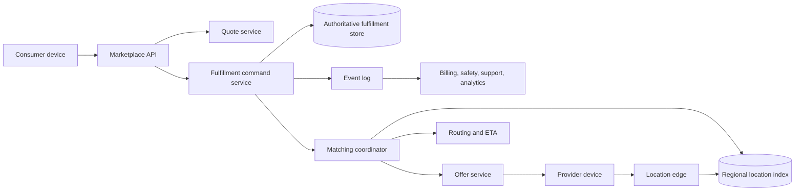

# Uber: Evidence, Inference, and a Real-Time Marketplace Reference Design

> Riders and drivers move every second and a match has to be made in a few. How do you index a city that will not hold still?

## TL;DR

Ride fulfillment applies distributed-systems correctness to a physical world that keeps moving while packets are delayed. Three distinctions organize the whole design. A driver's location is an estimate that is already out of date when it arrives. An offer sent to a driver is a proposal and does not yet assign anyone. And payment must follow an authoritative record of what happened on the trip, whatever any screen displayed. Public sources describe several generations of Uber's systems and do not describe every current service.

Claims are labeled:

- **Documented**: stated in a dated Uber engineering post, paper, repository, or company report.
- **Inference**: follows from documented constraints but is not a published implementation detail.
- **Reference design**: a proposed Uber-like system, not a claim about Uber production.

## Evidence Boundary and Dated Scale

| Dated source | Documented fact | Boundary |
|---|---|---|
| Project Mezzanine, July 2015 | Uber moved core trip data from a single PostgreSQL instance to an append-only, sharded MySQL-backed store after mirrored writes, backfill, query replay, and validation | Historical migration, not today's complete storage stack |
| Ringpop post, February 2016 | Uber's Geospatial service held active vehicle locations in sharded in-memory workers using membership, consistent hashing, and forwarding | Does not prove the present location architecture |
| H3 post, June 2018 | Uber open-sourced a hierarchical hexagonal index used for marketplace analysis and optimization | H3 is an index, not a dispatch algorithm |
| Fulfillment rearchitecture, July 2021 | The platform reported more than one million concurrent users, billions of trips per year, more than ten thousand cities, and billions of database transactions per day; it used statecharts and a transaction coordinator | Scale and architecture are a 2021 snapshot |
| Fulfillment on Spanner, September 2021 | Uber described Cloud Spanner as storage for the rebuilt Fulfillment Platform to obtain transactional consistency and horizontal scale | Not every Uber workload uses Spanner |
| Reinforcement-learning matching post, July 2025 | Uber reported deployment of a value-function signal in matching in more than 400 cities | Does not expose the full matching objective or allocation system |

These are snapshots of a system that was rebuilt more than once, and they should not be assembled into a single diagram of "Uber today." The reference architecture below declares its own assumptions.

## Workload and Requirements

Most systems in this book manage records, and a record stays where it was put. This one manages cars, which do not. By the time a driver's position has been measured by a phone, sent over a cellular network, and written to an index, the car is somewhere else, and by the time a match computed from that index reaches the driver, the driver may have turned onto a highway or gone offline. The marketplace runs on several clocks at once, none of them synchronized:

- Provider devices send noisy, delayed, and sometimes duplicated location updates.
- Consumers request quotes and trips against a rapidly changing supply set.
- Matching computes offers while providers move, go offline, or accept other work.
- Fulfillment state drives navigation, safety, pricing, receipts, support, and downstream finance.
- Maps, ETA, pricing, fraud, and notifications are dependencies, not the trip authority.

An **explicit reference-design contract**:

| Operation | Correctness requirement | Availability/degradation policy |
|---|---|---|
| Update provider location | Keep the newest accepted sample for a provider epoch; reject implausible or older samples | Missing updates age out rather than remain “available” forever |
| Request quote | Bind price/eligibility inputs and expiry to a quote ID | Return fewer products or a wider estimate if optional models fail |
| Request trip | Create one durable fulfillment intent per idempotency key | Do not dispatch until intent is committed |
| Offer work | An offer has a lease, version, target provider, and expiry | Expired offers cannot win |
| Accept offer | At most one provider becomes assigned for a fulfillment leg | Contention may reject a late acceptance |
| Advance trip | Only legal state transitions under the current entity version commit | Retry the command; never skip validation |
| Complete/cancel | Produce one authoritative terminal outcome and auditable adjustments | Downstream billing can catch up from events |

The contract contains two kinds of row. Location and ETA favor freshness: a slightly wrong answer now is better than a correct one in two seconds, and a lost update is harmless because another follows shortly. Assignment and trip state favor consistency, since two drivers dispatched to one rider, or a trip charged twice, is a real failure with a cost attached. A design that applies one consistency model to both gets one of them wrong. If everything is made strongly consistent, location updates become too slow to be useful, and if everything is made eventually consistent, drivers are double-booked. The architecture is largely the working out of where the boundary between the two falls.

## State, Authority, and Invariants

| State | Reference-design authority | Lifetime/consistency |
|---|---|---|
| Provider session | Fulfillment store, keyed by provider session ID | Strong per session |
| Latest provider location | Regional ephemeral location index plus sequence checkpoint | Bounded-stale and expiring |
| Consumer intent/quote | Quote and fulfillment stores | Immutable quote inputs; versioned intent |
| Offer | Offer store or fulfillment entity | Leased, versioned, idempotent |
| Assignment | Fulfillment state machine | Strong per fulfillment leg |
| Trip lifecycle | Fulfillment state machine and event log | Strong ordered transitions per trip |
| ETA/route | Versioned derived estimate | Recomputable and explicitly timestamped |
| Price/fare | Versioned quote plus adjustment ledger | Auditable; never inferred from displayed UI alone |
| Marketplace features | Stream/batch feature stores | Derived, versioned, bounded-stale |

Core invariants:

1. One fulfillment leg has at most one active assignment epoch.
2. A provider session can accept only work compatible with its current availability version.
3. A location update with an older device sequence or session epoch cannot replace a newer one.
4. Trip-state transitions are legal edges in a versioned statechart, not arbitrary field updates.
5. Every charge, payout, cancellation fee, and adjustment references immutable trip and policy versions.
6. A retry carries the same command identity; duplicates return the prior result or re-evaluate safely.
7. Derived ETA, map, and marketplace outputs cannot mutate trip authority directly.

The fourth invariant addresses a problem that grows with the product. A trip begins as a row with a status column, and code throughout the system updates that column. As products multiply, with shared rides, deliveries with several stops, and scheduled trips, the set of statuses and the rules for moving between them spread across dozens of services, and nobody can say with confidence which transitions are legal. A statechart writes the lifecycle down as an explicit graph of states and permitted transitions, and every change to a trip must be an edge of that graph.

**Documented (2021):** Uber's Fulfillment rearchitecture says it used hierarchical statecharts for fulfillment entities, a Business Transaction Coordinator for multi-entity writes, and an ORM over ACID storage. This is direct evidence that explicit lifecycle modeling replaced scattered implicit state in that generation.

## Data Plane and Control Plane

The **data plane** ingests locations, creates quotes and intents, retrieves candidates, computes offers, commits assignment and trip transitions, and emits events. The diagram has two stores, and they correspond to the two kinds of row in the contract. The location index is ephemeral, approximate, and fast. The fulfillment store is durable, transactional, and authoritative. Matching reads from the first to find candidates and commits to the second to make a decision binding.

The **control plane** manages city and product policy, geofence and H3 resolution versions, model rollout, shard and region placement, capacity quotas, statechart schema, experiment assignment, routing graph versions, and failover authority. During a control-plane outage, the data plane pins its signed known-good configuration and risky policy changes stop. Active trips are unaffected.

Configuration is safety-critical in this domain, more so than in most. A rule change for one city can alter who is eligible to drive, what a ride costs, or whether the service is operating legally. Every such change is versioned, staged, and audited, and each quote and trip transition records the version under which it was evaluated, so that a disputed fare can be explained months afterward.

## Location Ingestion and Spatial Indexing

**Documented historical design (2016):** Uber said its Geospatial service kept active vehicle locations in memory because the state was fleeting. Ringpop supplied SWIM-style membership, consistent hashing, and request forwarding so workers could own partitions and rebalance as membership changed.

Keeping this data in memory, with no durable store behind it, is a sound choice for a particular reason. A location is superseded within seconds by the next one. If a worker crashes and loses every position it held, the drivers' phones will have reported fresh positions before any recovery procedure could complete. Durability here would mean paying for disk writes to protect data that expires faster than it could be restored.

Ringpop let application servers divide that in-memory state among themselves without a separate coordination service. Each server learns which other servers are alive by gossip: it periodically checks a random peer and passes along what it has heard, so that news of a failure spreads through the cluster in a number of rounds that grows only logarithmically with its size. Given an agreed membership list, consistent hashing tells every server which of them owns a given key, and a request arriving at the wrong server is forwarded to the right one.

**Documented (2018):** H3 maps latitude/longitude at a resolution into hierarchical hexagonal cells and supports neighborhood operations. Uber described using it for analysis and marketplace optimization. It does not establish that every live dispatch query simply scans an H3 ring.

To find drivers near a rider, the system needs to turn continuous coordinates into discrete buckets that can be looked up, and the shape of the bucket matters. With a square grid, a cell has eight neighbors at two different distances: the four that share an edge are closer than the four that touch only at a corner. Any computation over "nearby cells" must account for that. A hexagon has six neighbors, and the centers of all six are the same distance away, so expanding a search by one ring of cells is a uniform step outward in every direction. That property is the reason for choosing hexagons, and it has a price. Hexagons do not subdivide cleanly into smaller hexagons, so a cell at one resolution only approximately contains its children at the next.

An **explicit reference-design update flow**:

1. Authenticate the device and bind it to a provider-session epoch.
2. Validate timestamp, monotonic device sequence, accuracy radius, speed, and plausible displacement.
3. Map the sample to a versioned spatial cell and route by `(city, cell_partition)`.
4. Compare-and-set the latest record only if `(session_epoch, device_sequence)` is newer.
5. Update cell membership, removing the previous cell entry idempotently.
6. Append a sampled or compacted location event for ETA, safety, and analytics according to retention policy.
7. Expire the provider from matching if no acceptable update arrives within the product's measured freshness bound.

Step 4 exists because mobile networks deliver packets late, twice, and out of order. Without the sequence comparison, an update from ten seconds ago that was delayed in transit would overwrite one from two seconds ago, and the driver would appear to jump backward. The device numbers its updates, and the server accepts only a higher number than it already holds.

Step 7 is the liveness half of the same concern. A phone that loses signal in a tunnel sends nothing, and the index cannot distinguish a parked car from a silent phone. If entries never expired, the map would gradually fill with drivers who are no longer there, and riders would be matched to them.

Accuracy and age are stored with each coordinate. GPS in a dense city can be wrong by a hundred meters, and a search for the "nearest" driver that ignores uncertainty will sometimes prefer a measurement error. Candidate retrieval expands outward through cells until it has enough candidates or has spent its budget, and then scores them by travel time on the road network together with marketplace value. Straight-line distance is used only as a coarse first filter, because the nearest car in a straight line may be on the far side of a river.

Ownership changes need care. When membership shifts and a partition moves to another worker, either a checkpoint and the buffered updates are transferred, or readers briefly consult both owners while writes are fenced by a partition epoch. Consistent hashing keeps the number of moved keys small. It does not transfer their state, and it does not stop a worker that has not yet learned of the change from continuing to answer for keys it no longer owns.

## Quote, Match, and Assignment Flows

### Quote

Before a trip is requested, the rider is shown a price and an estimated arrival time. The quote path is an **explicit reference design**:

1. Normalize pickup/drop-off and bind map/geofence versions.
2. Retrieve eligible product and provider-supply aggregates.
3. Compute route/ETA candidates under an end-to-end deadline.
4. Evaluate a versioned pricing policy and return a signed quote ID with expiry and assumptions.
5. Persist only the compact quote contract needed for later verification; high-volume diagnostic features can go to a separate event stream.

The quote is signed and carries an expiry because it is a commitment made under conditions that will change. When the rider confirms thirty seconds later, the system must be able to verify that this price was really offered, for this route, and that the offer has not lapsed. Recomputing the price at confirmation would yield a different number from the one the rider agreed to.

**Documented historical evidence (2015):** Uber described an evolution from external/open routing engines plus a learned ETA adjustment to its Gurafu routing engine and Flux traffic data. It reported that the production path targeted fast route calculations and compared ETA with actual arrival using Kafka logs. This establishes that ETA engineering was iterative and measured against outcomes. It does not describe the current algorithm.

### Candidate Generation and Offer

An **explicit reference design** makes the marketplace decision in two stages:

- Retrieve providers from expanding spatial/time cells, filtering session freshness, product eligibility, capacity, and safety constraints.
- Score a bounded set using pickup ETA, acceptance likelihood, provider fairness, consumer wait, downstream marketplace balance, and uncertainty.

The obvious rule is to send the nearest available driver, and it is worth understanding why that rule is not optimal. Matching is not a sequence of independent decisions. Suppose two riders request at nearly the same moment and two drivers are available. Giving the first rider their nearest driver may leave the second rider with a driver far away, when swapping the two would have served both in less total time. Decisions also affect the future: a driver sent across the city now is absent from a neighborhood where demand is about to rise. The objective involves several parties and extends over time.

A full global optimization, on the other hand, cannot finish within the latency a rider will tolerate. The practical design optimizes over a bounded window, collecting the requests and drivers of a few seconds and solving for that batch. It publishes the objective and version in use, and it keeps a simple eligible-nearest rule as a fallback for when the optimizer is unavailable.

**Documented (2025):** Uber described a DQN-inspired value-function signal incorporated into matching and reported deployment in more than 400 cities. **Inference:** a learned future-value signal complements eligibility and assignment invariants and does not replace them. The model estimates how valuable it is to have a driver in a given place at a given time, which informs the choice among eligible matches. Whether a match is eligible, and whether it commits exactly once, remain matters of rule.

### Assignment

Everything up to this point has been approximate and reversible. The assignment commit is the consistency boundary, where an approximate proposal becomes a binding fact:

1. Create offer `(offer_id, trip_id, provider_session, assignment_epoch, expires_at)`.
2. Deliver it through a retryable channel; delivery is not acceptance.
3. On acceptance, atomically verify offer lease, trip version, and provider availability version.
4. Commit the trip-provider assignment and advance both entities, or use a transaction coordinator with a recoverable intent.
5. Emit the authoritative assignment event after commit.
6. Revoke losing offers; late acceptances observe the committed winner and fail safely.

Step 3 carries the weight. The matching stage worked from a location index that may have been stale, and it may have offered the same driver to two riders or offered a driver who had just accepted something else. None of that causes harm, because acceptance is a conditional write against authoritative state: it succeeds only if the offer is still live, the trip is still unassigned, and the driver is still available, with all three checked and updated together. Of two concurrent acceptances, one finds the conditions true and commits. The other finds them changed and is refused.

A plain distributed lock is not a substitute. Suppose a matching worker acquires a lock on a driver with a ten-second lease and then pauses for fifteen seconds, in a garbage collection or a stalled virtual machine. The lease expires, another worker acquires the lock and assigns the driver, and the first worker then wakes, still believing it holds the lock, and writes its own assignment over the top. The lock gave the first worker no means of discovering that it had lost. A version number checked by the store at write time does: the first worker's write names a version that is no longer current and is rejected, however confident the worker is.

## Fulfillment Lifecycle and Eventing

A **reference statechart** might contain:

`requested → matching → assigned → provider_arriving → pickup_ready → in_progress → completed`

with explicit cancellation and failure substates. This is illustrative and is not Uber's private state enumeration.

Each transition command includes the expected entity version, the actor, location and time evidence, the policy version, and an idempotency key. The commit produces an ordered event such as `TripTransitioned(trip_id, from, to, entity_version, event_id)`.

Billing, receipts, safety, support, notifications, and analytics each consume those events, own their projections, and retry independently. A transactional outbox ensures that a committed transition cannot lose its event. Consumers that need order partition by trip ID, which keeps each trip's events in sequence. Ordering events across different trips would be expensive and nothing requires it, since the trips are independent of one another. See [Message Ordering](../05-messaging/03-message-ordering.md) and [Event Sourcing](../05-messaging/07-event-sourcing.md).

**Documented historical storage (2016):** Schemaless used immutable cells keyed by row, column, and reference key; buffered writes and sharded indexes supported trip storage. **Documented evolution (2021):** Uber described Docstore as a multi-model database with partition-level strict serializability, transactions, materialized views, and CDC. These belong to different generations and should not be read as simultaneously true.

## Partitioning and Illustrative Capacity

These numbers are **illustrative assumptions**, not Uber measurements:

- 3,000,000 online providers at peak.
- One accepted location sample every 4 seconds.
- 160 bytes per normalized in-memory record including identifiers, coordinate, accuracy, sequence, and index overhead.
- 120,000 quote/match requests/s at peak.
- 24 spatial partitions consulted per match after routing and expansion.
- 10,000 authoritative trip-transition writes/s at peak.

Location ingress is `3,000,000 / 4 = 750,000 updates/s`. Keeping only the latest normalized record requires about `458 MiB` raw (`3,000,000 × 160 B`) before hash/index allocator overhead and replicas. Replicating every raw location indefinitely would be far more expensive: at only 100 bytes/event, ingress is about `6.0 TiB/day` before replication and compression.

The two figures describe the same stream of data under different retention. The current position of every driver on the platform fits in half a gigabyte of memory, less than a laptop has. The history of every position is six terabytes a day. The decision about what to keep therefore determines what kind of system is being built, and it has to be made as part of the architecture.

Naively scattering each match to 24 partitions creates `2.88 million partition queries/s`, twenty-four times the request rate. Coarse supply summaries, request routing, and adaptive cell expansion reduce the scatter. The capacity model must also account for skew, because demand in a city is concentrated at airports, stations, stadiums, and wherever it is raining. A partition covering an airport at the end of a concert has a load unlike that of the average partition, and a model built on the mean will be wrong in the places where capacity is most needed.

If each trip transition averages 3 KiB across the canonical row, indexes, and log before replication, 10,000/s produces about `2.4 TiB/day`. The binding constraint is likely to be transactional write throughput and hot city partitions, with bytes a secondary concern.

| State | Primary partition | Why | Skew response |
|---|---|---|---|
| Latest location | City plus virtual spatial shard | Local retrieval | Split dense cells and time-slice rebalance |
| Provider session | Provider/session ID | Serialize availability | Cache route to authority |
| Trip/fulfillment | Trip ID | Ordered state transitions | Many virtual shards; no city-wide leader |
| Offers | Trip ID or provider ID by commit query | Resolve winner efficiently | Maintain query-specific index |
| Events | Trip ID | Preserve per-trip order | Partition count independent of storage shards |
| ETA graph | Region and graph version | Locality and atomic rollout | Immutable version plus delta overlays |

Location is partitioned by geography and trips are partitioned by trip ID. Location queries are spatial, so data that is near on the ground should be near in storage. Trip state is always accessed by its own identifier, and partitioning it by city would create one enormous hot partition for every large city.

See [Capacity Planning](../01-foundations/09-capacity-planning.md), [Partitioning Strategies](../03-distributed-databases/08-partitioning-strategies.md), and [Secondary Indexes](../03-distributed-databases/09-secondary-indexes.md).

## Concrete Failure Trace: Stale Location Produces Competing Offers

This is a **reference-design failure trace**, not a documented Uber incident.

1. A provider crosses from spatial partition A to B while A's owner is isolated from the membership control plane.
2. B accepts sequence 901, but the stale A owner continues advertising sequence 897.
3. Two consumer requests retrieve the same provider from different partitions.
4. Both matching workers send offers because candidate retrieval treated presence as assignment authority.
5. The provider accepts one; the other request repeatedly retries acceptance after a timeout.
6. Without an assignment epoch and conditional commit, both trips could appear assigned.

Steps 1 through 3 will happen in any real deployment. Partitions become isolated, indexes go stale, and a driver appears in two places at once. No amount of engineering on the location index prevents this entirely, because the index is approximate by design. What decides whether it becomes an incident is step 4, where a stale read is either treated as authoritative or checked against something that is.

The safe design has layered defenses:

- Location membership carries provider-session and partition epochs; readers discard stale owners.
- Candidate retrieval may be approximate, but acceptance performs a strong conditional write against provider availability and trip version.
- Offers expire and carry stable IDs; retry returns the committed outcome.
- Membership uncertainty shrinks eligibility or falls back to a slower authoritative lookup.
- Reconciliation scans detect one provider referenced by multiple active assignments and page before pickup.
- Metrics separate “offer delivered,” “accept attempted,” and “assignment committed.”

The trace illustrates a rule that extends well beyond ride-hailing: an approximate index can propose candidates, but it cannot own the allocation of a scarce resource. The same structure appears wherever a fast, stale read path feeds a decision about something that can be given out only once, such as inventory, seats, or usernames. The read path may be as approximate as performance requires, provided the final allocation is a conditional write against the authority.

## Multi-Region and Regional Authority

A physical marketplace is naturally regional, since a driver in one city is of no use to a rider in another. Identity, travel, support, and finance, however, cross regional boundaries.

An **explicit reference design** assigns live fulfillment to a home region chosen by pickup market, with an authority epoch:

- Location ingestion, matching, and active-trip commands stay near that market.
- Identity, payment tokens, risk signals, and product configuration replicate under their own consistency and residency contracts.
- Active trip state replicates to a paired recovery region with a declared RPO.
- A failover coordinator fences the previous region before issuing a higher authority epoch.
- Devices include observed authority/version on commands and reconnect to the promoted region.
- Completed-trip events flow to global finance and analytics through idempotent consumers.

The fourth item applies the lock-and-version argument at the scale of a region. If the recovery region begins accepting writes while the original region, cut off but still running, continues to accept them too, there are two authorities for the same trips. The old region must be fenced, made unable to commit, before the new one is given a higher epoch.

A city cannot fail over safely merely because compute is available elsewhere. The destination also needs the right map and configuration versions, a way for live drivers to reconnect, database write authority, notification routes, payment dependencies, and capacity headroom. See [Multi-Region Architecture](../06-scaling/14-multi-region-architecture.md).

## Operations, Security, and Observability

What must be observed is the physical outcome. RPC health can be perfect while riders stand on street corners:

- Location accepted/rejected by reason, age distribution, sequence regressions, cell skew, and ownership epoch mismatch.
- Quote coverage, route/model/config version, ETA error versus actual arrival, and fallback rate.
- Candidate count by stage, scatter width, optimization latency, offer delivery, acceptance, expiry, and committed-assignment rate.
- Illegal transition attempts, optimistic-concurrency conflicts, outbox age, and consumer lag by trip lifecycle.
- Pickup wait, cancellation, rematch, duplicate-offer, and “assigned provider unavailable” rates.
- Regional authority, replication position, recovery headroom, and device reconnect rate.

ETA error against actual arrival is an unusually good metric, because the physical world supplies the ground truth for free. Every trip ends with a measured arrival time that can be compared with the prediction, so the quality of the estimate is known continuously and for every city.

Trace identifiers join the device sample, quote, request, trip, offer, assignment epoch, and transition event, and they do so without placing raw precise location in broadly accessible logs.

Security and privacy requirements include:

- Mutual service identity and device-bound provider sessions.
- Encryption of precise location and payment data, with separate access purposes and retention.
- Coarse location for broad analytics; precise location only where fulfillment or safety requires it.
- Signed, expiring offers and commands resistant to replay.
- Audited override paths for safety/support; no direct database edits to trip state.
- Rate limits by actor, device, market, action cost, and target, plus synthetic-location and collusion detection.
- Data-residency classification carried into logs, backups, features, and disaster-recovery copies.

Location history is among the most sensitive data a consumer company holds, since it reveals where a person lives, works, and spends their nights. The third item, coarse location for analytics, is the practical form of data minimization here. Most analysis needs to know which neighborhood a trip started in and has no need of the building. Synthetic-location detection in the sixth item addresses a fraud specific to this domain, in which a device reports GPS coordinates it is not at.

## Evolution and Migration

Uber's sources document an instructive sequence: a PostgreSQL bottleneck; the 2014 Mezzanine and Schemaless migration, described in 2015 and 2016; application partitioning with Ringpop; H3 as a reusable spatial index; and a 2021 rewrite of Fulfillment with statecharts, ACID storage, and a controlled migration of every product.

**Documented (2015):** Mezzanine changed trip IDs to UUIDs, backfilled, mirrored writes, replayed queries in the background, validated results, and switched reads after incremental refactoring. **Documented (2021):** the Fulfillment rewrite says every product and city migrated with support from more than 100 engineers across more than 30 teams.

The technique of replaying queries in the Mezzanine account is worth borrowing. Comparing rows between an old and a new store shows that the data was copied. It does not show that the new store answers the application's actual questions correctly. Replaying real production queries against the new store and comparing the results tests the property the migration is supposed to preserve.

A reusable migration plan is:

1. Introduce a compatibility API and explicit statechart around the old authority.
2. Allocate stable IDs and versions before data movement.
3. Backfill immutable history with checksums and source positions.
4. Mirror commands/events while one store remains authoritative.
5. Shadow-read transition eligibility and resulting state, not just row equality.
6. Move one market/product cohort with automatic rollback gates.
7. Reconcile active trips before each cohort and drain old in-flight work.
8. Stop old writes, hold rollback history, then remove compatibility code.

Step 7 reflects a constraint that purely digital systems do not have. A trip in progress cannot be paused for a migration, because there is a person in the car. Migration proceeds market by market, and within each market the trips already under way are allowed to finish on the old system while new ones begin on the new.

This is covered generally in [Database Migrations](../14-deployment/05-database-migrations.md) and [Migration Strategies](../14-deployment/06-migration-strategies.md).

## Verification and Design Lessons

We verify with deterministic state-machine tests, property-based reordering of commands, and load shaped like a real market:

- Older and duplicate location samples never replace newer state.
- Two simultaneous acceptances yield one assignment winner.
- Every legal transition is reachable and every illegal transition is rejected.
- Event replay reconstructs the same fulfillment state and downstream ledger.
- A stale spatial owner cannot commit an assignment.
- Dense-cell failure sheds approximate queries without losing active trips.
- Regional promotion fences the previous writer and clients converge on the new epoch.
- ETA/model fallback is observable and cannot bypass eligibility or safety.

The reusable lessons are:

1. Keep ephemeral location indexes separate from authoritative allocation state.
2. Make offers leased proposals and assignment a conditional durable commit.
3. Encode business lifecycle as a versioned statechart with idempotent commands.
4. Model spatial skew and scatter, not only global request rate.
5. Bind quotes, routes, and transitions to configuration/model versions for auditability.
6. Migrate physical-world systems market by market with in-flight draining and reconciliation.

## References

- Uber Engineering, [“Project Mezzanine: The Great Migration”](https://www.uber.com/us/en/blog/mezzanine-codebase-data-migration/), July 2015.
- Uber Engineering, [“ETA Phone Home: How Uber Engineers an Efficient Route”](https://www.uber.com/us/en/blog/engineering-routing-engine/), November 2015.
- Uber Engineering, [“Designing Schemaless, Uber Engineering's Scalable Datastore Using MySQL”](https://www.uber.com/us/en/blog/schemaless-part-one-mysql-datastore/), January 2016.
- Uber Engineering, [“How Ringpop from Uber Engineering Helps Distribute Your Application”](https://www.uber.com/us/en/blog/ringpop-open-source-nodejs-library/), February 2016.
- Uber Engineering, [“H3: Uber's Hexagonal Hierarchical Spatial Index”](https://www.uber.com/us/en/blog/h3/), June 2018.
- Uber Engineering, [“Uber's Fulfillment Platform: Ground-up Re-architecture”](https://www.uber.com/us/en/blog/fulfillment-platform-rearchitecture/), July 2021.
- Uber Engineering, [“Building Uber's Fulfillment Platform for Planet-Scale using Google Cloud Spanner”](https://www.uber.com/us/en/blog/building-ubers-fulfillment-platform/), September 2021.
- Uber Engineering, [“Reinforcement Learning for Modeling Marketplace Balance”](https://www.uber.com/us/en/blog/reinforcement-learning-for-modeling-marketplace-balance/), July 2025.

---

## Related Chapters

- [Distributed Time](../01-foundations/04-distributed-time.md): a marketplace where every decision is a timestamp comparison across regions
- [Secondary Indexes in Distributed Databases](../03-distributed-databases/09-secondary-indexes.md): finding nearby drivers is a geospatial index with an update rate attached
- [Message Ordering](../05-messaging/03-message-ordering.md): dispatch, acceptance, and arrival must be ordered per ride or the state machine lies
- [Database Schema Migrations](../14-deployment/05-database-migrations.md): a schema change at this scale is a capacity event scheduled in advance
- [Geospatial Indexing](../11-search-systems/05-geospatial-indexing.md): the cell and tree structures behind proximity search, separated from the product
