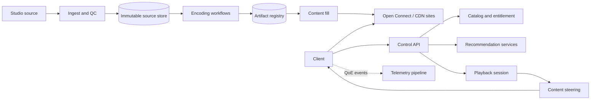

# Netflix: Evidence, Inference, and a Streaming Reference Design

> At eight in the evening millions of households press play at once. The control plane can be in the cloud; where do the bits come from, and what happens when a region fails?

## TL;DR

Netflix is two systems that share a brand. A control plane handles identity, catalog, personalization, playback authorization, and steering. A content plane prepares immutable media and delivers it. They differ in almost every engineering respect, from what they scale with to how they fail, and the most useful thing to learn from Netflix is why they were separated. Public sources document individual components at particular dates. They do not describe one complete current architecture, and this chapter does not pretend otherwise.

Claims use three labels:

- **Documented**: stated in a dated Netflix primary source, paper, or repository.
- **Inference**: follows from documented constraints but is not a published private implementation detail.
- **Reference design**: a proposed Netflix-like service, not an assertion about Netflix production.

## Evidence Boundary and Dated Scale

Case studies of large companies tend to blend what the company published, what an author deduced, and what an author would build, into one confident narrative. We keep the three apart, and we begin with exactly what the public record supports.

| Source snapshot | Documented fact | Boundary |
|---|---|---|
| Cloud migration announcement, February 2016 | Netflix completed a seven-year streaming-service cloud migration, used multiple AWS regions, evolved from a monolith to hundreds of microservices, and delivered video through Open Connect | Historical architecture, not a 2026 service inventory |
| Per-title encoding, December 2015 | Netflix analyzed title complexity to select bitrate-resolution ladders; clients selected encodes adaptively | The recipe has evolved since 2015 |
| Open Connect site, accessed July 2026 | Netflix said it partnered with more than 1,000 ISPs and used embedded appliances plus settlement-free interconnection; embedded appliances had the same capabilities as those in 60+ global datacenters | Dynamic program statement, not per-appliance capacity |
| Open Connect overview, accessed July 2026 | Thousands of appliances at IXPs and ISP networks stored encoded files and served them over HTTP/HTTPS under a supporting control system | Does not reveal steering algorithms or fleet-by-region |
| Recommendation foundation-model post, March 2025 | The post reported more than 300 million users at the end of 2024 and hundreds of billions of interaction events for recommendation work | Not streaming concurrency or request QPS |

Scale values keep their date and methodology. In particular, we do not multiply a subscriber count by a guess to produce a traffic figure. The number of people who pay for a service says little about how many are watching at nine in the evening.

## Workload and Requirements

"Video streaming" sounds like one workload and is at least five, with little in common:

- **Studio ingest:** very large source packages arrive irregularly and require validation, localization, quality control, and rights metadata.
- **Encoding:** many codecs, resolutions, dynamic ranges, audio tracks, subtitles, and device constraints multiply work and stored objects.
- **Control requests:** browse, search, recommendations, account, entitlement, playback-session creation, manifest, and steering are latency-sensitive but byte-light.
- **Content delivery:** segment reads are byte-heavy, highly cacheable, and dominated by evening regional peaks.
- **Telemetry:** clients emit playback quality and product events at high volume; these must not block playback.

The third and fourth items are the pair that shapes the architecture. A control request is a few kilobytes that must be answered quickly, involves per-user logic, and can hardly be cached. A content request is megabytes of data that is identical for every viewer of that title at that quality, and can be cached almost perfectly. A system built to do one of these well is built wrongly for the other.

An **explicit reference-design contract** states, for each capability, what must be correct and what may be given up under stress:

| Capability | Correctness requirement | Graceful degradation |
|---|---|---|
| Ingest title | Source package, rights, and checksums form an immutable version | Quarantine invalid tracks; do not publish partial assets |
| Encode | Every playable artifact is tied to source, recipe, codec, and quality-validation versions | Publish a baseline ladder while optional/high-cost encodes finish |
| Browse | Return entitled, age/region-appropriate catalog items | Use cached rows or generic ordering if personalization fails |
| Start playback | Authorize account/profile/device/title and issue a bounded session | Fail closed on entitlement; degrade optional personalization |
| Stream | Client can switch among compatible representations without corrupting playback | Lower quality or alternate content site before rebuffering |
| Revoke rights | New sessions cannot start after the effective boundary | Existing-session policy is explicit and auditable |

The right-hand column is the more interesting one. It ranks the features by how much the member would miss them: a generic home page is a minor loss, lower picture quality is tolerable, and a stalled stream is the failure the whole design exists to avoid.

Availability accordingly has to be measured as "can the member discover and play," and an API returning 200 is not evidence of that. We track playback-start success, time to first frame, rebuffering, delivered quality, and control-plane fallbacks as separate signals.

## State, Authority, and Invariants

For each kind of state, one system is the authority and everything else is a copy derived from it:

| State | Reference-design authority | Derived state |
|---|---|---|
| Source media package | Immutable studio object store and package manifest | Mezzanine/proxy files |
| Encoded representation | Artifact registry keyed by source and recipe version | CDN/OCA copies |
| Title/catalog metadata | Catalog service with effective-dated rights | Search and browse indexes |
| Account/profile/entitlement | Membership and policy services | Session authorization cache |
| Playback session | Session authority with signed grants | Edge verification state |
| Content steering | Versioned mapping from client/network/content to eligible sites | DNS/manifest hints and client cache |
| Recommendation model | Model registry plus immutable artifact | Online replicas and precomputed rows |
| Viewing interaction | Append-only event log | Features, metrics, experiments, recommendations |

Media is immutable throughout this table. An encoded segment, once published, never changes, and a correction produces a new generation under a new key. That single decision removes the hardest problem in caching. There is no invalidation, because nothing cached can become wrong. A copy on an appliance inside an ISP on another continent is correct for as long as it exists, and thousands of such appliances can be operated without any coordination about freshness.

The invariants follow:

1. A playable manifest references only validated, immutable artifacts from one compatible source generation.
2. Entitlement and rights are evaluated for title, profile, device, region, and effective time before issuing a playback grant.
3. Content caches may serve bytes but cannot grant rights.
4. Steering chooses only sites that advertise the required artifact and current health/capacity eligibility.
5. Retried session or telemetry commands are idempotent; telemetry loss cannot terminate playback.
6. Catalog, recommendation, and playback decisions retain configuration/model/artifact versions for audit and replay.
7. Content-plane failure is isolated from account and catalog authority; control-plane failure does not corrupt immutable media.

The third invariant draws the security boundary between the planes. The caches hold the most valuable bytes the company owns, and they sit in thousands of facilities it does not control. They are deliberately given no authority: a cache serves whatever it is asked for, and the decision about who may watch is made elsewhere and enforced by cryptography the cache does not hold.

## Separate Control and Content Planes

**Documented (2016):** Netflix said cloud systems handled business logic, distributed databases, analytics, recommendations, and transcoding, while Open Connect delivered video. **Documented (Open Connect, accessed 2026):** appliances serve encoded video/image files, report health, obtain configuration from supporting services, and contribute health/load information to routing decisions.

In the diagram, the client talks to two different systems. It asks the control API what to play and where to get it, and then it fetches the bytes from somewhere else entirely. The second conversation never passes through the first system.

**Inference:** separating control APIs from media delivery reduces correlated scaling and failure: browsing traffic scales with interactions, while content traffic scales with bitrate and viewing duration.

The two planes scale with different quantities. A member who presses play and then watches for two hours generates a handful of control requests in the first seconds and then a steady stream of segment fetches for the rest of the evening. Control load follows what people do, and content load follows how long they watch and at what quality. The two peak at different times and need different hardware, general-purpose compute for one and storage-dense, network-dense machines for the other. Their failures also need not be shared: a bad deployment to the recommendation service should not be able to interrupt a film already playing.

The **reference-design control plane** also owns encoding recipes, artifact placement, model and configuration rollout, rights ingestion, device capability rules, regional traffic, signing keys, and disaster-recovery authority. Serving systems cache signed, known-good versions of what they need from it, so that a pause in the control plane does not immediately stop healthy streams.

## Content Ingest and Encoding

A film arrives from a studio as a single enormous master file. No device plays that file. What devices play is one of dozens of derived versions, each cut into short segments, and producing those versions is a large batch-processing problem that runs before any viewer is involved. The following is an **explicit reference design**:

1. Receive a studio package into an isolated landing zone with a package ID and declared checksums.
2. Verify bytes, track timing, audio layout, subtitles, captions, artwork, rights metadata, and malware/content safety.
3. Commit an immutable source manifest. Corrections create a new generation rather than overwriting inputs.
4. Expand a versioned encode DAG by codec, device class, resolution, dynamic range, audio, locale, and accessibility track.
5. Chunk work into idempotent tasks. Each output key contains source generation, recipe version, and chunk boundary.
6. Measure objective/perceptual quality, decode compatibility, A/V synchronization, and boundary continuity.
7. Construct compatible bitrate ladders and manifests only from accepted outputs.
8. Publish the title generation after rights, catalog, and a minimum viable ladder are ready; optional variants can join through a new manifest version.
9. Replicate artifacts to origin/content sites according to forecast demand and recovery policy.

Step 5 is what makes the pipeline tractable at scale. Encoding a two-hour film as one job would take many hours on one machine and would have to start over after any failure. Cut into chunks of a few minutes, it becomes thousands of independent tasks that can run in parallel on whatever capacity is available and be retried individually. Because each output key names its inputs exactly, a task that runs twice produces the same object at the same key, and the retry is harmless.

The "bitrate ladder" of step 7 needs some explanation, because it is the basis of adaptive streaming. Each title is encoded at several quality levels, from a few hundred kilobits per second up to many megabits. The player measures its own network throughput and buffer continuously and requests each successive segment at the highest level it can sustain. When a viewer's connection degrades, the player moves down the ladder and the picture softens, and playback continues without a stall.

For years the ladder was fixed: the same set of bitrates and resolutions for every title. **Documented (2015):** Netflix's per-title work encoded trial points at multiple resolutions, estimated bitrate-quality curves, and chose points near a convex hull under device and perceptual-spacing constraints. It also states that clients run adaptive streaming algorithms to select among encodes based on bandwidth and device capability.

The reasoning behind per-title encoding is that content differs enormously in how hard it is to compress. An animated series with flat colors and little motion looks excellent at a bitrate that would turn a grainy action film into blocks. A fixed ladder therefore wastes bits on the easy title and starves the hard one. Encoding each title at many combinations of resolution and bitrate, measuring the quality of each, and keeping only the combinations that give the best quality for their bitrate, yields a ladder fitted to the title. The saving is paid back in bandwidth on every stream of that title thereafter.

The durable lesson does not concern any particular ladder. Encoding is an optimization under constraints of quality, device support, storage, compute, delivery cost, and launch deadline, and the optimum moves as codecs and devices change. Recipes and quality metrics must therefore be versioned, because improving them means re-encoding the catalog, and that is a migration.

## Browse and Recommendation Flow

The home screen is a personalized read model built on top of the catalog. It is not the authority on what exists or what a member may watch. An **explicit reference-design flow**:

1. Authenticate the account/profile and resolve locale, maturity, device, and experiment assignment.
2. Fetch eligible catalog IDs from rights and profile policy.
3. Retrieve several candidate rows: continue watching, known preferences, new/relevant content, and editorial/business collections.
4. Hydrate bounded-age features and rank under a deadline.
5. Apply entitlement, maturity, availability, diversity, and presentation constraints after ranking.
6. Return row/item explanations and model/config versions to observability, not necessarily to the client.
7. Fall back through cached personalized rows, precomputed cohort rows, and finally eligible generic rows.

The last step is a chain of progressively less personal answers, each cheaper and more reliable than the one before. If live ranking misses its deadline, the member sees the rows computed for them an hour ago. If those are unavailable, they see rows computed for people like them, and failing that, a sensible generic page. In no case do they see an error. Most members would not notice the difference on a given evening, and so a great deal of resilience is obtained for very little loss.

**Documented (2025):** Netflix described multiple specialized recommendation models, a foundation-model effort using tokenized interaction histories, and hundreds of billions of interactions associated with more than 300 million users at the end of 2024. It discusses batch-computed embeddings, online uses, incremental training, cold start, and downstream applications. It does not publish the entire browse request graph.

Step 5 applies eligibility after ranking, and the order matters for safety. A recommender is a statistical system that is allowed to be wrong about taste. It must not be in a position to be wrong about rights. A stale model may fail to suggest a title, which costs a little engagement. It must never surface a title outside the member's region or a child profile's maturity setting, and that is guaranteed by a separate, deterministic filter that runs last. See [Recommendation Systems](../16-ml-systems/15-recommendation-systems.md) and [ML Risk and Governance](../16-ml-systems/17-ml-risk-governance.md).

## Playback Start and Segment Delivery

Pressing play begins the one interaction in which both planes take part. The **reference-design playback-start flow**:

1. The client requests playback using profile, title, device capabilities, application version, and a stable idempotency key.
2. Session service checks membership, concurrent-stream policy, maturity, geography, title rights, DRM capability, and experiment policy.
3. It returns a signed, short-lived playback grant, compatible manifest generation, telemetry session ID, and steering bootstrap.
4. Steering selects an ordered set of eligible content sites using network prefix, artifact presence, health, load, and failure-domain diversity.
5. The client fetches a manifest and segments over HTTPS, measures throughput/buffer state, and selects compatible representations.
6. On a failed site, the client retries within an end-to-end deadline against the next eligible site; it does not retry indefinitely across every representation.
7. Quality-of-experience events flow asynchronously with bounded local buffering.

After step 4 the control plane's work is done. It has decided that this member may watch this title and has handed the client a signed permission and a list of places to fetch from. From then on the client talks to content servers, and the control plane could become unavailable without the viewer noticing until they try to start something else.

Where those content servers are is the distinctive part of Netflix's design. **Documented (Open Connect, accessed 2026):** embedded appliances can be deployed inside ISP networks; settlement-free interconnection provides another path; sample designs show failover between embedded sites and then to Netflix IX appliances. The deployment guide says appliances are directed caches: ISP prefixes advertised via BGP determine which clients an embedded appliance may serve, while Netflix also participates in directing requests.

The reasoning behind placing servers inside other companies' networks is economic as much as technical. Video is the largest single source of traffic on many consumer networks. If it originates outside the ISP, every byte crosses the ISP's expensive links to the rest of the internet. If it originates from a machine inside the ISP's own facility, it travels only the last few miles. The ISP saves on transit, its customers get a better picture, and Netflix gets delivery capacity close to viewers, which is why ISPs are willing to host the appliances.

The phrase "directed caches" marks a difference from a conventional CDN. A general-purpose CDN cache typically fetches an object the first time someone asks for it. These appliances are filled in advance, during off-peak hours, with the titles expected to be watched in that region, and clients are steered only to appliances known to hold what they need. Since tomorrow's popular titles are largely predictable today, most requests can be served from a copy that was placed deliberately.

**Inference:** the client is part of resilience. It observes buffer and throughput more directly than a remote load balancer, but its decisions must be bounded to prevent retry and representation-switch amplification.

The player has information no server has. It knows how many seconds of video it holds in its buffer and how fast the last segment actually arrived. Letting it choose the bitrate and switch between servers puts the decision where the knowledge is. The risk is that millions of clients making the same sensible local decision at the same moment produce a stampede, which the failure trace below illustrates.

## Partitioning and Illustrative Capacity

These figures are **illustrative assumptions**, not Netflix measurements:

- 5,000,000 concurrent streams at a regional/global design peak.
- Weighted delivered bitrate of 4 Mbit/s.
- 97% of bytes served from local/peered content sites, leaving 3% to an upstream tier.
- 1,000 source hours/day newly processed.
- 20 effective encode variants per source hour at an average 4× real-time compute cost.
- 6-second segments and a two-hour average title for object-count illustration.

Delivered traffic is `5,000,000 × 4 Mbit/s = 20 Tbit/s`. At the assumed 97% localization, upstream traffic is still `600 Gbit/s`. A one-percentage-point drop in localized bytes adds `200 Gbit/s` upstream, so byte-hit ratio and link headroom are first-class signals.

This is the usual arithmetic of a high cache-hit ratio. At 97 percent, the upstream tier carries 3 percent of the traffic. A fall to 96 percent sounds negligible and raises upstream load by a third. Systems that depend on very high hit ratios are sensitive to small declines in them, and the upstream tier has to be provisioned for the decline as well as the steady state.

Encoding demand is `1,000 × 20 × 4 = 80,000 compute-hours/day`, or roughly `3,333 continuously busy core-equivalents` before retries, quality analysis, codec heterogeneity, launch bursts, and headroom. This work has deadlines, because a title must be ready before its release date, so compute is scheduled by publication deadline and artifact criticality, and simple first-in, first-out ordering would not do.

At six-second segments, a two-hour representation contains 1,200 media segments. Twenty variants create about 24,000 segment objects per title generation before audio, subtitles, images, manifests, and replicas. A catalog of many thousands of titles therefore holds hundreds of millions of objects, and the capacity of the metadata and index systems that track them can become the binding constraint while byte capacity still looks comfortable.

Each dataset is partitioned according to how it is accessed:

| Dataset/work | Partition key | Skew concern | Control |
|---|---|---|---|
| Source/artifacts | Content hash plus generation | Launch-day title | Immutable objects and content-site replication |
| Encode tasks | Title, track, chunk, recipe | One large/high-priority launch | Deadline classes and chunk work stealing |
| Catalog/rights | Title and market/effective time | Global premiere | Replicas plus versioned caches |
| Account/profile | Account/profile ID | Household/device bursts | Per-account serialization and rate policy |
| Playback session | Session/account ID | Reconnect storm | Idempotency and admission control |
| Telemetry | Session or device hash plus time | Top-of-hour/device rollout | Bounded buffers and independent quotas |
| Recommendation features | Member/title and version | Popular titles | Batch/online split and hot-key replication |

The skew column describes one phenomenon from several directions. Viewing is extremely concentrated: on the day a major series is released, a large share of all viewers want the same few hours of video. Every row needs an answer for that day.

See [Capacity Planning](../01-foundations/09-capacity-planning.md), [CDN Architecture](../06-scaling/05-cdn-architecture.md), and [Durable Workflow Engines](../09-workflow-job-systems/07-durable-execution-workflow-engines.md).

## Concrete Failure Trace: Healthy APIs, Failing Playback

This is a **reference-design failure trace**, not a Netflix incident report. It is worth following closely, because every dashboard a typical team would build stays green throughout.

1. A routing-policy rollout marks an overloaded content site healthy because its aggregate CPU is low, while one network path is congested.
2. Playback-session APIs remain healthy and continue steering clients toward that site.
3. Clients experience slow first segments, switch down representations, and retry alternate hosts.
4. Retry traffic and cache misses raise connection and disk pressure at neighboring sites.
5. Browse metrics remain green; playback starts and delivered quality collapse in one ISP/region/device slice.
6. Automated scaling cannot fix an ISP path or missing artifact placement, and a broad rollback is delayed because aggregate global QoE looks acceptable.

Three things went wrong, and none of them was a crash. The health signal measured the wrong thing: the machine's CPU was idle because the network path in front of it was congested and little traffic was getting through. The control plane, working correctly on bad information, kept sending viewers there. And the failure was concentrated in one slice of the population, so that averaged over all viewers worldwide it hardly registered.

The defenses address each of these:

- Compute health by client network, artifact, and delivered throughput, not host CPU alone.
- Canary steering policy by ISP/region/device and compare playback-start success before expansion.
- Require artifact-presence proof and failure-domain diversity in the site list.
- Bound client attempts, use jitter, and cancel superseded segment requests.
- Keep emergency steering independent of the normal configuration rollout path.
- Alert on localized QoE burn rates and origin/upstream byte amplification.
- Degrade image previews, autoplay, or browse richness before playback authorization and segments.

The general conclusion is that control-plane observability has to join client-reported quality with content-site and network telemetry. The only component that knew playback was failing was the player, and a system that does not listen to its players by network and region will learn of such failures from its customers.

## Multi-Region Resilience and Chaos

**Documented (2016):** Netflix said multiple AWS regions allowed it to shift and expand global infrastructure, and that regular production drills using the Simian Army supported resilience. The announcement reported service availability nearing a four-nines goal at that time. That is a historical goal/status, not a promise today.

**Documented repository behavior:** Chaos Monkey randomly terminates production virtual-machine instances and containers to expose engineers to failures. The repository does not imply that arbitrary uncontrolled experiments are safe.

The idea behind Chaos Monkey is often retold as bravado, and its actual logic is more modest. In a large fleet, instances fail constantly whether anyone wants them to or not. A service that cannot tolerate the loss of an instance will therefore fail eventually, at a time nobody chose. Terminating instances deliberately, during working hours, makes that failure routine and frequent, so that intolerance is discovered and fixed by the owning team while they are at their desks. The effect is to turn a rare and badly timed surprise into an ordinary property that every service is expected to have.

An **explicit reference design** separates failure domains:

- Account and playback-session authority has a tested regional failover and fencing plan.
- Catalog, rights, model, and configuration snapshots replicate before traffic shifts.
- Content sites are multi-homed across embedded, IXP, and upstream paths where economics permit.
- Immutable media remains available even if personalization or telemetry is degraded.
- Region evacuation is rehearsed at expected peak load with static headroom.
- Chaos experiments have a hypothesis, steady-state metric, small blast radius, abort condition, and named owner.

The last item marks the difference between an experiment and an outage. A chaos experiment states in advance what should remain true, measures whether it does, limits how much can be affected, and stops automatically if the limit is crossed. Chaos engineering verifies a design. It cannot stand in for invariants, capacity, or disaster recovery. See [Cell-Based Architecture](../06-scaling/13-cell-based-architecture.md), [Multi-Region Architecture](../06-scaling/14-multi-region-architecture.md), and [Incident Management](../13-observability/06-incident-management.md).

## Operations, Security, and Observability

There are four layers to observe, and the value is in joining them:

- **Content preparation:** ingest age, validation failures, encode task age, retry cost, quality distribution, artifact completeness, and launch readiness.
- **Control plane:** browse/session latency, entitlement denials, fallback rate, catalog/config/model version, regional dependency health, and error-budget burn.
- **Delivery:** bytes and hit ratio by site/ISP/rendition, origin amplification, disk/network saturation, artifact misses, steering changes, and failover path.
- **Client QoE:** start success, time to first frame, rebuffer ratio, bitrate/resolution, representation switches, playback failures, and telemetry loss.

A stable playback-session ID ties these together, so that one viewer's bad experience can be traced from the player through the steering decision to the specific appliance, while account identity stays under access control. High-cardinality debugging data needs a deliberate retention and sampling policy. Sampling that discards rare failures discards the events the data was collected to explain.

Security runs from the studio to the screen:

- Studio source and unreleased assets use isolated identities, encryption keys, watermarking/audit policy, and least-privilege workflows.
- Playback grants are signed, short-lived, audience/device/title scoped, and replay bounded.
- DRM/license authority is separate from content caches; possession of a segment URL is insufficient entitlement.
- Account credentials, profiles, and viewing history have purpose-specific access and retention.
- OCA management and serving interfaces are separated. **Documented (Open Connect, accessed 2026):** Netflix describes single-purpose appliances, restricted management interfaces, minimal privileges, health monitoring, and runtime intrusion detection.
- BGP and routing policy require authenticated operations, prefix controls, rollback, and route-leak monitoring.

The third item restates the earlier invariant in security terms. Encrypted segments can be cached and served by untrusted infrastructure because they are useless without a license, and the license is issued only by the authority that checks entitlement.

## Evolution and Migration

The public record shows several evolutions that proceeded independently:

- **Documented (2008–2016):** after a 2008 database corruption, Netflix rebuilt toward distributed cloud systems and completed its streaming-service cloud migration in January 2016 rather than performing a simple lift-and-shift.
- **Documented (2015):** per-title encoding replaced a one-size-fits-all ladder with content-aware optimization.
- **Documented (Open Connect):** content delivery uses purpose-built appliances at exchange and ISP locations plus peering, separating media delivery from general cloud compute.
- **Documented (2025):** recommendation work explored a foundation model while preserving downstream embeddings, fine-tuning, cold-start behavior, and incremental training.

The first of these took seven years, which is itself informative. The company chose to rebuild its systems for the cloud and not to copy its datacenter architecture into rented machines, on the reasoning that copying would have carried the old failure modes along with it.

A reusable **reference migration** for a codec, manifest, or steering change:

1. Version the source, recipe, output, compatibility, and rollback contract.
2. Produce new artifacts alongside old ones; never overwrite playable bytes.
3. Validate decode compatibility and objective plus human quality on a representative device matrix.
4. Canary manifest exposure by device/network/title cohort.
5. Measure QoE, bytes, cache efficiency, and compute/storage cost together.
6. Keep old artifacts through the playback-session and rollback window.
7. Retire old variants only after active manifests and offline downloads can no longer reference them.

Immutability does the work here as well. Because new artifacts are added beside the old ones, rollback consists of pointing manifests back at files that never went away. The device matrix in step 3 reflects a constraint peculiar to this business: the software must run correctly on televisions and set-top boxes manufactured a decade ago that will never receive an update.

For a regional or API migration, shadow requests and failover drills must verify playback as the user sees it. Equivalent responses from the old and new systems do not establish that.

## Verification and Design Lessons

We verify that:

- Replayed encode tasks produce byte-identical or explicitly version-distinct artifacts.
- No manifest exposes a missing, failed, or incompatible representation.
- Rights revocation blocks new grants even if CDN bytes remain cached.
- Steering loses one site, network path, or region without retry amplification.
- Browse/recommendation failure preserves eligible generic discovery and playback.
- Client telemetry loss cannot interrupt an otherwise healthy stream.
- A codec/manifest rollback works on every supported device cohort.
- Region evacuation has enough control-plane capacity and reachable content delivery.

The reusable lessons are:

1. Separate byte delivery from personalized control requests and capacity-plan them independently.
2. Make media immutable and publish manifests as versioned compatibility contracts.
3. Put the adaptive client inside the resilience model, with strict attempt budgets.
4. Optimize encoding jointly for quality, compute, storage, device support, and delivery cost.
5. Measure playback outcome by ISP/region/device/content slice; global API health is insufficient.
6. Treat chaos experiments as bounded tests of a declared steady state.

## References

- Netflix Technology Blog, [“Per-Title Encode Optimization”](https://netflixtechblog.com/per-title-encode-optimization-7e99442b62a2), December 2015.
- Netflix, [“Completing the Netflix Cloud Migration”](https://about.netflix.com/en/news/completing-the-netflix-cloud-migration), February 2016.
- Netflix Open Connect, [program overview and sample architectures](https://openconnect.netflix.com/en/), accessed July 2026.
- Netflix Open Connect, [“Open Connect Overview”](https://openconnect.netflix.com/Open-Connect-Overview.pdf), accessed July 2026.
- Netflix Open Connect, [appliance overview](https://openconnect.netflix.com/en/appliances/), accessed July 2026.
- Netflix, [Chaos Monkey repository](https://github.com/Netflix/chaosmonkey), source and documentation accessed July 2026.
- Netflix Technology Blog, [“Foundation Model for Personalized Recommendation”](https://netflixtechblog.com/foundation-model-for-personalized-recommendation-1a0bd8e02d39), March 2025.

---

## Related Chapters

- [CDN Architecture](../06-scaling/05-cdn-architecture.md): the delivery plane, where the origin answers once and the edge answers the rest
- [Cell-Based Architecture and Shuffle Sharding](../06-scaling/13-cell-based-architecture.md): the published case for cells, including the failures that motivated it
- [Durable Execution and Workflow Engines](../09-workflow-job-systems/07-durable-execution-workflow-engines.md): encoding pipelines, where a workflow engine is the product rather than the plumbing
- [Recommendation Systems](../16-ml-systems/15-recommendation-systems.md): the personalization surface and the evaluation problem behind because-you-watched
