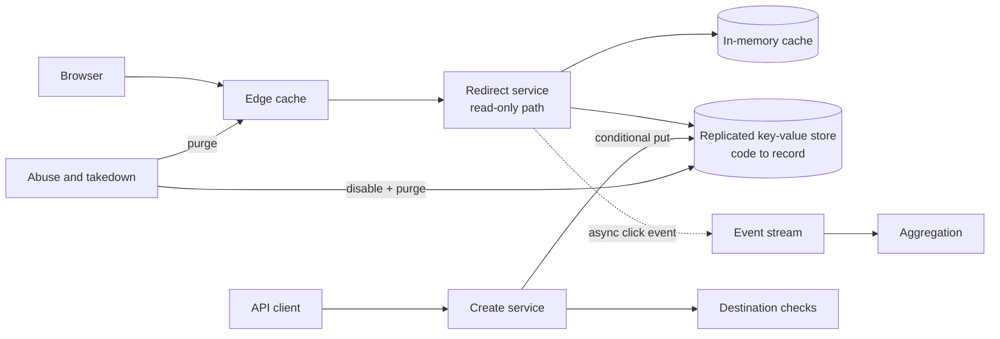

# URL Shortener: Identifier Allocation and the Redirect Path

## TL;DR

A URL shortener maps a short code to a long URL and redirects whoever follows it. It is the smallest system that forces every design decision of a read-heavy, globally distributed key-value service: how unique identifiers are allocated without a single bottleneck, what the redirect response promises to caches the operator does not control, and how a mapping that was safe when created is withdrawn after it turns hostile.

The data model is one small immutable record, so storage is not the hard part. The hard parts are three contracts that are easy to state wrongly. **Code allocation** must be unique under concurrency and region failure, and must not let a stranger enumerate other people's links. **Redirect semantics** decide whether the operator keeps control: a permanent redirect is cached by browsers and is effectively irrevocable, so the cheapest response is also the one that cannot be taken back. **Abuse handling** is a first-class requirement, because a shortener hides destinations by construction and attackers know it. The reference design below is deliberately conservative: random codes with a conditional write, temporary redirects with short explicit cache lifetimes, and click analytics off the redirect path. All capacity figures are illustrative.

## Requirements and Contract

**Functional.**

- Create a short link for a URL, optionally with a custom alias and an expiry.
- Redirect a request for a code to its destination.
- Disable or delete a link, by owner or by policy.
- Report click counts per link.

**Non-functional, stated as contracts.**

| Property | Contract |
|---|---|
| Uniqueness | One code maps to at most one destination for its whole life, including across regions and restores |
| Stability | An active code never changes destination unless the product explicitly offers editable links |
| Redirect availability | Higher than creation availability; a reader must not depend on the write path |
| Revocation | A disabled link stops redirecting within a bounded, published time everywhere |
| Unguessability | Knowing one code gives no practical advantage in finding another |
| Read-your-write | The creator can follow the link immediately, from any region |
| Analytics | Eventually consistent, never blocking the redirect |

The asymmetry between reads and writes drives the architecture. Redirects outnumber creations by orders of magnitude, are latency-sensitive, and are safe to serve from stale replicas because records do not change. Creations are rare, need a uniqueness guarantee, and can tolerate tens of milliseconds.

## Capacity Estimate

Assume 100 million new links per month, a 100:1 redirect-to-create ratio, a 10x peak factor, 500 bytes per stored record, and five years of retention.

```text
creates/s (mean)    = 100,000,000 / 2,592,000      = 39
redirects/s (mean)  = 39 x 100                     = 3,860
redirects/s (peak)  = 3,860 x 10                   = 38,600
records in 5 years  = 100,000,000 x 60             = 6 billion
storage             = 6e9 x 500 bytes              = 3 TB before replication
```

Three terabytes fits on a handful of nodes. The system is sized by redirect throughput and tail latency, and by how much of the read traffic the cache tier absorbs. See [Capacity Planning and Back-of-the-Envelope Estimation](../01-foundations/10-capacity-planning.md) for the method.

Code length follows from the record count. With a 62-character alphabet:

```text
62^6 = 56.8 billion      6 billion records fill 10.6% of the space
62^7 = 3.52 trillion     6 billion records fill 0.17% of the space
```

Seven characters keep the space sparse, which matters for both collision retries and guessing resistance, as the next two sections show.

## Architecture



Two services share one store and nothing else. The redirect service reads; it has no dependency on the create path, on analytics, or on the abuse pipeline's availability. The create service writes with a uniqueness condition. Analytics leaves the redirect path as an asynchronous event.

## Code Allocation

Five approaches exist. They differ in coordination cost, code length, and what the code reveals.

| Approach | Uniqueness mechanism | Reveals | Main risk |
|---|---|---|---|
| Central counter, base-62 encoded | The counter | Creation order and volume; neighbors are valid codes | Enumeration; the counter is a write bottleneck |
| Range or ticket allocation | Each node leases a block of the counter space | Same as above | Duplicate ranges after an allocator restore |
| Time-ordered 64-bit identifier | Timestamp plus worker identifier plus sequence | Creation time and worker | Longer codes (11 characters); clock and worker-identifier discipline |
| Random code with conditional write | The store rejects an existing key | Nothing | Retry on collision; requires a compare-and-set primitive |
| Hash of the destination | The hash, truncated | That two users shortened the same URL | Truncation collisions map different URLs to one code |

**Reference design: random code with conditional write.** Generate seven characters from a cryptographically secure random source and write with a put-if-absent condition. On conflict, generate again.

The retry rate is the fill fraction. At six billion records in a 3.52 trillion space, a new code collides with probability 0.17%, so 998 of 1,000 creations succeed on the first write. No allocator exists to fail, be restored to an old state, or become a hotspot, and regions need no coordination beyond the store's own uniqueness check.

Counter-based schemes produce shorter codes for the same record count and have no retries, which is why they are popular. Their costs are structural. A leased-range allocator must never hand out the same range twice, including after it is restored from a backup taken before its last grant; that requires the allocator's high-water mark to be durable and fenced by an epoch, as in [Distributed Locks and Leases](../01-foundations/09-distributed-locks.md). And sequential codes are enumerable, which is a security property and not a cosmetic one.

**Documented, Georgiev and Shmatikov:** by scanning the short-code space of public shorteners, the authors found links to private cloud documents and to map directions revealing home addresses, because the codes were short and dense enough to enumerate. Short links are frequently used as if they were secrets. The design should assume they will be.

Hashing the destination looks attractive because the same URL yields the same code. It fails in two ways: a truncated hash collides for different URLs, so a conditional write and a fallback are needed anyway, and merging all users of one destination into a single record makes per-owner analytics, expiry, and deletion impossible.

### Custom Aliases

Aliases use the same conditional write with a caller-chosen key. They need a reserved-word list (paths the product itself uses), a normalization rule decided once (case folding, Unicode handling), and a policy against lookalike names that impersonate brands. Normalize before the uniqueness check, or two visually identical aliases will coexist.

## The Redirect Response

The status code is a contract with caches the operator does not run.

**Documented, RFC 9110:** a `301 Moved Permanently` response is cacheable by default, so a browser may store it and stop asking. A `302 Found` response is not cacheable unless it carries explicit freshness information. `307` and `308` are the method-preserving counterparts of `302` and `301`.

| Choice | Effect on control | Effect on load | Effect on analytics |
|---|---|---|---|
| `301` with no cache headers | Lost: browsers may keep it indefinitely | Lowest | Repeat clicks are invisible |
| `302` with no cache headers | Kept: every click reaches the service | Highest | Complete |
| `302` or `301` with `Cache-Control: max-age=N` | Kept, with revocation delay bounded by N | Tunable | Undercounted within N per client |

**Reference design:** respond with `302` and an explicit short `max-age`, with a longer lifetime at the operator's own edge cache than in browsers, because the edge can be purged and browsers cannot. The revocation contract becomes "at most N seconds after disable, plus purge propagation", which is a number that can be published and tested.

The redirect path itself is a cache hierarchy over an immutable record: edge cache, then a process-local cache, then the store. Because records do not change, the only invalidation events are disable, delete, and expiry. See [Cache Invalidation and Coherence](../04-caching/02-cache-invalidation.md).

Nonexistent codes need the same care as existing ones. Random scanning produces a stream of misses that bypass every positive cache and land on the store. Cache negative results briefly, and place a membership filter in front of the store so most misses are answered from memory. See [Bloom Filters](../03-storage-engines/05-bloom-filters.md).

## Storage and Regional Layout

The record is small and fixed in shape:

```text
code            primary key
destination     URL, validated and length-bounded
owner           account identifier
created_at      timestamp
expires_at      optional
state           active | disabled | deleted
```

Any replicated key-value store with a conditional put serves it. Partition by a hash of the code; random codes spread evenly by construction. See [Partitioning Strategies](../02-distributed-databases/05-partitioning-strategies.md).

Multi-region deployment exposes the one consistency question in the system. If creation commits in one region and replicates asynchronously, the creator who immediately opens the link through another region receives a "not found" response for a link that exists. Three remedies, in increasing cost:

1. **Fall back on miss.** A regional miss for a syntactically valid code triggers one read against the authoritative region before returning not found. Cheap, and correct as long as misses for real codes are rare.
2. **Encode the home region in the code.** A prefix or checksum character routes reads for young codes to their origin. Costs a character and couples the code to topology.
3. **Replicate synchronously before acknowledging creation.** Simple semantics, creation latency bounded by the slowest quorum.

Uniqueness across regions comes from the same mechanism in every case: either the conditional write is evaluated by a store that is linearizable for that key, or regions draw codes from disjoint spaces. Never rely on "random collisions are unlikely" without the conditional write; the write is what turns unlikely into impossible.

**Never reuse a code.** When a link is deleted or expires, the code stays reserved. Old copies of the short link remain in emails, documents, and printed material, and reassigning the code would send those readers to someone else's destination.

## Abuse and Takedown

A shortener is useful to attackers for the same reason it is useful to everyone else: the destination is not visible. This is a design requirement, not an operational afterthought.

- **Check at creation.** Validate scheme and syntax, reject destinations on blocklists, and consult a reputation service.
- **Check again later.** A destination that is clean when shortened can serve malware a week later. Rescan active links, weighted by click volume.
- **Rate-limit creation by account**, with tighter limits for new accounts. See [Rate Limiting](../06-scaling/05-rate-limiting.md).
- **Disable, do not delete.** A disabled record redirects to an interstitial and preserves the evidence trail.
- **Make takedown reach every cache.** Purge the edge, and rely on the short browser lifetime chosen above for the rest.
- **Refuse to shorten your own short links** and other shorteners where policy allows, to prevent redirect chains that hide the final destination from scanners.

## Click Analytics

Counting clicks must not make redirects slower or less available. The redirect service emits an event (code, timestamp, coarse client attributes) to a stream and responds without waiting. Aggregation consumes the stream and maintains per-link counts.

The correctness questions are those of any event pipeline: duplicate events on retry, late events, and bot traffic that inflates counts. They are treated in full in [Ad Click Aggregation](./04-ad-click-aggregation.md). Two points are specific to this design. Cached redirects produce no events, so reported clicks are a lower bound whose tightness depends on the cache lifetime. And unique-visitor counts per link are a natural use of a mergeable cardinality sketch, described in [Probabilistic Sketches](../03-storage-engines/10-probabilistic-sketches.md).

## Failure Traces

### The allocator restored from backup

1. A range allocator has granted blocks up to 9,000,000.
2. Its database fails and is restored from a snapshot whose high-water mark is 8,500,000.
3. It grants 8,500,001 through 8,600,000 to a new node.
4. Codes in that block already exist. Without a conditional write, new links overwrite old ones and existing short links now lead to strangers' destinations.

Keep the conditional write even with an allocator, and fence allocator state with an epoch that a restore must advance.

### The permanent redirect that could not be recalled

A link is reported for phishing and disabled. Users who followed it earlier continue to be redirected, because their browsers cached the `301` and never ask again. The operator has no mechanism to reach those caches. The response should have carried a bounded lifetime.

### The viral link

One code receives 30,000 requests per second from a single event. Its record expires from the process-local caches on a hundred redirect servers within the same second, and every server reads the store for the same key. Coalesce concurrent loads per key and add jitter to cache lifetimes, as in [Cache Stampede, Cold Start, and Warming](../04-caching/04-cache-stampede.md).

### Enumeration

A crawler requests codes sequentially and harvests every destination, including links to unlisted documents. Random sparse codes make enumeration uneconomic; per-client limits on not-found responses make it visible.

### Analytics outage takes down redirects

The event stream is unavailable and the redirect service blocks on publishing. Redirect latency rises until the service fails its health checks. The publish must be asynchronous with a bounded local buffer that drops when full, and the drop must be counted.

## Design Review Questions

1. What makes a code unique, and does that mechanism survive a region partition and a restore from backup?
2. Can a stranger who holds one code find others faster than random guessing?
3. Which status code and cache headers are returned, and what is the resulting worst-case time to revoke a link?
4. What does the redirect path depend on, and which of those dependencies can fail without failing a redirect?
5. How does a not-found request avoid reaching the store?
6. What happens when the creator follows the link from another region one second after creating it?
7. What happens to a code after its link is deleted?
8. How is a destination that turns malicious after creation discovered and withdrawn?
9. What do click counts mean, given caching, retries, and bots, and is that meaning stated to users?

## References

- [RFC 9110, *HTTP Semantics*](https://www.rfc-editor.org/rfc/rfc9110)
- [RFC 3986, *Uniform Resource Identifier (URI): Generic Syntax*](https://www.rfc-editor.org/rfc/rfc3986)
- [Georgiev and Shmatikov, *Gone in Six Characters: Short URLs Considered Harmful for Cloud Services* (2016)](https://arxiv.org/abs/1604.02734)
- [Flickr Engineering, *Ticket Servers: Distributed Unique Primary Keys on the Cheap* (2010)](https://code.flickr.net/2010/02/08/ticket-servers-distributed-unique-primary-keys-on-the-cheap/)
- [Twitter Engineering, *Announcing Snowflake* (2010)](https://blog.x.com/engineering/en_us/a/2010/announcing-snowflake)
- [Google, *Safe Browsing* developer documentation](https://developers.google.com/safe-browsing)

---

## Related Chapters

- [Cache Invalidation and Coherence](../04-caching/02-cache-invalidation.md): revocation is an invalidation problem across caches you do not operate
- [Cache Stampede, Cold Start, and Warming](../04-caching/04-cache-stampede.md): what one viral code does to a hundred servers that miss together
- [Partitioning Strategies](../02-distributed-databases/05-partitioning-strategies.md): hashing codes across nodes, and why random keys make this the easy case
- [Distributed Locks and Leases](../01-foundations/09-distributed-locks.md): fencing an identifier allocator so a restore cannot reissue a range
- [Bloom Filters](../03-storage-engines/05-bloom-filters.md): answering not-found from memory when scanners probe the code space
- [Ad Click Aggregation](./04-ad-click-aggregation.md): the event pipeline behind click counts, with its duplicate and late-data rules
