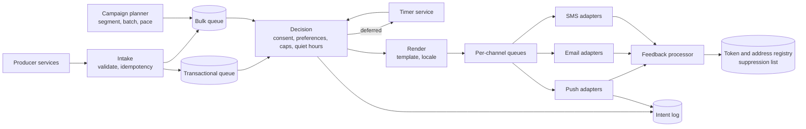

# Notification Delivery Platform: Preferences, Fan-Out, and Provider Semantics

## TL;DR

A notification platform accepts "tell this user about this event" from many internal services and turns it into a push message, an email, an SMS, or an in-app entry. The transport is the easy part and mostly belongs to someone else: Apple, Google, mailbox providers, and carriers deliver the last hop on a best-effort basis with their own rules. The platform's real job is everything before that hop: deciding **whether** to send (consent, preferences, quiet hours, frequency caps), **what** to send (one message, a digest, or a replacement for an earlier one), **when** to send (now, later, or never because it is already stale), and **how hard to try** (retry, fall back to another channel, or give up).

Three properties shape the design. Delivery is **not guaranteed and not ordered**, so anything that must be correct, such as a one-time passcode, needs an expiry and an idempotent intent rather than hope. Workloads are **two different systems sharing one name**: transactional messages are small, urgent, and must never queue behind a marketing campaign, while campaigns are enormous, deferrable, and capable of overloading both providers and the product they advertise. And every send is an **irreversible external effect**: a duplicate, a message to the wrong device, or a message after opt-out cannot be recalled. [Alert Evaluation and Notification](../11-observability/04-alerting.md) covers paging operators; this design covers messaging end users. All capacity figures are illustrative.

## Requirements and Contract

**Functional.**

- Accept notification intents from producer services with a recipient, a category, template data, and an idempotency key.
- Deliver over push, email, SMS, and an in-app inbox, with per-category channel policy.
- Honor user preferences, legal consent, quiet hours, and frequency caps.
- Support scheduled sends, digests, and campaigns to large segments.
- Record the outcome of every intent for support and audit.

**Contracts.**

| Property | Contract |
|---|---|
| Intent idempotency | The same idempotency key produces at most one user-visible notification per channel |
| Consent | No message is sent on a channel the user has not permitted at the moment of sending |
| Staleness | A message is never delivered after its declared expiry |
| Isolation | Transactional latency is unaffected by campaign volume |
| Delivery | Best effort after hand-off to the provider; the platform reports "accepted by provider", not "seen by user" |
| Ordering | Not guaranteed; replacements use explicit collapse identifiers |
| Auditability | Every intent has a terminal recorded state with a reason |

Writing "accepted by provider" into the contract matters. Product teams routinely assume a push notification was received because the API returned success, and build flows that fail silently when it was not.

## What the Providers Promise

The design has to fit the semantics of the last hop, so they are stated first.

**Documented, Apple Push Notification service:** requests are sent over HTTP/2 to a device token. Headers set an expiration time, a priority, and an optional collapse identifier that lets a new notification replace an earlier one with the same identifier. When a device is offline, the service stores a notification for a limited period and keeps only the most recent one for that app, discarding older ones. A response indicating the token is no longer registered tells the sender to stop using it.

**Documented, Firebase Cloud Messaging:** messages carry a time-to-live with a maximum of four weeks and may carry a collapse key so that only the latest message of a group is delivered when the device reconnects. Tokens can become stale, and the guidance is to track token freshness and remove tokens the service reports as unregistered.

**Documented, Web Push (RFC 8030):** a push message carries a time-to-live, an urgency, and an optional topic that replaces a pending message with the same topic.

**Documented, email:** authentication of the sending domain uses DKIM signatures and a DMARC policy, and RFC 8058 defines one-click unsubscribe. Large mailbox providers publish bulk-sender requirements covering authentication, unsubscribe handling, and spam-complaint rates; senders who exceed complaint thresholds are throttled or rejected.

Four consequences follow for every channel:

1. There is no delivery receipt you can rely on for correctness. Design flows that work if the message never arrives.
2. The provider may drop all but the latest message for an offline device. Notifications are hints to fetch state, not the state itself.
3. Sender reputation is a shared, slowly recovering resource. Sending to dead tokens and bouncing addresses damages delivery for everyone on the same sender identity.
4. Provider feedback (unregistered tokens, hard bounces, complaints) is an input the platform must consume, not log.

## Architecture



The stages are separated because they fail differently. Intake must be fast and durable. Decision is policy and must read current preferences. Rendering is CPU and template correctness. Channel adapters are bound by provider rate limits and latency. Each boundary is a queue so that a slow provider backs up only its own channel. See [Message Queue Architecture](../05-messaging/01-message-queues.md).

## Intake and Intent Identity

A producer submits an **intent**: recipient, category, template identifier and data, optional expiry and schedule, and an idempotency key derived from the business event (for example, `order-1234-shipped`). Intake stores the intent durably under that key and acknowledges. A repeated submission with the same key returns the original result. The mechanics are those in [Idempotency and Operation Identity](../01-foundations/08-idempotency.md).

The key is the producer's responsibility because only the producer knows what counts as the same event. A platform that deduplicates on message text will merge distinct events with identical wording and miss duplicates with a changed timestamp.

Downstream of intake, every stage is at-least-once. The stage that calls the provider is where duplicates become visible to a human, so it carries a second guard: before sending, record `(intent, channel, device)` as in progress, and after the provider accepts, record it as sent. A worker that crashes between the provider's acceptance and the record will retry and may send twice. That window cannot be closed against a provider that offers no idempotency key of its own; it can only be made narrow, and where a provider supports a collapse identifier, a duplicate with the same identifier replaces instead of stacking. See [Delivery Guarantees and Effect Boundaries](../05-messaging/04-delivery-guarantees.md).

## The Decision Stage

Decision answers whether this intent becomes a message on each channel. It evaluates, in order:

1. **Legal consent and suppression.** Unsubscribed addresses, numbers that replied with an opt-out keyword, and jurisdictions requiring prior consent. A hard stop.
2. **User preferences** by category and channel.
3. **Expiry.** An intent past its expiry is dropped with a recorded reason.
4. **Quiet hours** in the user's time zone, which defer non-urgent messages to a timer.
5. **Frequency caps** per user, per category, and per channel.
6. **Aggregation.** Related events inside a short window are merged into one message or a digest.
7. **Channel selection and fallback.** For example, push first, then SMS if the category is critical and no device acknowledged within a deadline.

**Evaluate at send time, not at enqueue time.** A campaign enqueued at 09:00 may reach a user's turn at 09:40. If the user unsubscribed at 09:10, the message must not go out. Any decision cached at enqueue is a consent violation waiting for a slow queue. The same applies after a deferral: preferences are re-read when the timer fires.

Categories carry policy. A security alert ignores marketing caps and quiet hours. A promotional message obeys all of them. Making the category a required, validated field with an owner prevents every producer from declaring itself critical, which is what happens when urgency is a free-form flag.

Deferred sends need a durable timer, not an in-memory delay; see [Distributed Scheduling and Timer Services](../18-workflow-job-systems/03-distributed-cron-scheduling.md).

## Transactional and Bulk Are Separate Systems

A passcode must arrive in seconds. A campaign to twenty million users can take an hour. If they share queues and workers, the campaign's backlog sits in front of the passcode.

**Reference design:** separate queues, worker pools, and provider connection budgets by class, with the transactional class never borrowing from or lending to bulk under load. Within bulk, schedule fairly across campaigns so one sender cannot monopolize the channel. The mechanisms are in [Priority, Fairness, and Backpressure](../18-workflow-job-systems/07-priority-fairness-backpressure.md).

Campaign fan-out is a planning job, not a loop. The planner resolves a segment to recipients in batches, writes batches to the bulk queue at a controlled rate, and paces the whole send over a window. Pacing serves three parties: the provider's rate limits, the user's device (a burst of pushes is collapsed or throttled), and the product itself, as the capacity section shows.

## Tokens, Addresses, and Feedback

The registry maps a user to deliverable endpoints: device tokens, verified email addresses, verified phone numbers. Its correctness is a privacy boundary.

- **Bind tokens to sessions.** When a user signs out, the token's association with that account must be removed before another user signs in on the device. Otherwise the next account holder receives the previous one's notifications.
- **Refresh and expire.** Record when each token was last confirmed by the app, and stop sending to tokens that have been silent beyond the provider's staleness horizon.
- **Consume feedback.** An unregistered-token response deletes the token. A hard bounce suppresses the address. A spam complaint suppresses and is counted against the sending category.
- **Keep payloads minimal.** Lock screens display notification text. Send an identifier and a generic line, and let the app fetch details after authentication, for anything sensitive.

## Capacity Model

Assume 50 million users, five notifications per user per day on average, and a campaign to 20 million users.

```text
steady rate         = 50,000,000 x 5 / 86,400         = 2,900 per second
campaign, unpaced   = 20,000,000 in 10 minutes        = 33,300 per second
in-flight requests  = 33,300/s x 0.1 s provider time  = 3,330 concurrent
```

The steady load is small. The campaign is twelve times larger and is entirely self-inflicted, which means it is also entirely controllable by pacing.

The larger effect is downstream. If 5% of recipients open the app within ten minutes and each open issues ten API requests:

```text
app opens           = 20,000,000 x 0.05               = 1,000,000 in 10 minutes
extra API load      = 1,000,000 x 10 / 600            = 16,700 requests per second
```

A marketing send can be the largest traffic event of the week for the product's own backend. Pacing the campaign over an hour instead of ten minutes divides that surge by six. The notification platform should take a maximum induced-load figure from the owning service as an input to the campaign plan.

## Failure Traces

### Duplicate after a worker crash

1. A push adapter sends an order-shipped notification; the provider accepts it.
2. The worker is killed before recording the send.
3. The queue redelivers; a second worker sends again.
4. The user sees two identical notifications.

Use a collapse identifier derived from the intent so the second replaces the first on the device, and keep the in-progress record so the retry can at least detect and count the ambiguity.

### The campaign that delayed sign-in codes

Passcodes and a product announcement share one SMS queue. The announcement enqueues four million messages; the provider allows a few hundred per second. Passcodes wait behind them for hours and expire. Users cannot sign in. Separate queues and provider budgets by class, and give passcodes an expiry so that late ones are dropped rather than delivered useless.

### Notifications to the previous owner of a device

A user signs out on a shared tablet; the app does not deregister its token. Another user signs in and the token is now associated with two accounts. The first user's messages appear on a device they no longer control. Deregister on sign-out, enforce one account per token in the registry, and treat a token re-registration under a new account as a removal from the old one.

### Unsubscribed, then messaged

A user opts out of promotional email at 09:10. A campaign batch built at 09:00 is sent at 09:40 using the preference snapshot taken at build time. The message is a compliance incident. Re-evaluate consent at send time, and make suppression checks part of the adapter's final step.

### Dead tokens erode reputation

Feedback processing has been failing silently for a month. A third of push sends go to unregistered tokens and bounce rates on email have tripled. A mailbox provider begins deferring all mail from the domain, including password resets. Monitor feedback lag and the unregistered and bounce ratios as primary health signals, and separate transactional and promotional sender identities so one cannot sink the other.

### Quiet hours in the wrong time zone

Quiet hours are evaluated in the server's time zone. Users nine hours away receive promotions at three in the morning. Store a time zone per user, define behavior when it is unknown, and test deferral across daylight-saving changes.

## Operations and Verification

Track the funnel per channel, category, and provider: intents accepted, dropped by reason (consent, preference, cap, expired), sent, accepted by provider, failed by error class, and, where the channel reports it, opened. Track queue age per class, time from intent to provider acceptance at the tail, feedback processing lag, token and address invalidation rates, and complaint rates.

Verify with tests that exercise policy, not transport: an opt-out between enqueue and send, an expiry that passes in the queue, a redelivered send, a sign-out followed by a different sign-in, a provider returning throttling errors for an hour, and a campaign launched while the transactional path is measured.

## Design Review Questions

1. What is the idempotency key for each producer, and who defines it?
2. At what moment are consent and preferences evaluated relative to the actual send?
3. What happens to a message whose expiry passes while it is queued or deferred?
4. Can any volume of bulk traffic delay a transactional message, and what measurement proves it cannot?
5. What does "delivered" mean in dashboards and in product logic, and does any flow break if a notification never arrives?
6. How does provider feedback change the registry, and how quickly?
7. What happens to a device token at sign-out, account deletion, and device transfer?
8. What load does a full-audience campaign induce on the product's own services, and who approved that number?
9. What is on the lock screen, and is that acceptable for every category?

## References

- [Apple, *Sending notification requests to APNs*](https://developer.apple.com/documentation/usernotifications/sending-notification-requests-to-apns)
- [Apple, *Handling notification responses from APNs*](https://developer.apple.com/documentation/usernotifications/handling-notification-responses-from-apns)
- [Firebase Cloud Messaging documentation](https://firebase.google.com/docs/cloud-messaging)
- [Firebase, *Best practices for FCM registration token management*](https://firebase.google.com/docs/cloud-messaging/manage-tokens)
- [RFC 8030, *Generic Event Delivery Using HTTP Push*](https://www.rfc-editor.org/rfc/rfc8030)
- [RFC 6376, *DomainKeys Identified Mail (DKIM) Signatures*](https://www.rfc-editor.org/rfc/rfc6376)
- [RFC 7489, *Domain-based Message Authentication, Reporting, and Conformance (DMARC)*](https://www.rfc-editor.org/rfc/rfc7489)
- [RFC 8058, *Signaling One-Click Functionality for List Email Headers*](https://www.rfc-editor.org/rfc/rfc8058)
- [Google, *Email sender guidelines*](https://support.google.com/a/answer/81126)

---

## Related Chapters

- [Idempotency and Operation Identity](../01-foundations/08-idempotency.md): the intent key that keeps a retried event from becoming a second message
- [Delivery Guarantees and Effect Boundaries](../05-messaging/04-delivery-guarantees.md): why the provider call is an effect you can narrow but not make exactly-once
- [Message Queue Architecture](../05-messaging/01-message-queues.md): the per-stage and per-channel queues that contain a slow provider
- [Priority, Fairness, and Backpressure](../18-workflow-job-systems/07-priority-fairness-backpressure.md): keeping passcodes ahead of campaigns and campaigns fair to each other
- [Distributed Scheduling and Timer Services](../18-workflow-job-systems/03-distributed-cron-scheduling.md): durable deferral for quiet hours, digests, and scheduled sends
- [Alert Evaluation and Notification](../11-observability/04-alerting.md): the operator-facing counterpart, where the recipient is on call
- [Client Delivery Transports](../07-real-time/01-polling.md): the in-app channel, for clients that are connected right now
- [URL Shortener](./01-url-shortener.md): tracked links in messages, and the same rule that a click count is a lower bound
