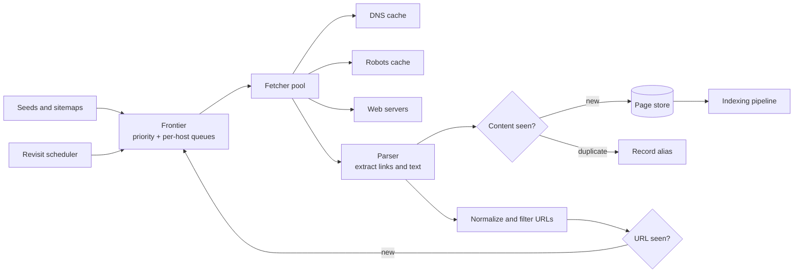

# Web Crawler: Frontier, Politeness, and Freshness

## TL;DR

A crawler downloads pages, extracts links, and repeats. The loop is trivial; the system is defined by three constraints that the loop ignores. **Politeness**: the servers being crawled belong to other people, so the request rate to each host is bounded by courtesy and by the Robots Exclusion Protocol, not by the crawler's hardware. **Unboundedness**: the web contains infinitely many URLs, most of them duplicates, traps, or spam, so the crawler must decide what not to fetch far more often than what to fetch. **Staleness**: every stored page begins aging the moment it is fetched, so a crawl is never finished, only more or less fresh.

All three meet in one component, the **frontier**: the data structure that holds URLs to visit and decides which one is next. A good frontier is a scheduler with two objectives that conflict, priority (fetch the valuable page first) and politeness (never fetch from one host too quickly), and it is where almost every crawler-specific design decision lives. Around it sit commodity parts: a fetcher pool, a DNS cache, duplicate detection, and bulk storage. The reference design below follows the published architecture of Mercator and its successors. All capacity figures are illustrative.

## Requirements and Contract

**Functional.**

- Discover and fetch pages starting from seed URLs and sitemaps.
- Obey robots rules and per-host rate limits.
- Avoid fetching the same content repeatedly.
- Revisit pages to keep the stored copy fresh.
- Emit fetched content and the link graph to downstream indexing.

**Contracts.**

| Property | Contract |
|---|---|
| Politeness | At most one in-flight request per host, with a minimum delay between requests that adapts to the host's response time |
| Robots compliance | No fetch of a disallowed path; robots rules refreshed at least daily |
| Identification | A stable user-agent with a contact URL; published address ranges where possible |
| Coverage | Measured against a defined target set, not "the web" |
| Freshness | A stated objective, such as the expected age of the stored copy for each priority tier |
| Robustness | Malformed, hostile, or infinite sites degrade one host's crawl, never the fleet |
| Restartability | A crash loses at most a bounded amount of frontier progress |

Coverage and freshness compete for the same fetch budget. A crawler that spends everything on discovery serves stale pages; one that only refreshes never grows. The budget split is a product decision that should be explicit.

## Primary Evidence and Scope

| Source | What it establishes | Boundary |
|---|---|---|
| Brin and Page (1998) | An early large crawler: a URL server feeding distributed fetchers holding hundreds of connections each, with a DNS cache | Historical scale |
| Heydon and Najork, Mercator (1999) | The frontier split into priority queues and per-host queues, plus URL-seen and content-seen tests | The reference architecture most later crawlers follow |
| Boldi et al., UbiCrawler (2004) | Assigning hosts to crawler agents by consistent hashing, with no central coordinator | One distributed design |
| Lee et al., IRLbot (2009) | 6.3 billion pages in 41 days from one server, with disk-based URL uniqueness and per-domain budgets against spam | One crawl; shows that disk and reputation, not CPU, were binding |
| Cho and Garcia-Molina (2003) | Refresh policies; revisiting in proportion to change rate is not optimal for average freshness | Analytical model with stated assumptions |
| Manku, Jain, and Das Sarma (WWW 2007) | Near-duplicate detection with 64-bit similarity fingerprints at multi-billion-page scale | Google's reported parameters |
| RFC 9309 | The Robots Exclusion Protocol, including caching and error handling | Standardized in 2022; some common directives are outside it |

## Architecture



The loop is: take a URL from the frontier, resolve the host, check robots rules, fetch, parse, test the content for duplication, normalize extracted links, test each for prior discovery, and add new ones to the frontier. Every stage is a place where the crawler chooses to do less.

## The Frontier

**Documented, Mercator:** the frontier has two tiers. **Front queues** hold URLs by priority. **Back queues** hold URLs by host, one host per queue, and enforce politeness. A heap keyed by "earliest time this host may be contacted again" tells a fetcher which back queue to serve next. When a back queue empties, it is refilled from the front queues, biased toward higher priority.

This structure resolves the two objectives cleanly:

- Priority decides which host's work enters the back queues.
- Politeness decides when each back queue may release one URL.
- A fetcher never chooses a URL; it takes the host whose turn has come.

Three implementation facts follow. The frontier is far larger than memory, so only the heads of queues are in RAM and the rest is on disk or in a queue service. The frontier is the crawl's state, so it must be checkpointed; losing it means rediscovering the web. And the number of hosts being crawled concurrently, not the number of fetcher threads, sets throughput, because each host yields at most one request per delay interval.

### Priority

Priority inputs include link-based importance, depth from a seed, host reputation, content type, and, for revisits, estimated change rate and the cost of staleness. Priority should be assigned per URL but **budgeted per host or domain**. **Documented, IRLbot:** the authors report that without per-domain budgets a crawl is captured by sites that generate unlimited URLs, and describe allocating crawl budget according to domain reputation.

### Politeness

One connection at a time per host, with a delay between requests. A common adaptive rule sets the delay to a multiple of the last response time, so a slow server is automatically contacted less often. Apply the limit per IP address as well as per hostname, since thousands of hostnames may share one server.

Politeness, not hardware, bounds how fast a large site can be crawled:

```text
2,000,000 pages on one host at 1 request per second = 2,000,000 s = 23 days
```

No amount of fleet capacity changes that number. Large sites are crawled continuously, and their freshness is negotiated through sitemaps and conditional requests, not through speed.

## Robots Rules and Identification

**Documented, RFC 9309:** a crawler fetches `/robots.txt` from each authority before crawling it and applies the group of rules matching its user-agent. The specification also defines error handling, which is where implementations go wrong:

- If the file is **unavailable** (a 4xx status), the crawler may access any resource.
- If the file is **unreachable** (a server error or network failure), the crawler must assume complete disallow.
- Cached rules should not be used for more than 24 hours unless the file is unreachable.

The asymmetry is deliberate: an overloaded server returning errors must not be read as permission to crawl everything. Directives such as `Crawl-delay` are widely used but are not part of the standard; honoring them is a courtesy the crawler should document.

Send a user-agent that names the crawler and links to a page explaining its purpose and how to block it. Operators who can identify and contact a crawler throttle it; operators who cannot, block its addresses.

## Deciding What Not to Fetch

### URL Normalization and the URL-Seen Test

The same resource has many spellings. Normalize before testing: lowercase the scheme and host, remove default ports, resolve dot segments, normalize percent-encoding, drop fragments, and strip known tracking and session parameters. The rules come from RFC 3986; the parameter list is curated per site family.

The URL-seen test then asks whether a normalized URL has been discovered before. At billions of URLs this is a set-membership problem too large for a hash table of strings. Store fixed-size fingerprints, front the store with an in-memory filter so most lookups never touch disk, and batch the rest. See [Bloom Filters](../03-storage-engines/05-bloom-filters.md). **Documented, IRLbot:** the paper describes a disk-based batch structure for exactly this check, because random disk lookups per discovered URL would have dominated the crawl.

### Content-Seen and Near Duplicates

Different URLs often return the same page: mirrors, printer views, session variants. A checksum of the content catches exact duplicates. Near duplicates, where only an advertisement or a timestamp differs, need a similarity fingerprint. **Documented, Manku et al.:** using 64-bit fingerprints, pages whose fingerprints differ in at most three bits were treated as near duplicates over a corpus of eight billion pages.

### Traps

A calendar that links to "next month" forever, a faceted search with every filter combination, or a script that embeds a fresh identifier in every link produces unbounded URL spaces. Defenses are budgets, not detection alone: maximum depth, maximum URLs per host per time window, maximum URL length, a cap on distinct query-parameter combinations per path, and demotion of hosts whose new pages are mostly duplicates.

## Fetching

- **DNS** is a hidden bottleneck. Resolving every URL synchronously serializes the crawl on resolver latency. Cache results with their lifetimes, resolve asynchronously, and operate dedicated resolvers. The lifecycle issues are in [DNS and Connection Management](../06-scaling/13-dns-and-connection-management.md).
- **Conditional requests.** Send validators (`If-Modified-Since`, `If-None-Match`) on revisits so an unchanged page costs a header exchange, not a download.
- **Limits.** Cap response size, time to first byte, total time, and redirect chain length. A server that sends one byte per second forever must cost one connection for a bounded time.
- **Rendering.** Pages built by client-side scripts need a headless browser to produce content, at a cost one to two orders of magnitude above a plain fetch. Run rendering as a separate, smaller tier fed only by pages that are valuable and demonstrably script-dependent.
- **Untrusted input.** Every byte is hostile until proven otherwise. Parsers run with memory and time limits, in isolation from the fetch workers' credentials and network.

## Distribution

Partition the frontier by **host**, not by URL, so that one worker owns all politeness state for a host. **Documented, UbiCrawler:** hosts are assigned to agents with consistent hashing so that adding or removing an agent moves only a fraction of hosts.

The hazard is the reassignment itself. If a host moves from worker A to worker B while A still has requests in flight or URLs queued, both may contact the host at once, doubling the rate. Transfer host ownership with a lease and a handoff of the next-allowed time, as described in [Leases, Heartbeats, and Recovery](../18-workflow-job-systems/08-leases-heartbeats-recovery.md). Links discovered by one worker for a host owned by another are forwarded in batches.

## Freshness and Revisit Scheduling

Each stored page has a change rate that can only be estimated from past visits. The intuitive policy, visiting pages in proportion to how often they change, is not the best one. **Documented, Cho and Garcia-Molina:** under their model, a uniform revisit policy yields better average freshness than a proportional one, and the optimal policy gives less attention to pages that change too frequently to ever be kept fresh.

The practical form: classify pages into tiers by importance and estimated change rate, give each tier a revisit interval, stop chasing pages that change on every fetch (serve them as known-volatile), and use sitemaps and feeds as hints. Then measure the outcome directly by sampling stored pages and comparing them with the live web.

## Capacity Model

Assume a target of one billion pages per month, 60 kilobytes of HTML per page, and ten billion discovered URLs.

```text
fetch rate        = 1,000,000,000 / 2,592,000 s     = 386 pages per second
bandwidth         = 386 x 60 KB                     = 23 MB/s = 185 Mbit/s
raw storage       = 1e9 x 60 KB                     = 60 TB per month before compression
URL fingerprints  = 10e9 x 8 bytes                  = 80 GB on disk
in-memory filter  = 10e9 x 10 bits                  = 12.5 GB at about 1% false positives
concurrent hosts  = 386 / (1 request per 2 s)       = at least 772 active at all times
```

Bandwidth and CPU are modest. The binding quantities are the number of distinct hosts that can be crawled in parallel, the size of the seen-set, and storage. A crawl that is behind schedule usually needs a wider spread of hosts, not more machines.

## Failure Traces

### Robots errors read as permission

A site's server is overloaded and returns 503 for every path, including `/robots.txt`. The crawler treats the failed fetch as "no rules" and requests thousands of normally disallowed URLs, deepening the overload. The standard requires the opposite: unreachable means disallow. Encode the three cases (success, unavailable, unreachable) as distinct states with tests.

### The infinite calendar

An events page links to the next day indefinitely. The crawler discovers 40 million unique URLs on one host, all nearly empty. They fill the frontier and consume that host's entire budget for weeks. Per-host URL budgets and duplicate-ratio demotion cap the damage; depth limits alone do not, because every page is one click from the last.

### Two workers, one host

A deploy restarts half the fetchers. Consistent hashing reassigns a large news site to a new worker while the old one is still draining. For ten minutes the site receives double the agreed rate and blocks the crawler's address range. Ownership transfer needs a lease and an inherited next-allowed time.

### Resolver collapse

The crawl widens to millions of new hosts after a seed import. Lookups overwhelm the shared resolvers, timeouts cascade into fetch failures, and unrelated services using the same resolvers degrade. Give the crawler dedicated resolvers, limit lookup concurrency, and cache negative results.

### Session identifiers defeat the seen-set

A site appends a random token to every internal link. Every URL is new, every page is a duplicate. The URL-seen test passes them all; only the content-seen test notices, after the fetch has been paid for. Strip known session parameters during normalization, and demote hosts by observed duplicate ratio.

## Operations and Verification

Track fetch rate by outcome class (success, redirect, client error, server error, timeout, robots-disallowed), active hosts, frontier size by priority, per-host delay compliance, duplicate ratio by host, DNS latency and failure rate, age distribution of stored pages by tier, and bytes saved by conditional requests.

Verify politeness with a test origin that records inter-arrival times per address. Verify robots handling against the cases in the standard. Run the crawler against a synthetic site containing traps, redirect loops, slow responses, oversized bodies, and malformed markup, and require bounded cost for each. Verify restart by killing the frontier owner mid-crawl and measuring refetched and lost URLs.

## Design Review Questions

1. What is the target set, and how are coverage and freshness measured against it?
2. How is the fetch budget split between discovery and refresh, and who decided?
3. What enforces one request at a time per host and per address, including during worker reassignment?
4. How are the three robots outcomes (success, unavailable, unreachable) handled, and for how long are rules cached?
5. What bounds the number of URLs accepted from a single host or domain?
6. How large is the seen-set at the target scale, and where does each lookup go?
7. What limits apply to one response in time, size, redirects, and parser resources?
8. How is the change rate of a page estimated, and what happens to pages that always change?
9. How does a site operator identify this crawler, reach its owner, and slow or stop it?

## References

- [Brin and Page, *The Anatomy of a Large-Scale Hypertextual Web Search Engine* (Computer Networks and ISDN Systems, 1998)](https://doi.org/10.1016/S0169-7552(98)00110-X)
- [Heydon and Najork, *Mercator: A Scalable, Extensible Web Crawler* (World Wide Web, 1999)](https://doi.org/10.1023/A:1019213109274)
- [Boldi, Codenotti, Santini, and Vigna, *UbiCrawler: A Scalable Fully Distributed Web Crawler* (Software: Practice and Experience, 2004)](https://doi.org/10.1002/spe.587)
- [Lee, Leonard, Wang, and Loguinov, *IRLbot: Scaling to 6 Billion Pages and Beyond* (ACM Transactions on the Web, 2009)](https://doi.org/10.1145/1541822.1541823)
- [Cho and Garcia-Molina, *Effective Page Refresh Policies for Web Crawlers* (ACM TODS, 2003)](https://doi.org/10.1145/958942.958945)
- [Manku, Jain, and Das Sarma, *Detecting Near-Duplicates for Web Crawling* (WWW 2007)](https://research.google/pubs/detecting-near-duplicates-for-web-crawling/)
- [RFC 9309, *Robots Exclusion Protocol*](https://www.rfc-editor.org/rfc/rfc9309)
- [RFC 3986, *Uniform Resource Identifier (URI): Generic Syntax*](https://www.rfc-editor.org/rfc/rfc3986)
- [Common Crawl](https://commoncrawl.org/)

---

## Related Chapters

- [Bloom Filters](../03-storage-engines/05-bloom-filters.md): the in-memory front for a seen-set of billions of URL fingerprints
- [Search Index Architecture and Internals](../14-search-systems/01-inverted-indexes.md): the consumer of fetched pages, and why freshness is its problem too
- [DNS and Connection Management](../06-scaling/13-dns-and-connection-management.md): resolver capacity and caching, the crawler's least visible bottleneck
- [Leases, Heartbeats, and Recovery](../18-workflow-job-systems/08-leases-heartbeats-recovery.md): handing a host between workers without doubling its request rate
- [Partitioning Strategies](../02-distributed-databases/05-partitioning-strategies.md): assigning hosts to workers so politeness state has one owner
- [Rate Limiting](../06-scaling/05-rate-limiting.md): politeness seen from the other side, as the limit a site applies to you
- [URL Shortener](./01-url-shortener.md): the redirect chains a crawler must follow and bound, seen from the service issuing them
