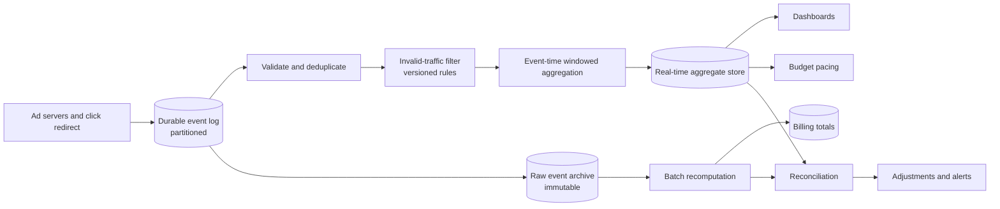

# Ad Click Aggregation: Event Time, Deduplication, and Reconciliation

## TL;DR

An ad click aggregator turns a stream of click events into counts per advertisement per time window. The counts drive three consumers with different tolerances: dashboards want them within a minute and forgive small errors, budget pacing wants them fast enough to stop a campaign before it overspends, and billing wants them exactly right and can wait a day. One pipeline cannot be optimal for all three, so the design is a fast streaming path whose output is provisional and a slower batch path over the same immutable event log whose output is final, with an explicit reconciliation between them.

Three problems make "count the clicks" hard. **Duplicates**: every hop retries, so the same click arrives more than once and must be counted once. **Time**: clicks are attributed to the minute they happened, not the minute they arrived, and some arrive hours late. **Validity**: a share of clicks are bots or accidental double-taps and must be excluded in a way an advertiser can audit. The mechanisms are event identity with a deduplication window, event-time windows closed by watermarks with a defined lateness policy, idempotent or transactional output so replays do not double count, and versioned filtering so that changing a rule does not silently rewrite history. [Stream Execution](../13-data-pipelines/02-stream-processing.md) owns the engine semantics; this chapter applies them to a system where the output is money. All capacity figures are illustrative.

## Requirements and Contract

**Functional.**

- Ingest click events from ad servers and client redirects.
- Produce counts per advertisement, campaign, and selected dimensions per one-minute window.
- Serve recent aggregates to dashboards and to the pacing service.
- Produce billable totals per campaign per day.
- Exclude invalid traffic and record why each event was excluded.

**Contracts.**

| Output | Latency | Accuracy contract |
|---|---|---|
| Real-time aggregate | Under one minute from event to queryable | Provisional; may change until the window is final |
| Pacing signal | Seconds to low tens of seconds | May undercount briefly; overspend is bounded by lag |
| Billing total | Hours to a day | Exact with respect to the event log and a named filter version; reproducible |

Additional contracts: every accepted click appears in the raw log exactly once after deduplication; every aggregate can be traced to the events that produced it; a correction to a published number is itself recorded.

Stating that the real-time number is provisional is the most valuable sentence in the contract. Without it, the first late-arriving batch of events becomes an argument about which number is "right".

## Primary Evidence and Scope

| Source | What it establishes | Boundary |
|---|---|---|
| Ananthanarayanan et al., Photon (SIGMOD 2013) | Joining click and query streams across data centers with exactly-once output, using a Paxos-backed registry of processed event identifiers; millions of events per minute with average delay under ten seconds | Google's advertising pipeline at publication |
| Gupta et al., Mesa (VLDB 2014) | A geo-replicated warehouse for advertising metrics that applies updates in versioned batches so queries see a consistent state | The serving store, not the stream processor |
| Akidau et al., The Dataflow Model (VLDB 2015) | Event time versus processing time, windows, watermarks, triggers, and accumulation modes as separate design axes | A model; guarantees depend on the engine |
| Carbone et al. (VLDB 2017) | Consistent distributed snapshots of operator state as the basis for exactly-once state in a stream processor | State consistency inside the engine, not external effects |
| Apache Kafka, KIP-98 | Idempotent producers and transactions that make a consume, transform, produce cycle atomic within the log | Atomicity ends at the log boundary |
| Yang et al., Druid (SIGMOD 2014) | Ingestion-time roll-up into a columnar store for interactive aggregate queries | One real-time analytical store |

## Architecture



The event log is the system of record. Everything downstream of it is derived and can be rebuilt. The streaming path favors latency; the batch path favors completeness; reconciliation makes their disagreement a measured quantity instead of a surprise.

## Event Identity and Deduplication

A click must carry an identifier assigned as early as possible, ideally by the ad server when it renders the ad or by the redirect service when it receives the click. The identifier, not the payload, defines sameness: two events with one identifier are one click however many times they are delivered.

Duplicates enter at every hop: the browser retries the redirect, the collector retries its write to the log, the stream job replays after a failure. Each is handled where it can be handled cheaply.

- **Producer to log.** Idempotent production prevents a retried write from appending twice.
- **Across the log.** A keyed deduplication operator remembers identifiers seen within a window and drops repeats. The window must exceed the longest plausible redelivery delay, and its state is sized in the capacity section.
- **Job to sink.** Covered below; this is where most double counting actually happens.

**Documented, Photon:** the system records each joined event's identifier in a registry replicated with Paxos across data centers, and a worker commits to the registry before emitting output. Because the registry is the single arbiter, workers in several data centers can process the same input concurrently for availability while each event is output once.

Business-level duplicates are different from delivery duplicates. Two clicks by the same user on the same ad within two seconds have different identifiers and are both delivered correctly; whether the second is billable is a policy decision that belongs to the filter stage.

## Event Time, Windows, and Lateness

A click belongs to the minute in which it occurred. Processing-time windows would attribute a backlog replayed after an outage to the minute of replay, producing a spike that never happened and a hole where the clicks actually were.

**Documented, The Dataflow Model:** the paper separates four questions: what is computed, where in event time it is grouped (windowing), when in processing time results are emitted (triggers, driven by watermarks), and how successive results relate (accumulation).

Applied here:

- **Timestamp authority.** Use the server-side receive time at the first trusted hop. Client clocks are wrong, sometimes by years, and can be set by an adversary.
- **Window.** Tumbling one-minute windows in event time, keyed by advertisement and dimensions.
- **Watermark.** The engine's estimate that no earlier events remain. Emit a first result when the watermark passes the window end.
- **Allowed lateness.** Keep window state for a further period, for example one hour, and emit an updated result when a late event arrives. The downstream store must accept updates to a window it has already seen.
- **Beyond lateness.** Events later than that are not added by the streaming path. They are still in the raw archive, and the batch path includes them. This is the designed gap between the two numbers.

Updated results need a defined relationship to earlier ones. Emitting the new total for the window and having the sink **replace** by key is simpler and safer than emitting deltas, because a replayed replacement is harmless and a replayed delta is a double count.

## Output Without Double Counting

A stream processor with consistent snapshots guarantees that its internal state reflects each input exactly once after recovery. That guarantee stops at the boundary of the engine. If the job writes "add 37" to an external store, fails before its checkpoint completes, and replays, the store receives "add 37" twice.

Two designs close the gap. Both are described in general form in [Delivery Guarantees and Effect Boundaries](../05-messaging/04-delivery-guarantees.md).

1. **Idempotent sink.** Write the full aggregate under a deterministic key, `(window start, advertisement, dimensions)`, with replace semantics. Replays rewrite the same value. This requires the aggregate to be a total, not an increment.
2. **Transactional sink.** Stage output during a checkpoint interval and commit it atomically with the checkpoint. Results become visible only at commit, so latency includes the checkpoint interval.

**Documented, Mesa:** updates are applied in batches identified by version numbers, and a query reads a specific committed version, so a reader never sees a partially applied batch. Versioned, atomic batches are the serving-side counterpart of an idempotent sink.

Counters incremented in a cache are the usual way this goes wrong. They are fast, and they are correct only if no step upstream ever retries.

## Invalid Traffic

A fraction of clicks should not be charged: automated traffic, repeated clicks in quick succession, clicks from sources on a blocklist, clicks without a matching impression. The filter stage evaluates rules and tags each event as valid or invalid with a reason.

Three rules keep this defensible:

- **Tag, do not delete.** Invalid events remain in the archive with their reason code. An advertiser asking why their count is lower than their own analytics deserves an answer derived from data.
- **Version the rules.** Every aggregate records the filter version that produced it. A better rule deployed tomorrow would change yesterday's numbers if applied retroactively; that must be a deliberate reprocessing with a recorded adjustment, not a side effect.
- **Separate fast and slow detection.** Cheap rules run inline. Expensive detection, such as coordinated patterns across many accounts, runs later over the archive and produces adjustments. The models behind such detection follow the lifecycle in [ML System Fundamentals](../16-ml-systems/01-ml-system-fundamentals.md).

## Aggregation at Scale

**Dimensions.** Each added dimension multiplies the number of aggregate rows. Aggregate at the finest grain the product needs, and derive coarser views by rolling up. Do not carry high-cardinality attributes such as user identifiers into aggregates; unique-user counts are served by mergeable cardinality estimates, described in [Probabilistic Sketches](../03-storage-engines/10-probabilistic-sketches.md).

**Hot keys.** A campaign that goes viral sends a large share of all events to one key, and therefore to one partition and one operator instance. Aggregate in two stages: first by `(key, random salt)` to spread the load and reduce volume, then by key alone to combine the partial results. Sums and counts compose correctly this way; so do mergeable sketches.

**Serving.** The aggregate store answers "sum over these advertisements, this time range, these dimensions" interactively. A columnar store with ingestion-time roll-up fits; see [Analytical Query Engines](../13-data-pipelines/03-analytical-query-engines.md).

## The Batch Path and Reconciliation

The batch path recomputes each day's totals from the raw archive with the full filter set, after late events have had time to arrive. Its output is the billing record. It is deterministic: given the same archive and the same filter version, it produces the same totals, which is what makes an invoice reproducible. See [Batch Execution](../13-data-pipelines/01-batch-processing.md).

Reconciliation compares batch totals with the sum of the streaming windows for the same period and classifies the difference:

- within tolerance and explained by late events beyond the lateness bound;
- explained by events filtered by slow detection;
- unexplained, which is a defect in one of the two paths and pages someone.

Trend the unexplained difference. A streaming path that drifts from the batch path by a growing amount is losing or duplicating events somewhere, and reconciliation is the only place that will show it.

## Capacity Model

Assume one billion clicks per day, a five-times peak factor, 500 bytes per event, and a one-hour deduplication window.

```text
mean rate            = 1,000,000,000 / 86,400         = 11,600 events per second
peak rate            = 11,600 x 5                     = 58,000 events per second
raw archive          = 1e9 x 500 bytes                = 500 GB per day
dedup state (peak)   = 58,000 x 3,600 s x 16 bytes    = 3.3 GB of identifiers plus overhead
```

The deduplication state grows linearly with the window, which is the cost of tolerating slower redelivery. Widening the window from one hour to one day multiplies the state by 24; past some point it is cheaper to deduplicate the tail in the batch path.

Pacing latency translates directly into money:

```text
overspend bound per campaign = spend rate x end-to-end lag
at 600 per hour and 2 minutes lag = 600 / 60 x 2 = 20 currency units
```

That bound, multiplied by the number of campaigns near their budget, is the cost of pipeline lag and the reason pacing has a tighter latency contract than dashboards.

## Failure Traces

### Replay doubles the dashboard

1. The aggregation job writes increments to a counter store.
2. It fails after writing ten seconds of results but before its checkpoint.
3. On restart it reprocesses those ten seconds and writes the increments again.
4. Dashboards show a bump; pacing pauses campaigns early.

The sink was not idempotent. Write totals keyed by window, or commit output with the checkpoint.

### The watermark that stopped

One partition of the log receives no events because its upstream collector is down. The watermark is the minimum across partitions, so it stops advancing. No window closes, and dashboards flatline while events from every other partition accumulate in state. Detect idle partitions and exclude them from the watermark after a timeout, and alert on watermark lag as a first-class signal.

### Clicks from the future

A client library stamps events with the device clock. A batch of devices set to next year emits events that land in windows a year ahead, advance the watermark, and cause every current event to be treated as late and dropped. Assign event time at the first trusted server, and reject or clamp timestamps outside a sane range.

### A regional backlog arrives three hours late

A collector region loses connectivity and buffers locally. When it reconnects, three hours of events arrive, all beyond the one-hour lateness bound. The streaming path discards them from aggregates; dashboards for that period remain low. The batch path includes them and billing is correct. Reconciliation shows a large, explained difference. This is the design working; make sure the dashboard states that recent figures are provisional.

### A filter change rewrites last month

A new bot rule is deployed and a backfill job reprocesses the last 30 days with it. Published campaign totals drop by 2% with no record of why. Advertisers who already received reports dispute them. Reprocessing must write a new version and an explicit adjustment, never overwrite a published number in place.

## Operations and Verification

Track end-to-end lag from event time to queryable aggregate, watermark lag per partition, late-event rate by lateness bucket, deduplication hit rate, invalid-traffic rate by rule and version, state size, checkpoint duration, and the reconciliation difference classified by cause.

Verify with deterministic replays. Record a day of input, run the pipeline, kill and restart it at random points, and require the final aggregates to equal the batch result. Inject duplicates, out-of-order events, a silent partition, and events with absurd timestamps. Run the batch job twice on the same archive and require identical output.

## Design Review Questions

1. Where is the click identifier assigned, and what makes two events the same click?
2. How long is the deduplication window, and what happens to a duplicate that arrives after it?
3. Which clock defines event time, and what happens to an event whose timestamp is wrong?
4. When is a window's result first emitted, how long can it change, and how does the sink apply a change?
5. If the job is killed and restarted at any instant, can any aggregate be counted twice? What makes the sink idempotent or transactional?
6. What stops one idle partition from freezing every window?
7. How are invalid clicks recorded, and which filter version produced each published number?
8. Which number is billed, how is it reproduced, and how is its difference from the real-time number explained?
9. What is the overspend bound implied by the pacing path's lag?

## References

- [Ananthanarayanan et al., *Photon: Fault-tolerant and Scalable Joining of Continuous Data Streams* (SIGMOD 2013)](https://research.google/pubs/photon-fault-tolerant-and-scalable-joining-of-continuous-data-streams/)
- [Gupta et al., *Mesa: Geo-Replicated, Near Real-Time, Scalable Data Warehousing* (VLDB 2014)](https://research.google/pubs/mesa-geo-replicated-near-real-time-scalable-data-warehousing/)
- [Akidau et al., *The Dataflow Model: A Practical Approach to Balancing Correctness, Latency, and Cost in Massive-Scale, Unbounded, Out-of-Order Data Processing* (VLDB 2015)](https://research.google/pubs/the-dataflow-model-a-practical-approach-to-balancing-correctness-latency-and-cost-in-massive-scale-unbounded-out-of-order-data-processing/)
- [Carbone et al., *State Management in Apache Flink: Consistent Stateful Distributed Stream Processing* (VLDB 2017)](https://www.vldb.org/pvldb/vol10/p1718-carbone.pdf)
- [Apache Kafka, *KIP-98: Exactly Once Delivery and Transactional Messaging*](https://cwiki.apache.org/confluence/display/KAFKA/KIP-98+-+Exactly+Once+Delivery+and+Transactional+Messaging)
- [Yang et al., *Druid: A Real-time Analytical Data Store* (SIGMOD 2014)](http://static.druid.io/docs/druid.pdf)
- [Uber Engineering, *Real-Time Exactly-Once Ad Event Processing with Apache Flink, Kafka, and Pinot*](https://www.uber.com/blog/real-time-exactly-once-ad-event-processing/)

---

## Related Chapters

- [Stream Execution](../13-data-pipelines/02-stream-processing.md): watermarks, state, and checkpoints, the engine semantics this design depends on
- [Delivery Guarantees and Effect Boundaries](../05-messaging/04-delivery-guarantees.md): why exactly-once state inside the job does not cover the write to the sink
- [Batch Execution](../13-data-pipelines/01-batch-processing.md): the deterministic recomputation that produces the billable number
- [Analytical Query Engines](../13-data-pipelines/03-analytical-query-engines.md): serving sums over ads, time ranges, and dimensions interactively
- [Probabilistic Sketches](../03-storage-engines/10-probabilistic-sketches.md): unique-user counts per ad without carrying identifiers into aggregates
- [URL Shortener](./01-url-shortener.md): the same click pipeline behind a smaller product, with caching as an extra undercount
