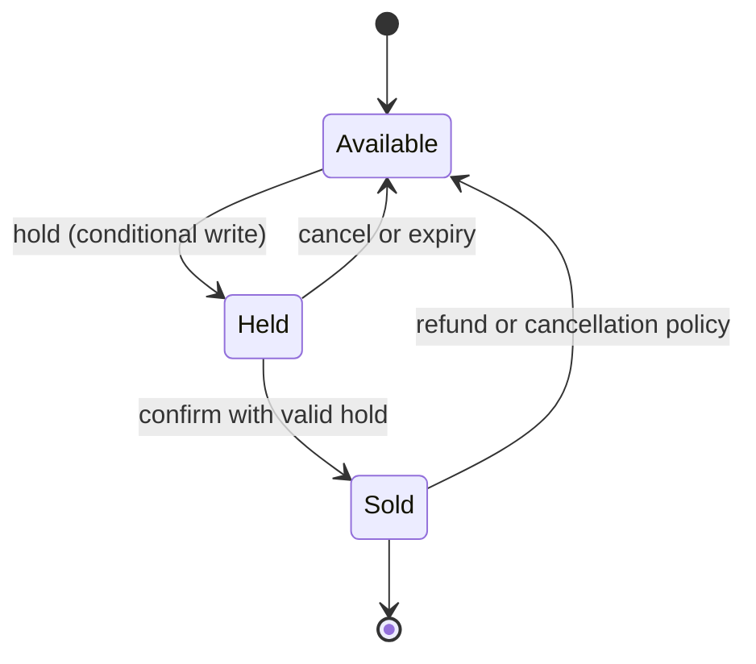
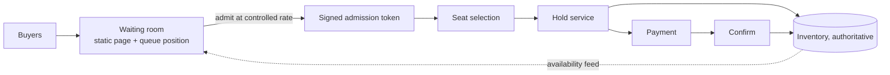

# Ticketing and Inventory Reservation: Holds, Contention, and Fair Admission

## TL;DR

Selling a fixed inventory, whether seats, rooms, or limited stock, has one invariant that cannot be relaxed: the number sold plus the number held never exceeds the number that exists. Everything else in the design is a consequence of defending that invariant while a payment, which takes minutes and happens in someone else's system, is in progress, and while far more buyers than items arrive in the same second.

Three mechanisms carry the design. A **hold** is a time-limited claim that reserves an item before payment and expires on its own, turning a multi-minute purchase into two short atomic steps. **Conditional writes** on the authoritative inventory record make the invariant a property of the database instead of a property of application logic, which is the only place it survives concurrency. **Admission control** in front of the purchase path, usually a waiting room, converts a stampede into a queue so that the contended records see a rate they can serve. The recurring mistakes are equally consistent: checking availability and then writing in separate steps, letting correctness depend on a background sweeper, and treating a successful payment as proof that the hold was still valid. [Stripe](../08-case-studies/06-stripe.md) covers the payment state machine; this design covers the inventory side of the same transaction. All capacity figures are illustrative.

## Requirements and Contract

**Functional.**

- Show availability for an event or product.
- Let a buyer hold specific items or a quantity for a limited time.
- Convert a hold into a sale when payment succeeds; release it when payment fails, the buyer abandons, or time runs out.
- Enforce per-buyer limits.
- Admit buyers fairly when demand exceeds capacity.

**Contracts.**

| Property | Contract |
|---|---|
| No oversell | For every inventory unit, `sold + held <= capacity` at all times, under any interleaving and after any crash |
| Hold exclusivity | An item has at most one unexpired holder |
| Hold expiry | A hold that is past its deadline confers no rights, whether or not anything has cleaned it up |
| Sale finality | A confirmed sale is never reassigned; a charge without a sale is refunded automatically |
| Idempotency | Retrying a hold or confirm request produces no additional hold or sale |
| Availability display | Advisory and possibly stale; only the write path is authoritative |
| Fairness | Stated explicitly, for example arrival order after the sale opens |

Overselling is a policy question as well as a correctness one. Airlines overbook deliberately against expected no-shows. The invariant is whatever the business defines; the design's job is to make the defined limit impossible to exceed by accident.

## Primary Evidence and Scope

| Source | What it establishes | Boundary |
|---|---|---|
| O'Neil, The Escrow Transactional Method (ACM TODS, 1986) | Concurrent updates to an aggregate quantity are safe when each transaction first sets aside the amount it may need, so the constraint holds under every commit order | Aggregate quantities, not individually identified items |
| Garcia-Molina and Salem, Sagas (SIGMOD 1987) | A long activity as a sequence of local transactions with compensations | Compensation must be semantically valid |
| Helland, Life beyond Distributed Transactions (CIDR 2007) | Entities updated by single-entity transactions, coordinated by messages and tentative operations that are later confirmed or cancelled | An architectural position paper |
| Bailis et al., Coordination Avoidance in Database Systems (VLDB 2015) | Whether an invariant can be preserved without coordination is decidable from the invariant and operations; a lower bound on a decremented counter is not such an invariant | Analysis framework and benchmarks of that paper |
| PostgreSQL documentation | Row-level locks, and `SKIP LOCKED` for taking unlocked rows without waiting | One database's semantics |

## Purchase State Machine



A purchase is two short transactions with an external wait between them:

1. **Hold.** Atomically move items from available to held, recording holder and deadline. Fails if any item is not available.
2. **Pay.** Outside the inventory system. May take minutes, may time out with an unknown result.
3. **Confirm.** Atomically move the items from held to sold, **only if** the hold still belongs to this buyer and has not expired.

The condition in step 3 is the part most often omitted. Payment success and hold validity are independent facts decided by different systems, and the design must handle every combination.

## The Authoritative Write

The invariant has to be enforced where concurrent writers meet, which is the storage engine. Application code that reads availability, decides, and then writes is a check-then-act race: two requests read "available" before either writes.

**Identified items (assigned seats).** Each seat is a row. A hold is a conditional update that succeeds only from the available state or from an expired hold:

```sql
UPDATE seats
   SET state = 'held', holder = :buyer, hold_expires = now() + interval '8 minutes'
 WHERE id = :seat
   AND (state = 'available'
        OR (state = 'held' AND hold_expires < now()));
-- one row updated means the hold was acquired; zero means someone else has it
```

The update either changes the row or does not, atomically. No prior read is trusted. Holding several seats is one transaction that succeeds only if every row is updated.

For "any N adjacent or best-available seats", selecting candidates and locking them invites lock waits and deadlocks when many buyers want the same block. **Documented, PostgreSQL:** `SELECT ... FOR UPDATE SKIP LOCKED` returns rows that are not currently locked and skips the rest instead of waiting, which lets concurrent buyers each take a different free block.

**Counted inventory (general admission, stock).** The record is a quantity, and the hold is a conditional decrement:

```sql
UPDATE inventory
   SET available = available - :n
 WHERE item = :item
   AND available >= :n;
```

This is correct and, on a popular item, a single hot row. Every buyer contends for the same lock. The isolation subtleties are in [Isolation Levels](../01-foundations/02-isolation-levels.md).

### Relieving the Hot Counter

**Documented, O'Neil:** the escrow method lets many transactions update one aggregate concurrently by having each reserve its amount first; because the reserved total never exceeds what exists, the constraint holds regardless of the order in which they commit.

Applied as a design, split the quantity into **allocations**: give each of `k` shards, application nodes, or regions a portion of the stock, let each decrement its own portion locally, and rebalance unused allocation in the background. Contention drops by a factor of `k`. The cost appears at the end: when total stock is low, one allocation may be empty while another still has units, so a buyer can be refused while stock exists. Rebalance aggressively as stock runs down, or collapse to a single counter for the last units.

**Documented, Bailis et al.:** a constraint such as "the counter never goes below zero" under concurrent decrements cannot be maintained without coordination. Escrow does not avoid the coordination; it moves it out of the hot path into the allocation step.

The alternative for extreme contention is a single-writer design: one process per event owns the inventory in memory, applies requests in sequence from a durable log, and never takes a lock at all. That is the approach of [Order Matching Engine](./06-order-matching-engine.md), and it suits the largest on-sales.

## Expiry Without a Sweeper

A hold must stop conferring rights at its deadline even if every background job is down. Make expiry a **predicate evaluated on read and on write**, as in the update above, not an action performed by a cleaner. A sweeper may still run to release rows eagerly and keep counts tidy, but if it stops, the only effect is that expired holds are reclaimed lazily by the next buyer.

Use one clock, the database's, for both setting and testing deadlines. Deadlines compared across application servers with skewed clocks expire early for some buyers and late for others. See [Distributed Time](../01-foundations/05-distributed-time.md).

For counted inventory, a hold is a row in a holds table plus the decrement. Expiry returns the quantity. Because that return is an increment performed by a cleaner, it must be idempotent per hold, or a retried sweep credits stock twice and the system oversells.

## Payment and the Late Success

Payment is an external effect with three outcomes: success, failure, and unknown. Combined with a hold that may or may not still be valid, there are cases the happy path never exercises.

| Payment | Hold at confirm time | Action |
|---|---|---|
| Succeeded | Valid | Confirm the sale |
| Failed | Any | Release the hold |
| Succeeded | Expired, items still free | Re-acquire atomically and confirm |
| Succeeded | Expired, items resold | Refund automatically; tell the buyer clearly |
| Unknown | Any | Do not release; query the provider or wait for its callback, then apply a row above |

Three practices shrink the bad cases:

- **Authorize, then confirm, then capture.** Place a payment authorization first, confirm the sale, and capture funds only after the sale is recorded. A failure between steps leaves an authorization to void, not a charge to refund.
- **Extend the hold when payment begins.** The hold deadline should exceed the payment timeout, with the extension itself a conditional write.
- **Make confirm idempotent.** The payment provider's callback and the buyer's browser redirect both trigger confirm, often concurrently. The second must be a no-op that returns the first's result.

The compensation logic is a saga; the general treatment is in [Effect Commit Protocols for Workflows](../18-workflow-job-systems/06-retry-idempotency-compensation.md) and [Idempotency and Operation Identity](../01-foundations/08-idempotency.md).

## Admission and the Waiting Room

When two million people want fifty thousand seats, most requests cannot succeed no matter how the inventory path is built. Letting them all reach it guarantees lock contention, timeouts, and retries that make the experience worse for the buyers who could have succeeded.

**Reference design:** a waiting room in front of the purchase flow.



- The waiting room is served from static, cacheable infrastructure and keeps buyers out of the dynamic path.
- Buyers are admitted at a rate the hold and payment services sustain, and receive a signed, expiring token. The purchase path rejects requests without one.
- When inventory is exhausted, the room says so, and nobody else is admitted.

Fairness is a product decision with engineering consequences. Strict arrival order rewards fast networks and automation. Assigning random positions to everyone who arrived before the opening time removes the advantage of arriving a millisecond earlier. State the rule publicly; it will be examined.

Abuse controls belong here as well: per-account and per-payment-method purchase limits, a cap on simultaneous holds per identity, and bot detection before admission. Without a cap on holds, an attacker can reserve the entire inventory repeatedly without paying and deny the sale to everyone. The limiter mechanics are in [Rate Limiting](../06-scaling/05-rate-limiting.md).

## Availability Display

A seat map is stale the moment it renders. Treat it as a hint: serve it from a cache or a replica with a short lifetime, push updates where practical, and design the interface for the common case where a displayed seat is gone by the time the buyer clicks. A failed hold should offer alternatives immediately, not an error that invites a manual retry storm against the hottest rows.

## Capacity Model

Assume 50,000 seats, two million buyers arriving in the first minute, two seats per order, a three-minute median checkout, and an eight-minute hold.

```text
without admission    = 2,000,000 x 5 requests / 60 s    = 167,000 requests per second on the hold path
orders needed        = 50,000 / 2                       = 25,000
admit at 1,000/s, 60% conversion
  admitted to sell out = 25,000 / 0.60                  = 41,700 buyers = 42 seconds of admission
hot counter ceiling  = 1 / 5 ms lock hold               = 200 transactions per second on one row
```

Three conclusions follow. Admission reduces load on the contended path by two orders of magnitude and loses no sales, because the inventory was always the limit. A single counter row cannot serve even the admitted rate, so allocation or a single-writer queue is required. And holds outlive their usefulness:

```text
seats held after 25 s of admission at 1,000 buyers/s x 2 seats = 50,000
```

Every seat is held within half a minute, the event appears sold out, and then 40% of those holds expire over the next eight minutes and seats trickle back. Buyers who left are gone. Admit in proportion to remaining inventory, keep holds short, release immediately on abandonment, and tell waiting buyers that held seats may return.

## Failure Traces

### Check, then write

1. Two requests read seat 14C as available.
2. Both write `state = 'held'` unconditionally.
3. The second write overwrites the first; both buyers proceed to pay.
4. Two confirmed sales exist for one seat.

The availability read must not be the gate. The conditional write is.

### Paid after expiry

A buyer's bank takes nine minutes to approve. The hold expired at eight; another buyer holds the seats. The payment callback confirms without checking the hold, and the seat is now sold twice, or the buyer is charged for nothing. Confirm conditionally, and automate the refund path for the case where the items are gone.

### The sweeper outage that froze inventory

Expiry is implemented only by a scheduled job that sets expired holds back to available. The job fails for an hour. Every abandoned hold stays held and the event shows no availability while half the seats are unclaimed. With expiry as a predicate in the hold statement, the next buyer simply takes the seat.

### Hold squatting

A script opens thousands of sessions, holds every seat, lets the holds lapse, and repeats. No seat is ever sold. Cap concurrent holds per account, per payment instrument, and per admission token, and shorten the hold for buyers who have not entered payment.

### The retried hold

A buyer's hold request times out at the gateway but succeeded in the database. The client retries and holds two more seats. The buyer now holds four and other buyers see less inventory. Key hold requests by an idempotency key and return the original hold on retry.

### Double credit on release

A sweeper releases an expired quantity hold by adding back to the counter, crashes before marking the hold released, and on restart adds it back again. Available stock now exceeds reality by that amount, and the system oversells later, far from the cause. Make release a single transaction that changes the hold's state and the counter together, conditional on the hold not already being released.

## Operations and Verification

Track holds created, confirmed, expired, and cancelled; hold-to-confirm conversion and duration; conditional-write failure rate by cause; lock wait time on inventory rows; payments succeeded with invalid holds and their resolution; refunds issued automatically; queue depth and admission rate; and, continuously, an invariant check that `sold + held <= capacity` for every unit and that no item has two live holders.

Verify with concurrency tests that would fail a naive design: thousands of simultaneous holds for the last unit, asserting exactly one success; confirm racing with expiry; duplicate confirm callbacks; a killed sweeper; and a process crash between payment success and confirm. Run a full on-sale rehearsal at the expected arrival rate with the waiting room in place.

## Design Review Questions

1. Which single statement or operation enforces the no-oversell invariant, and can any code path write inventory without going through it?
2. Does a hold stop conferring rights at its deadline if every background job is stopped?
3. Which clock sets and tests hold deadlines?
4. What happens when payment succeeds after the hold has expired, in each of the two sub-cases?
5. What happens when the payment result is unknown?
6. Are hold, confirm, and release each idempotent, and what are their keys?
7. What rate reaches the contended inventory record during the first minute of a sale, and what enforces that rate?
8. How many holds can one identity keep at once, and for how long without paying?
9. What does the buyer see when a displayed seat is no longer available, and does that response create a retry storm?
10. Which continuous check would detect an oversell, and how quickly?

## References

- [O'Neil, *The Escrow Transactional Method* (ACM TODS, 1986)](https://doi.org/10.1145/7239.7265)
- [Garcia-Molina and Salem, *Sagas* (SIGMOD 1987)](https://doi.org/10.1145/38713.38742)
- [Helland, *Life beyond Distributed Transactions: an Apostate's Opinion* (CIDR 2007)](https://www.cidrdb.org/cidr2007/papers/cidr07p15.pdf)
- [Bailis et al., *Coordination Avoidance in Database Systems* (VLDB 2015)](https://www.vldb.org/pvldb/vol8/p185-bailis.pdf)
- [PostgreSQL documentation, *SELECT* (the locking clause and `SKIP LOCKED`)](https://www.postgresql.org/docs/current/sql-select.html)
- [PostgreSQL documentation, *Explicit Locking*](https://www.postgresql.org/docs/current/explicit-locking.html)
- [AWS Solutions, *Virtual Waiting Room on AWS*](https://aws.amazon.com/solutions/implementations/virtual-waiting-room-on-aws/)

---

## Related Chapters

- [Isolation Levels](../01-foundations/02-isolation-levels.md): why a read followed by a write is not a check, and what a conditional update guarantees
- [Idempotency and Operation Identity](../01-foundations/08-idempotency.md): keys for hold, confirm, and release so a retry changes nothing
- [Stripe](../08-case-studies/06-stripe.md): the payment state machine on the other side of the hold, including unknown outcomes
- [Effect Commit Protocols for Workflows](../18-workflow-job-systems/06-retry-idempotency-compensation.md): compensation when payment and inventory disagree
- [Distributed Transactions](../02-distributed-databases/07-distributed-transactions.md): the alternatives to holds, and what they cost across services
- [Rate Limiting](../06-scaling/05-rate-limiting.md): admission tokens and per-identity caps in front of the contended records
- [Order Matching Engine](./06-order-matching-engine.md): the single-writer design for when one record is hotter than locks allow
