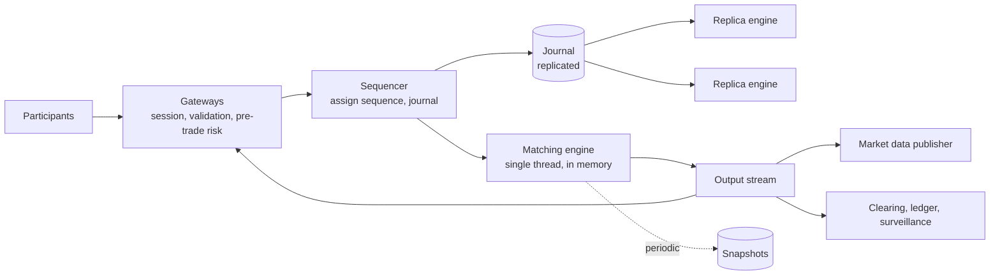

# Order Matching Engine: Sequencing, Determinism, and Replay

## TL;DR

A matching engine maintains an order book per instrument and pairs buy orders with sell orders under a published priority rule, almost always price first and then arrival time. Its defining requirement is not speed but **agreement on order**: because the earlier of two orders at the same price trades first, the system must assign every input a single position in one total sequence, and every participant, replica, auditor, and regulator must be able to recover exactly that sequence afterwards.

That requirement produces an architecture unlike most services in this book. The core is a **single-threaded, in-memory, deterministic state machine** fed by a **sequencer** that journals each input before it is processed. There are no locks and no database on the critical path, because one thread applying inputs in sequence needs neither. Availability comes from replaying the same journal on replicas, which reach the same state because the engine is deterministic, and recovery is a snapshot plus the journal suffix. Scale comes from partitioning by instrument, since books do not interact. The engineering risk concentrates in three places: anything that makes replay diverge from the original run, anything that reports a result before its input is durable, and anything that lets one participant's faulty system submit orders without limit. All capacity figures are illustrative.

## Requirements and Contract

**Functional.**

- Accept new, cancel, and modify requests for limit and market orders.
- Match orders by price-time priority and emit trades.
- Report each order's state changes to its owner.
- Publish market data: the public sequence of book changes and trades.
- Enforce pre-trade risk limits and instrument-level trading controls.

**Contracts.**

| Property | Contract |
|---|---|
| Total order | Every accepted input has exactly one sequence number; processing follows sequence order |
| Priority | Within a price level, earlier sequence trades first; a modification that increases size or changes price loses priority |
| Determinism | Given the same initial state and input sequence, every run produces the same outputs, byte for byte |
| Durability before disclosure | No acknowledgement, fill, or market-data message is released until its input is durable on a quorum |
| Idempotent entry | A resubmitted order with the same client order identifier is not accepted twice |
| Bounded exposure | No participant can exceed configured order, position, or notional limits, checked before an order reaches the book |
| Recoverability | State at any sequence number can be reconstructed from a snapshot and the journal |

Latency matters, and venues compete on it, but it is a quality attribute layered on these contracts. A fast engine that cannot prove its sequence is not a market.

## Primary Evidence and Scope

| Source | What it establishes | Boundary |
|---|---|---|
| Schneider (ACM Computing Surveys, 1990) | Replicas of a deterministic state machine that process the same requests in the same order produce the same outputs | Requires determinism and agreed order; says nothing about performance |
| Fowler, The LMAX Architecture (2011) | A retail trading platform whose business logic runs on one thread in memory, fed by journaled, replicated input, reported at six million orders per second on that thread | One system; the figure is the author's report for that workload and hardware |
| Thompson et al., LMAX Disruptor (2011) | A pre-allocated ring buffer for passing messages between threads without locks or queues that allocate | A concurrency component, not an exchange design |
| Nasdaq TotalView-ITCH specification | An order-level market-data protocol: sequenced messages for order add, execute, cancel, and replace | One venue's feed format |
| FIX Trading Community standards | Order-entry session semantics with sequence numbers and resend requests | Industry protocol family |
| SEC administrative proceeding against Knight Capital (2013) | A deployment error caused an automated router to send erroneous orders for about 45 minutes, with losses above 460 million dollars | A broker's order router, cited for the consequence of absent controls |
| Budish, Cramton, and Shim (QJE 2015) | Continuous-time matching creates a speed race; batch auctions at discrete intervals are a design alternative | Economic analysis, not an implementation |

## Order Book and Priority

A book for one instrument has two sides. Bids are sorted by price descending, asks ascending. Each price level holds a first-in, first-out queue of resting orders.

- A **limit order** specifies a worst acceptable price. If it crosses the opposite side, it trades against resting orders, best price first and oldest first within a price, until it is filled or no longer crosses. Any remainder rests in the book.
- A **market order** trades against the best available prices until filled or the side is exhausted.
- A **cancel** removes a resting order.
- A **modify** that reduces quantity keeps its place. One that raises quantity or changes price is a cancel and a new order, and goes to the back of its new level.

Variations such as immediate-or-cancel, fill-or-kill, and self-trade prevention are rules applied inside the same loop.

The data structures follow from the operations: best price lookup, insertion at a price, removal by order identifier, and removal from the head of a level. A common arrangement is price levels in an array or tree keyed by price tick, orders within a level in a linked list, and a hash map from order identifier to its node for constant-time cancel. Prices and quantities are integers in fixed units. Floating-point arithmetic is avoided because its results can differ across compilers and hardware, which breaks determinism.

## Architecture



**Gateways** terminate participant sessions, authenticate, validate message format and instrument rules, apply per-participant risk limits, and convert requests into a compact internal form. They are horizontally scaled and hold no book state.

**The sequencer** is the single point where concurrent inputs become a sequence. It stamps each message with a sequence number and a timestamp and appends it to the journal. From this point on there is no concurrency in the design.

**The matching engine** reads inputs in sequence order and applies them. It performs no I/O, takes no locks, and reads no clock. It writes results to an output buffer.

**Consumers** of the output stream send execution reports back through gateways, publish market data, and feed clearing and surveillance. They are asynchronous to the engine and can be rebuilt by replaying its output.

## Why One Thread

**Documented, LMAX:** the platform's business logic runs on a single thread, entirely in memory, and was reported to process six million orders per second, with input journaled and replicated before processing and state recovered by replay.

The reasoning generalizes beyond that system. Matching within one book is inherently sequential, because each order's result depends on the book left by the previous one. Multiple threads would contend on the same structure and need locks, and the locks would cost more than the work they protect. A single thread with pre-allocated memory and cache-friendly structures handles each order in well under a microsecond, so the service time, not parallelism, sets capacity. The measurement discipline for such paths is in [Performance Engineering and Profiling](../11-observability/08-performance-engineering-and-profiling.md).

Concurrency is kept at the edges. Threads that parse, journal, replicate, and publish communicate with the engine thread through bounded, pre-allocated buffers. The engine never waits on a consumer: if a downstream reader falls behind, the reader is disconnected or dropped, not the engine slowed.

## Determinism

Replication and recovery both rest on one property: replaying the journal reproduces the original run exactly. **Documented, Schneider:** identical deterministic state machines given identical ordered inputs produce identical outputs. Everything that could differ between runs must therefore be an input in the journal or be forbidden.

| Source of nondeterminism | Rule |
|---|---|
| Wall-clock time | The engine never reads a clock. Time arrives as a field stamped by the sequencer, and timers are inputs |
| Randomness | None, or seeded from journaled input |
| Iteration order of hash tables | Never iterate an unordered structure where order affects output |
| Floating-point arithmetic | Fixed-point integers only |
| Thread scheduling | One thread applies inputs |
| Configuration and reference data | Changes enter through the sequencer as inputs with sequence numbers |
| Code version | Journal records the engine version; replay across versions is tested or forbidden |

Verify the property continuously, not by assumption. Have every replica compute a hash of its state at agreed sequence numbers and compare. A mismatch means a determinism bug, and it should halt the divergent replica before it is ever promoted. The same structure makes the engine testable by deterministic simulation, as described in [Verification Strategy for Distributed Systems](../20-production-readiness/04-verification-strategy-for-distributed-systems.md).

Determinism has a sharp edge. A bug that crashes the engine on a particular input crashes every replica at the same sequence number, and crashes them again on replay. Validate inputs before sequencing so that malformed messages never enter the journal, and keep an audited operational procedure for skipping a poisoned entry.

## Replication, Durability, and Failover

The journal is the system of record, and it is the thing that is replicated. The sequencer sends each entry to replicas and treats it as committed when a quorum has stored it, by a consensus protocol or a primary-backup scheme with explicit fencing. See [Consensus Algorithms](../02-distributed-databases/08-consensus-algorithms.md) and [Leader Election](../02-distributed-databases/09-leader-election.md).

**No output may be released before its input is committed.** If the primary matches an order, reports the fill, and fails before the order reached a quorum, the new primary has no record of it. The participant holds a fill that the market does not. The engine may process speculatively to save time, but the output gate opens only at the commit point.

Replicas run the same engine against the same journal and are a few messages behind. Failover promotes a replica, fences the old primary so it cannot sequence further, and resumes from the last committed sequence number. Gateways reconnect and use session sequence numbers to learn which of their messages were accepted.

**Recovery** is a snapshot plus replay. Snapshots are taken by a replica, not the primary, so the critical path never pauses. The journal before the oldest retained snapshot can be archived, but it is the audit record and is kept for the period regulation requires. This is event sourcing in its strictest form; see [Event Sourcing and Domain Logs](../05-messaging/05-event-sourcing.md).

## Market Data

The public feed is derived from the engine's output and has its own delivery problem: many consumers, strict ordering, and no tolerance for silently missing a message.

**Documented, ITCH:** the feed carries order-level events, each with a sequence number, from which a consumer reconstructs the full book.

A consumer that misses one message has a wrong book and does not know it unless it checks sequence numbers. The standard design is: every message is sequenced; the feed is sent on two redundant paths; a consumer that detects a gap requests retransmission from a replay service; and a consumer that is too far behind discards its state and rebuilds from a snapshot followed by the live stream. The same gap-and-snapshot pattern applies to any ordered fan-out, as in [Message Ordering](../05-messaging/03-message-ordering.md).

Fairness is part of the contract. The public feed and private execution reports should be released so that no participant learns of a trade materially before others can.

## Risk Controls and Kill Switches

Pre-trade checks sit in the gateway or immediately behind the sequencer and reject an order before it can reach a book: maximum order size and value, price collars around a reference price, position and notional limits per participant, message-rate limits, and duplicate detection by client order identifier.

**Documented, SEC order on Knight Capital:** a deployment left old code active on one server, and the firm's router sent a flood of unintended orders for about 45 minutes before it was stopped, causing losses above 460 million dollars. The engineering lessons are the ones a venue applies to itself and to its participants: limits that do not depend on the correctness of the system they constrain, a kill switch that cancels all of a participant's orders and blocks new ones, cancel-on-disconnect, and instrument-level halts when prices move beyond bands. See [Progressive Delivery and Deployment Strategies](../15-deployment/01-deployment-strategies.md) for the deployment side.

Limits that span instruments, such as a participant's total exposure, do not fit inside a single partitioned engine. Enforce them at the gateway against a per-participant budget, or allocate portions of the budget to each engine partition, which is the escrow technique from [Ticketing and Inventory Reservation](./05-ticketing-inventory-reservation.md).

## Partitioning and Alternatives

Books for different instruments do not interact, so the natural partition is by instrument: each engine instance owns a set of instruments with its own sequencer and journal. Activity is highly skewed, so the busiest instruments may each need a dedicated engine while thousands of quiet ones share one. Orders that span instruments, such as spreads, need either a single engine owning all legs or an explicit two-step protocol.

Continuous matching is not the only design. **Documented, Budish, Cramton, and Shim:** the authors argue that processing orders serially in continuous time rewards tiny speed advantages, and propose collecting orders over short intervals and clearing each batch at a uniform price. Opening and closing auctions on conventional venues already work this way. Batch clearing changes the matching rule but keeps the same sequencer, journal, and determinism requirements.

## Capacity Model

Assume a mean of 20,000 messages per second, a peak of 100,000, 100 bytes per journaled message, 5,000 instruments with 5% of traffic on the busiest, and a replay rate of two million messages per second.

```text
peak on busiest book   = 100,000 x 0.05              = 5,000 messages per second
engine capacity        = 1 / 1 microsecond           = 1,000,000 messages per second per thread
journal per day        = 20,000 x 86,400 x 100 B     = 173 GB
messages per day       = 20,000 x 86,400             = 1.73 billion
full-day replay        = 1.73e9 / 2,000,000          = 864 s = 14 minutes
replay from 10-minute snapshot = 12,000,000 / 2e6    = 6 s
```

The engine thread has two orders of magnitude of headroom over the busiest book. Recovery time, not throughput, drives the design: replaying a full day takes too long for a failover, so replicas stay hot and snapshots bound cold-start time. Journal throughput and the commit round trip to a quorum set the latency floor.

## Failure Traces

### A fill that never happened

1. The primary matches order 7001 and sends the fill to the participant.
2. It fails before the journal entry reaches any replica.
3. The promoted replica has no order 7001. Its book differs.
4. The participant hedges a position it does not hold.

Output was released before commit. Gate all external output on quorum durability of the corresponding input.

### Replica divergence

A new release iterates over a hash map of orders when cancelling all of a participant's orders, and the iteration order differs between two builds. Cancels are emitted in different orders on primary and replica, sequence-dependent state diverges, and after failover participants see order states that contradict earlier reports. Periodic state-hash comparison would have halted the replica within seconds of the first divergence.

### The slow consumer

A surveillance system reading the output stream stalls. Its buffer fills, and the engine thread blocks on the write. Matching stops for every instrument on that engine. The engine must never block on a consumer; a full buffer disconnects the reader, which later recovers from the journal.

### Duplicate order after reconnect

A participant sends an order, loses its connection before the acknowledgement, reconnects, and resends. Without duplicate detection on the client order identifier, both are accepted and the participant holds twice the intended position. Session sequence numbers and unique client identifiers make resubmission safe.

### The poisoned input

A message with an out-of-range field passes the gateway and triggers an arithmetic fault in the engine. The primary crashes, a replica is promoted, processes the same journal entry, and crashes. So does the next. Restart replays the journal into the same fault. Validate before sequencing, fuzz the input boundary, and maintain a controlled procedure to mark an entry as skipped on all replicas.

### Unbounded orders from one participant

A participant's algorithm enters a loop and submits thousands of orders per second at prices far from the market. Without rate limits and price collars, the orders execute, and the damage is done before a human reacts. Automated limits and a kill switch must act in milliseconds, and must sit outside the participant's own software.

## Operations and Verification

Track sequencer latency, commit latency to quorum, engine service time per message at high percentiles, output buffer occupancy per consumer, replica lag in sequence numbers, state-hash agreement, snapshot age, risk-limit rejections by rule, and market-data gap and retransmission counts.

Verify by replay. Every production journal is a regression test: replay it against a candidate build and require byte-identical output, or an explained difference for an intended rule change. Run randomized order flow through deterministic simulation with injected crashes at every point between sequencing, commit, matching, and output release, and check the invariants: no trade without two matching orders, quantities conserved, priority respected, and no released output without a committed input.

## Design Review Questions

1. What assigns the total order, and where is it made durable?
2. Can any output leave the system before its input is committed on a quorum?
3. What does the engine read besides its input sequence? Is every item in that list deterministic?
4. How is replica agreement checked while running, and what happens on a mismatch?
5. How long does recovery take from the newest snapshot, and from the oldest retained one?
6. What happens when a consumer of the output stream stops reading?
7. What prevents the same order from being accepted twice after a reconnect?
8. Which limits stop a malfunctioning participant, how fast do they act, and do they depend on the participant's own system?
9. How does a market-data consumer detect and repair a gap?
10. What is the procedure when one input crashes the engine on every replica?

## References

- [Schneider, *Implementing Fault-Tolerant Services Using the State Machine Approach: A Tutorial* (ACM Computing Surveys, 1990)](https://doi.org/10.1145/98163.98167)
- [Fowler, *The LMAX Architecture* (2011)](https://martinfowler.com/articles/lmax.html)
- [Thompson et al., *Disruptor: High Performance Alternative to Bounded Queues for Exchanging Data Between Concurrent Threads* (2011)](https://lmax-exchange.github.io/disruptor/disruptor.html)
- [Nasdaq, *TotalView-ITCH 5.0* specification](https://www.nasdaqtrader.com/content/technicalsupport/specifications/dataproducts/NQTVITCHspecification.pdf)
- [FIX Trading Community, *FIX Standards*](https://www.fixtrading.org/standards/)
- [SEC, *In the Matter of Knight Capital Americas LLC* (2013)](https://www.sec.gov/litigation/admin/2013/34-70694.pdf)
- [Budish, Cramton, and Shim, *The High-Frequency Trading Arms Race: Frequent Batch Auctions as a Market Design Response* (Quarterly Journal of Economics, 2015)](https://doi.org/10.1093/qje/qjv027)
- [Jane Street, *How to Build an Exchange* (tech talk)](https://www.janestreet.com/tech-talks/building-an-exchange/)

---

## Related Chapters

- [Consensus Algorithms](../02-distributed-databases/08-consensus-algorithms.md): committing the journal on a quorum, the step that must precede any disclosed result
- [Event Sourcing and Domain Logs](../05-messaging/05-event-sourcing.md): state as a replayed log, here with determinism as a hard requirement
- [Message Ordering](../05-messaging/03-message-ordering.md): sequence numbers, gap detection, and snapshot recovery for the market-data feed
- [Write-Ahead Logging](../03-storage-engines/04-write-ahead-logging.md): journaling before processing, and what durable means at the device
- [Verification Strategy for Distributed Systems](../20-production-readiness/04-verification-strategy-for-distributed-systems.md): deterministic simulation, which this architecture makes natural
- [Performance Engineering and Profiling](../11-observability/08-performance-engineering-and-profiling.md): measuring a microsecond-scale single-threaded path without distorting it
- [Ticketing and Inventory Reservation](./05-ticketing-inventory-reservation.md): the lock-based alternative, and where it stops scaling
