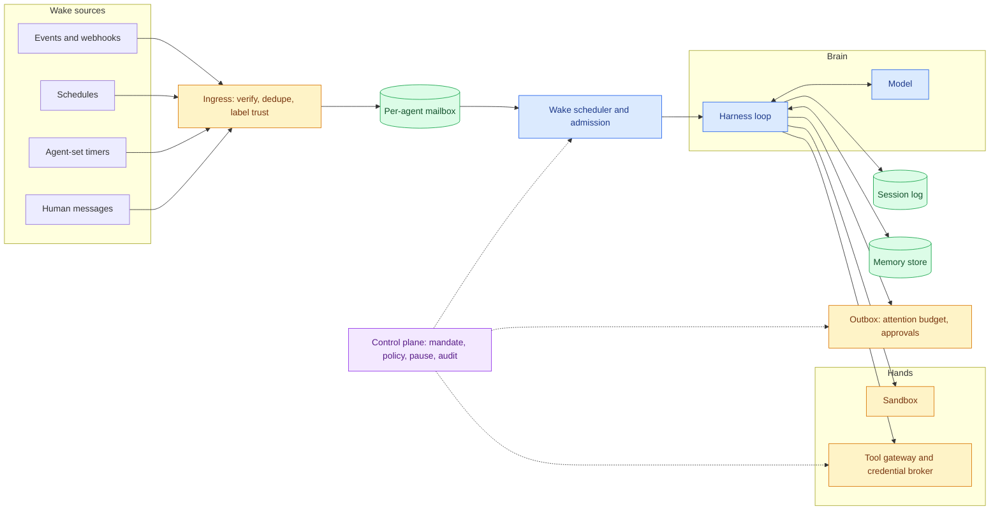

# Always-On Agents: The Standing Process Model

## TL;DR

An always-on agent is a model-driven process that nobody starts. It holds a mandate for weeks or months, wakes on events, schedules, and its own timers, acts with delegated authority while its principal is absent, and spends most of its life idle. That changes the engineering problem. A request-scoped agent borrows its correctness boundary from the human who launched it: they chose the task, they are watching, and they read the result. A standing agent has none of those. The system has to supply the task selection, the supervision, and the audience itself.

We therefore design the agent as a service with an identity, a durable log, a mailbox, a budget, and an owner, and we treat the model as one replaceable component inside it. The agent's state lives in an append-only session log and an external memory store, never in a process or a context window. Exactly one turn runs per agent at a time. Wakes are level-triggered reconciliations against the world and not reactions to individual messages. Authority is granted by a mandate that names scope, budget, attention allowance, and an expiry, and it lapses unless a human renews it.

The service is judged on four things a chat agent never reports: how late it reacts to something that mattered, how often it acted when it should not have, how much human attention it consumed, and what a useful outcome cost including all the wakes that produced nothing.

---

## What Changes When Nobody Presses Enter

[Agent Fundamentals](../17-llm-systems/01-agent-fundamentals.md) describes the loop: the model proposes an action, the harness executes it, the observation returns, and the loop continues until a stop condition. That chapter treats the loop as a durable state machine, and everything in it still applies. This part is about what has to be built around the loop when it runs without a person attached.

The differences are easiest to see side by side.

| Property | Request-scoped agent | Always-on agent |
|---|---|---|
| Who starts a run | A person, with a task in mind | An event, a clock, or the agent's own timer |
| Who decides the task | The person | The agent, from its mandate and what it observes |
| Supervision | The person watches or reviews the result | Nobody, unless the agent asks |
| Lifetime | Minutes to hours | Weeks to years, across model and tool upgrades |
| State | One context window, perhaps a checkpoint | A log and a memory store that outlive every process |
| Input trust | Mostly the user's own prompt | Mostly content from third parties |
| Authority | The user's live session | Delegated, exercised while the user is offline |
| Dominant cost | Tokens per task | Wakes that find nothing to do |
| Dominant failure | A wrong answer the user sees | A wrong action nobody sees, or no action at all |

Each row removes a safeguard that request-scoped designs get for free. When a person starts the run, a duplicate start is their mistake and a missing start is their choice. When an event starts it, duplicate delivery and lost delivery are our bugs. When a person reads the result, a poor answer is caught at the point of use. When nobody reads it, the agent has to decide whether the result deserves anyone's attention, and that decision can itself be wrong in both directions. The remaining chapters in this part each rebuild one of these safeguards as a mechanism.

## The Mandate

A standing agent needs a written statement of what it is for, because there is no prompt to read the intent from. We call it the *mandate*. It is a versioned configuration object owned by a named human, and it is the root of everything the agent is permitted to do.

```yaml
mandate:
  id: oncall-triage/payments
  version: 14
  owner: team:payments-sre          # a human group that answers for this agent
  principal: svc:payments-triage    # the identity it acts as
  objective: >
    Keep the payments alert queue triaged. Correlate new alerts with
    deploys and known incidents, attach evidence, and page only when
    the runbook says a human decision is required.
  wake:
    events: [alertmanager.firing, deploy.finished]
    schedule: "*/30 * * * *"        # reconciliation sweep
  authority:
    read:  [metrics, logs, deploy-history, incident-tracker]
    write: [incident-tracker.comment, alert.annotate]
    gated: [alert.silence, deploy.rollback]   # needs approval
  budget:
    tokens_per_day: 4_000_000
    actions_per_hour: 60
    spend_usd_per_day: 40
  attention:
    pages_per_day: 3
    digest: "09:00 local"
  expires: 2027-02-01               # lapses unless renewed
```

Four fields here have no equivalent in a chat agent. The `wake` block is the agent's only source of initiative, so an agent with no wake source is dead and an agent with a noisy one is expensive. The `budget` block bounds what a runaway loop can consume before anyone looks. The `attention` block bounds what the agent may take from people, which [Attention, Evaluation, and Operations](06-attention-evaluation-operations.md) treats as the scarcest resource in the system. And `expires` makes authority decay by default. A standing agent whose owner has left the team should stop, and the only reliable way to arrange that is for stopping to be what happens when nobody acts.

The mandate is data and not prose buried in a system prompt, because three different components enforce it. The scheduler reads `wake`, the policy layer reads `authority` and `budget`, and the outbox reads `attention`. The model sees a rendering of the mandate so that it can plan within it, but nothing depends on the model honoring it.

## Reference Architecture



The vocabulary here follows Anthropic's guide to building always-on agents, which names the same parts: an *event inbox* that every source writes to instead of calling the agent, *timers* in their own store, *memory*, *permissions*, and an *outbox*. In that guide's terms the agent is not actually always on. It sleeps, and each wake is a *run* that receives events, does its work, and saves what happened, while a *session* is the transcript of messages and tool calls that a run either resumes or starts fresh. We use "turn" for a run throughout this part and "mailbox" for the inbox.

The diagram separates five concerns, and the separation is the design.

*Ingress* turns the outside world into mailbox entries. It authenticates the sender, drops duplicates, attaches a trust label, and commits the entry durably before it acknowledges the source. Nothing downstream ever talks to a webhook.

*The mailbox and scheduler* decide when a turn runs. They coalesce bursts, enforce the single-turn rule, apply the fleet's admission limits, and are the only place where "should this agent think right now" is answered. [Wake Sources, Mailboxes, and Scheduling](02-wake-triggers-scheduling.md) covers them.

*The brain* is the harness loop and the model. It is stateless between turns. It reads the log and memory, decides, and writes back.

*The hands* are where effects happen: a sandbox for code and files, and a tool gateway that holds credentials the brain never sees. Hands are disposable.

*The session log and memory* are the agent. If every process in the diagram were destroyed, a new brain reading the log and memory would be the same agent. [The Session Log and Durable Runtime](03-session-log-durable-runtime.md) and [Memory Lifecycle](04-memory-lifecycle.md) cover them.

The *control plane* sits beside all of this and holds the mandate, the policy, the pause switch, and the audit trail. Its important property is that it does not depend on the model's cooperation. A pause takes effect at the scheduler and the tool gateway, so it works on an agent that is confused, compromised, or mid-loop.

## The Agent Is an Actor With a Log

The cleanest model for a standing agent is the virtual actor. An actor has an identity, private state, and a mailbox, and it processes one message at a time. It need not be in memory: when a message arrives for an actor that is not running, the runtime activates it from stored state, runs it, and may deactivate it again. Orleans and Durable Objects built this for ordinary services. It fits agents unusually well, for three reasons.

First, an agent turn is long and non-deterministic, so two turns for the same agent running concurrently do not merge. If a deploy event and an alert arrive together and each starts its own turn, both read the same memory, both decide to comment on the incident, and both write a summary that omits what the other learned. One turn at a time per agent is the invariant that makes the rest tractable. We enforce it with a lease and a fencing epoch on the log, as [Leases, Heartbeats & Recovery](../18-workflow-job-systems/08-leases-heartbeats-recovery.md) describes: a turn acquires the agent's lease, receives an epoch, and every append to the log carries that epoch. A brain that lost its lease during a long model call discovers this on its next append and stops, instead of interleaving with its replacement.

Second, activation on demand matches the duty cycle. An agent that thinks for ninety seconds an hour should hold no compute for the other fifty-eight and a half minutes.

Third, a turn has a natural transactional shape. It begins by taking a batch of mailbox entries and ends by appending its decisions and acknowledging those entries. If the brain dies in between, the entries are still in the mailbox and the next activation sees them again. The protocol for making the effects inside the turn safe under that replay is the subject of chapter 3.

## Reconcile State, Not Messages

Kubernetes controllers are level-triggered: a controller does not act on "a pod was deleted" but on "the desired count is three and the observed count is two." The event is only a hint that it is time to look. This is the right discipline for standing agents, and it is the one most often missed, because the natural way to prompt an agent is "an alert just fired, handle it."

An edge-triggered agent is only as reliable as its event delivery. If the webhook is dropped during an ingress deploy, the agent never learns the alert fired, and nothing will ever tell it. A level-triggered agent treats every wake, whatever caused it, as a reason to compare the world against its mandate: which alerts are open and untriaged, which incidents have no owner, which of its own promises are overdue. The event shortens the delay; the periodic sweep bounds it. We can then state the reliability property in one sentence: *the agent's reaction time to any condition is at most the event latency when delivery works and at most the sweep interval when it does not.*

This has a cost, which is that every wake does some observation work that may find nothing. Chapter 2 covers how to make the empty case cheap. It also has a design consequence that pays for itself: because the agent derives its work from current state, replaying or duplicating an event is harmless. The event carries no instructions, so there is nothing to execute twice.

## Idle Is the Common Case

A standing agent's time divides into three states: *dormant*, with no process and no cost beyond storage; *triaging*, where a cheap check decides whether a wake deserves a turn; and *working*, where the full model runs. For most mandates the dormant fraction is above ninety-five percent, and that drives several decisions.

The runtime scales to zero. Per-agent processes, warm containers, and held connections are affordable for ten agents and impossible for a hundred thousand. State that must survive dormancy goes in the log, the memory store, or a workspace snapshot.

Activation latency is part of the reaction-time budget. Rebuilding context from the log, restoring a workspace, and paying an uncached prefill are all charged to the first turn after a long sleep, and chapter 6 shows how wake cadence interacts with the provider's prompt-cache lifetime.

Most wakes should not reach the large model at all. Chapter 2 builds the gate that answers "has anything changed that this mandate cares about" for a hundredth of the price, so that the expensive path runs only when there is work.

## Service Levels for a Standing Agent

We cannot run a service we do not measure, and the usual agent metrics, task success and tokens per task, assume someone defined the task. A standing agent needs indicators that hold when the agent chooses its own work.

| Indicator | Definition | What it catches |
|---|---|---|
| Reaction freshness | Time from a mandate-relevant condition becoming true to the agent's first durable response | Dropped events, starved mailboxes, slow activation |
| Wake completeness | Fraction of scheduled and delivered wakes that produced a committed turn or an explicit skip | Silent death: the agent that stopped running |
| Unsolicited action precision | Fraction of self-initiated actions later judged appropriate | Overreach and misread context |
| Missed-action rate | Fraction of conditions that warranted action and received none | Timidity and blind spots, usually found by audit |
| Attention spend | Human interruptions per day, and the fraction acted on | Notification fatigue and approval rubber-stamping |
| Cost per useful outcome | All spend, including empty wakes, divided by outcomes someone valued | Heartbeat waste and runaway loops |
| Mandate compliance | Actions outside scope that policy blocked, and any that it did not | Policy gaps before they become incidents |

Wake completeness deserves emphasis. A chat agent that breaks produces an error someone sees. A standing agent that breaks produces silence, and silence looks exactly like a quiet week. We alert on the absence of expected turns, with the same reasoning that leads SRE teams to alert on missing heartbeats from a batch job.

## Lifecycle

Because the agent outlives its components, each transition in its life is an operation with its own failure modes.

*Provisioning* creates the identity, the empty log, the initial memory, and the mandate, and it should require an owner. *Running* is the steady state. *Pausing* stops new turns and gated effects but keeps accepting mailbox entries, so that resuming does not lose the interval; the scheduler needs a policy for whether to coalesce that backlog or replay it. *Upgrading* changes the model, the prompt, or the tools under a living agent whose log and memories were written by the old version, and chapter 3 treats it as a migration. *Renewal* is the owner confirming the mandate before `expires`. *Retirement* revokes credentials, cancels timers, answers or withdraws open questions to humans, and archives the log under the retention policy.

The transition that organizations skip is retirement. Agents are cheap to create and each one holds credentials, so a fleet accumulates standing authority that nobody remembers granting. Expiring mandates and an inventory with an owner per agent are the controls, and they are the same controls [Workload and Agent Identity](../10-security/12-workload-and-agent-identity.md) applies to service accounts.

## Failure Modes

| Failure | Mechanism | Detection | Mitigation |
|---|---|---|---|
| Silent death | Wake source misconfigured, lease stuck, or scheduler bug; no turns run | Wake completeness drops; absence alert | Independent liveness sweep; lease expiry; alert on missing turns |
| Dropped edge | Event lost; edge-triggered agent never reacts | Reaction freshness tail equals infinity for some conditions | Level-triggered reconciliation on a schedule |
| Concurrent turns | Two activations for one agent | Fencing rejections; duplicate effects | Lease plus epoch on every log append |
| Wake storm | Agent's own action emits an event that wakes it | Wakes per hour and spend spike with no external cause | Tag self-caused events; rate limit; budget cutoff |
| Mandate drift | Objective reinterpreted over months through accumulated memory | Audit of actions against scope; widening tool use | Mandate rendered from config each turn; memory cannot amend it |
| Orphaned authority | Owner left; agent continues with live credentials | Inventory shows no active owner | Expiry by default; renewal requires a named human |
| Unseen wrong action | Agent acts incorrectly and nobody reviews | Sampled audit; downstream complaints | Reversible actions by default; digest of actions taken; gated tier |
| Budget exhaustion mid-task | Daily cap reached with work half done | Turns ending on budget stop | Reserve for wind-down; commit progress before the cap |

## Decision Framework

An always-on agent is a standing operational commitment, and many problems described as needing one do not.

Use a **deterministic automation** when the reaction to each condition can be written down. A rule engine or a workflow is cheaper, testable, and has no injection surface.

Use a **scheduled request-scoped agent** when the work is periodic and each run is independent: a nightly report, a weekly dependency review. This is a cron job that calls an agent. It needs no memory, no mailbox, and no lease, and it should not be given them.

Use an **event-triggered stateless agent** when each event is handled on its own and judgment is needed per event, such as classifying an incoming ticket.

Use an **always-on agent** when three things are true together: the work requires judgment about *whether and when* to act, continuity across wakes matters because what was learned or promised last week changes what is correct today, and the conditions arrive on the world's schedule and not the user's. On-call triage, account monitoring, long-running research, and a personal assistant that manages a calendar and inbox all meet that bar.

When in doubt, start one level down. Each step up this ladder adds a class of failure, and the standing agent adds the most: persistent memory that can be wrong, authority that outlives attention, and a cost that accrues whether or not anything happens.

## Key Takeaways

- A standing agent loses the three safeguards a human-launched run provides: someone chose the task, someone is watching, and someone reads the result. Each must be rebuilt as a mechanism.
- The mandate is versioned configuration with an owner, a budget, an attention allowance, and an expiry. Components enforce it; the model only reads it.
- The agent is its session log and memory. Brains and hands are stateless and replaceable.
- One turn per agent at a time, enforced by a lease and a fencing epoch, is the invariant that keeps memory and effects coherent.
- Wakes are level-triggered. Events reduce reaction delay and a periodic sweep bounds it, which makes lost and duplicated events harmless.
- Design for idleness: scale to zero, gate wakes cheaply, and account for activation and cache-miss cost.
- Measure reaction freshness, wake completeness, unsolicited action precision, attention spend, and cost per useful outcome. Alert on silence.
- Authority should decay. Mandates expire, and retirement is a first-class operation.

## References

- [Building always-on agents](https://claude.com/resources/articles/building-always-on-agents): the inbox, timers, memory, permissions, and outbox primitives, and the run and session cycle
- [Scaling Managed Agents: Decoupling the brain from the hands](https://www.anthropic.com/engineering/managed-agents): the brain, hands, and session separation for long-lived agents
- [Effective harnesses for long-running agents](https://www.anthropic.com/engineering/effective-harnesses-for-long-running-agents): working across many context windows with durable artifacts
- [Building effective agents](https://www.anthropic.com/engineering/building-effective-agents): when an agent is and is not the right tool
- [Introducing ambient agents](https://blog.langchain.com/introducing-ambient-agents/): agents that act on event streams and ask for input only when needed
- [Orleans: Distributed Virtual Actors for Programmability and Scalability](https://www.microsoft.com/en-us/research/publication/orleans-distributed-virtual-actors-for-programmability-and-scalability/): activation on demand and single-threaded actors
- [Kubernetes Controllers](https://kubernetes.io/docs/concepts/architecture/controller/): level-triggered reconciliation of observed and desired state
- [Measuring AI Ability to Complete Long Tasks](https://arxiv.org/abs/2503.14499): how the length of tasks agents can finish has grown
- [Monitoring Distributed Systems](https://sre.google/sre-book/monitoring-distributed-systems/): symptom-based alerting, including alerting on absence

---

## Related Chapters

- [LLM Agent Fundamentals](../17-llm-systems/01-agent-fundamentals.md): the loop and effect contracts that every standing agent still runs inside
- [Harness Engineering](../17-llm-systems/09-harness-engineering.md): the runtime around the model, which this part extends across months
- [Durable Execution and Workflow Engines](../18-workflow-job-systems/04-durable-execution-workflow-engines.md): the journal and replay machinery under long-lived turns
- [Leases, Heartbeats, and Recovery](../18-workflow-job-systems/08-leases-heartbeats-recovery.md): the single-writer lease and fencing epoch each turn depends on
- [Workload and Agent Identity Delegation](../10-security/12-workload-and-agent-identity.md): the identity an agent holds when it acts with nobody present
