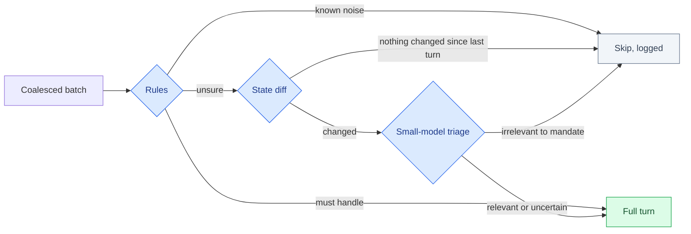

# Wake Sources, Mailboxes, and Scheduling

## TL;DR

Initiative is a resource. Every wake of a standing agent costs an activation, a context rebuild, and usually a model call, and most wakes find nothing to do. The wake path therefore decides both the agent's reliability and its bill. We give it four stages: ingress that makes external signals durable and labels their trust, a per-agent mailbox that coalesces them, a gate that decides cheaply whether a wake deserves a full turn, and a fleet scheduler that admits turns against token and rate budgets.

There are three ways to wake an agent: an event, a schedule, and a heartbeat. Events are cheapest and least reliable, heartbeats are most reliable and most wasteful, and a sound design uses events for latency and a slow sweep for completeness. Agents also set their own timers, which is how a standing agent keeps a promise, and those timers must be durable, bounded, and visible.

The mailbox is not a queue of tasks. It is a set of hints that something may have changed, and a turn consumes all pending hints at once and then looks at the world. That one decision removes most of the ordering and exactly-once problems that event-driven agent designs otherwise inherit.

---

## Three Ways to Wake

| Source | What starts the turn | Reaction delay | Cost when nothing changed | Fails by |
|---|---|---|---|---|
| Event | Something happened: a webhook, a queue message, a row change | Seconds | Zero | Losing the event, or flooding |
| Schedule | A clock reached a defined time for a defined job | Up to the period | One wake per period | Skew, missed fire, herd at the top of the hour |
| Heartbeat | A timer with no job attached; the agent looks around | Up to the interval | One wake per interval, forever | Cost; self-inflicted busywork |
| Self-set timer | The agent asked to be woken, with a reason | As requested | Zero until due | Lost timers; unbounded self-rescheduling |
| Human message | A person wrote to the agent | Seconds | Zero | Arriving mid-turn |

The arithmetic separates them quickly. A five-minute heartbeat is 288 wakes a day and 8,640 a month. If each wake rebuilds 30,000 tokens of context and none of it is cached because the interval exceeds the cache lifetime, that is roughly 260 million input tokens a month for an agent that may have had forty things to do. An event source would have woken it forty times.

Heartbeats exist because some conditions have no event. "The customer has not replied in three days" is the absence of an event. "The dashboard looks wrong" may not be expressible as an alert rule, which is why an agent is looking at it. And events get lost. So the practical rule is to use an event wherever the world can emit one, a schedule wherever something is due at a known time, and a heartbeat only for what neither covers, at the slowest interval the freshness objective allows. Chapter 1's reconciliation sweep is such a heartbeat with a specific purpose: it bounds the damage of a lost event.

## Ingress: Making a Signal Durable

A webhook handler that calls the agent directly has made the sender's retry policy part of the agent's reliability. Ingress exists to break that coupling. It does five things in order and acknowledges the sender only after the fourth.

1. **Authenticate the source.** Verify the signature or mutual TLS identity. An unauthenticated wake is free compute for anyone who finds the URL, and its payload is attacker-controlled text on its way to a model.
2. **Deduplicate.** Derive a stable key from the source's event id, or from a content hash when there is none, and drop repeats within a window. Senders retry, and at-least-once delivery is the best any of them offers.
3. **Normalize and label.** Reduce the payload to a small envelope: source, type, subject key, time, and a pointer to the full payload. Attach a *trust label* that records whether the content is from the principal, from an internal system, or from an arbitrary third party. Chapter 5 uses this label to decide what the resulting turn may do.
4. **Commit to the mailbox.** Write the envelope durably.
5. **Acknowledge.**

The envelope carries a pointer and not the payload for two reasons. Large or hostile payloads should be fetched deliberately, by a turn that has decided to read them, and not injected into context merely because they arrived. And the payload may be stale by the time the turn runs, so the turn should read current state from the system of record anyway.

## The Mailbox Holds Hints

The mailbox has three parts: a durable event list, usually a database table with a status per event; the ingress handler above; and a worker that takes pending events and runs the agent. The table is the source of truth, so a replacement worker can pick up where a crashed one stopped. One mailbox per principal is the right starting granularity, with exactly one active worker for each.

A natural first design gives each agent a FIFO queue and runs one turn per message. It fails under any burst. A deploy that restarts forty pods emits forty alerts within a minute, and forty sequential turns each rediscover the same deploy. It also fails under reordering, because the agent acts on message twelve with a context built before message eleven was processed.

We treat the mailbox as an unordered set of hints, keyed by subject, and a turn drains it.

```python
def next_turn(agent_id: str, now: float) -> Turn | None:
    lease = leases.try_acquire(agent_id, ttl=TURN_LEASE_S)
    if lease is None:
        return None                      # a turn is already running

    hints = mailbox.peek_all(agent_id)   # not removed yet
    hints = [h for h in hints if now - h.time < h.ttl]        # drop stale
    if not hints or not debounce_elapsed(hints, now):
        leases.release(lease)
        return None

    batch = collapse_by_subject(hints)   # 40 alerts on one service -> 1 hint, count=40
    batch.sort(key=lambda h: (h.priority, h.time))

    if not gate.should_think(agent_id, batch):                # cheap check, see below
        log.append(agent_id, lease.epoch, Skip(batch.ids))
        mailbox.ack(agent_id, batch.ids)
        leases.release(lease)
        return None

    return Turn(agent_id, lease, batch, high_water=max(h.seq for h in hints))
```

Several properties come from this shape.

*Coalescing.* `collapse_by_subject` folds hints about the same subject into one entry with a count and the first and last times. The turn learns that forty alerts fired on `payments-api` between 14:02 and 14:03, which is more useful than forty separate facts, and costs one turn.

*Debouncing.* The turn does not start on the first hint of a burst. It waits until hints have stopped arriving for a quiet period or until the oldest hint reaches a maximum age, whichever comes first. The quiet period trades reaction delay for turn count, and the maximum age bounds the delay under a continuous stream.

*Acknowledge after commit.* Hints stay in the mailbox until the turn's result is appended to the log. A brain that dies mid-turn leaves them in place, and the next activation drains them again. Because the turn derives its work from current state and not from the hints, redoing it is safe.

*High-water mark.* Hints that arrive during the turn have a sequence number above `high_water`. They are not acknowledged with the batch, and they cause another turn. Without this, a hint that arrives after the agent read the world but before it finished would be acknowledged without ever having been considered.

*Staleness.* A hint has a time-to-live. An alert hint from six hours ago, found after a long pause, should not cause a turn about that alert. It should at most cause a sweep.

## The Gate: Deciding Whether to Think

The gate answers one question, whether this batch warrants a full turn, as cheaply as it can be answered correctly. It is a cascade, and each stage only sees what the previous one could not decide.



*Rules* handle what the owner already knows: event types the mandate ignores, sources that are muted, and types that always require a turn. *State diff* handles heartbeats and sweeps. The gate computes a digest of the observable state the mandate covers, such as the set of open alert ids or the hash of an inbox listing, and compares it with the digest recorded at the end of the last turn. An unchanged digest means the last turn already saw this world. *Small-model triage* reads the envelope and a short rendering of the mandate and classifies relevance.

Two rules keep the gate honest. The gate fails open: an uncertain result, a timeout, or an error becomes a full turn, because a skipped wake that mattered is invisible and a wasted turn is only money. And every skip is appended to the session log with its reason. A gate that silently drops is indistinguishable from an agent that is dead, and skip records are also the data for measuring gate recall: we sample skipped batches, run the full turn offline, and count how often it would have acted.

Triage reads third-party content, so it is an injection target. Its output is a single enumerated label, it holds no tools, and it cannot write to memory. The worst a hostile payload can do is cause a full turn, which is the fail-open direction.

## Self-Set Timers

A standing agent makes commitments: check whether the rollback held in twenty minutes, follow up if the vendor has not replied by Thursday. It keeps them by scheduling its own wake through a tool that writes a durable timer. Timers live in their own store, separate from the mailbox, because the mailbox holds only work that is ready now; a scheduler polls the timer store, moves a recurring schedule to its next occurrence or marks a one-off follow-up done, and adds an event to the mailbox. The mechanics are those of any durable timer service, as [Distributed Scheduling & Timers](../18-workflow-job-systems/03-distributed-cron-scheduling.md) describes. The timer record carries the reason in the agent's own words, because the turn that fires may be running in a fresh context with no memory of having set it.

Self-scheduling is also the mechanism behind adaptive cadence. An agent watching an incident wakes every two minutes; the same agent on a quiet night can stretch to an hour. Letting the agent choose its next wake, within bounds, gets much of the cost benefit of an event source for conditions that have no events.

It is also a way for an agent to keep itself busy indefinitely. The controls are structural. The interval has a floor and a ceiling set by the mandate. Pending timers per agent are capped. A timer whose turn produced no effect and no change in state for several consecutive firings has its interval multiplied, the same backoff we would apply to a failing poller. And pending timers are listed in the agent's context every turn and on its operator page, so that neither the agent nor its owner loses track of what it has promised.

## Missed Wakes

A scheduler outage or a paused agent leaves a backlog of wakes that should have fired. What to do on recovery depends on the wake's meaning, and the policy belongs on the wake definition and not in the scheduler.

| Policy | Behavior after a gap | Use for |
|---|---|---|
| Coalesce | Fire once, with the gap recorded in the hint | Sweeps and heartbeats; the default |
| Skip | Fire nothing; wait for the next occurrence | Time-of-day digests that are worthless late |
| Catch up | Fire each missed occurrence in order | Per-period work with independent output, such as daily reports |

For level-triggered agents, coalesce is nearly always correct, because one sweep observes everything the missed wakes would have. Catch-up after a long outage produces a burst of turns across the fleet at the moment the platform is least able to absorb it.

Event sources need a different repair, because a missed event leaves no record. For each source that supports it, the agent keeps a *cursor*, the id or timestamp of the last item it has durably considered, in its own state. A sweep lists items after the cursor directly from the source, and the cursor advances in the same log append as the turn's result. This is the consumer-offset pattern from [Delivery Guarantees](../05-messaging/04-delivery-guarantees.md) applied to an agent, and it converts "we hope the webhook arrived" into "we can prove what we have seen."

## Messages That Arrive Mid-Turn

A human message is the highest-priority hint, and it often arrives while a turn is running, sometimes to correct that turn. There are three ways to handle it, and the right one depends on what the turn is doing.

*Queue it.* The message waits in the mailbox and triggers the next turn. This is correct and simple, and for a turn that takes fifteen minutes it means the agent spends fourteen of them doing something its owner just asked it to stop.

*Steer.* The harness checks the mailbox for principal messages at each tool boundary and, if one is present, injects it as the next observation. The turn continues with new information. This is the usual choice. It requires that the injection happen only at a boundary where no effect is in flight.

*Preempt.* A message classified as a stop, or a pause from the control plane, cancels the turn at the next boundary. The harness appends a cancellation record, and whatever effects were already committed stay committed and visible in the log.

Only messages from the principal steer. A third-party email that arrives mid-turn is a hint like any other, and letting it into a running context would give outsiders a way to redirect work in progress.

## Scheduling a Fleet

One agent's wake path is a mailbox and a lease. Ten thousand agents sharing a model quota are a scheduling problem, with the same structure as [Priority, Fairness & Backpressure](../18-workflow-job-systems/07-priority-fairness-backpressure.md) and one unusual constraint: the scarce resource is tokens per minute at the model provider, and a turn's token demand is not known when it is admitted.

*Herd avoidance.* Schedules written by people cluster at the top of the hour, and a fleet where a third of the agents wake at `:00` sends a third of the hour's demand in the first minute. The scheduler adds a deterministic per-agent jitter, derived from a hash of the agent id, so that each agent's offset is stable and the fleet's load is flat.

*Admission by estimated tokens.* The scheduler keeps a per-agent estimate of tokens per turn, from a moving percentile of recent turns, and admits a turn only when the estimated demand fits within the remaining provider budget and the tenant's share. Turns that run over are charged afterwards. This is admission control with a noisy size estimate, so it reserves headroom, and the reserve is sized from the estimate's observed error.

*Priority classes.* Human-initiated turns go first, then event-triggered turns with a freshness objective, then sweeps, then background work such as memory consolidation. Under provider throttling the lowest class stops entirely, which is acceptable because sweeps and consolidation are designed to tolerate being late.

*Fairness.* A tenant whose agents are in a wake storm should exhaust its own share and not the fleet's. Weighted fair queuing across tenants with a per-agent rate limit beneath it gives both isolation levels.

*Backpressure to the source.* When mailboxes grow, coalescing absorbs much of the excess because a deeper mailbox still drains in one turn. When turn latency itself grows past the freshness objective, the scheduler sheds sweeps, widens debounce windows, and finally declines low-priority wakes with an explicit skip record. It never drops silently.

## Failure Modes

| Failure | Mechanism | Detection | Mitigation |
|---|---|---|---|
| Self-wake loop | The agent's action emits an event that wakes it | Wakes with self-caused origin; flat external rate | Stamp effects with agent id and filter at ingress; rate cap |
| Coalescing hides a distinct event | Two different problems share a subject key | Missed-action audit | Key by subject and type; include counts and samples in the hint |
| Debounce starvation | Continuous stream never goes quiet | Oldest-hint age grows | Maximum-age bound on every debounce |
| Gate false negative | Triage skips something that mattered | Offline replay of sampled skips | Fail open; raise gate threshold; rules for must-handle types |
| Lost acknowledgment race | Hint arrives mid-turn and is acknowledged unseen | Cursor gaps; reaction freshness tail | High-water mark on acknowledgment |
| Timer leak | Agent sets timers faster than they fire | Pending timer count grows | Per-agent cap; backoff on ineffective firings |
| Thundering herd | Aligned schedules or post-outage catch-up | Admission queue depth at period boundaries | Hash jitter; coalesce policy; staged resume |
| Starved sweeps | Events consume the whole budget | Sweep lateness | Reserved share for the reconciliation class |
| Stale wake | Turn acts on a hint hours old after a pause | Hint age at turn start | TTL on hints; read current state before acting |

## Decision Framework

Choose the wake design from the freshness objective and the event sources actually available.

If every relevant condition has a reliable event, use events with a cursor for each source and a slow sweep, hourly or daily, as the completeness backstop. This is the cheapest correct design.

If some conditions are absences or are only visible by looking, add self-set timers for specific commitments and keep the heartbeat for whatever remains. Put a state-diff gate in front of the heartbeat so that an unchanged world costs a hash comparison.

If the freshness objective is tighter than the debounce window you can afford, the workload may not want a standing agent on the hot path at all. Put a deterministic responder in front, and let the agent handle what the responder escalates.

For a fleet, decide early what the unit of admission is. Per-turn token estimates with a reserve work well up to the point where a few very large turns dominate; past that, split long work into resumable segments so that the scheduler can interleave them.

## Key Takeaways

- Every wake has a cost, and most wakes find nothing. The wake path is where a standing agent's economics are decided.
- Use events for latency, schedules for known due times, and heartbeats only for what has no signal. A slow sweep bounds the damage of lost events.
- Ingress authenticates, deduplicates, labels trust, and commits before acknowledging. The envelope carries a pointer, not the payload.
- The mailbox is a set of hints. A turn drains it, coalesces by subject, and then reads the world, so duplicates and reordering are harmless.
- Acknowledge hints only after the turn commits, and only up to the high-water mark read at turn start.
- Gate wakes with rules, then a state diff, then a small model. Fail open and log every skip.
- Self-set timers keep commitments and adapt cadence; bound them, back them off, and show them.
- Schedule a fleet with hash jitter, token-estimate admission, priority classes, and per-tenant fairness. Shed explicitly.

## References

- [Building always-on agents](https://claude.com/resources/articles/building-always-on-agents): the event inbox, single worker, batching, and the split between follow-up and schedule timers
- [Introducing ambient agents](https://blog.langchain.com/introducing-ambient-agents/): event-stream-driven agents and the human interaction patterns around them
- [Simulating Human Cognition: Heartbeat-Driven Autonomous Thinking Activity Scheduling for LLM-based AI systems](https://arxiv.org/abs/2604.14178): periodic internal wakes for reflection and planning
- [Kubernetes Controllers](https://kubernetes.io/docs/concepts/architecture/controller/): events as hints and reconciliation as the unit of work
- [Orleans: Distributed Virtual Actors for Programmability and Scalability](https://www.microsoft.com/en-us/research/publication/orleans-distributed-virtual-actors-for-programmability-and-scalability/): mailboxes, turns, and activation on demand
- [Standard Webhooks](https://www.standardwebhooks.com/): signing, idempotency keys, and replay protection for webhook delivery
- [Exponential Backoff And Jitter](https://aws.amazon.com/blogs/architecture/exponential-backoff-and-jitter/): why aligned retries and schedules need randomization
- [Reliable Cron across the Planet](https://queue.acm.org/detail.cfm?id=2745840): missed-fire policy and the semantics of skipping versus double-running

---

## Related Chapters

- [Distributed Scheduling and Timer Services](../18-workflow-job-systems/03-distributed-cron-scheduling.md): the durable timer service that schedules and self-set wakes rely on
- [Priority, Fairness, and Backpressure](../18-workflow-job-systems/07-priority-fairness-backpressure.md): admission and fair-share mechanics that the fleet scheduler reuses
- [Delivery Guarantees and Effect Boundaries](../05-messaging/04-delivery-guarantees.md): at-least-once delivery, deduplication, and consumer offsets behind ingress
- [Backpressure](../06-scaling/07-backpressure.md): what to shed, and in which order, when turns fall behind demand
- [Agent Inference](../17-llm-systems/12-agent-inference.md): prefix-cache residency, which sets what a wake after idle time costs
