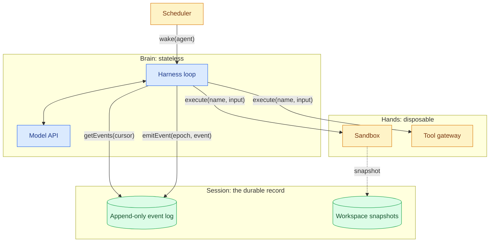

# The Session Log and Durable Runtime

## TL;DR

A standing agent outlives every process that runs it, every context window it fills, and several versions of the model that drives it. The only way to make that work is to put the agent's identity in a durable, append-only *session log* and to treat everything else as derived or disposable. The context window is a view computed from the log. The brain, the harness loop plus the model, is a stateless reader and appender. The hands, sandboxes and tools, are replaceable executors behind one narrow interface.

Three protocols make the arrangement safe. The *turn commit protocol* records the intent to perform an effect before performing it, so that a crash leaves a recoverable in-doubt record and not an unknown. The *context protocol* decides, at each activation, how to build a window from a log that no longer fits in one, using compaction within a line of work and a clean reset with handoff artifacts between them. The *upgrade protocol* changes the model, prompt, or tools underneath a living agent as a migration with a canary, because the log and memories it will read were written by its predecessor.

The model call is the one step we never replay. Its output is recorded once and read back on recovery, which is what lets a non-deterministic component sit inside a deterministic recovery scheme.

---

## Why the Process Cannot Hold the State

The first version of most agents keeps state where it is convenient: the conversation in the harness's memory, working files in the container, credentials in the environment, the plan in the model's context. Anthropic's account of building Managed Agents describes where that leads. When the harness, the sandbox, and the session all live in one container, the container becomes a pet. If it dies the session is lost, if it hangs someone has to nurse it back, and it cannot be replaced without losing whatever the agent had in mind.

For a request-scoped agent this is an inconvenience. For a standing agent it is disqualifying, because over months every one of those processes will be restarted, rescheduled, upgraded, or evicted. So we split the agent three ways.



The interfaces are deliberately small. The brain reads events from a position, appends events under its lease epoch, and calls `execute(name, input)` to get a string back. It does not know whether a hand is a container, a remote service, or another agent. That narrowness gives us the two recovery cases we need. If a hand fails, the brain sees a tool error, provisions a replacement, and carries on. If the brain fails, the scheduler wakes a new one, which reads the log and continues. Neither case needs the failed process back.

The split also has a latency benefit that matters for wakes. A brain that does not live in the sandbox does not have to wait for one. It can begin reasoning from the log immediately and provision a sandbox only if the turn turns out to need one, and many turns of a standing agent, the ones that read state and decide nothing has changed, never do.

## What the Log Contains

The session log is an append-only sequence of typed events, each with a sequence number, a timestamp, the lease epoch of the writer, and the versions of the harness and model that produced it.

| Event | Written when | Used for |
|---|---|---|
| `TurnStarted` | A brain acquires the lease; lists the mailbox hints it took | Recovery, audit of what caused a turn |
| `ModelOutput` | A model response is received, in full | Never re-calling the model for a recorded step |
| `EffectIntent` | Before a tool call with side effects; carries an idempotency key | Detecting in-doubt effects after a crash |
| `EffectResult` | After the tool returns | Completing the pair; the observation the model saw |
| `Observation` | Read-only tool results, often by reference to a blob | Context reconstruction |
| `Compaction` | A summary replaces a span in the view; carries the span it covers | Building context without rereading the span |
| `MemoryWrite` | A memory record is proposed or committed | Provenance for chapter 4 |
| `HumanMessage`, `Approval` | The principal says something or decides a gated action | Steering, authorization evidence |
| `TurnEnded` | Result committed; lists hints acknowledged and the next wake | Turn atomicity |
| `Skip`, `Cancelled` | The gate declined a wake, or a turn was preempted | Distinguishing quiet from dead |

Two properties matter more than the schema. The log is the single source of truth for what the agent did and saw, so anything not in it did not happen as far as recovery, audit, and the agent's own future context are concerned. And the log is never edited. Compaction, redaction for the view, and summarization all produce new events that describe how to read old ones. An operator debugging a decision made in March can still see exactly what the model was shown in March.

## The Turn Commit Protocol

The hard question in any durable runtime is what happens to an effect that was in flight when the process died. [Effect Commit Protocols](../18-workflow-job-systems/06-retry-idempotency-compensation.md) treats it in general. For an agent the protocol is:

```text
1. append EffectIntent{key, tool, input}        # durable before the call
2. result = execute(tool, input, idempotency_key=key)
3. append EffectResult{key, result}
```

On recovery the new brain scans the current turn for intents without results. Each one is *in doubt*: the call may never have been sent, may have been sent and applied, or may have been applied with the response lost. What happens next depends on the tool's contract, which is why tools declare one.

| Tool contract | Recovery action for an in-doubt intent |
|---|---|
| Idempotent by key | Re-execute with the same key; the receiver returns the original result |
| Queryable | Look up the effect by key or by natural identifier, then record the result or re-execute |
| Read-only | Re-execute freely |
| Neither idempotent nor queryable | Do not retry. Record the effect as unknown and surface it to the model, or to a human if the action is in the gated tier |

The last row is the honest one. A tool that sends an email through an API with no idempotency key and no sent-items lookup cannot be made exactly-once by anything in the agent runtime. The correct behavior is to tell the next turn the truth, that an email may or may not have been sent, and let it check before deciding. Hiding the uncertainty produces the duplicate.

This protocol also shows why the choice between *journal-and-replay* and *checkpoint-and-re-execute* runtimes matters. A journaling engine such as Temporal, Restate, or DBOS records each step's result, and recovery replays the code while substituting recorded results, so a turn that made twelve tool calls and crashed on the thirteenth re-executes one. A checkpointing framework saves state at node boundaries, and if a node contains the whole turn, recovery re-executes all twelve. Either can be correct. With checkpointing, correctness depends on every tool in the node being idempotent, and the granularity of the checkpoint is the granularity of the duplicate.

## Recording the Model

Durable execution engines require workflow code to be deterministic so that replay reaches the same state. A model call is the opposite of deterministic: the same prompt yields different output, and the provider's model behind a floating alias may change between the original call and the replay.

The resolution is to treat the model call as an effect whose result is journaled, never as code that is replayed. `ModelOutput` is appended in full before the harness acts on it. On recovery, the harness reads the recorded output and proceeds from there; it calls the model only for the step after the last recorded one. A recovered turn therefore continues the original trajectory instead of branching into a different one halfway through, which is what would happen if the model were asked again and decided differently about a plan whose first three steps have already been executed.

Recording outputs also gives us the raw material for two tools covered later: replaying a past decision exactly for debugging, and re-running a recorded trajectory against a candidate model for evaluation.

## Building Context From a Log That Does Not Fit

After a week, the log is larger than any context window. The context is therefore a *view*, computed at activation, and [Context Management](../17-llm-systems/08-context-management.md) describes the general techniques. Three decisions are specific to standing agents.

**The view has a fixed skeleton.** Every turn's context begins with the same stable prefix in the same order: system instructions, the rendered mandate, tool definitions, then core memory. Only then does the turn-specific material follow. The stability is for the prompt cache, which matches on exact prefixes, and the ordering puts the slowest-changing content first. An agent that interleaves a timestamp or a freshly sorted memory listing near the top of its prompt pays full price for every token on every wake.

**Compaction is for continuing; a reset is for starting over.** Within one line of work, the harness compacts: it replaces an older span with a summary, clears stale tool results, and keeps recent turns verbatim. Compaction preserves continuity, but it is lossy in a way the agent cannot see, and repeated compaction of compacted text drifts. Anthropic's work on long-running coding agents reports that compaction alone was not enough: an agent that ran out of context mid-task left the next window with half-finished work and a summary that did not say so.

The alternative is a *context reset with handoff artifacts*. The agent is instructed, and the harness enforces, that durable progress is written to the workspace and not left in the window: a task list with pass or fail status, a progress note, and a commit history with descriptive messages. A new context starts clean, reads those artifacts, runs a check that the workspace is in the state they claim, and continues. The window becomes scratch space and the workspace becomes the memory of the task.

The same choice appears at the start of every wake as a routing decision. An event that continues earlier work, such as a reply to a question the agent asked or an approval of a deferred action, resumes the session that work lives in. An unrelated event starts a new one. Both compaction and replacement lose detail, so whatever must survive is written to memory or the workspace before the window is given up.

For a standing agent the rule of thumb is to reset between wakes that are about different things and compact within a wake that runs long. Most wakes are short and unrelated to the previous one, and loading the summary of yesterday's incident into today's calendar question spends tokens to add confusion.

**The view states what it omits.** A turn built from a summary plus the last few events should be told so: how far back the verbatim history goes, that earlier material is summarized, and how to retrieve the original through a log-search tool. An agent that believes it is seeing the whole history will reason confidently from a gap.

## Hands: Sandboxes Without Sentiment

The sandbox is where the agent runs code, edits files, and drives a browser. In the decoupled design it is cattle, which sets its requirements.

*Provision lazily, restore quickly.* A turn that needs a sandbox either attaches to a warm one or restores the agent's workspace snapshot into a fresh one. Snapshot-restore time is added to reaction latency, so workspaces are kept small and snapshotted incrementally.

*Snapshot at turn boundaries.* The workspace snapshot referenced by `TurnEnded` is the one a future turn restores. Files written by a turn that never committed are discarded with its sandbox, which keeps the workspace consistent with the log.

*Hold no secrets.* The sandbox executes model-written code that has read third-party content. Anything in its environment should be assumed readable by an attacker. Credentials live in the tool gateway, outside the sandbox, and chapter 5 describes how calls are authorized there.

*Assume the lifetime is shorter than the task.* Sandboxes are evicted, and long waits should never hold one. An agent waiting three days for an approval is a row in a timer table and a pending event in a log, with no container and no model call. This is the property that durable timers buy: the cost of waiting is storage.

## Upgrading a Living Agent

A request-scoped agent is upgraded by deploying the new version; the next task uses it. A standing agent is in the middle of things. It has open commitments, a memory written in the old prompt's vocabulary, a log full of tool calls in the old schema, and timers whose reasons assume capabilities it may no longer have. Changing what is underneath it is a migration.

*Pin, then move deliberately.* Each agent records the model version, prompt version, and tool schema version it runs. Floating aliases are convenient and make every provider-side change an unannounced deployment to the entire fleet. Pinned versions move through a rollout.

*Shadow-replay before canary.* Because `ModelOutput` and observations are recorded, we can take a sample of recent turns, rebuild the exact context each one saw, and run the candidate version against it without executing effects. Comparing proposed actions with the recorded ones, by rule and by a judge model, finds behavior changes before any agent acts on them. The comparison is only valid for the first step after the divergence point, since later observations would have differed, and that is enough to catch the commonest regressions: different tool selection, a new tendency to interrupt, a changed threshold for acting.

*Canary by cohort.* The new version goes to a small set of agents chosen for low blast radius, and the indicators from chapter 1 are compared with the control cohort over long enough to cover a full cycle of the agents' work, which for a weekly rhythm is more than a week.

*Migrate schemas additively.* Tool schema changes follow the rules of any wire protocol: add fields, keep old ones readable, and never reinterpret a recorded event. A tool that is removed needs a decision about the timers and memories that refer to it.

*Keep rollback real.* Rolling back the model is easy. Rolling back what the new version wrote to memory is not. During a canary, memory writes are tagged with the writer's version so they can be reviewed or reverted as a set.

## Forking and Replay

Because the log is the agent, an agent can be forked: copy the log up to a sequence number, attach a new identity with no live credentials, and run it forward. Forks are how we investigate an incident without touching the live agent, test a prompt change against a real history, and answer the question "what would it have done if this email had not arrived."

A fork must be isolated from the world. Its tool gateway is a recording stub or a simulated environment, its timers do not fire into the production scheduler, and its outbox goes nowhere. The failure this guards against is a debugging session that sends the customer a second email.

## Failure Modes

| Failure | Mechanism | Detection | Mitigation |
|---|---|---|---|
| Duplicate effect on recovery | Checkpoint coarser than the effect; tool not idempotent | Duplicate downstream records sharing a turn id | Intent and result per effect; idempotency keys; declared tool contracts |
| Lost effect knowledge | Response lost; intent never resolved | Intents without results at recovery | Query-by-key; surface unknown outcome to the next turn |
| Trajectory fork on replay | Model re-called for a recorded step | Recorded and replayed outputs differ | Journal model output; replay reads, never re-asks |
| Zombie brain | Old brain resumes after lease loss and appends | Epoch mismatch on append | Fencing epoch checked by the log on every write |
| Compaction drift | Summaries of summaries lose constraints | Agent violates an instruction given long ago | Durable instructions live in mandate and memory, not in the window; reset with artifacts |
| Half-finished handoff | Context exhausted mid-task; next window misreads state | Workspace fails its own checks at start | Commit progress incrementally; start-of-turn verification |
| Cache-hostile prefix | Volatile content early in the prompt | Cached-token fraction near zero | Stable skeleton; volatile material last |
| Workspace and log diverge | Uncommitted files survive, or committed ones do not | Snapshot id mismatch at restore | Snapshot referenced by `TurnEnded` only |
| Upgrade regression | New model reads old memory differently | Cohort indicators diverge | Shadow replay, cohort canary, version-tagged memory writes |
| Fork leaks into production | Debug fork holds live credentials or timers | Effects attributed to a fork identity | Forks get stub gateways and an isolated scheduler |

## Decision Framework

The runtime choice follows from how long the agent waits and how costly a repeated effect is.

| Situation | Reasonable runtime |
|---|---|
| Turns are short, effects are idempotent, waits are minutes | A queue, a database row per agent, and checkpoint per turn |
| Turns span many tool calls; some effects are not idempotent | Per-effect journaling, from a durable execution library or engine |
| Waits of days, human approvals, many timers per agent | A durable execution engine with timers and signals as primitives |
| Large fleet, code execution, strict isolation | A managed agent runtime, or the brain, hands, and session split built in-house |

Whichever is chosen, four questions should have written answers before the agent holds real authority. What is the unit of re-execution after a crash? Which tools are not idempotent, and what does the agent do when one is in doubt? What does a new context read first, and how does it verify it? And how is a new model version tested against this agent's own history before it acts?

## Key Takeaways

- The session log is the agent. Brains are stateless readers and appenders; hands are disposable executors behind `execute(name, input)`.
- Record the intent before every effect and the result after it. Recovery resolves in-doubt intents according to each tool's declared contract and tells the truth about the ones it cannot resolve.
- The granularity of the checkpoint is the granularity of the duplicate. Journal per effect when effects are not idempotent.
- The model call is journaled and never replayed, so a recovered turn continues its original trajectory.
- Context is a view over the log with a stable, cache-friendly skeleton. Compact within a line of work and reset with handoff artifacts between them.
- A waiting agent should cost storage only: no container, no connection, no model call.
- Upgrading a living agent is a migration. Pin versions, shadow-replay against recorded turns, canary by cohort, and tag memory writes by version.
- Forks make incidents investigable, provided they are cut off from live credentials, timers, and outboxes.

## References

- [Building always-on agents](https://claude.com/resources/articles/building-always-on-agents): runs and sessions, resuming versus starting a session, and saving state before compaction
- [Scaling Managed Agents: Decoupling the brain from the hands](https://www.anthropic.com/engineering/managed-agents): the session, harness, and sandbox split and its recovery properties
- [Effective harnesses for long-running agents](https://www.anthropic.com/engineering/effective-harnesses-for-long-running-agents): initializer and incremental sessions, progress artifacts, and why compaction alone falls short
- [Effective context engineering for AI agents](https://www.anthropic.com/engineering/effective-context-engineering-for-ai-agents): compaction, structured notes, and context as a finite resource
- [Temporal: Workflows](https://docs.temporal.io/workflows): event history, deterministic replay, timers, and signals
- [Restate documentation](https://docs.restate.dev/): journaled execution and durable promises for long-running handlers
- [DBOS documentation](https://docs.dbos.dev/): workflow checkpointing in Postgres as a library
- [LangGraph persistence](https://langchain-ai.github.io/langgraph/concepts/persistence/): checkpointers, threads, and interrupt and resume
- [Firecracker: Lightweight Virtualization for Serverless Applications](https://www.usenix.org/conference/nsdi20/presentation/agache): fast-start microVM isolation for untrusted code

---

## Related Chapters

- [Durable Execution and Workflow Engines](../18-workflow-job-systems/04-durable-execution-workflow-engines.md): event history, replay, and timers, the machinery beneath the session log
- [Effect Commit Protocols for Workflows](../18-workflow-job-systems/06-retry-idempotency-compensation.md): the intent, result, and idempotency-key discipline in full generality
- [Context Management](../17-llm-systems/08-context-management.md): compaction and budgeting techniques that the view over the log applies
- [Harness Engineering](../17-llm-systems/09-harness-engineering.md): the loop the stateless brain runs, and its tool-execution contract
- [Workflow Observability and Replay](../18-workflow-job-systems/09-workflow-observability-replay.md): replaying recorded histories for debugging and for regression testing
