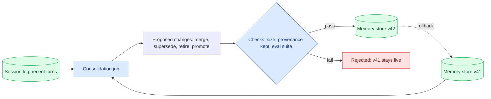

# Memory Lifecycle for Standing Agents

## TL;DR

A request-scoped agent's memory problem is retrieval: find the right passage and put it in the window. A standing agent's memory problem is *maintenance*. It writes to its own memory every day for months, with no editor, and then trusts what it wrote. Errors do not stay local. A wrong inference recorded as a fact in week two is read back as ground truth in week ten, shapes actions, and generates further memories that depend on it.

We therefore treat memory as a database with a write path, and not as a notebook. Every record carries provenance: which event produced it, how trusted the source was, when the fact was true, and when the agent learned it. Writes from untrusted content are quarantined. An offline consolidation job, running while the agent is idle, merges duplicates, resolves contradictions, and retires stale entries, and it writes its output to a new version of the store so that a bad consolidation can be rolled back. Deletion propagates to everything derived from the deleted record.

The operating rule that keeps memory safe to use is that memory is a hint about where to look and what to expect. The world is the authority. Before an action that depends on a remembered fact, the agent checks the fact.

---

## Why Standing Agents Are Different

[Context Management](../17-llm-systems/08-context-management.md) covers how a single session selects, compresses, and budgets what goes into the window, and [RAG Patterns](../17-llm-systems/04-rag-patterns.md) covers retrieval over a corpus that someone else maintains. Neither assumes the reader and the writer are the same unsupervised process over a long horizon. Three consequences follow from that.

*The corpus is self-authored.* The agent decides what is worth remembering, phrases it, and files it. Its mistakes of judgment become its future evidence.

*The world moves underneath it.* "Dana owns the billing service" was true when written. Nothing notifies the memory store when Dana changes teams.

*Memory is an input channel that persists.* A context window is discarded at the end of a session, which bounds how long a successful prompt injection lasts. A memory record written under injection loads into every future session. Memory turns a transient compromise into a durable one.

## Tiers and Their Authority

It helps to separate memory by how it is written, how it is loaded, and how much authority it carries when it conflicts with something else.

| Tier | Contents | Written by | Loaded | Authority |
|---|---|---|---|---|
| Mandate and instructions | Objective, scope, standing rules from the owner | The owner, through the control plane | Every turn, in the cached prefix | Highest; memory cannot amend it |
| Core memory | A small, curated block: who the principal is, current commitments, key preferences | The agent, under a size cap, and consolidation | Every turn | High; kept short so it stays true |
| Semantic memory | Facts and learned preferences as individual records | The agent's write tool; consolidation | Retrieved on demand | Medium; verify before acting |
| Procedural memory | How to do recurring tasks: runbooks, skills, scripts | The agent proposes; an owner or a test admits | Listed by name every turn; body loaded on use | High once admitted |
| Episodic memory | What happened: the session log and its summaries | The runtime | Searched on demand | Evidence, not instruction |
| Shared memory | Facts used by several agents or a team | Many writers, with review | Retrieved on demand | Depends on the writer's standing |

The table's most important row is the first. Instructions that must hold for the agent's whole life belong in the mandate, where a human owns them, and are rendered into every turn. If they live only in agent-written memory, they are subject to everything that can go wrong with agent-written memory, including consolidation rewording them and an injection replacing them.

The second most important is the split between always-loaded and retrieved. Always-loaded memory is paid for on every wake and competes with the task for attention, so it has a hard token cap, typically a few thousand tokens, and the agent has to evict to add. Retrieved memory can grow, at the cost that the agent must know to look. The common pattern is a short index in core memory, a line per topic with a pointer, and the bodies in files or records fetched when relevant. Anthropic's always-on guide gives a concrete layout with four kinds of content: the user's instructions in their own file and an index of notes, both loaded every run; a record of what the agent has already reported, so that it does not repeat itself; note bodies fetched on demand; and one progress file per task. Several current harnesses implement this as a directory of Markdown files with an index file, and some back it with git so that every change has an author, a diff, and a revert.

## The Record

[Context Management](../17-llm-systems/08-context-management.md) lists what any memory record needs: subject, claim, source, scope, and expiry. A store that an agent maintains by itself for months needs three more things: where each belief came from and how far to trust it, two separate notions of time, and links from derived records back to their sources.

```python
@dataclass
class MemoryRecord:
    id: str
    kind: Literal["fact", "preference", "commitment", "procedure", "observation"]
    subject: str                  # normalized entity or topic key
    text: str
    # provenance
    source_event: int             # session-log sequence number that produced it
    source_trust: Literal["principal", "internal", "third_party", "inferred"]
    writer_version: str           # model and prompt version of the writer
    # time
    valid_from: datetime | None   # when the fact became true in the world
    valid_to: datetime | None     # when it stopped being true, if known
    learned_at: datetime          # when the agent recorded it
    last_verified: datetime | None
    # lifecycle
    status: Literal["quarantined", "active", "superseded", "retracted"]
    supersedes: str | None
    derived_from: list[str]       # ids of records this one summarizes or infers from
    confidence: float
```

Each group of fields supports a specific operation. `source_event` lets an operator, or the agent, go from a belief to the exact log entry that produced it, which is the only way to debug "why does it think that." `source_trust` drives the security policy below. The two time axes make the store *bitemporal*: `valid_from` and `valid_to` describe the world, `learned_at` describes the agent's knowledge, and keeping them apart is what lets the agent answer both "who owns billing now" and "who did I believe owned billing when I assigned that ticket." `supersedes` and `status` make updates non-destructive. `derived_from` is what makes deletion possible, as we will see.

## The Write Path

The cheapest moment to prevent a bad memory is before it is written. The write path has four checks.

**Is it worth keeping?** The working rule is to store only what the agent cannot look up again, and otherwise to save a pointer to where the answer lives. A ticket's status belongs in the tracker; the fact that this principal wants ticket updates on Fridays belongs in memory. Agents asked to remember tend to remember too much, and a store full of one-off observations degrades retrieval for everything else. The write tool's instructions distinguish durable facts, standing preferences, and open commitments from details of the task at hand, which belong in the log and are already there.

**Is it already known?** The writer retrieves by subject before writing. A match with the same content updates `last_verified`. A match with different content is a contradiction, handled below, and not a second record.

**Where did it come from?** The harness, not the model, sets `source_trust`, from the trust labels of the content in context when the write was proposed. If the turn has read third-party content, a write that is not a direct quotation of the principal is labeled `third_party` or `inferred`.

**Is it an instruction?** A record that tells the future agent what to do, such as "always forward invoices to this address," is far more dangerous than a record that describes the world. Imperative records from anything other than the principal are quarantined. They are stored and visible to the owner for review, and they are not loaded into any future context until admitted.

In the log, a write is a `MemoryWrite` event, so the store can in principle be rebuilt from the log and every record has a causal history.

## Consolidation While Idle

A store that only grows gets worse. Near-duplicates crowd retrieval results, superseded facts sit beside their replacements, and many small observations never get combined into the pattern they imply. People consolidate memory during sleep. Agents have an obvious equivalent, since a standing agent is idle most of the time and idle compute is what the background priority class in chapter 2 is for.



The job reads the current store and a window of recent sessions and proposes a set of changes: merge these three records into one, mark this one superseded by that one, retire observations that are older than their usefulness, and promote a repeated pattern to core memory. It is a separate invocation with its own prompt and no tools except the memory interface.

Four design choices make it safe to run unattended.

*Write a new version.* Consolidation is a lossy rewrite of the agent's beliefs by a model. It should produce store version `n+1` beside version `n`, with the old version kept until the new one has been in use long enough to trust. Anthropic's consolidation feature for managed agents, in research preview at the time of writing, has this shape: it takes a store and a set of past sessions as input and writes a separate output store. In-place edits make a bad consolidation unrecoverable.

*Preserve provenance through merges.* A merged record's `derived_from` lists its inputs, and its `source_trust` is the lowest trust among them. Consolidation must not launder a third-party claim into an unlabeled fact.

*Leave the mandate and admitted procedures alone.* The consolidator may propose changes to them, for human review. It may not rewrite them.

*Evaluate before promoting.* A fixed set of questions with known answers, drawn from the agent's real history, is asked against the candidate store. A consolidation that loses an answer the previous version had is rejected.

The research on sleep-time compute gives the cost argument. Work done once while idle, anticipating what will be asked, is amortized over every later query on the same context, and the reported benefit is large when future queries are predictable from the context and small when they are not. For standing agents with a stable mandate, they usually are.

## Truth Maintenance

Consolidation finds contradictions; something has to decide them. The policy is ordered.

A more trusted source beats a less trusted one, so the principal's statement beats an inference. Between equally trusted records, the one with the later `valid_from` wins for present-tense questions, and both are retained because both were true. Where neither rule decides, the records are marked as conflicting and the agent is told so when either is retrieved. A visible conflict is better than a confident coin flip.

Superseding is never overwriting. The old record gets `valid_to` and `status: superseded` and stays queryable, because the agent's past actions were taken on it and an audit needs to see what was believed at the time.

Staleness is handled at read time as well as at consolidation. Each kind of record has an expected lifetime, short for "the build is red," long for "the principal prefers morning meetings," and retrieval returns the record's age and last verification beside its text. The agent's instructions tie this to action: a remembered fact may guide where to look, and a fact that an action depends on is verified against the system of record first. When the check passes, `last_verified` is updated. When it fails, the record is superseded on the spot. This is the cheapest truth maintenance there is, because it happens exactly when the truth matters.

## Forgetting

Retention is partly cost and mostly obligation. Memory accumulates personal data about the principal and about third parties who never agreed to be remembered, and [Data Retention and Compliance Engineering](../20-production-readiness/05-data-retention-and-compliance-engineering.md) applies in full.

Deleting a record is the easy part. The hard part is everything derived from it. If a consolidation merged a deleted fact into a summary, the summary still contains it. If an embedding index holds its vector, a search still returns it. If the fact was in context when other records were written, they may restate it. The `derived_from` graph exists so that deletion can walk forward from a record to every descendant and either regenerate each one without the deleted input or delete it too. Without that graph, the only complete erasure is rebuilding the store from a redacted log.

The session log needs the same treatment by a different mechanism. It is append-only, so erasure is implemented by encrypting payloads with per-subject keys and destroying the key, or by storing payloads as blobs referenced from the log and deleting the blob, leaving a tombstone event.

## Memory as an Attack Surface

Prompt injection through memory is the standing agent's characteristic vulnerability. The attack has two steps separated in time: content the agent reads today causes a memory write, and the memory causes an action in some later session where no hostile content is present at all. Research on poisoning agent memory and knowledge bases shows that a small number of crafted records can be enough to steer retrieval-based agents reliably.

The defenses follow from the record structure.

- **Trust labels are set by the harness and survive consolidation.** The model cannot upgrade them.
- **Imperatives from untrusted sources are quarantined**, as described above.
- **Retrieved memory is presented as data.** The view wraps recalled records in a delimited block with their source and age, separate from instructions. This reduces the risk and does not remove it.
- **Capability follows taint.** A turn whose context includes `third_party` memory is treated like a turn that read third-party content directly, under the rules in chapter 5.
- **Memory writes are security events.** They are logged with their source event, alerted on when they match patterns such as new destinations, credentials, or standing instructions, and reviewable as a diff by the owner.
- **Recovery is possible.** With provenance, an operator who finds a hostile document can list every record whose causal history includes it and retract them together.

## Shared Memory

When several agents, or an agent and its subagents, write to one store, the usual concurrency rules apply, with one addition: the writers are confident, fluent, and occasionally wrong, so last-writer-wins amounts to data loss.

Writes carry the version they were based on, and a conflicting write is rejected for the writer to reconcile, as in any optimistic scheme. Git-backed stores get this from the merge machinery and add review: an agent proposes a change to shared memory as a branch, and a consolidating agent or a human merges it. Scope matters as much as concurrency. A record should be visible only to agents whose mandates cover its subject, because shared memory is otherwise a channel through which a low-trust agent's reading of the web becomes a high-trust agent's belief.

## Evaluating Memory

A memory system is judged by what the agent does with it, so component metrics are necessary and insufficient.

| Measure | Question |
|---|---|
| Recall on known answers | Given a question whose answer is in the history, does the agent retrieve and use it? |
| Staleness rate | Of the records used in decisions, how many were no longer true? |
| Harmful recall rate | How often did a retrieved record make the outcome worse than no memory would have? |
| Contradiction backlog | How many unresolved conflicts does the store hold, and is the number growing? |
| Core memory churn | How often does the always-loaded block change, and does each change survive review? |
| Consolidation regressions | How many known answers did a consolidation run lose? |

Harmful recall is the one teams skip. Memory is not free of downside: a stale or irrelevant record can anchor the agent on the wrong approach. The honest baseline for any memory feature is the same agent with the feature turned off, and on tasks where the feature does not win, it should not be loaded.

## Failure Modes

| Failure | Mechanism | Detection | Mitigation |
|---|---|---|---|
| Stale fact drives an action | World changed; record did not | Action fails or is wrong; staleness rate | Verify before acting; kind-specific lifetimes; `last_verified` |
| Inference recorded as fact | Agent's guess stored without label | Records with no source quotation | `inferred` trust level; lower confidence; surfaced on recall |
| Memory poisoning | Third-party content causes a persistent write | Alerts on imperative or destination-bearing writes | Harness-set trust, quarantine, taint-based capability limits |
| Trust laundering | Consolidation merges untrusted claim into plain fact | Merged records missing `derived_from` | Lowest-trust inheritance; provenance check before promotion |
| Destructive consolidation | Summary drops a constraint or commitment | Eval suite loses a known answer | Versioned output store; rollback; protected tiers |
| Core memory bloat | Always-loaded block grows; attention diluted | Token count; task quality falls | Hard cap; index plus on-demand bodies |
| Retrieval pollution | Duplicates and trivia crowd results | Precision at k falls as the store grows | Write filter; consolidation; retire by age and use |
| Incomplete erasure | Derived summaries and indexes retain deleted data | Deleted content resurfaces | `derived_from` graph; regenerate descendants; key destruction for logs |
| Lost update in shared memory | Concurrent writers overwrite each other | Version conflicts absent where they should occur | Optimistic versioning; proposed changes with review |

## Decision Framework

Start with less memory than seems necessary. An agent with a mandate, a small core block, and a searchable session log already has continuity, and each added tier brings a maintenance obligation.

Add a semantic store when the agent repeatedly rediscovers the same facts. Add procedural memory when it repeatedly re-derives the same method, and gate admission with a test or a review. Add consolidation when retrieval precision starts to fall or contradictions accumulate, and not before, because consolidation is itself a source of error. Add shared memory last, when agents demonstrably duplicate each other's learning, and scope it narrowly.

For the storage substrate, files with an index and version control are the strongest default: they are inspectable, diffable, revertible, and work with the tools the agent already has. A record store with a vector index earns its place when the volume is beyond what an index file can describe, and it should keep the provenance and versioning the file approach gave for free.

## Key Takeaways

- For a standing agent, memory is a maintenance problem. It writes its own evidence, the world changes beneath it, and what it writes persists across sessions.
- Lifelong instructions belong in the mandate, owned by a human. Agent-written memory cannot amend them.
- Keep the always-loaded block small and capped; put everything else behind an index and retrieve on demand.
- Every record carries provenance, a harness-set trust label, two time axes, and links to what it was derived from.
- Check worth, duplication, source, and imperative form on the write path. Quarantine instructions that did not come from the principal.
- Consolidate while idle, into a new store version, preserving provenance, and promote only after an evaluation against known answers.
- Supersede, never overwrite. Verify remembered facts at the moment an action depends on them.
- Deletion must reach summaries, indexes, and logs. Plan the derivation graph before the first erasure request.
- Measure harmful recall against a no-memory baseline.

## References

- [Building always-on agents](https://claude.com/resources/articles/building-always-on-agents): the four memory types, pointers over copies, and dreaming over past sessions
- [MemGPT: Towards LLMs as Operating Systems](https://arxiv.org/abs/2310.08560): tiered memory with the model managing its own paging
- [Sleep-time Compute: Beyond Inference Scaling at Test-time](https://arxiv.org/abs/2504.13171): amortizing offline work over later queries on the same context
- [Generative Agents: Interactive Simulacra of Human Behavior](https://arxiv.org/abs/2304.03442): observation streams, reflection, and retrieval by recency, importance, and relevance
- [A-MEM: Agentic Memory for LLM Agents](https://arxiv.org/abs/2502.12110): new memories triggering updates to linked older ones
- [AgentPoison: Red-teaming LLM Agents via Poisoning Memory or Knowledge Bases](https://arxiv.org/abs/2407.12784): backdoor attacks through stored records
- [Effective context engineering for AI agents](https://www.anthropic.com/engineering/effective-context-engineering-for-ai-agents): structured note-taking and just-in-time retrieval
- [Letta: sleep-time agents](https://docs.letta.com/guides/agents/architectures/sleeptime): a background agent that edits the primary agent's memory blocks
- [Zep: A Temporal Knowledge Graph Architecture for Agent Memory](https://arxiv.org/abs/2501.13956): bitemporal facts and invalidation instead of overwrite

---

## Related Chapters

- [Context Management](../17-llm-systems/08-context-management.md): how recalled memory competes for the window with the task itself
- [Retrieval-Augmented Generation Systems](../17-llm-systems/04-rag-patterns.md): retrieval mechanics for the on-demand tiers of the memory store
- [Data Retention and Compliance Engineering](../20-production-readiness/05-data-retention-and-compliance-engineering.md): erasure and retention duties that agent memory inherits in full
- [Conflict Resolution](../02-distributed-databases/04-conflict-resolution.md): merge policy for concurrent writers, which shared memory needs
- [Repository Context and Policy Plane](../19-compound-engineering/03-agent-context-engineering.md): repository-scoped instructions and memory files for coding agents
