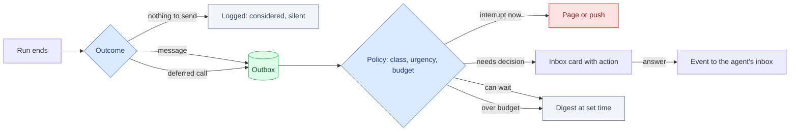

# Attention, Evaluation, and Operations

## TL;DR

A standing agent's output is not a stream that someone watches. It is an occasional message to a person who was doing something else, and that person's attention is the scarcest resource the system consumes. Every run therefore ends in one of three ways: a message to the outbox, nothing to send, or a deferred request for input. The outbox is a component with a budget, and the default is quiet. An agent starts by saying little and earns more of its principal's attention as its messages prove worth reading.

Evaluation has to change shape as well, because there is no prompt to grade an answer against. We evaluate *policies over event streams*: recorded or synthetic timelines are replayed against the agent on a simulated clock, and we score what it did, what it should have done and did not, what it said, and what it cost. Long-horizon defects such as memory drift, growing cost per wake, and creeping notification volume only appear over weeks of simulated time.

Operationally the agent is a service. It has service-level objectives, traces per run, an alert on silence, a cost model in which idle time is free and overhead is paid on every wake, and a rollout process that treats a prompt or model change to ten thousand living agents as a fleet migration.

---

## The Outbox

In a supervised session the user sees every step, so the agent's communication problem is solved by the interface. Background work inverts this. The user receives the outcome and not the process, and what the agent chooses to send is the whole of their experience of it.

A run can end three ways. It can produce a message, it can produce nothing, or it can stop on a deferred call that asks for a decision, as chapter 5 described. "Nothing" is a legitimate and common ending, and it must be an explicit one: the run records that it considered the situation and judged that nobody needed to hear about it. An agent that feels obliged to report every wake teaches its principal to ignore it within a week.

For many agents a single `send` tool is enough. A formal outbox, a durable table of pending messages and a dispatcher that delivers them, becomes worth building when any of the following is needed: pacing and batching, retry after a channel failure without sending twice, a budget enforced outside the model, or one view of everything waiting on a person.



### Message Classes

Outbound messages fall into classes with different costs to the reader, and the outbox routes by class.

| Class | Meaning | Channel | Budgeted |
|---|---|---|---|
| Interrupt | A human decision or action is needed now | Page or push | Tightly: a few per day |
| Decision request | A deferred call awaiting approval | Inbox card showing the exact action | Yes |
| Question | The agent cannot proceed without information | Inbox | Yes |
| Report | Work was done; here is the outcome | Digest | By size |
| Activity record | What the agent did and why | Pull only: an activity page | No |

The interrupt class is the one to protect. The reasoning is the same as for paging in [Alert Evaluation & Notification](../11-observability/04-alerting.md): an interrupt should be urgent, should require a human, and should be something the human can act on. Everything else waits for a digest or an inbox the person visits when they choose.

### The Interruption Budget

The mandate's `attention` block is enforced by the dispatcher, outside the model, as a token bucket per recipient. When the budget is spent, further interrupts are demoted to the digest with a note that they were demoted. The agent is told its remaining budget each run so that it can plan: an agent that knows it has one interrupt left today behaves differently from one that believes interrupts are free.

Research on proactive agents supports the practice. Work that frames proactivity as a gated decision about whether and when to intervene measures it by precision, recall, and false-alarm rate. Work on interruption budgets reports that capping clarifying questions at a small number preserved most task reward while cutting attention cost substantially. Asking fewer, better questions is close to free in outcome terms and valuable in attention terms.

Three further mechanisms keep volume down.

*Batching.* Several pending items for one person become one message. A digest at a fixed time is the simplest batch, and most reports belong in it.

*Deduplication across agents.* A person served by four agents has one attention budget, not four. When several agents can reach the same person, a single dispatcher owns the budget, and it merges or suppresses messages about the same subject. Without a shared owner, each team tunes its own agent to be reasonable and the sum is not.

*Start quiet.* A new agent begins with a low budget and a digest-first policy. Budget increases are earned from evidence: the fraction of its messages that were opened and acted on, and explicit feedback. Trust built this way is durable, and trust lost to a noisy first week is hard to recover.

### Questions That Go Unanswered

A standing agent will ask questions nobody answers. Every question and decision request therefore carries three things: a deadline, a default the agent will take when the deadline passes, and a statement of that default in the request itself, such as "I will leave the meeting as it is unless you reply by 17:00." The default is the conservative option. Open requests are listed in one place, withdrawn when they become moot, and counted, because a growing backlog of unanswered questions means the agent is asking the wrong person or asking too much.

## Evaluating an Agent With No Prompt

[LLM Evaluation](../17-llm-systems/10-llm-evaluation.md) covers grading outputs and trajectories against a task. A standing agent has no task in that sense. Its input is a timeline, its output is a set of actions and messages distributed over that timeline, and inaction is frequently the right answer. The unit of evaluation is the *scenario*: an initial state of memory and world, a mandate, a sequence of timestamped events, and a rubric.

### Timeline Replay

The harness runs the real agent, with its real wake path, against a simulated environment and a virtual clock.

```python
def run_scenario(agent, scenario) -> Scorecard:
    world = SimulatedWorld(scenario.initial_state)     # stub tools with state
    clock = VirtualClock(scenario.start)
    agent.restore(scenario.memory_snapshot, scenario.mandate)

    for event in scenario.timeline:                    # timestamped events
        clock.advance_to(event.time)                   # fires due timers and sweeps
        agent.ingress(event)
        agent.run_until_idle(world, clock)             # gate, turns, outbox, timers

    clock.advance_to(scenario.end)                     # let follow-ups fire
    return score(
        actions=world.effects,                         # what it did
        messages=agent.outbox.sent,                    # what it said, and to whom
        expected=scenario.rubric,                      # must-act, must-not-act, may-act
        spend=agent.ledger,                            # tokens and wakes
    )
```

The virtual clock is what makes this practical. Timers, sweeps, debounce windows, cache expiry, and approval timeouts all read the clock, so a simulated month runs in the time its turns take and not in a month. The rubric has three lists and not one: conditions where the agent must act, conditions where it must not, and a wide remainder where either is acceptable. Scoring only required actions rewards an agent that acts on everything.

### What to Score

| Dimension | Measure | Failure it exposes |
|---|---|---|
| Action recall | Required actions taken, within their freshness bound | Timidity; gate false negatives; lost events |
| Action precision | Actions taken that were permitted by the rubric | Overreach |
| Silence precision | Runs that correctly ended with nothing to send | Noise |
| Interrupt precision | Interrupts that a reviewer agrees needed a human then | Fatigue |
| Commitment keeping | Follow-ups the agent promised and performed on time | Lost or mis-set timers |
| Containment | Injection scenarios where no gated effect escaped | Security regressions |
| Cost | Tokens and wakes per scenario, and per useful outcome | Heartbeat waste; context bloat |

Scenarios come from three sources. Production session logs, with consent and redaction, give realistic timelines and are replayed with the recorded observations. Hand-written scenarios cover the conditions that matter and are rare: the dropped webhook, the contradictory instruction, the hostile email, the principal who does not answer. Synthetic timelines generated by a model and filtered by people give volume. Message volume in particular should be tuned with evaluations before it is tuned on users.

### Soak Tests

Some defects only exist at length. Core memory grows until it crowds the task. Consolidation slowly rewords a preference into something else. Cost per wake climbs as the always-loaded overhead accumulates. A timer leak adds a wake a day. None of these appears in a scenario of twenty events.

A soak test runs months of simulated time, with consolidation and compaction included, and tracks trends: tokens per wake, core memory size, pending timers, messages per day, and the score on a fixed probe set asked at intervals. The pass condition is that the trends are flat. Soak tests are slow and expensive, so they run on release candidates for the model, prompt, and memory system and not on every change.

### Online Evaluation

Offline scores are a gate, and production is the measure. The signals available online are the principal's reactions: messages opened, approvals granted or denied, actions undone, explicit feedback, and budgets the owner raised or lowered. An action the user reverses is the closest thing a standing agent has to a labeled error. A sampled audit, in which a reviewer or a judge model reads a random selection of runs including silent ones, finds the missed actions that no reaction can reveal.

## Evaluation Budget and Statistical Power

Scenario replay costs little wall time because the virtual clock removes waiting, so the binding constraint on evaluation is statistical rather than computational. Two arms of a comparison need enough cases before either can be called better, and for a proportion that requirement is fixed by arithmetic rather than by ambition. At 80 percent power and a 5 percent significance level:

| Baseline action recall | Cases per arm to detect | Drop detected |
|---|---|---|
| 92 percent | 130 | 12 points |
| 92 percent | 325 | 7 points |
| 92 percent | 881 | 4 points |

A fifty-scenario golden set therefore sees collapses and nothing else: it can catch a fifteen-point regression with reasonable reliability and cannot see a four-point one at all. That is a fine thing to own deliberately and a bad thing to believe by accident, so name the suite for what it is. "Breakage detector" is honest; "we run evals before shipping" is not.

The cost of doing this properly is smaller than teams fear. At 881 cases per arm, a comparison runs about 1,760 scenarios; at twenty-five turns each and the per-turn price from Economics, that is roughly USD 1,700, about a third of what this fleet spends running itself for a day. The scarce input is not compute but rubric authoring and labels, which is the argument for mining production session logs for scenarios rather than hand-writing them, and for reserving human authoring for the rare conditions that traffic does not supply.

Silence needs the same treatment because it is measured by sampling, and sampling has a floor. This fleet skips about 921,600 wakes a day. To have a 95 percent chance of catching at least one wrong skip when the true error rate is 1 percent requires roughly 300 sampled skips; at 0.1 percent it requires about 3,000. Sampling 0.03 percent of skips costs near USD 11 a day in full turns and 0.1 percent near USD 36. A weekly audit of fifty runs cannot bound the miss rate below two percent no matter how carefully those fifty are read, which is worth saying in the meeting where someone proposes it.

Attention has a budget that is not statistical at all, because it is spent out of a person's day. If owners tolerate roughly three escalations a day, then two hundred owners buy six hundred escalations across ten thousand agents: each agent may interrupt on about 6 percent of its days. Precision alone cannot protect that ceiling, since precision is a ratio and the budget is a count; the quantity to hold is escalations per owner per day, and new signal sources should be approved in the same review that prices their contribution to it.

## Observability

The trace unit is the run. One trace spans the wake event, the gate decision, each model call and tool call, the policy decisions, memory reads and writes, and the outcome, and it carries the agent, mandate version, session, and model version as attributes. [Tracing & Telemetry Pipelines](../11-observability/01-distributed-tracing.md) applies unchanged. The OpenTelemetry generative-AI semantic conventions define attribute names for model and agent spans. They were still marked as in development at the time of writing, with the agent and tool spans the least settled, so pin the convention version and expect to migrate.

A small set of metrics describes the health of a fleet.

| Signal | Why it is watched |
|---|---|
| Wake completeness per agent | Silence is the failure mode; alert when expected runs do not happen |
| Reaction freshness, by wake class | The primary user-facing latency |
| Gate skip rate and sampled skip recall | Cost control, and whether it is skipping real work |
| Tokens per wake, split into fixed overhead and task | Overhead growth is the slow cost leak |
| Cached-token fraction | A drop means the prefix became unstable or cadence outran the cache |
| Runs ended by budget, by lease loss, by error | Each has a different owner |
| Deferred calls open, age, approval rate, decision time | Fatigue and stuck work |
| Interrupts per recipient per day, and acted-on rate | Attention spend |
| Memory writes per day, quarantined writes, core size | Drift and poisoning |
| Pending timers per agent | Leaks |

The alert that matters most is for wake completeness, because a standing agent that stops waking fails silently, as chapter 1 argued. The checker that compares expected wakes with completed runs must not share the scheduler's failure domain, or the outage that stops the agent also stops the alert.

## Economics

A sleeping agent spends no tokens. The bill is therefore set by how often it wakes, what every wake costs before any work is done, and how much real work there is.

```python
def monthly_cost(wakes, gate_pass_rate, overhead_tokens, cached_fraction,
                 task_in, task_out, gate_cost, p_in, p_cached, p_out):
    full_turns = wakes * gate_pass_rate
    overhead = overhead_tokens * (cached_fraction * p_cached
                                  + (1 - cached_fraction) * p_in)
    per_turn = overhead + task_in * p_in + task_out * p_out
    return wakes * gate_cost + full_turns * per_turn
```

Four levers follow from the terms.

*Wake fewer times.* Events over heartbeats, a state-diff gate, and adaptive timers, from chapter 2, reduce `wakes` and `gate_pass_rate`.

*Shrink the overhead.* The system prompt, tool definitions, and always-loaded memory are paid on every run. An agent with forty tool definitions and a long memory block may spend more on overhead than on work. Load tool definitions and memory bodies on demand, and keep the fixed prefix lean.

*Keep the overhead cached.* A stable prefix read from cache is billed at a fraction of the input price. `cached_fraction` depends on the prefix not changing and on wakes arriving within the cache's lifetime. This produces a non-obvious interaction with cadence: an agent that wakes just outside the cache lifetime pays full price every time, and it can be cheaper to wake slightly more often, or to batch work into fewer, longer runs, than to sit at that boundary.

*Tier the model.* The gate, routine triage, and memory housekeeping run on a small model. The large model is for runs that need judgment. Model prices have also been falling quickly for the same capability, and published comparisons between successive model generations show large reductions in cost per solved task, so a cost model should be re-derived when the model changes and not carried forward.

Report cost per useful outcome and not per token or per run. An agent that costs twice as much per run and interrupts half as often may be the better system.

## Operating a Fleet

*Rollouts.* A change to the prompt, model, tools, or memory system goes out by cohort, as chapter 3 described, with the service-level indicators compared against a control cohort. [Progressive Delivery](../15-deployment/01-deployment-strategies.md) supplies the mechanics. The observation window has to cover the agents' natural cycle, and attention metrics are guardrails: a version that completes more work by interrupting twice as often is a regression.

*Configuration drift.* Agents provisioned at different times accumulate different prompt versions, tool sets, and memory formats. An inventory records, for each agent, its owner, mandate version, model and prompt versions, granted scopes, last run, and mandate expiry. The inventory is how a fleet stop is targeted and how orphaned agents are found.

*Incidents.* The first action in an agent incident is to pause, by agent or by cohort, which is safe because the mailbox keeps accepting events. Then the session log and gateway log establish what was done, and the provenance fields from chapter 4 establish what was learned from the offending input. Remediation includes reversing effects, retracting memory records derived from the cause, and cancelling timers set during the affected runs. Resume is staged, with a coalesced catch-up and not a replay of every missed wake. [Incident Command & Learning](../11-observability/07-incident-management.md) covers the process around this.

*Capacity.* Fleet demand is the sum of many low-duty-cycle agents, which is smooth on average and correlated in bursts: a shared upstream outage wakes every agent that watches it. Capacity planning uses the wake-rate distribution per mandate type and a correlated-wake scenario, and the scheduler's priority classes decide what is delayed when the scenario occurs.

## Failure Modes

| Failure | Mechanism | Detection | Mitigation |
|---|---|---|---|
| Notification fatigue | Reports sent as interrupts; every run sends something | Acted-on rate falls; users mute the agent | Message classes; dispatcher-enforced budget; start quiet |
| Over-silence | Agent suppresses something that needed a human | Sampled audit; late discovery by the principal | Must-act scenarios; interrupt recall tracked with precision |
| Stuck on a question | Unanswered request blocks work indefinitely | Open request age | Deadline and stated default on every request |
| Attention fragmentation | Several agents each within budget; sum is not | Per-person totals across agents | One dispatcher owns the recipient's budget |
| Duplicate send | Dispatcher retries after an unknown delivery result | Recipients see repeats | Idempotency key per outbox row; channel-side dedupe |
| Evaluation rewards action | Rubric lists only required actions | High recall, low precision in production | Must-not-act and may-act lists; silence precision |
| Slow drift | Memory, overhead, or volume grows over months | Soak-test trends; production trend alerts | Soak tests on release candidates; caps |
| Silent fleet failure | Scheduler fault stops wakes; dashboards look quiet | Independent expected-versus-actual check | Absence alerts outside the scheduler's failure domain |
| Cost cliff | Cadence crosses the cache lifetime, or overhead grows | Cached fraction drops; tokens per wake rise | Stable prefix; cadence chosen with cache lifetime in mind |
| Rollout regression in attention | New version interrupts more to finish more | Guardrail metrics by cohort | Attention metrics as rollout gates |

## Incident Playbook

Agent-fleet incidents arrive as complaints before they arrive as alerts, which means the first job is deciding whether the system is broken or merely wrong, because the second is not an engineering ticket.

### An agent did something wrong and nobody was paged

Establish whether an escalation existed and failed to send, or was never decided. The outbox answers this directly: a queued-but-unsent record means delivery, while an absent record means the attention policy chose silence. Only the first is an outage. For the second, read the decision record rather than retraining intuition, and check whether the condition was in the mandate at all; most "the agent should have told me" reports turn out to describe a mandate nobody wrote down. Do not lower escalation thresholds fleet-wide to answer one complaint, because that spends the interrupt budget of every owner to fix one owner's expectation. Verify by replaying the scenario with the rubric's must-act entry added and watching this agent escalate in it.

### Owners started muting the agent

Muting is the clearest possible evaluation signal and it arrives as a count: escalations per owner per day against the budget. When the count is over budget, the fix is subtraction, either dropping the least precise signal source or batching low-urgency classes into a digest. Do not add new signal types to improve precision, and do not invent quiet hours that merely delay delivery into a window where the same volume arrives at once. Verify by watching muted owners unmute on their own, which is the only confirmation that cannot be faked by a dashboard.

### Scores are flat and users are complaining

Flat aggregate scores during a complaint wave usually mean the measurement has stopped describing production. Check three things in order: slice scores by mandate and tenant, because an aggregate hides a cohort on fire; case provenance, because scenario sets go stale within weeks when they are not refreshed from current traffic; and the rubric's must-not-act list, which rots fastest since permissive rubrics score silence as success. Do not re-baseline the metric to agree with the complaints; that ends the argument and the ability to have it later. Verify by finding a production timeline that reproduces the complaint, adding it to the suite, and watching the suite fail before anything is fixed.

### Cost doubled while quality stayed flat

Read the soak trends before touching the model: tokens per wake, core memory size, pending timers, and wakes per agent-day. The usual causes are cache residency falling after a prefix change, always-loaded overhead growing one review at a time, and timer leaks adding a wake per agent per day, which on ten thousand agents is ten thousand wakes nobody scheduled. Do not cut the verbatim tail to save money; that is a correctness lever and it will be spent in an incident later. Verify by confirming cached fraction at turn start returned to its band and that action recall on the probe set held while spend fell.

### Some agents regressed after a model or prompt upgrade

Compare cohorts rather than rolling anything back globally, because the fleet is the only instrument that can attribute the regression and a global rollback destroys it. Hold the canary, revert the majority cohort, and check whether memory writes made under the new version read differently under the old one; if they do, the rollback needs version-tagged writes and not just a version flip. Do not average across cohorts to produce a single verdict, which is how a fleet convinces itself nothing happened while a tenth of its agents degrade. Verify by confirming the regressed slice returns to its band with the rest of the fleet unchanged.

## Decision Framework

Decide the attention design before the agent has users. A single `send` tool with a daily digest is right for one agent and one principal. Move to an outbox with a dispatcher when there are budgets to enforce, channels that fail, or more than one agent per person.

Invest in evaluation in proportion to authority. An agent that only reads and reports needs scenario tests for recall and noise. An agent that acts needs must-not-act scenarios and injection scenarios before it is given the tools. An agent with memory and a long life needs soak tests before each model or memory change.

Set objectives from the mandate. Reaction freshness comes from what the principal loses when the agent is late; the interrupt budget comes from what they will tolerate; the cost ceiling comes from what the outcomes are worth. An agent that cannot meet all three at once has the wrong mandate, and narrowing the mandate is usually the right fix.

## Key Takeaways

- Human attention is the resource a standing agent spends. Runs end with a message, with nothing, or with a deferred request, and silence is a recorded, legitimate outcome.
- Classify outbound messages, route by class, and enforce an interruption budget in a dispatcher outside the model. Start quiet and earn more.
- One dispatcher should own each person's attention across all the agents that can reach them.
- Every question carries a deadline and a stated conservative default.
- Evaluate policies over timelines, on a virtual clock, with must-act, must-not-act, and may-act rubrics. Score silence and interrupts as well as actions.
- Soak-test for drift over simulated months before changing the model, prompt, or memory system.
- Trace per run, alert on absent runs from outside the scheduler's failure domain, and watch fixed overhead and cached fraction as the leading cost signals.
- Idle is free. Cost is wakes times per-wake overhead plus real work, and cadence interacts with cache lifetime.
- Operate the fleet with cohort rollouts, an inventory with owners and expiries, and pause as the first incident action.

## References

- [Building always-on agents](https://claude.com/resources/articles/building-always-on-agents): the outbox, the three ways a run ends, starting quiet, and per-run context overhead
- [Introducing ambient agents](https://blog.langchain.com/introducing-ambient-agents/): notify, question, and review interactions and an inbox for agent requests
- [PRISM: Festina Lente Proactivity: Risk-Sensitive, Uncertainty-Aware Deliberation for Proactive Agents](https://arxiv.org/abs/2602.01532): when to intervene, scored by precision, recall, and false-alarm rate
- [Ask Less, Ask Better: Allocating User Attention in Proactive LLM Agents with Interruption Budgets](https://arxiv.org/abs/2610.24411): capped clarifying questions and attention cost
- [Monitoring Distributed Systems](https://sre.google/sre-book/monitoring-distributed-systems/): what deserves a page, and alerting on symptoms
- [OpenTelemetry semantic conventions for generative AI](https://opentelemetry.io/docs/specs/semconv/gen-ai/): span and attribute names for model, agent, and tool operations
- [Measuring AI Ability to Complete Long Tasks](https://arxiv.org/abs/2503.14499): task-length horizons as a capability measure for long-running work
- [Demystifying evals for AI agents](https://www.anthropic.com/engineering/demystifying-evals-for-ai-agents): building agent evaluations from tasks, graders, and transcripts

---

## Related Chapters

- [LLM Evaluation and Observability](../17-llm-systems/10-llm-evaluation.md): grading and judge-model methods that scenario scoring builds on
- [Alert Evaluation and Notification](../11-observability/04-alerting.md): paging discipline, which the interrupt class applies to an agent's messages
- [SLOs and Error-Budget Control](../11-observability/05-slos-error-budgets.md): turning reaction freshness and wake completeness into objectives
- [Progressive Delivery and Deployment Strategies](../15-deployment/01-deployment-strategies.md): cohort rollout and guardrail metrics for changes to living agents
- [FinOps and Cost Engineering](../11-observability/06-finops-cost-engineering.md): unit-cost thinking behind cost per useful outcome
- [Incident Command and Learning](../11-observability/07-incident-management.md): the response process once an agent has been paused
